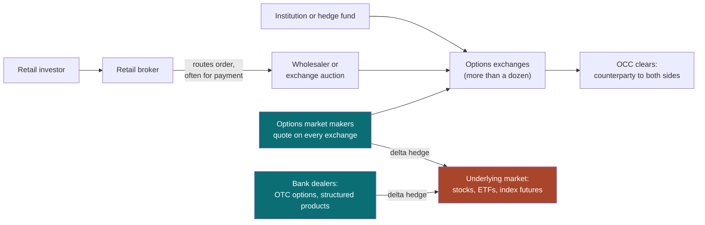
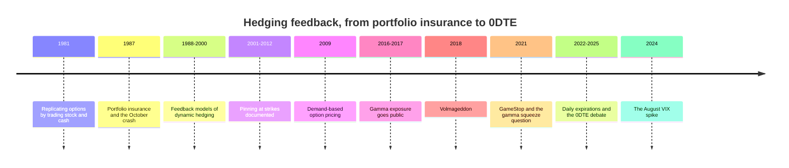
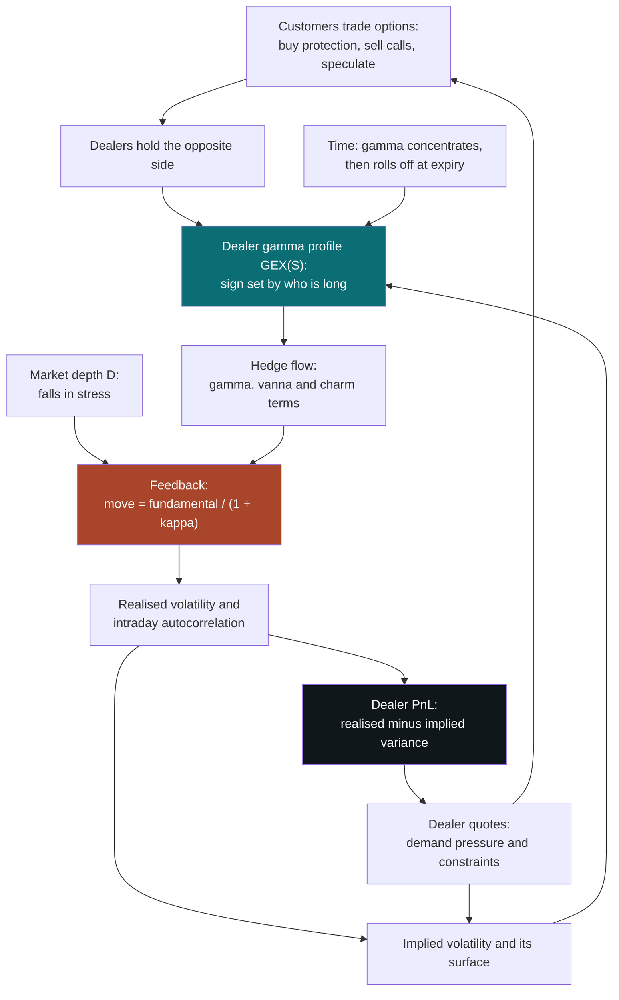
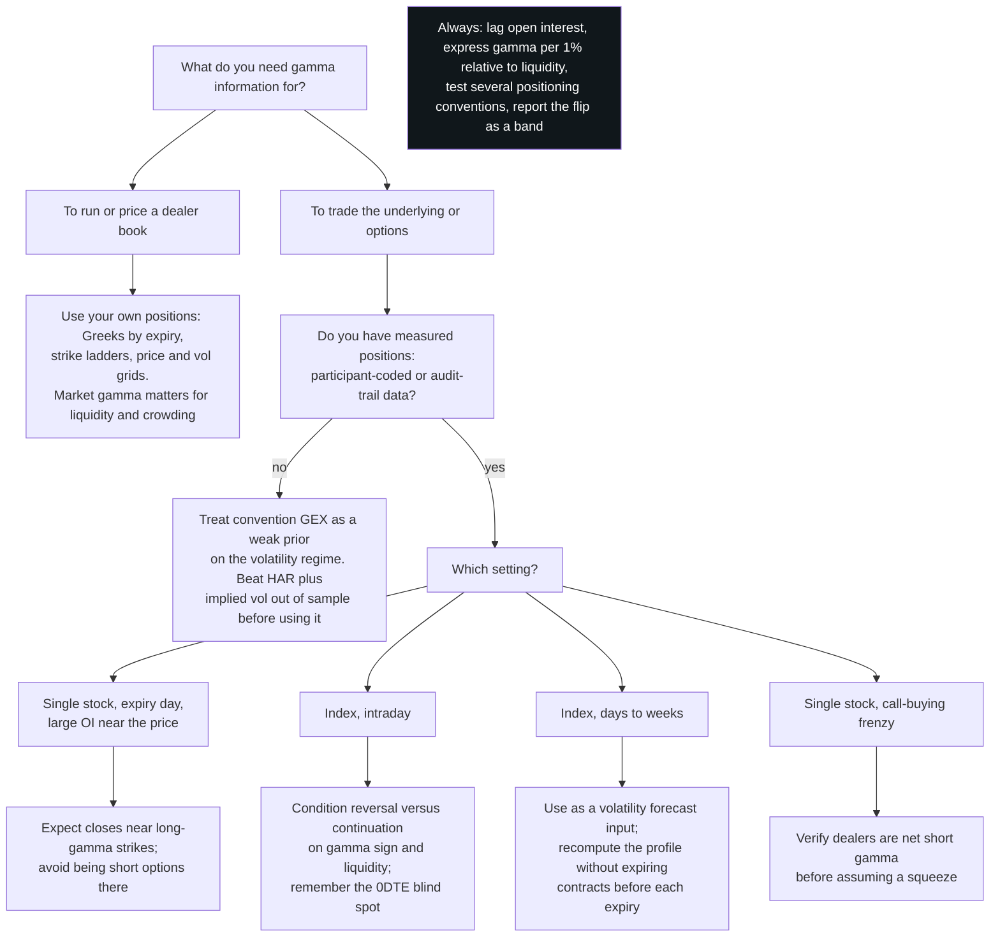

# Dealer Hedging and Gamma Exposure

### How options market makers hedge, what their hedging does to prices, and how to read it from either side of the trade

---

```{=html}
<aside class="abstract">
```

# Abstract {#abstract}

```{=latex}
\begin{chapterabstract}
```

Options dealers hedge mechanically. Their inventory sets what they must buy or sell after a price move. Their opinion plays no part. This chapter asks when that forced trading moves prices, and by how much.

A dealer who sells an option trades the underlying to remove its directional exposure. The option's delta changes as the price moves, so the dealer must re-hedge. Gamma measures that rate of change. A dealer who is short gamma buys after a rise and sells after a fall, which amplifies moves. A dealer who is long gamma does the reverse and damps them. A continuously hedged option earns gamma times the gap between realised and implied variance. At 20% implied volatility the break-even daily move is about 1.05%.

Options are in zero net supply, so gamma summed over all holders is zero. A claim that "the market is short gamma" is therefore a claim about who holds each side and which side hedges. Open-interest data does not record who is long. Every published gamma-exposure estimate rests on a positioning assumption, and a wrong assumption can reverse the sign of the estimate. In the chapter's worked example, the estimate changes from plus 3.9 million dollars per 1% move to minus 63 million.

Studies agree on the direction of the hedging effect. They disagree on its size for broad indices, which appears modest. The one study that used measured dealer positions found at most 3.3 points added to S&P 500 annualised daily volatility over 2020–2023. Part of the reported link between calm markets and positive gamma runs the other way. Gamma-exposure estimates read high in calm markets partly by construction. The best-documented effect is pinning: near expiry, single-stock prices move toward strikes with large open interest. The evidence for popular accounts is weaker. In GameStop, market makers bought calls, which contradicts the gamma-squeeze account. In August 2024, dealers affected prices through wider quotes and thinner liquidity, not through hedging flows.

The chapter recommends using dealer gamma as a conditioning variable for volatility and intraday reversals, never as a directional signal. To be useful, it must improve on a volatility forecast that already uses implied volatility. Its main practical value is defensive. It informs position sizing. It also argues against supplying liquidity while dealers must trade in the same direction as the move.

```{=latex}
\end{chapterabstract}
```

```{=html}
</aside>
```

---

**What this is.** This is a tutorial, built from first principles, on three topics. The first is the business of making markets in options. The second is the dynamic hedging that business requires. The third is a claim that market commentary now repeats daily: the hedging of options dealers moves the underlying market. Commentary states it in sentences like "Dealers are short gamma", "we crossed the gamma flip" and "the pin at 6,000 should hold into expiry". It also says "vanna and charm will support the market after the Fed". Each sentence rests on a long sequence of steps. This document states each step precisely and checks it. Some steps prove wrong. This document builds the sequence one step at a time, starting from what an option is.

**Who it is for.** The reader is mathematically comfortable and technically strong, but not an options specialist. The reader wants to *use* this material. Uses include building a gamma-exposure estimate, testing whether it predicts anything, and reasoning about one's own positions when someone else's hedging moves the market. The text assumes nothing about options beyond the word. It defines every basic concept before using it: bid and ask, call and put, open interest, delta. Each formula comes with its meaning first and a worked number after.

**How to read it.** The document has four cumulative parts.

- **Part I (§1–§3) — foundations.** These sections cover what a market maker does and how it earns
  money, what an option is, and how replication prices an option. They also cover the
  sensitivities (the "Greeks") that follow from the price. If you already trade options, skim §1.1,
  §2.5 and §3.9. The rest will be familiar.
- **Part II (§4–§5) — hedging.** These sections cover how a dealer neutralises the direction of an
  option position and the single identity that gives the earnings of a hedged option. They also give
  the full quadrant of worked examples. In each example a customer buys or sells a call or a put,
  and the dealer on the other side trades as the price moves.
- **Part III (§6–§8) — from one book to the market.** These sections show how individual positions
  add up to a market-wide gamma exposure, and why that total is unobservable and
  requires inference. They cover what hedging does to prices: the feedback multiplier, the gamma flip, expiry,
  pinning, charm and vanna, 0DTE options and squeezes. They end with what the historical episodes
  do and do not show.
- **Part IV (§9–§12) — using it.** These sections cover how dealers use this information and how
  traders on the other side use it. They show how to compute and validate a gamma-exposure signal
  without fooling yourself, and they end with a synthesis.

§13 is the reference list, grouped by kind. Appendix A collects every concept that the main text uses without fully explaining it. It orders the concepts by dependency, so each concept builds on the earlier ones.

If you read only four parts, read these. **§4.4** gives the identity that explains why dealers hedge and what hedging costs them. **§5.7–§5.8** give the quadrant on one page and show why call versus put does not matter for gamma. **§6.3** explains why nobody knows the sign of dealer gamma. **§7.1–§7.3** give the feedback multiplier and its realistic size.

**Relationship to the other notes.** [Simple and Log Returns](log_returns.html)
covers the return conventions used for volatility here. [Trend-Following in
Financial Markets](trend_following.html) derives the convexity of trend rules.
§5.10 shows that a trend follower and a short-gamma options dealer place the same
trades for opposite reasons. [Market Regimes and Hidden Markov Models](market_regimes.html)
gives a framework for treating "the dealer gamma regime" as a conditioning
variable in §10 and §11. You can read each note on its own.

**Epistemic tags.** The text flags a claim with its status where the status changes what
you should do:

- **[Fact]** — Independent datasets or implementations have replicated the claim, and the
  people who have examined it broadly agree.
- **[Contested]** — Studies document the claim, but researchers still disagree about its
  magnitude, robustness or cause.
- **[Hypothesis]** — A proposed mechanism that no test has decisively confirmed.
- **[Practice]** — A practitioner convention. It may be right, but the evidence is
  private or absent.

Untagged sentences are definitions, derivations or arithmetic. I label results from
simulations I ran while writing **[Simulated]**. The repository holds the generating code
alongside this document, in [`figures/dh_*.py`](https://github.com/rmahfoud/quant-research/tree/master/figures){target="_blank"}.
Each script prints
the numbers quoted in the text, so you can change my parameters and rerun.

---

**Notation.** The **underlying** is the asset that an option gives the right to buy or sell: a stock,
an exchange-traded fund, an index or a futures contract. $S$ (or $S_t$) is its
price, and a one-period **return** is $\Delta S / S$. An option has **strike**
$K$ and **expiry** $T$. The time remaining is $\tau = T - t$, always measured in
years. $r$ is the risk-free interest rate and $q$ is the underlying's dividend
yield. Every worked example sets $r = q = 0$
unless it says otherwise, which keeps the arithmetic clean.

$\sigma$ is **volatility**, the annualised standard deviation of log returns
(§3.1). The text keeps two versions apart. $\sigma_i$ is **implied** volatility,
the number that reproduces an option's market price (§3.7). $\sigma_r$ is
**realised** volatility, the number that the price path produces. Traders quote volatility
in percent. A "vol point" is one percentage point of $\sigma$.

$V$ is the value of an option, $C$ a call and $P$ a put. $N(\cdot)$ is the
standard normal cumulative distribution function and $\varphi(\cdot)$ its
density. $d_1$ and $d_2$ are the Black–Scholes quantities of §3.3.

The option **Greeks** are partial derivatives of $V$, per option and per unit of
the underlying:

$$
\Delta = \frac{\partial V}{\partial S}, \qquad
\Gamma = \frac{\partial^2 V}{\partial S^2}, \qquad
\Theta = \frac{\partial V}{\partial t}, \qquad
\nu = \frac{\partial V}{\partial \sigma}, \qquad
\text{vanna} = \frac{\partial \Delta}{\partial \sigma}, \qquad
\text{charm} = \frac{\partial \Delta}{\partial t}.
$$

$\Theta$ and charm differentiate with respect to calendar time $t$, which moves
forward, so $\partial/\partial t = -\partial/\partial \tau$. $\nu$ is vega. The
Greek letter nu stands in for it because "vega" is not a Greek letter.

$M$ is the **contract multiplier**, the number of units of the underlying one
contract controls. It is 100 for US equity and index options. $n$ is a signed position
in contracts, where positive means long. $n^{D}$ is the position that **dealers**
hold, the hedging intermediaries of §1. $\mathrm{OI}$ is open interest (§2.5).

At the market level, $\mathrm{GEX}(S)$ is **dealer gamma exposure** in dollars
per 1% move, as defined in §6.1. This quantity is the dollar value of the underlying that dealers
must sell (if positive) or buy (if negative) to stay hedged after a 1% rise in the price.
$D$ is **market depth** in the same units: the dollars of
trading that move the price by 1%. $\kappa = \mathrm{GEX}/D$ is the
dimensionless **feedback strength** of §7.1. $\Pi$ is the profit and loss (P&L)
of a hedged position, $\Delta t$ is a hedging interval, and $N_h$ is the number of
rehedges over an option's life.

One symbol has two uses, and typography separates them. $\Delta$ alone is the
Greek delta. $\Delta S$ and $\Delta t$ are changes in price and in time.

---

## Table of contents

- [Abstract](#abstract)

**Part I — Foundations**

1. [Market makers and dealers](#1-market-makers-and-dealers)
2. [Options from zero](#2-options-from-zero)
3. [What an option is worth, and how that value moves](#3-value-and-greeks)

**Part II — Hedging**

4. [Delta hedging, and the identity that governs it](#4-delta-hedging)
5. [The gamma quadrant](#5-the-gamma-quadrant)

**Part III — From one book to the market**

6. [Gamma exposure](#6-gamma-exposure)
7. [What hedging does to prices](#7-what-hedging-does-to-prices)
8. [Episodes: what history does and does not show](#8-episodes)

**Part IV — Using it**

9. [How dealers use this](#9-how-dealers-use-this)
10. [How traders on the other side use this](#10-how-traders-use-this)
11. [Measuring it yourself](#11-measuring-it-yourself)
12. [Synthesis](#12-synthesis)
13. [References](#13-references)

**Appendix**

- [A. Concepts and prerequisites](#appendix-a-concepts-and-prerequisites) — every
  idea the main text leans on without fully explaining, built from first
  principles and ordered by dependency.

---

```{=latex}
\newpage
```

# 1. Market makers and dealers {#1-market-makers-and-dealers}

## 1.1 The wrong intuition

The most common mental model of a market maker is a casino. You buy a call
option from a seller. On this model the seller is "the house", and the house is
betting that the stock will not go up. If the stock rallies, the house loses and
you win. On this view, the options market is a set of bets between customers and
dealers. A dealer with a large book of sold calls has a large bet against a
rally.

Almost every part of that model is wrong, and this document is about how it is wrong.

A market maker does not hold a view on your bet. Customers pay it for *immediacy*: for being there,
with a price, at the moment they want to trade. It then removes the risk that trading with you
created. Within seconds of selling you a call, a well-run options market maker has bought
shares of the underlying stock (or futures on it). The amount is the one that makes its position
insensitive to small moves in the price. To first order, the market maker then has no exposure to
whether the stock goes up or down. Its exposure is to how *much* the stock moves, to how its
position changes as the stock moves, and to the cost of re-neutralising that position until the
option expires.

That re-neutralising is **dynamic hedging**. A dealer must do it to stay in the business without
taking a directional bet. Dynamic hedging is also mechanical. A dealer's position, the price,
the time to expiry and the volatility together determine how many shares the dealer must hold.
When any of them changes, the dealer must trade. Arithmetic forces the trades, not opinion.
Dealers as a group can hold very large option positions. So the trades can be large enough to
move the market that is being hedged. This is the idea behind "gamma exposure". The rest of the
document makes it precise.

Two corrections to the casino model come first.

1. **Dealers do not "want" the price to go anywhere.** Commentary routinely says
   that dealers "need" the market to fall, or "defend" a strike. A hedged dealer
   has no directional preference. Its hedging trades have predictable
   *side effects* on prices, and those side effects can look like intent. The
   dealer does not intend them.
2. **The option contracts themselves do nothing to prices.** Options are contracts in zero net
   supply (§2.5). For every contract that someone holds long,
   someone else holds it short. Only the *hedging* can move the underlying,
   and only hedging by one side that the other side does not offset.

## 1.2 What a market maker sells: immediacy

Start with the simplest market maker, one that trades a single stock and holds
no options.

At any moment it posts two prices. The **bid** is the price at which it will buy.
The **ask** (or **offer**) is the price at which it will sell. The ask is higher
than the bid, and the difference is the **bid–ask spread**. The average of
the two is the **midpoint** or **mid**, the usual working estimate of
what the stock is worth right now. A quote of 99.98 bid and 100.02 offered
reads 99.98 / 100.02. The mid is 100.00 and the spread is 4 cents, or
4 basis points. A **basis point**, "bp", is one hundredth of a percent.

A customer who wants to sell immediately sells at the bid. A customer who wants to buy
immediately pays the ask. If one of each arrives, the market maker buys 1,000
shares at 99.98 and sells 1,000 shares at 100.02. It earns $40 without holding a view on the stock.
The business is to **capture the spread many times a day while carrying as little risk as possible in between.**

The two customers need not arrive at the same moment. The time between their arrivals creates both of a market maker's problems.

**Problem one: inventory risk.** Suppose the seller arrives first. The market
maker now owns 1,000 shares that it did not plan to hold, and it owns them until a buyer
turns up. If the price falls by 30 cents in the meantime, the $40 spread becomes a
$260 loss. A market maker's holding of the asset it trades is its
**inventory**. The risk of holding it is **inventory risk**. [Ho and Stoll
(1981)](https://ideas.repec.org/a/eee/jfinec/v9y1981i1p47-73.html){target="_blank"} showed how a dealer defends against this risk. A dealer holding unwanted inventory lowers
*both* quotes. This makes its bid less attractive, so fewer people sell to
it, and its offer more attractive, so more people buy from it. The dealer does this until it has
reduced the inventory. A market maker's quotes are therefore both a price and
an inventory-management tool. [Avellaneda and Stoikov (2008)](https://people.orie.cornell.edu/sfs33/LimitOrderBook.pdf){target="_blank"} turned the
same idea into the model that most electronic market makers start from. In that model the
quotes centre on a **reservation price** instead of the mid. The reservation price moves
against the inventory in proportion to the dealer's risk aversion, the variance
of the price, and the time left in the trading session.

**Problem two: adverse selection.** Suppose instead that the seller knew something, such as
an earnings miss that the company is about to announce, and the price drops to 99.50 a minute
later. The market maker bought at 99.98 from someone who knew the stock was worth
less. Trading with better-informed counterparties is **adverse selection**.
It explains why a spread exists even for a market maker that is indifferent to risk.
[Glosten and Milgrom (1985)](https://milgrom.people.stanford.edu/wp-content/uploads/1984/09/Bid-Ask-and-Transaction-Prices.pdf){target="_blank"} showed that if informed traders account for some fraction of order flow, a competitive market maker must widen its spread.
The spread must be wide enough that its earnings from
uninformed traders cover its losses to informed traders. [Kyle
(1985)](https://www.jstor.org/stable/1913210){target="_blank"} added the matching result for prices. When market makers cannot tell
informed orders from uninformed orders, every order moves the price a little, in
proportion to its size. The slope of that relation is **Kyle's lambda**: how far the price moves per
unit traded. It reappears in §7 as the price impact
of dealers' own hedging trades.

In sum, **a market maker earns the spread, loses on inventory it cannot sell, and loses to counterparties who know more than it does.**
Each of its decisions trades off those three quantities: how it quotes, how fast it hedges, and when it widens its spread
or withdraws its quotes entirely.
[Fact] These are the foundational results of market microstructure, surveyed in
[Biais, Glosten and Spatt (2005)](https://www.sciencedirect.com/science/article/pii/S1386418104000382){target="_blank"}. The evidence that dealer inventory moves
prices is direct. [Hendershott and Menkveld (2014)](http://faculty.haas.berkeley.edu/hender/price_pressures.pdf){target="_blank"} use New York Stock
Exchange intermediary data and estimate that inventory-driven price pressure averages
0.49%, with a half-life of under a day.

## 1.3 An options market maker's version of the same problem

An options market maker faces the same three quantities with one change. Its inventory is *options*, not shares, and the risk of an option position changes over time.
option position does not stay put.

If a stock market maker is long 1,000 shares, its exposure to a $1 move is $1,000
whether the stock is at 100 or at 110. If an options market maker sells 10 call
contracts, its exposure to a $1 move is about $511 at a stock price of 100.
A day later, at a price of 102, the exposure is about $648 (§5.3 works this out). The
exposure changes *because the price changed*. Neutralising the exposure once is
not enough. The dealer must neutralise it again each time the price moves, each time a day passes, and each time the
market's estimate of volatility changes. **Gamma** is the quantity that sets how fast the
exposure changes with the price. A dealer's problem is gamma
management, as a stock market maker's problem is inventory management.

The three quantities of §1.2 remain, in changed form:

| Stock market maker | Options market maker |
|------------------|----------------------------------------|
| Earns the bid–ask spread on shares | Earns the bid–ask spread on options, plus or minus the difference between the volatility it sold (or bought) and the volatility that is realised (§4.4) |
| Inventory risk: holding shares it does not want | Delta risk, hedged continuously; gamma, vega and jump risk that hedging the underlying cannot remove (§4.9) |
| Adverse selection: informed traders | Informed traders in the options *and* in the underlying; the options market is a venue where informed traders act ([Easley, O'Hara and Srinivas, 1998](https://www.ssrn.com/abstract=98724){target="_blank"}; [Pan and Poteshman, 2006](https://www.mit.edu/~junpan/volume.pdf){target="_blank"}) |
| Adjusts quotes against inventory | Adjusts option quotes against its *Greeks* — against accumulated gamma and vega, not just contract counts (§9.2) |

The second row matters most. An options market maker cannot remove all
of its risk by trading the underlying. It can remove only the first-order,
directional part. The remaining risk is priced into option spreads. [Jameson and
Wilhelm (1992)](https://onlinelibrary.wiley.com/doi/abs/10.1111/j.1540-6261.1992.tb04409.x){target="_blank"} found that the risks of discrete rebalancing and uncertain
volatility explain a significant share of quoted spreads on Chicago Board Options
Exchange options. The rest of Part II is about this remaining risk.

## 1.4 Market maker, dealer, liquidity provider: names that overlap

People use the words in this area loosely. Sometimes the words are interchangeable, and sometimes they have precise legal meanings.
This document concerns behaviour, not registration, but the labels still need defining.

| Term | What it usually means | Relevance here |
|--------------|----------------------------|----------------------------|
| **Market maker** | A firm registered with an exchange that has an obligation to post two-sided quotes in some set of products, in exchange for fee rebates or priority | Options market makers ("OMMs") are the core hedgers |
| **Dealer** | A firm that trades as *principal* — for its own account — rather than as an agent for a customer; covers exchange market makers and bank derivatives desks | In gamma-exposure language, "dealer" means *whoever is on the other side of customer option trades and hedges them*. I follow that usage |
| **Liquidity provider** | Anyone who posts resting orders that others trade against, whether obligated or not | Broader than market makers; includes proprietary trading firms that are not registered market makers |
| **Specialist / designated market maker** | The single firm with special obligations in a listed stock on some exchanges | Historical background; not central to options |
| **Wholesaler / internaliser** | A firm that executes retail brokerage orders against its own inventory, typically paying the broker for the flow | In US options, the same large firms are often both wholesalers and exchange market makers |
| **Intermediary** | The academic umbrella term for dealers and market makers together | Used by the demand-pressure and intermediary-constraint literature (§6.3, §9.6) |
| **End user / customer** | Everyone else: institutions, retail investors, hedge funds, corporations | The side whose positions are *not* assumed to be dynamically hedged |

The large options market makers in the United States are a small group of
specialised trading firms. Names such as Citadel Securities, Susquehanna, Optiver,
IMC, Jane Street and Wolverine recur. The derivatives desks of the major
banks work alongside them and dominate over-the-counter (off-exchange) options and structured
products. For everything that follows, the defining property is behaviour: **a dealer is a participant who hedges its option
position mechanically in the underlying.** The legal category does not matter. As a modelling
assumption, an end user does not hedge this way.

## 1.5 Who trades with whom in listed options

A listed option in the United States trades on one of more than a dozen
competing exchanges. The Options Clearing
Corporation (OCC) **clears** every trade. The OCC becomes the legal counterparty to both sides: the buyer
holds a contract against the OCC, and so does the seller. This is what makes
listed options safe to trade with strangers. It also means that, legally, nobody
holds an option "against" a particular dealer. Economically, though, someone's short position created every long
position. This document keeps returning to the question of who is short.

The exchange tags each trade with the **capacity** of each side. The capacities are broadly
*customer*, *professional customer*, *broker-dealer* (a firm's own account) and
*market maker*. The exchange also tags each trade as **opening** (creating a new position) or **closing**
(reducing an existing one). These tags are the data for measuring who
holds what. Most of them are not public in real time. §6.3 and §11.2 describe
what is available.

```{=latex}
\newpage
```

The flow of a typical trade looks like this:



Three features of this flow matter later.

- **The hedging occurs in a different market from the option.** An S&P 500 index
  option trades on Cboe. The dealer who sold it hedges with S&P 500 futures
  on the CME, with SPY exchange-traded fund shares, or with baskets of stocks.
  Gamma exposure is the claim that trading in one market (options) mechanically
  generates trading in another (the underlying).
- **Exchange data does not cover bank dealers.** Over-the-counter options,
  variance swaps and structured notes create hedging needs that appear in no
  public open-interest file. [Fact] Any gamma-exposure estimate built from listed open
  interest omits them.
- **Intermediaries handle retail flow.** Most retail option orders reach an exchange
  through a broker. The broker routes them to a wholesaler or into a price-improvement
  auction. The SEC's staff report on the January 2021 meme-stock episode ([SEC, 2021](https://www.sec.gov/files/staff-report-equity-options-market-struction-conditions-early-2021.pdf){target="_blank"}) is the best single public description of this structure. §8.5
  returns to what the report found.

> ### §1 Key takeaways
>
> 1. A market maker sells immediacy and earns the bid–ask spread. It holds no
>    directional view and neutralises directional exposure as fast as it can.
> 2. Its two main risks are inventory risk (holding what it did not plan to hold) and adverse
>    selection (trading with people who know more). Its quotes manage both.
> 3. An options market maker's inventory is options. Their directional exposure
>    changes every time the price moves. Neutralising it once is not enough, so the
>    market maker must hedge *dynamically*. Gamma is the rate at which the exposure changes.
> 4. Dynamic hedging is mechanical. Position, price, time and
>    volatility force it, so its direction is predictable. This is why the text can
>    reason about it at the market level.
> 5. Options are in zero net supply. The contracts themselves do not affect the
>    underlying. Only hedging by one side that the other side does not offset can.
> 6. "Dealer" in this document means whoever is on the other side of customer
>    option trades *and hedges them*. Bank dealers' over-the-counter positions
>    create hedging that no public data captures.

---

# 2. Options from zero {#2-options-from-zero}

## 2.1 The contract

An **option** is a contract that gives its holder a right without an obligation.

- A **call option** gives the holder the right to **buy** the underlying at a fixed
  price, the **strike** $K$, on or before a fixed date, the **expiry** $T$.
- A **put option** gives the holder the right to **sell** the underlying at the
  strike, on or before expiry.

The holder pays for this right up front. The price is the **premium**. The holder
is **long** the option, or has **bought** it. The other side received the premium and took on an
obligation. That obligation is to deliver (for a call) or to
take delivery (for a put) if the holder chooses. This side is **short** the option, or has
**sold** or **written** it. Using the right is **exercising** the
option. Being on the short side when the holder exercises is being **assigned**.

A holder exercises only when exercising pays. A call with strike 100 is worth
exercising at expiry if the underlying trades above 100, because the holder buys
at 100 something worth more. Otherwise the holder discards it. So the call's value at
expiry, its **payoff**, is

$$
C_T = \max(S_T - K,\ 0), \qquad P_T = \max(K - S_T,\ 0),
$$

where $S_T$ is the underlying's price at expiry and $P_T$ is the matching payoff of
a put. In words: *the call pays the amount by which the price finishes above
the strike, or nothing. The put pays the amount by which the price finishes below the strike, or nothing.*

Listed equity and index options in the United States have a **contract
multiplier** $M = 100$. One contract controls 100 shares (or 100 times the index
level), and quoted prices are per unit. An option quoted at $2.29 therefore costs
$229 per contract. This document states every position size either in contracts
or in options, and it says which. One option is the claim on a single unit of the underlying, so 10
contracts are 1,000 options.

## 2.2 Exercise and settlement

Two contract features look like administrative detail but matter greatly
for hedging flows near expiry (§7.7).

**Exercise style.** The holder of an **American** option can exercise at any time up to
expiry. The holder of a **European** option can exercise only at expiry. US single-stock
options and exchange-traded fund (ETF) options, such as those on SPY and QQQ, are
American. Options on the S&P 500 index itself (ticker SPX) are European.

**Settlement.** A **physically settled** option delivers the underlying: exercising
a stock call means actually receiving 100 shares per contract and paying the
strike. A **cash-settled** option pays the difference between the settlement price
and the strike in cash. Stock and ETF options are physically settled. Index
options have no deliverable, so they are cash-settled.

**Settlement price and timing.** Index options add one more feature. The standard
monthly SPX contracts expire on the third Friday of the month and are **AM-settled**.
They stop trading on Thursday. Their final value comes from the
*opening* prices of the index's component stocks on Friday morning. The weekly and
daily SPX contracts (ticker SPXW) are **PM-settled** at the closing value of the expiry day,
which is Friday for the weekly contract. SPXW expirations now exist for every trading day of the week.
The Tuesday and Thursday expirations began in April and May 2022. This made
**zero-days-to-expiry (0DTE)** trading possible every day (§7.9).

**Automatic exercise and pin risk.** At expiry, the OCC automatically exercises
any listed option that is in the money by at least a cent, unless its holder
instructs otherwise. For physically settled options, holders may submit or
reverse exercise instructions for some time *after* the closing bell. If a stock
closes almost exactly at a strike, a dealer who is short that strike does not
know until the next morning whether it has been assigned. The dealer does not know whether it will start the next
day owning, or short, a block of shares it did not plan to hold. That uncertainty
is **pin risk**. It is one reason dealers manage their positions around large
strikes in the final hours before expiry (§9.5).

## 2.3 The four basic positions

Two kinds of option and two sides to each trade give four basic
positions. They are the four corners of the quadrant that organises §5. This section fixes their payoffs and profits.

**Profit and loss (P&L)** is the payoff minus what was paid, or plus what was
received. Take a strike of 100 and a premium of $2.29 for both the call and the
put. §3.3 derives this value for a 30-day option at 20% volatility. At expiry,
per option:

| Price at expiry $S_T$ | 80 | 90 | 95 | 100 | 105 | 110 | 120 |
|--------------------------------------------|------:|------:|------:|------:|------:|------:|------:|
| **Long call**: $\max(S_T-100,0) - 2.29$ | −2.29 | −2.29 | −2.29 | −2.29 | +2.71 | +7.71 | +17.71 |
| **Short call**: $2.29 - \max(S_T-100,0)$ | +2.29 | +2.29 | +2.29 | +2.29 | −2.71 | −7.71 | −17.71 |
| **Long put**: $\max(100-S_T,0) - 2.29$ | +17.71 | +7.71 | +2.71 | −2.29 | −2.29 | −2.29 | −2.29 |
| **Short put**: $2.29 - \max(100-S_T,0)$ | −17.71 | −7.71 | −2.71 | +2.29 | +2.29 | +2.29 | +2.29 |

Four features of this table carry forward.

1. **Long and short are exact opposites.** Every dollar one side makes, the
   other loses. Options are a zero-sum transfer between the two sides *before*
   counting hedging and costs.
2. **The buyer's loss is capped. The seller's is not, or barely.** A long option
   can lose at most its premium. A short call can lose without limit as the price
   rises. A short put can lose up to the strike minus the premium.
3. **For the holder, calls profit from rises and puts profit from falls.** The long call
   breaks even at 102.29 and the long put at 97.71.
4. **The kink.** Every payoff is two straight lines joined at the strike. This kink
   is the source of all the interesting behaviour of options. Before expiry
   the kink becomes a smooth curve, and the *curvature* of that curve is gamma.

The figure shows each of the four positions twice. The dashed lines show the position at expiry.
The solid curves show its value if the price moved *now*, 30 days before expiry.
The solid curves are smooth versions of the dashed lines. Their slope at today's price is **delta**,
and their curvature is **gamma**. The small annotations give the number of shares a holder of
one contract would trade to neutralise that slope. §4 develops this hedge.

```{=latex}
\begin{center}
\includegraphics[width=0.92\linewidth]{quant-research/figures/dh_payoffs.pdf}
\end{center}
```

```{=html}
<style>
/* Figures for this document. Prefix "mdd-", shared with the other notes and
   distinct from the reading widget's "rdw-". Narrow viewports reclaim the
   body's side padding so the figure gets the full width. */
.mdd-fig {
  display: block; width: 100%; height: auto;
  max-width: 680px; margin: 1.6rem auto;
  /* the reading widget adds a light plate (padding) in dark mode */
  box-sizing: border-box;
}
@media (max-width: 760px) {
  .mdd-fig { width: calc(100% + 64px); max-width: none; margin-left: -32px; margin-right: -32px; }
}
@media (max-width: 600px) { /* pandoc's own stylesheet drops body padding to 12px here */
  .mdd-fig { width: calc(100% + 24px); margin-left: -12px; margin-right: -12px; }
}
</style>


```

Compare the curvature of the positions. The two *long* positions curve upward (convex), whether they are calls or puts.
The two *short* positions curve downward (concave). Call versus put sets the
slope of the curve. Long versus short sets the direction of its bend. §2.6 and §5.1 make this
precise. It is the most important sign rule in this document.

## 2.4 Moneyness, intrinsic value and time value

Traders describe an option by where the underlying stands relative to the strike.

- A call is **in the money (ITM)** when $S > K$, **out of the money (OTM)** when
  $S < K$, and **at the money (ATM)** when $S \approx K$. For a put, the
  inequalities reverse.
- **Intrinsic value** is what the option would pay if exercised now:
  $\max(S-K, 0)$ for a call, $\max(K-S, 0)$ for a put.
- **Time value** (or **extrinsic value**) is the premium minus the intrinsic value:
  what the holder pays for the possibility that the price moves further in its
  favour before expiry.

At $S = 100$, a 95-strike call is in the money with intrinsic value 5. §3 prices
it at 5.57, so it carries 0.57 of time value. The 95-strike put is out of the
money and has no intrinsic value. Its entire premium of 0.57 is time value. The
at-the-money 100 strike has zero intrinsic value and the largest time value of
all, 2.29. **Time value is largest at the money**, where the outcome is most
uncertain. This part of the premium decays to nothing by expiry
(§3.6).

Practitioners also label strikes by **delta** rather than by price. A "25-delta
put" is the put whose delta (§3.4) is −0.25, wherever that strike lies.
Delta measures moneyness and adjusts automatically for volatility and
time to expiry. For this reason, practitioners often organise volatility surfaces and positioning reports by delta.

## 2.5 Open interest: every long has a short

Two numbers measure how much an option trades, and they are easy to confuse.

- **Volume** is the number of contracts that changed hands during a day.
- **Open interest (OI)** is the number of contracts *outstanding* at the end of a day.
  A contract is outstanding when someone created it and no one has closed it.

A trade can create, transfer, or destroy open interest, depending on whether each
side is **opening** (establishing a position) or **closing** (unwinding one):

| Day | Trade | Buyer | Seller | Volume | Change in OI | OI after |
|----|--------------------|------------------|------------------|------:|------:|------:|
| 1 | A buys 10 calls from B | A opens (now long 10) | B opens (now short 10) | 10 | +10 | 10 |
| 2 | C buys 5 calls from A | C opens (long 5) | A closes (long 5) | 5 | 0 | 10 |
| 3 | B buys 5 calls from C | B closes (short 5) | C closes (flat) | 5 | −5 | 5 |

After day 3, A is long 5 and B is short 5. Open interest is 5, and total volume
over the three days was 20.

The rest of this document rests on this fact:

> **Options are in zero net supply.** Every contract of open interest is one long
> position and one short position. Summed over *everybody*, the net position in
> every option is exactly zero. So the net delta, the net gamma
> and every other Greek are also zero.

So the statement "the market is long gamma" is meaningless for all
holders together. A claim about gamma exposure is always a claim about **one group**
of holders, the dealers. Everyone else holds an equal and opposite gamma. Gamma exposure can matter for prices only if the two groups **behave
differently**: if dealers hedge dynamically and the other side, as a group, does
not. Every gamma exposure model assumes this behavioural asymmetry, and §6.3 examines it.

The OCC publishes open interest once a day, after it processes the day's trades.
So the figure available at the start of a trading day describes positions as of
the previous close. It says how many contracts exist, never who holds which side.
Both facts return in §6.3 and §11.

## 2.6 Put–call parity: the first equivalence

A call and a put with the same strike and expiry look like opposites. They are
closely related, because you can build each from the other.

Compare two portfolios, holding European options on a stock that pays no dividend,
with zero interest rates:

- **Portfolio A:** one call, plus $K$ in cash.
- **Portfolio B:** one put, plus one share of the stock.

At expiry, if $S_T > K$, portfolio A exercises the call and is worth $S_T$.
Portfolio B's put expires worthless and it holds a share worth $S_T$. If
$S_T \le K$, A lets the call lapse and holds $K$ in cash. B exercises the put
and sells its share for $K$. **Both portfolios are worth $\max(S_T, K)$ in every
state of the world.** If two portfolios have identical payoffs in every state,
they must cost the same today. Otherwise anyone could buy the cheap one, sell the
expensive one and keep the difference at no risk. So

$$
C + K = P + S
\qquad\Longleftrightarrow\qquad
C - P = S - K .
$$

With interest rates and dividends, the same argument gives
$C - P = S e^{-q\tau} - K e^{-r\tau}$. This is **put–call parity**, which [Stoll (1969)](https://onlinelibrary.wiley.com/doi/abs/10.1111/j.1540-6261.1969.tb01694.x){target="_blank"} stated in this
form. The numbers of §2.3 satisfy it. The 100-strike call and put
both cost 2.29, and $S - K = 0$. The 95-strike call costs 5.57 and the 95-strike put costs
0.57, and their difference is exactly $100 - 95 = 5$.

Differentiate parity with respect to the underlying price once for delta and again
for gamma. Differentiate it with respect to volatility for vega. The right-hand side
$S - K$ has no $\sigma$ in it, so the vega difference is zero. This gives three consequences for hedging:

$$
\Delta_C - \Delta_P = 1, \qquad \Gamma_C = \Gamma_P, \qquad \nu_C = \nu_P .
$$

**A call and a put with the same strike and expiry have exactly the same gamma and
the same vega.** Their deltas differ by exactly one share. A long call is a long put
plus one share of stock. When you hedge away the delta, the hedge also removes the share's delta, and
**a delta-hedged call and a delta-hedged put are the same position.**
§5.8 shows this numerically, trade for trade. For this reason, for gamma
exposure, the question of who is long matters more than the question of calls versus puts.

Parity holds exactly for European options such as SPX, up to financing and
dividend assumptions. For American options it becomes a pair of inequalities,
because early exercise has value. Prices can deviate visibly from parity when the
stock is hard to borrow. GameStop options in January 2021 are the extreme example.
[Hilliard and Hilliard (2023)](https://papers.ssrn.com/sol3/papers.cfm?abstract_id=3911491){target="_blank"} find that the costs of short selling largely
account for the apparent violations there, so the violations do not represent arbitrage profit.
[Fact] The gamma equivalence survives these frictions approximately.

> ### §2 Key takeaways
>
> 1. A call is the right to buy at the strike and a put is the right to sell. The holder
>    is long and pays a premium. The writer is short and receives it. Listed
>    contracts control 100 units of the underlying.
> 2. Payoffs have a kink at the strike. Before expiry the kink becomes a curve. Its slope
>    is delta and its curvature is gamma.
> 3. Long positions curve up and short positions curve down, whether they are calls
>    or puts. Call versus put sets the slope. Long versus short sets the curvature.
> 4. Exercise style and settlement matter. AM versus PM settlement,
>    physical delivery and automatic exercise shape the flows on expiry day and
>    create pin risk for dealers.
> 5. Open interest counts outstanding contracts. The OCC publishes it once a day, and it
>    never says who is long.
> 6. Options are in zero net supply, so aggregate gamma across all holders is zero.
>    Gamma exposure is meaningful only for one group, the dealers. It matters only if
>    that group hedges while the other side does not.
> 7. Put–call parity makes a same-strike call and put interchangeable up to a share
>    of stock. They have identical gamma and identical vega, and their deltas differ by one.

---

# 3. What an option is worth, and how that value moves {#3-value-and-greeks}

## 3.1 Volatility: the input you cannot see

An option's payoff depends on where the price ends up, and nobody knows that.
The option's value depends on *how far* the price is likely to move, not on *which way*
it is likely to go. Volatility measures how far the price moves.

Let the **log return** over a period be $\ln(S_{t+1}/S_t)$. For small moves it is
almost identical to the percentage change. Suppose log returns over successive days are
independent with standard deviation $\sigma_{\text{day}}$. Then the variance of the sum
of $n$ days' returns is $n\,\sigma_{\text{day}}^2$, so the standard deviation grows
with the **square root** of time:

$$
\sigma_{n\ \text{days}} = \sigma_{\text{day}} \sqrt{n}.
$$

**Volatility** $\sigma$ is this standard deviation scaled to one year. A year has about
252 trading days, so $\sigma = \sigma_{\text{day}}\sqrt{252}$. Since
$\sqrt{252} \approx 16$, practitioners use the **rule of 16**: an annual volatility
of 16% means a typical daily move of about 1%. A stock with 20% volatility moves
about 1.26% on a typical day. It moves about $20\% \times \sqrt{30/365} = 5.7\%$ over the
30 calendar days of the option priced below. [Simple and Log
Returns](log_returns.html) derives why log returns are the natural unit here.

Keep two volatilities apart from the start. The difference between them determines whether options market making earns or loses money:

- **Realised volatility** $\sigma_r$ is what you measure from the price path after the fact.
- **Implied volatility** $\sigma_i$ is the volatility that makes a pricing model
  reproduce an option's market price (§3.7). It is the market's price for
  future volatility, not a measurement of it.

## 3.2 Replication: why an option can be priced at all

The central idea of option pricing appears in a world simple enough to check by hand.

A stock is at 100. Tomorrow it will be at 110 or at 90. A call with strike 100 will
pay 10 if the stock rises and 0 if it falls. Find the call's value today.

The expected payoff is not the call's value, and it needs the probability of a rise. Instead, **manufacture** the call.
Buy $h$ shares and hold $b$ dollars of cash. Borrow if $b$ is negative, and take the interest rate to be
zero. Tomorrow this portfolio is worth $110h + b$ or $90h + b$. Choose $h$ and $b$
so that it pays exactly what the call pays:

$$
110h + b = 10, \qquad 90h + b = 0
\qquad\Longrightarrow\qquad
h = \frac{10 - 0}{110 - 90} = 0.5, \qquad b = -45 .
$$

Half a share and a loan of 45 reproduce the call in both states. The portfolio
costs $0.5 \times 100 - 45 = 5$ today, so the call must cost 5. If it sold for 6,
you could sell the call, build the portfolio for 5 and keep 1 with no risk.
If it sold for 4, you would do the reverse. **The calculation never used the probability of a rise.**
Whether the stock is 90% or 10% likely to go up, anyone
can manufacture the call for 5, so nobody pays more.

The number of shares in the replicating portfolio, $h = 0.5$, is the **hedge
ratio**. It is the option's **delta**. A dealer who *sells* this call for 5 and
*buys* half a share, borrowing the difference, has no risk at all. Whatever
happens, its shares and loan exactly cover what it owes on the call.

Now add a second day. From 110 the stock goes to 120 or 100. From 90 it goes to 100 or 80.
The call pays 20, 0 or 0. Work backwards through the tree, replicating one step at a time:
time:

| Node | Next prices | Call pays next | Hedge $h$ | Call value |
|---|---|---|---:|---:|
| After a rise, $S = 110$ | 120 or 100 | 20 or 0 | 1.0 | 10 |
| After a fall, $S = 90$ | 100 or 80 | 0 or 0 | 0.0 | 0 |
| Today, $S = 100$ | 110 or 90 | 10 or 0 | 0.5 | 5 |

The hedge of 0.5 today becomes **1.0 after a rise** and **0.0 after a fall**.
To stay hedged, the dealer who sold the call must *buy* another half share after
the price rises to 110. The dealer must *sell* its half share after the price falls to
90. It buys high and sells low, every time. Take any path through the tree: up then
down, down then up, up-up or down-down. Net the shares' gain or loss
against what the dealer then owes on the call. The result is a loss of exactly
5 on every path. As a check, take up-up. The shares alone *gain*
$0.5\times10 + 1.0\times10 = 15$, but the call finishes owing 20, so the net is still
$-5$. The premium the dealer collected was 5, so the hedge exactly breaks even.

This gives the theory of option pricing in one sentence: **an option's time
value is the cost of the rebalancing that its replication requires.** The rate at which
the hedge must change as the price moves is **gamma**. In this toy tree the cost
is the same on every path. In a real market it differs by path. §4 is about the gap between the
rebalancing cost that the premium assumed and the cost that the dealer actually incurs.

## 3.3 The Black–Scholes formula as a replication rule

Shrink the tree's steps towards zero and let the price follow a random walk in
log returns with constant volatility $\sigma$. Replication still works. At
every instant, some number of shares makes the hedged position riskless
over the next instant. The replication cost then has a closed form, which
[Black and Scholes (1973)](https://www.journals.uchicago.edu/doi/10.1086/260062){target="_blank"} and [Merton (1973)](https://www.maths.tcd.ie/~dmcgowan/Merton.pdf){target="_blank"} derived. For a European call and put on an
underlying that pays dividend yield $q$, with interest rate $r$:

$$
\begin{aligned}
C &= S e^{-q\tau} N(d_1) - K e^{-r\tau} N(d_2), \\
P &= K e^{-r\tau} N(-d_2) - S e^{-q\tau} N(-d_1), \\
d_1 &= \frac{\ln(S/K) + (r - q + \tfrac12 \sigma^2)\,\tau}{\sigma\sqrt{\tau}},
\qquad d_2 = d_1 - \sigma\sqrt{\tau}.
\end{aligned}
$$

The call formula is a replication rule: **hold $e^{-q\tau}N(d_1)$ shares and
borrow $K e^{-r\tau} N(d_2)$ in cash.** $N(d_1)$ is the continuous-time version of the hedge ratio of §3.2.
$N(d_2)$ has its own reading: it is the probability that the call finishes in
the money under the **risk-neutral** probabilities. These probabilities price
assets as if no investor demanded compensation for risk, and Appendix A explains them.
The quantity $\sigma\sqrt{\tau}$ is the standard deviation of the log return over
the option's remaining life. $d_1$ and $d_2$ measure the distance from the
strike in units of that standard deviation.

Take the example used throughout this document: $S = K = 100$, $\sigma = 20\%$,
$\tau = 30/365$, $r = q = 0$. Then $\sigma\sqrt{\tau} = 0.0573$,
$d_1 = 0.0287$, $d_2 = -0.0287$, $N(d_1) = 0.51144$ and $N(d_2) = 0.48856$, so

$$
C = 100 \times (0.51144 - 0.48856) = 2.29 .
$$

By put–call parity with $S = K$, the put also costs 2.29. Those are the premiums
of §2.3.

[Fact] Every assumption of the model is false in some respect, and each failure is a way that hedging fails
(§4.9). Volatility is not constant. It varies over time
and across strikes. Prices gap, especially overnight and on news, so trading is
not continuous. Trading costs money. Returns have fatter tails than the lognormal
distribution allows. [Practice] The formula survives anyway because markets use it as a
quoting convention. Traders quote options in the volatility that makes the formula match
the price (§3.7), and dealers compute their hedges from the formula evaluated at
those volatilities.

## 3.4 Delta

**Delta** is the sensitivity of the option's value to the underlying price,
$\Delta = \partial V / \partial S$. From the formula (with $q = 0$):

$$
\Delta_C = N(d_1) \in (0, 1), \qquad \Delta_P = N(d_1) - 1 \in (-1, 0).
$$

Across strikes, for our 30-day, 20%-volatility option on a stock at 100:

| Strike | 90 | 95 | 100 | 105 | 110 |
|---|---:|---:|---:|---:|---:|
| Call delta | 0.969 | 0.822 | 0.511 | 0.205 | 0.051 |
| Put delta | −0.031 | −0.178 | −0.489 | −0.795 | −0.949 |

Delta has three readings, and all three are useful.

1. **Slope.** A $1 rise in the stock raises the at-the-money call by about $0.51
   and lowers the put by about $0.49.
2. **Hedge ratio.** A holder of one call has the same exposure as a holder of 0.511 shares.
   Selling 0.511 shares neutralises that exposure for small moves.
3. **Rough probability.** Delta is close to the (risk-neutral) probability of
   finishing in the money. That probability is exactly $N(d_2)$, which is near $N(d_1)$ for
   short-dated options. A 5-delta option is unlikely to finish in the money.

A **position delta** multiplies delta by the number of contracts and the multiplier.
For example, 10 contracts of the at-the-money call carry $10 \times 100 \times 0.5114 = 511.4$
**share-equivalents** of delta, and 10 short contracts carry −511.4. Multiplying by
the price gives **dollar delta**: $511.4 \times \$100 = \$51{,}140$ of stock
exposure.

## 3.5 Gamma

**Gamma** is the rate at which delta changes as the price changes,
$\Gamma = \partial \Delta / \partial S = \partial^2 V / \partial S^2$. It is the
curvature of the solid curves in the §2.3 figure. For calls and puts alike (§2.6):

$$
\Gamma = \frac{e^{-q\tau}\,\varphi(d_1)}{S\,\sigma\sqrt{\tau}} .
$$

For the at-the-money 30-day option, $\Gamma = 0.0695$. When the stock rises from
100 to 101, the call's delta rises from 0.511 to about 0.580. For 10 contracts,
gamma is $1{,}000 \times 0.0695 = 69.5$ shares of delta per $1 move. A hedger must trade this number of
shares after each $1 move to stay neutral. A **long** option
position has **positive** gamma, and a **short** position has **negative** gamma. This
holds for calls and puts equally.

The formula has $\sigma\sqrt{\tau}$ in the denominator. Three consequences follow, and they
recur for the rest of this document.

**Gamma is concentrated near the strike.** $\varphi(d_1)$ is largest when $d_1 = 0$,
so gamma peaks close to the money and falls on both sides.

**Gamma rises sharply into expiry, near the strike.** As $\tau \to 0$ the at-the-money
gamma grows like $1/\sqrt{\tau}$, while the band of prices over which gamma is
large narrows. The same at-the-money option has gamma 0.0695 with 30 days left,
0.144 with 7, 0.381 with 1 and 0.762 with a quarter of a day.

**Away from the strike, gamma peaks and then falls to zero.** Take an option whose strike is a
log distance $x = |\ln(S/K)|$ from the price. Its gamma *rises* as expiry
approaches only until the remaining standard deviation shrinks to that distance.
Then gamma *falls* to zero. The option is now almost certain to expire worthless
(or almost certain to be exercised), so its delta stays at 0 (or ±1). The peak
comes where $\sigma\sqrt{\tau} = x$. Maximising $\varphi(d_1)/\sqrt{\tau}$ over $\tau$
gives

$$
\tau^\star \approx \frac{x^2}{\sigma^2} .
$$

For a strike 2% away at 20%
volatility, the peak comes 3.6 days before expiry. For a strike 5% away, it comes 21.7 days before expiry.

```{=latex}
\begin{center}
\includegraphics[width=\linewidth]{quant-research/figures/dh_greeks_expiry.pdf}
\end{center}
```

```{=html}

```

**Low volatility means high, narrow gamma.** Gamma at the money is inversely
proportional to $\sigma$. In a calm market with implied volatility of 12%, the same
open interest carries about two-thirds more at-the-money gamma than at 20%,
concentrated in a narrower range of prices. This is purely mechanical, and it matters when
interpreting data. Gamma exposure estimates read high in calm markets partly
*because* the market is calm, whatever the effect of hedging on calm itself. §10.1
returns to this confound.

## 3.6 Theta, and how it relates to gamma

**Theta** is the change in an option's value as time passes with everything else
held fixed, $\Theta = \partial V / \partial t$. Long options lose value as time
passes. The at-the-money 30-day option loses $0.0381 per day, and 10 contracts
lose $38.11. The loss accelerates as expiry approaches, because the time
value of §2.4 decays to zero.

Theta follows from the other Greeks. The replication argument of §3.2, carried
out in continuous time, produces a partial differential equation that every option
price must satisfy. This is the **Black–Scholes equation**:

$$
\Theta + \tfrac12 \sigma^2 S^2\, \Gamma + r S \Delta - r V = 0 .
$$

With $r = 0$ it reduces to a statement a trader can say aloud:

$$
\Theta = -\tfrac12 \sigma^2 S^2\, \Gamma .
$$

**Theta is the daily cost of holding gamma.** An option with a lot of gamma decays fast,
and an option whose value does not decay has no gamma. The example confirms it:
$\tfrac12 \times 0.20^2 \times 100^2 \times 0.0695 = 13.91$ per year, or $0.0381$ per
day. The holder of gamma pays this cost every day, and the seller collects it. §4.4
shows what each side gets in return.

Options decay over weekends and holidays, when the underlying
does not trade. The formulas above use calendar days (a year of 365). This spreads
decay evenly over days that have no price moves. [Practice] Many desks instead measure time in
trading days or in "variance time", which weights days by their expected activity.
This document uses calendar days throughout, so each day's theta pairs with that day's move.

## 3.7 Vega and implied volatility

**Vega** is the sensitivity to volatility, $\nu = \partial V/\partial \sigma =
S e^{-q\tau}\varphi(d_1)\sqrt{\tau}$. The at-the-money 30-day option gains $0.114 for
each percentage point of volatility, and 10 contracts gain $114. Vega, like gamma, is
identical for a call and a put of the same strike and expiry.

Volatility is the only input to the formula that cannot be observed, so options markets
invert the formula. Given an option's market price, the
**implied volatility** is the value of $\sigma$ that makes the formula return that
price. Markets quote and compare options in implied volatility, as they quote bonds in yield.

If the model were right, every option on the same underlying would have the same
implied volatility. They do not. Implied volatility varies with the strike. This variation is the
**smile** or, for equity indices where it slopes down from low strikes to high, the
**skew**. Implied volatility also varies with the expiry, which is the **term structure**. The whole
function from (strike, expiry) to implied volatility is the **volatility surface**. [Fact] The downward
skew in equity index options has been a permanent feature of the market
since the 1987 crash. In this skew, out-of-the-money puts are priced at much
higher implied volatility than calls. Part of the explanation is demand. End users buy
index puts for protection. Dealers who absorb that demand cannot hedge it
perfectly, and they charge for the risk they keep ([Bollen and Whaley, 2004](https://papers.ssrn.com/sol3/papers.cfm?abstract_id=319261){target="_blank"};
[Gârleanu, Pedersen and Poteshman, 2009](https://nbgarleanu.github.io/DBOP.pdf){target="_blank"}). [Contested] Researchers disagree about how much of the skew demand
explains, relative to fear of crashes itself.

Two consequences for hedging:

- **Greeks depend on which volatility you use.** The same option has a different
  delta at 15% than at 25%. A dealer computes its hedge from its own volatility
  surface, and two dealers with different surfaces hedge the same option
  differently.
- **The surface also moves when the price moves, and the way it moves is uncertain.** If every strike keeps
  its implied volatility as the price moves, the surface is **sticky strike**. If
  implied volatility moves with moneyness, so that an option's volatility depends on
  its delta rather than its strike, the surface is **sticky delta**. Neither is exactly
  right. The choice changes the gamma that a model assigns to a position at a
  hypothetical price. It therefore changes where a computed "gamma flip" lies (§6.5).
  [Practice]

## 3.8 The cross-Greeks that move hedges: vanna and charm

Gamma describes how delta changes when the price moves. Delta also changes when
volatility changes and when time passes. Those changes force hedging trades
even on a day when the price does not move.

**Vanna** is the change in delta per unit of volatility. With $r = q = 0$:

$$
\text{vanna} = \frac{\partial \Delta}{\partial \sigma} = -\frac{\varphi(d_1)\, d_2}{\sigma} .
$$

Vanna is the same for a call and a put. Its sign follows $-d_2$: positive for strikes
above the price and negative for strikes below. Higher volatility makes
an out-of-the-money option more likely to finish in the money, so its delta grows
in magnitude. An out-of-the-money call's delta rises, and an out-of-the-money put's
delta becomes more negative. Lower volatility does the reverse. For a 95-strike put
at 30 days and 20% volatility, vanna is −0.0113 per volatility point. If implied
volatility falls from 20% to 17%, the put's delta shrinks from −0.178 to about
−0.141.

**Charm** is the change in delta as time passes, with price and volatility fixed:

$$
\text{charm} = \frac{\partial \Delta}{\partial t} = \frac{\varphi(d_1)\, d_2}{2\tau} ,
$$

These formulas again set $r = q = 0$, and charm is again the same for calls and puts. As expiry approaches,
an out-of-the-money option's delta falls towards zero and an in-the-money option's
delta grows towards ±1, because the outcome is becoming certain. The 95-strike put's
delta goes from −0.178 to −0.174 in one day, and to −0.148 after a week, with the
price unchanged.

| 30 days, 20% vol, $S = 100$ | 95 put | 100 call or put | 105 call |
|---|---:|---:|---:|
| Delta | −0.178 | +0.511 / −0.489 | +0.205 |
| Gamma | 0.0454 | 0.0695 | 0.0496 |
| Vega per vol point | 0.0747 | 0.1143 | 0.0816 |
| Vanna per vol point | −0.0113 | +0.0006 | +0.0125 |
| Charm per day | +0.0038 | −0.0002 | −0.0042 |

At the money, vanna and charm are nearly zero. Away from the money they are
substantial, and they have *opposite signs* on the two sides of the price. §7.8
turns them into flows.

## 3.9 Units: share, dollar and percent Greeks

Greeks per option suit mathematics but are useless for comparing positions
across underlyings trading at 100, 600 and 6,000. Every desk and every data vendor
rescales them, usually without saying how. The table gives the conventions for a
position of 10 at-the-money 30-day calls (1,000 options) on a stock at 100:

| Quantity | Formula | Value | What it tells you |
|--------------------|----------------------------|-------------:|------------------------------------|
| Share delta | $n M \Delta$ | 511 shares | Shares to sell to hedge |
| Dollar delta | $n M \Delta\, S$ | $51,140 | Stock-equivalent exposure |
| Share gamma | $n M \Gamma$ | 69.5 shares per $1 | Shares to trade per $1 move |
| Dollar gamma per 1% | $n M \Gamma\, S^2 \times 0.01$ | $6,955 | Dollars of stock to trade per 1% move |
| Gamma P&L of a 1% move | $\tfrac12 n M \Gamma\, (0.01 S)^2$ | $34.78 | What a long holder gains from a 1% move, before theta |
| Theta per day | $n M \Theta / 365$ | −$38.11 | Daily decay |
| Vega per vol point | $n M \nu \times 0.01$ | $114.33 | P&L per point of implied volatility |

**Dollar gamma per 1%** is the row that matters most later. It equals the dollar value
of the underlying that a hedger must trade when the price moves by 1%. It is
comparable across underlyings, price levels and contract sizes. You can add a position in SPX
options to a position in SPY options once both are in dollars per
1%. Gamma exposure (§6) is this quantity summed over a dealer population. Two rows
are related: the gamma P&L of a 1% move equals
$\tfrac12 \times 0.01 \times$ the dollar gamma per 1%.

> ### §3 Key takeaways
>
> 1. Volatility is the annual standard deviation of log returns. It scales with
>    the square root of time. By the rule of 16, 16% volatility is about 1% a day.
> 2. Replication prices an option, not forecasting. The premium is what it
>    costs to manufacture the payoff by trading the underlying. It does not
>    depend on the probability of a rise.
> 3. Replicating a call means buying after rises and selling after falls. An
>    option's time value is the cost of that rebalancing.
> 4. Delta is the hedge ratio, and gamma is how fast it changes. Gamma is largest near
>    the strike. It rises sharply into expiry at the money, falls to zero into expiry away from the money, and is
>    inversely proportional to volatility.
> 5. Theta is the daily cost of holding gamma. With zero rates,
>    $\Theta = -\tfrac12\sigma^2S^2\Gamma$ exactly.
> 6. Markets quote options in implied volatility, which varies by strike and expiry.
>    Every Greek depends on the volatility the dealer assumes and on how the dealer
>    assumes the surface moves with the price.
> 7. Vanna and charm move delta when volatility changes and when time passes. They are
>    near zero at the money and opposite in sign on either side of it.
> 8. Dollar gamma per 1% move is the dollars a hedger must trade per 1% move. It is the
>    unit that lets you compare and aggregate gamma.

---

# 4. Delta hedging, and the identity that governs it {#4-delta-hedging}

## 4.1 Why a market maker hedges

Suppose a market maker sells a customer 10 at-the-money 30-day calls and does
nothing else. It is now short 511 share-equivalents of the stock (§3.4). At 20%
volatility the stock's typical daily move is about $1.05 (§3.1, but counting
calendar days, as §3.6 does). So the position's daily P&L has a standard deviation of about
$511 \times \$1.05 \approx \$535$. For taking on this risk, the market maker earned
$50 if it sold the calls five cents above their fair value.

Unhedged, the spread earned is small next to the risk. The market maker has become a speculator with a
tiny edge and a large bet it never meant to place. So it buys 511 shares. After that, a
small move up loses on the calls what it gains on the shares, and a small move
down does the reverse. The curvature remains. Over a typical day, the
hedged position's P&L has a standard deviation of about $54 (§4.7), a tenfold
reduction. Gamma governs that residual. Hedging converts a large, *directional* risk
into a smaller, *non-directional* one. The remaining risk is a bet
on how much the price moves, not on which way.

## 4.2 Static and dynamic hedging

Two methods neutralise an option.

- **Static hedging** offsets it with another option: buy back the same call from
  someone else, or buy a similar one. A perfect static hedge removes delta, gamma
  and vega at once and never needs adjusting. It requires a counterparty who will
  sell at a price that leaves the spread intact. A market maker cannot count on finding one.
- **Dynamic hedging** offsets the option's delta by trading the underlying, and keeps
  doing so as the delta changes. It is always available, in any size the underlying
  market can absorb, and it removes only the first-order risk.

Real books use both. A market maker's inventory nets thousands of options across
strikes and expiries. [Practice] It hedges the **net delta** of the whole book in the most
liquid instrument available: index futures for index options, and the stock or ETF
for single-name options. It manages net gamma and vega by adjusting its option
quotes to attract offsetting trades (§9.2). Gamma exposure concerns the
dynamic part: the net gamma that the market maker could not offset with other options.
The delta of that gamma keeps changing, so the market maker must hedge it by trading the underlying.

## 4.3 A dealer sells calls and hedges for a week

The rest of this section uses one worked example. A dealer sells 10 contracts
(1,000 options) of the at-the-money 30-day call at 20% implied volatility, buys the
delta hedge, and re-hedges once a day at the close. Implied volatility stays at 20%
throughout, so only the price and the calendar change. To keep the
arithmetic simple, the week has no weekend. It has five consecutive days, and each day carries both
a price move and a day of decay. Two different weeks follow.

**A quiet week.** The stock ends the week where it started, at 100, after small
moves.

| Day | Price | Call delta | Hedge trade (shares) | Day P&L | Identity (§4.4) | Cumulative |
|---:|---:|---:|---:|---:|---:|---:|
| 0 | 100.00 | 0.511 | buy 511.4 | | | |
| 1 | 100.40 | 0.539 | +28.0 | +32.86 | +32.54 | +32.86 |
| 2 | 100.10 | 0.518 | −21.2 | +35.95 | +35.58 | +68.81 |
| 3 | 99.70 | 0.489 | −29.4 | +33.93 | +33.71 | +102.74 |
| 4 | 100.20 | 0.526 | +36.7 | +31.39 | +30.86 | +134.13 |
| 5 | 100.00 | 0.510 | −15.1 | +39.85 | +39.46 | +173.97 |

**A wild week.** The stock also ends the week at 100, after large swings.

| Day | Price | Call delta | Hedge trade (shares) | Day P&L | Identity (§4.4) | Cumulative |
|---:|---:|---:|---:|---:|---:|---:|
| 0 | 100.00 | 0.511 | buy 511.4 | | | |
| 1 | 102.00 | 0.648 | +136.4 | −99.84 | −100.99 | −99.84 |
| 2 | 99.60 | 0.482 | −165.6 | −155.89 | −149.13 | −255.73 |
| 3 | 101.90 | 0.646 | +163.3 | −150.22 | −151.80 | −405.94 |
| 4 | 98.80 | 0.421 | −224.6 | −301.22 | −284.37 | −707.16 |
| 5 | 100.00 | 0.510 | +89.5 | −12.42 | −13.73 | −719.58 |

"Hedge trade" is the number of shares that the dealer buys (+) or sells (−) at that day's close to
restore the hedge. "Day P&L" is exact. It is the change in the value of the 1,000 short calls
plus the gain or loss on the shares
held over the day. The calculation reprices the calls at 20% volatility with one day less to run. "Identity" is the one-line approximation derived next.

Read the two tables side by side.

- **Same start, same end, opposite result.** Both weeks start and finish at 100. At the end of
  both weeks the calls are worth $2.088, down from $2.287. That is $199 of time decay,
  which the dealer collects either way. In the quiet week the dealer keeps most of it
  and makes $174. In the wild week it loses $720. The *path* alone explains the difference:
  annualised, the quiet week realised 7.1% volatility and the wild week 43%.
- **Every hedge trade in the wild week follows the move.** The dealer buys 136 shares
  after the rise to 102 and sells 166 after the fall to 99.60. It buys 163 after the rise to
  101.90 and sells 225 after the fall to 98.80. A dealer who is short options and hedging **buys
  after rises and sells after falls**. The bigger the move, the bigger the trade.
  This is the replication cost of §3.2, now incurred at real prices on a real path.
- **The trades are large relative to the move that caused them.** Day 4's move of 3%
  forced the dealer to sell 225 shares, which is 44% of its initial hedge, at the low. If
  many dealers hold the same position, their combined selling reaches the market at
  the same moment. This is the starting point of §7.

## 4.4 The identity: hedged P&L is gamma times the variance surprise

Hold one long option worth $V(S, t)$ and short $\Delta$ shares against it, with zero
interest rates. Over a short interval in which the price changes by $\Delta S$, the
hedged position's P&L is

$$
\Delta \Pi = \Delta V - \Delta \cdot \Delta S .
$$

Expand the option's value to second order in the price move and first order in time:

$$
\Delta V \approx \Theta\, \Delta t + \Delta \cdot \Delta S + \tfrac12 \Gamma\, (\Delta S)^2 .
$$

The delta terms cancel by design. This leaves

$$
\Delta \Pi \approx \Theta\, \Delta t + \tfrac12 \Gamma\, (\Delta S)^2 .
$$

Now use §3.6. An option marked at implied volatility $\sigma_i$ has
$\Theta = -\tfrac12 \sigma_i^2 S^2 \Gamma$. Substitution gives

$$
\Delta \Pi \;\approx\; -\tfrac12 \sigma_i^2 S^2 \Gamma\, \Delta t + \tfrac12 \Gamma (\Delta S)^2
\;=\; \tfrac12\, \Gamma \left[ (\Delta S)^2 - \sigma_i^2 S^2 \Delta t \right],
$$

Factoring $S^2$ out of both terms inside the brackets gives

$$
\boxed{\;
\Delta \Pi \;\approx\; \tfrac12\, \Gamma S^2
\left[ \left(\frac{\Delta S}{S}\right)^{2} - \sigma_i^2\, \Delta t \right]
\;}
$$

For a **short** option, flip the sign. This is the most useful equation in this
document. In words, it says:

> **The P&L of a delta-hedged option over any interval is one half of its dollar gamma
> times a difference. The difference is the squared return that actually happened minus the
> variance that implied volatility assumed for the interval.**

The "Identity" column of the tables above is this formula. It tracks the exact
P&L to within a few dollars a day. Its error grows with the size of the move, for example on
day 4 of the wild week: −$301 exact against −$284. The error arises because the formula
ignores the third-order change in gamma with the price. The formula also leaves out P&L from
changes in implied volatility itself. Vega covers that P&L. With non-zero interest rates,
the financing of the option and of the hedge contributes terms that cancel, so the identity
is unchanged.

Five things follow.

**1. A break-even move exists.** The bracket is zero when
$|\Delta S / S| = \sigma_i \sqrt{\Delta t}$. At 20% implied volatility and one
calendar day, that is a move of 1.047%. A dealer short gamma makes money on any day
that moves less than that. On any day that moves more, the dealer loses, and the loss grows
quadratically. For the 1,000 short calls of §4.3, a 1% day is almost exactly break-even.
A 2% day loses about \$101, nearly three days' worth of time decay.
A 3% day loses about \$275,
seven days' worth.

**2. Gamma is a position in variance, and theta is its price.** Long gamma is a
purchase of realised variance at the implied price. Short gamma is a sale. The
position's direction is irrelevant, because the squared return in the bracket has no sign.
A hedged dealer's P&L therefore does not depend on the direction of the price. The size of
the path's moves matters. A short-gamma dealer profits if the path is quieter than
implied volatility assumed. A long-gamma dealer profits if the path is wilder than implied
volatility assumed.

**3. Summed over the option's life, the P&L is a weighted variance surprise.** Adding
up the intervals gives

$$
\Pi_{\text{total}} \approx \tfrac12 \sum_t \Gamma_t S_t^2
\left[ \left(\frac{\Delta S_t}{S_t}\right)^{2} - \sigma_i^2 \Delta t \right],
$$

In continuous time this becomes the robustness result of [El Karoui,
Jeanblanc-Picqué and Shreve (1998)](https://doi.org/10.1111/1467-9965.00047){target="_blank"}. The result holds for options with convex payoffs such as calls and
puts. A seller who hedges with a volatility at or above the true one at every moment
cannot lose on the hedged position. A seller who hedges below it cannot win. The
size of the gain or loss is the integral of dollar gamma against the gap between the
two variances.

**4. The expected P&L is a volatility spread.** Take an option sold at $\sigma_i$,
hedged at $\sigma_i$, and held to expiry while the underlying moves with
volatility $\sigma_r$. With no drift and zero rates, the expected P&L is exactly the
difference in the option's price at the two volatilities, $V(\sigma_i) - V(\sigma_r)$.
This is close to $\nu \times (\sigma_i - \sigma_r)$. The figure below simulates it.
For our option, realised volatility of 10% earns $1.14 per option on average, which is half
the premium. Realised volatility of 30% loses $1.14. **[Simulated]**

**5. The P&L is random even when volatility is right.** The scatter around
the line in the figure is hedging error, the subject of §4.7. With realised volatility
between 15% and 25%, the dealer lost money on 46% of paths. With realised
volatility between 25% and 30%, the dealer lost money on 96% of them. **[Simulated]**

```{=latex}
\begin{center}
\includegraphics[width=\linewidth]{quant-research/figures/dh_hedge_pnl.pdf}
\end{center}
```

```{=html}

```

## 4.5 Long gamma and short gamma, as businesses

The identity defines "long gamma" and "short gamma" as two businesses
with opposite economics.

| | **Long gamma** (owns options, hedges) | **Short gamma** (sold options, hedges) |
|---------------------------|--------------------------------------|--------------------------------------|
| Hedge trade after a rise | Sells | Buys |
| Hedge trade after a fall | Buys | Sells |
| Daily cash flow from time | Pays theta | Collects theta |
| Makes money when | Realised volatility exceeds implied | Realised volatility is below implied |
| Typical P&L pattern | Many small losses, occasional large gains | Many small gains, occasional large losses |
| Effect of its hedging on the price | Trades against moves: stabilising | Trades with moves: destabilising |
| Practitioner name | "Gamma scalping" | "Selling premium", "short vol" |

A long-gamma hedger sells into every rally and buys every dip. Each of those
round trips locks in a small gain. Whether the gains exceed the theta cost depends on
realised volatility. A short-gamma hedger does the opposite. It collects theta
and loses when the market moves. Neither is a directional bet. **Both are
volatility bets, and their hedging has opposite effects on the market they trade
in.** §7 turns this observation into a model.

Dealers end up on the side that customer demand dictates, and §6.3 shows that the side
differs by product and era. [Fact] Sellers of equity index volatility have earned compensation
on average. Delta-hedged positions in
S&P 500 index options have lost money for buyers ([Bakshi and Kapadia, 2003](https://people.umass.edu/~nkapadia/docs/Bakshi_and_Kapadia_2003_RFS.pdf){target="_blank"}). Implied
variance on the index has exceeded subsequently realised variance on average,
by a large margin. This margin is the **variance risk premium** ([Carr and Wu, 2009](https://doi.org/10.1093/rfs/hhn038){target="_blank"}).
That premium pays for the rare large losses in
the right-hand column. The holders of short index gamma earn it by bearing
the crash that eventually comes.

## 4.6 Which volatility to hedge at

The dealer in §4.3 computed its hedge from the implied volatility of 20%, even though
the path it faced realised a different volatility. It could not have done otherwise, because
realised volatility is known only afterwards. The choice still has consequences. [Carr and Madan (1998)](https://www.researchgate.net/publication/2852582_Towards_a_Theory_of_Volatility_Trading){target="_blank"} and [Ahmad and Wilmott (2005)](https://www.wilmott.com/which-free-lunch-would-you-like-today-sir-delta-hedging-volatility-arbitrage-and-optimal-portfolios-riaz-ahmad-and-paul-wilmott/){target="_blank"} set them out.

- **Hedging at implied volatility** makes each day's P&L follow the identity of §4.4.
  The daily P&L is smooth and explainable, and it is consistent with marking the option to
  market. The *total* P&L, however, is path-dependent. It is the dollar-gamma-weighted sum
  of variance surprises. Variance that arrives when the price sits near the strike late in
  the option's life counts heavily. Variance that arrives far from the strike counts for
  almost nothing. Two paths with identical realised volatility can produce very different
  results.
- **Hedging at the (known) realised volatility** would fix the total P&L at
  $V(\sigma_i) - V(\sigma_r)$ regardless of path. The daily mark-to-market would
  fluctuate, because the hedge no longer matches the option's market sensitivity.

[Practice] Dealers overwhelmingly hedge with deltas from their implied volatility surface,
because their risk limits, capital and P&L are measured on marked-to-market
positions. This matters for gamma exposure in one way. Dealers compute the hedge flows that
reach the market from *implied* volatilities. A model of those
flows should therefore use implied volatilities too (§11.3).

## 4.7 Discrete hedging: the error that does not diversify

The identity holds interval by interval. A dealer that re-hedges once a day faces a squared
return each day, and that squared return is a random draw around the variance that implied
volatility assumed. Even if implied volatility is exactly right on average, a day's
squared return differs from its average. Write the day's return as
$\sigma\sqrt{\Delta t}\,Z$ with $Z$ standard normal. Each interval then contributes
$\tfrac12 \Gamma S^2 \sigma^2 \Delta t\,(Z^2 - 1)$. This term has mean zero and standard
deviation proportional to gamma. [Boyle and Emanuel (1980)](https://www.sciencedirect.com/science/article/abs/pii/0304405X80900033){target="_blank"} derived this distribution.
[Bertsimas, Kogan and Lo (2000)](https://papers.ssrn.com/sol3/papers.cfm?abstract_id=116688){target="_blank"} showed how the accumulated error behaves for general
payoffs and processes.

For an at-the-money option hedged $N_h$ times over its life, with volatility exactly
as priced, the standard deviation of the total hedging error is approximately

$$
\operatorname{sd}(\Pi) \approx \sqrt{\frac{\pi}{4}} \cdot \nu \cdot \frac{\sigma}{\sqrt{N_h}},
$$

This is a rule of thumb due to [Derman (1999)](https://emanuelderman.com/when-you-cannot-hedge-continuously-the-corrections-of-black-scholes/){target="_blank"}. His simulations put the error at 16% of the
premium for daily rehedging. The right-hand panel of the figure reproduces it. The errors
are large. **[Simulated]**

| Rehedges over 30 days | Error sd per option | As % of premium |
|---:|---:|---:|
| 2 | $1.27 | 55.7% |
| 8 | $0.68 | 29.6% |
| 30 (daily) | $0.36 | 15.7% |
| 120 (four times a day) | $0.18 | 8.0% |
| 480 (sixteen times a day) | $0.09 | 4.0% |

**Halving the error takes four times as many trades.** Two further facts make the problem
worse than a per-option number suggests.

- **The error does not diversify within an underlying.** Every option on the S&P 500
  is hedged against the *same* price path. [Fact] A dealer with ten thousand index options
  has one hedging error, from one path weighted by its net gamma. It does not have ten
  thousand independent errors. Diversification comes only from books on unrelated
  underlyings.
  underlyings.
- **Real hedging has costs.** Each extra rehedge pays a spread and moves the price.
  The next subsection covers that trade-off.

## 4.8 Transaction costs and hedging bands

[Leland (1985)](https://onlinelibrary.wiley.com/doi/abs/10.1111/j.1540-6261.1985.tb02383.x){target="_blank"} showed that proportional trading costs can be included in the
replication argument as a change of volatility. Suppose each round trip in the underlying
costs a fraction $k$ of the price, and the hedger rebalances every $\Delta t$. The
hedger of a *short* option should then price and hedge as if volatility were

$$
\tilde\sigma = \sigma \sqrt{1 + \mathrm{Le}}, \qquad
\mathrm{Le} = \sqrt{\frac{2}{\pi}}\; \frac{k}{\sigma\sqrt{\Delta t}} .
$$

The **Leland number** $\mathrm{Le}$ grows as the hedging interval shrinks, because
more frequent trading means more costs. With a round-trip cost of 10 bp and 20%
volatility, daily hedging calls for pricing at 20.75%. Four hedges a day call for 21.5%.
Hourly hedging around the clock calls for 23.4%. A market maker that sells options at 20%
and hedges aggressively loses its edge to hedging costs.

A better answer is to avoid hedging on a clock. [Hodges and Neuberger (1989)](https://www.econbiz.de/Record/optimal-replication-of-contingent-claims-under-transactions-costs-hodges-stewart/10001083702){target="_blank"} posed
the problem as optimal hedging under costs for a utility-maximising hedger. [Whalley
and Wilmott (1997)](https://users.ox.ac.uk/~ofrcinfo/file_links/mf_papers/1999mf08.pdf){target="_blank"} solved the small-cost limit. **The solution is to do nothing while the
position's delta stays within a band around the Black–Scholes delta. When delta leaves the
band, the hedger trades back to the edge of the band.** The band's half-width, in units of delta per
option, is

$$
w = \left( \frac{3\, c\, \Gamma^2 S}{2\, a} \right)^{1/3},
$$

where $c$ is again the proportional cost, which plays the same role as $k$ above, and $a$ is
the hedger's risk aversion. Two features
matter more than the constants. The band scales as the **cube root** of cost, so
doubling costs widens it by only 26%. The band also scales as $\Gamma^{2/3}$.
High-gamma positions get wider bands in delta terms. They get narrower bands in terms of how
far the price can move before a trade ($w/\Gamma \propto \Gamma^{-1/3}$). Near expiry and near
the strike, where gamma is large, hedgers trade more often.

[Practice] In practice desks combine clocks, price-move triggers and delta bands. They hedge
the net delta of the book rather than of each option. They execute the hedge with algorithms
that spread it over time instead of trading all at once. This has an important consequence
for gamma exposure, which people often forget. **The hedge flow a dealer population actually
sends to the market is lumpier, later and smaller than "dollar gamma times the move".** Read
"dollar gamma times the move" as an upper bound on the immediate flow. It describes the flow
fairly only on average over many moves.

## 4.9 What dynamic hedging cannot fix

The identity of §4.4 is an expansion for *small* moves over *short* intervals in a
market that is *always open* and *liquid*. It fails when any of these conditions fails.

| Risk | Why trading the underlying cannot remove it | What dealers do instead |
|--------------------|----------------------------------------------|------------------------------|
| **Gaps and jumps** | The hedge cannot be adjusted during an overnight gap or a news jump. The whole move is paid at $\tfrac12 \Gamma (\Delta S)^2$ | Hold less net short gamma into events; buy wings (§9.4) |
| **Volatility changes** | A jump in implied volatility reprices every option at once (vega), independently of the price | Vega limits; offsetting option trades |
| **Liquidity** | Hedging costs spike exactly when moves are large and many hedgers trade the same way | Wider quotes, smaller size, pre-hedging |
| **Model and skew** | A wrong volatility surface gives a wrong delta, and the hedge is wrong before the price moves | Surface calibration; conservative marks |
| **Basis** | Index options hedged with futures or ETFs, or the market exposure of single-stock books hedged with index futures. The hedge does not track the option's underlying exactly | Basis limits; direct hedges near expiry |
| **Pin and assignment** | Physical settlement at a strike leaves the post-expiry share position unknown (§2.2) | Reduce positions at large strikes into expiry (§9.5) |

A numerical example shows the size of gap risk. Take the 1,000 short at-the-money calls of
§4.3 and let the stock open 5% higher tomorrow. The hedged position loses $773, which
equals twenty days of time decay. A 5% gap down loses \$812.
A 10% gap loses \$2,709. That is more than the total time decay
the dealer could have collected over the option's remaining month. No rehedging
frequency helps, because the move happened while the market was closed.

One more risk is absent from the table, because it is a risk to the market and not to one
dealer. If dealers as a group hold large net short gamma, their hedge trades are
large and simultaneous, and they go in the direction of the move. Part III begins there.

> ### §4 Key takeaways
>
> 1. Hedging converts a large directional risk into a smaller bet on the size of moves.
>    It does not remove risk.
> 2. The hedged P&L over an interval is $\tfrac12\Gamma S^2[(\Delta S/S)^2 - \sigma_i^2\Delta t]$:
>    gamma times the surprise in realised variance relative to implied.
> 3. A break-even move exists, $\sigma_i\sqrt{\Delta t}$, at about 1.05% a day at 20%
>    volatility. Short gamma loses quadratically beyond it.
> 4. A short-gamma hedger buys after rises and sells after falls. A long-gamma hedger
>    does the reverse. Both are volatility bets. Their hedging has opposite effects on
>    prices.
> 5. Expected hedged P&L is the volatility spread $V(\sigma_i)-V(\sigma_r)$, but the
>    outcome is path-dependent. Variance realised near the strike and near expiry
>    counts most.
> 6. Discrete hedging error falls only like $1/\sqrt{N_h}$ and does not diversify
>    across options on the same underlying.
> 7. Costs favour hedging bands whose width scales with the cube root of cost. Real
>    hedge flows are lumpier, later and smaller than dollar gamma times the move.
> 8. Trading the underlying cannot hedge gaps, volatility shocks or liquidity crises.
>    Dealers short gamma earn a premium for bearing them.

---

# 5. The gamma quadrant {#5-the-gamma-quadrant}

This section is the central part of Part II. A customer can buy or sell, and the option can
be a call or a put. A dealer can therefore end up on the other side of four trades.
For each trade, we fix the same numbers, give the dealer the position and hedge it. Then we
move the price up and down to see what the dealer's hedging does.

## 5.1 Four sign rules

Everything in the quadrant follows from four rules, three of which you have already
met.

**Rule 0 — the dealer holds the opposite of the customer.** If a customer buys an
option from a dealer, the dealer is short it. If a customer sells, the dealer is long.

**Rule 1 — gamma depends only on long or short.** Long options have positive gamma and
short options negative gamma, for calls and puts alike (§2.6, §3.5).

**Rule 2 — delta depends on both.** Long call: positive delta. Short call: negative.
Long put: negative. Short put: positive.

**Rule 3 — the initial hedge follows delta, and every later hedge trade follows gamma.**
To neutralise a position with delta $\Delta_{\text{pos}}$, a hedger takes
$-\Delta_{\text{pos}}$ shares. After the price moves by $\Delta S$, the position's delta
has changed by about $\Gamma_{\text{pos}}\,\Delta S$, so the hedger must trade

$$
\text{hedge trade} \approx -\,\Gamma_{\text{pos}}\,\Delta S \quad\text{shares}.
$$

With positive gamma, a rise ($\Delta S > 0$) means selling and a fall means buying.
With negative gamma, a rise means buying and a fall means selling.

A consequence follows, and the examples below confirm it. **The direction in which the
dealer trades *after* the price moves does not depend on whether the option is a call or a
put.** Calls and puts decide only the sign of the initial hedge.

## 5.2 The set-up

All four cases use the example of §3. The stock is at 100, the strike is 100 and expiry is
30 days away. Implied volatility is 20% and stays unchanged throughout. Rates and dividends
are zero. The trade is 10 contracts, or 1,000 options. Per option:

| | Call | Put |
|---|---:|---:|
| Premium | 2.2872 | 2.2872 |
| Delta | +0.5114 | −0.4886 |
| Gamma | 0.06955 | 0.06955 |
| Theta per day | −0.0381 | −0.0381 |
| Vega per vol point | 0.1143 | 0.1143 |

In each case, the dealer hedges at the moment of the trade. A day passes, and the price ends
somewhere between 98 and 102. Then the dealer re-hedges. Each table lists the dealer's P&L
on the options and on the hedge, and the total. It also lists the position's new delta and
the hedge trade required to become neutral again (positive means buy).

## 5.3 Case 1 — a customer buys calls; the dealer is short calls

**Who and why.** Buying calls lets an investor bet on a rise with limited downside
and leverage. $2,287 controls exposure to about 51,000 dollars' worth of stock. Call
buyers include retail speculators, investors expecting news, and short sellers capping
their risk. In single stocks, "gamma squeeze" accounts describe waves of call buying
(§7.10).

**The dealer's position.** Short 1,000 calls: delta −511 shares, gamma −69.5 shares per
$1, theta +$38.11 a day (it collects decay), vega −$114 per volatility point.

**The hedge.** The dealer is short 511 shares' worth of exposure, so it **buys 511
shares**.

| One day later, price at | 98 | 99 | 100 | 101 | 102 |
|------------------------|------:|------:|------:|------:|------:|
| P&L on short calls | +919.52 | +514.22 | +38.43 | −507.91 | −1,122.71 |
| P&L on 511 shares | −1,022.87 | −511.44 | 0.00 | +511.44 | +1,022.87 |
| **Total** | **−103.35** | **+2.79** | **+38.43** | **+3.52** | **−99.84** |
| New position delta | −370.6 | −440.3 | −511.2 | −581.1 | −647.8 |
| **Re-hedge trade** | **sell 140.8** | **sell 71.1** | 0.2 | **buy 69.7** | **buy 136.4** |

**What happened.** If the stock rises to 101, the calls are more likely to finish in the
money. The short position's delta falls to −581, and the dealer must **buy** another 70
shares at the higher price. If the stock falls to 99, the delta shrinks to −440 and the
dealer must **sell** 71 shares at the lower price. The dealer buys after prices rise and
sells after prices fall.
On a quiet day it keeps the $38 of decay. A $1 move roughly breaks even. A $2 move in
either direction costs about $100.

**Effect on the market.** The dealer's re-hedging adds buying to rallies and selling to
declines, so **it amplifies moves.** The more calls customers have bought, the stronger the
effect.

## 5.4 Case 2 — a customer sells calls; the dealer is long calls

**Who and why.** Selling calls against a stock one owns is called **covered call writing**
or **overwriting**. Investors use it to earn income from holdings they would be willing to
sell at a higher price. Individuals, pension funds, and a large family of
income-oriented exchange-traded funds do it. [Lakonishok, Lee, Pearson and Poteshman (2007)](https://www.business.kaist.ac.kr/faculty/inmoo/articles/lakonishokleepearsonpoteshman22may2006.pdf){target="_blank"} found
that a large share of call writing by non-market-maker investors was part of covered
positions. Selling the upside is also one leg of a **collar** (§5.9).

**The dealer's position.** Long 1,000 calls: delta +511, gamma +69.5 shares per $1,
theta −$38.11 a day (it pays decay), vega +$114 per volatility point.

**The hedge.** The dealer is long 511 shares' worth of exposure, so it **sells 511
shares** (short, or against other inventory).

| One day later, price at | 98 | 99 | 100 | 101 | 102 |
|------------------------|------:|------:|------:|------:|------:|
| P&L on long calls | −919.52 | −514.22 | −38.43 | +507.91 | +1,122.71 |
| P&L on short 511 shares | +1,022.87 | +511.44 | 0.00 | −511.44 | −1,022.87 |
| **Total** | **+103.35** | **−2.79** | **−38.43** | **−3.52** | **+99.84** |
| New position delta | +370.6 | +440.3 | +511.2 | +581.1 | +647.8 |
| **Re-hedge trade** | **buy 140.8** | **buy 71.1** | −0.2 | **sell 69.7** | **sell 136.4** |

**What happened.** Every number is that of Case 1 with the sign reversed. When the stock
rises, the long calls' delta grows and the dealer **sells** more shares into the rally. When
the stock falls, the dealer **buys** into the decline. The dealer pays $38 a day in decay and
earns it back only on days that move more than about 1%.

**Effect on the market.** The dealer sells rallies and buys dips, so **it dampens moves.**
Large customer call overwriting leaves dealers long calls. [Hypothesis] At the market level,
this tends to calm the price around the strikes of the written calls. §7.4 weighs the evidence.

## 5.5 Case 3 — a customer buys puts; the dealer is short puts

**Who and why.** Buying puts is **portfolio insurance**. An investor who owns stocks,
or an index fund, pays a premium to cap losses below the strike. This position is a
**protective put**. Bearish speculators also buy puts to bet on a fall with limited risk. In
equity index options, persistent institutional demand for out-of-the-money puts is the
leading explanation of the index skew (§3.7).

**The dealer's position.** Short 1,000 puts: delta **+489** (a short put gains when the
price rises), gamma −69.5 shares per $1, theta +$38.11 a day, vega −$114 per point.

**The hedge.** The dealer is long 489 shares' worth of exposure, so it **sells 489
shares**.

| One day later, price at | 98 | 99 | 100 | 101 | 102 |
|------------------------|------:|------:|------:|------:|------:|
| P&L on short puts | −1,080.48 | −485.78 | +38.43 | +492.09 | +877.29 |
| P&L on short 489 shares | +977.13 | +488.56 | 0.00 | −488.56 | −977.13 |
| **Total** | **−103.35** | **+2.79** | **+38.43** | **+3.52** | **−99.84** |
| New position delta | +629.4 | +559.7 | +488.8 | +418.9 | +352.2 |
| **Re-hedge trade** | **sell 140.8** | **sell 71.1** | 0.2 | **buy 69.7** | **buy 136.4** |

**What happened.** When the price falls, the puts move towards the money. The short
puts' delta *grows* from +489 to +560, and the dealer must **sell** 71 more shares into
the decline. When the price rises, the delta shrinks and the dealer **buys** back shares
into the rally. The last two rows of Cases 1 and 3 match: **the totals and the re-hedge
trades are identical, to the cent and to the share.** §5.8 explains why.

**Effect on the market.** The dealer sells into declines and buys into rallies, so **it
amplifies moves.** The amplification is strongest in a selloff. Customers buy the most puts
in a selloff, and implied volatility rises then and causes a vega loss for the dealer at the
same time. [Hypothesis] This case underlies every account of dealer hedging accelerating a
crash. §7.5 weighs the evidence.

## 5.6 Case 4 — a customer sells puts; the dealer is long puts

**Who and why.** Selling puts earns the premium in exchange for an obligation to buy
the stock at the strike if it falls. This is **cash-secured put writing**. It is sometimes
described as getting paid to place a limit order below the market. Income strategies,
systematic put-writing indices and funds, and retail investors "selling premium" all do it.

**The dealer's position.** Long 1,000 puts: delta −489, gamma +69.5 shares per $1, theta
−$38.11 a day, vega +$114 per point.

**The hedge.** The dealer is short 489 shares' worth of exposure, so it **buys 489
shares**.

| One day later, price at | 98 | 99 | 100 | 101 | 102 |
|------------------------|------:|------:|------:|------:|------:|
| P&L on long puts | +1,080.48 | +485.78 | −38.43 | −492.09 | −877.29 |
| P&L on 489 shares | −977.13 | −488.56 | 0.00 | +488.56 | +977.13 |
| **Total** | **+103.35** | **−2.79** | **−38.43** | **−3.52** | **+99.84** |
| New position delta | −629.4 | −559.7 | −488.8 | −418.9 | −352.2 |
| **Re-hedge trade** | **buy 140.8** | **buy 71.1** | −0.2 | **sell 69.7** | **sell 136.4** |

**What happened.** Case 4 is the opposite of Case 3, and its last two rows are an exact copy
of Case 2's. When the price falls, the long puts' delta becomes more negative and the dealer
**buys** more shares into the decline. When the price rises, the dealer **sells** into the
rally.

**Effect on the market.** **It dampens moves.** Widespread customer put selling leaves
dealers long gamma below the market. [Hypothesis] This slows declines towards the strikes
of the puts that customers sold.

## 5.7 The quadrant on one page

The four cases form a two-by-two grid in which **only the columns matter**:

| | Customer **buys** — dealer is **short** | Customer **sells** — dealer is **long** |
|-----------|--------------------------------------|--------------------------------------|
| **Calls** | Dealer short gamma. Hedge: buy. Then buys rallies, sells dips. **Amplifies.** | Dealer long gamma. Hedge: sell. Then sells rallies, buys dips. **Dampens.** |
| **Puts** | Dealer short gamma. Hedge: sell. Then buys rallies, sells dips. **Amplifies.** | Dealer long gamma. Hedge: buy. Then sells rallies, buys dips. **Dampens.** |

The same information in full, for reference:

| Customer trade | Typical customer motive | Dealer holds | Dealer delta | Dealer gamma | Dealer theta |
|--------------|------------------------|------------|-------:|------:|------:|
| Buys calls | Upside speculation, leverage | Short calls | − | − | + |
| Sells calls | Overwriting, income, collars | Long calls | + | + | − |
| Buys puts | Protection, bearish speculation | Short puts | + | − | + |
| Sells puts | Income, "get paid to buy the dip" | Long puts | − | + | − |

| Dealer holds | Initial hedge | Hedge trade after a rise | Hedge trade after a fall | Effect on moves |
|------------|------------|------------------|------------------|-----------------|
| Short calls | Buy shares | Buy more | Sell | Amplifies |
| Long calls | Sell shares | Sell more | Buy | Dampens |
| Short puts | Sell shares | Buy back | Sell more | Amplifies |
| Long puts | Buy shares | Sell | Buy more | Dampens |

Three statements summarise the section:

1. **When customers buy options, calls or puts, they leave dealers short gamma. Dealer
   hedging then trades in the direction of the price move.**
2. **When customers sell options, calls or puts, they leave dealers long gamma. Dealer
   hedging then trades against the price move.**
3. **The initial hedge depends on call versus put. Every later hedge trade depends only on
   who is long.**

## 5.8 Why call versus put does not matter: parity, trade by trade

Cases 1 and 3 produced the same P&L and the same re-hedge trades in every scenario, as
did Cases 2 and 4. Put–call parity (§2.6) causes this for any choice of numbers.

Write the dealer's hedged short put as *short one put and short 0.4886 shares*. The shares
are the put's delta hedge. Substitute parity, $P = C - S + K$:

$$
-P - 0.4886\,S \;=\; -(C - S + K) - 0.4886\,S \;=\; \underbrace{-C + 0.5114\,S}_{\text{hedged short call}} \;-\; K .
$$

The hedged short put *equals* a hedged short call plus a fixed amount of cash, $-K$, and
cash does not move. Every future price, every P&L and every hedge trade is the same. A put
is a call plus a short position in the stock. Once the dealer has hedged, the hedge absorbs
the short stock. The same gamma remains.

The equivalence is exact for European options with zero rates and dividends, and very close
otherwise. It has a practical consequence for §6. **A gamma exposure model that gives calls
a positive sign and puts a negative sign makes an assumption about who is long each
contract.** The assumption is that customers mostly sell calls and buy puts. The model makes
no claim about calls and puts themselves. Changing the assumption changes the sign of the
answer.

## 5.9 Combinations, collars, and a dealer's book

Customers trade combinations, and dealers hold books. The quadrant extends by adding positions.

- **A straddle** is a call and a put at the same strike. A customer who buys a straddle
  leaves the dealer short both. For 10 of each, gamma is −139 shares per $1, twice Case 1.
  The initial delta is almost zero, because the dealer buys only about 23 shares, the
  difference between the two deltas. The amplifying flow is twice as large.
- **A call spread** means buying the 100-strike call and selling the 105. It leaves the
  dealer short the 100 and long the 105. With the stock at 100 the dealer's gamma is
  $-69.5 + 49.6 = -19.9$ shares per $1 per 1,000 options. That is short gamma, but a little
  over a quarter of Case 1's. As the price climbs towards 105, the long 105s dominate and
  the dealer's gamma turns positive. **One position has opposite hedging behaviour at
  different prices.**
- **A collar** protects stock an investor owns at low cost. The investor buys an
  out-of-the-money put and pays for it by selling an out-of-the-money call. For 10,000
  contracts of a 95-strike put and a 105-strike call, the dealer ends up long the 105 calls
  and short the 95 puts. Its gamma at 100 is small and positive (+4,186 shares per $1). At
  95 it is short $5.1 million of dollar gamma per 1% move, and at 105 it is long
  $5.8 million. **Below the market the dealer amplifies moves. Above the market it dampens
  them.** [Practice] Some large funds run systematic index collars that reset on a fixed
  calendar. Traders closely watch their strikes for this reason.

A dealer's book is the sum of thousands of such positions. Its gamma is a function of the
price, called a **gamma profile**, and is positive at some prices and negative at others.
The collar book above is the simplest interesting case: short gamma below the market, long
gamma above it. Analysts usually attribute the same shape to the whole index options
market. The resemblance has a cause: that market is the aggregate of many customers
who own stock, buy downside protection and sell upside calls. §6 builds that aggregate.

## 5.10 Others who trade like hedgers

Participants other than options dealers also generate the flows of §5.3–§5.6. Any strategy
that **manufactures an option by trading** places the same trades as a dealer hedging the
opposite option. Replicating a long option means buying after rises and selling after falls
(§3.2). Replicating a short option means the reverse.

| Participant | Trades after a rise | Trades after a fall | What it is replicating | Effect on moves |
|--------------------------|------------|------------|--------------------------|--------------|
| Dealer short options, hedging | Buys | Sells | A long option, against its short one | Amplifies |
| Portfolio insurer | Buys | Sells | A long put on its portfolio | Amplifies |
| Leveraged or inverse ETF | Buys | Sells | Constant daily leverage | Amplifies |
| Trend follower | Buys | Sells | A long, straddle-like payoff | Amplifies |
| Dealer long options, hedging | Sells | Buys | A short option, against its long one | Dampens |
| Fixed-weight rebalancer | Sells | Buys | A short, option-like payoff | Dampens |

Three of these rows need a short explanation.

**Portfolio insurance** in the 1980s was Case 3 without the dealer. Institutions did not buy
puts. They replicated puts by selling index futures as prices fell, following the method of
[Rubinstein and Leland (1981)](https://www.tandfonline.com/doi/abs/10.2469/faj.v37.n4.63){target="_blank"}. The replication required selling into the
decline, and on 19 October 1987 it did. §8.1 describes that episode.

**Leveraged and inverse ETFs** must rebalance every day to keep their leverage constant. A
fund with leverage $L$ and assets $A$ whose index returns $\rho$ must trade

$$
\text{rebalance} = L(L-1)\, A\, \rho
$$

in the index at the close. The amount is positive for $L > 1$, meaning the fund buys after a
rise. The amount is also positive for inverse funds with $L < 0$ ([Cheng and Madhavan, 2009](https://papers.ssrn.com/sol3/papers.cfm?abstract_id=1539120){target="_blank"}). Take $10 billion
in 3× funds on an index that rises 2%. The funds must buy $1.2 billion at the close. This is a
short-gamma position of $600 million per 1% move. [Contested] Studies disagree on whether
this measurably moves prices. [Ivanov and Lenkey (2018)](https://papers.ssrn.com/sol3/papers.cfm?abstract_id=2504012){target="_blank"} find that investor flows into and out of the funds
offset much of the rebalancing. [Barbon, Beckmeyer, Buraschi and Moerke (2021)](https://papers.ssrn.com/sol3/papers.cfm?abstract_id=3925725){target="_blank"} find
end-of-day effects from both leveraged-ETF rebalancing and options delta hedging, with the
ETF effect fading over time.

**Trend followers** buy after prices rise and sell after prices fall, at horizons of weeks to
months. Their returns resemble long straddles. The companion note [Trend-Following in Financial
Markets](trend_following.html) shows in its fifth section that a trend rule is long the
energy of the filtered trend and short realised variance. It also shows that the rule's
convexity is synthetic and exposed to gaps. Those are the two defining properties of a
short-gamma dealer's *hedge*. A trend follower trades like a hedger who does not hold the
option.

For readers of "dealer gamma" commentary, the table shows that dealers are not the only
source of move-amplifying flow. A model that attributes every accelerating selloff to
options hedging leaves out several other participants who trade the same way.

> ### §5 Key takeaways
>
> 1. The dealer holds the opposite of the customer. Customers buying options leave dealers
>    short gamma. Customers selling options leave dealers long gamma.
> 2. A short-gamma dealer's hedging buys rallies and sells dips and amplifies moves. A
>    long-gamma dealer's hedging sells rallies and buys dips and dampens them.
> 3. Call versus put determines only the initial hedge. After that, a dealer short calls and
>    a dealer short puts make identical trades and identical P&L. This is exact, by put–call
>    parity.
> 4. For 1,000 at-the-money options, each $1 move forces about 70 shares of re-hedging. Each
>    $2 move forces about 140. The dealer collects or pays $38 a day in decay in return.
> 5. A "calls positive, puts negative" gamma convention is an assumption about who is long,
>    not a property of the contracts.
> 6. Combinations have gamma that changes sign with the price. A collar leaves the dealer
>    short gamma below the market and long above it. This is the shape usually attributed to
>    the whole index market.
> 7. Anyone who manufactures an option by trading places the same trades as a dealer
>    hedging the opposite option. Examples are portfolio insurers, leveraged ETFs and trend
>    followers.

---

# 6. Gamma exposure {#6-gamma-exposure}

## 6.1 From one book to a market

§5 followed one dealer and one position. The claim that dealer hedging moves markets
concerns all dealers and all positions on an underlying at once. The construction is to add
up the positions.

Consider each option series $i$ on the underlying, meaning each combination of strike,
expiry and call or put. Let $n_i^{D}$ be the dealers' net position in contracts, positive if
dealers are net long. The dealers' combined gamma, in shares of the underlying per $1 move,
is $\sum_i n_i^{D} M\, \Gamma_i(S)$. Converting to dollars per 1% move as in §3.9 gives the
central quantity of Part III:

$$
\boxed{\;
\mathrm{GEX}(S) \;=\; \sum_i n_i^{D}\, M\, \Gamma_i(S)\; S^2 \times 0.01
\;}
$$

**GEX is an order that dealers will place if the price moves.** If GEX is positive, dealers
must *sell* GEX dollars of the underlying after a 1% rise to stay hedged. They must *buy* it
after a 1% fall. If GEX is negative, dealers must *buy* |GEX| dollars after a 1% rise and
*sell* it after a 1% fall. Positive GEX is the collective version of Cases 2 and 4. Negative
GEX is the collective version of Cases 1 and 3.

The formula rests on six assumptions. Most of this section examines how far each holds.

1. **The dealers' positions $n_i^{D}$ are known.** Analysts must infer them instead
   (§6.3). This is by far the weakest assumption.
2. **Dealers hedge fully, to the model delta.** In practice they hedge in bands, net
   across books, and spread execution over time (§4.8).
3. **Each option's gamma is the Black–Scholes gamma at its implied volatility.** Dealers'
   own models differ, and gamma at a hypothetical price depends on the assumed movement of
   the volatility surface (§3.7).
4. **The move is small.** GEX is a slope. For large moves the whole profile matters
   (§6.5).
5. **The model includes every product on the same underlying risk.** For the S&P 500 that means
   index options (SPX and SPXW), options on the SPY and other ETFs, options on E-mini
   futures, and ideally over-the-counter positions. Over-the-counter positions are invisible.
6. **Nobody else offsets the hedging.** If the other side of the dealers' options also
   hedges dynamically, the two hedges cancel (§2.5).

[SqueezeMetrics (2017)](https://squeezemetrics.com/download/white_paper.pdf){target="_blank"}, the practitioner white paper that popularised the term, states
four assumptions of its own. They map onto the six above. A delta hedger
facilitates every option. Investors sell calls and market makers buy them. Investors buy puts and market
makers sell them. Market makers hedge precisely to the option's delta. The paper says it
adopts this last assumption because hedging bands cannot be observed.

## 6.2 Units and normalisations

Gamma exposure numbers quoted in commentary differ by factors of 100 or more for the same
market, because they use different units. Before comparing any two numbers, find out which
convention each uses.

| Convention | Formula per series | Units | Comparable across price levels? |
|------------------------|------------------------------|------------------------------|------------------|
| Share gamma | $n M \Gamma$ | Shares (or index units) per 1-point move | No |
| Dollar gamma per point | $n M \Gamma\, S$ | Dollars of delta per 1-point move | No |
| **Dollar gamma per 1%** | $n M \Gamma\, S^2 \times 0.01$ | Dollars to trade per 1% move | **Yes** |
| Gamma P&L per 1% | $\tfrac12 n M \Gamma\, (0.01 S)^2$ | Dollars of P&L from a 1% move | Yes |
| Normalised by liquidity | GEX divided by daily dollar volume or depth | Dimensionless | Yes, across assets and time |

The SqueezeMetrics formula, for example, is $\Gamma \times \mathrm{OI} \times 100$, which is
share gamma. SqueezeMetrics notes that for the index it expresses the result in dollars.
This document uses dollar gamma per 1% throughout.

The following example gives the size of these numbers. Take the S&P 500 at 6,000 with 15%
implied volatility. **One at-the-money SPX contract carries about $55,600 of dollar gamma
per 1% with 30 days to expiry.** A hundred thousand such contracts carry $5.6 billion. That
is a large but ordinary concentration of open interest. The same hundred thousand contracts
carry $30.5 billion with one day left and $61 billion with a quarter of a day left, because
of the $1/\sqrt{\tau}$ scaling of §3.5. At 30% implied volatility with 30 days left, they
carry only $2.8 billion.

Products on the same underlying combine once each is in dollars per 1%. An SPY option
contract covers 100 shares of an ETF priced near a tenth of the index. It carries about a
tenth of the dollar gamma of the matching SPX contract. E-mini futures options have a
multiplier of 50 rather than 100.

Raw dollars are the wrong unit for asking *whether hedging matters*. A market that trades $400 billion a day and a
stock that trades $400 million respond differently to $5 billion of hedging. §7.1 introduces the ratio that answers that question.

## 6.3 The positioning problem: who is actually long?

Open interest says how many contracts exist. It never says who holds which side (§2.5).
Analysts must therefore assume or estimate the dealers' net position $n_i^{D}$ in every
series. They use five approaches.

| Approach | How dealer positions are assigned | Strengths | Weaknesses |
|----------------------|----------------------------|----------------------|----------------------------|
| **Sign convention** | Dealers long all call OI and short all put OI | Needs only public open interest | Wrong whenever customers buy calls or sell puts; wrong for many single stocks; cannot adapt |
| **All short** | Dealers short all OI | A worst-case bound | Contradicted by the evidence below for single stocks |
| **Flow accumulation** | Sum signed opening and closing volume by participant type from exchange open–close data | Uses actual capacity codes; adapts to behaviour | Needs long history and every exchange; assumes which participants hedge |
| **Trade-side inference** | Classify each trade as a customer buy or sell by comparing its price to the quotes | Public tick data; captures intraday flow | Many option trades print at the midpoint, in auctions or as multi-leg orders, where the side is ambiguous |
| **Audit-trail data** | Exchange or regulatory records with each side's identity | Closest to the truth | Not available in real time; mostly academic |

Vendors blend these approaches in undisclosed proportions. The trade-side approach relies on quote
rules of the kind [Lee and Ready (1991)](https://onlinelibrary.wiley.com/doi/abs/10.1111/j.1540-6261.1991.tb02683.x){target="_blank"} evaluated for stocks. In options, [Savickas and Wilson
(2003)](https://www.cambridge.org/core/journals/journal-of-financial-and-quantitative-analysis/article/abs/on-inferring-the-direction-of-option-trades/FDA4541B57F78B2C8DCE129AFC25AAF0){target="_blank"} found that the standard rules signed only 59% to 83% of classifiable trades correctly.
A dealer's net position is a small difference between large gross flows, so misclassifying
a fifth of trades can reverse its sign. Exchange open–close files are the best public input.
Cboe's file covers its four options exchanges. It tags each side as customer, professional
customer, broker-dealer or market maker, and marks it as opening or closing. SPX options
trade only on Cboe, so one exchange's file covers the whole market for them. That is rare.

The measured evidence shows that the sign convention is right in some places and wrong in
others. The answer also changes over time.

| Study | Market and period | What it found about dealers' net position |
|--------------------|------------------------|--------------------------------------------|
| [Lakonishok, Lee, Pearson and Poteshman (2007)](https://www.business.kaist.ac.kr/faculty/inmoo/articles/lakonishokleepearsonpoteshman22may2006.pdf){target="_blank"} | CBOE single-stock options, 1990–2001 | Non-market-makers held more written than purchased open interest in *both* calls and puts, so market makers were net long both |
| [Gârleanu, Pedersen and Poteshman (2009)](https://nbgarleanu.github.io/DBOP.pdf){target="_blank"} | CBOE index and single-stock options, 1996–2001 | End users net long S&P 500 index options, with large net long positions in out-of-the-money puts, so dealers were net short index options. End users net *short* single-stock options |
| [SqueezeMetrics (2017)](https://squeezemetrics.com/download/white_paper.pdf){target="_blank"} | SPX options | *Assumes* dealers long calls, short puts. This is a convention, not a measurement |
| SEC staff ([SEC, 2021](https://www.sec.gov/files/staff-report-equity-options-market-struction-conditions-early-2021.pdf){target="_blank"}) | GameStop options, January 2021 | Market makers were buying, not writing, calls. Customer volume was driven more by put buying than call buying |
| [Cboe (2023)](https://www.cboe.com/insights/posts/volatility-insights-evaluating-the-market-impact-of-spx-0-dte-options){target="_blank"} | SPX 0DTE options, 2023 | Market makers' net 0DTE gamma small and balanced through the day. The source is the exchange that lists the product |
| [Adams, Fontaine and Ornthanalai (2024)](https://papers.ssrn.com/sol3/papers.cfm?abstract_id=4881008){target="_blank"} | SPX 0DTE options | Market makers match most 0DTE order flow, and absorb positions opened earlier that become 0DTE |
| [Amaya, Garcia-Ares, Pearson and Vasquez (2025)](https://cdn.cboe.com/resources/education/research_publications/gammasqueezes.pdf){target="_blank"} | SPX and SPXW, Cboe trade records, July 2020 – June 2023 | Aggregate market-maker gamma typically positive, but often negative |

Four lessons follow. They should shape any gamma-exposure number you build or buy.

- **Index and single-stock markets differ.** [Fact] In the samples studied, the classic
  evidence has dealers short index options, especially downside puts, and long single-stock
  options. A convention calibrated to one market is wrong for the other.
- **Behaviour changes.** The 2020–2021 surge in retail call buying, the growth of
  covered-call income funds, and the rise of 0DTE trading each changed who holds what. A
  fixed convention cannot capture any of it.
- **Sign errors reverse the result.** In the worked example below, flipping the convention
  changes the answer from +\$3.9 million to −\$63 million per 1%. A wrong positioning
  assumption makes a GEX estimate *wrong-signed*. It does not merely make it imprecise.
- **"Dealers hedge, customers don't" is itself an approximation.** Proprietary trading
  firms and volatility hedge funds hedge too, while many customers hold static positions.
  [Ni, Pearson, Poteshman and White (2021)](https://papers.ssrn.com/sol3/papers.cfm?abstract_id=970592){target="_blank"} sort holders into those "likely to hedge" and
  those not, rather than by the dealer label. The likely hedgers are market makers and firm
  proprietary traders.

Several sources have interests in the answer. SqueezeMetrics and other vendors sell gamma
data. Cboe earns fees on the options whose market impact its research finds to be modest.
The academic committee that criticised the SEC's GameStop report (§8.5) included the
founder of a gamma-analytics firm. None of that makes their work wrong. It is a reason to
weight independent replications more heavily.

## 6.4 A worked calculation

The whole computation fits on a chain small enough to check by hand. The stock is at 100.
The chain has one expiry 30 days away and five strikes. The sign convention applies:
dealers are long calls and short puts. Implied volatility slopes down across strikes, as
index skew does.

| Strike | Implied vol | Call OI | Put OI | Gamma per option | $ per 1% per contract |
|---:|---:|---:|---:|---:|---:|
| 90 | 24% | 2,000 | 25,000 | 0.01702 | 170.2 |
| 95 | 22% | 5,000 | 30,000 | 0.04427 | 442.7 |
| 100 | 20% | 20,000 | 15,000 | 0.06955 | 695.5 |
| 105 | 18% | 30,000 | 3,000 | 0.05065 | 506.5 |
| 110 | 17% | 15,000 | 1,000 | 0.01268 | 126.8 |

The last column is the dollar gamma per 1% of one contract. It equals
$\Gamma \times S^2 \times 0.01 \times M$ (§6.2) with $S=100$ and $M=100$ substituted, which
is $\Gamma \times 100^2 \times 0.01 \times 100$. Multiply by open interest and apply the
signs:

| Strike | From dealers' long calls ($m) | From dealers' short puts ($m) | Net ($m per 1%) |
|---:|---:|---:|---:|
| 90 | +0.34 | −4.26 | −3.92 |
| 95 | +2.21 | −13.28 | −11.07 |
| 100 | +13.91 | −10.43 | +3.48 |
| 105 | +15.19 | −1.52 | +13.68 |
| 110 | +1.90 | −0.13 | +1.78 |
| **Total** | **+33.56** | **−29.62** | **+3.95** |

At a price of 100, dealers are net long $3.95 million of gamma per 1%. After a 1% rise they
sell about $4 million of stock. After a 1% fall they buy it. Three observations follow even
from five rows.

- **The total is a small difference between two large numbers.** $33.6 million of call
  gamma against $29.6 million of put gamma. A modest error in either side's positioning
  is larger than the net.
- **The contributions are local.** The 105 strike contributes most at a price of 100
  because it combines heavy call open interest with substantial gamma. The 90 strike
  contributes little despite large put open interest, because a 90-strike option on a
  stock at 100 has little gamma with 30 days left.
- **The convention decides the sign.** If dealers were instead short everything, the
  total at 100 would be **−$63.2 million** per 1%.

Now recompute the total at other prices. Hold each strike's implied volatility fixed, as in
the sticky-strike convention of §3.7:

| Price | 94 | 96 | 97 | 98 | 99 | 100 | 102 | 104 | 106 |
|---|---:|---:|---:|---:|---:|---:|---:|---:|---:|
| GEX ($m per 1%) | −20.7 | −15.3 | −11.4 | −6.7 | −1.5 | +3.9 | +14.7 | +23.5 | +28.8 |

The total crosses zero at **99.28**, only 0.7% below the current price. Above that level,
dealers' hedging trades against moves. Below it, the price approaches the heavy put open
interest at 95 and 90. Dealers' hedging then increasingly trades with moves.

## 6.5 The gamma profile and the gamma flip

The row you just computed is a **gamma profile**. It gives total dealer gamma exposure as a
function of a hypothetical underlying price. The price at which the profile crosses zero is
the **gamma flip**, also called the **zero-gamma level**. The figure shows the profile for a
larger synthetic index chain under the same convention. The chain has two expiries: a front
month with 7 days left and a back month with 35.

```{=latex}
\begin{center}
\includegraphics[width=0.92\linewidth]{quant-research/figures/dh_gex_profile.pdf}
\end{center}
```

```{=html}

```

Today the flip is at 99.3. At the current price of 100, dealers are long $43.7 million
of gamma per 1%. **[Simulated]** One week later, the back month has the same open interest,
the same implied volatilities and *the same price*. The front month has expired, and with it
the long gamma dealers held in heavy near-the-money call open interest. The flip has moved
to 101.8. At a price of 100, dealers are now *short* $55.3 million per 1%. The price did not
change. The regime changed because contracts expired. §7.7 returns to this.

Four things move the profile and its flip.

1. **Time.** Near-dated gamma concentrates around its strikes and then disappears at
   expiry (§3.5). The flip can move a long way on expiry days with no price change at all.
2. **Implied volatility.** Higher implied volatility spreads each option's gamma over a
   wider range of prices and lowers it at the money. This flattens the profile. Lower
   implied volatility sharpens it.
3. **New positions.** Every day's trading changes open interest, and customers' buying and
   selling changes the dealers' side of it.
4. **The model itself.** The sign convention, the choice of products, and the choice of
   sticky-strike or sticky-delta surface dynamics each move the computed flip.

The price itself moves *along* the profile and does not move it. The price changes which
part of the profile is relevant. Under a sticky-delta assumption it also reshapes the
profile.

**The flip is a model output and cannot be observed.** It inherits every uncertainty of
§6.1 and §6.3. A profile with a shallow slope near zero can put the flip anywhere within a
range of several percent. A published flip level quoted to the index point conveys a
precision that does not exist. [Practice] Vendors publish point estimates. I would treat
any flip as a band whose width is at least the change produced by switching between two
reasonable positioning assumptions.

## 6.6 Walls, pins, and other strike-level features

Traders name several features of gamma by strike.

- **Call wall** — the strike with the largest dealer call gamma. Under the convention, this
  is where call open interest and gamma combine most heavily. In the synthetic chain, it is 100.
- **Put wall** — the strike with the largest dealer put gamma. In the synthetic chain, 95.
- **High-gamma strikes** — strikes carrying large gamma of either kind, especially in an
  expiry that is close.

[Practice] Practitioners read a call wall as resistance and a put wall as support. The
mechanics support this reading only in part.

Near a **call wall held long by dealers**, dealer gamma is positive and large. Hedging then
trades against moves through the strike, which is a mechanical reason for rallies to slow
there. If customers are *long* those calls, through speculative call buying rather than
overwriting, the same strike is where dealer hedging *accelerates* a rally. The wall's
effect depends entirely on the positioning assumption behind it.

Near a **put wall held short by dealers**, dealer gamma is at its most *negative*. Hedging
then amplifies moves towards the strike, which is the opposite of support. The mechanical
case for "support" is subtler. Once the price falls well through a large put strike, those
puts are deep in the money. Their gamma fades because their delta saturates at −1. The
selling pressure from re-hedging them then *diminishes*. Hedging pressure peaks around the
wall and weakens beyond it. That can slow a decline below the wall. It does not make the
wall hold.

**Max pain** is a different idea that often accompanies these. It is the strike
at which the total intrinsic value paid to option holders at expiry would be smallest,
computed from open interest alone. [Practice] Market folklore says prices move towards it
into expiry. Max pain contains no hedging mechanism. Prices do cluster at strikes with large
open interest on expiration days (§7.7). I am not aware of peer-reviewed evidence that
prices move to the max-pain strike as such.

## 6.7 Same name, different thing

| Term | What it usually means | What to check |
|------------------------|----------------------------------------|------------------------------------|
| **GEX** (SqueezeMetrics) | $\Gamma \times \mathrm{OI} \times 100$, calls positive, puts negative, summed over all strikes and expiries | A convention, not a measurement; share units |
| **Net gamma**, **dealer gamma** (vendors) | Proprietary estimates of dealers' gamma, often in dollars per 1% | Undisclosed positioning model; units |
| **Market-maker gamma** (academic) | Gamma of positions measured from capacity-coded or audit-trail data | Historical only; which participants are counted |
| **Gamma flip**, **zero gamma** | Price at which a modelled profile crosses zero | Moves with time, volatility and positions; wide error band |
| **Vendor trigger levels** | Proprietary levels below which dealer hedging is said to add volatility | Definitions differ from zero gamma |
| **Call wall**, **put wall** | Strike with the largest dealer call or put gamma | By open interest, by gamma, or by dollar gamma? |
| **Delta exposure (DEX)** | Dealers' net option delta before hedging | If dealers are hedged, it describes their hedge book, not a directional exposure |
| **Vanna and charm exposure** | Aggregate dealer vanna (per volatility point) or charm (per day) | Same positioning problem, plus surface dynamics |
| **Gamma squeeze** | Short-gamma hedging that adds to a rally in a single stock | Often applied to any rally with call buying |
| **Max pain** | Strike minimising holders' payout at expiry | Not a hedging concept |

> ### §6 Key takeaways
>
> 1. Gamma exposure is dealers' aggregate dollar gamma per 1% move: the dollars of the
>    underlying dealers must sell (if positive) or buy (if negative) after a 1% rise.
> 2. It rests on six assumptions, and the weakest is that dealers' positions are known.
>    Open interest never says who is long.
> 3. Measured positions differ by market and era: dealers have historically been short
>    index options (especially puts) and long single-stock options, and 0DTE positions
>    appear largely balanced. A fixed sign convention cannot reflect any of this.
> 4. Positioning errors flip signs instead of adding noise. In the worked example,
>    +\$3.9 million per 1%
>    becomes −\$63 million.
> 5. Quote gamma exposure in dollars per 1% and compare it to liquidity. Raw numbers
>    across sources differ by orders of magnitude because of units alone.
> 6. The gamma profile shows gamma exposure at hypothetical prices, and the flip is where
>    it crosses zero. The flip is a model output with a wide band. It moves with time,
>    volatility and positions, sometimes a long way on expiry days with no price change.
> 7. Walls and pins mark where hedging pressure concentrates. They are not levels that must
>    hold. Their meaning depends on the positioning assumption behind them. Max pain is not
>    a hedging concept.

---

# 7. What hedging does to prices {#7-what-hedging-does-to-prices}

## 7.1 The feedback multiplier

The preceding sections describe what dealers must trade. Whether that trading moves the
price depends on a second quantity: how much trading the market can absorb. The simplest
model contains both. Every more elaborate model in the literature is a version of it, so
the derivation is worth following.

Suppose news, or other traders, would move the price by $x_f$ percent if dealers did
nothing. Call this the **fundamental move**. Let the actual move be $x$ percent. Dealers
holding gamma exposure GEX must trade $-\mathrm{GEX} \times x$ dollars to stay hedged. They
sell after a rise if GEX is positive. Let the market's **depth** $D$ be the dollars of
one-sided trading that move the price by 1%. Then dealers' hedging adds
$-(\mathrm{GEX}/D)\, x$ percent to the move. The actual move must therefore satisfy

$$
x = x_f - \kappa\, x, \qquad \kappa = \frac{\mathrm{GEX}}{D},
$$

Solving gives

$$
\boxed{\; x = \frac{x_f}{1 + \kappa} \;}
$$

**Dealer hedging multiplies every move by $1/(1+\kappa)$, and so multiplies realised
volatility by the same factor.** The dimensionless ratio $\kappa$ measures dealer gamma in
units of the market's capacity to absorb it.

- **Dealers long gamma, $\kappa > 0$:** the multiplier is below one. Hedging absorbs part of
  every move. With $\kappa = 0.25$, a 1% fundamental move becomes 0.8%.
- **Dealers short gamma, $\kappa < 0$:** the multiplier exceeds one. With $\kappa = -0.2$,
  a 1% fundamental move becomes 1.25%, and 20% volatility becomes 25%.
- **As $\kappa \to -1$** the multiplier grows without bound. Dealers' hedging demand for any
  move exceeds what the market can absorb at that move. The loop then has no stable
  solution. The price must gap until something else breaks the loop: new sellers of the
  options, dealers abandoning their hedges, or a trading halt.

This one line underlies a large theoretical literature. [Grossman (1988)](https://www.nber.org/papers/w2357){target="_blank"} argued
that replacing traded options with synthetic ones, as portfolio insurance does, removes
information the market needs to supply liquidity for the replication trades. [Gennotte and
Leland (1990)](https://ideas.repec.org/a/aea/aecrev/v80y1990i5p999-1021.html){target="_blank"} showed that a small amount of hedging can produce a price *discontinuity*, a crash,
when market participants underestimate hedging demand and liquidity is thin. [Frey and Stremme
(1997)](https://www.ssrn.com/abstract=6267){target="_blank"} derived how the demand of dynamic hedgers transforms volatility. They found that
volatility rises and becomes price- and time-dependent. [Sircar and Papanicolaou (1998)](http://math.stanford.edu/~papanico/pubftp/feedback.pdf){target="_blank"}, [Platen and
Schweizer (1998)](https://people.math.ethz.ch/~mschweiz/Files/smile_sfb373.pdf){target="_blank"} and [Schönbucher and Wilmott (2000)](https://www.semanticscholar.org/paper/The-Feedback-Effect-of-Hedging-in-Illiquid-Markets-Wilmott-Sch%C3%B6nbucher/44519ebebadbf4ce61e18e17df2573a7a257d5c5){target="_blank"} built the resulting nonlinear
Black–Scholes models. In these models, hedgers' own aggregate gamma, scaled by illiquidity, enters
the volatility of the price they are hedging. In each of them the effective volatility has a
denominator that approaches zero as liquidity-scaled hedging demand grows. That
singularity is the model's crash. $\kappa$ is the same quantity with the stochastic calculus
removed.

```{=latex}
\begin{center}
\includegraphics[width=\linewidth]{quant-research/figures/dh_feedback.pdf}
\end{center}
```

```{=html}

```

## 7.2 The same fact at two horizons: autocorrelation and volatility

The loop above assumes that dealers hedge at the same moment the price moves. They hedge a
little later: at the next rebalance, the next band crossing, or the close. Let each bar's
return be a fundamental shock $e_t$ plus the price impact of dealers hedging the *previous*
bar's move:

$$
r_t = e_t - \kappa\, r_{t-1} .
$$

This small change makes the effect appear in a second place.

- **Autocorrelation.** Consecutive returns now have correlation $-\kappa$. Long-gamma
  hedging turns each move into a partial reversal (negative autocorrelation). Short-gamma
  hedging turns it into a partial continuation (positive autocorrelation). In the simulation
  behind the figure, $\kappa = \pm 0.3$ produces lag-one autocorrelations of ∓0.30.
  **[Simulated]**
- **Volatility over longer windows.** Summing the returns over a day scales the fundamental
  shocks by $1/(1+\kappa)$, the same multiplier as the instantaneous loop. The recursion
  telescopes when summed. It leaves $(1+\kappa)\sum r_t \approx \sum e_t$ once the leftover
  endpoint terms are negligible. The simulation
  gives a daily volatility ratio of 0.770 for $\kappa = 0.3$ (theory 0.769) and 1.427 for
  $\kappa = -0.3$ (theory 1.429). **[Simulated]**
- **Volatility at the bar level barely changes.** Bar-by-bar volatility rises by only about
  5% at $|\kappa| = 0.3$ in either direction. A market in which dealers are long gamma can
  look just as noisy tick by tick while being markedly quieter over a day.

Dealer hedging therefore has two empirical effects, which are one effect seen at two
horizons: **intraday autocorrelation of returns, and realised volatility over the day.** The
right-hand panel of the figure shows both on one simulated day built from identical shocks.
The long-gamma path moves back and forth with little net change. The short-gamma path trends.

The empirical literature tests both effects.

- [Barbon and Buraschi (2020)](https://papers.ssrn.com/sol3/papers.cfm?abstract_id=3725454){target="_blank"} link large aggregate imbalances in dealers' gamma to intraday
  momentum when dealers are short and reversal when they are long. They argue the channel
  depends on limited liquidity rather than on information or funding frictions.
- [Baltussen, Da, Lammers and Martens (2021)](https://www3.nd.edu/~zda/intramom.pdf){target="_blank"} study more than 60 futures markets from 1974
  to 2020. They find that the return over the rest of the day predicts the return over the
  last 30 minutes of trading. They find that the effect reverses over the following days. They link
  it to the gamma hedging demand of options market makers and leveraged ETFs. The reversal
  is evidence of price pressure, since information does not reverse.
- [Gao, Han, Li and Zhou (2018)](https://papers.ssrn.com/sol3/papers.cfm?abstract_id=2440866){target="_blank"} documented the same intraday momentum in the S&P 500 ETF. They
  attributed it to infrequent portfolio rebalancing and late-informed trading, which are
  alternative mechanisms that produce the same pattern. [Contested] Studies disagree on how
  much of intraday momentum hedging explains.
- [Ni, Pearson, Poteshman and White (2021)](https://papers.ssrn.com/sol3/papers.cfm?abstract_id=970592){target="_blank"}, across individual stocks, find that stock
  volatility is lower when investors likely to hedge hold net purchased option positions.
  Those investors are market makers and firm proprietary traders. Volatility is higher, with
  more large moves, when they hold net written ones.

## 7.3 How big is it?

The size of the multiplier depends on $\kappa$, and $\kappa$ needs a number for market
depth $D$. The best-established empirical regularity for that is the **square-root law of
market impact**. A large order of $Q$ dollars, executed over the day in a market that
trades $V$ dollars a day with daily volatility $\sigma_d$, moves the price by about

$$
\text{impact} \approx Y\, \sigma_d \sqrt{Q / V},
$$

Here $Y$ is a constant of order one. [Fact] The relation has held across assets and decades
of data ([Tóth and co-authors, 2011](https://arxiv.org/abs/1105.1694){target="_blank"}; [Bouchaud, Bonart, Donier and Gould, 2018](https://www.cambridgebookshop.co.uk/products/trades-quotes-and-prices){target="_blank"}). This is the price
impact promised in §1.2, but concave rather than linear. Unlike [Kyle's (1985)](https://www.jstor.org/stable/1913210){target="_blank"} constant lambda,
impact grows more slowly than order size. Treat the hedge flow triggered by a 1% move as such
an order. Then $\kappa$ is the resulting impact as a fraction of that 1%. This makes $D$
itself depend on the size of the flow, since a concave law has no single order-independent
depth.

For the S&P 500, futures alone trade about $400 billion a day ([Cboe, 2023](https://www.cboe.com/insights/posts/volatility-insights-evaluating-the-market-impact-of-spx-0-dte-options){target="_blank"}).
Take dealer gamma of $5 billion per 1%, about what a hundred thousand at-the-money 30-day
index contracts carry (§6.2, rounded). Under stated assumptions, the calibration gives:

| Situation | Dealer GEX per 1% | Daily volume | Daily vol | $\lvert\kappa\rvert$ for $Y$ = 0.5 to 1 | Volatility multiplier |
|--------------------------|--------:|--------:|------:|------------:|--------------------------|
| S&P 500, 30-day gamma, normal liquidity | $5bn | $400bn | 1% | 0.06–0.11 | 0.90–0.95 long; 1.06–1.13 short |
| The same contracts, one day before expiry | $30bn | $400bn | 1% | 0.14–0.28 | 0.78–0.88 long; 1.16–1.38 short |
| 30-day gamma, stressed liquidity | $5bn | $150bn | 2% | 0.18–0.37 | 0.73–0.85 long; 1.22–1.58 short |
| Mid-cap stock, dealers short after call buying | −$200m | $1bn | 3% | 0.67–1.34 | 3× to unstable |

The rows illustrate the arithmetic. They are not measurements. **[Simulated]** here means
calibrated. The rows carry the model's assumptions: every dealer hedges fully, dealers do not net the
hedge flow against other flows, and the square-root law applies to it. The first row
agrees with the best available measurement. [Amaya, Garcia-Ares, Pearson and Vasquez (2025)](https://cdn.cboe.com/resources/education/research_publications/gammasqueezes.pdf){target="_blank"}
use Cboe records of every SPX trade to construct market makers' actual positions from July
2020 to June 2023. They estimate that the *largest* effect of market-maker gamma was to raise
annualised daily volatility by 3.3 points and 30-minute volatility by 6.4 points. The median
effect reduced daily volatility by 0.08 points. They conclude that these effects are not
large next to ordinary day-to-day swings in realised volatility, whose standard deviation in
their sample was 4.5 points.

Three conditions make $\kappa$ larger than in the first row. Notable episodes arise under these conditions.
episodes live.

1. **Expiry.** The same open interest carries several times the gamma in its final day (row 2),
   concentrated around a few strikes (§7.7).
2. **Stress.** Depth falls and volatility rises together (row 3). [Hypothesis] Negative
   dealer gamma also tends to arrive *after* declines, which push prices towards the strikes
   of the puts customers own, just as liquidity is deteriorating. The magnitude of $\kappa$
   tends to grow exactly when its sign is negative. The phrase
   "gamma fragility" in Barbon and Buraschi's title refers to this interaction.
3. **Single stocks.** Dealer gamma can be a large fraction of daily volume in a stock under
   concentrated call buying. The calibration then crosses the singularity (row 4). That is
   the arithmetic of a squeeze (§7.10).

The square-root law implies that the *relative* feedback is strongest for small moves and
weakest for large ones, because impact grows only with the square root of the hedge. In the
first row's market, the effective $\kappa$ is about 0.35 for a 0.1% move, 0.11 for a 1% move
and 0.07 for a 3% move. [Hypothesis] Hedging should therefore be most visible where moves
are small: intraday reversals and closing prices that converge on strikes. It should be
least decisive during a large repricing, unless liquidity itself collapses.

## 7.4 The long-gamma regime

Dealers are net long gamma when customers have, on balance, sold them options near the
current price. The mechanics then predict the following market.

- Realised volatility below implied, as hedging absorbs part of each move.
- Negative intraday autocorrelation: moves that partially reverse.
- Narrow daily ranges, and closes that move towards large strikes into expiry (§7.7).

The evidence that this regime exists at all comes mostly from measured positions. Amaya and
co-authors find index volatility falls when market-maker gamma is positive. Market-maker
gamma was usually positive in SPX between 2020 and 2023, though the typical effect is small.
[Adams, Fontaine and
Ornthanalai (2024)](https://papers.ssrn.com/sol3/papers.cfm?abstract_id=4881008){target="_blank"} find index volatility 60 to 90 annualised basis points lower on days when
0DTE options trade. They attribute this to market makers' hedging of expiring positions. Ni and
co-authors find the same direction in single stocks. [SqueezeMetrics (2017)](https://squeezemetrics.com/download/white_paper.pdf){target="_blank"} reported that S&P 500
daily returns had a standard deviation of 0.55% after days in the highest quartile of its GEX
measure. After days in the second-highest quartile, the standard deviation was 0.85%. This is a striking gap, but it comes from
an interested party and has no controls.

The SqueezeMetrics result illustrates a problem that affects the whole regime. **High
gamma-exposure readings and low volatility are linked mechanically, whether or not hedging
calms anything.** The same open interest produces higher at-the-money gamma when implied
volatility is low (§3.5). Calm markets also tend to be rising markets, in which the price has
moved up towards call strikes and away from put strikes. A sign-convention GEX therefore
reads high in calm markets *because* they are calm. Volatility also clusters, so calm tends
to continue. [Contested] A study that finds high GEX followed by low volatility without
controlling for current implied and realised volatility has not distinguished hedging from
persistence.

The same caution applies to a popular recent hypothesis. [Hypothesis] It says that the
growth of funds selling index calls for income has left dealers structurally long gamma and
suppressed index volatility. The hypothesis is consistent with the mechanics of Case 2
(§5.4). I know of no study that separates it from everything else that happened to
volatility over the same years.

## 7.5 The short-gamma regime

Dealers are net short gamma when customers have bought options near the price, above all
puts in a falling market. The mechanics then predict the opposite market.

- Realised volatility above what fundamentals alone would produce.
- Positive intraday autocorrelation: moves that extend, often into the close, when hedging
  concentrates.
- "Air pockets": declines that accelerate as they approach large put strikes.

The measured evidence points in the predicted direction. Ni and co-authors find higher stock
volatility and more frequent large moves when likely hedgers are net written. Amaya and
co-authors find index volatility elevated when market-maker gamma turns negative. Baltussen
and co-authors connect end-of-day momentum to short-gamma hedging demand.

The confound here has the opposite direction from the one in §7.4. Dealer gamma usually turns
negative *after* a decline has pushed prices into the strikes of protective puts. By then
volatility is already elevated, implied volatility has jumped, and liquidity has thinned.
Negative gamma and high volatility therefore appear together partly because the selloff
caused both. Studies that use lagged gamma and control for lagged volatility address part of
this. Amaya and co-authors estimate models with lagged squared returns, and Ni and
co-authors use stock-level panels. Measured positions establish the direction of the
effect. [Contested] How large the effect is for broad indices, and how much of it is
causal, remains disputed.

## 7.6 Crossing the flip

Market commentary treats the gamma flip as a switch. Above it the market is calm, and below it the market is violent. The mechanics are different.

**At the flip, dealer hedging does nothing.** Gamma exposure is zero there, so $\kappa$ is zero, and hedging neither dampens nor amplifies. Crossing the flip passes through neutrality into a region where amplification *grows* with distance below the flip. The growth follows the slope of the profile. It continues until the profile's trough, typically near the largest put strikes. Beyond the trough, amplification fades as those puts go deep into the money. The market does not jump from full dampening to full amplification.

**The sign of the feedback changes at the flip.** Hedging resists a decline that starts above the flip. If the decline continues through the flip, every further decline adds hedging pressure instead of absorbing it. This asymmetry means the flip can matter as a *level*, even though the hedging effect at the level itself is zero. [Hypothesis]

**The flip also moves while the price crosses it.** A selloff raises implied volatility, which reshapes the profile. The selloff also prompts new put buying. That leaves dealers shorter still and pushes the flip *up*, towards or above a falling price. The regime can therefore deepen faster than the price falls. [Hypothesis]

Two practical conclusions follow. First, the flip's location is uncertain by several percent (§6.5). So classify regimes with a buffer, not by which side of a point estimate the price sits. One buffer is the distance from the flip in units of daily volatility. Second, the more informative quantity is usually **how negative the profile becomes within one or two days' typical move below the price**, not where it crosses zero. The depth and slope of this trough set how large $\kappa$ can get if the decline continues. That is my view, not an established result.

## 7.7 Approaching expiry

Four things happen as options approach expiry. Together they explain most of what is distinctive about expiration days.

**1. Gamma concentrates.** At-the-money gamma grows like $1/\sqrt{\tau}$, while out-of-the-money gamma falls towards zero (§3.5). A month before expiry, open interest gives a gradual slope of gamma exposure. In the final days it gives a set of sharp peaks at the strikes nearest the price. A hundred thousand at-the-money SPX contracts carry \$5.6 billion per 1% with 30 days left and
\$30.5 billion with one (§6.2).

**2. Long-gamma strikes pin the price, and short-gamma strikes repel it.** Suppose dealers are long a large amount of options at a strike close to the price on expiry day. Above the strike, their hedging sells into every uptick. Below the strike, it buys every downtick. As the hours pass, gamma at the strike grows. Charm adds to this effect. Above the strike, the calls' deltas rise towards one as time passes, so dealers must sell more. Below the strike, the deltas fall towards zero, so dealers buy back hedges. Both effects push the price towards the strike. If dealers are short the strike, every sign reverses and hedging pushes the price away from it. The figure simulates an expiry day for a stock that starts near a strike with large open interest.

```{=latex}
\begin{center}
\includegraphics[width=0.92\linewidth]{quant-research/figures/dh_pinning.pdf}
\end{center}
```

```{=html}

```

With no hedging dealers, 4.6% of simulated days close within 10 cents of the strike. With dealers long the strike, 12.2% do. With dealers short it, 0.9% do. **[Simulated]** The simulation uses liquidity-limited hedging. Its parameters are in [`figures/dh_pinning.py`](https://github.com/rmahfoud/quant-research/blob/master/figures/dh_pinning.py){target="_blank"}.

[Krishnan and Nelken (2001)](https://www.risk.net/infrastructure/1530420/effect-stock-pinning-upon-option-prices){target="_blank"} and [Avellaneda and Lipkin (2003)](https://www.cis.upenn.edu/~mkearns/finread/PinningPaper.pdf){target="_blank"} developed the theory. They wrote down price dynamics with a drift towards the strike that becomes singular as expiry approaches. [Jeannin, Iori and Samuel (2008)](https://ideas.repec.org/a/taf/quantf/v8y2008i8p823-831.html){target="_blank"} extended it to show that short positions repel. The evidence is among the best in this field. [Ni, Pearson and Poteshman (2005)](https://papers.ssrn.com/sol3/papers.cfm?abstract_id=519044){target="_blank"} found that closing prices of optionable US stocks cluster at strike prices on expiration dates. The clustering alters the returns of optionable stocks by at least 16.5 basis points on each expiration date. They attributed it to hedge rebalancing by option market makers and to deliberate manipulation by firm proprietary traders. [Fact] for single stocks. [Golez and Jackwerth (2012)](https://d-nb.info/1112655492/34){target="_blank"} found that S&P 500 futures move towards the at-the-money strike on days when options on the futures expire. Just before index options expire, the futures move *away* from it. They attribute both effects to hedge rebalancing and unwinding.

**3. Pin risk makes dealers trade.** A dealer short a physically settled strike near the price does not know whether it will be assigned (§2.2). So it tends to reduce or hedge the exposure in the final hours. This adds flow at exactly the strikes that matter (§9.5). [Practice]

**4. Roll-off.** At expiry the options disappear, and so do the dealers' gamma and the hedges against it. Two consequences follow.

- **The regime can change with no price move.** In the synthetic chain of §6.5, the front expiry's roll-off moved the flip from 99.3 to 101.8. It turned $43.7 million of long gamma at a price of 100 into $55.3 million of short gamma. **[Simulated]**
- **Hedges must be unwound.** For cash-settled index options, dealers holding futures against in-the-money positions must trade them away around the settlement print. This is the opening auction for AM-settled monthlies and the close for PM-settled contracts. For physically settled options, exercise delivers stock that may be sold the next session.

Practitioners claim that volatility tends to rise in the days after large monthly expirations, as long-gamma positions roll off. They sometimes call this a "window of weakness". The claim follows from the mechanics when dealers were long gamma going in. The systematic evidence is anecdotal. [Practice] An event study can test the claim, and §11.4 describes how to run a reliable test.

These events follow a fixed calendar. The **monthly** expiry is on the third Friday. The **quarterly** expiry is in March, June, September and December. Index futures, index options and single-stock options expire together then ("triple witching"). Options and futures on the **VIX** expire on a Wednesday, 30 days before the following month's SPX expiry. The VIX is Cboe's index of the S&P 500's expected volatility over the next 30 days, computed from index option quotes across a wide range of strikes. Since 2022, SPX options also have a **daily** expiry.

## 7.8 Charm and vanna: flows without price moves

Gamma exposure describes only one reason a dealer's hedge changes. The required hedge trade is minus the change in the dealers' aggregate position delta over an interval, in shares:

$$
\text{hedge trade} \;\approx\; -\left( \Gamma_{D}\, \Delta S \;+\; \text{vanna}_{D}\, \Delta\sigma \;+\;
\text{charm}_{D}\, \Delta t \right),
$$

where $\Gamma_D$, $\text{vanna}_D$ and $\text{charm}_D$ are dealers' aggregate Greeks in shares. Gamma exposure is the first term. The second and third terms produce trades **without any move in the price**. The second trades when implied volatility changes. The third trades simply because time passes.

Consider a concrete book. Customers have bought protection, so dealers are short 10,000 contracts of a 95-strike put, 30 days from expiry. The stock is at 100 and implied volatility is 20%. The dealers' position delta is +177,940 shares, so they hold a short hedge of 177,940 shares.

| What changes | Dealers' new position delta | Hedge trade required |
|------------------------------------|-----------------:|-------------------------------|
| One day passes, nothing else (charm) | +174,108 | **Buy 3,832 shares** ($0.4m) |
| One week passes, nothing else (charm) | +147,601 | **Buy 30,339 shares** ($3.0m) |
| Implied volatility falls 3 points (vanna) | +140,783 | **Buy 37,157 shares** ($3.7m) |
| Implied volatility rises 5 points (vanna) | +226,177 | **Sell 48,237 shares** ($4.8m) |
| For comparison: the price falls 1% (gamma) | +227,242 | **Sell 49,301 shares** ($4.9m) |

A three-point fall in implied volatility forces almost as much buying as a 1% price move forces selling. Practitioners describe three market patterns that follow from these mechanics. [Practice] throughout. The mechanisms are as stated. The market-level magnitudes are untested.

- **Charm into expiry.** When dealers are short out-of-the-money puts, the passage of time steadily shrinks those puts' deltas. Dealers buy back hedges day after day. This gives a supportive drift into a monthly expiry, which stops when the puts expire.
- **The vanna rally.** When a feared event passes, such as a central-bank meeting or an inflation print, implied volatility falls, dealers short puts buy back hedges, and the price rises. Equity implied volatility tends to fall as prices rise, so the loop reinforces itself.
- **The vanna selloff.** The sequence reverses. A decline lifts implied volatility, the puts' deltas grow, and dealers must sell more than gamma alone would require.

Two caveats apply. First, every sign reverses if dealers are *long* the out-of-the-money options, that is, if customers sold the puts. Second, I am not aware of peer-reviewed work isolating aggregate charm or vanna flows in index markets. The concepts are exact for any hedged book. Their market impact is a [Hypothesis].

## 7.9 Zero-days-to-expiry options

Options that expire on the day they trade, including older contracts in their final session, have grown from a curiosity to the largest segment of index options. Cboe reports that they grew from about 5% of SPX volume in 2016 to more than 40% after daily expirations began in 2022 ([Cboe, 2023](https://www.cboe.com/insights/posts/volatility-insights-evaluating-the-market-impact-of-spx-0-dte-options){target="_blank"}). They reached a record 62% in August 2025 ([Cboe, 2025](https://www.cboe.com/insights/posts/spx-0-dte-options-jump-to-record-62-share-in-august){target="_blank"}).

0DTE options matter for gamma exposure for two reasons. First, their gamma per contract is enormous (§3.5). With hours left, a modest position at the money carries more hedging need than a large position a month out. Second, **most 0DTE positions are opened and closed within the day, so they never appear in the open interest published the next morning.** A gamma-exposure estimate built from that file necessarily misses the part of the market with the most gamma. [Fact]

The most publicised debate in this area asks whether 0DTE trading destabilises the index. Both sides have argued it with data.

| Study | Data | Finding |
|----------------------------|------------------------------|--------------------------------------------|
| [Brogaard, Han and Won (2023)](https://papers.ssrn.com/sol3/papers.cfm?abstract_id=4426358){target="_blank"} | 0DTE share of index option volume; staggered introduction of weekly expirations as an instrument | Higher 0DTE trading raises index volatility. One standard deviation more 0DTE volume gives about 9% more volatility relative to its mean |
| [Dim, Eraker and Vilkov (2024)](https://papers.ssrn.com/sol3/Delivery.cfm/4692190.pdf?abstractid=4692190){target="_blank"} | Open-interest gamma and intraday volume in SPX 0DTEs | High 0DTE gamma does not propagate past volatility. Volume shocks do not amplify recent returns |
| [Adams, Fontaine and Ornthanalai (2024)](https://papers.ssrn.com/sol3/papers.cfm?abstract_id=4881008){target="_blank"} | Days with and without 0DTE expiries before daily expirations existed | Index volatility is 60–90 annualised basis points lower on 0DTE days. Market makers' hedging of expiring positions dampens volatility |
| [Amaya, Garcia-Ares, Pearson and Vasquez (2025)](https://cdn.cboe.com/resources/education/research_publications/gammasqueezes.pdf){target="_blank"} | Cboe records of every SPX trade, market-maker positions each minute | Market-maker gamma is usually positive. The maximum effect on volatility is modest |
| [Cboe (2023)](https://www.cboe.com/insights/posts/volatility-insights-evaluating-the-market-impact-of-spx-0-dte-options){target="_blank"} | Cboe's own capacity-coded SPX data | Market makers' net 0DTE gamma is $170 million to $670 million through the day, a fraction of a percent of S&P futures liquidity. The source is the exchange that lists the product |

[Contested]. My read is that the studies that measure market makers' actual positions agree on two points. Those positions are usually net long gamma, and the average effect is mild dampening. When market makers are short, which Amaya and co-authors find happens regularly, the amplification they estimate is small relative to ordinary swings in volatility. The strongest destabilising result relates volatility to 0DTE *volume*, and volume differs from dealers' gamma. Every study ends by 2023 or 2024, before 0DTE options passed 60% of SPX volume.

## 7.10 Single stocks and gamma squeezes

A **gamma squeeze** is the short-gamma loop of §7.1 in a single stock, driven by call buying. Customers buy large quantities of short-dated out-of-the-money calls. Dealers who sold them are short gamma and buy stock to hedge. The price rises, and the calls move towards the money, where their gamma is larger (§3.5). Dealers must then buy more. In a stock whose daily volume is small relative to dealers' hedging needs, the calibration of §7.3 puts $\kappa$ near or past the singularity. Short sellers covering into the rally add to the same buying.

The mechanism is sound, and systematic evidence shows that it operates. Ni and co-authors' result that stock volatility rises when likely hedgers are net short options is the general form. [Zaynutdinova, Strong and Baig (2025)](https://papers.ssrn.com/sol3/Delivery.cfm/5959235.pdf?abstractid=5959235&mirid=1){target="_blank"}, in a working paper, identify gamma-squeeze events followed by an average cumulative abnormal return of 5.13% over the next month.

The most famous case shows why the explanation needs checking. In January 2021, GameStop's share price rose more than tenfold in a few weeks amid heavy retail options trading, and "gamma squeeze" became the popular explanation. The SEC staff's report ([SEC, 2021](https://www.sec.gov/files/staff-report-equity-options-market-struction-conditions-early-2021.pdf){target="_blank"}) found no evidence of one. Individual customers' options volume rose from
$58.5 million on 21 January to $2.4 billion on 27 January. The increase came more from buying *puts* than from buying calls, and market makers were *buying* calls rather than writing them. An ad hoc committee of academics ([Mitts and co-authors, 2022](https://papers.ssrn.com/sol3/papers.cfm?abstract_id=4030179){target="_blank"}) argued that the staff's analysis could not rule out short or gamma squeezes. [Contested] The lesson survives the dispute. **Call buying followed by a rally is not evidence of a gamma squeeze.** A squeeze requires dealers to be net short gamma and hedging, and position data can show that they were not.

> ### §7 Key takeaways
>
> 1. Dealer hedging multiplies moves by $1/(1+\kappa)$, where $\kappa$ is gamma exposure divided by market depth. Long gamma dampens, short gamma amplifies, and $\kappa \to -1$ is a singularity, where the model produces a crash.
> 2. With realistic lags, the same effect appears as intraday autocorrelation and as scaled volatility over the day. The autocorrelation is negative when dealers are long gamma and positive when they are short.
> 3. In a calibration with the square-root impact law, 30-day index gamma of $5 billion per 1% moves volatility by only 5–13%. Measured market-maker gamma in SPX raised daily volatility by at most 3.3 points over 2020–2023.
> 4. $\kappa$ grows near expiry, in stressed liquidity, and in single stocks under concentrated call buying. Its magnitude tends to be larger when its sign is negative.
> 5. High gamma exposure coincides with calm markets partly by construction. Negative gamma coincides with volatility partly because selloffs cause both. Measured positions establish the direction of the hedging effect. Its size for broad indices is contested.
> 6. At the gamma flip, hedging does nothing, and the sign of the feedback changes. The depth of the profile below the price matters more than the zero crossing.
> 7. Near expiry, gamma concentrates at strikes: long-gamma strikes pin, short-gamma strikes repel, and roll-off
>    can change the regime with no price move. Pinning in single stocks is among the best-documented effects in
>    this field.
> 8. Charm and vanna force hedging without price moves. A three-point fall in implied volatility can require almost as much buying as a 1% move. Their market-level effects are untested.
> 9. 0DTE options carry enormous gamma that end-of-day open interest cannot show. The studies that measure positions find mild dampening on average.
> 10. A rally with call buying is not proof of a gamma squeeze. GameStop's January 2021 data showed market makers buying calls.

---

# 8. Episodes: what history does and does not show {#8-episodes}

History offers few clean experiments in this field. Positions are rarely observed. The events that make hedging interesting are the ones in which everything else is happening too. Narratives form within hours. Each episode below is worth knowing for what it rules in or out. Each episode has the same four fields: what happened, the hedging mechanism proposed, what it taught, and what remains in dispute.



## 8.1 October 1987: portfolio insurance

**What happened.** On Monday 19 October 1987 the Dow Jones Industrial Average fell 22.6%,
the largest one-day percentage decline in its history. [Fact]

**The mechanism.** Portfolio insurance, sold to pension funds through the 1980s, promised a minimum value for an equity portfolio without buying puts. [Leland and Rubinstein (1988)](https://www.researchgate.net/publication/265430746_The_Evolution_of_Portfolio_Insurance){target="_blank"} recount how it began and grew. It *replicated* a protective put by selling index futures as prices fell and buying them back as prices rose. This followed the logic of [Rubinstein and Leland (1981)](https://www.tandfonline.com/doi/abs/10.2469/faj.v37.n4.63){target="_blank"} and is Case 3 of §5.5 with no dealer in the middle. The Brady Commission's report ([Presidential Task Force on Market Mechanisms, 1988](https://www.sechistorical.org/collection/papers/1980/1988_0101_BradyReport.pdf){target="_blank"}) concluded that portfolio insurers' selling played a central role in the crash. On 19 October their futures sales amounted to the equivalent of about $4 billion of stock. That was more than 40% of futures volume excluding locals (independent floor traders dealing for their own account). Index arbitrage carried that selling into the stock market, as [Carlson (2007)](https://www.federalreserve.gov/pubs/feds/2007/200713/200713pap.pdf){target="_blank"} summarises. Index arbitrage means buying the now-cheap futures and selling the equivalent basket of stocks to close the gap.

**What it taught.** Synthetic options behave like short gamma at market scale. Replication assumes liquidity that is absent when many replicators trade the same way at once. The episode generated the theory of §7.1. [Grossman (1988)](https://www.nber.org/papers/w2357){target="_blank"} explained why synthetic puts are not equivalent to traded ones. [Gennotte and Leland (1990)](https://ideas.repec.org/a/aea/aecrev/v80y1990i5p999-1021.html){target="_blank"} showed how thin liquidity turns a little hedging into a discontinuity. [Jacklin, Kleidon and Pfleiderer (1992)](https://academic.oup.com/rfs/article-abstract/5/1/35/1599650){target="_blank"} showed how a market that *underestimates* the amount of dynamic hedging can overprice stocks until a collapse makes the hedging visible.

**Still disputed.** The dispute concerns how much portfolio insurance *caused* the decline, as opposed to accompanying and accelerating it. [Shiller (1988)](https://www.nber.org/system/files/chapters/c10958/c10958.pdf){target="_blank"} surveyed investors at the time and argued that the crash reflected a shift in investor sentiment. He argued that portfolio insurance was one expression of that shift and not an independent cause. [Contested]

## 8.2 2001–2012: pinning is documented

**What happened.** A sequence of papers established that option expirations affect underlying prices. [Krishnan and Nelken (2001)](https://www.risk.net/infrastructure/1530420/effect-stock-pinning-upon-option-prices){target="_blank"} covered single stocks, and [Avellaneda and Lipkin (2003)](https://www.cis.upenn.edu/~mkearns/finread/PinningPaper.pdf){target="_blank"} covered the mechanism. [Ni, Pearson and Poteshman (2005)](https://papers.ssrn.com/sol3/papers.cfm?abstract_id=519044){target="_blank"} covered the clustering of US stock closes at strikes on expiration dates. [Golez and Jackwerth (2012)](https://d-nb.info/1112655492/34){target="_blank"} covered pinning and anti-pinning in S&P 500 futures.

**The mechanism.** Dealers who are long gamma at strikes near the price delta hedge, and charm near expiry reinforces this (§7.7). In the single-stock evidence, manipulation by proprietary traders with an interest in where the stock closed also contributes.

**What it taught.** Hedging effects are clearest where the square-root law says they should be (§7.3). These are small scales, near expiry, the final minutes, and around specific strikes. This is the best-supported empirical finding in the subject. [Fact]

**Still disputed.** The disputes concern the split between hedging and manipulation in single stocks, and whether pinning in index markets has weakened as expirations multiplied. [Contested]

## 8.3 2009–2017: from demand pressure to gamma exposure

**What happened.** [Gârleanu, Pedersen and Poteshman (2009)](https://nbgarleanu.github.io/DBOP.pdf){target="_blank"} showed that dealers who cannot hedge perfectly charge more for options that end users demand. This explains part of the index skew. The paper also documented that end users were net long index options and net short single-stock options. [Chen, Joslin and Ni (2019)](https://www.nber.org/papers/w25573){target="_blank"} showed that the terms on which intermediaries absorb deep out-of-the-money put demand vary with their balance-sheet constraints. Meanwhile SqueezeMetrics released its gamma exposure white paper in 2016 and revised it in 2017. The term entered market commentary. Commercial data services and bank strategists' notes followed.

**The mechanism.** Positioning, not prices alone, is the state variable. Who holds the options determines how they are priced (demand pressure). It also determines how their hedging moves the underlying (gamma exposure).

**What it taught.** Academic and practitioner work studied the same object in different ways. Academics measured positions and asked about the prices of options. Practitioners assumed positions and asked about the prices of the underlying.

**Still disputed.** The dispute is whether assumed-position gamma exposure has predictive content beyond implied and realised volatility (§7.4, §11.4). [Contested]

## 8.4 February 2018: Volmageddon

**What happened.** On 5 February 2018 the S&P 500 fell 4.1% and the VIX index (§7.7) more than doubled, from 17.31 to 37.32. This was then the largest one-day rise in its history. Exchange-traded products that paid the inverse of VIX futures lost more than 90% of their value in a day. The largest was shut down (Augustin, Cheng and Van den Bergen, 2021). [Fact]

**The mechanism.** The arithmetic was the same as in dealer hedging, with no options dealers involved. An inverse volatility product must rebalance daily by *buying* VIX futures after volatility rises. This is the $L(L-1)$ rebalancing of §5.10 with $L = -1$. Leveraged long-volatility products must buy too. Their combined rebalancing was large, predictable in timing, and concentrated in the final minutes of trading, in a futures market that could not absorb it.

**What it taught.** Hedging and rebalancing feedback operates wherever a large position must trade in proportion to recent moves, not only in dealers' option books. Traders can front-run predictable rebalancing. This brings the price move earlier instead of preventing it. Augustin and co-authors draw the parallel with portfolio insurance explicitly.

**Still disputed.** The dispute concerns the role of anticipatory trading around the known rebalancing window. [Contested]

## 8.5 January 2021: GameStop and the gamma-squeeze question

**What happened.** GameStop's shares rose more than tenfold in a few weeks. Retail trading in the stock and its options was at a record, short interest was heavy, and brokers restricted trading.

**The mechanism proposed.** Retail call buying left dealers short gamma, and their hedge purchases added to the rally (a gamma squeeze, §7.10). A short squeeze acted at the same time.

**What it taught.** The data can contradict a compelling explanation. The SEC staff ([SEC, 2021](https://www.sec.gov/files/staff-report-equity-options-market-struction-conditions-early-2021.pdf){target="_blank"}) found no evidence of a gamma squeeze. Put buying drove the surge in customer options volume more than call buying did, and market makers were buying calls rather than writing them.

**Still disputed.** An ad hoc academic committee ([Mitts and co-authors, 2022](https://papers.ssrn.com/sol3/papers.cfm?abstract_id=4030179){target="_blank"}) argued that the staff's data and methods could not rule out short or gamma squeezes. [Contested] The committee included the founder of a gamma-analytics firm. This affiliation is worth knowing. It is not a reason to dismiss the committee's argument.

## 8.6 2022–2025: daily expirations and the 0DTE debate

**What happened.** Adding Tuesday and Thursday SPX expirations in 2022 completed a daily expiry cycle. Zero-days-to-expiry trading grew from a minority of SPX volume to more than 60% of it by 2025 (§7.9). Market commentary warned of a "Volmageddon 2.0" in which market makers short 0DTE gamma would amplify an intraday crash.

**The mechanism proposed.** Dealers held enormous same-day gamma short. They would hedge it intraday into a market that could not absorb it.

**What it taught.** Measured positions settle questions that assumed positions cannot. The studies that use market makers' actual positions (§7.9) find them usually long gamma, with modest average effects. The concern rested largely on assumed positions and on volume.

**Still disputed.** The disputes concern the size of rare negative-gamma episodes and whether the conclusions survive the growth since 2023. [Contested]

## 8.7 August 2024: the VIX spike that was about quotes

**What happened.** On 5 August 2024, yen carry trades were unwinding. These are positions funded by borrowing cheaply in yen to hold higher-yielding assets (A.23). The VIX recorded its largest one-day spike on record. The spike exceeded its moves in 2008 and March 2020. The VIX touched levels above 60 before US markets opened. By the end of that week the S&P 500 had recovered its losses.

**The mechanism proposed.** In real time, dealer gamma was among the first explanations offered.

**What it taught.** [Todorov and Vilkov (2024)](https://www.bis.org/publ/bisbull95.htm){target="_blank"} found that the spike resulted largely from market makers' *quoting*. The VIX calculation uses option quotes, not trades. Market makers widened bid–ask spreads, especially on puts, to protect themselves from an imbalanced book. This lifted the quote midpoints that enter the calculation. Volatility ETFs and dispersion trades were unlikely to have been the main driver. Dispersion trades are bets that index volatility is priced high relative to the volatility of its members (A.22). Dealers mattered through withdrawing liquidity rather than through delta hedging.

**Still disputed.** Researchers dispute little about the mechanism. The episode's lesson is methodological. Stress events invite gamma explanations, and the first explanation is often wrong.

> ### §8 Key takeaways
>
> 1. The 1987 crash established that synthetic option replication behaves like short gamma at market scale. It also generated the feedback theory of §7.1. How much replication caused the crash remains disputed.
> 2. Pinning at strikes near expiry is the most solidly documented hedging effect. It occurs in exactly the conditions the square-root law favours: small scale, near expiry, specific strikes.
> 3. Volmageddon showed the same feedback arithmetic in volatility products, with no options dealers involved.
> 4. GameStop showed that position data can contradict a compelling gamma-squeeze explanation.
> 5. The 0DTE debate showed that measured positions settle questions assumed positions cannot.
> 6. August 2024 showed that dealers mattered through quotes and liquidity, not hedging. It also showed that the first explanation of a stress event is often wrong.

---

# 9. How dealers use this {#9-how-dealers-use-this}

A dealer does not need a gamma-exposure *estimate*, because it knows its own positions exactly. It needs three things: to turn those positions into risk it can see, to set prices that manage that risk, and to hedge so that the risk stays bounded. Market-wide gamma exposure matters to a dealer in a narrower way, as information about crowding and liquidity. This section infers private practice from public sources and first principles. [Practice] throughout unless marked otherwise.

## 9.1 The risk report: Greeks, ladders and scenario grids

An options desk's daily risk report aggregates Greeks by underlying, by expiry bucket and by strike, in the share, dollar and per-1% units of §3.9. Three views matter most.

- **Gamma and vega by expiry.** Near-dated gamma behaves differently from far-dated gamma (§3.5),
  and vega in the front month responds to different events than vega a year out.
- **Strike ladders.** Gamma and open positions by strike around the current price, with the next expiry highlighted. This is where pin risk (§9.5) and pinning flows arise.
- **Scenario grids.** The book's P&L revalued under joint shocks to the price and to implied volatility, known as the "slide". Greeks describe small moves. Grids describe large ones, including the gaps no hedge can prevent (§4.9).

The grid below is for the simplest interesting book, the collar book of §5.9. The book is long 10,000 contracts of a 105-strike call and short 10,000 of a 95-strike put, 30 days to expiry, delta-hedged at a price of 100. P&L is in millions of dollars:

| Implied vol shock ↓ / price shock → | −10% | −5% | 0% | +5% | +10% |
|---|---:|---:|---:|---:|---:|
| −5 points | −1.44 | +0.22 | −0.03 | −0.21 | +1.42 |
| unchanged | −1.73 | −0.24 | 0.00 | +0.31 | +1.80 |
| +5 points | −2.07 | −0.61 | +0.03 | +0.74 | +2.23 |
| +10 points | −2.40 | −0.90 | +0.07 | +1.09 | +2.64 |
| *Dollar gamma, $m per 1%* | −3.94 | −5.09 | +0.42 | +5.79 | +5.11 |

A risk manager reads the grid as follows. Small moves barely matter, because the book is hedged and its gamma at 100 is almost zero. A 10% decline costs \$1.7 million, and \$2.4 million if implied volatility rises 10 points at the same time. In equity markets, implied volatility usually rises in a decline. A 10% rally *makes* money. The bottom row is the book's gamma profile: short gamma below the price, long gamma above, the shape of a collar. A desk running this book knows before anything happens that in a selloff it will be a short-gamma hedger selling into the decline. It also knows that the loss will be worst in exactly the scenario where everyone else's hedging and liquidity look the same.

## 9.2 Pricing the inventory: quotes as a risk tool

A stock market maker shades its quotes against its inventory (§1.2). An options market maker shades them against its *Greeks*. A dealer that has accumulated short downside gamma and vega raises both its bid and its offer on downside puts. This makes further put buying more expensive and put selling more attractive. The dealer keeps doing so until customers' trades bring the book back towards balance. Stoikov and Sağlam (2009) derive optimal option quotes under inventory risk and show when inventory should matter. If traders could trade the underlying continuously and costlessly, delta hedging would remove all risk, and quotes would not depend on inventory. Inventory shapes prices because of the risk that hedging cannot remove: discrete trading, volatility risk and jumps.

The market-level version is **demand-based option pricing**. [Gârleanu, Pedersen and Poteshman (2009)](https://nbgarleanu.github.io/DBOP.pdf){target="_blank"} show that when competitive dealers cannot hedge perfectly, end users' demand for an option raises its price. The price rises in proportion to the variance of the part of the option that cannot be hedged. Demand also raises the prices of other options in proportion to the covariance of their unhedgeable parts. End users' net demand for index puts then helps explain why index options are expensive and skewed. [Muravyev (2016)](https://papers.ssrn.com/sol3/papers.cfm?abstract_id=1963865){target="_blank"} finds that inventory risk has a first-order effect on option prices. Order imbalances attributable to inventory risk have a much larger price impact than earlier estimates suggested. [Fact] that dealer positioning is priced. [Contested] as to how much of the index skew it explains.

For traders on the other side, **dealer positioning is already partly in option prices.** When dealers are short and constrained, implied volatility and skew rise. A gamma-exposure signal that does not add information beyond implied volatility may simply be a noisier measure of something the options market has already priced. [Hypothesis] §11.4 shows how to test it.

## 9.3 Hedging policy in practice

- **Hedge the net, not the parts.** Dealers aggregate delta across the whole book on an underlying and hedge it once. Offsetting options never generate a trade.
- **Use the cheapest instrument that tracks.** Dealers hedge index options mostly with index futures, which trade almost around the clock. They hedge ETF options with the ETF or the index future, and single-stock options with the stock. Cross-hedging related underlyings, such as SPX, SPY and E-mini futures, is routine and leaves basis risk.
- **Hedge in bands, with judgement about time.** The band logic of §4.8 sets how far delta may drift. Schedules and events set when the desk reviews the hedge. Desks often reduce gamma ahead of scheduled announcements.
- **Execute like any large trader.** Desks work hedges with execution algorithms that participate in volume rather than crossing the spread at once, because a dealer's own price impact is a hedging cost. Many electronic market makers hedge within moments of an option fill, while others let hedge needs accumulate.
- **Re-hedge towards the close.** Desks mark positions at the close and carry the exposure overnight, so they re-hedge towards the end of the session. That concentration is one reason hedging effects appear in the end-of-day momentum of Baltussen and co-authors (§7.2). [Hypothesis]

## 9.4 Hedging gamma with options, and what that does to the market

A dealer that is uncomfortably short gamma can buy gamma back by buying options, instead of hedging only in the underlying. Buying back the same strikes, or cheaper out-of-the-money "wings" that protect against large moves, reduces the dealer's hedging needs and its exposure to gaps.

At the market level, a conservation law follows from §2.5. **Gamma bought from another hedger is gamma that hedger no longer has.** If one market maker buys puts from another, the first becomes less short gamma and the second becomes more short gamma. The market-wide hedging flow does not change. Aggregate dealer gamma changes only when options move between hedgers and *non*-hedgers. This happens when an end user who does not hedge, such as an overwriter or a pension fund selling puts, takes the other side. To get end users to do so, dealers must pay with higher implied volatility for the options dealers want to buy. This is the demand-pressure mechanism of §9.2 from the dealer's side. So a market in which dealers are collectively short gamma tends to be a market in which implied volatility is rising.

## 9.5 Expiry, pin and dividend risk

- **Pin risk.** A dealer short a physically settled strike at which the stock is closing faces uncertain assignment (§2.2). After-hours news can change holders' exercise decisions. Dealers reduce or re-hedge such positions during the final session, adding flow at exactly the strikes where pinning operates (§7.7).
- **Settlement risk.** AM-settled index options settle on a value computed from the opening prints of the
  index's component stocks, not on a price anyone can trade at the open. A dealer hedged into Thursday's close
  holds basis risk until Friday's settlement value is known.
- **Early exercise and dividends.** Holders of in-the-money American calls exercise before ex-dividend dates to
  capture the dividend. A dealer short those calls can find itself unexpectedly short stock across the
  dividend.
- **The roll.** At each expiry, dealers must unwind hedges against expiring options or roll them into positions against the next expiry. This is the unwinding flow of §7.7.

## 9.6 Tail risk, capital and intermediary constraints

Capital, margin and limits manage the risks that hedging in the underlying cannot remove (§4.9). These include stress-scenario losses like the corners of the §9.1 grid, exchange margin, and bank capital rules. Those constraints bind hardest in stress, and when they bind, dealers supply less.

- **Prices respond.** [Chen, Joslin and Ni (2019)](https://www.nber.org/papers/w25573){target="_blank"} show that when intermediaries' constraints tighten, the terms on which they absorb public demand for crash protection worsen. Options become more expensive, risk premia rise across markets, and broker-dealers deleverage. [Fact] for the relation they document.
- **Quotes widen.** In August 2024, market makers widened option spreads, particularly on puts, to avoid imbalanced books. Because the VIX calculation uses quotes, the index spiked ([Todorov and Vilkov, 2024](https://www.bis.org/publ/bisbull95.htm){target="_blank"}).
- **Liquidity falls exactly when $\kappa$ matters.** Wider quotes and smaller size are a fall in the depth $D$ of §7.1. This fall arrives together with the negative dealer gamma that follows selloffs. The dealer's rational risk management and the market's fragility result from the same event. [Hypothesis]

> ### §9 Key takeaways
>
> 1. Dealers know their own positions. They manage Greeks by expiry and strike, and P&L under joint price and volatility shocks.
> 2. A collar-shaped book loses most in a selloff with rising volatility. In that scenario every other hedger and liquidity provider is under the same pressure.
> 3. Dealers shade option quotes against their Greeks. Dealer positioning is priced, because demand for options dealers cannot hedge raises their prices. A gamma signal must beat what implied volatility already reflects.
> 4. Real hedging nets across books, uses futures, runs in bands and concentrates towards the close.
> 5. Buying gamma from another hedger does not change market-wide hedging flow. Only trades with non-hedging end users do, and they require paying higher implied volatility.
> 6. Constraints bind in stress. Dealers widen quotes and reduce size, lowering market depth exactly when dealer gamma turns negative.

---

# 10. How traders on the other side use this {#10-how-traders-use-this}

## 10.1 What gamma information is, and what it is not

The properties of the information set its limits before any use. Parts II and III reduce to seven statements about a gamma-exposure estimate built from public data.

1. **It is about volatility, not direction.** Hedging follows or opposes moves in whichever direction they occur (§4.4). A reading that "dealers need the market higher" misunderstands the mechanism.
2. **It rests on a positioning assumption that can be wrong-signed** (§6.3).
3. **It is stale.** Open interest describes the previous close. The estimate cannot see the day's 0DTE positions, which are the largest concentrations of gamma (§7.9).
4. **It is partial.** Over-the-counter positions and some venues are missing.
5. **Its effect on broad indices is modest.** In measured data it is a few volatility points at the extremes. It is larger near expiry, in thin liquidity and in single stocks (§7.3).
6. **It is confounded with the volatility regime itself** (§7.4, §7.5). High readings coincide with calm, and negative readings with stress, partly by construction.
7. **It is public.** Many participants watch the same levels, and anticipatory trading can make moves happen earlier. But a hedge that dealers *must* execute does not disappear because it is anticipated. [Hypothesis]

The information that survives these limits is a **conditioning variable**. It shifts the probability of calmer or wilder, choppier or trendier price action. It is most useful in the situations where §7.3 says the effect is large.

## 10.2 Use 1: a conditional volatility forecast

The natural use is as an input to a forecast of realised volatility over the next session or the next few days. The natural test is whether it adds anything to a good baseline. The standard baseline is a regression of realised volatility on its own recent values at daily, weekly and monthly horizons, augmented with implied volatility such as the VIX. This is the **HAR** model of [Corsi (2009)](https://statmath.wu.ac.at/~hauser/LVs/FinEtricsQF/References/Corsi2009JFinEtrics_LMmodelRealizedVola.pdf){target="_blank"}. Candidate gamma features are:

- the sign and magnitude of dealer gamma, normalised by liquidity (dollar gamma per 1% divided by average
  daily dollar volume, a proxy for $\kappa$);
- the distance from the price to the flip, in units of daily volatility;
- the share of gamma expiring within the forecast horizon;
- the depth of the profile within one or two days' typical move below the price (§7.6).

Expect small incremental improvements for broad indices, concentrated in particular regimes. [Maurer (2026)](https://papers.ssrn.com/sol3/papers.cfm?abstract_id=6650858){target="_blank"}, a working paper, reports for example that dealer gamma adds forecasting information about the size of overnight gaps only when the VIX is low. It also reports that the effect is not detectable when the sample pools calm and stressed days. [Hypothesis] The study is unrefereed, but its structure is exactly the one to expect if the baseline already captures stressed regimes. A forecast improved in this way is useful for sizing positions to a volatility target, for comparing implied volatility with expected realised volatility, and for setting stops.

## 10.3 Use 2: choosing between reversal and continuation

The second use rests on autocorrelation (§7.2): partial reversals when dealers are long gamma, and continuations when they are short. The corresponding tactics follow. When the estimated dealer position is long gamma, **fade moves and expect ranges**. When it is short gamma, **respect breakouts and expect extension, especially late in the session**. The empirical support is Barbon and Buraschi's link between dealer gamma imbalance and intraday momentum or reversal, and the last-half-hour momentum of Baltussen and co-authors. [Hypothesis] as a trading rule. Two cautions apply. The effect is small relative to the costs most traders pay. The regime estimate is least reliable exactly where it changes sign.

## 10.4 Use 3: the expiry calendar

Expiry is where the mechanics are strongest and the evidence best.

- **Single stocks with large open interest at a strike near the price on expiration day** are more likely than usual to close at that strike ([Ni, Pearson and Poteshman, 2005](https://papers.ssrn.com/sol3/papers.cfm?abstract_id=519044){target="_blank"}). A trader short options at that strike is exposed to pin risk. A trader betting on a late breakout through it is betting against a documented effect.
- **Index expiries** bring hedge unwinding around settlement, at the opening for AM-settled monthlies and the close for PM-settled contracts. They also bring pinning or anti-pinning in index futures around serial and index option expirations ([Golez and Jackwerth, 2012](https://d-nb.info/1112655492/34){target="_blank"}).
- **After expiry**, the regime can change with no price move (§6.5). The practical habit is to recompute the gamma profile *excluding* the expiring contracts before the expiry happens. Then the post-expiry regime is known in advance rather than discovered.

## 10.5 Use 4: strike levels

Walls and high-gamma strikes mark where hedging pressure concentrates (§6.6), and traders commonly treat them as support and resistance. [Practice] The defensible way to use them is as **conditional expectations about volatility near those prices**. Expect dampening near large long-gamma strikes and acceleration towards large short-gamma ones. Do not treat them as levels that must hold. Walls are also the features most likely to give a false result, because strikes sit at round numbers and prices cluster at round numbers anyway. Any test of a "wall" effect needs round-number levels *without* large open interest as its control.

## 10.6 Use 5: choosing options strategies

A trader who sells options is short gamma, as the dealer is in Cases 1 and 3 (§5.3, §5.5), and the same identity governs the result. A market in which dealers are collectively short gamma is therefore the worst environment in which to be short gamma yourself. Realised volatility is elevated and moves extend. In the reverse case, long-gamma regimes favour selling premium. But implied volatility is typically already low in those regimes. The edge is the gap between implied volatility and the realised volatility you forecast (§10.2), which is the variance risk premium conditioned on the regime. The regime label itself is not the edge. A regime that flips on a shock turns a steady premium-selling strategy into Case 3 within hours.

## 10.7 Use 6: risk management

Much of the practical value of gamma information is defensive.

- Reduce leverage and widen stops when estimated dealer gamma is deeply negative and liquidity thin. Moves and gaps will be larger than recent history suggests.
- Avoid supplying liquidity into accelerating moves in short-gamma regimes. The other side of your limit order may be a hedger who must keep trading.
- Do not rely on long-gamma calm ahead of large expiries. The long gamma that produced the calm may roll off on a known date.
- Add a dealer-gamma dimension to your own stress scenarios, alongside the price and volatility shocks of §9.1.

## 10.8 Anti-patterns

| Anti-pattern | Why it fails | Do instead |
|--------------------------|--------------------------------------------|------------------------------------|
| Treating the flip as a precise trigger | The flip is a model output with an uncertainty of several percent (§6.5) | Use a band; measure distance in units of volatility |
| Assuming dealers are long calls and short puts everywhere | Evidence differs for single stocks and has changed over time (§6.3) | Use participant-coded data; test several conventions |
| Using same-day open interest in a backtest | Open interest is published the next morning | Lag it; timestamp every input |
| Ignoring 0DTE | The largest gamma never appears in open interest (§7.9) | Use intraday flow-based estimates, or restrict claims accordingly |
| Reading direction into hedging | Hedging is direction-neutral (§4.4) | Read it as a volatility and autocorrelation regime |
| Testing levels without a baseline | Strikes are round numbers | Compare with matched round levels without open interest |
| Crediting every selloff to gamma | Leveraged ETFs, trend followers, volatility targeters and liquidity withdrawal amplify too (§5.10, §8.7) | Attribute with position data, not narrative |
| Assuming the effect is large | Measured index effects are a few volatility points at most (§7.3) | Size accordingly; focus on expiry, stress and single stocks |
| Trusting a signal because everyone watches it | Crowding brings moves forward in time and weakens signals | Test out of sample; monitor decay after publication |

> ### §10 Key takeaways
>
> 1. Gamma information is a conditioning variable for volatility and autocorrelation, not a directional signal or a price target.
> 2. Its most defensible use is as an input to a volatility forecast, and it must beat a HAR-plus-implied-volatility baseline to be useful.
> 3. Tactically it suggests fading moves when dealers are long gamma and respecting extensions when they are short. The effect is small relative to most traders' costs.
> 4. Expiry is where the mechanics are strongest: pins in single stocks, unwinding around index settlement, and
>    regime changes as contracts roll off. Traders can compute the regime changes in advance.
> 5. Walls are places where hedging pressure concentrates, not levels that must hold. Test them against
>    round numbers.
> 6. For option sellers, a dealer short-gamma regime is the worst environment in which to be short gamma. In long-gamma regimes the edge is still implied versus forecast realised volatility, not the label.
> 7. Much of the value is defensive: sizing, stops, and not supplying liquidity into forced hedging flows.

---

# 11. Measuring it yourself {#11-measuring-it-yourself}

## 11.1 What matters, in order

Readers building a gamma-exposure estimate for the first time tend to spend effort in the reverse order of importance. I would spend it in the order below.

| Rank | Decision | Why it ranks here |
|---:|------------------------------|--------------------------------------------------|
| 1 | **Positioning** — which side dealers hold in each series | Errors flip the sign of the answer (§6.3) |
| 2 | **Coverage and timing** — every product on the underlying, correct timestamps, the 0DTE blind spot | Missing products bias the magnitude. Look-ahead invalidates every test |
| 3 | **The volatility surface** — implied volatility by series, and how it moves with the price | Changes gamma at hypothetical prices, and therefore the flip (§3.7, §6.5) |
| 4 | **Hedging realism** — bands, lags, netting | Real flows are smaller and later than dollar gamma (§4.8) |
| 5 | **Normalisation** — by liquidity | Turns dollars into the $\kappa$ that determines impact (§7.1) |
| 6 | **Presentation** — profiles, flips, walls | Easiest to build, least important |

Most public tools invest heavily in rank 6 and assume rank 1. The worked example of §6.4 shows why this order is wrong. The convention changed the answer from +\$3.9 million to −\$63 million per 1%.

## 11.2 Data

| Input | Typical source | Timing and caveats |
|----------------------------|--------------------------------|--------------------------------------------|
| Open interest by series | OCC and exchanges, via data vendors | Published before the next session, as of the previous close |
| Option quotes and implied volatility | The consolidated options feed (OPRA); vendors; academic histories such as OptionMetrics | Compute implied volatility from midpoints consistently, or use one vendor's surface throughout |
| Participant-coded volume | Exchange open–close files, such as Cboe's, which record buys and sells by customer, professional customer, broker-dealer and market maker, opening and closing | End-of-day or intraday snapshots. Each file covers only its own exchanges. Cboe's main exchange history starts in 2011 |
| Trades and quotes | OPRA tick data | For trade-side inference, with its midpoint ambiguity (§6.3) |
| Underlying prices and volume | Stock, ETF and futures exchanges | For normalising by liquidity |
| Rates and dividends | Treasury curves; dividend forecasts or parity-implied carry | Matter for long-dated and deep in-the-money deltas |

Two points about participant-coded data prevent confusion. First, **a participant class's net position changes by its buys minus its sells**, whatever the opening and closing flags say. An opening buy and a closing buy both add to the net position. The flags matter for open interest accounting, not for the net. Second, the net position in a series is the running sum of those changes **since the series was listed**, on **every exchange that lists it**. SPX trades only on Cboe, so one exchange's files suffice. SPY and single stocks have options on many exchanges, so a single exchange's file measures only part of the flow.

## 11.3 A reference implementation

The code below computes a dealer gamma profile from an option chain, under any of three positioning inputs: the sign convention, the all-short bound, or measured dealer positions. It holds each series' implied volatility fixed as the hypothetical price moves, which is the sticky-strike assumption of §3.7. It measures time to expiry in calendar years. Run against the five-strike chain of §6.4, it returns +3.946 million dollars per 1% at a price of 100 and a flip at 99.28. Under the all-short convention it returns −63.2 million dollars.

```{=latex}
\newpage
```

```python
import math

import numpy as np
import pandas as pd

YEAR_SECONDS = 365.0 * 86400.0


def bs_gamma(spot: np.ndarray, strike: np.ndarray, tau: np.ndarray, vol: np.ndarray,
             rate: float = 0.0, div: float = 0.0) -> np.ndarray:
    d1 = (np.log(spot / strike) + (rate - div + 0.5 * vol**2) * tau) / (vol * np.sqrt(tau))
    numerator = np.exp(-div * tau - 0.5 * d1**2)
    denominator = math.sqrt(2 * math.pi) * spot * vol * np.sqrt(tau)
    return numerator / denominator


def dealer_contracts(chain: pd.DataFrame, convention: str) -> np.ndarray:
    oi = chain["open_interest"].to_numpy(dtype=float)
    is_call = chain["type"].eq("C").to_numpy()
    if convention == "long_calls_short_puts":
        return np.where(is_call, oi, -oi)
    if convention == "short_all":
        return -oi
    if convention == "measured":
        return chain["dealer_net"].to_numpy(dtype=float)
    raise ValueError(f"unknown convention: {convention}")


def gex_profile(chain: pd.DataFrame, spots: np.ndarray, asof: pd.Timestamp,
                convention: str = "long_calls_short_puts", multiplier: float = 100.0,
                rate: float = 0.0, div: float = 0.0) -> pd.Series:
    # dealer $ gamma per 1% move at each hypothetical spot, implied vols held fixed by series
    tau = (chain["expiry"] - asof).dt.total_seconds().to_numpy() / YEAR_SECONDS
    live = tau > 0
    c, tau = chain.loc[live], tau[live]
    n = dealer_contracts(c, convention) * multiplier
    k = c["strike"].to_numpy(dtype=float)
    vol = c["iv"].to_numpy(dtype=float)
    s = np.asarray(spots, dtype=float)[:, None]
    g = bs_gamma(s, k[None, :], tau[None, :], vol[None, :], rate, div)
    gex = (n[None, :] * g).sum(axis=1) * s[:, 0] ** 2 * 0.01
    return pd.Series(gex, index=np.asarray(spots, dtype=float), name="gex_usd_per_1pct")


def gamma_flip(profile: pd.Series, spot: float) -> float | None:
    x, y = profile.index.to_numpy(dtype=float), profile.to_numpy()
    crossings = np.flatnonzero(np.sign(y[:-1]) * np.sign(y[1:]) < 0)
    if crossings.size == 0:
        return None
    i = crossings[np.argmin(np.abs(x[crossings] - spot))]
    return float(x[i] - y[i] * (x[i + 1] - x[i]) / (y[i + 1] - y[i]))


def dealer_net_positions(flows: pd.DataFrame,
                         dealer_classes: tuple[str, ...] = ("market_maker",)) -> pd.Series:
    # flows: one row per series, date and participant class, with contracts bought and sold,
    # covering every exchange that lists the series from the day it was listed
    d = flows[flows["participant_class"].isin(dealer_classes)]
    change = (d["buy_qty"] - d["sell_qty"]).groupby([d["series"], d["date"]]).sum()
    return change.groupby(level="series").cumsum().rename("dealer_net")
```

A typical call follows. The table `chain` holds one row per series, with columns `type`, `strike`, `expiry`, `iv`, `open_interest`, and optionally `dealer_net`:

```python
asof = pd.Timestamp("2026-09-11 16:00")
spots = np.round(np.arange(0.85, 1.15, 0.0005) * spot, 4)
profile = gex_profile(chain, spots, asof, convention="long_calls_short_puts")
flip = gamma_flip(profile, spot)
at_spot = profile.iloc[np.argmin(np.abs(profile.index - spot))]
gamma_to_volume = at_spot / avg_daily_dollar_volume
```

Five implementation notes follow. Each changes the answers.

1. **Combine products in dollars per 1%.** Compute a profile for each product on the same underlying risk, such as SPX, SPY and E-mini futures options. Use a common grid of *percentage* moves, with each product's own price and multiplier. Then add the profiles.
2. **Decide what "live" means on expiry day.** The code drops expired series at `asof`. For a profile computed before the open on an expiry day, AM-settled contracts are effectively gone, and PM-settled ones are at their most concentrated.
3. **Guard the surface.** Stale or crossed quotes produce absurd implied volatilities and, near expiry, absurd
   gammas. Filter by quote quality and cap implied volatility before computing.
4. **Know the limits of the Greeks.** Black–Scholes gamma for American options is a good approximation except for deep in-the-money options near early-exercise boundaries, such as calls before an ex-dividend date.
5. **Report ranges, not points.** Compute the profile under at least two positioning inputs and two surface assumptions. Publish the spread of the flip across them (§6.5).

## 11.4 Validating a gamma signal without fooling yourself

A gamma-exposure signal is exceptionally easy to backtest badly, for three reasons. Its data has awkward timestamps. It is mechanically correlated with volatility. It comes with many discretionary choices. This protocol runs from the cheapest stage to the most expensive, and each stage is a gate.

**Stage 0 — reproduce what must be true.** The computed profile should reproduce the worked example of §6.4.
Swapping a call for a put at the same strike, with the delta adjusted, should leave gamma unchanged (§5.8).
Historical gamma readings should correlate *negatively* with the level of implied volatility, for the
mechanical reason of §3.5. If they do not, something is wrong with the data.

**Stage 1 — define the target and horizon exactly.** Candidate targets are next-session realised variance from intraday returns and the absolute size of the overnight gap. Others are the lag-one autocorrelation of 30-minute returns and the predictability of the last half hour from the rest of the day. Each tests a different claim in §7.

**Stage 2 — fix information timing.** Open interest dated $t$ is usable only from the session after $t$.
Implied volatilities come from the previous close. Participant-coded files are usable from their publication
time, not their trade date. Every feature carries the timestamp at which it became known.

**Stage 3 — build the baseline you must beat.** Use a HAR model of realised volatility ([Corsi, 2009](https://statmath.wu.ac.at/~hauser/LVs/FinEtricsQF/References/Corsi2009JFinEtrics_LMmodelRealizedVola.pdf){target="_blank"}) with daily, weekly and monthly lags. Add implied volatility, day-of-week and expiry-day indicators, and indicators for scheduled announcements such as central-bank decisions and inflation releases.

**Stage 4 — add the gamma features.** Add the sign and magnitude of dealer gamma, normalised by liquidity. Add the distance to the flip in units of daily volatility. Add the gamma expiring within the horizon and the depth of the profile below the price (§10.2). Include interactions with liquidity, because §7.3 says the effect should scale with liquidity.

**Stage 5 — evaluate out of sample.** Use rolling or expanding estimation windows. Compare volatility forecasts with a loss function that is robust to noise in the realised-volatility proxy, such as QLIKE ([Patton, 2011](https://public.econ.duke.edu/~ap172/Patton_vol_proxies_JoE_2011.pdf){target="_blank"}). Then test the difference in accuracy formally ([Diebold and Mariano, 1995](https://www.sas.upenn.edu/~fdiebold/papers/paper68/pa.dm.pdf){target="_blank"}).

**Stage 6 — test the result for robustness.** The result must survive every reasonable positioning convention, not just the one that worked. It must hold for separate products (SPX and SPY) and for sub-periods before and after daily expirations began in 2022. It must also pass placebo tests, using shuffled positioning signs or open interest shifted by a week. Count every convention, horizon and threshold you tried, and discount the best result for the number of trials.

**Stage 7 — measure economic significance.** Translate the forecast improvement into volatility points and into
the after-cost P&L of a sizing rule that uses it. A statistically significant improvement of a tenth of a
volatility point is not a trading signal.

Three specific claims deserve specific designs.

- **"Volatility rises after large expiries."** Run an event study around monthly expiries. Compare realised volatility before and after, split by the amount of dealer gamma that rolls off. Use non-expiry Fridays as placebos, and control for the volatility term structure and the macroeconomic calendar.
- **"Walls act as support and resistance."** Measure price behaviour as the price approaches strikes with large estimated dealer gamma. Compare it with matched round-number levels without open interest (§10.5).
- **"Prices pin on expiry."** Compare the distance from the close to the nearest large-open-interest strike on expiry days with the same distance on non-expiry days, following [Ni, Pearson and Poteshman (2005)](https://papers.ssrn.com/sol3/papers.cfm?abstract_id=519044){target="_blank"}.

## 11.5 Pitfalls checklist

- [ ] Open interest lagged to its publication time, with no same-day open interest in any feature.
- [ ] Every product on the underlying included, or the omission stated.
- [ ] The 0DTE blind spot acknowledged in every intraday claim.
- [ ] Results reported under at least two positioning inputs.
- [ ] Gamma expressed in dollars per 1% and normalised by liquidity.
- [ ] Flip reported as a band.
- [ ] Baseline includes implied volatility and HAR lags.
- [ ] Out-of-sample evaluation with a robust loss and a formal comparison.
- [ ] Number of trials counted.
- [ ] Economic significance after costs.

> ### §11 Key takeaways
>
> 1. Spend effort on positioning first and presentation last. Most tools do the reverse.
> 2. A participant class's net position is its cumulative buys minus sells since listing, on every exchange listing
>    the series.
> 3. Compute profiles per product in dollars per 1% on a common percentage grid, then add them. Guard the implied volatility surface. Report ranges across positioning and surface assumptions.
> 4. Validate in gated stages. Reproduce what must be true, fix timing, beat a HAR-plus-implied-volatility baseline out of sample, test the result with placebos and alternative conventions, and measure economic value after costs.

---

# 12. Synthesis {#12-synthesis}

## 12.1 The framework on one page

Everything in this document follows from a sign rule and three identities.

**The sign rule.** Options are in zero net supply, and the dealer holds the opposite of the customer. A position's gamma is positive if it is long options and negative if short, for calls and puts alike. So the sign of dealer gamma depends on *who is long* and never on the contracts (§2.5, §5.8).

**Identity 1 — what a hedged option earns** (§4.4):

$$
\Delta \Pi \approx \tfrac12\, \Gamma S^2 \left[ \left(\frac{\Delta S}{S}\right)^{2} - \sigma_i^2\, \Delta t \right].
$$

This identity explains four things. Dealers hedge. Short gamma collects theta and loses on large moves. Hedged dealers have no directional preference. Selling index options earns a premium that is a price for crash risk.

**Identity 2 — what a hedge must trade** (§5.1, §7.8):

$$
\text{hedge trade} \approx -\left( \Gamma_{D}\, \Delta S + \text{vanna}_{D}\, \Delta\sigma + \text{charm}_{D}\, \Delta t \right).
$$

This identity covers the quadrant, gamma exposure (the first term, aggregated), and the flows that arrive without price moves (the second and third terms).

**Identity 3 — what the hedge does to the price** (§7.1):

$$
x = \frac{x_f}{1+\kappa}, \qquad \kappa = \frac{\mathrm{GEX}}{D}.
$$

This identity explains dampening, amplification, the singularity behind crashes and squeezes, the autocorrelation pattern, and pinning. Through the calibration of §7.3, it also explains why the effect on broad indices is modest except near expiry, in stress, and in single stocks.

The loop below connects them:



Information about positioning enters prices in two ways. It enters the underlying through the hedge flow, and it enters implied volatility through dealers' quotes. A trader who reads gamma exposure tries to anticipate the first. The options market has often already priced part of it through the second (§9.2).

## 12.2 A decision tree



## 12.3 A staged build, with gates

Skipping the early stages is the usual reason gamma signals fail. These stages are infrastructure and are not the interesting part.

| Stage | Build | Gate before moving on |
|---:|--------------------------|--------------------------------------------------|
| 1 | Black–Scholes Greeks and an implied volatility surface | Reproduce the §3 and §5 numbers; call and put gamma identical at a strike |
| 2 | Option chain and open interest ingestion with timestamps | Open interest totals reconcile with the clearing house; no feature uses data before its publication time |
| 3 | Positioning: conventions, plus participant-coded flow accumulation where available | Measured net positions never exceed open interest; results computed under at least two conventions |
| 4 | Gamma profile, flip and walls, across all products on the underlying | The §6.4 worked example reproduced exactly |
| 5 | Normalisation by liquidity | Implied $\kappa$ of the order of §7.3 for the index, and larger near expiry |
| 6 | Validation, as in §11.4 | Out-of-sample improvement over HAR plus implied volatility, robust across conventions and placebos |
| 7 | Production: pre-open computation, intraday updates if flow data exist | Monitoring for decay after deployment |

If stage 6 fails, stop. A gamma profile that does not improve a volatility forecast can still be a useful description of where hedging pressure concentrates. It should not be used to size a position.

## 12.4 Ten things I would tell someone starting today

1. **Learn the hedged P&L identity until you can derive it unaided.** Nearly every dealer behaviour in this document follows from it.
2. **The sign of gamma depends on who is long, not on call versus put.** Every gamma-exposure number is an assumption about who is long, whether or not the source states it.
3. **Spend your effort on positioning, not on prettier profiles.** A wrong sign gives the opposite answer, not an imprecise one.
4. **Put gamma in dollars per 1% and divide by liquidity before believing it matters.** Raw billions are uninformative without depth.
5. **Expect modest effects on broad indices.** Measured market-maker gamma moved SPX volatility by a few points at
   most over 2020–2023. Look for bigger effects where $\kappa$ is large: expiry, stress, single stocks.
6. **Lag open interest by a day, and remember that 0DTE is invisible to it.**
7. **Treat the flip as a band, and look at the depth of the profile below the price** rather than at the zero
   crossing.
8. **Beat implied volatility and a HAR model before claiming a signal.** High gamma coincides with calm partly by
   construction.
9. **Do not read direction into hedging.** Dealers do not need the market to go in any direction. Their hedging follows or opposes moves in whichever direction they occur.
10. **When a stress event happens, wait for position data before accepting a gamma explanation.** GameStop and
    August 2024 both had better explanations than the first one offered.

## 12.5 What is known, what is not, and what I would bet on

**Known.** The mechanics are exact. The sign rules, the parity equivalence, the hedged P&L identity and the scaling of discrete hedging error are mathematics, not hypotheses. Stock prices cluster at strikes on expiration dates, and hedge rebalancing is part of the reason. Dealers were historically net short index options, especially downside puts, and net long single-stock options. Measured hedger positions relate to volatility in the direction the mechanics predict, in single stocks and in the index. Intraday momentum exists across many futures markets.

**Not known.** Five questions are open. Studies have not shown how much gamma exposure computed from *public* data adds to implied and realised volatility out of sample. They have not shown whether aggregate charm and vanna flows move index prices measurably, or whether volatility reliably rises after large expiries. They have not shown how the market has changed since 0DTE options passed half of SPX volume, beyond the samples that end in 2023–2024. They have not shown how large the over-the-counter positions are that no public data captures.

**What I would bet on.** I would bet on four things. First, position-measured dealer gamma has small but real conditional effects on volatility, concentrated near expiry and in thin liquidity. Second, convention-based gamma exposure mostly restates the level of implied volatility and the recent path of prices, and adds little beyond them for broad indices. Third, pinning is the most reliable effect to build on. Fourth, genuine gamma squeezes in single stocks happen, but more rarely than people claim. These are my judgements, and §11.4 describes how to test every one of them.

---

# 13. References {#13-references}

This list groups references by kind. Where a free copy exists, it is the link. The list marks paywalled-only entries and working papers as such. It flags practitioner sources from parties with a commercial interest in the conclusion.

## 13.1 Option pricing and hedging

- **Stoll, H. R. (1969).** ["The Relationship Between Put and Call Option Prices."](https://onlinelibrary.wiley.com/doi/abs/10.1111/j.1540-6261.1969.tb01694.x)
  *Journal of Finance* 24(5), 801–824. [[paywalled]] — Put–call parity, four years before Black–Scholes (§2.6).
- **Black, F. & Scholes, M. (1973).** ["The Pricing of Options and Corporate Liabilities."](https://www.journals.uchicago.edu/doi/10.1086/260062)
  *Journal of Political Economy* 81(3), 637–654. [[paywalled]] — The replication argument and the formula (§3.3).
- **Merton, R. C. (1973).** ["Theory of Rational Option Pricing."](https://www.maths.tcd.ie/~dmcgowan/Merton.pdf)
  *Bell Journal of Economics and Management Science* 4(1), 141–183. — The rigorous companion to Black–Scholes.
- **Boyle, P. P. & Emanuel, D. (1980).** ["Discretely Adjusted Option Hedges."](https://www.sciencedirect.com/science/article/abs/pii/0304405X80900033)
  *Journal of Financial Economics* 8(3), 259–282. [[paywalled]] — The distribution of hedging error when
  rebalancing is discrete (§4.7).
- **Rubinstein, M. & Leland, H. E. (1981).** ["Replicating Options with Positions in Stock and Cash."](https://www.tandfonline.com/doi/abs/10.2469/faj.v37.n4.63)
  *Financial Analysts Journal* 37(4), 63–72. [[paywalled]] — The replication method that portfolio insurance followed (§5.10, §8.1).
- **Leland, H. E. (1985).** ["Option Pricing and Replication with Transactions Costs."](https://onlinelibrary.wiley.com/doi/abs/10.1111/j.1540-6261.1985.tb02383.x)
  *Journal of Finance* 40(5), 1283–1301. [[paywalled]] — Trading costs as an adjustment to volatility (§4.8).
- **Hodges, S. D. & Neuberger, A. (1989).** ["Optimal Replication of Contingent Claims under Transactions Costs."](https://www.econbiz.de/Record/optimal-replication-of-contingent-claims-under-transactions-costs-hodges-stewart/10001083702)
  *Review of Futures Markets* 8, 222–239. — Hedging under costs posed as utility maximisation. Link is a
  catalogue record.
- **Whalley, A. E. & Wilmott, P. (1997).** ["An Asymptotic Analysis of an Optimal Hedging Model for Option Pricing with Transaction Costs."](https://users.ox.ac.uk/~ofrcinfo/file_links/mf_papers/1999mf08.pdf)
  *Mathematical Finance* 7(3), 307–324. — The no-transaction band and its cube-root scaling (§4.8). Link is a
  working-paper version.
- **El Karoui, N., Jeanblanc-Picqué, M. & Shreve, S. E. (1998).** ["Robustness of the Black and Scholes Formula."](https://doi.org/10.1111/1467-9965.00047)
  *Mathematical Finance* 8(2), 93–126. [[paywalled]] — Hedging with the wrong volatility, made rigorous (§4.4).
- **Carr, P. & Madan, D. (1998).** ["Towards a Theory of Volatility Trading."](https://www.researchgate.net/publication/2852582_Towards_a_Theory_of_Volatility_Trading)
  In R. Jarrow (ed.), *Volatility: New Estimation Techniques for Pricing Derivatives*, Risk Books. — The P&L of a
  delta-hedged option as a gamma-weighted bet on variance (§4.4, §4.6).
- **Derman, E. (1999).** ["When You Cannot Hedge Continuously: The Corrections to Black–Scholes."](https://emanuelderman.com/when-you-cannot-hedge-continuously-the-corrections-of-black-scholes/)
  Goldman Sachs Quantitative Strategies research note; also published in *Risk*. — The $\sqrt{\pi/4}$ rule for
  hedging error (§4.7).
- **Bertsimas, D., Kogan, L. & Lo, A. W. (2000).** ["When Is Time Continuous?"](https://papers.ssrn.com/sol3/papers.cfm?abstract_id=116688)
  *Journal of Financial Economics* 55(2), 173–204. — Replication error under discrete trading, in general (§4.7).
- **Ahmad, R. & Wilmott, P. (2005).** ["Which Free Lunch Would You Like Today, Sir? Delta Hedging, Volatility Arbitrage and Optimal Portfolios."](https://www.wilmott.com/which-free-lunch-would-you-like-today-sir-delta-hedging-volatility-arbitrage-and-optimal-portfolios-riaz-ahmad-and-paul-wilmott/)
  *Wilmott Magazine*, November, 64–79. — Hedging at implied versus realised volatility, with the consequences for
  P&L paths (§4.6).

## 13.2 Market making and microstructure

- **Ho, T. & Stoll, H. R. (1981).** ["Optimal Dealer Pricing under Transactions and Return Uncertainty."](https://ideas.repec.org/a/eee/jfinec/v9y1981i1p47-73.html)
  *Journal of Financial Economics* 9(1), 47–73. [[paywalled]] — Quotes shaded against inventory (§1.2).
- **Glosten, L. R. & Milgrom, P. R. (1985).** ["Bid, Ask and Transaction Prices in a Specialist Market with Heterogeneously Informed Traders."](https://milgrom.people.stanford.edu/wp-content/uploads/1984/09/Bid-Ask-and-Transaction-Prices.pdf)
  *Journal of Financial Economics* 14(1), 71–100. — Why adverse selection alone produces a spread (§1.2).
- **Kyle, A. S. (1985).** ["Continuous Auctions and Insider Trading."](https://www.jstor.org/stable/1913210)
  *Econometrica* 53(6), 1315–1335. [[paywalled]] — Price impact proportional to order size (§1.2).
- **Lee, C. M. C. & Ready, M. J. (1991).** ["Inferring Trade Direction from Intraday Data."](https://onlinelibrary.wiley.com/doi/abs/10.1111/j.1540-6261.1991.tb02683.x)
  *Journal of Finance* 46(2), 733–746. [[paywalled]] — The standard trade-classification rule (§6.3).
- **Jameson, M. & Wilhelm, W. (1992).** ["Market Making in the Options Markets and the Costs of Discrete Hedge Rebalancing."](https://onlinelibrary.wiley.com/doi/abs/10.1111/j.1540-6261.1992.tb04409.x)
  *Journal of Finance* 47(2), 765–779. [[paywalled]] — Rebalancing and volatility risk priced in option spreads (§1.3).
- **Easley, D., O'Hara, M. & Srinivas, P. S. (1998).** ["Option Volume and Stock Prices: Evidence on Where Informed Traders Trade."](https://www.ssrn.com/abstract=98724)
  *Journal of Finance* 53(2), 431–465. — Informed trading moves to options (§1.3).
- **Savickas, R. & Wilson, A. J. (2003).** ["On Inferring the Direction of Option Trades."](https://www.cambridge.org/core/journals/journal-of-financial-and-quantitative-analysis/article/abs/on-inferring-the-direction-of-option-trades/FDA4541B57F78B2C8DCE129AFC25AAF0)
  *Journal of Financial and Quantitative Analysis* 38(4), 881–902. [[paywalled]] — How often trade-side rules
  misclassify option trades (§6.3).
- **Biais, B., Glosten, L. & Spatt, C. (2005).** ["Market Microstructure: A Survey of Microfoundations, Empirical Results, and Policy Implications."](https://www.sciencedirect.com/science/article/pii/S1386418104000382)
  *Journal of Financial Markets* 8(2), 217–264. — The survey to read first on microstructure (§1.2).
- **Avellaneda, M. & Stoikov, S. (2008).** ["High-Frequency Trading in a Limit Order Book."](https://people.orie.cornell.edu/sfs33/LimitOrderBook.pdf)
  *Quantitative Finance* 8(3), 217–224. — The reservation-price model of electronic market making (§1.2).
- **Stoikov, S. & Sağlam, M. (2009).** ["Option Market Making under Inventory Risk."](https://people.orie.cornell.edu/sfs33/StoikovSaglam.pdf)
  *Review of Derivatives Research* 12(1), 55–79. — When inventory should move option quotes (§9.2).
- **Tóth, B., Lempérière, Y., Deremble, C., de Lataillade, J., Kockelkoren, J. & Bouchaud, J.-P. (2011).** ["Anomalous Price Impact and the Critical Nature of Liquidity in Financial Markets."](https://arxiv.org/abs/1105.1694)
  *Physical Review X* 1, 021006. — The square-root impact law and why liquidity is fragile (§7.3).
- **Hendershott, T. & Menkveld, A. J. (2014).** ["Price Pressures."](http://faculty.haas.berkeley.edu/hender/price_pressures.pdf)
  *Journal of Financial Economics* 114(3), 405–423. — Direct evidence that intermediary inventory moves prices (§1.2).

## 13.3 Who holds options, and what demand does to prices

- **Bakshi, G. & Kapadia, N. (2003).** ["Delta-Hedged Gains and the Negative Market Volatility Risk Premium."](https://people.umass.edu/~nkapadia/docs/Bakshi_and_Kapadia_2003_RFS.pdf)
  *Review of Financial Studies* 16(2), 527–566. — Buyers of delta-hedged index options lose on average (§4.5).
- **Bollen, N. P. B. & Whaley, R. E. (2004).** ["Does Net Buying Pressure Affect the Shape of Implied Volatility Functions?"](https://papers.ssrn.com/sol3/papers.cfm?abstract_id=319261)
  *Journal of Finance* 59(2), 711–753. — Demand for index puts moves the skew (§3.7).
- **Pan, J. & Poteshman, A. M. (2006).** ["The Information in Option Volume for Future Stock Prices."](https://www.mit.edu/~junpan/volume.pdf)
  *Review of Financial Studies* 19(3), 871–908. — Option order flow predicts stock returns (§1.3).
- **Lakonishok, J., Lee, I., Pearson, N. D. & Poteshman, A. M. (2007).** ["Option Market Activity."](https://www.business.kaist.ac.kr/faculty/inmoo/articles/lakonishokleepearsonpoteshman22may2006.pdf)
  *Review of Financial Studies* 20(3), 813–857. — Who holds which side of single-stock options, and how common covered calls are (§5.4, §6.3). Link is a
  working-paper version.
- **Gârleanu, N., Pedersen, L. H. & Poteshman, A. M. (2009).** ["Demand-Based Option Pricing."](https://nbgarleanu.github.io/DBOP.pdf)
  *Review of Financial Studies* 22(10), 4259–4299. — End users are long index options and short single-stock options. Demand pressure is priced through the unhedgeable part of the option. This is the most useful single paper for §6.3 and §9.2.
- **Carr, P. & Wu, L. (2009).** ["Variance Risk Premiums."](https://doi.org/10.1093/rfs/hhn038)
  *Review of Financial Studies* 22(3), 1311–1341. [[paywalled]] — The variance risk premium measured directly (§4.5).
- **Muravyev, D. (2016).** ["Order Flow and Expected Option Returns."](https://papers.ssrn.com/sol3/papers.cfm?abstract_id=1963865)
  *Journal of Finance* 71(2), 673–708. — Inventory risk is first-order in option prices (§9.2).
- **Chen, H., Joslin, S. & Ni, S. X. (2019).** ["Demand for Crash Insurance, Intermediary Constraints, and Risk Premia in Financial Markets."](https://www.nber.org/papers/w25573)
  *Review of Financial Studies* 32(1), 228–265. — Intermediary constraints and the price of crash protection (§6.3, §9.6).

## 13.4 Hedging feedback: theory

- **Grossman, S. J. (1988).** ["An Analysis of the Implications for Stock and Futures Price Volatility of Program Trading and Dynamic Hedging Strategies."](https://www.nber.org/papers/w2357)
  *Journal of Business* 61(3), 275–298. — Why synthetic options are not the same as traded ones (§7.1, §8.1).
- **Gennotte, G. & Leland, H. (1990).** ["Market Liquidity, Hedging, and Crashes."](https://ideas.repec.org/a/aea/aecrev/v80y1990i5p999-1021.html)
  *American Economic Review* 80(5), 999–1021. [[paywalled]] — A small amount of hedging in a thin market causes a discontinuity (§7.1).
- **Jacklin, C. J., Kleidon, A. W. & Pfleiderer, P. (1992).** ["Underestimation of Portfolio Insurance and the Crash of October 1987."](https://academic.oup.com/rfs/article-abstract/5/1/35/1599650)
  *Review of Financial Studies* 5(1), 35–63. [[paywalled]] — Crashes from underestimated hedging demand (§8.1).
- **Frey, R. & Stremme, A. (1997).** ["Market Volatility and Feedback Effects from Dynamic Hedging."](https://www.ssrn.com/abstract=6267)
  *Mathematical Finance* 7(4), 351–374. — How hedging demand transforms volatility (§7.1).
- **Platen, E. & Schweizer, M. (1998).** ["On Feedback Effects from Hedging Derivatives."](https://people.math.ethz.ch/~mschweiz/Files/smile_sfb373.pdf)
  *Mathematical Finance* 8(1), 67–84. — Feedback as a source of smile-like implied volatility (§7.1).
- **Sircar, K. R. & Papanicolaou, G. (1998).** ["General Black-Scholes Models Accounting for Increased Market Volatility from Hedging Strategies."](http://math.stanford.edu/~papanico/pubftp/feedback.pdf)
  *Applied Mathematical Finance* 5(1), 45–82. — The nonlinear pricing equation with feedback (§7.1).
- **Schönbucher, P. J. & Wilmott, P. (2000).** ["The Feedback Effect of Hedging in Illiquid Markets."](https://www.semanticscholar.org/paper/The-Feedback-Effect-of-Hedging-in-Illiquid-Markets-Wilmott-Sch%C3%B6nbucher/44519ebebadbf4ce61e18e17df2573a7a257d5c5)
  *SIAM Journal on Applied Mathematics* 61(1), 232–272. — Replication in illiquid markets (§7.1).
- **Krishnan, H. & Nelken, I. (2001).** ["The Effect of Stock Pinning upon Option Prices."](https://www.risk.net/infrastructure/1530420/effect-stock-pinning-upon-option-prices)
  *Risk*, December. [[paywalled]] — Early statement of pinning (§7.7).
- **Avellaneda, M. & Lipkin, M. D. (2003).** ["A Market-Induced Mechanism for Stock Pinning."](https://www.cis.upenn.edu/~mkearns/finread/PinningPaper.pdf)
  *Quantitative Finance* 3(6), 417–425. — The pinning model with a singular drift at the strike (§7.7).
- **Jeannin, M., Iori, G. & Samuel, D. (2008).** ["Modeling Stock Pinning."](https://ideas.repec.org/a/taf/quantf/v8y2008i8p823-831.html)
  *Quantitative Finance* 8(8), 823–831. [[paywalled]] — Extends the model. Short positions repel (§7.7).

## 13.5 Hedging feedback: evidence

- **Ni, S. X., Pearson, N. D. & Poteshman, A. M. (2005).** ["Stock Price Clustering on Option Expiration Dates."](https://papers.ssrn.com/sol3/papers.cfm?abstract_id=519044)
  *Journal of Financial Economics* 78(1), 49–87. — The best evidence in the field. Closing prices cluster at strikes (§7.7).
- **Cheng, M. & Madhavan, A. (2009).** ["The Dynamics of Leveraged and Inverse Exchange-Traded Funds."](https://papers.ssrn.com/sol3/papers.cfm?abstract_id=1539120)
  *Journal of Investment Management* 7(4). — The rebalancing arithmetic of leveraged ETFs (§5.10).
- **Golez, B. & Jackwerth, J. C. (2012).** ["Pinning in the S&P 500 Futures."](https://d-nb.info/1112655492/34)
  *Journal of Financial Economics* 106(3), 566–585. — Pinning and anti-pinning in index futures (§7.7).
- **Gao, L., Han, Y., Li, S. Z. & Zhou, G. (2018).** ["Market Intraday Momentum."](https://papers.ssrn.com/sol3/papers.cfm?abstract_id=2440866)
  *Journal of Financial Economics* 129(2), 394–414. — Intraday momentum in the S&P 500 ETF, with non-hedging
  explanations (§7.2).
- **Ivanov, I. T. & Lenkey, S. L. (2018).** ["Do Leveraged ETFs Really Amplify Late-Day Returns and Volatility?"](https://papers.ssrn.com/sol3/papers.cfm?abstract_id=2504012)
  *Journal of Financial Markets* 41, 36–56. — Fund flows offset much of the rebalancing (§5.10).
- **Barbon, A. & Buraschi, A. (2020).** ["Gamma Fragility."](https://papers.ssrn.com/sol3/papers.cfm?abstract_id=3725454)
  Working paper, University of St. Gallen. — Dealer gamma imbalance, liquidity, and intraday momentum or reversal (§7.2).
- **Baltussen, G., Da, Z., Lammers, S. & Martens, M. (2021).** ["Hedging Demand and Market Intraday Momentum."](https://www3.nd.edu/~zda/intramom.pdf)
  *Journal of Financial Economics* 142(1), 377–403. — Last-half-hour momentum across 60 futures markets, linked to
  short-gamma hedging (§7.2).
- **Barbon, A., Beckmeyer, H., Buraschi, A. & Moerke, M. (2021).** ["Liquidity Provision to Leveraged ETFs and Equity Options Rebalancing Flows: Evidence from End-of-Day Stock Prices."](https://papers.ssrn.com/sol3/papers.cfm?abstract_id=3925725)
  Working paper, Swiss Finance Institute. — Separates leveraged-ETF and options hedging effects at the close (§5.10).
- **Ni, S. X., Pearson, N. D., Poteshman, A. M. & White, J. (2021).** ["Does Option Trading Have a Pervasive Impact on Underlying Stock Prices?"](https://papers.ssrn.com/sol3/papers.cfm?abstract_id=970592)
  *Review of Financial Studies* 34(4), 1952–1986. — Net positions of likely hedgers and stock volatility (§6.3, §7.2).
- **Zaynutdinova, G. R., Strong, C. & Baig, A. S. (2025).** ["Seeking Gamma: Lessons from the Meme Frenzy."](https://papers.ssrn.com/sol3/Delivery.cfm/5959235.pdf?abstractid=5959235&mirid=1)
  Working paper. — Identifies gamma-squeeze events and their returns (§7.10).
- **Maurer, M. (2026).** ["Dealer Gamma Exposure and Overnight Gap Risk: Incremental Information in Low-Volatility Regimes."](https://papers.ssrn.com/sol3/papers.cfm?abstract_id=6650858)
  Working paper, unrefereed. — Dealer gamma's forecasting value conditional on the VIX regime (§10.2).

## 13.6 Zero-days-to-expiry options

- **Brogaard, J., Han, J. & Won, P. Y. (2023).** ["Does 0DTE Options Trading Increase Volatility?"](https://papers.ssrn.com/sol3/papers.cfm?abstract_id=4426358)
  Working paper. Earlier titled "How Does Zero-Day-to-Expiry Options Trading Affect the Volatility of Underlying
  Assets?" — The case that 0DTE volume raises index volatility (§7.9).
- **Dim, C., Eraker, B. & Vilkov, G. (2024).** ["0DTEs: Trading, Gamma Risk and Volatility Propagation."](https://papers.ssrn.com/sol3/Delivery.cfm/4692190.pdf?abstractid=4692190)
  Working paper. — 0DTE gamma does not propagate volatility (§7.9).
- **Adams, G., Fontaine, J.-S. & Ornthanalai, C. (2024).** ["The Market for 0DTE: The Role of Liquidity Providers in Volatility Attenuation."](https://papers.ssrn.com/sol3/papers.cfm?abstract_id=4881008)
  Working paper. — Identification from days without 0DTE expiries. Market makers dampen volatility (§6.3, §7.9).
- **Amaya, D., Garcia-Ares, P. A., Pearson, N. D. & Vasquez, A. (2025).** ["0DTE Index Options and Market Volatility: How Large is Their Impact?"](https://cdn.cboe.com/resources/education/research_publications/gammasqueezes.pdf)
  Working paper. — Market-maker positions from every SPX trade, and the maximum effect on volatility (§6.3, §7.3).
  Uses data provided by Cboe. Cboe hosts the paper.
- **Cboe (2023).** ["Volatility Insights: Much Ado About 0DTEs — Evaluating the Market Impact of SPX 0DTE Options."](https://www.cboe.com/insights/posts/volatility-insights-evaluating-the-market-impact-of-spx-0-dte-options)
  Cboe Global Markets, by M. Xu. — Market makers' net 0DTE gamma from exchange data (§6.3, §7.9). Interested party:
  Cboe lists SPX options.
- **Cboe (2025).** ["SPX 0DTE Options Jump to Record 62% Share in August."](https://www.cboe.com/insights/posts/spx-0-dte-options-jump-to-record-62-share-in-august)
  Cboe Global Markets. — 0DTE share of SPX volume (§7.9). Interested party.

## 13.7 Episodes and official reports

- **Presidential Task Force on Market Mechanisms (1988).** ["Report of the Presidential Task Force on Market Mechanisms."](https://www.sechistorical.org/collection/papers/1980/1988_0101_BradyReport.pdf)
  US Government Printing Office. — The Brady report on October 1987 (§8.1).
- **Leland, H. E. & Rubinstein, M. (1988).** ["The Evolution of Portfolio Insurance."](https://www.researchgate.net/publication/265430746_The_Evolution_of_Portfolio_Insurance)
  In D. Luskin (ed.), *Portfolio Insurance: A Guide to Dynamic Hedging*, Wiley. — The history, by its inventors (§8.1).
- **Shiller, R. J. (1988).** ["Portfolio Insurance and Other Investor Fashions as Factors in the 1987 Stock Market Crash."](https://www.nber.org/system/files/chapters/c10958/c10958.pdf)
  *NBER Macroeconomics Annual* 3, 287–297. — Survey evidence that sentiment, not only insurance, drove the crash (§8.1).
- **Carlson, M. (2007).** ["A Brief History of the 1987 Stock Market Crash with a Discussion of the Federal Reserve Response."](https://www.federalreserve.gov/pubs/feds/2007/200713/200713pap.pdf)
  Finance and Economics Discussion Series 2007-13, Federal Reserve Board. — Accessible summary, including the Brady
  report's figures (§8.1).
- **Augustin, P., Cheng, I.-H. & Van den Bergen, L. (2021).** ["Volmageddon and the Failure of Short Volatility Products."](https://papers.ssrn.com/sol3/papers.cfm?abstract_id=3819342)
  *Financial Analysts Journal* 77(3), 35–51. — February 2018 (§8.4).
- **SEC (2021).** ["Staff Report on Equity and Options Market Structure Conditions in Early 2021."](https://www.sec.gov/files/staff-report-equity-options-market-struction-conditions-early-2021.pdf)
  US Securities and Exchange Commission. — GameStop, and the best public description of US options market
  structure for individual investors (§1.5, §7.10, §8.5).
- **Mitts, J., Battalio, R. H., Brogaard, J., Cain, M. D., Glosten, L. R. & Kochuba, B. (2022).** ["A Report by the Ad Hoc Academic Committee on Equity and Options Market Structure Conditions in Early 2021."](https://papers.ssrn.com/sol3/papers.cfm?abstract_id=4030179)
  Working paper. — The critique of the SEC report (§8.5). One author founded a gamma-analytics firm.
- **Hilliard, J. E. & Hilliard, J. (2023).** ["The GameStop Short Squeeze: Put–Call Parity and the Effect of Frictions Before, During and After the Squeeze."](https://papers.ssrn.com/sol3/papers.cfm?abstract_id=3911491)
  *Journal of Futures Markets* 43(5), 635–661. — Put–call parity under short-selling frictions, in the most
  extreme case on record (§2.6).
- **Todorov, K. & Vilkov, G. (2024).** ["Anatomy of the VIX Spike in August 2024."](https://www.bis.org/publ/bisbull95.htm)
  *BIS Bulletin* 95, Bank for International Settlements. — Quotes, not hedging, drove the spike (§8.7, §9.6).

## 13.8 Practitioner sources and data

- **SqueezeMetrics (2017).** ["Gamma Exposure (GEX): Quantifying Hedge Rebalancing in SPX Options."](https://squeezemetrics.com/download/white_paper.pdf)
  White paper, March 2016, revised December 2017. — The document that popularised gamma exposure, with its four
  assumptions stated (§6.1, §6.3, §7.4). Interested party: the firm sells the data.
- **Cboe Open-Close Volume Summary.** [Product description.](https://datashop.cboe.com/cboe-options-open-close-volume-summary)
  — Participant-coded opening and closing volume for Cboe's options exchanges (§6.3, §11.2).

## 13.9 Books and econometric tools

- **Taleb, N. N. (1997).** *Dynamic Hedging: Managing Vanilla and Exotic Options.* Wiley. — A practitioner's
  book on what hedging involves. Its products are dated. Its insight still holds.
- **Harris, L. (2003).** ["Trading and Exchanges: Market Microstructure for Practitioners."](https://global.oup.com/academic/product/trading-and-exchanges-9780195144703)
  Oxford University Press. — Who trades, why, and how markets organise trading.
- **Gatheral, J. (2006).** ["The Volatility Surface: A Practitioner's Guide."](https://onlinelibrary.wiley.com/doi/book/10.1002/9781119202073)
  Wiley. — How to model the surface and why it moves.
- **Sinclair, E. (2013).** ["Volatility Trading."](https://onlinelibrary.wiley.com/doi/book/10.1002/9781118662724)
  2nd ed., Wiley. — Hedging, the variance premium and trade evaluation, for traders.
- **Natenberg, S. (2015).** ["Option Volatility and Pricing."](https://www.mheducation.com/highered/mhp/product/option-volatility-pricing-advanced-trading-strategies-techniques-2nd-edition.html)
  2nd ed., McGraw-Hill. — The book trading firms give new options traders.
- **Bouchaud, J.-P., Bonart, J., Donier, J. & Gould, M. (2018).** ["Trades, Quotes and Prices: Financial Markets Under the Microscope."](https://www.cambridgebookshop.co.uk/products/trades-quotes-and-prices)
  Cambridge University Press. — Market impact and liquidity, analysed from the data (§7.3).
- **Hull, J. C. (2021).** ["Options, Futures, and Other Derivatives."](https://www.pearson.com/en-us/subject-catalog/p/options-futures-and-other-derivatives/P200000005938)
  11th ed., Pearson. — The standard textbook reference for contract mechanics and pricing.
- **Diebold, F. X. & Mariano, R. S. (1995).** ["Comparing Predictive Accuracy."](https://www.sas.upenn.edu/~fdiebold/papers/paper68/pa.dm.pdf)
  *Journal of Business and Economic Statistics* 13(3), 253–263. — Testing whether one forecast beats another (§11.4).
- **Corsi, F. (2009).** ["A Simple Approximate Long-Memory Model of Realized Volatility."](https://statmath.wu.ac.at/~hauser/LVs/FinEtricsQF/References/Corsi2009JFinEtrics_LMmodelRealizedVola.pdf)
  *Journal of Financial Econometrics* 7(2), 174–196. — The HAR baseline every gamma signal must beat (§10.2, §11.4).
- **Patton, A. J. (2011).** ["Volatility Forecast Comparison Using Imperfect Volatility Proxies."](https://public.econ.duke.edu/~ap172/Patton_vol_proxies_JoE_2011.pdf)
  *Journal of Econometrics* 160(1), 246–256. — Which loss functions rank volatility forecasts correctly (§11.4).

## 13.10 If you only read eight things

In order:

1. **[Gârleanu, Pedersen and Poteshman (2009)](https://nbgarleanu.github.io/DBOP.pdf){target="_blank"}** — who holds options, and why their holdings affect option prices.
2. **[Derman (1999)](https://emanuelderman.com/when-you-cannot-hedge-continuously-the-corrections-of-black-scholes/){target="_blank"}** — six pages on what hedging really costs, with the rule of thumb for hedging error.
3. **[SqueezeMetrics (2017)](https://squeezemetrics.com/download/white_paper.pdf){target="_blank"}** — the practitioner framing. It states its assumptions plainly enough to criticise.
4. **[Ni, Pearson and Poteshman (2005)](https://papers.ssrn.com/sol3/papers.cfm?abstract_id=519044){target="_blank"}** — the strongest evidence that hedging moves prices.
5. **[Ni, Pearson, Poteshman and White (2021)](https://papers.ssrn.com/sol3/papers.cfm?abstract_id=970592){target="_blank"}** — measured hedger positions and volatility, across stocks.
6. **[Baltussen, Da, Lammers and Martens (2021)](https://www3.nd.edu/~zda/intramom.pdf){target="_blank"}** — the intraday pattern, across markets and decades.
7. **[Amaya, Garcia-Ares, Pearson and Vasquez (2025)](https://cdn.cboe.com/resources/education/research_publications/gammasqueezes.pdf){target="_blank"}** — how large the effect is when the authors measure positions.
8. **[SEC (2021)](https://www.sec.gov/files/staff-report-equity-options-market-struction-conditions-early-2021.pdf){target="_blank"}, then [Mitts and co-authors (2022)](https://papers.ssrn.com/sol3/papers.cfm?abstract_id=4030179){target="_blank"}** — a gamma-squeeze episode, the data, and the dispute.

---

# Appendix A. Concepts and prerequisites {#appendix-a-concepts-and-prerequisites}

This appendix explains the concepts the main text uses without explanation. The intended reader is comfortable with mathematics but may not have seen stochastic calculus, market microstructure or forecast-evaluation econometrics. Such a reader meets "quadratic variation" in §4.4 or "QLIKE" in §11.4. That reader wants the idea and the precise definition, not a citation, and wants them without leaving the document.

The appendix orders entries by **dependency**, not alphabetically. A later entry uses an earlier one. The entries fall into four parts, which are also in dependency order. The appendix therefore builds from probability, through market mechanics, to the volatility products and the forecasting methods that the later sections use. The appendix writes cross-references between entries as "(A.3)". It writes references back to the main text as "§x.y", as everywhere else in the document.

Each entry gives the idea in words first, then the formal definition, then why it appears here, then where to go deeper. Notation follows the main text's notation block exactly. Where a standard formula from another field would collide with that notation, the entry flags the collision and introduces a substitute symbol explicitly. For example, the document's $r$ is the risk-free rate, not a return, and its $P$ is a put's price, not a probability. The appendix does not reuse the letter and rely on context to disambiguate it.

**Index.** The table lists each concept and the section where the main text first uses it.

| Concept | First used | Concept | First used |
|---|---|---|---|
| [The lognormal distribution and fat tails](#a1) | §3.1 | [Kyle's lambda and the square-root law](#a15) | §1.2 |
| [Brownian motion and GBM](#a2) | §3.2 | [Payment for order flow](#a16) | §1.5 |
| [Quadratic variation and Itô's lemma](#a3) | §4.4 | [Short selling and hard-to-borrow](#a17) | §2.6 |
| [The law of $Z^2$ and $\sqrt{N}$ error growth](#a4) | §4.7 | [Cost of carry and basis risk](#a18) | §4.9 |
| [Self-financing strategies and replication](#a5) | §3.2 | [Front-running and anticipatory trading](#a19) | §8.4 |
| [Risk-neutral probability](#a6) | §3.3 | [Variance swaps and the variance risk premium](#a20) | §1.3 |
| [Convexity and one-sided super-hedging](#a7) | §4.4 | [The VIX index](#a21) | §7.7 |
| [Nonlinear PDEs and model blow-up](#a8) | §7.1 | [Dispersion trading](#a22) | §8.7 |
| [Asymptotic analysis](#a9) | §4.8 | [The carry trade and its unwinds](#a23) | §8.7 |
| [Autocorrelation, AR(1), the variance ratio](#a10) | §7.2 | [The HAR model](#a24) | §10.2 |
| [Volatility clustering](#a11) | §7.4 | [The QLIKE loss](#a25) | §11.4 |
| [Expected utility and risk aversion](#a12) | §1.2 | [The Diebold–Mariano test](#a26) | §11.4 |
| [Inventory models: Ho–Stoll, Avellaneda–Stoikov](#a13) | §1.2 | [Event studies and placebo tests](#a27) | §11.4 |
| [Glosten–Milgrom and adverse selection](#a14) | §1.2 | [Multiple testing and data snooping](#a28) | §11.4 |

---

**Part I — Probability and stochastic calculus.** The main text prices and hedges options with an argument that rests on eleven ideas from probability and stochastic calculus. The text compresses them into a few lines at §3.2–§4.8. This part explains them in the order the argument uses them. First comes the kind of randomness a price has. Then comes what continuous trading does to it, and the calculus that follows. Last come the statistics of the errors that remain when you trade it.

## A.1 The lognormal distribution, and fat tails {#a1}

**The idea.** A stock price cannot go negative. A 100-point move also means something different at a price of 100 than at a price of 10,000. Both problems disappear if you model the *ratio* of one day's price to the next, not the price itself. The logarithm of that ratio is symmetric and additive. This motivates the lognormal model. It is the simplest distribution for a positive quantity whose *percentage* changes, not its absolute changes, are stable, and you can aggregate them.

**Formally.** A positive random variable $S_T$ is **lognormally** distributed if $\ln(S_T/S_0)$ is normal. Write the mean and variance of that log return as $(\mu - \tfrac12\sigma^2)\tau$ and $\sigma^2\tau$. A.2 explains the $-\tfrac12\sigma^2$ centring term. Then $S_T = S_0 \exp\{(\mu - \tfrac12\sigma^2)\tau + \sigma\sqrt\tau\,Z\}$ for $Z \sim N(0,1)$. **Kurtosis** is $\mathbb E[(X-\mathbb E X)^4]/\operatorname{Var}(X)^2$. A normal distribution has kurtosis exactly 3. **Excess kurtosis** is kurtosis minus 3. A lognormal price implies log returns with zero excess kurtosis. Real daily returns have reliably positive excess kurtosis. They have more small, quiet days and more extreme days than the lognormal predicts, with fewer days in between. This property comes from **volatility clustering** (A.11), even when each day is close to normal conditional on its own local variance.

**Why it appears here.** §3.1 defines $\sigma$ as the annualised standard deviation of log returns. That standard deviation captures only the *second* moment of a distribution that the model otherwise assumes is lognormal. §3.3 lists "returns have fatter tails than the lognormal distribution allows" among the ways every Black–Scholes assumption is false. That clause summarises this entry's second paragraph.

**Deeper.** [Hull (2021)](https://www.pearson.com/en-us/subject-catalog/p/options-futures-and-other-derivatives/P200000005938){target="_blank"}, in its chapter on the Black–Scholes–Merton model, for the lognormal assumption behind the pricing formula. Cont, R. (2001). "Empirical Properties of Asset Returns: Stylized Facts and Statistical Issues." *Quantitative Finance* 1(2), 223–236, for the fat tails and the other stylised facts that return series share.

## A.2 Brownian motion and geometric Brownian motion {#a2}

**The idea.** Shrink the up-or-down step of §3.2's binomial tree towards an instant. The step is a fixed percentage move over a fixed short interval. Keep the *variance per unit time* fixed, not the step itself. In the limit the process is continuous and has no memory beyond its current level. Its increments over any interval are normal, with variance proportional to the interval's length. This process is Brownian motion. Passing it through the exponential of A.1, which turned a random log return into a positive price, gives a stock price. That price is geometric Brownian motion (GBM). GBM is the continuous-time version of the tree.

**Formally. Brownian motion** $W_t$ satisfies $W_0=0$. It has independent increments and continuous paths. For $t>s$, $W_t - W_s \sim N(0,\,t-s)$. **Geometric Brownian motion** solves the stochastic differential equation $dS_t = \mu S_t\,dt + \sigma S_t\,dW_t$. The solution is $S_t = S_0\exp\{(\mu-\tfrac12\sigma^2)t + \sigma W_t\}$, which is A.1's lognormal price with $\tau=t$. The Cox–Ross–Rubinstein tree has $n$ steps over $[0,\tau]$, with up and down factors $u=e^{\sigma\sqrt{\tau/n}}$ and $d=1/u$. As $n\to\infty$ it converges to exactly this distribution. The main text's notation block has no symbol for the real-world drift $\mu$. The drift needs no symbol, because A.5's replication argument prices the option without using it.

**Why it appears here.** §3.3 states this limit in one clause. The clause reads: "Shrink the tree's steps towards zero and let the price follow a random walk in log returns with constant volatility $\sigma$. Replication still works.". §3.2 is the tree that this limit comes from.

**Deeper.** Cox, J. C., Ross, S. A. & Rubinstein, M. (1979). "Option Pricing: A Simplified Approach." *Journal of Financial Economics* 7(3), 229–263, for the tree and its continuous limit. [Merton (1973)](https://www.maths.tcd.ie/~dmcgowan/Merton.pdf){target="_blank"} for the continuous-time model directly.

## A.3 Quadratic variation, and Itô's lemma {#a3}

**The idea.** Ordinary calculus treats squared changes over a short interval as negligible next to first-order changes. So it drops $(dx)^2$ from any Taylor expansion. Brownian motion breaks that rule, because its path is highly irregular. The sum of its squared increments over a partition does not shrink to zero as the partition refines. It converges to the *length of the interval itself*, a finite, non-zero, deterministic number. This fact is the reason a second-order term survives every hedging calculation in this document. Calculus calls the term second-order and negligible. For Brownian motion it is first-order and unavoidable. Itô's lemma is the chain rule rewritten to keep that term.

**Formally.** Take a partition of $[0,t]$ whose mesh goes to zero. The **quadratic variation** of Brownian motion over it is $\sum_k (W_{t_{k+1}}-W_{t_k})^2 \to t$. Write this as $[W,W]_t = t$, or informally $(dW_t)^2 = dt$. Let $S_t$ follow A.2's GBM and let $f(S,t)$ be twice differentiable in $S$. Then **Itô's lemma** gives

$$
df = \left(\frac{\partial f}{\partial t} + \mu S\frac{\partial f}{\partial S}
+ \tfrac12\sigma^2 S^2\frac{\partial^2 f}{\partial S^2}\right) dt
+ \sigma S \frac{\partial f}{\partial S}\, dW_t .
$$

The ordinary chain rule lacks the extra term $\tfrac12\sigma^2S^2 f_{SS}\,dt$. This term is the quadratic-variation correction, because $(dS)^2 = \sigma^2S^2\,dt$ to leading order, not zero. Here $dS$ and $dt$ are infinitesimals. They differ from the document's Greek $\Delta$, as the notation block already separates $\Delta$ from $\Delta S$ and $\Delta t$.

**Why it appears here.** §4.4 derives $\Delta V \approx \Theta\Delta t +
\Delta\cdot\Delta S + \tfrac12\Gamma(\Delta S)^2$ — a finite-difference Itô
expansion. The section shows that the $\tfrac12\Gamma(\Delta
S)^2$ term does *not* vanish. The explanation "why the $(\Delta S)^2$ term survives" is this entry's first paragraph applied to $V(S,t)$.

**Deeper.** Shreve, S. E. (2004). *Stochastic Calculus for Finance II: Continuous-Time Models.* Springer, chapters 4–5. This is the standard applied treatment, built around exactly this application.

## A.4 The law of $Z^2$, and why summed errors grow like $\sqrt{N}$ {#a4}

**The idea.** §4.7's arithmetic of hedging error needs two separate facts. First, squaring a standard normal draw gives a distribution that is concentrated near zero and has a long right tail. It is not normal. Negative and positive draws of the same magnitude both give the same positive square. Second, independent random errors add up in their *variances*, not in proportion to their number. So their combined *size* (standard deviation) grows only with the square root of the number of errors. Averaging $N$ independent errors of fixed size shrinks the result by the same factor $\sqrt N$. This is the other side of the same fact.

**Formally.** If $Z\sim N(0,1)$, then $Z^2$ follows the **chi-squared distribution with one degree of freedom**, $\chi^2_1$. It has $\mathbb E[Z^2]=1$ and $\operatorname{Var}(Z^2)=2$. Let $X_1,\dots,X_N$ be independent with mean zero and variance $v$ each. Then $\operatorname{Var}(\sum_k X_k) = Nv$. So $\operatorname{sd}(\sum_k X_k) = \sqrt{N}\cdot\sqrt v$. In contrast, $\operatorname{sd}(N^{-1}\sum_k X_k) = \sqrt v/\sqrt N$.

**Why it appears here.** §4.7 writes a day's hedging error as $\tfrac12\Gamma S^2\sigma^2\Delta t\,(Z^2-1)$. Its mean is zero because $\mathbb E[Z^2]=1$. Its scale is fixed by $\operatorname{Var}(Z^2-1)=2$. Sum $N_h$ independent such errors over an option's life and apply the second fact. This gives Derman's rule $\operatorname{sd}(\Pi)\approx\sqrt{\pi/4}\cdot\nu\cdot\sigma/\sqrt{N_h}$. §3.1 already used the same $\sqrt N$ law in its growing direction, not its shrinking direction, to scale daily volatility up to annual.

**Deeper.** [Boyle and Emanuel (1980)](https://www.sciencedirect.com/science/article/abs/pii/0304405X80900033){target="_blank"} derive this distribution for discrete hedging error directly. [Bertsimas, Kogan and Lo (2000)](https://papers.ssrn.com/sol3/papers.cfm?abstract_id=116688){target="_blank"} cover the general case.

## A.5 Self-financing strategies, and replication {#a5}

**The idea.** §3.2's replication argument works only because the hedger never adds or removes outside cash. The hedger borrows more to pay for every share bought. Every share sold pays down the loan. Both happen at the price prevailing *right then*. A trading strategy with this property is called self-financing. Its value changes only when the things it holds change in value, never because anyone injects money. Self-financing is the formal content of "manufacturing" a payoff by trading and by nothing else.

**Formally.** A strategy holds $\phi_t$ shares and $\psi_t$ units of a cash account $B_t$ (with $B_t=e^{rt}$). Its value is $\Pi_t = \phi_tS_t+\psi_tB_t$. The letter differs from the document's $V$ on purpose, because $V$ already names the option's own value. $\Pi_t$ matches the document's use of $\Pi$ for a hedged position's P&L, and this value is the running total of that P&L. The strategy is **self-financing** if $d\Pi_t = \phi_t\,dS_t+\psi_t\,dB_t$. Value changes then come only from price moves, not from rebalancing itself. A strategy **replicates** a claim paying $V_T$ if $\Pi_T=V_T$ in every state. No-arbitrage then forces $V_t=\Pi_t$ for every earlier $t$. A gap would let anyone buy the cheaper of the two and sell the dearer for a riskless profit. This is exactly §3.2's argument.

**Why it appears here.** §3.2 builds the two-state replicating portfolio "buy $h$ shares and hold $b$ dollars of cash". It rebalances the portfolio one step at a time without adding money. §4.4's identity gives the cost of that same rebalancing once the steps shrink to instants (A.3).

**Deeper.** Harrison, J. M. & Pliska, S. R. (1981). "Martingales and Stochastic Integrals in the Theory of Continuous Trading." *Stochastic Processes and Their Applications* 11(3), 215–260, the rigorous foundation. [Black and Scholes
(1973)](https://www.journals.uchicago.edu/doi/10.1086/260062){target="_blank"} and [Merton (1973)](https://www.maths.tcd.ie/~dmcgowan/Merton.pdf){target="_blank"} cover the application.

## A.6 Risk-neutral probability {#a6}

**The idea.** §3.2's central result is that the probability of the stock rising never enters the option's price. Probability still enters pricing, but the *real-world* probability does not. Pricing by replication implicitly uses a *different* set of probabilities. Under them every traded asset has an expected change of zero once you remove the time value of money. These probabilities are not anyone's actual beliefs. They are an accounting device: a change of measure that lets the replication argument's arithmetic come out as an expectation. They are called risk-neutral because under them nobody needs compensation for risk. Every asset already earns the riskless rate.

**Formally.** Write $\mathbb P$ for the real-world (physical) probability measure and $\mathbb Q$ for an equivalent measure. Blackboard letters avoid a clash with the document's own $P$, which names a put's price, not a probability. The **fundamental theorem of asset pricing** says a market is arbitrage-free essentially if and only if such a $\mathbb Q$ exists under which every discounted traded price is a martingale. A claim's no-arbitrage price is then $V_0 = e^{-r\tau}\,\mathbb E^{\mathbb Q}[V_T]$. Under $\mathbb Q$ the stock's drift becomes $r-q$. This replaces whatever real-world $\mu$ the stock has (A.2), so $\mu$ never needed a symbol. For the Black–Scholes call, $N(d_2) = \mathbb Q(S_T>K)$ exactly. That is the risk-neutral probability of finishing in the money.

**Why it appears here.** §3.3 states this result and defers the explanation to this appendix: "$N(d_2)$ ... is the probability that the call finishes in the money under the **risk-neutral** probabilities. These probabilities price assets as if no investor demanded compensation for risk, and Appendix A explains them."

**Deeper.** Harrison, J. M. & Kreps, D. M. (1979). "Martingales and Arbitrage in Multiperiod Securities Markets." *Journal of Economic Theory* 20(3), 381–408, the origin of the theorem. Cox, Ross and Rubinstein (1979) (A.2) give the concrete two-state version. [Hull (2021)](https://www.pearson.com/en-us/subject-catalog/p/options-futures-and-other-derivatives/P200000005938){target="_blank"} covers binomial trees.

## A.7 Convexity, and one-sided super-hedging {#a7}

**The idea.** A hedger who does not know future volatility, and has only a guess, wants a guarantee that holds on *every* path, not only on average. Such a guarantee exists. It requires only that the hedger guess on the safe side. Suppose you sell an option with a convex payoff, such as a call or a put. Suppose you *always* hedge with a volatility input at least as large as the volatility that actually occurs, moment to moment. Then you cannot lose, whatever the price does. If you hedge with a lower input, you cannot win. The guarantee depends on the direction of the guess, not its accuracy.

**Formally.** A payoff is **convex** in $S$ if its second derivative is non-negative wherever it exists. Both $\max(S-K,0)$ and $\max(K-S,0)$ are convex, so $\Gamma\ge0$ for a long position in either. Let $\hat\sigma_t$ be the volatility used to compute hedging deltas. It may vary over time and need not come from a model. Let $\sigma_t$ be the true instantaneous volatility realised along a given path. It is unknown and may not follow any fixed model. Suppose $\hat\sigma_t \ge \sigma_t$ for (almost) every $t$ along that path. Then a **seller** who hedges at $\hat\sigma_t$ has hedged P&L $\ge 0$ *on that path*, not merely in expectation. If instead $\hat\sigma_t\le\sigma_t$ everywhere, the seller's hedged P&L is $\le 0$ on that path.

**Why it appears here.** §4.4 point 3 states this result: "A seller who hedges with a volatility at or above the true one at every moment cannot lose on the hedged position. A seller who hedges below it cannot win.". It reads the boxed identity $\Delta\Pi\approx\tfrac12\Gamma S^2[(\Delta S/S)^2-\hat\sigma^2\Delta t]$ term by term along each path, not only on average.

**Deeper.** [El Karoui, Jeanblanc-Picqué and Shreve (1998)](https://doi.org/10.1111/1467-9965.00047){target="_blank"} make this rigorous.

## A.8 Nonlinear partial differential equations, and model blow-up {#a8}

**The idea.** The Black–Scholes equation (§3.6) assumes the hedger's own trading does not affect the price it hedges. Once dealers as a group are large enough to move the market, that assumption fails. The equation for the option's value must then include the effect of the hedgers' gamma on the volatility they face. The pricing equation stops being *linear* in the option value, because the effective volatility of a position depends on the position itself. It depends on how much of the position needs hedging. If the feedback is strong enough, because the position is large or the market is thin, the equation can develop a genuine mathematical singularity. At that point the model predicts infinite effective volatility. The singularity is a property of the model, not a numerical artefact. The model interprets it as a crash.

**Formally.** The ordinary Black–Scholes equation is $\Theta+\tfrac12\sigma^2S^2\Gamma+rS\Delta-rV=0$ with constant $\sigma$. A feedback model replaces $\sigma$ with an **effective volatility** $\hat\sigma(S,t,\Gamma)$. This volatility increases with the hedging demand that $\Gamma$ generates. The equation becomes quasi-linear, because the coefficient of the highest derivative, $\Gamma$ itself, depends on the solution. In the models cited below, $\hat\sigma^2$ has the schematic form $\sigma^2$ divided by a factor. The factor shrinks towards zero as aggregate, liquidity-scaled hedging demand grows. So $\hat\sigma \to \infty$ at a finite level of that demand. This is a **blow-up**. It is the continuous-time counterpart of the document's own $\kappa\to-1$ singularity (§7.1).

**Why it appears here.** §7.1 says: "In each of them the effective volatility has a denominator that approaches zero as liquidity-scaled hedging demand grows. That singularity is the model's crash. $\kappa$ is the same quantity with the stochastic calculus removed". This entry covers the calculus that §7.1 removes to obtain $\kappa$.

**Deeper.** [Frey and Stremme (1997)](https://www.ssrn.com/abstract=6267){target="_blank"} and [Schönbucher and Wilmott (2000)](https://www.semanticscholar.org/paper/The-Feedback-Effect-of-Hedging-in-Illiquid-Markets-Wilmott-Sch%C3%B6nbucher/44519ebebadbf4ce61e18e17df2573a7a257d5c5){target="_blank"} both build the nonlinear equation and its singularity explicitly.

## A.9 Asymptotic (small-parameter) analysis {#a9}

**The idea.** Some problems have no closed-form solution but have a small, natural parameter, such as a trading cost or a rebalancing interval. The problem simplifies in the limit where this parameter vanishes. Asymptotic analysis expands the true solution as a power series in the small parameter around the solvable limit. It keeps the first term or two and discards the rest as negligible. The choice of power matters. The right expansion is sometimes in a fractional power of the parameter, not in the parameter itself. The correct power is the scaling at which the terms of the problem balance.

**Formally.** For a small parameter $\varepsilon$, seek a solution of the form $f(x;\varepsilon) = f_0(x) + \varepsilon^{p} f_1(x) + O(\varepsilon^{2p})$. Choose the power $p$ so that the leading correction balances a term otherwise left out of $f_0$. This is a **distinguished limit**. Whalley and Wilmott solve their hedging-band problem (§4.8) this way in the small proportional cost $c$. Balancing the cost of trading against the risk of not trading makes the band's half-width scale as $c^{1/3}$. This gives $w = (3c\Gamma^2S/2a)^{1/3}$. The law is a *cube-root* law, not a linear one. It is a textbook example of a distinguished limit, not a naive first-order expansion.

**Why it appears here.** §4.8's source is named for this technique. [Whalley and Wilmott (1997)](https://users.ox.ac.uk/~ofrcinfo/file_links/mf_papers/1999mf08.pdf){target="_blank"} is titled "An Asymptotic Analysis of an Optimal Hedging Model for Option Pricing with Transaction Costs." The section observes that "the band scales as the cube root of cost, so doubling costs widens it by only 26%". This is the distinguished-limit scaling.

**Deeper.** [Whalley and Wilmott (1997)](https://users.ox.ac.uk/~ofrcinfo/file_links/mf_papers/1999mf08.pdf){target="_blank"} is the direct source. [Hodges and Neuberger (1989)](https://www.econbiz.de/Record/optimal-replication-of-contingent-claims-under-transactions-costs-hodges-stewart/10001083702){target="_blank"} cover the utility-maximisation problem of which it is the small-cost limit.

## A.10 Autocorrelation, the AR(1) process, and the variance ratio {#a10}

**The idea.** Returns are **autocorrelated** if today's return predicts tomorrow's. On average it pushes tomorrow's return in the same direction (momentum) or the opposite direction (reversal). Market efficiency in its weakest form says returns should not be autocorrelated beyond what trading costs can exploit. The simplest model of a small departure from this makes each return a fixed fraction of the previous one, plus new information. A natural way to detect the departure without fitting that model is to compare how fast variance grows with the horizon. Independent returns have variance that grows exactly in proportion to time (A.4). Dependent returns do not.

**Formally.** An **AR(1) process** is $r_t = \phi\, r_{t-1} + e_t$, with $e_t$ mean-zero and uncorrelated with $r_{t-1}$. Its lag-1 autocorrelation is exactly $\phi$. Its lag-$k$ autocorrelation is $\phi^k$, which decays geometrically. The **variance ratio** at horizon $q$ is $\operatorname{VR}(q) = \operatorname{Var}(r_t^{(q)})\big/\big(q\operatorname{Var}(r_t)\big)$, where $r_t^{(q)}$ is the $q$-period return. Under an uncorrelated random walk, $\operatorname{VR}(q)=1$ for every $q$. $\operatorname{VR}(q)>1$ signals positive autocorrelation. $\operatorname{VR}(q)<1$ signals negative autocorrelation.

**Why it appears here.** §7.2's lagged feedback $r_t = e_t - \kappa\, r_{t-1}$ is an AR(1) with $\phi=-\kappa$ exactly. So "consecutive returns now have correlation $-\kappa$" follows immediately. The section's ratio of daily to bar-level volatility is a variance ratio computed at a one-day horizon. It equals 0.770 for $\kappa=0.3$, which matches the multiplier $1/(1+\kappa)$ of §7.1.

**Deeper.** Lo, A. W. & MacKinlay, A. C. (1988). "Stock Market Prices Do Not Follow Random Walks: Evidence from a Simple Specification Test." *Review of Financial Studies* 1(1), 41–66, the variance-ratio test. Hamilton, J. D. (1994). *Time Series Analysis.* Princeton University Press, chapters 3–4, for AR processes generally.

## A.11 Volatility clustering {#a11}

**The idea.** Returns are close to uncorrelated, as A.10 says they should be, but their *magnitudes* are correlated. More large moves tend to follow a large move of either sign. A quiet spell tends to stay quiet. So "how much" is predictable even when "which way" is not. This is volatility clustering. It is one of the oldest and most robust facts about return data. It makes a single unconditional standard deviation a poor description of risk on any given day. It also makes the natural model for variance autoregressive.

**Formally.** Returns $r_t$ show volatility clustering if $r_t$ is close to serially uncorrelated while $r_t^2$ (or $|r_t|$) is positively autocorrelated over long lags. The canonical model is **GARCH(1,1)**. It sets $r_t = \sigma_t Z_t$ with $Z_t$ iid standard normal and $\sigma_t^2 = \omega + \alpha\, r_{t-1}^2 + \beta\, \sigma_{t-1}^2$. Here $\omega>0$ and $\alpha,\beta\ge0$, with $\alpha+\beta<1$ for stationarity. The conditional variance $\sigma_t^2$ is the same quantity the document calls $\sigma_r^2$ once realised and annualised. It carries a time subscript to track how it evolves.

**Why it appears here.** §7.4's caution treats this fact as a confound: "Calm markets also tend to be rising markets... A sign-convention GEX therefore reads high in calm markets *because* they are calm. Volatility also clusters, so calm tends to continue. [Contested] A study that finds high GEX followed by low volatility without controlling for current implied and realised volatility has not distinguished hedging from persistence.". Clustering alone predicts the pattern that a naive gamma-exposure study would credit to hedging.

**Deeper.** Engle, R. F. (1982). "Autoregressive Conditional Heteroscedasticity with Estimates of the Variance of United Kingdom Inflation." *Econometrica* 50(4), 987–1007. Bollerslev, T. (1987). "A Conditionally Heteroskedastic Time Series Model for Speculative Prices and Rates of Return." *Review of Economics and Statistics* 69(3), 542–547.

---

**Part II — Market microstructure and trading mechanics.** §1 sketches why a market maker's spread exists and how price impact works. Its few paragraphs rely on a specific, citable literature. §2, §4 and §8 add short-selling frictions, cost of carry and anticipatory trading. These eight entries give that literature's actual models in the order the main text needs them. First comes the decision theory behind every quote (A.12). Next come the two competing explanations for why a spread exists (A.13, A.14). Then comes what happens once orders move prices (A.15). Last come the institutional mechanics that the later sections assume: order flow, borrowing, arbitrage and anticipation.

## A.12 Expected utility, and the risk-aversion coefficient {#a12}

**The idea.** To say precisely that a market maker "dislikes risk", you need more than a preference ranking. You need a way to compare a certain amount of money with a risky amount of the same average value. You also need a way to say how much less the risky amount is worth. Expected utility theory provides both. An agent evaluates a risky prospect by the average of a concave function of the payoff, not by the average payoff. Concavity means the function bends down as wealth rises. Concavity makes a sure thing preferable to a fair bet of equal expectation. A single number measures how sharply the function bends. That number is what "risk aversion" means formally.

**Formally.** An agent has utility $U(\cdot)$ that is increasing and concave ($U''<0$). The agent ranks a random wealth outcome $\tilde W$ by $\mathbb E[U(\tilde W)]$. The **Arrow–Pratt coefficient of absolute risk aversion** is $a(W) = -U''(W)/U'(W)$. This is the document's own notation, since §4.8 calls it $a$ directly. For a small risk $\tilde x$ with mean zero, the certainty equivalent falls short of $\mathbb E[\tilde x]$ by approximately $\tfrac12\, a\operatorname{Var}(\tilde x)$. Both entries below use this standard local approximation.

**Why it appears here.** §1.2 introduces the Avellaneda–Stoikov reservation price. It moves "against the inventory in proportion to the dealer's risk aversion, the variance of the price, and the time left in the trading session" (A.13). §4.8's hedging-band width depends on the same coefficient $a$ (A.9). Both are this entry's certainty-equivalent adjustment, applied to a market maker's inventory instead of a generic small risk.

**Deeper.** Pratt, J. W. (1964). "Risk Aversion in the Small and in the Large." *Econometrica* 32(1/2), 122–136, which defines the coefficient. von Neumann, J. & Morgenstern, O. (1944). *Theory of Games and Economic Behavior.* Princeton University Press, for the axiomatic foundation.

## A.13 Inventory models of market making {#a13}

**The idea.** A market maker holding unwanted shares bears risk for every further minute it holds them. The natural defence is to make holding them less likely. The dealer quotes a less attractive price on the side that would add to the position, and a more attractive price on the side that would reduce it. Ho and Stoll formalised this first, for how *both* quotes should shade against inventory. Avellaneda and Stoikov later gave the idea a usable form. They centre the quotes on a shifted price, not on the market's mid-price. The shift equals the amount a risk-averse dealer with that inventory would accept. The dealer then sets a bid and ask symmetrically around the shifted price.

**Formally.** Let $y$ be the dealer's current signed inventory in shares (not $q$, which the document reserves for the dividend yield). Let $s$ be the mid-price, $\sigma^2$ the variance of the asset's return, and $a$ the risk-aversion coefficient (A.12). Let $T-t$ be the time left in the trading session. This is a session horizon, distinct from the document's option-expiry $\tau=T-t$. Avellaneda and Stoikov's **reservation price** is $R(s,t) = s - y\,a\,\sigma^2\,(T-t)$. It lies below the mid when the dealer is long ($y>0$) and above it when short. The gap grows with inventory, risk aversion, variance and remaining time. The dealer then sets bid and ask symmetrically around $R$, not around $s$. The fuller model sets them asymmetrically.

**Why it appears here.** §1.2 says: "[Ho and Stoll (1981)](https://ideas.repec.org/a/eee/jfinec/v9y1981i1p47-73.html){target="_blank"} showed how a dealer defends against this risk. A dealer holding unwanted inventory lowers *both* quotes... [Avellaneda
and Stoikov (2008)](https://people.orie.cornell.edu/sfs33/LimitOrderBook.pdf){target="_blank"} turned the same idea into the model that most electronic market makers start from. In that model the quotes centre on a **reservation price** instead of the mid."

**Deeper.** [Ho and Stoll (1981)](https://ideas.repec.org/a/eee/jfinec/v9y1981i1p47-73.html){target="_blank"}. [Avellaneda and Stoikov (2008)](https://people.orie.cornell.edu/sfs33/LimitOrderBook.pdf){target="_blank"}.

## A.14 The Glosten–Milgrom model, and adverse selection {#a14}

**The idea.** A market maker who is completely indifferent to risk still needs a spread, because some of the people it trades with know more than it does. This reason has nothing to do with inventory. Suppose a fraction of incoming orders come from traders who know the asset is worth more (or less) than the current price, and they place orders accordingly. A market maker who sets the same price for everyone will then systematically overpay informed sellers and underpay informed buyers. It funds these losses from what it earns from uninformed traders. The only defence is to charge every trader, informed and uninformed alike, a price that reflects this. The market maker sets the ask above, and the bid below, what the asset would be worth if nobody had extra information.

**Formally.** At each of a sequence of times, one trader arrives and buys, sells, or does not trade. With probability $\mu\in(0,1)$ the trader is **informed**. An informed trader knows the asset's true value $V\in\{V_L,V_H\}$ and trades in the direction it implies. With probability $1-\mu$ the trader is uninformed and buys or sells for reasons unrelated to value. A competitive, zero-profit market maker cannot tell the two apart. By Bayes' rule it sets $\text{ask}=\mathbb E[V\mid\text{buy arrives}]$ and $\text{bid}=\mathbb E[V\mid\text{sell arrives}]$. A buy is relatively more likely when $V=V_H$. So the ask exceeds the unconditional mean and the bid falls short of it. A spread opens with no inventory motive at all.

**Why it appears here.** §1.2 says: "[Glosten and Milgrom (1985)](https://milgrom.people.stanford.edu/wp-content/uploads/1984/09/Bid-Ask-and-Transaction-Prices.pdf){target="_blank"} showed that if informed traders account for some fraction of order flow, a competitive market maker must widen its spread. The spread must be wide enough that its earnings from uninformed traders cover its losses to informed traders." This entry makes that model explicit.

**Deeper.** [Glosten and Milgrom (1985)](https://milgrom.people.stanford.edu/wp-content/uploads/1984/09/Bid-Ask-and-Transaction-Prices.pdf){target="_blank"}.

## A.15 Price impact: Kyle's lambda and the square-root law {#a15}

**The idea.** A market maker who cannot tell an informed order from an uninformed one protects itself by moving the price a little in the direction of *any* order. It does this whether or not that trader knows anything. This protects it on average, although it is wrong about most individual trades. The move per unit traded is price impact. Empirically, price impact is not a fixed number. The price concession needed to trade a given fraction of a day's volume grows with the *square root* of the size traded, not in proportion to it. So an order ten times bigger costs only about three times as much per share, not ten times. Two further distinctions matter alongside the shape of the curve. Part of any order's impact is a temporary concession that fades once the order stops. Part is a permanent revision that persists because the order revealed information. Also, the curve is concave rather than a straight line. So "depth", measured in dollars per percent moved, is not a single number. It depends on how large a move you ask about.

**Formally.** **Kyle's lambda** posits a linear relation, $\Delta P = \lambda Q$, for signed net order flow $Q$. This is the original, tractable case. The better-supported empirical form is the **square-root law**. Take an order of $Q$ dollars executed over a day that trades $V$ dollars, with daily volatility $\sigma_d$. Then $\text{impact} \approx Y\,\sigma_d\sqrt{Q/V}$, where $Y$ is a constant of order one. Differentiating shows that the *marginal* impact of an extra dollar falls as $Q$ grows. This causes the concavity. So an effective depth $D=Q/\text{impact}$ is itself a function of $Q$, not a constant.

**Why it appears here.** §1.2 introduces Kyle's lambda directly. §7.3 uses the square-root law to calibrate $\kappa$. It states the concavity's consequence explicitly: "a concave law has no single order-independent depth." The worked numbers show effective $\kappa$ falling from 0.35 at a 0.1% move to 0.07 at a 3% move. §7.2 finds that hedging-induced returns partially *reverse* at the next lag (negative autocorrelation under long gamma). This reversal is the temporary-impact component of this entry. It fades once the uninformative, mechanical hedging pressure passes.

**Deeper.** [Kyle (1985)](https://www.jstor.org/stable/1913210){target="_blank"}. [Tóth and co-authors (2011)](https://arxiv.org/abs/1105.1694){target="_blank"}.

## A.16 Payment for order flow, wholesalers, and price-improvement auctions {#a16}

**The idea.** A retail broker's customer orders are, in aggregate, close to uninformed. Material non-public information is unlikely to drive any single retail order. This makes the flow attractive to trade against. Many US retail brokers do not send each order to an exchange. They route it to a wholesaler, who pays the broker for the right to fill it. The wholesaler either trades against its own inventory (internalising the order) or runs the order through an auction. The auction invites other liquidity providers to better the public quote. Both routes typically fill the retail customer at a price at least as good as the best publicly displayed price. The arrangement is named for this "price improvement".

**Formally.** A **wholesaler** pays a retail broker a per-share (or per-contract) rebate for first refusal on that broker's marketable order flow. The wholesaler then either **internalises** the order or exposes it to a **price-improvement auction**. To internalise, it executes against its own book at or better than the National Best Bid and Offer (NBBO). A price-improvement auction is a brief competitive window in which other participants may execute at a price better than the NBBO. The wholesaler's profit is the spread it captures on internalised flow, net of the rebate paid and the cost of hedging the resulting position.

**Why it appears here.** §1.5's flow diagram routes retail orders through "a retail broker" to a "wholesaler or exchange auction... often for payment". It notes that "the same large firms are often both wholesalers and exchange market makers" (§1.4). This entry describes the arrangement that the diagram shows as one arrow.

**Deeper.** [SEC (2021)](https://www.sec.gov/files/staff-report-equity-options-market-struction-conditions-early-2021.pdf){target="_blank"} is the report that the main text calls "the best single public description of this structure."

## A.17 Short selling, stock borrow, and "hard to borrow" {#a17}

**The idea.** Selling a stock you do not own requires three steps. You borrow shares from someone who owns them. You deliver the borrowed shares to the buyer. Eventually you return equivalent shares to the lender. Borrowing costs money. Supply and demand for lendable shares set the price, as in any rental market. A stock that most holders are happy to lend is "easy to borrow" and nearly costless to short. A stock in high demand from short sellers, relative to its lendable float, is "hard to borrow". The fee can then be large enough to erode or reverse an otherwise profitable short position. It can also make the no-arbitrage relationships of §2.6 fail to hold exactly.

**Formally.** A short seller borrows shares through their broker. The short seller posts cash collateral (typically around 102% of the position's value) and pays an annualised **borrow fee** $f$ on that value. The lender pays a **rebate rate** on the posted collateral. The rebate rate equals a reference rate minus $f$. When $f$ exceeds the reference rate, the rebate is negative and the short seller pays net cash to maintain the position. A stock is **hard to borrow (HTB)** when scarce lendable supply pushes $f$ to a level that materially changes the economics of shorting it. The same holds for positions that implicitly require a short stock position to enforce them, such as the reverse-conversion arbitrage behind put–call parity.

**Why it appears here.** §2.6 says: "Prices can deviate visibly from parity when the stock is hard to borrow. GameStop options in January 2021 are the extreme example. [Hilliard and Hilliard (2023)](https://papers.ssrn.com/sol3/papers.cfm?abstract_id=3911491){target="_blank"} find that the apparent violations there are largely accounted for by the costs of short selling rather than free money."

**Deeper.** [Hilliard and Hilliard (2023)](https://papers.ssrn.com/sol3/papers.cfm?abstract_id=3911491){target="_blank"}. D'Avolio, G. (2002). "The Market for Borrowing Stock." *Journal of Financial Economics* 66(2–3), 271–306, the standard reference on the stock-loan market itself.

## A.18 Index arbitrage, the futures basis, cost of carry, and basis risk {#a18}

**The idea.** A stock index future and the basket of stocks it tracks are two ways to hold the same exposure. The difference between their prices cannot exceed the cost of converting one into the other. Otherwise someone converts and captures the gap risk-free. To convert, you can borrow cash and buy the basket instead of the future. Or you can short the basket and lend the proceeds instead of buying the future. Financing alone sets the fair gap. It is the interest paid (or earned) on the future's cash substitute until the future expires. The dividends that the basket pays in the meantime, and the future does not, reduce it. A hedge built from a related but not identical instrument has a smaller version of the same problem. The hedge and the hedged exposure can drift apart even with no arbitrage opportunity, because they are not the same claim.

**Formally.** A futures contract's no-arbitrage (**cost-of-carry**) fair value is $F_0 = S_0\,e^{(r-q)\tau}$. It uses the document's own $S$, $r$, $q$ and $\tau$, because this is the same discounting that prices any forward claim. The **basis** is the difference between spot and futures prices, or its percentage form. **Index arbitrage** is the trade that should hold the basis near its fair value, buying the cheaper side and selling the dearer. **Basis risk** is exposure to unexpected moves in the basis itself. It arises when a position in one instrument (SPX options, say) is hedged with a related but distinct one (E-mini futures, an ETF or a basket). The hedge and the hedged exposure then decouple.

**Why it appears here.** §8.1's account of 19 October 1987 describes "Index arbitrage means buying the now-cheap futures and selling the equivalent basket of stocks to close the gap.". §4.9 lists "basis" as a risk that dynamic hedging cannot fix, since "the hedge does not track the option's underlying exactly". §9.5 notes the AM-settlement basis risk that a dealer holds "until Friday's settlement value is known."

**Deeper.** [Hull (2021)](https://www.pearson.com/en-us/subject-catalog/p/options-futures-and-other-derivatives/P200000005938){target="_blank"}, on the determination of forward and futures prices, for cost-of-carry pricing. [Carlson
(2007)](https://www.federalreserve.gov/pubs/feds/2007/200713/200713pap.pdf){target="_blank"} for its role in 1987.

## A.19 Front-running, and anticipatory trading around predictable flows {#a19}

**The idea.** A trader who foresees a large, price-moving trade can trade ahead of it and let the large trade itself pay for the position. The trader may foresee it because someone told them, or because a mechanical rule makes its timing and direction public knowledge. Trading ahead does not stop the impact that the big trade was always going to have. It mostly moves that impact earlier. The impact spreads across the period between when the trade became foreseeable and when it executes. The anticipatory buying (or selling) often speeds up the move in its own right, which is self-fulfilling.

**Formally.** Take A.15's linear-impact toy model. A flow of size $Q$ is known in advance to arrive at time 2 with impact $\lambda Q$. Suppose anticipatory traders believe this and trade ahead at time 1. Their own buying (or selling) moves the price by some fraction of $\lambda Q$ *before* time 2. So the market realises the total impact $\lambda Q$ earlier, spread across both periods, not concentrated at time 2. The total is essentially unchanged, but its timing moves earlier. If the anticipatory trade is itself large, the earlier move can overshoot.

**Why it appears here.** §8.4's account of Volmageddon says: "Traders can front-run predictable rebalancing. This brings the price move earlier instead of preventing it.". It flags "the role of anticipatory trading around the known rebalancing window" as still disputed. §10.1 makes the general point for gamma exposure itself: "A hedge that dealers *must* execute does not disappear because it is anticipated."

**Deeper.** [Augustin and co-authors (2021)](https://papers.ssrn.com/sol3/papers.cfm?abstract_id=3819342){target="_blank"}.

---

**Part III — Volatility products and strategies.** §1.3, §7.7 and §8.7 assume the reader already knows what a variance swap is, how Cboe builds the VIX from one, and what a dispersion or carry trade does. This part explains those assumptions. It follows the order in which the products build on each other. A variance swap comes first, because the VIX is a portfolio of the trades that replicate one. Dispersion trading comes next. It is a bet on the correlation embedded in the gap between index and single-stock variance. The carry trade comes last. Its August 2024 unwind shares this document's own feedback mechanism (§7.1), even though no options dealer is involved.

## A.20 Variance swaps, and the variance risk premium {#a20}

**The idea.** An option combines exposure to volatility with exposure to direction, because its payoff depends on where the price ends up, not only on how much it moved. A variance swap removes the direction. Its only payoff is the difference between the variance that actually occurred and a variance level fixed in advance. It has no strike and no moneyness. To a good approximation, it does not depend on the path taken. The contract exists because many volatility traders and hedgers want to trade realised volatility directly, without the delta hedging of Part II of the main text. Traders can also build and price it from a portfolio of ordinary options.

**Formally.** A **variance swap** pays its long side $N_{\text{var}}(\sigma_r^2 - K_{\text{var}}^2)$ at maturity. Here $\sigma_r^2$ is realised annualised variance over the swap's life, computed from a pre-agreed daily log-return sampling rule. $K_{\text{var}}$ is the fixed **variance strike**, set so that entering the swap requires no payment. Its symbol differs from the document's own strike $K$, because it is a level of variance, not of price. $N_{\text{var}}$ is the variance notional. No-arbitrage pricing under $\mathbb Q$ (A.6) gives $K_{\text{var}}^2 = \mathbb E^{\mathbb Q}[\sigma_r^2]$. A classic replication argument shows that this equals a fixed, model-free weighted integral over option prices at every strike for that expiry. A.21 turns that fact into an index. The **variance risk premium** is $K_{\text{var}}^2 - \mathbb E^{\mathbb P}[\sigma_r^2]$. It is the gap between the priced-in and the physically expected variance. It is positive on average for equity indices. So sellers of variance earn, on average, a premium for bearing crash risk.

**Why it appears here.** §4.5 says: "Implied variance on the index has exceeded subsequently realised variance on average, by a large margin. This margin is the **variance risk premium** ([Carr and Wu, 2009](https://doi.org/10.1093/rfs/hhn038){target="_blank"})". §1.3 lists the variance-versus-realised gap as the first row of what an options market maker earns or loses relative to a stock market maker.

**Deeper.** [Carr and Wu (2009)](https://doi.org/10.1093/rfs/hhn038){target="_blank"}. [Carr and Madan (1998)](https://www.researchgate.net/publication/2852582_Towards_a_Theory_of_Volatility_Trading){target="_blank"} give the replication argument itself.

## A.21 The VIX index {#a21}

**The idea.** A variance swap's fair strike is a specific weighted average of option prices across every strike at one expiry (A.20). You can compute that average continuously from the options market, without anyone trading a swap, and publish the result as an index. This is the VIX. It is not a model's forecast. It is a formulaic calculation of what a variance swap on the S&P 500 would currently cost, based on a strip of real S&P 500 option quotes. The calculation converts the cost to a volatility (a square root) and annualises it to a 30-day horizon. The VIX uses *quotes*, meaning bid–ask midpoints on resting orders, not trades. So anything that moves those quotes moves the index, whether or not a single contract changes hands.

**Formally.** The published construction is, schematically,

$$
\text{VIX}^2 = \frac{2}{\tau}\sum_i \frac{\Delta K_i}{K_i^2}\, e^{r\tau}\, Q(K_i)
\;-\; \frac{1}{\tau}\left(\frac{F}{K_0}-1\right)^2,
$$

The sum runs over out-of-the-money option prices $Q(K_i)$ across a wide strip of strikes $K_i$ with spacing $\Delta K_i$. $F$ is the forward index level, $K_0$ is the first strike below $F$, and $\tau$ is fixed at 30 calendar days. The symbols $K$, $\tau$ and $r$ are the document's own, because these are literally SPX option strikes, time to a target expiry, and the discount rate. The sum is exactly a discretisation of A.20's variance-swap replication integral.

**Why it appears here.** §7.7 defines the VIX as "Cboe's index of the S&P 500's expected volatility over the next 30 days, computed from index option quotes across a wide range of strikes". §8.7's account of August 2024 rests on this "quotes, not trades" mechanism: "Market makers widened bid–ask spreads, especially on puts, to protect themselves from an imbalanced book. This lifted the quote midpoints that enter the calculation.". §8.4's Volmageddon is a feedback loop in products written on this same index.

**Deeper.** Carr, P. & Wu, L. (2006). "A Tale of Two Indices." *Journal of Derivatives* 13(3), 13–29, the academic account of the VIX as a variance-swap rate. [Todorov and Vilkov (2024)](https://www.bis.org/publ/bisbull95.htm){target="_blank"} for the quoting mechanism in practice.

## A.22 Dispersion trading {#a22}

**The idea.** A fixed accounting identity links an index's variance and the variance of its constituents through the constituents' pairwise correlations. A basket of stocks that move independently diversifies away much of its variance. A basket in which every stock moves together does not. Index options and single-stock options are priced in separate markets, each pricing one side of that identity. The two markets need not agree on the correlation that comparing them implies. A dispersion trade takes a position on that gap. It typically sells index variance and buys a weighted basket of single-stock variance. This position is a bet that stocks will move together *less* than the two options markets jointly imply. The reverse trade is the bet that they will move together more.

**Formally.** Take portfolio weights $w_k$ and constituent volatilities $\sigma_k$ for stocks $k=1,\dots,n$. They carry a stock subscript. Do not confuse them with the document's own $\sigma_i$ for *implied* volatility, which uses the letter "i" for an unrelated purpose. Index variance decomposes as

$$
\sigma_{\text{index}}^2 = \sum_k w_k^2\sigma_k^2
+ \sum_{k\ne l} w_k w_l\, \sigma_k\sigma_l\, \rho_{kl} .
$$

Assume a single **implied correlation** $\rho$ common to every pair. Solving with each side's own quoted implied volatility gives a market-implied $\rho$. A dispersion trade is short (or long) index implied variance and long (or short) the weighted single-name implied variances. This position bets directly that *realised* correlation will differ from this implied $\rho$.

**Why it appears here.** §8.7 lists dispersion trades, alongside volatility ETFs, among the mechanisms it considers and largely rules out for the August 2024 VIX spike. It says: "Volatility ETFs and dispersion trades were unlikely to have been the main driver."

**Deeper.** Driessen, J., Maenhout, P. & Vilkov, G. (2009). "The Price of
Correlation Risk: Evidence from Equity Options." *Journal of Finance* 64(3),
1377–1406.

## A.23 The carry trade, and its unwinds {#a23}

**The idea.** A carry trade borrows in a currency with a low interest rate, converts the proceeds, and invests in a currency (or any asset) with a higher rate. If exchange rates do not move enough to offset the rate gap, the trade earns a profit with no offsetting cost. Historically, exchange rates have on average not moved enough. This is a durable anomaly, with occasional sharp losses, against the theory that exchange rates should offset the gap. Traders usually run the trade with leverage. This works as long as the funding currency stays cheap and the position's value stays well above margin requirements. When the funding currency instead strengthens sharply, leveraged positions lose money and face margin calls at the same time. The margin calls force deleveraging: traders sell the funded asset and buy back the funding currency. That pushes the funding currency up and the funded asset down further. This is the same forced, mechanical, self-reinforcing loop as §7.1's dealer hedging. Margin calls play the role that dealers' gamma plays there.

**Formally.** Ignore transaction costs. A carry trade funded in currency $f$ at rate $r_f$ and invested in currency $d$ at rate $r_d$ profits by approximately $(r_d - r_f) - \Delta e$. Here $\Delta e$ is the funding currency's appreciation over the holding period. The rates carry currency subscripts, unlike the document's single risk-free $r$, because two currencies are in play. **Uncovered interest rate parity** predicts that $\mathbb E[\Delta e]$ exactly offsets $r_d-r_f$ on average. This prediction fails persistently. Studies document the failure. It is called the "forward premium puzzle", and the carry trade exploits it. An **unwind** is the forced deleveraging described above. A sudden move in $\Delta e$ against the trade typically triggers it.

**Why it appears here.** §8.7: "On 5 August 2024, yen carry trades were unwinding... The VIX recorded its largest one-day spike on record."

**Deeper.** Brunnermeier, M. K., Nagel, S. & Pedersen, L. H. (2008). "Carry Trades and Currency Crashes." *NBER Macroeconomics Annual* 23, 313–347. [Todorov and Vilkov (2024)](https://www.bis.org/publ/bisbull95.htm){target="_blank"} for the August 2024 episode specifically.

---

**Part IV — Forecasting and evaluation.** §10 and §11 ask whether a gamma signal has forecasting value. Answering that honestly needs five econometric methods. The first is a baseline forecast to beat. The second is a loss function that ranks forecasts fairly even when the quantity being forecast cannot be observed directly. The third is a formal test of whether one forecast beats another. The fourth is a design for testing a narrower causal claim. The fifth is a procedure that guards against false findings after trying many variations. The five entries below follow the order in which §11.4 applies them.

## A.24 The HAR model of realised volatility {#a24}

**The idea.** Recent volatility is the single best predictor of tomorrow's volatility, but "recent" covers several horizons. Some traders react to today's move, some to the week's, and some to the month's. All three groups exist and all affect prices. A forecast that uses only one horizon ignores the information in the others. The HAR model shows that a sophisticated long-memory process is not needed to capture this. It averages realised variance over a few very different, simply chosen horizons and regresses on all of them at once. This ordinary linear regression reproduces most of the long-memory-like behaviour that real volatility shows.

**Formally.** Let $RV_t$ be the realised variance on day $t$ (the document's $\sigma_{r,t}^2$, annualised and dated). The HAR regression is

$$
RV_{t+1} = c + \beta_d\, RV_t + \beta_w\, \overline{RV}_{t-5,t}
+ \beta_m\, \overline{RV}_{t-22,t} + \varepsilon_{t+1},
$$

Here $\overline{RV}_{t-5,t}$ and $\overline{RV}_{t-22,t}$ are the averages of $RV$ over the past 5 and 22 trading days (roughly a week and a month). All three coefficients are typically positive, which reflects persistence at every horizon at once.

**Why it appears here.** §10.2 says: "The standard baseline is a regression of realised volatility on its own recent values at daily, weekly and monthly horizons, augmented with implied volatility such as the VIX. This is the **HAR** model of [Corsi (2009)](https://statmath.wu.ac.at/~hauser/LVs/FinEtricsQF/References/Corsi2009JFinEtrics_LMmodelRealizedVola.pdf){target="_blank"}." §11.4 then turns this baseline into a test the signal must pass: "build the baseline you must beat."

**Deeper.** [Corsi (2009)](https://statmath.wu.ac.at/~hauser/LVs/FinEtricsQF/References/Corsi2009JFinEtrics_LMmodelRealizedVola.pdf){target="_blank"}.

## A.25 The QLIKE loss, and robust forecast comparison {#a25}

**The idea.** You cannot grade a volatility forecast against the true variance, because the instantaneous variance that drives the price at each moment is never observed. You can only grade it against a *proxy*, such as variance estimated from a day's intraday returns. The proxy is itself noisy. An ordinary loss function such as squared error can give the wrong ranking because of that noise. A *worse* forecast can look better than a *better* one, purely because of how the forecast errors interact with the proxy's measurement error. QLIKE is a loss function chosen to avoid this problem. QLIKE provably preserves the ranking of two forecasts even when the proxy used to compute it is noisy, provided the noise is unbiased.

**Formally.** Let $\sigma_r^2$ be a realised-variance proxy and let $h$ be a forecast of the same quantity. Both are variances, not volatilities. Then

$$
\text{QLIKE}(\sigma_r^2, h) = \frac{\sigma_r^2}{h} - \ln\!\left(\frac{\sigma_r^2}{h}\right) - 1 .
$$

QLIKE is non-negative and zero only when $h=\sigma_r^2$. It is asymmetric. It penalises under-prediction of large realised values more heavily than over-prediction. This suits variance, which is non-negative and heavy-tailed.

**Why it appears here.** §11.4 Stage 5: "Compare volatility forecasts with a
loss function that is robust to noise in the realised-volatility proxy, such as
QLIKE ([Patton, 2011](https://public.econ.duke.edu/~ap172/Patton_vol_proxies_JoE_2011.pdf){target="_blank"})."

**Deeper.** [Patton (2011)](https://public.econ.duke.edu/~ap172/Patton_vol_proxies_JoE_2011.pdf){target="_blank"}.

## A.26 The Diebold–Mariano test {#a26}

**The idea.** Suppose one volatility forecast's average QLIKE loss (A.25) over a backtest is a little lower than another's. The difference may be real and reliable, or it may arise from noise in the same sample. The Diebold–Mariano test distinguishes the two cases. It treats each period's *difference* in loss between the two forecasts as a time series. It tests whether the mean of that series differs reliably from zero. The test accounts for autocorrelation in forecast errors, which arises from overlapping forecasts or persistent volatility. A naive standard error would understate the true uncertainty.

**Formally.** Define the loss differential $d_t = L(\sigma_{r,t}^2, h_{1,t}) - L(\sigma_{r,t}^2, h_{2,t})$ between two forecasts' losses at each $t=1,\dots,T$. The test statistic is

$$
\mathrm{DM} = \frac{\bar d}{\sqrt{\widehat{\operatorname{avar}}(\bar d)}}
\;\xrightarrow{d}\; N(0,1) \quad \text{under } H_0: \mathbb E[d_t]=0,
$$

Here $\bar d = T^{-1}\sum_t d_t$. The denominator is a heteroskedasticity- and autocorrelation-consistent standard error of the mean (not the document's market depth $D$, an unrelated use of a similar-looking letter). Rejecting $H_0$ means one forecast beats the other by more than sampling noise would produce.

**Why it appears here.** §11.4 Stage 5 says, immediately after QLIKE: "test the difference in accuracy formally ([Diebold and Mariano, 1995](https://www.sas.upenn.edu/~fdiebold/papers/paper68/pa.dm.pdf){target="_blank"})". A candidate gamma feature must pass this test against the HAR baseline (A.24).

**Deeper.** [Diebold and Mariano (1995)](https://www.sas.upenn.edu/~fdiebold/papers/paper68/pa.dm.pdf){target="_blank"}.

## A.27 Event studies, and placebo tests {#a27}

**The idea.** Showing that volatility was high after expiries is not enough to test a claim like "volatility rises after large option expiries". Volatility is high after many things, including nothing in particular. An event study isolates the claim. It compares an outcome around the events of interest against the same outcome around carefully matched non-events. These are dates that share every observable feature of a real event except the one mechanism under test. If the true events differ systematically from their placebos, the difference is evidence for the mechanism. If they do not, the original claim reflected something else that the calendar already explains.

**Formally.** Define an event date $\tau=0$ for each occurrence, such as each monthly expiry. Define an outcome window, such as realised volatility over $[\tau, \tau+5]$ trading days. Define a placebo set of pseudo-events that share observable characteristics but lack the mechanism. Examples are non-expiry Fridays, or the same dates shifted by a fixed offset. Compare the outcome's distribution across true events and placebos. The comparison is typically a difference in means, or a regression with an event indicator and controls for known confounders such as day-of-week effects and the macro calendar. Attribute a significant gap to the mechanism unique to true events.

**Why it appears here.** §11.4 gives this design for the expiry-volatility claim: "Run an event study around monthly expiries. Compare realised volatility before and after, split by the amount of dealer gamma that rolls off. Use non-expiry Fridays as placebos, and control for the volatility term structure and the macroeconomic calendar."

**Deeper.** MacKinlay, A. C. (1997). "Event Studies in Economics and Finance."
*Journal of Economic Literature* 35(1), 13–39 — the standard methodological
survey.

## A.28 Multiple testing, and data snooping {#a28}

**The idea.** Suppose you test twenty configurations of a trading rule against pure noise, at a significance threshold that produces one false positive in twenty by chance. You should expect to *find* a "significant" result although nothing real is there. You will also be unable to tell which result it is from the rest. Suppose a researcher reports only the best of many configurations and does not say how many they tried. This replaces the honest question ("is this real?") with a biased one ("what is the largest number this noisy process happened to produce?"). The gap between the two questions grows with every configuration added to the search.

**Formally.** Suppose $m$ independent trials each test a true null at significance level $\alpha$. Here $m$ is lowercase, distinct from the document's contract multiplier $M$. The chance that *at least one* trial is falsely significant is $1-(1-\alpha)^m$. This approaches 1 quickly as $m$ grows. Suppose each trial's statistic is, under the null, a draw from a standard normal. Then the *expected maximum* over $m$ independent draws grows like $\sqrt{2\ln m}$, not staying at zero. So the best of $m$ trials must beat this inflated benchmark, not the single-trial null. Two simple corrections restore an honest test. The Bonferroni correction requires $p<\alpha/m$ for any one trial to count. The alternative is explicit deflation by $\sqrt{2\ln m}$.

**Why it appears here.** §11.4 Stage 6 says: "The result must survive every reasonable positioning convention, not just the one that worked... Count every convention, horizon and threshold you tried, and discount the best result for the number of trials". This entry makes that requirement precise.

**Deeper.** White, H. (2000). "A Reality Check for Data Snooping." *Econometrica* 68(5), 1097–1126. Harvey, C. R., Liu, Y. & Zhu, H. (2016). "...and the Cross-Section of Expected Returns." *Review of Financial Studies* 29(1), 5–68, the finance-specific treatment.

---

These documents were generated in whole or in part with the help of a large language model.
Dedicated to the public domain under the [CC0 1.0 Universal Public Domain Dedication](https://creativecommons.org/publicdomain/zero/1.0/).

[Index](index.html) · [Source](https://github.com/rmahfoud/quant-research)
