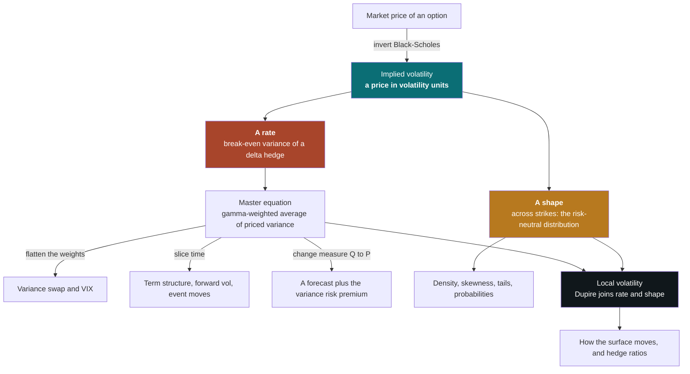
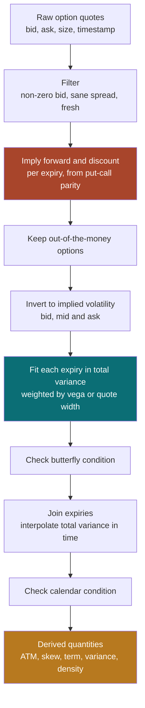
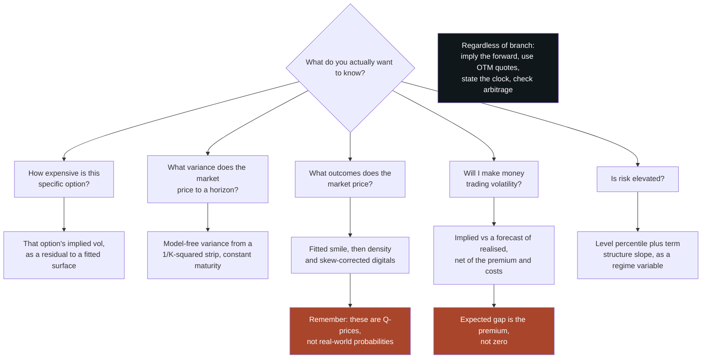

# Implied Volatility

### What the number means, how it is computed, how to look at it, and what practitioners do with it

---

```{=html}
<aside class="abstract">
```

# Abstract {#abstract}

```{=latex}
\begin{chapterabstract}
```

Implied volatility is a unit. It equals the volatility input that makes a standard pricing formula match an option's market price. It is not a forecast and not a price. This chapter explains the several true statements that this one number makes. It also explains how to compute and use the number correctly.

Quoting options with the Black–Scholes formula does not require believing the formula. Quoting a bond by yield likewise does not require believing that one constant rate applies. The unit removes the share price, strike, expiry and interest rate, so options become comparable. Each strike and expiry has its own implied volatility, and a single quoted figure is a convention. The number has three valid readings. It is a price in comparable units. It is the break-even daily move for a delta-hedged option: about 1.26% a day at 20% implied volatility. Across strikes, the pattern of implied volatilities describes the risk-neutral distribution of the underlying. Two rules of thumb help. Dividing annual volatility by 16 gives the typical daily move. An at-the-money straddle costs about the expected size of the move over its life.

Implied volatility predicts realised volatility better than historical forecasts do, but it is biased upward. On the S&P 500 it has averaged about four points above subsequent realised volatility since 1990. The gap is the premium that sellers earn for selling insurance, which pays small steady gains and rare large losses. Size short-volatility positions by the loss on a bad day. Probabilities read from option prices are risk-neutral. They overweight bad outcomes and give upper bounds on real-world probabilities. These probabilities come from the slope of the smile across strikes. In the worked example, using one strike's own volatility in the formula overstated the probability of a 10% fall by three quarters.

The VIX applies the same idea with different weights. A strip of out-of-the-money options replicates a variance swap, and discretizing that strip gives the VIX. The same view explains the drop in implied volatility after earnings. The event adds a fixed amount of variance to the term structure. That variance is gone once the event passes. Most practical difficulty lies in the data. A forward price error of half a percent creates 4.4 points of false skew. Far out-of-the-money quotes give unreliable volatilities. The time-to-expiry convention alone can change an intraday estimate by a factor of 2.3. When a surface looks wrong, check the forward first.

```{=latex}
\end{chapterabstract}
```

```{=html}
</aside>
```

---

**What this is.** A from-first-principles tutorial on implied volatility. Implied volatility is the most quoted number in options markets, and readers often misread it. People call it the market's forecast of volatility, the price of an option, the fear gauge, the width of a probability distribution and the break-even of a hedge. Each description is right about something and wrong about something else. This document takes the readings one at a time and shows where each one comes from. It then shows that all of them describe a single object. It also covers how to compute the number from real quotes, which is where nearly all of the practical difficulty lies. It covers how to draw the number. It covers what market makers, volatility traders, risk managers, allocators and researchers do with it.

**Who it is for.** The reader is mathematically comfortable and technically strong, but not an options specialist. The reader intends to *use* implied volatility. Uses include building a volatility surface, computing a VIX-style index, comparing implied with realised volatility, reading a probability off option prices, and feeding option-implied quantities into a model. Intuition comes first throughout. Each formula follows an explanation of its meaning and precedes a number. §2 defines basic option terms briefly. [Dealer Hedging and Gamma Exposure](dealer_hedging.html) builds these terms from zero. Look there when a definition here is too thin.

**How to read it.** The document has five parts, which follow the four questions in the title.

- **Part I (§1–§2) — the concept.** This part defines implied volatility and lists the intuitions to discard. It states the one idea that organises everything else. It gives just enough Black–Scholes to make the definition precise.
- **Part II (§3–§8) — ways to read the number.** This part covers these readings: a price in volatility units, the break-even rate of a hedge, and the price of future variance. It also covers a forecast with a risk premium attached and a probability distribution written in lognormal units. §8 joins the last two through local volatility. It also describes how the whole surface moves when the market moves.
- **Part III (§9–§11) — calculating it.** This part covers inverting one price and building a surface from noisy quotes. It also covers the derived quantities that people quote: at-the-money volatility, skew, term structure, VIX-style variance, densities, event moves and implied correlation.
- **Part IV (§12) — visualising it.** This part covers the standard charts, the question each one answers, and how each one misleads.
- **Part V (§13–§15) — using it.** This part covers how each kind of practitioner uses the number. It also gives a consolidated list of failure modes and a synthesis.

§16 is the reference list, grouped by kind. Appendix A collects every concept that the main text uses without fully explaining it. Appendix A orders the concepts so that each builds on the earlier ones.

To read only four parts, read these. Read **§1.4** (the three statements: a price, a rate and a shape). Read **§4.3** (why implied variance is a gamma-weighted average of the variance priced in). Read **§7.2–§7.4** (why a smile is a distribution, and the probability error that follows). Read **§9.4** (the inputs that matter far more than the root-finder).

**Relationship to the other notes.** [Dealer Hedging and Gamma Exposure](dealer_hedging.html) derives the Greeks and the hedged-P&L identity in detail (its sections 3 and 4). It also explains who holds options and why that affects their prices. This document uses those results and refers back to them instead of repeating them. [Simple and Log Returns](log_returns.html) explains why volatility is defined on log returns. [Market Regimes and Hidden Markov Models](market_regimes.html) is the right reference for using the VIX or the volatility term structure as a regime variable (§13.5). [Stochastic Processes](stochastic_processes.html) covers the Brownian motion that the models here use. Each note stands alone.

**Epistemic tags.** The text flags a claim by status where the status changes what you should do:

- **[Fact]** — Independent datasets or implementations have replicated the claim. The people who have looked broadly agree.
- **[Contested]** — Researchers have documented the claim but disagree about its magnitude, robustness or cause.
- **[Hypothesis]** — A proposed mechanism that nobody has decisively tested.
- **[Practice]** — A practitioner convention. It may well be right. The evidence is private or absent.

Untagged sentences are definitions, derivations or arithmetic. I label as **[Simulated]** the numbers that come from simulations or stylised surfaces I built while writing. I committed the generating code alongside this document in [`figures/iv_*.py`](https://github.com/rmahfoud/quant-research/tree/master/figures){target="_blank"}. Each script prints the numbers quoted in the text, so you can change the parameters and rerun.

---

**Notation.** The **underlying** is the asset an option is written on. $S$ (or $S_t$) is its price. An option has **strike** $K$ and **expiry** $T$. $\tau = T - t$ is the time remaining, in years, counted in calendar days over 365 unless a passage says otherwise. $r$ is the risk-free rate and $q$ the underlying's dividend (or carry) yield. $F = S e^{(r-q)\tau}$ is the **forward price** for the option's expiry. $D = e^{-r\tau}$ is the **discount factor**. $k = \ln(K/F)$ is **log-moneyness**. It is negative for strikes below the forward and positive above.

$V$ is an option's value, $C$ a call and $P$ a put. $N(\cdot)$ is the standard normal
cumulative distribution function and $\varphi(\cdot)$ its density. $\mathrm{BS}(\cdot)$
denotes the Black–Scholes price as a function of its inputs, and $d_1, d_2$ are the
quantities of §2.2. The Greeks are $\Delta = \partial V/\partial S$,
$\Gamma = \partial^2 V/\partial S^2$, $\nu = \partial V/\partial\sigma$ (vega) and
$\Theta = \partial V/\partial t$. $\Gamma S^2$ is **dollar gamma**.

The document uses several volatilities and always states which one it means:

| Symbol | Name | What it is |
|---|---|---|
| $\sigma_i$, or $\sigma_i(K,T)$ | implied volatility | The number that makes $\mathrm{BS}$ reproduce a market price (§1.1); as a function of strike and expiry, the **surface** |
| $\sigma_t$ | instantaneous volatility | The true, unobserved volatility of the underlying at time $t$ in whatever process actually drives it |
| $\sigma_r$ | realised volatility | The volatility a price path actually delivered, measured afterwards from returns |
| $\sigma_{\text{loc}}(S,t)$ | local volatility | The volatility as a function of price and time that reproduces the whole surface (§8) |
| $\sigma_{\text{VS}}$ | variance-swap volatility | The square root of the fair variance of §5. The VIX is one example |

$w(k,T) = \sigma_i^2(k,T)\,T$ is **total implied variance** at log-moneyness $k$ and
expiry $T$. It equals the variance of the log return to expiry that the option price implies.
Traders quote volatility in percent. A **vol point** is one percentage point of $\sigma$.
A surface always describes the market today, so an expiry $T$ and the time remaining
to it coincide. So $w(k,T)$ and $\partial w/\partial T$ write $T$, as the literature does.

The text uses two probability measures. $\mathbb{Q}$ is the **pricing** (risk-neutral) measure, under which discounted prices are expectations. $\mathbb{P}$ is the **physical** (real-world) measure, under which events actually happen. The blackboard letters distinguish $\mathbb{P}$ from the put price $P$. $f_T(K)$ is the risk-neutral density of $S_T$ at $K$. $\Pi$ is the profit and loss (P&L) of a hedged position. $\rho$ denotes a correlation, either between price and volatility changes or between stocks in an index (§11.7). It also denotes the rotation parameter of the SVI smile (§10.4), which plays the same role. Each passage says which meaning applies.

**The running example** comes from the Dealer Hedging note. The underlying is at 100, the strike is 100, expiry is 30 calendar days away ($\tau = 30/365$), $r = q = 0$ (so $F = S = 100$ and $D = 1$), and volatility is 20%. The call and the put each cost **2.29**.

---

## Table of contents

- [Abstract](#abstract)

**Part I — The concept**

1. [The number, and the intuitions to discard](#1-the-number)
2. [The conversion model: just enough Black–Scholes](#2-the-ruler)

**Part II — Ways to read the number**

3. [A price in volatility units](#3-a-price)
4. [The break-even rate of a hedge](#4-break-even)
5. [The price of variance: variance swaps, the VIX and the term structure](#5-price-of-variance)
6. [A forecast with a premium attached](#6-forecast)
7. [A distribution in lognormal units: the smile](#7-smile)
8. [Local volatility, and how the surface moves](#8-local-vol-and-dynamics)

**Part III — Calculating it**

9. [Inverting one price](#9-inverting)
10. [From quotes to a surface](#10-surface)
11. [Derived quantities](#11-derived)

**Part IV — Visualising it**

12. [Pictures of implied volatility](#12-pictures)

**Part V — Using it**

13. [How practitioners use implied volatility](#13-uses)
14. [Failure modes](#14-failure-modes)
15. [Synthesis](#15-synthesis)
16. [References](#16-references)

**Appendix**

- [A. Concepts and prerequisites](#appendix-a-concepts-and-prerequisites) — every
  idea the main text leans on without fully explaining, built from first principles
  and ordered by dependency.

---

```{=latex}
\newpage
```

# 1. The number, and the intuitions to discard {#1-the-number}

## 1.1 The definition, with one number

An option's price depends on six inputs. Five are the underlying price $S$, the strike $K$,
the time to expiry $\tau$, the interest rate $r$ and the dividend yield $q$. The sixth is the
volatility $\sigma$ of the underlying over the option's life. The first five are observable. The sixth is not, because it is a property of the future.

The Black–Scholes formula (§2.2) turns all six inputs into a price. Implied volatility reverses the formula. Take the price the market is actually paying and hold the five observable inputs fixed. Then find the volatility that makes the formula match that price.

$$
\mathrm{BS}\big(S, K, \tau, r, q, \sigma_i\big) = V_{\text{market}} .
$$

The solution $\sigma_i$ is the option's **implied volatility**. For the running example, a 30-day at-the-money call trading at 2.29 has an implied volatility of 20%. If buyers bid the price up to 2.52, the implied volatility becomes 22%. The option's vega is 0.114 per vol point, so 23 cents of extra premium is two vol points.

The definition has three consequences for everything that follows.

- **The formula is used as a conversion table, not as a description of the world.** The definition does not say that anyone believes returns are lognormal or that volatility is constant. The formula is a fixed, agreed way to turn a dollar price into a number that traders can compare across options.
- **It works only because price rises with volatility.** Every option is worth more when volatility is higher (§2.3), so each price corresponds to exactly one volatility. That monotonicity makes the number well defined, whatever anyone believes about markets.
- **One option gives one number. A chain of options gives a surface.** Every strike and every expiry has its own implied volatility, and these values generally differ. "The implied volatility" of a stock or an index always means one point on that surface, which convention chooses (§11.1).

## 1.2 An exact analogy: the yield of a bond

A bond's **yield to maturity** is the single discount rate that makes the present
value of its promised cash flows equal its market price. The calculation assumes a
flat interest-rate curve, and nobody believes that assumption. Markets quote and compare bonds in yield anyway. The conversion removes coupon size, maturity and face value. It leaves a number that means roughly the same thing for every bond. When yields differ across maturities, no one concludes that the yield formula fails. Instead, traders draw a **yield curve** and read it as information about what the flat-rate assumption leaves out. That information is expected future rates and a term premium for bearing duration risk.

Implied volatility is the same construction applied to options:

| | Bonds | Options |
|---|---|---|
| Observed | Price | Price |
| Conversion model (nobody believes it literally) | Flat-rate discounting | Black–Scholes with constant volatility |
| The number it yields | Yield to maturity | Implied volatility |
| Why the conversion model works | Price falls monotonically as yield rises | Price rises monotonically with volatility |
| Variation across instruments | Yield curve, by maturity | Volatility surface, by strike and expiry |
| What the variation measures | Expected rates plus term premium | Expected variance plus variance risk premium, and the shape of the distribution |

The analogy is exact in structure. It also holds one level deeper. A yield contains a risk premium on top of expected future rates. An implied volatility contains a risk premium on top of expected future variance (§6). Riccardo Rebonato often describes implied volatility as the wrong number to put into the wrong formula in order to obtain the right price
([Rebonato, 1999](https://www.wiley.com/en-us/Volatility+and+Correlation%3A+The+Perfect+Hedger+and+the+Fox%2C+2nd+Edition-p-9780470091395){target="_blank"}). The remark works because both errors are deliberate and cancel exactly.

The analogy fails in one respect. A bond's cash flows are fixed, so its yield is a statement about discounting alone. An option's payoff depends on the path, and in particular on how much variance the path delivers where the option is sensitive to it. So implied volatility has more readings than yield has.

## 1.3 Seven intuitions to discard

Most confusion about implied volatility comes from a few intuitions that are partly right. Naming them now reduces the unlearning needed later.

| The intuition | Why it fails | What is true instead | Section |
|--------------------|------------------------------------|--------------------------------|------|
| "Implied volatility is the market's forecast of volatility" | It is a price, and prices contain risk premia. S&P 500 implied volatility has exceeded subsequently realised volatility by about 4 vol points on average since 1990 | A forecast plus a premium, plus the effect of supply and demand for options | §6 |
| "It is a parameter of a model the market believes" | The model is known to be false, and markets use it anyway | A unit of measurement. The *shape* of the surface records how the model is false | §3, §7 |
| "A stock has an implied volatility" | Every strike and expiry has its own | A surface. Any single number is a convention | §10, §11.1 |
| "High implied volatility means options are expensive" | The statement names no benchmark for comparison | Rich or cheap only relative to the variance the option will actually experience where it has gamma, net of the premium for bearing that risk | §4, §6 |
| "An option's implied volatility is the underlying's volatility over the option's life" | Variance that arrives far from the strike barely affects an option | A dollar-gamma-weighted average of the variance priced along the paths from today's price to the strike | §4.3 |
| "Implied volatility measures moves in either direction equally" | Out-of-the-money puts and calls on an index trade at very different implied volatilities | Different strikes price different parts of the distribution. The downside wing prices crash risk | §7 |
| "$N(d_2)$ at the option's implied volatility is the probability of finishing in the money" | It ignores the skew, and it is the wrong probability measure | With a typical index skew, the naive number overstates the chance of finishing below a 10%-lower strike by about three quarters. It is also a pricing probability, not a real-world one | §6.1, §7.4 |

## 1.4 Three statements: a price, a rate, and a shape

Three statements organise this document. Each later section examines one of them up close. The synthesis in §15 combines all three.

**1. Implied volatility is a price.** It re-expresses an option price in the unit that would make the surface flat in a lognormal, constant-volatility world. This is the definition (§1.1). Markets therefore quote, compare and mark options in volatility (§3).

**2. Implied volatility is a rate.** Over a short
interval, the P&L of a delta-hedged option equals half its dollar gamma times a gap. The gap is the variance that occurred minus the variance that implied volatility charged for:

$$
d\Pi = \tfrac12\,\Gamma S^2 \left(\sigma_t^2 - \sigma_i^2\right) dt .
$$

So implied variance is the **break-even variance rate** for anyone who hedges the
option (§4). Take expectations under the pricing measure and require that a fairly
priced option breaks even on average. Then implied variance becomes a **weighted average of the variance the market has priced in**. The weights equal the option's
dollar gamma along the paths it might follow. This is the master equation of the
document. §4.3 derives it:

$$
\sigma_i^2 \;=\; \frac{\mathbb{E}^{\mathbb{Q}}\!\left[\displaystyle\int_0^T \Gamma_t S_t^2\, \sigma_t^2\, dt\right]}
{\mathbb{E}^{\mathbb{Q}}\!\left[\displaystyle\int_0^T \Gamma_t S_t^2\, dt\right]} .
$$

Three choices in this equation generate most of the named readings of implied volatility. The first choice is the **weights**. Replace one option's dollar gamma with the flat dollar gamma of a strip of options weighted by $1/K^2$, and the equation gives the variance swap and the VIX (§5). The second is the **measure**. Changing it from $\mathbb{Q}$ to $\mathbb{P}$ gives a forecast, with the variance risk premium as the gap (§6). The third is the **slice of time** that the integral covers. Changing it gives forward volatility and the variance of a single event, because total variance adds up over time (§5.4–§5.5).

**3. Implied volatility is a shape.** Across strikes at one expiry, option prices determine the whole risk-neutral probability distribution of the price at expiry. The second derivative of the call price with respect to the strike equals the density (§7.2). The smile is that distribution written relative to a lognormal. The level of the smile measures the width of the distribution, its slope measures the skewness, and its curvature measures the fatness of the tails (§7.3).

**Local volatility** (§8) joins the rate and the shape. Dupire's formula gives the local variance at a strike and expiry. It equals the rate at which total implied variance grows with expiry, divided by a term proportional to the risk-neutral density at that strike. The numerator is a quantity in the time direction and the denominator is a quantity in the strike direction. Every surface must satisfy two no-arbitrage conditions. They are exactly the conditions that the numerator be non-negative and the denominator positive.



The rest of Part II covers this diagram one reading per section. Each section follows the same template: the intuition, the formal statement, a number, what the reading is good for, and how it misleads.

| Reading | What changes in the master equation | Section | What it is good for |
|---|---|---|---|
| A price in volatility units | Nothing. This is the definition | §3 | Quoting, comparing and marking options |
| The break-even rate of a hedge | Weights are this option's dollar gamma | §4 | Deciding whether to own or sell an option you will hedge |
| The price of variance | Weights flattened by a $1/K^2$ strip; time sliced | §5 | The VIX, variance swaps, term structure, event moves |
| A forecast with a premium | Measure $\mathbb{Q}$ replaced by $\mathbb{P}$ | §6 | Volatility forecasting and the variance risk premium |
| A distribution | Vary the strike instead of integrating over time | §7 | Probabilities, tails, skew |
| An average of local volatility | Weights follow a bridge from spot to strike | §8 | Pricing and hedging beyond vanilla options, and surface dynamics |

```{=latex}
\newpage
```

## 1.5 How the idea evolved

| Year | Development | What changed |
|---|---|---|
| 1973 | Black–Scholes and Merton. Listed equity options begin trading in Chicago | An option has a price, and one input that cannot be observed |
| 1976 | Implied standard deviations computed from option prices. Black's formula for options on futures | The number gets its name, and its first test as a forecast |
| 1987 | The October crash | The index skew appears and persists |
| 1993 | Cboe's first volatility index, on S&P 100 options. The Heston model | Volatility becomes something you can quote, and something you can model as a process |
| 1994 | Local volatility, by Dupire and by Derman and Kani | One diffusion is shown to fit an entire surface |
| 1999 | Variance swaps and the replicating strip | Volatility becomes tradable without delta hedging |
| 2002 | SABR | A smile model built for hedging rather than only for fitting |
| 2003 | The VIX is redefined as model-free variance on S&P 500 options | The index becomes a variance-swap rate |
| 2004 | VIX futures list. The SVI parameterisation appears | Volatility becomes an asset class with its own term structure |
| 2009 | The variance risk premium is shown to predict equity returns | The gap between implied and realised becomes a research object |
| 2014 | Arbitrage-free SVI | Surface fitting acquires explicit no-arbitrage conditions |
| 2018 | "Volatility is rough" | The shape of the short end becomes a research field |
| 2022 | SPX options expire every trading day | Intraday implied volatility, and the clock behind it, become first-order |

The history falls into four eras. Each has a one-line summary.

**1973–1986: implied volatility as a by-product.** [Black and Scholes
(1973)](https://www.journals.uchicago.edu/doi/10.1086/260062){target="_blank"} and [Merton
(1973)](https://www.maths.tcd.ie/~dmcgowan/Merton.pdf){target="_blank"} gave a price that depended on one unobservable input. Within three years, [Latané and Rendleman
(1976)](https://onlinelibrary.wiley.com/doi/10.1111/j.1540-6261.1976.tb01892.x){target="_blank"} were computing the "implied standard deviation" from option prices
and asking whether it forecast future volatility. Volatility became
something readers could read off a market instead of only estimating from history. The
limitation was that users treated the number as a single estimate of a
single parameter. Index smiles were mild before 1987, so little seemed lost. The definition survives unchanged.

**1987–1999: the smile becomes permanent, and gets modelled.** [Fact] After the October 1987
crash, S&P 500 options have priced downside strikes at persistently higher implied
volatility than upside strikes ([Rubinstein,
1994](https://onlinelibrary.wiley.com/doi/abs/10.1111/j.1540-6261.1994.tb00079.x){target="_blank"}). Practitioners stopped treating the smile as noise and started
treating it as information. [Heston (1993)](https://academic.oup.com/rfs/article-abstract/6/2/327/1574747){target="_blank"} produced smiles from stochastic volatility.
[Dupire (1994)](https://www.risk.net/derivatives/equity-derivatives/1500211/pricing-with-a-smile){target="_blank"} and [Derman and Kani
(1994)](https://emanuelderman.com/the-volatility-smile-and-its-implied-tree/){target="_blank"} showed how to recover the unique local volatility function consistent
with the whole surface. At the end of the decade, [Carr and Madan
(1998)](https://www.researchgate.net/publication/2852582_Towards_a_Theory_of_Volatility_Trading){target="_blank"} and [Demeterfi, Derman, Kamal and Zou
(1999)](https://emanuelderman.com/wp-content/uploads/1999/02/gs-volatility_swaps.pdf){target="_blank"} showed that a strip of options replicates a contract on realised
variance. This made volatility itself tradable without any delta hedging. The
limitation was that models that fit today's surface often predict tomorrow's surface badly
(§8.5). All of these methods remain standard practice.

**2000–2014: implied volatility as an index, an asset and a risk factor.** In 2003
Cboe redefined the VIX as a model-free variance computed from S&P 500 options
([Carr and Wu, 2006](https://engineering.nyu.edu/sites/default/files/2021-03/carrwutaleoftwoindices.pdf){target="_blank"}). Futures and options on the VIX followed. Academic
work measured the gap between implied and realised variance as a risk premium
([Carr and Wu, 2009](https://engineering.nyu.edu/sites/default/files/2019-01/CarrReviewofFinStudiesMarch2009-a.pdf){target="_blank"}). That work found that the gap predicts equity returns
([Bollerslev, Tauchen and Zhou, 2009](https://public.econ.duke.edu/~boller/Published_Papers/rfs_09.pdf){target="_blank"}). Practitioners standardised how they parameterise surfaces, notably with SVI.
[Gatheral and Jacquier (2014)](https://arxiv.org/abs/1204.0646){target="_blank"} later gave SVI explicit no-arbitrage conditions. The limitation was that volatility products concentrated
short-volatility risk, and few understood this risk until the products failed (February
2018, [Dealer Hedging](dealer_hedging.html), section 8.4). The VIX survives as the
world's default measure of equity risk appetite.

**2015 onward: every horizon, every hour.** Options now expire daily. Traders compute implied
volatility intraday for options with hours left to expiry. The shape of the
short end of the surface has become a research field of its own. That field includes the
[Contested] claim that the at-the-money skew follows a power law in maturity because
volatility is "rough" ([Gatheral, Jaisson and Rosenbaum, 2018](https://arxiv.org/abs/1410.3394){target="_blank"}). §8.4 discusses this claim. The clock used to measure time to expiry was a minor detail for 30-day options. It has become first-order (§9.4).

> ### §1 Key takeaways
>
> 1. Implied volatility is the volatility that makes the Black–Scholes formula reproduce a market price. The formula is a conversion model, not a belief.
> 2. The number is well defined only because option prices rise monotonically with
>    volatility.
> 3. It is exactly analogous to a bond's yield. Both convert a price into a comparable rate through a deliberately simple model, and the variation across instruments carries information.
> 4. Every strike and expiry has its own implied volatility. "The" implied
>    volatility of an asset is a convention.
> 5. Implied volatility is a price, a rate and a shape at once. It is the price of the option in volatility units, the break-even variance rate of a delta hedge and, across strikes, the risk-neutral distribution written relative to a lognormal.
> 6. Implied variance is a dollar-gamma-weighted average of the variance priced in. Changing the weights gives the variance swap and the VIX. Changing the measure gives a forecast plus a risk premium. Slicing time gives forward volatility.
> 7. It is a forecast plus a premium. It is a surface, not one number. It is asymmetric across strikes. It gives real-world probabilities only after correction.

---

# 2. The conversion model: just enough Black–Scholes {#2-the-ruler}

## 2.1 Volatility, and the square root of time

**Volatility** $\sigma$ is the annualised standard deviation of log returns. If daily
log returns are independent, variances add, so the standard deviation over $n$ days
grows in proportion to $\sqrt{n}$. Over an option's remaining life $\tau$ the standard deviation
of the log return is $\sigma\sqrt{\tau}$. This document calls it **total
volatility**. Its square, $\sigma^2\tau$, is **total variance**.

A year has about 252 trading days, and $\sqrt{252} \approx 16$. So traders use the **rule
of 16**: 16% annual volatility is roughly a 1% move on a typical trading day. The
running example's 20% is a typical daily move of 1.26% on trading days. If you count the year as 365 calendar days, the same variance spreads over more days and the daily move is 1.05%. Over the
option's 30 days, the standard deviation is $20\% \times \sqrt{30/365} = 5.73\%$. [Simple and Log Returns](log_returns.html) explains why log
returns, not simple returns, are the natural unit here.

## 2.2 What an option price really depends on

The Black–Scholes price of a European call, written in terms of the forward $F$ and
discount factor $D$ (the "Black" form, [Black, 1976a](https://ideas.repec.org/a/eee/jfinec/v3y1976i1-2p167-179.html){target="_blank"}), is

$$
C = D\left[F\,N(d_1) - K\,N(d_2)\right], \qquad
d_{1,2} = \frac{\ln(F/K) \pm \tfrac12\sigma^2\tau}{\sigma\sqrt{\tau}} ,
$$

and the put follows from **put–call parity**, $C - P = D(F - K)$, which holds for
European options regardless of any model. In the formula, $N(d_2)$ is
the risk-neutral probability that the call finishes in the money. $d_2$ is the
distance from the forward to the strike, measured in standard deviations of the log
return (with a small adjustment of half a variance). [Dealer
Hedging](dealer_hedging.html), sections 3.2 and 3.3, derives the formula from replication.

Now divide by $DF$ and write the strike as log-moneyness $k = \ln(K/F)$:

$$
\frac{C}{DF} = N(d_1) - e^{k} N(d_2), \qquad
d_{1,2} = -\frac{k}{\sigma\sqrt{\tau}} \pm \frac{\sigma\sqrt{\tau}}{2} .
$$

The normalised price depends on **exactly two numbers**. One is $k$, the distance of the strike from the
forward. The other is $\sigma\sqrt{\tau}$, the expected spread of the log price before expiry. Three consequences follow for the rest of the document.

- **Rates and dividends enter only through $F$ and $D$.** Getting the forward right is
  therefore most of getting the inputs right (§9.4).
- **Volatility and time enter only through $\sigma\sqrt{\tau}$.** A one-year option at
  10% volatility and a four-year option at 5% volatility with the same moneyness have
  the same normalised price. The option really prices total volatility. The
  annualised $\sigma$ is a convention for comparing across expiries.
- **Total implied variance $w = \sigma_i^2\tau$ is the natural coordinate.** The price determines total implied variance directly, and it adds up over time (§5.4). Build, interpolate and check surfaces for arbitrage in $(k, w)$ rather than in
  $(K, \sigma_i)$ (§10).

Put–call parity implies that a call and a put with the same strike and expiry must have **the same implied
volatility**, because the same $\sigma$ prices both. When
computed call and put volatilities disagree, the inputs are wrong, usually the forward, or the options are American (§9.4).

## 2.3 Why the formula can be run backwards

Vega, the sensitivity of the price to volatility, is

$$
\nu = \frac{\partial C}{\partial \sigma} = D F \,\varphi(d_1)\sqrt{\tau} \;>\; 0 ,
$$

strictly positive for any strike and any positive time to expiry, and the same for a
call and a put. The intuition is convexity. An option pays off asymmetrically, so
widening the distribution of the final price adds more to the winning outcomes than it removes from the losing ones.

Positive vega, together with the limits of the price as volatility goes to zero and
to infinity, makes implied volatility well defined. As $\sigma \to 0$, the call
is worth its discounted intrinsic value against the forward, $D(F-K)^+$. As $\sigma \to \infty$, the call is worth $DF$. Every price strictly between those bounds
corresponds to **exactly one** volatility. A quoted price outside them has no implied
volatility. Those bounds are no-arbitrage bounds, so such a price is
either an arbitrage or, far more often, bad data.

```{=latex}
\begin{center}
\includegraphics[width=\linewidth]{quant-research/figures/iv_inversion.pdf}
\end{center}
```

```{=html}

```

The left panel shows the whole idea of implied volatility. Each curve is
monotone, so a price on the vertical axis maps back to a volatility on the
horizontal axis. Two features of the curves matter later. The at-the-money curve is
almost a straight line through the origin (§2.4), so its inversion is easy and robust.
The out-of-the-money curves are flat near zero volatility and rise steeply only at higher volatility.
Where a curve is flat, a small change in price corresponds to a large change in
volatility. The right panel measures the resulting error in volatility points, and §9.3 returns to it.

## 2.4 The at-the-money shortcut, and the straddle as an expected move

At the money forward, $K = F$, so $k = 0$ and $d_{1,2} = \pm\tfrac12\sigma\sqrt{\tau}$.
Expanding the normal distribution function around zero,

$$
C_{\text{ATM}} = DF\left[N\!\left(\tfrac12\sigma\sqrt{\tau}\right) - N\!\left(-\tfrac12\sigma\sqrt{\tau}\right)\right]
\;\approx\; DF\,\sigma\sqrt{\tau}\,\varphi(0) \;=\; \frac{DF\,\sigma\sqrt{\tau}}{\sqrt{2\pi}} \;\approx\; 0.4\, DF\,\sigma\sqrt{\tau} .
$$

This is the approximation of [Brenner and Subrahmanyam
(1988)](https://www.tandfonline.com/doi/abs/10.2469/faj.v44.n5.80){target="_blank"}. It is remarkably accurate for the options people trade most. For the
running example it gives $0.4 \times 100 \times 0.20 \times 0.2867 = 2.293$ against an
exact 2.287. Inverting it, a trader can read implied volatility off an
at-the-money price without a computer: $\sigma_i \approx C/(0.4\,DF\sqrt{\tau}) =
19.94\%$. The approximation shows that the at-the-money price is **almost linear
in volatility**. So at-the-money implied volatility is the most robust
number on the surface, and at-the-money vega barely depends on the level of
volatility.

The **straddle** is a call plus a put at the same strike. It has a second reading that
practitioners use daily. At the money it costs about twice the call,
$0.8\,DF\sigma\sqrt{\tau}$. Suppose the change in the forward over the option's life is
roughly normal with standard deviation $F\sigma\sqrt{\tau}$. Then the expected *absolute*
change is $F\sigma\sqrt{\tau}\sqrt{2/\pi} = 0.798\,F\sigma\sqrt{\tau}$. The two
coincide:

> **An at-the-money straddle costs the discounted expected absolute move of the
> underlying over the option's life**, under the pricing measure and to the extent
> the move is close to normal.

The running example's straddle costs 4.57, which is 4.57% of the price. The market is
pricing an average absolute move of about 4.6% over 30 days, corresponding to a
standard deviation of $4.57/0.798 = 5.73\%$. Traders quote this as the "expected move" around
earnings announcements (§5.5, §13.3). [Practice] The expected move has two caveats. First, it is a
risk-neutral expectation, so it includes whatever premium sellers of options demand
(§6). Second, fat tails change the ratio. For a distribution with more weight in the tails
and more in the centre, the mean absolute move is a smaller fraction of the standard
deviation than 0.8. So dividing a straddle price by 0.8 slightly understates the
standard deviation the market is pricing.

## 2.5 Other conversion models: normal volatility and variance units

Black–Scholes is one of several conversion models in use, and the choice of model changes the shape of the smile.

- **Lognormal (Black–Scholes or Black-76) volatility**, in percent per square-root
  year. It is the convention for equities, foreign exchange and most commodities.
- **Normal (Bachelier) volatility**, in price units per square-root year, or
  basis points a year for interest rates. The model assumes that the underlying's *change*, rather
  than its log change, is normally distributed. Near the money the two are related by
  $\sigma_N \approx \sigma_{\text{LN}}\,F$. [Practice] Interest-rate options moved largely to
  normal-volatility quoting as rates approached zero. Near zero rates, lognormal volatility
  becomes enormous and unstable for small changes in the rate.
- **Variance units.** Dealers quote variance swaps as a volatility strike, but they pay on variance (§5.1). Some models state their results naturally in variance.

The choice of model matters because a surface that is flat under one model slopes under another. Suppose a market prices options exactly as the normal model with $\sigma_N = 20$
price units a year on a forward of 100. Then the equivalent lognormal volatility at strike
$K$ is approximately $\sigma_N \ln(F/K)/(F-K)$ ([Hagan, Kumar, Lesniewski and
Woodward, 2002](https://www.researchgate.net/publication/235622441_Managing_Smile_Risk){target="_blank"}). It is 21.1% at a strike of 90 and 19.1% at 110. A "flat" normal smile is a
lognormal skew of about one vol point per ten points of strike. So part of any skew reflects
which model the quote uses. Comparisons of skew across
markets quoted under different conventions need conversion first.

> ### §2 Key takeaways
>
> 1. Volatility is the annualised standard deviation of log returns. Over an option's
>    life the relevant number is total volatility $\sigma\sqrt{\tau}$. By the rule of 16,
>    16% is about 1% a trading day.
> 2. A normalised option price depends only on log-moneyness $k = \ln(K/F)$ and total
>    volatility. Rates and dividends matter only through the forward and the discount
>    factor.
> 3. Total implied variance $w = \sigma_i^2\tau$ is the coordinate that the price determines directly, and the right one for building surfaces.
> 4. Vega is strictly positive, so every price inside the no-arbitrage bounds has
>    exactly one implied volatility. A price outside them has none.
> 5. A call and a put with the same strike and expiry have the same implied
>    volatility. Disagreement signals bad inputs.
> 6. At the money, price is almost linear in volatility: $C \approx 0.4\,DF\sigma\sqrt{\tau}$.
>    The at-the-money straddle costs roughly the expected absolute move.
> 7. The conversion model is a convention. Normal and lognormal volatilities give differently
>    shaped smiles for the same prices.

---

# 3. A price in volatility units {#3-a-price}

## 3.1 What the conversion removes

The first reading of implied volatility is the literal one. It is the option's price expressed in different units. The effect of the conversion is clearest for options with very different prices and identical volatilities.

| Option (20% volatility throughout) | Price |
|---|---:|
| 30-day at-the-money call, underlying at 100 | 2.29 |
| 30-day at-the-money call, underlying at 500 | 11.44 |
| One-year at-the-money call, underlying at 100 | 7.97 |
| 30-day 110-strike call, underlying at 100 | 0.12 |
| 30-day 90-strike put, underlying at 100 | 0.07 |

Every option in the table is priced at exactly 20% volatility, and their prices span
two orders of magnitude. The reverse direction shows the same point more sharply. A price of **2.29** is 20% volatility for the 30-day at-the-money call. It is 41.5% for a *seven-day*
at-the-money call, 5.7% for a *one-year* at-the-money call, and 50.2% for the 30-day
110-strike call. The dollar price alone does not show whether an option is expensive.

The conversion removes four things at once. They are the level of the underlying, the strike, the time to expiry, and the financing and dividends. Financing and dividends enter only through the forward and the discount factor (§2.2). The remaining number has the same meaning across contracts. A 20% volatility means approximately the same thing for a 30-day option on a $40 stock and a two-year option on an index at 6,000.

## 3.2 Trading, quoting and marking in volatility

Because the number is comparable, the market uses it as the unit of account.

**Quotes.** Dealers quote over-the-counter foreign-exchange options directly in
volatility and specify the strike by delta rather than by price (§10.4).
Dealers often negotiate interdealer trades in listed index options the same way. The two
sides agree a volatility and a reference price for the underlying. The trade then prints as a package of options plus the delta hedge. [Practice] The dollar price is
then an output, computed from the agreed volatility.

**Marks and P&L attribution.** A dealer marks the book to a fitted surface rather
than to individual screen prices, and attributes the day's P&L to the Greeks. Take
the running example. The underlying rises 1%, one day passes, and implied volatility
falls by one point. The call's value changes by $+0.397$, which decomposes as

$$
\underbrace{+0.511}_{\text{delta}} \;+\; \underbrace{+0.035}_{\text{gamma}} \;+\;
\underbrace{-0.038}_{\text{theta}} \;+\; \underbrace{-0.114}_{\text{vega}} \;=\; +0.394 ,
$$

Higher-order terms account for the remaining third of a cent. The vega line says that the market repriced volatility and the repricing cost eleven cents. That line exists only because the conversion expresses prices in volatility. Without the conversion there is a P&L
number and no explanation of it.

**Relative value.** Once every option on an underlying is a point on a surface, the
natural questions are comparative. This put is 1.5 volatility points rich to the
fitted skew. This expiry is cheap relative to the expiries on either side of it. This stock's
volatility is high relative to its sector. Each of these statements is about residuals from a fitted surface (§10.4). So the quality of the fit matters a great deal.

## 3.3 What the unit cannot remove

The conversion normalises the *model's* dimensions. It does not make different risks
comparable. Forgetting this causes four confusions.

- **Different underlying risks.** A biotech stock facing a binary regulatory decision and an equity index can both have a 30% implied volatility. The two numbers are not the same price for the same thing. The first is mostly the price of one event
  (§5.5). The second is the price of a diffusive process plus crash insurance.
- **Different parts of the distribution.** The implied volatility of a 25-delta put and
  that of an at-the-money option are prices of different risks. So they differ, and the difference is information rather than error (§7).
- **The risk premium is part of the number.** Comparing implied volatilities across
  underlyings compares risk premia and hedging demand as much as expected variance
  (§6.3). Single-stock options and index options carry systematically different
  premia ([Driessen, Maenhout and Vilkov, 2009](https://papers.ssrn.com/sol3/papers.cfm?abstract_id=673425){target="_blank"}).
- **Model errors enter the number.** American exercise, discrete dividends, borrow costs and
  settlement conventions all distort the number if the inversion mishandles them
  (§9.4). A "high" implied volatility is sometimes just a wrong forward.

> ### §3 Key takeaways
>
> 1. Implied volatility is the option's price in a unit that removes the underlying's
>    level, the strike, the expiry, rates and dividends.
> 2. Dollar prices spanning two orders of magnitude can all be 20% volatility. One
>    dollar price can be 5.7% or 50% volatility depending on the contract.
> 3. Markets quote, negotiate and mark in volatility, and P&L attribution's vega line
>    exists only because of the conversion.
> 4. Relative-value statements about options are statements about residuals from a
>    fitted surface.
> 5. The unit does not make different risks comparable. Event risk, skew, risk premia
>    and mishandled forwards all affect the same number.

---

# 4. The break-even rate of a hedge {#4-break-even}

## 4.1 The identity, in one paragraph

Buy an option, sell $\Delta$ shares against it, and keep the hedge current. Over a
short interval in which the underlying moves by $\Delta S$, the hedged position's P&L
is, to second order,

$$
\Delta \Pi \;\approx\; \Theta\,\Delta t + \tfrac12 \Gamma (\Delta S)^2 ,
$$

because the hedge cancels the delta terms. An option marked at
implied volatility $\sigma_i$ satisfies the Black–Scholes equation at that volatility.
With zero rates, the equation says $\Theta = -\tfrac12 \sigma_i^2 S^2 \Gamma$. The option's time
decay is exactly the charge for its gamma. Substituting,

$$
\boxed{\;\Delta \Pi \;\approx\; \tfrac12\,\Gamma S^2\left[\left(\frac{\Delta S}{S}\right)^{\!2} - \sigma_i^2\,\Delta t\right]\;}
$$

**The P&L of a delta-hedged option is half its dollar gamma times the difference
between the squared return that happened and the variance that implied volatility
charged for.** [Dealer Hedging](dealer_hedging.html), section 4.4, derives this carefully, works
it through a week of hedging, and simulates its distribution. This document takes it
as given and asks what it says about the number $\sigma_i$.

The identity shows that implied volatility is a **rate**. It is the rate at which a hedger pays, in time decay, for the right to collect
squared returns, or collects in exchange for owing them. It is not really a forecast or an opinion.

## 4.2 The break-even move

Setting the bracket to zero gives the move at which a hedged option breaks even over
an interval:

$$
\left|\frac{\Delta S}{S}\right| = \sigma_i \sqrt{\Delta t} .
$$

At 20% implied volatility, one day's break-even is 1.26% if you count the year as 252 trading days, or 1.05% if you count 365 calendar days. The same option gets two answers under two conventions, and the difference matters over a weekend (§9.4).

| Implied volatility | Daily break-even (252-day year) | Daily break-even (365-day year) |
|---:|---:|---:|
| 10% | 0.63% | 0.52% |
| 16% | 1.01% | 0.84% |
| 20% | 1.26% | 1.05% |
| 32% | 2.02% | 1.68% |
| 80% | 5.04% | 4.19% |

This is the most practical single reading of implied volatility. It converts the
number into a question a trader can actually answer: whether the underlying will move more
or less than this each day. Owning a hedged option is a bet on "more". Selling one is
a bet on "less". Because the payoff is quadratic in the move, the loser on a big
day loses far more than the winner gains on a quiet one. At 20% implied volatility a
2% day delivers three and a half times the break-even variance, and a 3% day delivers more
than eight times.

Over the option's whole life, the expected P&L of selling at $\sigma_i$ and then experiencing
realised volatility $\sigma_r$ is the difference in Black–Scholes values,
$V(\sigma_i) - V(\sigma_r)$. This difference is close to $\nu \times (\sigma_i - \sigma_r)$, which is about
$\$1.14$ per option for each 10 volatility points, in the running example. But this is
an *expectation*. The realised outcome differs from it by a hedging error. The hedging error falls only as
the square root of the number of rehedges, and it does not diversify across options on
the same underlying ([Dealer Hedging](dealer_hedging.html), section 4.7).

## 4.3 Implied variance is a gamma-weighted average

The identity holds interval by interval. Integrating it over the option's life turns
implied volatility from a per-day break-even into a statement about the entire future.
The result is the master equation of the document.

Work under the pricing measure $\mathbb{Q}$ with zero rates. Let the underlying
follow *any* continuous process whose instantaneous volatility $\sigma_t$ may itself be
random: $dS_t = \sigma_t S_t\, dW_t$. Let $V(S,t;\sigma_i)$ be the Black–Scholes value
of the option at the constant volatility $\sigma_i$. Itô's lemma and the
Black–Scholes equation at $\sigma_i$ (the same substitution as in §4.1) give

$$
dV = \Delta\, dS + \tfrac12 \Gamma S^2\left(\sigma_t^2 - \sigma_i^2\right) dt .
$$

Integrate from now to expiry. At expiry the Black–Scholes value equals the payoff, so

$$
\text{payoff} - V(S_0,0;\sigma_i) = \int_0^T \Delta\, dS + \tfrac12 \int_0^T \Gamma_t S_t^2\left(\sigma_t^2 - \sigma_i^2\right) dt .
$$

Now take expectations under $\mathbb{Q}$. The hedging term is a martingale, so its expectation is zero. The market price of the option is $\mathbb{E}^{\mathbb{Q}}[\text{payoff}]$. By
the definition of implied volatility, that price is exactly $V(S_0,0;\sigma_i)$. The
left-hand side is therefore zero. Rearranging the remaining terms gives

$$
\sigma_i^2 \;=\; \frac{\mathbb{E}^{\mathbb{Q}}\!\left[\displaystyle\int_0^T \Gamma_t S_t^2\, \sigma_t^2\, dt\right]}
{\mathbb{E}^{\mathbb{Q}}\!\left[\displaystyle\int_0^T \Gamma_t S_t^2\, dt\right]},
\qquad \Gamma_t = \Gamma^{\mathrm{BS}}(S_t,t;\sigma_i) .
$$

**An option's implied variance is a weighted average of the variance the market prices in. The weights equal the option's own dollar gamma along the paths the underlying might take.** The relation is exact given continuous paths and
the usual integrability. It is implicit, because the weights depend on $\sigma_i$ itself. This does not weaken the reading, and the fixed point is unique in
practice. The representation is standard. It underlies the delta-hedging P&L analysis
of [Carr and Madan (1998)](https://www.researchgate.net/publication/2852582_Towards_a_Theory_of_Volatility_Trading){target="_blank"}, the local-volatility averaging results in
[Gatheral (2006)](https://onlinelibrary.wiley.com/doi/book/10.1002/9781119202073){target="_blank"}, and the survey of probabilistic interpretations in
[Lee (2005)](https://math.uchicago.edu/~rogerlee/impvol.pdf){target="_blank"}.

Four special cases show how much the equation explains on its own.

- **Constant volatility.** If $\sigma_t \equiv \sigma$, then $\sigma_i = \sigma$ for every
  strike and expiry, so the surface is flat. This is the Black–Scholes world. It is the
  only world in which "the implied volatility" is a well-posed phrase.
- **Volatility that varies with time but not randomly.** If $\sigma_t = \sigma(t)$ is a
  known function of time, the weights cannot favour one level of the price over
  another. The equation then reduces to
  $\sigma_i^2 = \frac{1}{T}\int_0^T \sigma^2(t)\,dt$, which makes the implied volatility the root-mean-square of forward
  volatility. Every strike still has the same implied volatility, which gives **a term
  structure with no smile**. This case drives §5.4.
- **Volatility that depends on the price level.** Different strikes now place their
  weights in different places (§4.4), so they average different volatilities and
  therefore differ. The result is **a smile**. §8.2 makes this precise.
- **Volatility that is random but independent of the price.** The option price becomes
  an average of Black–Scholes prices over the distribution of average variance. The
  Black–Scholes price is convex in volatility away from the money. The second
  derivative with respect to volatility, "vomma", is positive away from the money and negligible in a narrow band
  around the forward. Averaging therefore raises
  out-of-the-money prices more than at-the-money ones. The result is **a symmetric smile**, with
  curvature that grows with the uncertainty about volatility. Correlation between the price
  and its volatility tilts that smile into a skew (§8.4).

## 4.4 Where an option's weights live

The weights in the master equation have a concrete form. Under Black–Scholes dynamics at
$\sigma_i$, the expected dollar gamma at each time and price level follows a **Brownian bridge** from today's price to the strike on expiry
day.

```{=latex}
\begin{center}
\includegraphics[width=\linewidth]{quant-research/figures/iv_bridge.pdf}
\end{center}
```

```{=html}

```

The figure shows *which* volatility an option's implied volatility refers to. Almost everyone finds this question confusing.

- For an **at-the-money** option, the weights form a region centred on today's price, widest in the middle of the option's life. The
  option is a claim on variance delivered near the current price.
- For a **90-strike** option with the price at 100, the region tilts. It runs from 100
  today to 90 on expiry day. [Simulated] At the midpoint of the option's life, its
  one-standard-deviation band covers roughly 92.2 to 97.6. The option is a
  claim on the variance that occurs *along the way down*. Suppose volatility in that region
  is higher than volatility near 100, as the leverage effect and
  crash risk imply for equities. Then this option's implied volatility is higher.
  **That is a skew, derived without any model.**
- In **time**, the weights are flat. [Simulated] Each third of the option's life contributes exactly
  a third of the total weight. This is initially surprising, since gamma
  becomes very large near expiry. But gamma becomes very large only *near the strike*,
  and the probability of being near the strike late in the option's life shrinks at
  exactly the compensating rate.

The last point needs care, because a careless statement of it contradicts itself.
*Unconditionally*, the weight per unit time is flat. *Along a given path*, the weight is far from flat.
If the price sits at the strike with two days left, the dollar gamma there is very large. The variance delivered in those two days then dominates the option's P&L. So a
hedged option's outcome is path-dependent even when total realised volatility equals
implied volatility ([Dealer Hedging](dealer_hedging.html), section 4.6).

## 4.5 What the master equation explains

Almost everything in Part II follows from the same three choices: the weights, the measure, and the slice of time.

1. **Why each strike has its own number.** Different strikes weight different regions of
   price space. If volatility depends on the price level, their averages differ. The
   smile shows that volatility is not a single number (§7, §8). It does not show that the market misunderstands volatility.
2. **Why "implied versus realised" is subtler than it looks.** The right comparison for a
   single option is implied variance against *dollar-gamma-weighted* realised variance,
   not against a plain close-to-close estimate over the same window (§11.8). Two paths
   with identical realised volatility give a hedger very different P&L.
3. **Why flattening the weights gives a cleaner instrument.** If a portfolio's dollar
   gamma is the same at every price, the weighted average becomes a plain average. The instrument then pays realised variance, with no dependence on where the price went.
   That portfolio exists. It is a $1/K^2$ strip of options, and it is a variance swap
   (§5.1).
4. **Why the term structure is an average of forward variances.** Slicing the integral in
   time gives additive total variance and the forward-variance reading (§5.4).
   Adding a single dated lump of variance to the integral gives the implied move of
   an earnings announcement (§5.5).
5. **Why implied volatility is not a forecast.** Everything above is under $\mathbb{Q}$.
   Moving to the real-world measure introduces the variance risk premium. §6 is entirely about it.
6. **Why the number is model-dependent in one specific way.** The weights come from
   Black–Scholes gamma at $\sigma_i$. That is a modelling choice built into the definition. This choice allows a local-volatility function, a stochastic-volatility model or a jump model, each with very different behaviour, to describe the same market equally well (§8.4).

> ### §4 Key takeaways
>
> 1. A delta-hedged option's P&L is half its dollar gamma times the difference between the realised squared return
>    and the variance that implied volatility charged for. Implied volatility is a rate,
>    not an opinion.
> 2. The daily break-even move is $\sigma_i\sqrt{\Delta t}$, which is 1.26% a trading day at 20%
>    volatility. Losses beyond it grow quadratically.
> 3. Integrating the identity gives the master equation. Implied variance is exactly a
>    dollar-gamma-weighted average of the variance priced in, for any
>    continuous process.
> 4. Constant volatility gives a flat surface. Deterministic time-varying volatility
>    gives a term structure with no smile. Price-dependent volatility gives a skew.
>    Random volatility independent of price gives a symmetric smile.
> 5. The weights follow a Brownian bridge from today's price to the strike. An
>    out-of-the-money option prices the variance along the path to its strike, which is
>    where skew comes from.
> 6. Unconditionally the weights are flat in time. Along any single path they are
>    concentrated wherever the price sits near the strike late in the option's life.
> 7. Flattening the weights, changing the measure, or slicing time generates the
>    variance swap, the forecast reading, and forward volatility respectively.

---

# 5. The price of variance: variance swaps, the VIX and the term structure {#5-price-of-variance}

## 5.1 Flattening the weights: the log contract and the variance swap

A single option's implied volatility combines two things that a volatility trader would rather
keep separate. One is how much variance the market prices. The other is *where* that variance has to
arrive to be worth anything (§4.4). To separate them, build a portfolio whose dollar gamma
is the same at every price level. Its weights in the master equation are flat, so the
weighted average becomes a plain average. The position then pays realised variance
regardless of the path.

Such a portfolio exists. Its construction is the one piece of financial
engineering that every user of the VIX should be able to reproduce. A single option's
dollar gamma is a bump centred on its strike, and the size of that bump scales with
the square of the strike. So hold **$1/K^2$ of an option at every strike**. The bumps
then have equal area, and they sum to a constant. Concretely, for options priced at
one volatility,

$$
\int_0^{\infty} \frac{1}{K^2}\,\Gamma_K(S)\,S^2 \, dK \;=\; 1 \qquad\text{for every } S \text{ and every } \tau ,
$$

where $\Gamma_K$ is the gamma of the option struck at $K$ (the subscript is a strike, not
a time). The result follows in two lines from $\Gamma_K S^2 = S\varphi(d_1)/(\sigma\sqrt{\tau})$, the
identity $S\varphi(d_1) = K\varphi(d_2)$ and a change of the variable of integration from
$K$ to $d_1$.

Apply the hedged-P&L identity of §4.1 to that portfolio. Dollar gamma is constant at
$2/T$ (the $1/K^2$ strip scaled by $2/T$). The P&L of the delta-hedged strip over the
option's life is

$$
\Pi = \frac{1}{T}\int_0^T \sigma_t^2\,dt \;-\; \sigma_{\text{VS}}^2 ,
$$

realised variance minus a number fixed today. Such a contract is a **variance swap**. It pays the difference between realised variance and a strike. Its payoff depends on the path only through the variance itself. Its fair strike is the cost of the strip:

$$
\sigma_{\text{VS}}^2 \;=\; \frac{2}{T}\int_0^{\infty} \frac{\mathrm{OTM}(K)}{K^2}\,dK
$$

(with zero rates). Here $\mathrm{OTM}(K)$ is the out-of-the-money option at strike $K$: a put
below the forward and a call above. Equivalently, the strip replicates a **log contract**
paying $-\tfrac{2}{T}\ln(S_T/F)$, whose dollar gamma is constant by inspection
([Neuberger, 1994](https://jpm.iijournals.com/content/20/2/74){target="_blank"}). The spanning formula of
[Carr and Madan (2001)](https://engineering.nyu.edu/sites/default/files/2019-01/CarrQuantFinance2001-a.pdf){target="_blank"} is the general statement that any payoff decomposes into a
bond, a forward and a strip of options with weight $f''(K)$. [Demeterfi, Derman, Kamal and Zou (1999)](https://emanuelderman.com/wp-content/uploads/1999/02/gs-volatility_swaps.pdf){target="_blank"} is the practitioner reference that made this
standard. [Britten-Jones and Neuberger
(2000)](https://onlinelibrary.wiley.com/doi/abs/10.1111/0022-1082.00228){target="_blank"} give the theoretical
statement that this strip gives the $\mathbb{Q}$-expected integrated variance for *any*
continuous process, with no model at all.

Two intuitions are useful. **Low strikes get more contracts.** The $1/K^2$
weighting means far more puts than calls by contract count. So a
variance-swap rate is very sensitive to the price of deep out-of-the-money puts. **The strip is long convexity everywhere.** The strip is therefore the natural instrument for anyone
who wants to own or sell "volatility" without also taking a view on where the price
will be.

## 5.2 Model-free implied variance, and the VIX

Because the replication is model-free, the strip's cost directly measures the market's priced variance.
A volatility index computes this cost continuously and publishes it. [Cboe's VIX methodology](https://cdn.cboe.com/api/global/us_indices/governance/Volatility_Index_Methodology_Cboe_Volatility_Index.pdf){target="_blank"}
sums out-of-the-money SPX option mid-quotes as

$$
\sigma^2 = \frac{2}{T}\sum_i \frac{\Delta K_i}{K_i^2}\,e^{RT}\,Q(K_i) \;-\; \frac{1}{T}\left(\frac{F}{K_0}-1\right)^{\!2} ,
$$

the discretised version of the integral above, in Cboe's own notation. $R$ is the
constant-maturity risk-free rate to that expiry (the $r$ of the notation block, sourced
as below). $Q(K_i)$ is the midpoint quote at strike $K_i$. It is an option price, not the measure $\mathbb{Q}$. The remaining term corrects for the sum starting at $K_0$, the first listed strike below the forward, rather than exactly
at the forward. The published index then interpolates the two expiries that lie on either side of 30
days. It interpolates linearly in **total variance**, weighted by minutes, and annualises the result:
$\mathrm{VIX} = 100\sqrt{\text{(30-day interpolated variance)}}$.

Your own calculation can diverge from the published number at each implementation detail below:

| Rule | What Cboe does |
|---|---|
| Universe | Monthly AM-settled SPX options and weekly PM-settled SPXW options, quotes from Cboe's own exchange |
| Which options | Out-of-the-money only: puts below $K_0$, calls above, and the average of the put and call at $K_0$ |
| Price used | The midpoint of the bid–ask spread, for options with a non-zero bid only |
| Strip truncation | Stop after **two consecutive strikes with zero bids**, and ignore anything beyond |
| Forward | Implied from put–call parity at the strike where the call and put prices are closest |
| Rates | Constant-maturity Treasury yields, cubic-spline interpolated to each expiry |
| Term interpolation | Linear in total variance, by minutes, to a constant 30 days |

The original 1993 VIX (now published as VXO) was an average of Black–Scholes implied volatilities of near-the-money S&P 100
options ([Whaley, 1993](https://www.whaley.info/research-articles/1990-1999){target="_blank"}). This is a different object. [Carr and Wu
(2006)](https://engineering.nyu.edu/sites/default/files/2021-03/carrwutaleoftwoindices.pdf){target="_blank"} show that the old index approximates a *volatility*-swap rate, while
the 2003 redefinition targets a *variance*-swap rate. The distinction has practical consequences.
It is most of the content of §5.3.

## 5.3 Why the VIX is not at-the-money implied volatility

Practitioners routinely treat a VIX-style number and an at-the-money implied volatility as interchangeable. The two differ, and the gap between them has two separate causes.

**Cause 1: the whole smile enters, not just the middle.** The variance-swap rate is an
average of the smile's implied variances, weighted by the standard normal density in
the standardised strike variable $z = -d_2$:

$$
\sigma_{\text{VS}}^2 \;=\; \int_{-\infty}^{\infty} \varphi(z)\,\sigma_i^2\big(k(z)\big)\, dz .
$$

[Gatheral (2006)](https://onlinelibrary.wiley.com/doi/book/10.1002/9781119202073){target="_blank"} gives this identity. It is exact when paths are continuous and the map
from strike to $z$ is monotone. It is the cleanest statement of the relationship between
"the VIX" and "the smile". [Simulated] I checked it numerically against the $1/K^2$ strip on three
stylised 30-day smiles, all with a 20.0% at-the-money volatility:

| Smile | At-the-money vol | Variance-swap vol from the strip | From the normal-weighted smile |
|---|---:|---:|---:|
| Flat | 20.00% | 20.00% | 20.00% |
| Symmetric smile | 20.00% | 21.98% | 21.98% |
| Equity-index skew | 19.99% | 23.55% | 23.55% |

The two computations agree to three decimals. They show that **wings raise a
variance-swap rate above at-the-money volatility, and a steep skew raises it a lot.**
Three and a half volatility points of the gap in the last row are the price of the out-of-the-money puts. They are not a forecast of anything.

**Cause 2: a square root of an average is not an average of square roots.** A variance
swap pays variance. A volatility swap pays volatility. Since the square root is concave,
$$
\mathbb{E}\big[\sqrt{\text{variance}}\big] \;\le\; \sqrt{\mathbb{E}[\text{variance}]},
$$

so the fair volatility strike is *below* the square root of the fair variance strike
by roughly $\operatorname{Var}(\text{realised variance}) / (8\,\sigma_{\text{VS}}^3)$.
With a 20% variance-swap rate and a standard deviation of realised variance equal to
half its mean, that convexity adjustment is about 0.6 volatility points. At-the-money
implied volatility is much closer to the volatility-swap rate than to the
variance-swap rate ([Carr and Lee, 2009](https://engineering.nyu.edu/sites/default/files/2021-03/annurev.financial.050808.114304.pdf){target="_blank"}). [Practice] This is the formal version of
the rough practitioner statement that the VIX "sits above" 30-day at-the-money
volatility.

Three rules follow. Do not compare a VIX-style index on one
underlying with an at-the-money volatility on another. Do not conclude that
"volatility rose" when a widening skew lifted a variance index while at-the-money
volatility was flat. When you need a clean level, say which object you mean.

## 5.4 Total variance adds up: the term structure

Set the strike aside and slice the master equation in time instead. Variance
accumulates, so total implied variance is additive. The variance priced between two dates
is the difference of the total variances. The **forward variance** between expiries
$T_1$ and $T_2$ is

$$
\sigma_{\text{fwd}}^2(T_1,T_2) \;=\; \frac{w(T_2) - w(T_1)}{T_2 - T_1}
\;=\; \frac{\sigma_i^2(T_2)\,T_2 - \sigma_i^2(T_1)\,T_1}{T_2 - T_1} .
$$

One month at 20% and two months at 22% imply a forward volatility of 23.8% for the
month in between. This is several points above either quoted volatility, which surprises most people the first time they compute one.

```{=latex}
\begin{center}
\includegraphics[width=\linewidth]{quant-research/figures/iv_term.pdf}
\end{center}
```

```{=html}

```

[Simulated] The left panel shows the three shapes that account for most of what term structures
do.

- **Contango.** In calm markets the curve slopes up. In the stylised example it is 11.4% at a week, 12.5% at a month,
  and 17.4% at a year. Short-dated variance is low, and the market
  prices mean reversion back to a higher long-run level.
- **Backwardation.** In stressed markets the curve inverts: 44.3% at a week falling to 27.7% at
  a year. Current variance is high, and the market does not expect it to last.
- **An event hump.** A stock with an earnings announcement on day 20 has a flat 25%
  term structure for expiries *before* the event. The first
  expiry *after* it jumps to 35.4%. Implied volatility then decays slowly as the fixed event variance is spread
  over more days.

The right panel shows the same information in total variance, where the structure is clearest.
Each curve is increasing, its slope at any point is the forward
variance, and the event is a vertical step of exactly the event's variance. The
no-arbitrage condition is also visible here: **total variance must be non-decreasing in
expiry** at a fixed moneyness, because forward variance cannot be negative. A one-month
option at 30% ($w = 0.0075$) alongside a two-month option at 20% ($w = 0.0067$) is an
arbitrage, not a steep term structure.

## 5.5 Events: extracting the implied move

The event hump is how the options market prices scheduled
information. Reading it backwards is a standard desk calculation. Model total
variance as a diffusive part plus a lump that arrives on the event date:

$$
w(T) = \sigma_{\text{base}}^2\,T + \sigma_{\text{event}}^2 \cdot \mathbf{1}\{T \ge t_{\text{event}}\} .
$$

With expiries on either side of the event, the lump is a difference:
$\sigma_{\text{event}}^2 = w(T_2) - w(T_1) - \sigma_{\text{base}}^2 (T_2 - T_1)$. [Simulated] In the
stylised example, a 14-day option at 25.0% and a 28-day option at 33.1% give an event standard deviation of exactly 6.00%. Hence the expected absolute move is $6.00\% \times \sqrt{2/\pi} = 4.79\%$. With only one post-event expiry and
an assumed base volatility, the same arithmetic applies but rests on the assumed base. A
30-day option at 40% against a 25% base implies an event standard deviation of 8.95%
and an expected absolute move of 7.1%.

This is the number quoted as "the options market is pricing a 7% move on earnings".
§13.3 covers how traders use and misuse it. Two points apply now. First, it is a **risk-neutral** expectation, so it carries whatever premium sellers of
event risk demand. Evidence shows that the market prices earnings-event volatility at a premium to the volatility that the stock realises. Evidence also shows that the implied event move is genuinely informative about the size of the move that follows ([Dubinsky, Johannes,
Kaeck and Seeger, 2019](https://research.vu.nl/ws/portalfiles/portal/108247883/Option_Pricing_of_Earnings_Announcement_Risks.pdf){target="_blank"}). Second, the "vol crush" after the announcement is mechanical, not sentiment. The announcement uses up the event variance, so the lump leaves the remaining total variance and implied volatility drops back to the base level.

[Practice] The same decomposition explains why desks use a **variance clock** instead of a calendar.
Weekends and holidays carry little variance, and event days carry a lot. Pricing a Friday-to-Monday option on calendar days overstates the variance the market
expects.

## 5.6 Where the replication breaks

The variance-swap replication is exact only under certain assumptions, and each assumption fails in some conditions.

- **Jumps.** The strip replicates the log contract, and the log contract tracks
  quadratic variation only for continuous paths. A single jump of $\Delta\ln S = -20\%$
  (a drop in price of about 18%) contributes $(\Delta \ln S)^2 = 0.04$ to realised
  variance but only $0.0375$ to the log contract. The strip captures 94% of it, and
  the error is third order in the jump size. Jump risk therefore creates a
  small difference between a variance-swap rate and a VIX-style index. [Carr
  and Wu (2009)](https://engineering.nyu.edu/sites/default/files/2019-01/CarrReviewofFinStudiesMarch2009-a.pdf){target="_blank"} and [Carr and Lee (2009)](https://engineering.nyu.edu/sites/default/files/2021-03/annurev.financial.050808.114304.pdf){target="_blank"} discuss this difference.
- **Truncation.** The integral runs over all strikes. The market lists finitely many,
  and the VIX rule stops after two consecutive zero bids. Truncation always *understates*
  variance, and it understates it most when the tails are expensive, that is, in
  stress. [Andersen, Bondarenko and Gonzalez-Perez (2015)](https://papers.ssrn.com/sol3/papers.cfm?abstract_id=1787528){target="_blank"} show that the strike range
  used in the index varies over time and adds noise of its own.
- **Discretisation.** Listed strikes have gaps between them, so the sum approximates the integral. Wider spacing biases the answer. This matters more for single stocks than for SPX.
- **Quotes, not trades.** The index uses bid–ask midpoints. Anything that
  widens quotes lifts the index even if nothing trades. This was the mechanism behind the
  August 2024 VIX spike ([Todorov and Vilkov, 2024](https://www.bis.org/publ/bisbull95.htm){target="_blank"}).
- **Settlement.** VIX derivatives settle against a special opening auction in the option
  strip. The mechanics of this auction have attracted a [Contested] literature on manipulation
  ([Griffin and Shams, 2018](https://doi.org/10.2139/ssrn.2972979){target="_blank"}). Cboe disputes the interpretation.
- **Discrete monitoring.** A contract computes realised variance from daily closing
  log returns, not from the continuous quadratic variation the replication assumes.

None of this makes the construction unusable. It is the best-understood object in the
volatility world. But a VIX-style number computed from your own
data will differ from the published index. The difference is in the third decimal for routine reasons, and
in the first decimal in a crisis for substantive reasons.

> ### §5 Key takeaways
>
> 1. A strip of options weighted $1/K^2$ has constant dollar gamma, so hedging it pays
>    realised variance against a fixed strike. That is a variance swap.
> 2. Its fair strike is model-free and holds for any continuous process. So an
>    index provider can publish a volatility index without a pricing model.
> 3. The VIX is that strip, discretised: out-of-the-money mid-quotes, two expiries
>    bracketing 30 days, interpolated linearly in total variance.
> 4. A variance-swap rate exceeds at-the-money volatility for two reasons. The wings
>    enter the average (3.5 points on a stylised index skew). Variance swaps also pay
>    variance rather than volatility (about 0.6 points of convexity).
> 5. Total implied variance is additive in time. Its slope is forward variance, and
>    total variance must not decrease with expiry.
> 6. A scheduled event is a lump of variance in the term structure. Differencing two
>    expiries recovers the market's expected move. The post-event "vol crush" is
>    that lump leaving the term structure.
> 7. Jumps, truncation, discrete strikes and quote-based pricing all make a published index
>    differ from the theory.

---

# 6. A forecast with a premium attached {#6-forecast}

## 6.1 Two probability measures

§4 and §5 compute everything under $\mathbb{Q}$, the pricing measure. The distinction between $\mathbb{Q}$ and the real-world measure $\mathbb{P}$ is the single most important point to hold on to when reading implied volatility as a forecast. It has a one-line intuition.

Prices are expectations of payoffs *weighted by how much a dollar is worth in each state of the world*. A dollar delivered in a crash is worth more than a dollar delivered in a rally, because the holder is poor when it arrives. Combining that weighting with the probabilities produces $\mathbb{Q}$. These probabilities overweight bad states relative to how often they actually happen. Implied volatility is a price, so it carries the same overweighting. So

$$
\underbrace{\sigma_i^2}_{\text{what options price}} \;=\;
\underbrace{\mathbb{E}^{\mathbb{P}}[\text{variance}]}_{\text{what you expect to happen}}
\;+\; \underbrace{\text{compensation for bearing the risk}}_{\text{§6.4, mechanisms 1 and 3}}
\;+\; \underbrace{\text{demand pressure and frictions}}_{\text{§6.4, mechanism 2}} .
$$

Two conventions apply before the evidence. First, prices alone cannot separate the last two terms, because both make options expensive relative to expected variance. This document follows the literature and bundles them. It defines the **variance risk premium** as implied minus expected realised variance, the whole gap. A positive premium means options are expensive relative to what happens. Much of the literature, including [Carr and Wu (2009)](https://engineering.nyu.edu/sites/default/files/2019-01/CarrReviewofFinStudiesMarch2009-a.pdf){target="_blank"}, defines it with the opposite sign, as realised minus implied. Second, compare premia in **variance** units. The volatility-point difference that practitioners quote mixes in the convexity of §5.3.

## 6.2 How good a forecast is implied volatility?

The empirical literature on this question is unusually clean. It produced a famous disagreement, and later work resolved it.

- [Latané and Rendleman (1976)](https://onlinelibrary.wiley.com/doi/10.1111/j.1540-6261.1976.tb01892.x){target="_blank"} opened the question within three years of the Black–Scholes paper. They found that implied standard deviations were related to subsequent realised volatility.
- [Canina and Figlewski (1993)](https://academic.oup.com/rfs/article-abstract/6/3/659/1582244){target="_blank"} then found the opposite, and emphatically. For S&P 100 index options, implied volatility had "virtually no correlation" with subsequent realised volatility. It did not even subsume information in recent historical volatility.
- [Christensen and Prabhala (1998)](https://www.researchgate.net/publication/222305915_The_relation_between_implied_and_realized_volatility){target="_blank"} revisited the same market over a longer sample with non-overlapping monthly observations. They instrumented implied volatility to deal with measurement error. They found the reverse: implied volatility outperforms past realised volatility and subsumes it in some specifications. They attribute the earlier result partly to a regime shift around the 1987 crash and partly to the statistical treatment.
- [Jorion (1995)](https://ssrn.com/abstract=6117){target="_blank"} reached a similar conclusion in currency options. Implied volatility beats time-series models, *and* is a biased forecast.
- [Jiang and Tian (2005)](https://papers.ssrn.com/sol3/papers.cfm?abstract_id=900697){target="_blank"} showed that the model-free (variance-swap) measure of §5
  subsumes both Black–Scholes implied volatility and past realised volatility.
- [Poon and Granger (2003)](https://www.aeaweb.org/articles?id=10.1257%2F002205103765762743){target="_blank"} reviewed 93 studies. They found option-implied forecasts generally the most accurate class of forecast among those compared.

**[Fact]** Implied volatility is an informative but biased forecast of subsequent realised volatility. It is informative because it beats or subsumes history-based forecasts at horizons of a month or so. It is biased because it sits above realised volatility on average.

Two methodological points apply if you test this yourself. Realised variance is a noisy proxy for the quantity being forecast. So forecast comparisons need a loss function that is robust to that noise ([Patton, 2011](https://public.econ.duke.edu/~ap172/Patton_vol_proxies_JoE_2011.pdf){target="_blank"}). Overlapping windows induce serial correlation that makes standard errors far too small. An example is regressing 30-day realised volatility on daily observations of 30-day implied volatility.

## 6.3 The variance risk premium

The bias is the variance risk premium. Its sign and size are well documented.

**[Fact]** For equity indices, implied variance exceeds subsequently realised variance on average, by a wide margin. The gap is one of the more robust facts in asset pricing. Over 1990–2024 the VIX averaged 19.6%. The S&P 500's subsequent 30-day realised volatility averaged about 15.5%. The gap is roughly four volatility points ([Horstmeyer, Handley and Manuel, 2024](https://rpc.cfainstitute.org/blogs/enterprising-investor/2024/how-well-does-the-market-predict-volatility){target="_blank"}, a practitioner piece whose methodology is not fully described). Treat the exact figure as indicative and the sign as settled. The academic measurements agree. [Carr and Wu (2009)](https://engineering.nyu.edu/sites/default/files/2019-01/CarrReviewofFinStudiesMarch2009-a.pdf){target="_blank"} find strongly negative variance risk premia on index variance swaps. [Bakshi and Kapadia (2003)](https://people.umass.edu/~nkapadia/docs/Bakshi_and_Kapadia_2003_RFS.pdf){target="_blank"} find that buyers of delta-hedged index options lose on average. [Coval and Shumway (2001)](https://deepblue.lib.umich.edu/handle/2027.42/74142){target="_blank"} find that zero-beta at-the-money index straddles lose roughly 3% a week.

Four qualifications show that the premium is not a riskless profit.

- **The premium is concentrated in indices.** Single-stock variance risk premia are much smaller and often statistically indistinguishable from zero ([Carr and Wu, 2009](https://engineering.nyu.edu/sites/default/files/2019-01/CarrReviewofFinStudiesMarch2009-a.pdf){target="_blank"}). [Driessen, Maenhout and Vilkov (2009)](https://papers.ssrn.com/sol3/papers.cfm?abstract_id=673425){target="_blank"} explain the difference. Index options are expensive because of correlation, not volatility.
- **It is concentrated at the short end.** [Dew-Becker, Giglio, Le and Rodriguez (2017)](https://stefanogiglio.org/papers/dew-becker-giglio-le-rodriguez-jfe-2017.pdf){target="_blank"} find that between 1996 and 2014, hedging *news about future variance* cost nothing on average at horizons from one quarter to fourteen years. Only unexpected, transitory realised variance was priced.
- **It varies enormously over time, and that variation is informative.** [Bollerslev, Tauchen and Zhou (2009)](https://public.econ.duke.edu/~boller/Published_Papers/rfs_09.pdf){target="_blank"} show the premium predicts aggregate stock returns, most strongly at a quarterly horizon. [Bekaert and Hoerova (2014)](https://www.nber.org/papers/w18995){target="_blank"} decompose the squared VIX into a conditional-variance part and a premium part. They find that the two components carry different predictive content for returns, economic activity and financial instability.
- **The average payoff misses the left tail.** Selling variance earns a small positive amount most months and loses catastrophically in a few. The premium compensates for holding that distribution. It is not an anomaly. The February 2018 collapse of short-volatility products was a realisation of its left tail ([Dealer Hedging](dealer_hedging.html), section 8.4).

## 6.4 Why the premium exists

Three mechanisms explain the premium. None excludes the others.

1. **Volatility is insurance.** [Fact] A long-volatility position pays off precisely when markets fall and portfolios lose value, so it has a strongly negative beta to bad states. Investors accept a negative expected return on such an asset for the same reason they pay for insurance. [Contested] Researchers dispute the magnitude of the premium that this reasoning justifies.
2. **Demand pressure meets constrained intermediaries.** End users are net buyers of index puts and net sellers of single-stock options. Dealers take the other side. Dealers cannot hedge the residual risk perfectly because of jumps, discrete rehedging and liquidity. So they charge for the inventory they carry ([Bollen and Whaley, 2004](https://papers.ssrn.com/sol3/papers.cfm?abstract_id=319261){target="_blank"}; [Gârleanu, Pedersen and Poteshman, 2009](https://nbgarleanu.github.io/DBOP.pdf){target="_blank"}). The same mechanism explains why the premium is largest exactly where demand is largest, at index downside strikes.
3. **Correlation risk.** Part of the index premium pays for the risk that correlations rise in a sell-off. Rising correlations make index variance spike more than component variance ([Driessen, Maenhout and Vilkov, 2009](https://papers.ssrn.com/sol3/papers.cfm?abstract_id=673425){target="_blank"}).

Arbitrage does not remove the premium, for a practical reason. The trade that harvests it has small steady gains and rare enormous losses. It requires capital against those losses. It is also hardest to hold precisely when it is most profitable to initiate.

## 6.5 Using a biased forecast

When the goal is a forecast, this is how I would use implied volatility.

- **Debias before use.** Regress realised variance on implied variance (and on a history-based forecast such as HAR). Use the fitted value instead of raw implied variance. The slope is typically below one and the intercept positive. [Practice]
- **Work in variance, convert at the end.** Premia, forecasts and regressions are linear in variance, not in volatility.
- **Match the horizon exactly.** A 30-day implied volatility forecasts the next 30 calendar days, roughly 21 trading days, and nothing else. Horizon mismatches explain most of the "implied volatility doesn't work" results I have seen.
- **Do not trade the gap unless it exceeds the premium.** Implied volatility above your forecast is the normal state of the world. The tradable signal is the gap *relative to its own history*, net of hedging error and costs (§13.2).
- **For risk management, the bias is useful.** A stress calculation needs an input that reacts within minutes to a shock and errs on the high side. Implied volatility is such an input. Do not also call it an unbiased expectation (§13.4).

A deeper question is whether option prices can recover the entire real-world distribution, rather than only a correction on average. [Ross (2015)](https://www.nber.org/papers/w17323){target="_blank"} showed that this is possible under strong assumptions on preferences and state dynamics. [Borovička, Hansen and Scheinkman (2016)](https://arxiv.org/abs/1412.0042){target="_blank"} showed that those assumptions do most of the work. They also showed that the recovered measure generally is not the physical one. [Contested] My read is that the negative case is the stronger one. Treat option-implied distributions as prices, not probabilities.

> ### §6 Key takeaways
>
> 1. Implied volatility comes from the pricing measure, which overweights bad states. A forecast requires removing that weighting.
> 2. Later work overturned the early finding that implied volatility has no forecasting power. Implied volatility beats or subsumes history-based forecasts. The model-free version subsumes the Black–Scholes one.
> 3. Implied volatility is nonetheless biased upward. The S&P 500's implied volatility has averaged about four points above subsequent realised volatility since 1990.
> 4. The premium concentrates in indices rather than single stocks, and at short horizons rather than long ones.
> 5. The premium compensates for a genuinely bad payoff distribution: small steady gains and rare enormous losses. It is not an anomaly.
> 6. Debias by regression, work in variance units, match horizons exactly, and do not
>    mistake a normal premium for a trading signal.
> 7. Researchers contest the recovery of real-world probabilities from option prices. Treat implied distributions as prices.

---

# 7. A distribution in lognormal units: the smile {#7-smile}

## 7.1 A flat smile is a lognormal distribution

Fix an expiry and look across strikes. Suppose every strike has the same implied volatility. Then the same Black–Scholes formula, with the same $\sigma$, prices every option. The distribution of the price at expiry that these prices imply is exactly lognormal, with log standard deviation $\sigma\sqrt{T}$. A flat smile *is* a lognormal distribution, expressed in volatility units.

Every departure from flatness is a departure from lognormality. The smile plots that departure in convenient coordinates. The vertical axis gives, strike by strike, *how wide a lognormal distribution would have to be to price this particular option correctly*. An out-of-the-money put at a high implied volatility shows that the market prices more probability mass below that strike than a lognormal fitted to at-the-money options would. The mass is weighted by how far below the strike it lies.

## 7.2 Butterflies are probabilities: Breeden–Litzenberger

The link between prices and the distribution is an identity, not an analogy. The cleanest derivation is a trade.

Buy one call at $K-h$, sell two at $K$, and buy one at $K+h$. This **butterfly spread** pays nothing unless the price finishes between $K-h$ and $K+h$. Inside that range it pays a triangle that peaks at $h$ when the price finishes exactly at $K$. The triangle's area is $h^2$. So for small $h$, the spread pays about $h^2$ if the price lands near $K$. Its price is the discounted probability of landing there times $h^2$. Dividing by $h^2$ and taking the limit gives

$$
f_T(K) \;=\; \frac{1}{D}\,\frac{\partial^2 C}{\partial K^2} ,
$$

This is the risk-neutral density of the price at expiry ([Breeden and Litzenberger, 1978](https://papers.ssrn.com/sol3/papers.cfm?abstract_id=2642349){target="_blank"}). The same logic with a first derivative gives the digital. A call spread $\big(C(K) - C(K+h)\big)/h$ pays 1 if the price exceeds $K$, so

$$
\mathbb{Q}(S_T > K) \;=\; -\frac{1}{D}\,\frac{\partial C}{\partial K} .
$$

**Option prices across strikes are the distribution.** They are a different encoding of the same information. They are not an estimate or a model of it. The smile is that encoding converted into volatility units. §7.4 shows what happens when people forget that the conversion is nonlinear.

```{=latex}
\begin{center}
\includegraphics[width=\linewidth]{quant-research/figures/iv_smile_density.pdf}
\end{center}
```

```{=html}

```

## 7.3 Reading the shape: level, slope and curvature

The figure shows three 30-day smiles built to have the *same* 20% at-the-money volatility, and the densities they encode. [Simulated] The table below translates each smile into properties of the distribution.

| | Flat | Equity-index skew | Symmetric smile |
|---|---:|---:|---:|
| Implied vol at strike 80 | 20.0% | 39.5% | 30.2% |
| Implied vol at strike 90 | 20.0% | 30.1% | 24.3% |
| Implied vol at strike 100 | 20.0% | 20.0% | 20.0% |
| Implied vol at strike 110 | 20.0% | 18.5% | 23.8% |
| Standard deviation of the log return | 5.73% | 6.90% | 6.30% |
| Skewness of the log return | 0.00 | −2.00 | −0.08 |
| Excess kurtosis | 0.00 | +8.97 | +2.66 |
| Most likely price at expiry | 99.5 | 101.7 | 99.8 |

Three readings follow, in order of how often they are used.

- **Level → width.** The at-the-money volatility sets the scale of the distribution.
- **Slope → skewness.** A smile that falls from left to right encodes a left-skewed distribution. The index skew here has skewness $-2.0$, against zero for the lognormal. The figure shows a counter-intuitive consequence. A left-skewed distribution has its *mode to the right* of the lognormal's (101.7 versus 99.5). Mass moves out of the middle-left into both the far-left tail and the region just above the forward. The market prices a distribution that usually drifts up a little and occasionally collapses.
- **Curvature → tails.** A U-shaped smile encodes excess kurtosis. The distribution has fat tails on both sides *and* a sharper peak, because the extra tail mass must come from the centre of the distribution. The symmetric smile here has excess kurtosis of 2.7 and essentially no skewness.

A Gram–Charlier expansion of the density captures this to first order, and only for modest departures from lognormality. The expansion is similar to the one in [Corrado and Su (1996)](https://onlinelibrary.wiley.com/doi/abs/10.1111/j.1475-6803.1996.tb00592.x){target="_blank"}:

$$
\sigma_i(d) \;\approx\; \bar{\sigma}\left[1 - \frac{\gamma_1}{6}\,d - \frac{\gamma_2}{24}\left(1 - d^2\right)\right] ,
$$

Here $d \approx d_2$ is the standardised distance from the strike to the forward. Like $d_2$, it *falls* as the strike rises. $\gamma_1$ is the skewness and $\gamma_2$ the excess kurtosis of the log return to expiry. Negative skewness tilts the smile down to the right. Positive excess kurtosis lifts both wings and lowers the middle. Treat this as a qualitative description, not a calibration tool. A real index smile implies skewness of $-2$, and at that value the first-order expansion is badly out of its range of validity.

The model-free way to get the same information is to price the moments directly. [Bakshi, Kapadia and Madan (2003)](https://people.umass.edu/~nkapadia/docs/Bakshi_Kapadia_Madan_2003_RFS.pdf){target="_blank"} show that risk-neutral variance, skewness and kurtosis are each the price of a specific payoff. So a strip of options with its own weighting function can replicate each of them. The variance contract of §5.1 is the first of these. Cboe's SKEW index is a published transformation of the 30-day risk-neutral skewness computed this way (100 minus ten times the skewness). So it rises when out-of-the-money puts become more expensive relative to calls.

## 7.4 Probabilities from the smile, and the skew correction

The single most common quantitative mistake with implied volatility is to read a probability from one strike's volatility. An analyst wants the probability that the index finishes below 90. The analyst looks up the implied volatility at the 90 strike, 30.1% in the index-skew example, and plugs it into $N(-d_2)$. The result is 11.96%. The correct answer from the same smile is **6.83%**. [Simulated] The analyst overstates the probability by three quarters.

The error is conceptual. The probability is the *slope* of the price curve across strikes. The *level* of one point on that curve does not determine it. Differentiating through the smile gives

$$
\mathbb{Q}(S_T > K) \;=\; N(d_2) \;-\; \frac{\nu}{D}\,\frac{\partial \sigma_i}{\partial K} ,
$$

Here $\nu$ is the call's vega. Both terms use the strike's own implied volatility. The second term is the skew correction. With a downward-sloping smile it is positive, so **the probability of finishing above any strike is higher than $N(d_2)$ implies, and the probability of finishing below it is lower.** Plugging a high out-of-the-money put volatility into a Black–Scholes probability treats the entire distribution as that wide. Only the tail is that wide.

The table compares the methods on the stylised smiles. [Simulated]

| | Flat (lognormal) | Equity-index skew | Symmetric smile |
|---|---:|---:|---:|
| $\mathbb{Q}(S_T < 90)$, computed correctly | 3.52% | 6.83% | 4.93% |
| Naive $N(-d_2)$ at that strike's own vol | 3.52% | 11.96% | 6.96% |
| $\mathbb{Q}(S_T > 105)$, computed correctly | 18.95% | 16.65% | 16.63% |
| Naive $N(d_2)$ at that strike's own vol | 18.95% | 16.28% | 20.41% |

The skew roughly doubles the true probability of a 10% fall relative to a lognormal fitted at the money (3.5% to 6.8%). The naive calculation nearly doubles it again. Both errors are large and point in opposite directions. So two analysts on a desk can disagree by a factor of three about the same strike.

Two further warnings apply to any probability read off options. First, it is a $\mathbb{Q}$-probability, inflated relative to reality by the risk premium of §6. So it is an upper bound on the real-world chance of the bad outcome, not an estimate of it. Second, delta is not a probability either. $\Delta = N(d_1)$, not $N(d_2)$, and both differ from the skew-corrected number above. Retail options platforms display a "probability of profit" that is usually one of these three quantities, rarely labelled. [Practice]

## 7.5 How steep the wings can be

A hard limit caps how fast a smile can rise in the tails. It is a no-arbitrage result, not a modelling convention. [Lee (2004)](http://math.uchicago.edu/~rogerlee/moment.pdf){target="_blank"} showed that total implied variance can grow at most *linearly* in log-moneyness:

$$
\limsup_{k\to\pm\infty} \frac{w(k)}{|k|} \;=\; \beta_{R,L} \in [0,2] ,
$$

The slope is determined by which moments of the risk-neutral distribution exist. If the distribution has finite moments of every order, the wings are asymptotically flat in total-variance terms. The maximal slope of 2 corresponds to a distribution whose moments diverge immediately. In volatility terms the bound says $\sigma_i(k) \lesssim \sqrt{2|k|/T}$. At one month, no strike at half the forward can have an implied volatility above about 411%. At one year, the limit is about 118%.

The bound looks generous, and for quoted strikes it usually is. It binds in two places that matter. First, **any smile parameterisation that is quadratic in log-moneyness eventually violates it**. This is why fitted polynomials produce arbitrage when extrapolated, and why SVI's wings are linear by construction (§10.4). Second, every computation that integrates across all strikes depends on how the analyst extrapolates the wings beyond the last quoted strike. These computations include variance-swap rates, densities and risk-neutral moments. A Lee-consistent extrapolation is the minimum standard.

```{=latex}
\newpage
```

## 7.6 Why smiles look the way they do, by market

The shape of a smile depends on the market's participants and on the underlying's dynamics. It differs systematically by asset class.

| Market | Typical shape | Main mechanisms | Status |
|---|---|---|---|
| Equity indices | Steep negative skew, mild right wing | Leverage and volatility feedback; crash-risk pricing; net end-user demand for puts against constrained dealers; correlation rising in sell-offs | [Fact] for the shape, [Contested] for the split |
| Single stocks | Flatter skew, more symmetric, event humps | Idiosyncratic upside jumps (takeovers, results) offset downside skew; less put demand | [Fact] |
| Foreign exchange | Broadly symmetric smile with a tilt that follows crash risk | Carry currencies price crash risk on the high-yield side | [Fact] |
| Commodities | Often positive skew (calls richer) | Supply shocks spike prices upward; storage constraints | [Practice] |
| Rates | Depends on the conversion model; normal-volatility quoting flattens it | Zero-bound effects; lognormal quoting creates skew (§2.5) | [Practice] |

For equity indices, the persistent downward skew dates from the 1987 crash ([Rubinstein, 1994](https://onlinelibrary.wiley.com/doi/abs/10.1111/j.1540-6261.1994.tb00079.x){target="_blank"}). Four mechanisms compete to explain it:

1. **Leverage.** A fall in equity raises a firm's debt-to-equity ratio and therefore the volatility of its equity. Fischer Black proposed this explanation in 1976, and [Christie (1982)](https://www.sciencedirect.com/science/article/abs/pii/0304405X82900186){target="_blank"} measured it. The effect is real but too small to explain the observed asymmetry.
2. **Volatility feedback.** If volatility rises, required returns rise, so prices fall immediately. Causation runs from volatility to price, the opposite of the leverage mechanism ([Campbell and Hentschel, 1992](https://www.nber.org/papers/w3742){target="_blank"}).
3. **Crash risk.** The distribution genuinely has a fat left tail. Models with jumps, fitted to option prices, imply that the market prices a meaningful chance of a large drop ([Bates, 2000](https://www.nber.org/papers/w5894){target="_blank"}).
4. **Demand and intermediation.** End users buy index puts for protection. Dealers who absorb that demand cannot hedge it perfectly, so they charge for the risk ([Bollen and Whaley, 2004](https://papers.ssrn.com/sol3/papers.cfm?abstract_id=319261){target="_blank"}; [Gârleanu, Pedersen and Poteshman, 2009](https://nbgarleanu.github.io/DBOP.pdf){target="_blank"}).

My own read is that the index skew is mostly the price of crash insurance sold by constrained intermediaries, added to a real but smaller asymmetry in the physical distribution. This is a view, not a finding. The strongest evidence for the demand channel has two parts. Skew is steepest exactly where end-user demand concentrates. Single-stock skews are much flatter, and end users are net *sellers* of single-stock options ([Bakshi, Kapadia and Madan, 2003](https://people.umass.edu/~nkapadia/docs/Bakshi_Kapadia_Madan_2003_RFS.pdf){target="_blank"}). For foreign exchange, the analogous evidence is that risk reversals on carry-trade currencies price the crash risk that those trades actually exhibit ([Brunnermeier, Nagel and Pedersen, 2008](https://www.nber.org/papers/w14473){target="_blank"}).

> ### §7 Key takeaways
>
> 1. A flat smile is exactly a lognormal distribution. Every departure from flat is a departure from lognormality.
> 2. The second derivative of call prices across strikes is the risk-neutral density, and
>    the first derivative is the digital probability. Option prices *are* the
>    distribution.
> 3. Level maps to width, slope to skewness, curvature to fat tails. A left-skewed
>    distribution has a mode above the lognormal's, not below it.
> 4. Probabilities are slopes, not levels. In the stylised example, plugging a strike's own implied volatility into $N(-d_2)$ overstated the chance of a 10% fall by three quarters. The correct reading adds a skew term.
> 5. Any probability from options is a $\mathbb{Q}$-probability, and therefore an upper
>    bound on the real-world chance of the bad state, not an estimate of it.
> 6. No-arbitrage caps wing growth at slope 2 in total variance. This rules out quadratic smile fits and constrains every extrapolation.
> 7. Index skew is steep and persistent after 1987. Single stocks are flatter, and commodities often tilt the other way. Part of any "skew" is an artefact of the conversion model used to quote volatility.

---

# 8. Local volatility, and how the surface moves {#8-local-vol-and-dynamics}

## 8.1 Local volatility: the one diffusion that fits

The master equation of §4.3 says an option's implied variance averages the variance priced along its own paths. The inverse question is **whether a single process exists whose options reproduce the entire observed surface**.

[Dupire (1994)](https://www.risk.net/derivatives/equity-derivatives/1500211/pricing-with-a-smile){target="_blank"} and [Derman and Kani (1994)](https://emanuelderman.com/the-volatility-smile-and-its-implied-tree/){target="_blank"} showed that such a process exists. It is unique within the class of diffusions whose volatility is a deterministic function of price and time. That function is **local volatility** $\sigma_{\text{loc}}(S,t)$. Call prices give it through the following formula, with zero rates and dividends:

$$
\sigma_{\text{loc}}^2(K,T) \;=\; \frac{\partial C/\partial T}{\tfrac12 K^2\, \partial^2 C/\partial K^2}
$$

Read the formula as a ratio of two quantities that §5 and §7 already named. The numerator is the option value that one extra instant of expiry adds. That value equals the variance the market prices *at that strike and date*. The denominator is the risk-neutral density at that strike, times $K^2/2$. So

> **local variance = the value of one more instant of time, per unit of probability of
> being there.**

Local volatility is the unique diffusion consistent with today's prices. It does not claim that volatility really is a function of the price. Its consistency with today's prices makes it useful. It prices path-dependent payoffs consistently with the vanilla market. It also gives a well-defined answer for the variance that the surface prices at a given price level and date.

## 8.2 Implied volatility averages local volatility

Combining Dupire's formula with the bridge argument of §4.4 gives a rule of thumb. An option's implied variance is roughly the average of local variance along the Brownian bridge from today's price to its strike ([Gatheral, 2006](https://onlinelibrary.wiley.com/doi/book/10.1002/9781119202073){target="_blank"}). In the short-maturity limit this is exact ([Berestycki, Busca and Florent, 2002](https://citeseerx.ist.psu.edu/document?repid=rep1&type=pdf&doi=ce39cfb956af87ad11419a0dfdc4487fc4d732b0){target="_blank"}). Implied volatility at log-moneyness $k$ is the **harmonic mean** of local volatility between the forward and the strike,

$$
\frac{1}{\sigma_i(k)} \;=\; \frac{1}{k}\int_0^k \frac{dy}{\sigma_{\text{loc}}(y)} .
$$

The practitioner's **rule of two** follows. Near the money, the implied skew is about *half* the local skew. The implied volatility at a strike averages local volatility over the whole interval from the forward to that strike. The average of a linear function over an interval is its midpoint value.

```{=latex}
\begin{center}
\includegraphics[width=\linewidth]{quant-research/figures/iv_sticky.pdf}
\end{center}
```

```{=html}

```

The right panel illustrates the rule. A local volatility that falls linearly from 42.3% at a strike of 80 to 10.5% at 110 generates implied volatilities of 29.8% and 14.7% at those strikes. Both curves give the same 20% at the money, and the implied volatility has roughly half the slope. [Simulated] Two practical implications follow. A local-volatility surface calibrated to a given implied skew is about twice as steep as that skew. This is why local volatility produces extreme behaviour in the wings. An implied skew also describes volatility *in the region between spot and strike*, not at the strike.

## 8.3 Dupire's formula joins the rate and the shape

In the surface's natural coordinates, total implied variance $w(k,T)$ against log-moneyness, Dupire's formula links the rate and the shape, as promised in §1.4 ([Gatheral, 2006](https://onlinelibrary.wiley.com/doi/book/10.1002/9781119202073){target="_blank"}):

$$
\sigma_{\text{loc}}^2(k,T) \;=\; \frac{\partial w/\partial T}{g(k)}, \qquad
g(k) = \left(1 - \frac{k\,\partial_k w}{2w}\right)^{\!2} - \frac{(\partial_k w)^2}{4}\left(\frac{1}{w} + \frac14\right) + \frac{\partial_k^2 w}{2} .
$$

Both directions of this document appear in that equation. The numerator is the **rate** direction. It measures how fast total variance accumulates with expiry, which is forward variance at that moneyness (§5.4). The denominator is the **shape** direction. $g(k)$ is proportional to the risk-neutral density, via
$f(k) = g(k)\,e^{-d_2^2/2}/\sqrt{2\pi w}$ ([Gatheral and Jacquier,
2014](https://arxiv.org/abs/1204.0646){target="_blank"}).

This gives the cleanest statement of what a valid surface is. Local variance must be non-negative and finite, so the following conditions hold:

| Condition | Meaning | Violation is |
|---|---|---|
| $\partial w/\partial T \ge 0$ at fixed $k$ | Total variance never decreases with expiry | Calendar-spread arbitrage |
| $g(k) > 0$ for all $k$ | The implied density is positive | Butterfly arbitrage |
| $w(k)/|k| \le 2$ asymptotically | Wings grow no faster than linearly | Lee-bound violation (§7.5) |

An arbitrage-free surface is exactly one on which Dupire's formula returns a sensible local variance everywhere. Conversely, the fastest way to find arbitrage in a fitted surface is to compute local variance. Look for places where it turns negative or becomes extremely large (§10.6).

## 8.4 What generates a smile: stochastic volatility and jumps

Local volatility fits any surface, so it does not explain *why* the surface has its shape. Two mechanisms do explain it.

**Stochastic volatility.** Let volatility itself be random ([Hull and White, 1987](https://onlinelibrary.wiley.com/doi/full/10.1111/j.1540-6261.1987.tb02568.x){target="_blank"}; [Heston, 1993](https://academic.oup.com/rfs/article-abstract/6/2/327/1574747){target="_blank"}). Uncertainty about the average variance produces a symmetric smile through the convexity argument of §4.3. Curvature grows with the volatility of volatility. Correlation between the price and its volatility tilts that smile. Negative correlation is the empirical norm for equities. It means high-variance paths tend to be down paths. So the weights of low-strike options fall where variance is high, and their implied volatilities rise. Skew is therefore roughly proportional to (correlation × volatility of volatility).

**Jumps.** Allow the price to move discontinuously ([Merton, 1976](https://www.sciencedirect.com/science/article/abs/pii/0304405X76900222){target="_blank"}; [Bates, 2000](https://www.nber.org/papers/w5894){target="_blank"}). Jumps matter most at short horizons. A diffusion has almost no chance of travelling far in a day, and a jump does. This difference allows a test. [Carr and Wu (2003)](https://onlinelibrary.wiley.com/doi/abs/10.1046/j.1540-6261.2003.00616.x){target="_blank"} show that out-of-the-money option prices decay at different rates as expiry approaches, depending on whether the process is continuous, discontinuous, or both. They find both components in S&P 500 options.

The **term structure of the at-the-money skew** discriminates empirically between model families. Pure stochastic-volatility diffusions generate short-dated smiles that are far too flat compared with what trades. [Fact] Jumps steepen the short end. The "rough volatility" literature reproduces the observed steepening with a fractional-noise volatility process. It predicts a power-law skew
$\propto T^{-\alpha}$ with $\alpha$ near $0.4$ ([Gatheral, Jaisson and Rosenbaum,
2018](https://arxiv.org/abs/1410.3394){target="_blank"}). [Contested] [Guyon and El Amrani (2022)](https://papers.ssrn.com/sol3/papers.cfm?abstract_id=4174538){target="_blank"} find that a power law fits well from about a month out. It fails at the shortest maturities, where the observed skew does not diverge. They also find that a capped or time-shifted power law fits the whole term structure better, with one extra parameter. My read is that the power law describes well the maturities most people trade, and that the disagreement concerns the few days at the very short end. Those days are exactly where the fastest-growing part of the options market now trades.

## 8.5 When the price moves: sticky rules

Everything so far is about a surface at one instant. For anyone hedging, the harder
question is what the surface does *next*, because an option's delta depends on it.

Write the smile as a function of strike, and ask what happens when the underlying falls 5%. Three conventional rules answer this ([Derman, 1999](https://emanuelderman.com/regimes-of-volatility-risk-april-1999/){target="_blank"}). All three appear in the left panel of the figure above. [Simulated]

| Rule | What stays fixed | At-the-money vol after a 5% fall | Skew-stickiness ratio |
|---|---|---:|---:|
| Sticky moneyness (sticky delta) | Volatility as a function of $K/S$ | 20.0% (unchanged) | 0 |
| Sticky strike | Volatility at each fixed strike | 25.0% (+5.0 points) | 1 |
| Local volatility ("sticky implied tree") | The local volatility function | 30.0% (+10.0 points) | 2 |

The **skew-stickiness ratio** $\mathcal{R}$ ([Bergomi,
2016](https://www.routledge.com/Stochastic-Volatility-Modeling/Bergomi/p/book/9781482244069){target="_blank"}) places all three rules on one scale. It is the move in at-the-money volatility per unit of log price move, divided by the at-the-money skew. Sticky moneyness is $\mathcal{R} = 0$, sticky strike is 1, and local volatility is 2. Empirically, equity index surfaces sit between 1 and 2 at short maturities. [Practice] [Derman (1999)](https://emanuelderman.com/regimes-of-volatility-risk-april-1999/){target="_blank"} observed that the *regime* changes. Calm, trending markets behave more like sticky strike. Markets under stress behave more like the local-volatility rule.

The rule determines the delta, so the choice matters in practice. Under a general rule, the fixed-strike implied volatility moves by $(\mathcal{R}-1)$ times the skew for each unit of log price move. So the smile-adjusted delta is

$$
\Delta = \Delta^{\mathrm{BS}} + \nu\,\frac{\partial \sigma_i}{\partial S} .
$$

With a negative skew and $\mathcal{R} > 1$, fixed-strike volatility *falls* when the price rises. So the correct delta for a call is **below** the Black–Scholes delta. [Hull and White (2017)](https://ssrn.com/abstract=2658343){target="_blank"} find this empirically when they estimate the minimum-variance delta for equity index options. The same logic explains the practical complaint about local-volatility models that [Hagan, Kumar, Lesniewski and Woodward (2002)](https://www.researchgate.net/publication/235622441_Managing_Smile_Risk){target="_blank"} made when they introduced SABR. A local-volatility model fitted to today's smile predicts that the smile moves in the *opposite* direction to the underlying. This is the reverse of what is observed, and it produces unstable hedges.

## 8.6 How surfaces actually move

Four empirical regularities help with both hedging and building features.

- **A few factors explain most surface changes.** A level factor dominates daily changes in the surface. A slope or term factor and a curvature factor follow ([Cont and da Fonseca, 2002](http://rama.cont.perso.math.cnrs.fr/pdf/ImpliedVolDynamics.pdf){target="_blank"}). Modelling the surface as level × term structure × one shape (as in §10.3's rescaling) is a reasonable first approximation. [Fact]
- **Level moves are strongly negatively correlated with the underlying.** For equity indices this is the leverage effect, observed in implied rather than realised volatility. The effect is pronounced for both continuous and jump moves ([Andersen, Bondarenko and Gonzalez-Perez, 2015](https://papers.ssrn.com/sol3/papers.cfm?abstract_id=1787528){target="_blank"}). It is also asymmetric. Volatility rises more on down moves than it falls on up moves of the same size.
- **Volatility mean-reverts, and the term structure encodes the speed.** Short-dated implied volatility is far more variable than long-dated. [Contested] [Stein (1989)](https://scholar.harvard.edu/stein/publications/overreactions-options-market){target="_blank"} argued that long-dated options nonetheless *over*react to short-dated shocks. The qualitative pattern is undisputed. Shocks decay along the term structure.
- **Scheduled events reprice discontinuously.** The event lump of §5.5 enters the surface when the event enters the option's window. It leaves the surface the instant the event resolves.

> ### §8 Key takeaways
>
> 1. Local volatility is the unique diffusion consistent with an entire surface. It equals the value of one more instant of time at a strike, per unit of probability of being there.
> 2. Implied volatility is approximately an average of local volatility along the bridge
>    from spot to strike, and exactly its harmonic mean in the short-maturity limit.
> 3. This gives the rule of two. Local skew is about twice implied skew near the money.
> 4. Dupire's formula combines the two readings as forward variance over density. The no-arbitrage conditions require both to be well behaved.
> 5. Stochastic volatility generates curvature through uncertainty about variance, and skew through spot–volatility correlation. Jumps generate the steep short end.
> 6. The sticky rule you assume determines your delta. Empirical index surfaces sit
>    between sticky strike and local volatility, so the right call delta is below the
>    Black–Scholes one.
> 7. Surfaces move mostly in level, with slope and curvature second. Level moves are strongly and asymmetrically negatively correlated with the underlying.

---

```{=latex}
\newpage
```

# 9. Inverting one price {#9-inverting}

## 9.1 The problem, stated precisely

Given a market price $V$, a forward $F$, a discount factor $D$, a strike $K$ and a time
to expiry $\tau$, find $\sigma > 0$ such that $\mathrm{BS}(F,K,\tau,D,\sigma) = V$.

Three preliminaries make the rest easy. People skip them surprisingly often.

- **Work with the out-of-the-money option.** Convert a put to a call (or back) with put–call parity. Invert whichever is out of the money. In-the-money options carry intrinsic value that dominates the time value. So the same absolute price error is a larger relative error in the part of the price that depends on volatility.
- **Check the no-arbitrage bounds first.** If $V \le D(F-K)^+$ or $V \ge DF$, no implied volatility exists. Return a missing value. Do not clamp to a boundary, because a clamped 500% or 0.1% silently distorts every average downstream.
- **Reduce to two variables.** As §2.2 showed, the normalised price depends only on
  $k = \ln(K/F)$ and total volatility $s = \sigma\sqrt{\tau}$. Solve for $s$, then divide
  by $\sqrt{\tau}$. This keeps the root-finder's scale independent of maturity.

## 9.2 Algorithms

**Bisection** always works. Price is monotone in volatility, so you can halve a bracket of, say, $[10^{-6}, 10]$ about fifty-five times to reach machine precision. Bisection is slow but unconditionally safe. It is the right fallback inside any production routine.

**Newton–Raphson** uses vega, $\sigma_{n+1} = \sigma_n - (\mathrm{BS}(\sigma_n) - V)/\nu(\sigma_n)$. Near the money it is extraordinarily fast. Start from the at-the-money shortcut of §2.4, $\sigma_0 = V/(0.4\,DF\sqrt{\tau})$. The running example then converges in **one step**, from 19.944% to 20.000000%. [Simulated] Away from the money, closed-form approximations that extend the shortcut make better starting values, such as [Corrado and Miller (1996)](https://www.sciencedirect.com/science/article/abs/pii/0378426695000143){target="_blank"}. Their errors grow with distance from the forward.

Newton's method can fail badly away from the money. Take the 110 call with 30 days left, priced at 25% volatility (0.321):

| Starting guess | Newton iterates |
|---|---|
| 20% | 26.66% → 25.08% → 25.0002% → 25.000000% |
| Manaster–Koehler 152.3% | 36.47% → 26.90% → 25.11% → 25.0004% → 25.000000% |
| 10% | 681% → −196% → diverged |
| 5% | vega is $3\times10^{-9}$, so the step is numerically undefined |

A starting value that cannot overshoot cures this. [Manaster and Koehler (1982)](https://onlinelibrary.wiley.com/doi/10.1111/j.1540-6261.1982.tb01105.x){target="_blank"} showed that Newton converges monotonically from above, for any valid price, when it starts at the volatility where the price is an inflection point in $\sigma$. That volatility is

$$
\sigma_0 = \sqrt{\frac{2\,|\ln(F/K)|}{\tau}} ,
$$

For this option the start is 152.3%, and the iterates fall to the answer without oscillation. Below that point the price is convex in volatility, and above it concave. This is exactly the condition under which Newton converges well.

**Production libraries** use a better method. [Jäckel (2015)](https://onlinelibrary.wiley.com/doi/abs/10.1002/wilm.10395){target="_blank"} constructs rational-function initial guesses tuned to the log-moneyness region and then applies two Householder iterations of order four. This reaches full double precision for every input in at most two steps. It is the de facto standard, and open-source implementations exist. [Practice] Use one of them unless you have a reason not to. If you write your own, use Newton from the Manaster–Koehler start with a bisection safeguard. Test it on deep wings and on options with hours to expiry.

**American** options have no closed form to invert. Either price with a binomial or trinomial tree inside the root-finder, or "de-Americanise" first. To de-Americanise, compute the early exercise premium on a tree at a trial volatility, subtract it to get a European-equivalent price, invert Black–Scholes, and iterate once or twice. [Practice]

## 9.3 Conditioning: when a cent is a volatility point

Inversion error is price error divided by vega:

$$
\Delta\sigma_i \approx \frac{\Delta V}{\nu} .
$$

Vega falls sharply in the wings and at short maturities (§2.3), and the information content of a quoted price falls with it. The right panel of the §2.3 figure plots this. The table gives the numbers for a five-cent price error at a flat 20% volatility. [Simulated]

| Strike | 7 days | 30 days | 180 days |
|---:|---:|---:|---:|
| 90 | 1,324 vol pts | 2.49 vol pts | 0.25 vol pts |
| 95 | 5.16 | 0.67 | 0.20 |
| 100 | 0.91 | 0.44 | 0.18 |
| 105 | 4.17 | 0.61 | 0.19 |
| 110 | 322 | 1.66 | 0.21 |
| 120 | — | 62.6 | 0.38 |

At 30 days the at-the-money implied volatility is accurate to half a point on a five-cent error. The 120-strike number is noise. That option is worth about a tenth of a cent at this volatility, so the "error" exceeds the price. At seven days the usable range narrows to roughly 95–105. [Hentschel (2003)](https://www.cambridge.org/core/journals/journal-of-financial-and-quantitative-analysis/article/abs/errors-in-implied-volatility-estimation/A7AB63150BBB5F2E8302FE96EE22D354){target="_blank"} makes this point formally and proposes weighted estimators. The practical versions are:

- **Weight by vega** (or equivalently by the inverse of the implied-volatility bid–ask spread) when fitting a smile, so the wings cannot distort the fit.
- **Quote the uncertainty.** Convert the bid–ask spread into volatility:
  $\sigma_i^{\text{ask}} - \sigma_i^{\text{bid}} \approx (\text{ask} - \text{bid})/\nu$.
  An option whose volatility bid–ask is eight points wide should not be a data point.
- **Drop options priced within a tick or two of zero.** Tick size, not the market, determines their implied volatilities.

## 9.4 The inputs matter more than the algorithm

The inputs matter more than the algorithm. The list below gives their order of importance in practice. It is nearly the reverse of the order in which people usually worry about them.

**1. The forward (dividends, borrow, rates).** This dominates everything. Put–call parity gives the forward from option prices alone: $C - P = D(F - K)$. Regressing the call-minus-put price on the strike across near-the-money pairs yields $-D$ as the slope and $DF$ as the intercept. Use the options' own implied forward rather than a spot price plus a dividend assumption.

A forward error has a large effect. Take the running example and misestimate the forward by half a point: 99.5 instead of 100. This 0.5% error is entirely plausible from a wrong dividend or a hard-to-borrow stock. Inverting the *correct* market prices with the *wrong* forward gives a call implied volatility of 22.17% and a put implied volatility of 17.77%. [Simulated] **A 0.5% forward error creates a 4.4-point call–put volatility gap.** This is a completely fictitious skew, and a large one. The gap is also the best diagnostic available. If your call and put implied volatilities disagree at the same strike, the forward is the first thing to suspect.

**2. Synchronisation.** The option quote and the underlying price must be from the same instant. Historical datasets in which options close at 4:15pm and the underlying at 4:00pm contain a systematic error in every number. The implied forward removes almost all of this error, which is another reason to prefer it.

**3. The clock.** Time to expiry is measured in years, and the definition of a year changes the result. Calendar days over 365 spread variance evenly over days when the market is shut. Trading days over 252 assume weekends carry none. For a 30-day option the difference is under a percent. For an option with six hours to expiry it is enormous. Six hours is $0.000685$ calendar-years but $0.003663$ trading-years. So **the same price implies a volatility 2.3 times higher on the calendar clock than on the trading clock**. Any comparison of intraday or zero-days-to-expiry implied volatilities must state its clock. Desks handle the general case with a variance clock that weights each hour by its expected variance share. [Practice]

**4. Exercise style.** Listed single-stock options in the US are American. The early
exercise premium is largest for in-the-money puts and for calls facing a dividend, so
inverting them with a European formula overstates volatility. Using out-of-the-money
options removes most of the problem at no cost.

**5. Which price.** Mid-quote is the default. The last trade is stale and sometimes hours old. Down-weight wide markets. Do not average them into the fit as if they were equally informative.

**6. Discounting.** The rate matters only through $D$ and the forward. For short-dated options its effect is negligible, so it is safe to leave it last.

> ### §9 Key takeaways
>
> 1. Invert the out-of-the-money option, check the no-arbitrage bounds, and solve in
>    total volatility $\sigma\sqrt{\tau}$.
> 2. Newton from the at-the-money shortcut converges in one step near the money and diverges in the wings. The Manaster–Koehler inflection start fixes that.
> 3. Use a proven implementation (Jäckel's is the standard) rather than writing your own
>    unless you have a reason.
> 4. Implied-volatility error is price error over vega, so wing and short-dated numbers are noise. A five-cent error is half a point at the money and hundreds of points in a seven-day wing.
> 5. Weight fits by vega, convert bid–ask spreads into volatility, and drop options
>    priced at a tick.
> 6. The forward matters more than everything else combined. A 0.5% error creates a 4.4-point fake skew. Imply it from put–call parity.
> 7. Disagreement between call and put implied volatility at the same strike is a
>    diagnostic, not a trading signal.

---

# 10. From quotes to a surface {#10-surface}

## 10.1 The pipeline

Building a surface is a data-engineering problem with a small amount of mathematics at the end. The order of operations matters, because errors made early are impossible to detect later.



## 10.2 Cleaning quotes

The filters below are conventional. Each one addresses a specific way in which the data is wrong. [Practice]

| Filter | Why |
|---|---|
| Drop zero or missing bids | The implied volatility is undefined or tick-determined (§9.3) |
| Drop crossed or locked markets | Stale or erroneous feed data |
| Drop quotes wider than a threshold in volatility terms | The midpoint carries almost no information |
| Keep out-of-the-money options only | Avoids American exercise premium and intrinsic-value dominance |
| Require a recent timestamp | An option that has not been quoted for an hour is not a price |
| Drop options priced within a tick or two of zero | Tick size, not volatility |
| Flag outliers against a first-pass fit rather than deleting them blind | Real dislocations exist and are sometimes the point |

Keep the bid and ask implied volatilities alongside the mid. They are the natural weights for fitting and the natural error bars for any plot (§12.1).

## 10.3 Coordinates

The choice of horizontal axis changes what a surface looks like and what you can compare.

| Coordinate | Definition | Good for | Watch out |
|---|---|---|---|
| Strike | $K$ | Trading a specific contract | Nothing is comparable across expiries or dates |
| Moneyness | $K/F$ | Simple comparisons | Ignores that a 10% move means more at a year than a week |
| Log-moneyness | $k=\ln(K/F)$ | The natural coordinate for the maths | Still maturity-dependent |
| Standardised moneyness | $k/(\sigma_{\text{ATM}}\sqrt{T})$ | Comparing shapes across expiries and regimes | Depends on the volatility level you divide by |
| Delta | $N(d_1)$ | FX convention, vendor surfaces | The strike behind a 25-delta point moves with volatility |

The figure below shows the benefit of the right coordinate. The top-left panel plots the same SSVI surface against strike. The seven-day slice looks very steep and the one-year slice almost flat. The top-right panel divides each slice by its own at-the-money volatility and plots it against standard deviations from the money. All four expiries then coincide on a single curve. [Simulated] To a good approximation, a surface is **a level, a term structure, and one shape**.

```{=latex}
\begin{center}
\includegraphics[width=\linewidth]{quant-research/figures/iv_surface.pdf}
\end{center}
```

```{=html}

```

The delta axis needs its own warning. A 25-delta put is a fixed *probability-like* distance from the money, so its strike moves further away as volatility rises. Comparing "25-delta skew" across a calm period and a crisis therefore mixes a change in shape with a shift to different strikes. [Practice]

## 10.4 Fitting one expiry

Fit in total variance $w$ against log-moneyness $k$, weighted by vega or by the inverse
of the quote width in volatility terms.

- **Polynomials in moneyness.** The "practitioner Black–Scholes" approach fits a quadratic to implied volatilities and uses it as an interpolator. [Dumas, Fleming and Whaley (1998)](https://www.nber.org/papers/w5500){target="_blank"} found that this ad hoc smoothing predicted and hedged at least as well as the deterministic local-volatility models of its day. The result was uncomfortable at the time and remains a useful benchmark. Its fatal flaw is extrapolation. A quadratic in $k$ violates Lee's linear bound (§7.5), so densities computed from it go negative in the wings.
- **SVI.** SVI is the standard parametric smile. Gatheral introduced it at a 2004 conference, and [Gatheral and Jacquier (2014)](https://arxiv.org/abs/1204.0646){target="_blank"} gave it explicit no-arbitrage conditions:
  $$w(k) = a + b\left[\rho\,(k-m) + \sqrt{(k-m)^2 + s^2}\right].$$
  It has five parameters with clear interpretations. $a$ is the overall level, $b$ the angle between the wings, $\rho \in (-1,1)$ the rotation that produces skew, $m$ the horizontal translation, and $s$ the smoothness at the money. The wings are linear by construction, which makes SVI Lee-consistent. The resulting wing-slope bound is exactly $b(1+|\rho|) \le 2$ (§7.5). That bound is necessary for an arbitrage-free fit but not sufficient by itself. It constrains the wings alone. A calibration can satisfy it and still produce butterfly arbitrage nearer the money, unless $s$ is also large enough relative to $b$ and $\rho$.
- **SSVI.** SSVI is a surface-level version in which the at-the-money total variance $\theta(T)$ and a single shape function $\phi(\theta)$, typically a power law, determine every slice. Under simple parameter conditions it is arbitrage-free by construction. It generated the figure above. Its assumption (one shape, rescaled) is exactly the empirical regularity of §10.3.
- **SABR.** SABR is the standard for rates and FX ([Hagan, Kumar, Lesniewski and Woodward,
  2002](https://www.researchgate.net/publication/235622441_Managing_Smile_Risk){target="_blank"}). It is a stochastic-volatility model with four parameters and a closed-form implied-volatility approximation. The parameters are level $\alpha$, backbone $\beta$ (0 for normal, 1 for lognormal), correlation $\rho$ for skew, and volatility-of-volatility $\xi$ for curvature. The original paper writes the last as $\nu$, which would conflict with the symbol for vega here. This document reuses two of SABR's own letters elsewhere for unrelated quantities. $\alpha$ is also the rough-volatility exponent of §8.4, and $\beta$ is also Lee's wing exponent $\beta_{R,L}$ of §7.5. The asymptotic formula can imply negative densities at low strikes and long maturities. Later arbitrage-free versions address this. [Practice]
- **The FX three-point convention.** Foreign-exchange desks quote a smile as three numbers per expiry. These are the at-the-money volatility (usually the delta-neutral straddle), the 25-delta **risk reversal** $\sigma(25\Delta\text{c}) - \sigma(25\Delta\text{p})$, and the
  25-delta **butterfly** $\tfrac12[\sigma(25\Delta\text{c}) + \sigma(25\Delta\text{p})] -
  \sigma_{\text{ATM}}$, often with 10-delta points as well ([Reiswich and Wystup,
  2010](https://www.researchgate.net/publication/275905055_A_Guide_to_FX_Options_Quoting_Conventions){target="_blank"}). For the stylised surface above, the 30-day risk reversal is
  $-6.6$ volatility points and the butterfly $+0.8$. [Simulated]

Four properties matter more in a production fit than the choice of model family. First, the fit lies inside the bid–ask across the liquid strikes. Second, it is arbitrage-free. Third, its parameters are stable from day to day, because unstable parameters mean unstable hedges. Fourth, it extrapolates sensibly beyond the quoted strikes.

## 10.5 Joining expiries

Interpolate **linearly in total variance at fixed moneyness**. The VIX does this between its two bracketing expiries (§5.2). No other interpolation keeps forward variance constant between quoted dates without creating humps. Interpolating implied volatility directly against time implies oscillating forward variances and can even produce negative ones.

Two details apply. Interpolate at fixed *forward* moneyness, not fixed strike, so that the forward's drift between expiries does not distort the shape. Beyond the last listed expiry, extrapolate with flat forward variance rather than flat volatility. [Practice]

## 10.6 No-arbitrage checks

Run these checks on every surface, every day. They are cheap. Each one catches a class of error that otherwise silently corrupts everything downstream.

| Check | Condition | Catches |
|---|---|---|
| Calendar | $w(k,T)$ non-decreasing in $T$ at fixed $k$ | Bad term interpolation, stale expiries, wrong forwards |
| Butterfly | $g(k) > 0$ for all $k$ (§8.3); equivalently call prices convex in $K$ | Overfitted smiles, negative densities |
| Wings | $w(k)/|k| \le 2$ asymptotically | Polynomial fits, reckless extrapolation |
| Digitals | $-\partial C/\partial K \in [0, D]$ | Non-monotone price curves |
| Parity | Call and put implied volatilities agree at each strike | Wrong forward (§9.4) |

The stylised SSVI surface above passes all of them. Its minimum butterfly value is $g = 0.25$, and total variance is strictly increasing in expiry everywhere on the grid. [Simulated] The checks matter because every derived quantity in §11 involves differentiating or integrating the surface. Differentiation amplifies small violations that inspecting a plot never reveals.

> ### §10 Key takeaways
>
> 1. Building a surface is mostly data work: filter, imply the forward, invert, fit,
>    check, join, check again.
> 2. Keep bid and ask implied volatilities. They are the fit weights and the error bars.
> 3. Plotted against strike, short expiries look steep for the wrong reason. Rescaled by at-the-money volatility and plotted in standard deviations, a whole surface is nearly one shape.
> 4. Fit in total variance against log-moneyness. SVI and SSVI are the modern defaults. Polynomial fits violate the wing bound and produce negative densities.
> 5. A 25-delta point moves in strike terms as volatility changes, so delta-based skew
>    measures mix level and shape.
> 6. Interpolate between expiries linearly in total variance. Anything else creates spurious forward-variance structure.
> 7. Check calendar, butterfly, wing, digital and parity conditions daily. Derivatives of the surface amplify violations that you cannot see by eye.

---

# 11. Derived quantities {#11-derived}

A surface is rarely the end product. Desks store, plot, trade and feed into models a handful of numbers extracted from it. Each number has conventions that differ between desks. Mixing conventions is one of the most common sources of wrong results.

## 11.1 Which at-the-money?

"At-the-money implied volatility" names at least five different numbers.

| Definition | Strike | Notes |
|---|---|---|
| At-the-money spot | $K = S$ | Common in equity data; drifts with rates and dividends |
| At-the-money forward | $K = F$ | The natural choice; $k = 0$ |
| Delta-neutral straddle | $d_1 = 0$, i.e. $k = \tfrac12\sigma^2\tau$ | The FX convention |
| 50-delta call | $N(d_1) = 0.5$ | Same as the delta-neutral straddle for unadjusted deltas |
| Nearest listed strike | whatever trades | Introduces a sawtooth as the price moves between strikes |

The gaps are small for short-dated, low-volatility options and material otherwise. The delta-neutral straddle sits at $k = \tfrac12\sigma^2\tau$ above the forward. That is 0.16% for a 30-day option at 20% volatility and 2% for a one-year option. A one-year skew is 0.4 volatility points per 1% of strike (§11.3), so the one-year gap is a 0.8-point difference between two numbers that are both called "the at-the-money volatility". Always record which one you mean.

## 11.2 Constant-maturity series

Comparing today's 30-day volatility with last year's requires a constant-maturity series. Build it by interpolating between listed expiries, again linearly in total variance (§10.5) and at fixed moneyness, as the VIX does. Two failure modes need avoiding. Rolling from one listed expiry to the next produces a sawtooth that looks like signal but is not. Letting the front expiry get within a few days of expiration adds the noise of §9.3 to the series.

```{=latex}
\newpage
```

## 11.3 Skew, curvature and term-structure measures

| Measure | Definition | Captures | Pitfall |
|---|---|---|---|
| At-the-money slope | $\partial\sigma_i/\partial k$ at $k=0$ | Skew, locally | Sensitive to the fit near the money |
| Fixed-moneyness spread | $\sigma_i(90\%) - \sigma_i(100\%)$ | Skew over a fixed range | Means different things at different maturities |
| 25-delta risk reversal | $\sigma_i(25\Delta\text{c}) - \sigma_i(25\Delta\text{p})$ | Skew, FX convention | Strikes move with the volatility level |
| 25-delta butterfly | $\tfrac12[\sigma_i(25\Delta\text{c})+\sigma_i(25\Delta\text{p})] - \sigma_{\text{ATM}}$ | Curvature, fat tails | Same |
| Normalised skew | Slope $\times \sqrt{T}$, or risk reversal over at-the-money vol | Shape free of level and maturity | The right one for time series and cross-sections |
| Risk-neutral skewness | From the moment strips of §7.3 | Whole-distribution asymmetry | Needs the wings, hence extrapolation |
| Term slope | $\sigma_i(3\text{M}) - \sigma_i(1\text{M})$, or a ratio such as VIX to VIX3M, Cboe's three-month counterpart | Expected direction of volatility priced by the market, plus term premia | Inverts in stress, which is the signal |

Two of these measures need attention. **Normalisation matters.** Raw skew measures rise mechanically when the volatility level rises. They shrink with maturity roughly as $T^{-0.4}$ to $T^{-0.5}$ (§8.4). So an unnormalised skew time series is mostly a volatility time series in another form. On the stylised surface, the at-the-money skew falls from 2.85 volatility points per 1% of strike at a week to 0.40 at a year, with a fitted exponent of $-0.50$. [Simulated] The **term slope** is the single most useful summary of the curve. Its inversion is a reliable marker of stress, and it carries information about the variance risk premium ([Johnson, 2017](https://www.travislakejohnson.com/pdfs/Johnson%20VIXTS%202017%20(JFQA).pdf){target="_blank"}).

## 11.4 Model-free implied variance in practice

To compute a VIX-style number on an arbitrary underlying, follow §5.2 but make three
choices deliberately.

- **Truncation versus extrapolation.** Cboe truncates after two consecutive zero bids. This is reproducible, but it makes the index's strike coverage vary with market conditions ([Andersen, Bondarenko and Gonzalez-Perez, 2015](https://papers.ssrn.com/sol3/papers.cfm?abstract_id=1787528){target="_blank"}). Integrating a fitted, Lee-consistent smile out to a fixed number of standard deviations instead gives a smoother series, at the cost of a model in the tails. For research I prefer the fitted version and would report both.
- **Interpolation grid.** Sum over a fine strike grid from the fitted smile rather than over listed strikes. Single-stock strike spacing is coarse enough to bias the sum.
- **Validation.** Compute the VIX itself with Cboe's exact rules and check that you reproduce the published value to a few hundredths. The calculation uses the forward, the filters, the clock and the interpolation all at once, so nothing else tests an implied-volatility pipeline as thoroughly. [Practice]

A related quantity is worth knowing. Weighting the same option strip by $1/F^2$ instead of $1/K^2$ gives the risk-neutral variance of the *simple* return. [Martin (2017)](https://eprints.lse.ac.uk/67036/){target="_blank"} calls this SVIX and shows that it is a lower bound on the equity risk premium under a weak condition. It is the most direct route from option prices to an expected return.

## 11.5 Densities and moments

Recover the density from the **fitted** smile. Never difference raw prices twice, because differentiation amplifies market noise. One convenient form is:

$$
f(k) = \frac{g(k)}{\sqrt{2\pi w(k)}}\,e^{-d_2^2/2},
$$

Here $g(k)$ is the butterfly function of §8.3 ([Gatheral and Jacquier,
2014](https://arxiv.org/abs/1204.0646){target="_blank"}). [Malz (2014)](https://www.newyorkfed.org/research/staff_reports/sr677.html){target="_blank"} gives a robust method that interpolates implied volatility in delta space with a clamped spline before differentiating. [Jackwerth and Rubinstein (1996)](https://www.ssrn.com/abstract=7849){target="_blank"} give the smoothness-maximising alternative. The tails beyond the quoted strikes are extrapolation, and every published density is partly an assumption. Central banks that publish these series have always been careful to make this point. The [Bank of England](https://www.bankofengland.co.uk/statistics/option-implied-probability-density-functions){target="_blank"} published such densities weekly until 2021. The [Minneapolis Fed](https://www.minneapolisfed.org/banking/current-and-historical-market--based-probabilities){target="_blank"} publishes market-based probabilities today.

## 11.6 Forward volatility and event moves

Forward variance between two expiries is the difference of total variances (§5.4). The implied event move comes from the same arithmetic with a dated lump (§5.5). Practitioners often miss one distinction: **forward implied volatility is not the implied volatility of a forward-starting option.** Forward implied volatility describes the average variance between two dates. A forward-starting option also depends on the forward smile and the volatility of volatility, so it trades at a different number.

## 11.7 Implied correlation

An accounting identity links index variance and constituent variances, so one can calculate the correlation that the market prices. Give stock $j$ an index weight
$\omega_j$ and an implied volatility $\sigma_j$, write $\sigma_{\text{idx}}$ for the index's
implied volatility, and assume a single correlation between every pair of stocks:

$$
\rho_{\text{imp}} = \frac{\sigma_{\text{idx}}^2 - \sum_j \omega_j^2 \sigma_j^2}{\sum_{j \ne l} \omega_j \omega_l \sigma_j \sigma_l} .
$$

An index at 18% built from 50 equally weighted stocks each at 30% implies a correlation of **0.35**. Use variance-swap volatilities rather than at-the-money volatilities on both sides if you can, because the identity concerns variance. A dispersion trade is long or short implied correlation (index volatility against constituent volatility). Implied correlation carries its own risk premium. Index options are expensive relative to single-stock options precisely because the market prices correlation risk ([Driessen, Maenhout and Vilkov, 2009](https://papers.ssrn.com/sol3/papers.cfm?abstract_id=673425){target="_blank"}).

## 11.8 Rank, percentile, and the implied–realised spread

**Implied-volatility rank** is $(\sigma_i - \min)/(\max - \min)$ over a lookback window. **Implied-volatility percentile** is the fraction of days in the window below today's level. People routinely treat them as synonyms, and they routinely disagree. In the simulated year in the figure of §12.6, implied volatility is 18.8% today, the year's low is 14.5% and its high is 54.7%. The rank is **11%** and the percentile is **56%**. [Simulated] One three-week spike set the maximum and now dominates the rank. The spike does not move the percentile. Percentile is the more robust statistic. Neither statistic accounts for the current regime or the premium.

For the **implied–realised spread**, decide what you are measuring before you compute it:

- *Ex post*, for measuring the premium: compare today's 30-day implied volatility with the realised volatility of the following 30 calendar days. This requires waiting. It cannot be used as a signal without look-ahead.
- *Ex ante*, as a signal: compare today's implied volatility with **trailing** realised volatility. [Goyal and Saretto (2009)](https://doi.org/10.1016/j.jfineco.2009.01.001){target="_blank"} use this to predict delta-hedged option returns in the cross-section of stocks.

In both cases, match the horizon (30 calendar days is about 21 trading days) and work in variance, converting at the end. Remember §4.5: for a single option, the theoretically right comparison is dollar-gamma-weighted realised variance, not a plain estimator.

> ### §11 Key takeaways
>
> 1. "At-the-money" names at least five different strikes. The delta-neutral straddle sits $\tfrac12\sigma^2\tau$ above the forward, worth 0.8 volatility points at a year.
> 2. Constant-maturity series require interpolation in total variance. Rolling between listed expiries creates a sawtooth.
> 3. Normalise skew measures by level and maturity. Otherwise the series is mostly a volatility series in another form.
> 4. The term-structure slope is the most informative single summary of the curve.
> 5. Validate a whole pipeline by reproducing the published VIX to a few hundredths.
> 6. Densities come from fitted smiles, and their tails are always partly assumption.
> 7. Forward implied volatility is not the volatility of a forward-starting option.
> 8. Implied-volatility rank and percentile can disagree by 45 points. Prefer percentile, and match horizons whenever comparing implied with realised.

---

# 12. Pictures of implied volatility {#12-pictures}

Implied volatility is one of the few quantities in finance that practitioners look at, not only compute. This section takes the standard plots in turn. For each plot it says what the plot answers and how readers misread it. The figures already appeared next to the concepts they illustrate. This section explains how to read them.

## 12.1 The smile, and the choice of axis

**What it shows.** One expiry: implied volatility against strike, log-moneyness, delta or
standardised moneyness (§10.3).

**How to read it.** Level is the market's price for variance near the money. The tilt is the price of asymmetry. The curvature is the price of tails. Overlay the bid and ask implied volatilities as a band. The band shows immediately which part of the smile is information and which is an artefact of the quote width (§9.3).

**How it misleads.** A strike axis makes short-dated smiles look dramatic and long-dated smiles look flat. Most of this effect is the $\sqrt{T}$ scaling, not a change of shape (§10.3). A delta axis shifts to different strikes as the level moves, and the plot does not show this.

## 12.2 The term structure

**What it shows.** At-the-money implied volatility against expiry (§5.4), ideally with the
total-variance version beside it.

**How to read it.** Slope in total variance is forward variance. Contango means the market prices mean reversion upward. Backwardation means options price today's turbulence as fading. A hump means a dated event.

**How it misleads.** Reading levels rather than slopes misses the forward variance, which carries the information. Comparing curves across dates without constant-maturity interpolation compares different maturities. Weekly expiries also produce a weekend-shaped sawtooth in any curve plotted on a calendar clock (§9.4).

## 12.3 The whole surface

**What it shows.** Both dimensions at once, as a heat map with contours (the fourth panel
of the §10.3 figure), as small multiples of slices, or as a 3D rendering.

**How to read it.** Only the heat map lets a reader retrieve a number. Contours make the skew and term structure visible simultaneously. Small multiples are better for comparing shapes. 3D renderings look impressive but are nearly useless for reading values. They obscure the short-maturity wing region, where the interesting features appear.

**How it misleads.** Any surface plot makes the interpolation look better than it is. Most of the plotted grid consists of points where no option trades.

The **change** plot is a particularly useful variant. It shows today's surface minus yesterday's, and so shows immediately whether the day's move was level, skew or term (§8.6).

## 12.4 The distribution behind the smile

**What it shows.** The risk-neutral density implied by one expiry's smile (§7.2),
optionally against a lognormal fitted at the money.

**How to read it.** This plot makes skew and kurtosis concrete, and it is the one to show a non-specialist. Plot the tails on a log scale if the tails matter most.

**How it misleads.** It misleads in two serious ways. First, the tails beyond the quoted strikes are extrapolation (§11.5). Second, the density is risk-neutral, so it overstates the real-world probability of the states people pay to hedge (§6.1). A density plot labelled "the market's view of where the index will be" is wrong for both reasons.

## 12.5 Time series

**What it shows.** A single number through time: a VIX-style index, an at-the-money series,
a normalised skew, the term-structure ratio, or implied minus realised.

**How to read it.** Volatility series mean-revert, spike upward, and have strongly right-skewed distributions. A log scale is usually the appropriate choice. For the implied–realised comparison, plot realised volatility **forward-aligned**. That means plotting the realised volatility of the 30 days *after* each date at that date. The plot then shows whether implied volatility was too high, rather than what volatility just did.

**How it misleads.** The forward-alignment error above is the most common chart mistake in this field. Plotting trailing realised volatility against implied volatility makes implied volatility look like a lagging indicator of something it is forecasting. Overlapping windows also make both series far smoother than the underlying information warrants.

## 12.6 Cones, ranks and percentiles

**What it shows.** A **volatility cone** ([Burghardt and Lane, 1990](https://jpm.iijournals.com/content/16/2/72){target="_blank"}) plots percentiles of realised volatility by measurement horizon. It overlays the current implied term structure.

```{=latex}
\begin{center}
\includegraphics[width=\linewidth]{quant-research/figures/iv_cone.pdf}
\end{center}
```

```{=html}

```

**How to read it.** The cone narrows because of the square-root law. Short windows of realised volatility scatter widely, and long windows average out. In the simulated example, the 5th-to-95th percentile range is 7.0–28.8% at ten days and 11.2–21.8% at a year. [Simulated] The overlaid implied term structure shows where the market prices volatility relative to how that underlying has actually behaved.

**How it misleads.** It misleads in three ways. First, the cone is **unconditional**. It mixes calm and crisis history, so "below the median" does not mean cheap when today is calm. Second, it compares implied with realised volatility, which differ by the risk premium. So implied volatility a few points above the median realised is the normal state of the world, not a sell signal (§6.3). Third, rank and percentile can disagree widely, as the right panel shows.

## 12.7 The spot–volatility scatter

**What it shows.** Daily log returns of the underlying against daily changes in
at-the-money implied volatility (or in a VIX-style index).

**How to read it.** The slope is the empirical spot–volatility beta. Dividing it by the at-the-money skew gives the skew-stickiness ratio of §8.5. That ratio determines whether your delta should be above or below the Black–Scholes delta. Fit the two halves separately, because volatility rises more on down days than it falls on up days.

**How it misleads.** Fixed-strike and fixed-moneyness volatility changes are different series. They differ by the skew times the move. Plotting one and interpreting it as the other is an easy way to mis-measure the ratio.

```{=latex}
\newpage
```

## 12.8 Which picture answers which question

| Question | Picture | Look for |
|---|---|---|
| Is this option rich or cheap relative to its neighbours? | Smile with bid–ask band and fitted curve | Residual outside the band |
| What does the market price for variance to a horizon? | Term structure in total variance | Slope between the relevant dates |
| Is there an event, and how big? | Term structure, total-variance panel | A vertical step |
| What outcomes does the market price? | Implied density | Left-tail mass, mode location |
| Is volatility high for this asset? | Cone plus percentile of own history | Position versus conditional forecast, not versus median |
| Has the market's risk appetite changed today? | Surface-change plot; term-structure ratio | Level versus skew versus term; inversion |
| Should my delta be above or below Black–Scholes? | Spot–volatility scatter | Slope, and its asymmetry |
| Is my surface arbitrage-free? | Total variance against log-moneyness, all expiries | Crossing slices; non-convexity |

> ### §12 Key takeaways
>
> 1. The axis you plot a smile against determines what looks steep. Rescaled coordinates separate shape from level and maturity.
> 2. Plot bid and ask implied volatilities as a band. Most wing "structure" is quote width.
> 3. Read term structures in total variance, where the slope is forward variance and an
>    event is a step.
> 4. Heat maps with contours beat 3D surface renderings for every practical purpose.
> 5. Implied densities rely on extrapolation in the tails and are risk-neutral everywhere. Label them as prices, not beliefs.
> 6. Align realised volatility *forward* when comparing it with implied volatility. Otherwise you will conclude that implied volatility lags what it is forecasting.
> 7. Volatility cones are unconditional and ignore the premium. Rank and percentile can disagree by 45 points on the same series.

---

```{=latex}
\newpage
```

# 13. How practitioners use implied volatility {#13-uses}

The same number serves different purposes for different users. This section goes user by user. Each use follows the same template. The template lists the question asked, the implied-volatility quantity that answers it, the logic, and the way the use fails.

## 13.1 Market makers

**Quoting.** A market maker prices all options from one fitted surface, not one at a
time. The maker generates quotes from the surface and shades them for inventory. The
surface is the pricing model, and the quotes are its output. A trade at a strike where the
desk is already long volatility gets a worse bid ([Dealer Hedging](dealer_hedging.html),
section 9.2). *Fails when* the surface is stale in a fast market. The worst quotes a desk
shows come from yesterday's skew.

**Marking and P&L attribution.** The desk marks positions to the surface and splits the
day's P&L into delta, gamma, theta and vega (§3.2). *Fails when* the marking surface is the
desk's own rather than a consensus one. A desk can mark a book into profit by moving the
skew. Independent price verification exists for this reason. [Practice]

**Choosing the hedge ratio.** Delta depends on the behaviour you assume for the surface
when the price moves (§8.5). Desks either assume a sticky rule or estimate the
minimum-variance delta empirically ([Hull and White, 2017](https://ssrn.com/abstract=2658343){target="_blank"}). *Fails when* the assumed rule and the
market's actual regime diverge. [Derman (1999)](https://emanuelderman.com/regimes-of-volatility-risk-april-1999/){target="_blank"} showed that this happens as markets move
between calm and stressed states.

**Which volatility to hedge at.** Hedging with deltas from the implied surface makes daily
P&L match the identity of §4.1. It also keeps the book consistent with its marks. The cost
is path-dependent total P&L ([Dealer Hedging](dealer_hedging.html), section 4.6).

## 13.2 Volatility traders

**The core trade.** Buy an option and hedge it if you expect realised volatility to exceed
implied volatility. Sell and hedge if you expect the reverse. Expected P&L is
$\nu \times (\sigma_i - \sigma_r)$. In the running example this is about $\$1.14$ per
option per 10 volatility points. The realised outcome scatters around the expected P&L by
the hedging error of §4.2. *Fails when* the forecast edge is smaller than the premium
(§6.3) plus the hedging error plus costs. My rule of thumb: if the gap between implied
volatility and a defensible forecast is less than several volatility points, there is no
trade.

**Harvesting the variance risk premium.** Short straddles, strangles, put-writing and
short variance swaps all earn the premium of §6.3. The economics are sound. The return
distribution has many small gains and rare, very large losses. The large losses arrive when
everything else in the portfolio is also losing. Size the position by stress loss, not by
the volatility of returns. *Fails when* the desk sets leverage from realised Sharpe ratios
computed in a calm period. This was the failure mode of February 2018.

**Term-structure trades.** Calendars express a view on forward variance rather than on
volatility. The slope of the curve predicts the returns to holding variance exposure
([Johnson, 2017](https://www.travislakejohnson.com/pdfs/Johnson%20VIXTS%202017%20(JFQA).pdf){target="_blank"}). The VIX futures premium is informative
about risk pricing ([Cheng, 2019](https://papers.ssrn.com/sol3/papers.cfm?abstract_id=2495414){target="_blank"}). *Fails when* the trade is really a short-volatility
carry position. Most steep-contango calendar trades are.

**Skew trades.** Risk reversals and put spreads take a view on the shape of the smile
rather than the level. *Fails when* the position is also long or short the level
unintentionally. A risk reversal has vega if the smile shifts. A "pure skew" trade needs a
deliberate hedge of the level.

**Dispersion.** Selling index volatility and buying constituent volatility is a short
position in implied correlation (§11.7). Its returns compensate for correlation risk
([Driessen, Maenhout and Vilkov, 2009](https://papers.ssrn.com/sol3/papers.cfm?abstract_id=673425){target="_blank"}). *Fails when* correlations go to one in a
crisis. The returns compensate for exactly this risk.

**Events.** Compare the implied event move (§5.5) with the distribution of the
underlying's historical moves on comparable events. *Fails when* the historical sample is
short, the company has changed, or the "premium" is really compensation for a genuinely
fatter tail ([Dubinsky, Johannes, Kaeck and Seeger, 2019](https://research.vu.nl/ws/portalfiles/portal/108247883/Option_Pricing_of_Earnings_Announcement_Risks.pdf){target="_blank"}).

**Cross-sectional volatility.** Rank stocks by the spread between trailing realised and
implied volatility. Trade delta-hedged options according to the rank ([Goyal and Saretto,
2009](https://doi.org/10.1016/j.jfineco.2009.01.001){target="_blank"}). *Fails when* the wide transaction costs of single-stock options absorb the
spread. This is the standard critique of this family of results.

## 13.3 Directional options traders

**Choosing the structure.** The surface shows what your view costs in each structure. In a
steep skew, outright puts are expensive, and put spreads or put ratios are relatively
cheaper. When call skew is flat, overwriting earns little. Ask which part of the surface is
expensive relative to your view, not whether options are cheap.

**The expected move.** The at-the-money straddle prices the expected absolute move (§2.4).
Around events, the term-structure decomposition gives the event's own share of the move
(§5.5). This is the most useful number for deciding whether an options trade expresses
your view. Suppose you expect the stock to move 3% on earnings and the options price a 7%
move. Then buying premium is a poor way to trade that view.

**Probabilities.** Use the skew-corrected digital of §7.4. It is a risk-neutral
probability. Treat any platform's "probability of profit" as a delta unless shown otherwise.

## 13.4 Risk managers

**Scenario grids.** Revalue the book over a grid of spot and volatility shocks. Apply the
volatility shock under an explicit sticky rule. Short-dated volatility moves more than
long-dated volatility in any real shock. A common convention therefore scales volatility
shocks by roughly $\sqrt{30/T}$ across the curve. [Practice]

**Volatility inputs for risk models.** Implied volatility reacts to a shock within
minutes, while historical estimators take weeks. This makes it attractive for risk
measurement. It also includes the premium of §6.3, which makes it conservative. Both
properties are acceptable if the model documentation does not call it an unbiased
forecast.

**Vega bucketing.** A book can have flat total vega and still be badly exposed to the
curve steepening or the skew rotating. Bucket vega by expiry and by moneyness.

**Model risk.** Marks, reserves and independent price verification all depend on the
surface. The surface depends on the fit. *Fails when* the desk uses a single vendor surface
both to mark and to validate the marks.

## 13.5 Allocators and macro investors

**A risk gauge.** The VIX is the market's most-watched measure of equity risk appetite.
[Whaley, 2000](https://jpm.pm-research.com/content/26/3/12){target="_blank"} called it the "investor fear gauge". Cross-asset analogues exist for
rates, currencies and commodities. *Fails when* readers treat it as a forecast of
direction. A high VIX says options are expensive and recent moves have been large. It does
not say the market will fall.

**A regime variable.** The level, and especially the term-structure slope, work well as
conditioning variables. An inverted volatility curve is one of the cleaner markers of
market stress. [Market Regimes and Hidden Markov Models](market_regimes.html) covers how to
use such a variable without misleading yourself.

**Volatility targeting.** Scaling exposure by inverse volatility can use implied
volatility rather than realised volatility as the scaler. This trades the premium's bias
for faster reaction. [Practice] The evidence on volatility-managed portfolios uses realised
measures ([Moreira and Muir, 2017](https://doi.org/10.3386/w22208){target="_blank"}). An implied-volatility variant needs its own testing.
It cannot inherit those results.

**Expected returns.** The SVIX bound of [Martin (2017)](https://eprints.lse.ac.uk/67036/){target="_blank"} converts option prices into a
lower bound on the equity premium. The bound rose above 20% in late 2008 and averages
around 5%. It is the most direct use of implied volatility in asset allocation.

**Hedging cost.** The cost of tail protection depends on skew and the premium. Both are
cheapest when demand for protection is low. The structural problem with tail hedging is
that its cost depends on demand for it. [Practice]

```{=latex}
\newpage
```

## 13.6 Researchers: implied volatility as a signal

The option surface contains information that the underlying's price history lacks. A
substantial literature tries to extract it.

| Signal | Finding | Status |
|---|---|---|
| Variance risk premium | Predicts aggregate equity returns, strongest at a quarterly horizon ([Bollerslev, Tauchen and Zhou, 2009](https://public.econ.duke.edu/~boller/Published_Papers/rfs_09.pdf){target="_blank"}) | [Fact] in sample; [Contested] out of sample |
| Call–put implied volatility spread | Stocks with relatively expensive calls outperform by about 50 bp a week ([Cremers and Weinbaum, 2010](https://papers.ssrn.com/sol3/papers.cfm?abstract_id=968237){target="_blank"}) | [Fact] in sample |
| Volatility smirk steepness | Steepest-smirk stocks underperform by about 10.9% a year ([Xing, Zhang and Zhao, 2010](https://doi.org/10.1017/S0022109010000220){target="_blank"}) | [Fact] in sample |
| Changes in implied volatility | Large increases in call implied volatility predict high returns. Large increases in put implied volatility predict the reverse ([An, Ang, Bali and Cakici, 2014](https://www.nber.org/papers/w19590){target="_blank"}) | [Fact] in sample |
| Implied minus trailing realised | Predicts delta-hedged option returns cross-sectionally ([Goyal and Saretto, 2009](https://doi.org/10.1016/j.jfineco.2009.01.001){target="_blank"}) | [Contested] after costs |
| Sensitivity to aggregate volatility | Stocks loading positively on volatility innovations earn lower returns ([Ang, Hodrick, Xing and Zhang, 2006](https://doi.org/10.1111/j.1540-6261.2006.00836.x){target="_blank"}) | [Fact] |
| Option-implied political-event premia | Options spanning political events are more expensive ([Kelly, Pástor and Veronesi, 2016](https://www.nber.org/papers/w19812){target="_blank"}) | [Fact] |

Four cautions apply to all of these signals. First, single-stock option spreads are wide,
so paper returns overstate achievable returns. Second, implied volatilities computed from
closing quotes are not tradable at those levels, so a signal built on them can be
unimplementable. Third, stale quotes create look-ahead when a "today" implied volatility
reflects a price from hours ago. Fourth, researchers have mined this area heavily, so
readers should discount published effects for selection. [Dealer Hedging](dealer_hedging.html),
Appendix A.28, covers the multiple-testing methods.

The useful machine-learning features are the quantities this document has built: level,
normalised skew, curvature, term slope, the variance risk premium, and the daily changes in
each. Normalise each by its own history. Compute everything point-in-time. Never feed a
model a raw implied volatility, because its units drift with the volatility regime.

## 13.7 Outside trading

**Accounting.** Companies that expense employee stock options must estimate expected
volatility. The SEC's guidance explicitly allows a company with actively traded options to
rely more heavily, or even exclusively, on implied volatility
([SEC Staff Accounting Bulletin 107, 2005](https://www.sec.gov/interps/account/sab107.pdf){target="_blank"}). This uses implied volatility as a
forecast in a legal document, including its premium.

**Central banks and policy analysis.** Option-implied densities are a standard tool for
reading market expectations around policy decisions. The [Bank of
England](https://www.bankofengland.co.uk/statistics/option-implied-probability-density-functions){target="_blank"} published implied probability density functions for the FTSE 100
and short sterling until 2021. The [Federal Reserve Bank of
Minneapolis](https://www.minneapolisfed.org/banking/current-and-historical-market--based-probabilities){target="_blank"} publishes market-based probabilities of large moves. Both
institutions state carefully that these are market-implied rather than actual
probabilities. This is the $\mathbb{Q}$-versus-$\mathbb{P}$ distinction of §6.1, applied
in public communication.

**Corporate and credit applications.** Equity implied volatility feeds structural credit
models, where it proxies for asset volatility. Equity option prices around announced
deals also reflect the market's view of completion risk. [Practice]

> ### §13 Key takeaways
>
> 1. Market makers use the surface as the pricing model, the marking basis and the source
>    of hedge ratios. A stale surface is their main operational risk.
> 2. For a volatility trader, the edge must exceed the premium plus hedging error plus
>    costs. That is several volatility points, not a fraction of one.
> 3. Selling variance has sound economics and a return distribution with rare, very large
>    losses. Size it by stress loss rather than by return volatility.
> 4. Directional traders should ask which part of the surface is expensive relative to
>    their view, not whether options are cheap.
> 5. Implied volatility gives risk managers a fast-reacting, conservative input, provided
>    nobody calls it unbiased. Bucket vega by expiry and moneyness.
> 6. Allocators use the level as a risk gauge, the slope as a regime variable, and the
>    SVIX bound as a direct lower bound on expected returns.
> 7. Option-implied signals predict returns in sample across several independent
>    constructions. The standing objections are costs, stale quotes and selection.
> 8. Outside trading, accounting rules and central-bank market monitoring use implied
>    volatility. In both cases it is a forecast that includes a premium.

---

```{=latex}
\newpage
```

# 14. Failure modes {#14-failure-modes}

The practical errors with implied volatility fall into the short list below. The list
orders the errors by the damage they do.

| Failure | Mechanism | Symptom | Fix | § |
|---|---|---|---|---|
| Wrong forward | Dividends, borrow or rates assumed rather than implied | Call and put volatilities disagree; a fake skew | Imply the forward from put–call parity | §9.4 |
| Non-synchronous prices | Option quote and underlying from different instants | Spurious skew and noisy time series | Use the implied forward; check timestamps | §9.4 |
| Wrong clock | Calendar versus trading versus variance time | Intraday and weekend volatilities wrong by factors, not percents | State the convention; use a variance clock | §9.4 |
| American exercise | European formula on American prices | In-the-money options show inflated volatility | Use out-of-the-money options or a tree | §9.4 |
| Inverting noise | Vega small in wings and near expiry | Wild wing volatilities; unstable fits | Weight by vega; drop tick-priced options | §9.3 |
| Polynomial smile fits | Quadratic wings violate Lee's bound | Negative densities when extrapolated | Fit in total variance with linear wings (SVI) | §7.5, §10.4 |
| Interpolating volatility in time | Not linear in the additive quantity | Wobbling or negative forward variance | Interpolate total variance | §10.5 |
| Unchecked arbitrage | Fitted surface violates butterfly or calendar | Negative local variance; nonsense exotics | Run the §10.6 checks daily | §10.6 |
| Confusing index with at-the-money | VIX is a variance-swap rate, not an ATM volatility | Apparent "volatility spikes" that are skew moves | Compare like with like | §5.3 |
| $N(d_2)$ as a probability | Ignores skew; wrong measure | Overstated downside probabilities | Use the skew-corrected digital; label it risk-neutral | §7.4 |
| Treating implied as a forecast | Ignores the variance risk premium | Persistent "options are expensive" conclusions | Debias by regression; compare in variance units | §6.3, §6.5 |
| Horizon mismatch | 30-day implied against 20-day realised, or trailing instead of forward | Spurious forecast failure | Match horizons exactly; align forward | §11.8, §12.5 |
| Rank versus percentile | One spike sets the range | "Volatility is at 11% of its range" when it is mid-pack | Prefer percentile; show both | §11.8 |
| Unnormalised skew series | Skew scales with level and maturity | A skew time series that is really a volatility series | Normalise by level and $\sqrt{T}$ | §11.3 |
| Wrong sticky assumption | Delta depends on surface dynamics | Systematic hedging P&L leakage | Estimate the skew-stickiness ratio | §8.5 |
| Stale surface in a fast market | Fitted yesterday, quoted today | Adverse selection on every quote | Refit intraday; widen when uncertain | §13.1 |

Three of these errors need more than a table row.

**The wrong forward is the most damaging error in the field**, because it is invisible.
Everything downstream still computes. The result is a surface with a skew, a time series
of that skew, and correlations of that series with other variables. The diagnostic is the
call–put volatility gap at the same strike. A 0.5% forward error widens this gap to 4.4
volatility points (§9.4). Check the gap before anything else, every day, for each expiry.

**Comparing implied with realised volatility goes wrong in four independent ways at
once**, and most published "implied volatility is useless" claims make at least one of
these errors. The horizon must match. The alignment must be forward. The comparison should
use variance units. The expected gap is the premium, not zero. For a single option, the
theoretically correct comparison is against dollar-gamma-weighted realised variance
(§4.5). Almost nobody computes it. It matters most when the price has moved far from the
strike.

**Small arbitrage in a fitted surface becomes large nonsense downstream.** A butterfly
violation too small to see on a plot is a negative probability. Downstream it becomes a
negative local variance (§8.3), an exotic price that is off by a factor, or a VIX-style
integral that is wrong without any visible sign. Differentiation amplifies errors, so check
the arbitrage conditions numerically rather than inspecting a plot.

> ### §14 Key takeaways
>
> 1. Get the forward right first and check it first. The call–put volatility gap is the
>    diagnostic.
> 2. Time conventions matter. The same intraday price implies volatilities that differ by a
>    factor of 2.3 across clocks.
> 3. Wing implied volatilities are mostly noise. Weight by vega and discard tick-priced
>    options.
> 4. Fit in total variance with linear wings, and interpolate total variance in time. Other
>    methods create arbitrage.
> 5. Compare like with like. A variance-swap index differs from an at-the-money volatility,
>    and implied volatility differs from realised volatility.
> 6. Every probability from a surface is risk-neutral, and every tail is extrapolated.
> 7. Check arbitrage conditions numerically rather than visually, because the downstream
>    quantities differentiate the surface.

---

# 15. Synthesis {#15-synthesis}

## 15.1 The framework on one page

Implied volatility is one number, defined by inverting a formula known to be false. The
number has three roles at once.

**A price.** Implied volatility is an option's price in the unit in which a lognormal,
constant-volatility world gives a flat surface. The conversion model cannot express fat
tails, asymmetry or volatility that moves. These appear as *shape* in the surface rather
than as error in the number. For this reason the market kept a model that it knows to be
false. As a coordinate system the model is exact, and a coordinate system is all anyone
needs from it.

**A rate.** A delta-hedged option earns half its dollar gamma times realised variance
minus implied variance. Implied volatility is therefore the break-even variance rate of
the hedge. Under the pricing measure, it is also a dollar-gamma-weighted average of the
variance that the market prices along the paths where the option has gamma:

$$
\sigma_i^2 = \frac{\mathbb{E}^{\mathbb{Q}}\!\left[\int_0^T \Gamma_t S_t^2 \sigma_t^2 dt\right]}
{\mathbb{E}^{\mathbb{Q}}\!\left[\int_0^T \Gamma_t S_t^2 dt\right]} .
$$

Flatten the weights with a $1/K^2$ strip to get the variance swap and the VIX. Slice the
integral in time to get forward variance and event moves. Change the measure to get a
forecast, with the variance risk premium as the difference.

**A shape.** Across strikes, option prices determine the risk-neutral distribution. The
second strike-derivative of the call price is the density. The smile is that distribution
written in lognormal units. Level corresponds to width, slope to skewness and curvature to
tails.

The rate and the shape belong to one object. Dupire's formula divides the time-direction
quantity by the strike-direction quantity and returns local variance. The conditions for a
surface to be arbitrage-free are exactly that this ratio is well behaved:

$$
\sigma_{\text{loc}}^2 = \frac{\partial w/\partial T}{g(k)}, \qquad
\underbrace{\partial w/\partial T \ge 0}_{\text{no calendar arbitrage}}, \qquad
\underbrace{g(k) > 0}_{\text{no butterfly arbitrage}} .
$$

```{=latex}
\newpage
```

## 15.2 Equivalences

The most valuable half-page in a document like this is a list. The list covers things
that look different but are the same. It also covers things that share a name but are
different.

| Claim | Status |
|---|---|
| Option price $\leftrightarrow$ implied volatility | **Exact** one-to-one inside the no-arbitrage bounds (vega > 0) |
| Call implied volatility $=$ put implied volatility at the same strike | **Exact** for European options with the right forward; deviations diagnose inputs |
| Theta $= -\tfrac12\sigma_i^2S^2\Gamma$ | **Exact** under Black–Scholes with zero rates |
| Implied variance $=$ dollar-gamma-weighted average of priced variance | **Exact** for continuous paths (§4.3) |
| $1/K^2$ strip $=$ log contract $=$ variance swap | **Exact** for continuous paths; jumps break it at third order |
| Variance-swap rate $=$ normal-weighted average of implied variance over $z=-d_2$ | **Exact** under the same conditions (verified numerically to three decimals, §5.3) |
| VIX$^2$ $=$ 30-day variance-swap rate | **Approximate**: discretisation, truncation, jumps |
| $\partial^2 C/\partial K^2 = D f_T(K)$ | **Exact** |
| Flat smile $\leftrightarrow$ lognormal distribution | **Exact** |
| No calendar arbitrage $\leftrightarrow$ total variance non-decreasing in expiry | **Exact** at fixed forward-moneyness |
| No butterfly arbitrage $\leftrightarrow$ $g(k)>0$ $\leftrightarrow$ positive density | **Exact** |
| ATM straddle $=$ expected absolute move | **Approximate**: $\sqrt{2/\pi}$ scaling, near-normal returns, and under $\mathbb{Q}$ |
| ATM implied volatility $\approx$ volatility-swap rate | **Approximate**, and better than treating it as a variance-swap rate |
| Implied skew $=$ half the local skew | **Asymptotic**, short maturities, near the money |
| Implied volatility $=$ harmonic mean of local volatility from spot to strike | **Asymptotic** (short maturity) |
| Sticky strike / sticky delta / local volatility $\leftrightarrow$ skew-stickiness ratio 1 / 0 / 2 | **Definitional**; real markets sit between 1 and 2 |

```{=latex}
\newpage
```

Several names also refer to different objects in different contexts:

| Name used for both | The two things |
|---|---|
| "Implied volatility" | One option's inverted price; a VIX-style variance-swap rate; an at-the-money level; a whole surface |
| "Variance (or volatility) risk premium" | Implied minus expected realised in **volatility** points; the same in **variance** units (sign conventions also differ) |
| "Forward volatility" | The rate implied between two expiries; the implied volatility of a forward-starting option (different, §11.6) |
| "At-the-money" | Spot, forward, delta-neutral straddle, 50-delta, nearest listed strike (§11.1) |
| "IV rank" versus "IV percentile" | Range position versus frequency below (differed by 45 points in §11.8's example) |
| "Probability of finishing in the money" | $N(d_2)$; the skew-corrected digital; delta; and all three under $\mathbb{Q}$, not $\mathbb{P}$ |
| "Skew" | The slope of the smile; risk-neutral skewness; a risk reversal; the Cboe SKEW index |

## 15.3 A decision tree



```{=latex}
\newpage
```

## 15.4 A staged build, with gates

To build a working implied-volatility pipeline, follow this order. Do not pass a stage
until its gate is clean. The early stages are basic infrastructure. Skipping them is the
usual cause of failure.

| Stage | What you build | Gate |
|---|---|---|
| 0. Data | Quotes with bid, ask, size, timestamp; underlying prices; rates; expiry calendars | Timestamps align; expiry dates and settlement times are right |
| 1. Forward | Implied forward and discount per expiry from put–call parity | Call and put implied volatilities agree at each strike within the quote width |
| 2. Inversion | Implied volatilities for out-of-the-money options, with bid/ask volatilities | Round-trip: reprice from the volatility and recover the input price |
| 3. Smile fit | One arbitrage-free slice per expiry in total variance | Fit inside the bid–ask on liquid strikes; $g(k)>0$ everywhere |
| 4. Surface | Expiries joined by total-variance interpolation; constant-maturity series | Calendar condition holds; the constant-maturity series has no sawtooth |
| 5. Derived | ATM, skew, term slope, model-free variance, densities, event moves | Your VIX reproduces the published VIX to a few hundredths |
| 6. Research | History, premia, signals | No look-ahead; horizons matched; results survive costs |

## 15.5 Ten things I would tell someone starting today

1. **Get the forward right before anything else.** Imply it from put–call parity. Check the
   call–put volatility gap daily. Treat a disagreement as a data bug, not a trading
   signal.
2. **Work in total variance and log-moneyness.** Nearly every formula gets simpler. The
   no-arbitrage conditions become checkable. Interpolation stops creating spurious
   structure.
3. **Say which volatility you mean.** A VIX-style index, an at-the-money level and a
   25-delta put volatility are three different numbers. Most confused conversations about
   "volatility" happen because two people mean different ones.
4. **Expect implied to exceed realised.** The gap is four volatility points on the S&P 500
   over three decades. A strategy whose thesis is "options are expensive" has found the
   premium, not an edge.
5. **Never read probabilities off $N(d_2)$ at the strike's own volatility.** Use the
   skew-corrected digital. It is still risk-neutral.
6. **Discard the wings and short-dated quotes whose small vega makes them noise.** Weight
   fits by vega. A five-cent error is hundreds of volatility points in a seven-day wing.
7. **Check arbitrage numerically, not visually.** Butterfly and calendar violations too
   small to see become negative densities and nonsense local variance.
8. **Decide your sticky rule explicitly.** Your delta depends on it. The empirical answer
   for index options lies between sticky strike and local volatility.
9. **Match horizons and align forward when comparing implied with realised.** Most claims
   that implied volatility fails as a forecast are horizon or alignment errors.
10. **Reproduce the published VIX as a test of your whole pipeline.** It tests the
    forward, the filters, the clock and the interpolation simultaneously. It is the
    only end-to-end check with a published answer.

## 15.6 What is known, and what is not

**Known, and not seriously disputed.** Implied volatility is a price, not a forecast. The
inversion is well defined, and researchers understand its conditioning. The variance-swap
replication is exact for continuous paths and is the basis of every volatility index.
Option prices across strikes determine the risk-neutral distribution exactly. Equity
index skew has been persistently negative since 1987. Implied variance exceeds
subsequently realised variance on average for equity indices. The margin is large enough
to make selling volatility a commercial business. That premium is compensation for a
genuinely bad payoff distribution. Surfaces move mostly in level, and level moves are
negatively correlated with the underlying.

**Contested, with live disagreement.** Researchers disagree on how much of the index skew
is crash risk in the physical distribution and how much is a price charged by constrained
intermediaries. They disagree on whether the at-the-money skew follows a power law all the
way to zero maturity. This bears on whether "rough volatility" is the right description
of the short end. They disagree on whether the option-implied predictive signals survive
costs and out-of-sample testing. They disagree on whether prices can recover the real-world
distribution at all. They also disagree on the right skew-stickiness ratio, which appears
to depend on the regime.

**Not known, and I would not pretend otherwise.** The field does not know what the
variance risk premium *should* be, in the sense of a model that predicts its level rather
than measuring it. It does not know how much of the short end's behaviour is genuine
information about jump risk and how much is the market microstructure of options that
expire in hours. It does not know whether the surface's dynamics are stable enough for any
fitted sticky rule to hold through the next regime change. If I had to bet on where the
next decade's useful results come from, I would choose the interaction between implied
volatility and dealer positioning at very short horizons. The
[Dealer Hedging](dealer_hedging.html) note takes up this subject from the other side.

---

```{=latex}
\newpage
```

# 16. References {#16-references}

This list groups the entries by kind. Where a free copy exists, the link points to it.
The list marks entries with only a paywalled copy. It flags practitioner sources from
parties with a commercial interest in the conclusion.

## 16.1 Option pricing and the Black–Scholes conversion model

- **Black, F. & Scholes, M. (1973).** ["The Pricing of Options and Corporate Liabilities."](https://www.journals.uchicago.edu/doi/10.1086/260062)
  *Journal of Political Economy* 81(3), 637–654. [[paywalled]] — The formula that implied volatility inverts (§1.1, §2.2).
- **Merton, R. C. (1973).** ["Theory of Rational Option Pricing."](https://www.maths.tcd.ie/~dmcgowan/Merton.pdf)
  *Bell Journal of Economics and Management Science* 4(1), 141–183. — The rigorous companion, including the no-arbitrage bounds that make the inversion well posed (§2.3).
- **Black, F. (1976a).** ["The Pricing of Commodity Contracts."](https://ideas.repec.org/a/eee/jfinec/v3y1976i1-2p167-179.html)
  *Journal of Financial Economics* 3(1–2), 167–179. — The forward-based form of the formula used throughout §2.2. Link is a catalogue record.
- **Black, F. (1976b).** "Studies of Stock Price Volatility Changes." *Proceedings of the 1976 Meetings of the American Statistical Association, Business and Economic Statistics Section*, 177–181. — The origin of the leverage explanation for skew (§7.6). No free copy online.
- **Merton, R. C. (1976).** ["Option Pricing When Underlying Stock Returns Are Discontinuous."](https://www.sciencedirect.com/science/article/abs/pii/0304405X76900222)
  *Journal of Financial Economics* 3(1–2), 125–144. [[paywalled]] — Jumps, and the steep short-dated smiles they produce (§8.4).
- **Hull, J. & White, A. (1987).** ["The Pricing of Options on Assets with Stochastic Volatilities."](https://onlinelibrary.wiley.com/doi/full/10.1111/j.1540-6261.1987.tb02568.x)
  *Journal of Finance* 42(2), 281–300. [[paywalled]] — Random volatility, and the mixture argument behind smile curvature (§4.3, §8.4).
- **Heston, S. L. (1993).** ["A Closed-Form Solution for Options with Stochastic Volatility with Applications to Bond and Currency Options."](https://academic.oup.com/rfs/article-abstract/6/2/327/1574747)
  *Review of Financial Studies* 6(2), 327–343. [[paywalled]] — The standard stochastic-volatility model (§8.4).
- **Carr, P. & Madan, D. (2001).** ["Optimal Positioning in Derivative Securities."](https://engineering.nyu.edu/sites/default/files/2019-01/CarrQuantFinance2001-a.pdf)
  *Quantitative Finance* 1(1), 19–37. — The spanning formula. Any payoff is a bond, a forward and a strip of options (§5.1).

## 16.2 Computing implied volatility

- **Latané, H. A. & Rendleman, R. J. (1976).** ["Standard Deviations of Stock Price Ratios Implied in Option Prices."](https://onlinelibrary.wiley.com/doi/10.1111/j.1540-6261.1976.tb01892.x)
  *Journal of Finance* 31, 369–381. [[paywalled]] — The first implied standard deviations, and the first test of them as forecasts (§1.5, §6.2).
- **Manaster, S. & Koehler, G. (1982).** ["The Calculation of Implied Variances from the Black–Scholes Model: A Note."](https://onlinelibrary.wiley.com/doi/10.1111/j.1540-6261.1982.tb01105.x)
  *Journal of Finance* 37(1), 227–230. [[paywalled]] — The starting value that makes Newton converge monotonically (§9.2).
- **Brenner, M. & Subrahmanyam, M. G. (1988).** ["A Simple Formula to Compute the Implied Standard Deviation."](https://www.tandfonline.com/doi/abs/10.2469/faj.v44.n5.80)
  *Financial Analysts Journal* 44(5), 80–83. [[paywalled]] — The at-the-money approximation $C \approx 0.4\,F\sigma\sqrt{\tau}$ (§2.4).
- **Corrado, C. J. & Miller, T. W. (1996).** ["A Note on a Simple, Accurate Formula to Compute Implied Standard Deviations."](https://www.sciencedirect.com/science/article/abs/pii/0378426695000143)
  *Journal of Banking and Finance* 20(3), 595–603. [[paywalled]] — A more accurate closed-form approximation near the money (§9.2).
- **Hentschel, L. (2003).** ["Errors in Implied Volatility Estimation."](https://www.cambridge.org/core/journals/journal-of-financial-and-quantitative-analysis/article/abs/errors-in-implied-volatility-estimation/A7AB63150BBB5F2E8302FE96EE22D354)
  *Journal of Financial and Quantitative Analysis* 38(4), 779–810. [[paywalled]] — How input errors propagate into implied volatility, and what to do about it (§9.3).
- **Jäckel, P. (2015).** ["Let's Be Rational."](https://onlinelibrary.wiley.com/doi/abs/10.1002/wilm.10395)
  *Wilmott* 2015(75), 40–53. [[paywalled]] — Machine-precision inversion in at most two iterations. It is the production standard (§9.2).

## 16.3 Variance swaps, the VIX and model-free implied variance

- **Neuberger, A. (1994).** ["The Log Contract."](https://jpm.iijournals.com/content/20/2/74)
  *Journal of Portfolio Management* 20(2), 74–80. [[paywalled]] — The contract whose dollar gamma is constant (§5.1).
- **Carr, P. & Madan, D. (1998).** ["Towards a Theory of Volatility Trading."](https://www.researchgate.net/publication/2852582_Towards_a_Theory_of_Volatility_Trading)
  In R. Jarrow (ed.), *Volatility: New Estimation Techniques for Pricing Derivatives*, Risk Books. — The delta-hedged option as a gamma-weighted bet on variance (§4.3, §5.1).
- **Demeterfi, K., Derman, E., Kamal, M. & Zou, J. (1999).** ["More Than You Ever Wanted to Know About Volatility Swaps."](https://emanuelderman.com/wp-content/uploads/1999/02/gs-volatility_swaps.pdf)
  Goldman Sachs Quantitative Strategies Research Notes; also published as "A Guide to Volatility and Variance Swaps," *Journal of Derivatives* 6(4), 9–32. — The clearest exposition of the replicating strip, and the paper the VIX methodology cites (§5.1).
- **Britten-Jones, M. & Neuberger, A. (2000).** ["Option Prices, Implied Price Processes, and Stochastic Volatility."](https://onlinelibrary.wiley.com/doi/abs/10.1111/0022-1082.00228)
  *Journal of Finance* 55(2), 839–866. [[paywalled]] — Model-free implied variance. The strip works for any continuous process (§5.1).
- **Whaley, R. E. (1993).** ["Derivatives on Market Volatility: Hedging Tools Long Overdue."](https://www.whaley.info/research-articles/1990-1999)
  *Journal of Derivatives* 1(1), 71–84. — The original volatility index (§1.5, §5.2). Link is the author's article list.
- **Whaley, R. E. (2000).** ["The Investor Fear Gauge."](https://jpm.pm-research.com/content/26/3/12)
  *Journal of Portfolio Management* 26(3), 12–17. [[paywalled]] — The interpretation of the index that became standard (§13.5).
- **Carr, P. & Wu, L. (2006).** ["A Tale of Two Indices."](https://engineering.nyu.edu/sites/default/files/2021-03/carrwutaleoftwoindices.pdf)
  *Journal of Derivatives* 13(3), 13–29. — Why the old index approximates a volatility-swap rate and the new one a variance-swap rate (§5.2, §5.3).
- **Jiang, G. J. & Tian, Y. S. (2005).** ["The Model-Free Implied Volatility and Its Information Content."](https://papers.ssrn.com/sol3/papers.cfm?abstract_id=900697)
  *Review of Financial Studies* 18(4), 1305–1342. — Model-free implied variance subsumes Black–Scholes implied volatility and past realised volatility (§6.2).
- **Carr, P. & Lee, R. (2009).** ["Volatility Derivatives."](https://engineering.nyu.edu/sites/default/files/2021-03/annurev.financial.050808.114304.pdf)
  *Annual Review of Financial Economics* 1, 319–339. — The survey covers variance swaps, volatility swaps, the convexity gap, and what fails when jumps occur (§5.3, §5.6).
- **Cboe.** ["Volatility Index Methodology: Cboe Volatility Index."](https://cdn.cboe.com/api/global/us_indices/governance/Volatility_Index_Methodology_Cboe_Volatility_Index.pdf)
  Cboe Global Markets. — The authoritative construction rules quoted in §5.2. Interested party: Cboe lists the products written on the index.
- **Andersen, T. G., Bondarenko, O. & Gonzalez-Perez, M. T. (2015).** ["Exploring Return Dynamics via Corridor Implied Volatility."](https://papers.ssrn.com/sol3/papers.cfm?abstract_id=1787528)
  *Review of Financial Studies* 28(10), 2902–2945. — Strike-range variation adds noise to index-style measures. Corridor measures fix this (§5.6, §8.6, §11.4).
- **Griffin, J. M. & Shams, A. (2018).** ["Manipulation in the VIX?"](https://doi.org/10.2139/ssrn.2972979)
  *Review of Financial Studies* 31(4), 1377–1417. — Settlement-auction behaviour consistent with manipulation. The exchange contests this finding (§5.6).
- **Todorov, K. & Vilkov, G. (2024).** ["Anatomy of the VIX Spike in August 2024."](https://www.bis.org/publ/bisbull95.htm)
  *BIS Bulletin* 95, Bank for International Settlements. — Quotes, not trades, caused an index spike (§5.6).

## 16.4 Forecasting, and the variance risk premium

- **Canina, L. & Figlewski, S. (1993).** ["The Informational Content of Implied Volatility."](https://academic.oup.com/rfs/article-abstract/6/3/659/1582244)
  *Review of Financial Studies* 6(3), 659–681. [[paywalled]] — The strong negative result that started the debate (§6.2).
- **Jorion, P. (1995).** ["Predicting Volatility in the Foreign Exchange Market."](https://ssrn.com/abstract=6117)
  *Journal of Finance* 50(2), 507–528. — Implied volatility beats time-series models and is biased (§6.2).
- **Christensen, B. J. & Prabhala, N. R. (1998).** ["The Relation Between Implied and Realized Volatility."](https://www.researchgate.net/publication/222305915_The_relation_between_implied_and_realized_volatility)
  *Journal of Financial Economics* 50(2), 125–150. — The rebuttal. It uses a longer sample, non-overlapping data and instruments for measurement error (§6.2).
- **Coval, J. D. & Shumway, T. (2001).** ["Expected Option Returns."](https://deepblue.lib.umich.edu/handle/2027.42/74142)
  *Journal of Finance* 56(3), 983–1009. — Zero-beta index straddles lose about 3% a week (§6.3).
- **Bakshi, G. & Kapadia, N. (2003).** ["Delta-Hedged Gains and the Negative Market Volatility Risk Premium."](https://people.umass.edu/~nkapadia/docs/Bakshi_and_Kapadia_2003_RFS.pdf)
  *Review of Financial Studies* 16(2), 527–566. — Buyers of delta-hedged index options lose on average (§6.3).
- **Poon, S.-H. & Granger, C. W. J. (2003).** ["Forecasting Volatility in Financial Markets: A Review."](https://www.aeaweb.org/articles?id=10.1257%2F002205103765762743)
  *Journal of Economic Literature* 41(2), 478–539. [[paywalled]] — 93 studies compared. Option-implied forecasts rank ahead (§6.2).
- **Carr, P. & Wu, L. (2009).** ["Variance Risk Premiums."](https://engineering.nyu.edu/sites/default/files/2019-01/CarrReviewofFinStudiesMarch2009-a.pdf)
  *Review of Financial Studies* 22(3), 1311–1341. — The premium measured directly on variance swaps, index by index and stock by stock (§6.1, §6.3).
- **Bollerslev, T., Tauchen, G. & Zhou, H. (2009).** ["Expected Stock Returns and Variance Risk Premia."](https://public.econ.duke.edu/~boller/Published_Papers/rfs_09.pdf)
  *Review of Financial Studies* 22(11), 4463–4492. — The premium predicts aggregate returns, most strongly quarterly (§6.3, §13.6).
- **Driessen, J., Maenhout, P. J. & Vilkov, G. (2009).** ["The Price of Correlation Risk: Evidence from Equity Options."](https://papers.ssrn.com/sol3/papers.cfm?abstract_id=673425)
  *Journal of Finance* 64(3), 1377–1406. — Index options are expensive because correlation risk is priced. Single-stock options are not (§3.3, §6.3, §6.4, §11.7, §13.2).
- **Patton, A. J. (2011).** ["Volatility Forecast Comparison Using Imperfect Volatility Proxies."](https://public.econ.duke.edu/~ap172/Patton_vol_proxies_JoE_2011.pdf)
  *Journal of Econometrics* 160(1), 246–256. — Which loss functions rank volatility forecasts correctly when the target is measured with noise (§6.2).
- **Bekaert, G. & Hoerova, M. (2014).** ["The VIX, the Variance Premium and Stock Market Volatility."](https://www.nber.org/papers/w18995)
  *Journal of Econometrics* 183(2), 181–192. — Splitting the squared index into conditional variance and premium, and what each predicts (§6.3).
- **Dew-Becker, I., Giglio, S., Le, A. & Rodriguez, M. (2017).** ["The Price of Variance Risk."](https://stefanogiglio.org/papers/dew-becker-giglio-le-rodriguez-jfe-2017.pdf)
  *Journal of Financial Economics* 123(2), 225–250. — Only transitory realised variance is priced. Hedging variance news cost nothing on average (§6.3).
- **Martin, I. (2017).** ["What is the Expected Return on the Market?"](https://eprints.lse.ac.uk/67036/)
  *Quarterly Journal of Economics* 132(1), 367–433. — SVIX, and a lower bound on the equity premium from option prices (§11.4, §13.5).
- **Cheng, I.-H. (2019).** ["The VIX Premium."](https://papers.ssrn.com/sol3/papers.cfm?abstract_id=2495414)
  *Review of Financial Studies* 32(1), 180–227. — The premium in VIX futures falls when measured risk rises (§13.2).
- **Horstmeyer, D., Handley, A. & Manuel, A. C. F. (2024).** ["How Well Does the Market Predict Volatility?"](https://rpc.cfainstitute.org/blogs/enterprising-investor/2024/how-well-does-the-market-predict-volatility)
  CFA Institute *Enterprising Investor*. — Source of the 19.6% versus 15.5% comparison since 1990 (§6.3). A practitioner blog whose methodology is not fully described. The sign is well established elsewhere. The exact figure is indicative.

## 16.5 Smiles, densities and the shape of the distribution

- **Breeden, D. T. & Litzenberger, R. H. (1978).** ["Prices of State-Contingent Claims Implicit in Option Prices."](https://papers.ssrn.com/sol3/papers.cfm?abstract_id=2642349)
  *Journal of Business* 51(4), 621–651. — The second strike-derivative of the call price is the density (§7.2).
- **Christie, A. A. (1982).** ["The Stochastic Behavior of Common Stock Variances: Value, Leverage and Interest Rate Effects."](https://www.sciencedirect.com/science/article/abs/pii/0304405X82900186)
  *Journal of Financial Economics* 10(4), 407–432. [[paywalled]] — The leverage effect measured (§7.6).
- **Campbell, J. Y. & Hentschel, L. (1992).** ["No News is Good News: An Asymmetric Model of Changing Volatility in Stock Returns."](https://www.nber.org/papers/w3742)
  *Journal of Financial Economics* 31(3), 281–318. — Volatility feedback as the other direction of causation (§7.6).
- **Rubinstein, M. (1994).** ["Implied Binomial Trees."](https://onlinelibrary.wiley.com/doi/abs/10.1111/j.1540-6261.1994.tb00079.x)
  *Journal of Finance* 49(3), 771–818. [[paywalled]] — Documents the post-1987 index skew and recovers distributions from prices (§1.5, §7.6).
- **Corrado, C. J. & Su, T. (1996).** ["Skewness and Kurtosis in S&P 500 Index Returns Implied by Option Prices."](https://onlinelibrary.wiley.com/doi/abs/10.1111/j.1475-6803.1996.tb00592.x)
  *Journal of Financial Research* 19, 175–192. [[paywalled]] — The Gram–Charlier reading of the smile (§7.3).
- **Jackwerth, J. C. & Rubinstein, M. (1996).** ["Recovering Probability Distributions from Option Prices."](https://www.ssrn.com/abstract=7849)
  *Journal of Finance* 51(5), 1611–1631. — Smoothness-maximising density estimation (§11.5).
- **Bates, D. S. (2000).** ["Post-'87 Crash Fears in the S&P 500 Futures Option Market."](https://www.nber.org/papers/w5894)
  *Journal of Econometrics* 94(1–2), 181–238. — Jump-risk models fitted to the post-crash skew (§7.6, §8.4).
- **Bakshi, G., Kapadia, N. & Madan, D. (2003).** ["Stock Return Characteristics, Skew Laws, and the Differential Pricing of Individual Equity Options."](https://people.umass.edu/~nkapadia/docs/Bakshi_Kapadia_Madan_2003_RFS.pdf)
  *Review of Financial Studies* 16(1), 101–143. — Risk-neutral moments from option strips, and why index skew exceeds single-stock skew (§7.3, §7.6).
- **Lee, R. W. (2004).** ["The Moment Formula for Implied Volatility at Extreme Strikes."](http://math.uchicago.edu/~rogerlee/moment.pdf)
  *Mathematical Finance* 14(3), 469–480. — The wings can grow at most linearly in total variance (§7.5).
- **Bollen, N. P. B. & Whaley, R. E. (2004).** ["Does Net Buying Pressure Affect the Shape of Implied Volatility Functions?"](https://papers.ssrn.com/sol3/papers.cfm?abstract_id=319261)
  *Journal of Finance* 59(2), 711–753. — Demand moves the skew (§6.4, §7.6).
- **Brunnermeier, M. K., Nagel, S. & Pedersen, L. H. (2008).** ["Carry Trades and Currency Crashes."](https://www.nber.org/papers/w14473)
  *NBER Macroeconomics Annual* 23, 313–347. — Risk reversals as the price of currency crash risk (§7.6).
- **Gârleanu, N., Pedersen, L. H. & Poteshman, A. M. (2009).** ["Demand-Based Option Pricing."](https://nbgarleanu.github.io/DBOP.pdf)
  *Review of Financial Studies* 22(10), 4259–4299. — End-user demand and constrained intermediaries as a driver of the surface's shape (§6.4, §7.6).
- **Malz, A. M. (2014).** ["A Simple and Reliable Way to Compute Option-Based Risk-Neutral Distributions."](https://www.newyorkfed.org/research/staff_reports/sr677.html)
  Federal Reserve Bank of New York Staff Report 677. — A robust method for computing densities (§11.5).
- **Ross, S. (2015).** ["The Recovery Theorem."](https://www.nber.org/papers/w17323)
  *Journal of Finance* 70(2), 615–648. — Conditions under which real-world probabilities can be recovered from prices (§6.5).
- **Borovička, J., Hansen, L. P. & Scheinkman, J. A. (2016).** ["Misspecified Recovery."](https://arxiv.org/abs/1412.0042)
  *Journal of Finance* 71(6), 2493–2544. — Why those conditions determine the result. The recovered measure is generally not the physical one (§6.5).

## 16.6 Local volatility, stochastic volatility and surface dynamics

- **Dupire, B. (1994).** ["Pricing with a Smile."](https://www.risk.net/derivatives/equity-derivatives/1500211/pricing-with-a-smile)
  *Risk* 7(1), 18–20. [[paywalled]] — The unique diffusion consistent with a surface (§8.1).
- **Derman, E. & Kani, I. (1994).** ["The Volatility Smile and Its Implied Tree."](https://emanuelderman.com/the-volatility-smile-and-its-implied-tree/)
  Goldman Sachs Quantitative Strategies Research Notes; published in *Risk* 7(2) as "Riding on a Smile". — The same idea, built as a tree (§8.1).
- **Derman, E. (1999).** ["Regimes of Volatility."](https://emanuelderman.com/regimes-of-volatility-risk-april-1999/)
  *Risk*, April. — Sticky strike, sticky moneyness and the implied tree, and the observation that markets switch between them (§8.5, §13.1).
- **Berestycki, H., Busca, J. & Florent, I. (2002).** ["Asymptotics and Calibration of Local Volatility Models."](https://citeseerx.ist.psu.edu/document?repid=rep1&type=pdf&doi=ce39cfb956af87ad11419a0dfdc4487fc4d732b0)
  *Quantitative Finance* 2(1), 61–69. — Implied volatility as the harmonic mean of local volatility in the short-maturity limit (§8.2).
- **Hagan, P. S., Kumar, D., Lesniewski, A. S. & Woodward, D. E. (2002).** ["Managing Smile Risk."](https://www.researchgate.net/publication/235622441_Managing_Smile_Risk)
  *Wilmott Magazine*, 84–108. — SABR, and the complaint about local volatility's smile dynamics that motivated it (§2.5, §8.5, §10.4).
- **Cont, R. & da Fonseca, J. (2002).** ["Dynamics of Implied Volatility Surfaces."](http://rama.cont.perso.math.cnrs.fr/pdf/ImpliedVolDynamics.pdf)
  *Quantitative Finance* 2(1), 45–60. — A few factors explain most daily surface variation (§8.6).
- **Carr, P. & Wu, L. (2003).** ["What Type of Process Underlies Options? A Simple Robust Test."](https://onlinelibrary.wiley.com/doi/abs/10.1046/j.1540-6261.2003.00616.x)
  *Journal of Finance* 58(6), 2581–2610. [[paywalled]] — Short-dated option prices distinguish diffusion from jumps. The S&P 500 has both (§8.4).
- **Lee, R. W. (2005).** ["Implied Volatility: Statics, Dynamics, and Probabilistic Interpretation."](https://math.uchicago.edu/~rogerlee/impvol.pdf)
  In *Recent Advances in Applied Probability*, Springer, 241–268. — The survey of what implied volatility means, including the weighted-average representations of §4.3.
- **Gatheral, J. & Jacquier, A. (2014).** ["Arbitrage-Free SVI Volatility Surfaces."](https://arxiv.org/abs/1204.0646)
  *Quantitative Finance* 14(1), 59–71. — SVI and SSVI with explicit no-arbitrage conditions, and the density in terms of $g(k)$ (§8.3, §10.4, §11.5).
- **Bergomi, L. (2016).** ["Stochastic Volatility Modeling."](https://www.routledge.com/Stochastic-Volatility-Modeling/Bergomi/p/book/9781482244069)
  Chapman & Hall/CRC. — Forward-variance modelling, and the skew-stickiness ratio (§8.5).
- **Hull, J. & White, A. (2017).** ["Optimal Delta Hedging for Options."](https://ssrn.com/abstract=2658343)
  *Journal of Banking and Finance* 82, 180–190. — The minimum-variance delta, estimated (§8.5, §13.1).
- **Gatheral, J., Jaisson, T. & Rosenbaum, M. (2018).** ["Volatility is Rough."](https://arxiv.org/abs/1410.3394)
  *Quantitative Finance* 18(6), 933–949. — Fractional volatility and the power-law skew (§8.4).
- **Guyon, J. & El Amrani, M. (2022).** ["Does the Term-Structure of Equity At-the-Money Skew Really Follow a Power Law?"](https://papers.ssrn.com/sol3/papers.cfm?abstract_id=4174538)
  Working paper; a version appeared in *Risk*. — The power law fails at the shortest maturities. A capped version fits better (§8.4).
- **Stein, J. C. (1989).** ["Overreactions in the Options Market."](https://scholar.harvard.edu/stein/publications/overreactions-options-market)
  *Journal of Finance* 44(4), 1011–1023. — Long-dated implied volatility overreacts to short-dated shocks (§8.6).

## 16.7 Surface construction and quoting conventions

- **Dumas, B., Fleming, J. & Whaley, R. E. (1998).** ["Implied Volatility Functions: Empirical Tests."](https://www.nber.org/papers/w5500)
  *Journal of Finance* 53(6), 2059–2106. — Ad hoc smoothing of implied volatilities remains a good benchmark (§10.4).
- **Reiswich, D. & Wystup, U. (2010).** ["A Guide to FX Options Quoting Conventions."](https://www.researchgate.net/publication/275905055_A_Guide_to_FX_Options_Quoting_Conventions)
  *Journal of Derivatives* 18(2), 58–68. — Precise definitions of at-the-money, risk reversals and butterflies (§10.4, §11.1).

## 16.8 Implied volatility as a signal, and other uses

- **Burghardt, G. & Lane, M. (1990).** ["How to Tell If Options Are Cheap."](https://jpm.iijournals.com/content/16/2/72)
  *Journal of Portfolio Management* 16(2), 72–78. [[paywalled]] — The volatility cone (§12.6).
- **Ang, A., Hodrick, R. J., Xing, Y. & Zhang, X. (2006).** ["The Cross-Section of Volatility and Expected Returns."](https://doi.org/10.1111/j.1540-6261.2006.00836.x)
  *Journal of Finance* 61(1), 259–299. [[paywalled]] — Aggregate volatility risk is priced in the cross-section (§13.6).
- **Goyal, A. & Saretto, A. (2009).** ["Cross-Section of Option Returns and Volatility."](https://doi.org/10.1016/j.jfineco.2009.01.001)
  *Journal of Financial Economics* 94(2), 310–326. [[paywalled]] — The implied-minus-historical spread predicts delta-hedged option returns (§11.8, §13.2, §13.6).
- **Cremers, M. & Weinbaum, D. (2010).** ["Deviations from Put-Call Parity and Stock Return Predictability."](https://papers.ssrn.com/sol3/papers.cfm?abstract_id=968237)
  *Journal of Financial and Quantitative Analysis* 45(2), 335–367. — The call–put implied volatility spread predicts stock returns (§13.6).
- **Xing, Y., Zhang, X. & Zhao, R. (2010).** ["What Does the Individual Option Volatility Smirk Tell Us About Future Equity Returns?"](https://doi.org/10.1017/S0022109010000220)
  *Journal of Financial and Quantitative Analysis* 45(3), 641–662. [[paywalled]] — Steep smirks predict underperformance (§13.6).
- **An, B.-J., Ang, A., Bali, T. G. & Cakici, N. (2014).** ["The Joint Cross Section of Stocks and Options."](https://www.nber.org/papers/w19590)
  *Journal of Finance* 69(5), 2279–2337. — Changes in implied volatility predict stock returns (§13.6).
- **Kelly, B., Pástor, Ľ. & Veronesi, P. (2016).** ["The Price of Political Uncertainty: Theory and Evidence from the Option Market."](https://www.nber.org/papers/w19812)
  *Journal of Finance* 71(5), 2417–2480. — Options spanning political events are more expensive (§5.5, §13.6).
- **Johnson, T. L. (2017).** ["Risk Premia and the VIX Term Structure."](https://www.travislakejohnson.com/pdfs/Johnson%20VIXTS%202017%20(JFQA).pdf)
  *Journal of Financial and Quantitative Analysis* 52(6), 2461–2490. — The slope of the curve prices variance risk rather than forecasting the level (§11.3, §13.2).
- **Moreira, A. & Muir, T. (2017).** ["Volatility-Managed Portfolios."](https://doi.org/10.3386/w22208)
  *Journal of Finance* 72(4), 1611–1644. — Scaling exposure by volatility. This is the evidence base for volatility targeting (§13.5).
- **Dubinsky, A., Johannes, M., Kaeck, A. & Seeger, N. J. (2019).** ["Option Pricing of Earnings Announcement Risks."](https://research.vu.nl/ws/portalfiles/portal/108247883/Option_Pricing_of_Earnings_Announcement_Risks.pdf)
  *Review of Financial Studies* 32(2), 646–687. — Separating event variance from diffusive variance, and what the implied move is worth (§5.5, §13.2).
- **US Securities and Exchange Commission (2005).** ["Staff Accounting Bulletin No. 107."](https://www.sec.gov/interps/account/sab107.pdf)
  — Guidance permitting exclusive reliance on implied volatility when estimating expected volatility for option expensing (§13.7).
- **Bank of England.** ["Option-Implied Probability Density Functions."](https://www.bankofengland.co.uk/statistics/option-implied-probability-density-functions)
  — Weekly implied densities for the FTSE 100 and short sterling, discontinued in 2021. The documentation is a good short guide to the method (§11.5, §13.7).
- **Federal Reserve Bank of Minneapolis.** ["Market-Based Probabilities."](https://www.minneapolisfed.org/banking/current-and-historical-market--based-probabilities)
  — Option-implied probabilities of large moves, published and maintained (§11.5, §13.7).

## 16.9 Books and practitioner sources

- **Taleb, N. N. (1997).** *Dynamic Hedging: Managing Vanilla and Exotic Options.* Wiley. — What hedging an option book actually involves, including the parts models omit.
- **Rebonato, R. (1999).** ["Volatility and Correlation in the Pricing of Equity, FX and Interest-Rate Options."](https://www.wiley.com/en-us/Volatility+and+Correlation%3A+The+Perfect+Hedger+and+the+Fox%2C+2nd+Edition-p-9780470091395)
  Wiley; 2nd edition (2004) retitled *Volatility and Correlation: The Perfect Hedger and the Fox*. — Source of the description of implied volatility quoted in §1.2, and a careful treatment of what the number does and does not mean.
- **Gatheral, J. (2006).** ["The Volatility Surface: A Practitioner's Guide."](https://onlinelibrary.wiley.com/doi/book/10.1002/9781119202073)
  Wiley. — The single best book on this subject. It covers local volatility, the variance-swap formula of §5.3, and the surface's dynamics.
- **Sinclair, E. (2013).** ["Volatility Trading."](https://onlinelibrary.wiley.com/doi/book/10.1002/9781118662724)
  2nd ed., Wiley. — The trading side: forecasting, position sizing, and evaluating volatility trades.
- **Natenberg, S. (2015).** ["Option Volatility and Pricing."](https://www.mheducation.com/highered/mhp/product/option-volatility-pricing-advanced-trading-strategies-techniques-2nd-edition.html)
  2nd ed., McGraw-Hill. — The book that trading firms give new options traders.
- **Hull, J. C. (2021).** ["Options, Futures, and Other Derivatives."](https://www.pearson.com/en-us/subject-catalog/p/options-futures-and-other-derivatives/P200000005938)
  11th ed., Pearson. — The standard textbook for contract mechanics and pricing.

## 16.10 If you only read eight things

In order:

1. **[Demeterfi, Derman, Kamal and Zou (1999)](https://emanuelderman.com/wp-content/uploads/1999/02/gs-volatility_swaps.pdf){target="_blank"}** — the replicating strip, explained so clearly that the VIX methodology cites it.
2. **[Lee (2005)](https://math.uchicago.edu/~rogerlee/impvol.pdf){target="_blank"}** — what implied volatility means, surveyed by someone who proved several of the results.
3. **[Breeden and Litzenberger (1978)](https://papers.ssrn.com/sol3/papers.cfm?abstract_id=2642349){target="_blank"}** — four pages that turn option prices into a probability distribution.
4. **[Gatheral (2006)](https://onlinelibrary.wiley.com/doi/book/10.1002/9781119202073){target="_blank"}** — the book to own if you work with surfaces.
5. **[Canina and Figlewski (1993)](https://academic.oup.com/rfs/article-abstract/6/3/659/1582244){target="_blank"}, then [Christensen and Prabhala (1998)](https://www.researchgate.net/publication/222305915_The_relation_between_implied_and_realized_volatility){target="_blank"}** — a clear case of an empirical debate resolved by better statistics.
6. **[Carr and Wu (2009)](https://engineering.nyu.edu/sites/default/files/2019-01/CarrReviewofFinStudiesMarch2009-a.pdf){target="_blank"}** — the variance risk premium, measured properly.
7. **[Gatheral and Jacquier (2014)](https://arxiv.org/abs/1204.0646){target="_blank"}** — how to fit a surface that admits no arbitrage.
8. **[Derman (1999)](https://emanuelderman.com/regimes-of-volatility-risk-april-1999/){target="_blank"}** — six pages on how the surface moves, which determines your hedge.

---

```{=latex}
\newpage
```

# Appendix A. Concepts and prerequisites {#appendix-a-concepts-and-prerequisites}

This appendix covers every concept that the main text uses without fully explaining it.
This appendix orders the entries so that each one relies only on earlier entries. Each entry gives
the idea first, in plain language. It then gives the formal statement, the places where the
main text relies on the concept, and where to read further. A reader who stops after "The
idea" should still have something usable. A.1–A.5 cover the probability behind the main
text. A.6–A.11 cover the pricing theory. A.12–A.16 cover models of the surface. A.17–A.25
cover statistics and econometrics. A.26–A.32 cover numerics and market practice.

| Concept | Where the main text leans on it | Entry |
|---|---|---|
| Brownian motion, and why variance grows with time | §2.1, §4.3, §4.4 | [A.1](#a1) |
| Quadratic variation, realised variance, and jumps | §5.1, §5.6 | [A.2](#a2) |
| Itô's lemma | §4.1, §4.3 | [A.3](#a3) |
| Martingales, and why a hedging gain has zero expected value | §4.3, §5.1 | [A.4](#a4) |
| The Brownian bridge | §4.4, §8.2 | [A.5](#a5) |
| State prices, the pricing measure, and the stochastic discount factor | §6.1, §7.2, §7.4, §12.4 | [A.6](#a6) |
| Convexity, Jensen's inequality, and convexity adjustments | §4.3, §5.3, §6.1 | [A.7](#a7) |
| European and American exercise | §9.2, §9.4, §10.2 | [A.8](#a8) |
| Static replication, and the spanning formula | §5.1, §7.3, §11.4 | [A.9](#a9) |
| SVIX, and option-implied expected returns | §11.4, §13.5 | [A.10](#a10) |
| Second-order Greeks: vomma and vanna | §4.3, §8.4 | [A.11](#a11) |
| Stochastic volatility models | §4.3, §8.4, §10.4 | [A.12](#a12) |
| Jump-diffusion models | §5.6, §8.4 | [A.13](#a13) |
| Fractional Brownian motion, the Hurst exponent, and rough volatility | §1.5, §8.4, §11.3 | [A.14](#a14) |
| The SVI and SSVI parameterisations | §10.3, §10.4, §10.6 | [A.15](#a15) |
| The minimum-variance delta | §8.5, §13.1 | [A.16](#a16) |
| Skewness, kurtosis, and the Gram–Charlier expansion | §7.3 | [A.17](#a17) |
| History-based volatility forecasts: GARCH and HAR | §6.2, §6.5, §12.6 | [A.18](#a18) |
| Measurement error, attenuation, and instrumental variables | §6.2 | [A.19](#a19) |
| Overlapping observations, and why they inflate significance | §6.2, §12.5 | [A.20](#a20) |
| Loss functions for volatility forecasts | §6.2 | [A.21](#a21) |
| Principal components | §8.6, §12.3 | [A.22](#a22) |
| Beta, and why insurance earns a negative return | §6.4, §13.6 | [A.23](#a23) |
| Index variance, implied correlation, and dispersion | §11.7, §13.2 | [A.24](#a24) |
| The recovery theorem, and why it is contested | §6.5 | [A.25](#a25) |
| Root-finding: bisection, Newton, and higher-order methods | §9.2 | [A.26](#a26) |
| Conditioning, and why numerical derivatives amplify noise | §9.3, §10.6, §11.5, §14 | [A.27](#a27) |
| Cubic splines | §11.5 | [A.28](#a28) |
| Binomial trees for American options | §9.2, §9.4 | [A.29](#a29) |
| Delta conventions, and delta as a strike coordinate | §10.3, §10.4, §11.1, §11.3 | [A.30](#a30) |
| Look-ahead bias, and data snooping | §12.5, §13.6, §15.4 | [A.31](#a31) |
| Structural credit models | §13.7 | [A.32](#a32) |

## A.1 Brownian motion, and why variance grows with time {#a1}

**The idea.** Take a random walk with many tiny independent steps. Shrink the steps toward
zero while speeding up the clock. The limit is Brownian motion. Its paths are continuous
but jagged at every scale, and its variance grows in proportion to elapsed time. Brownian
motion is the source of randomness in every model in this document. It is also the reason
option prices depend on total volatility $\sigma\sqrt{\tau}$ rather than on $\sigma$
and $\tau$ separately.

**Formally.** A standard Brownian motion $W_t$ starts at zero, has independent
increments, and has $W_t - W_s \sim N(0, t-s)$ for $s < t$, with continuous paths.
Geometric Brownian motion, $dS_t = \mu S_t\,dt + \sigma S_t\,dW_t$, has the solution
$S_T = S_0 \exp\big((\mu - \tfrac12\sigma^2)T + \sigma W_T\big)$, so $\ln S_T$ is
normal and $S_T$ lognormal.

**Why it appears here.** The $\sqrt{\tau}$ scaling of §2.1; the process
$dS_t = \sigma_t S_t\,dW_t$ of §4.3; the bridge of §4.4 (A.5).

**Deeper.** [Stochastic Processes](stochastic_processes.html) builds it from first
principles. [Dealer Hedging](dealer_hedging.html), Appendix A.2, connects it to option
pricing.

## A.2 Quadratic variation, realised variance, and jumps {#a2}

**The idea.** Add up the squared changes of a path over many small intervals. For a smooth
curve, the sum vanishes as the intervals shrink. For a Brownian path, it converges to the
elapsed time. For a price path, it converges to the integrated variance. This limit is what
"realised variance" estimates and what a variance swap pays. Jumps add their own squared
size to the limit. Jumps therefore make the variance-swap replication of §5 inexact.

**Formally.** The quadratic variation of $X$ over $[0,T]$ is
$[X]_T = \lim \sum_k (X_{t_{k+1}} - X_{t_k})^2$ as the mesh goes to zero. For
$d\ln S_t = (\ldots)\,dt + \sigma_t\,dW_t$ plus jumps,
$[\ln S]_T = \int_0^T \sigma_t^2\,dt + \sum_{\text{jumps}} (\Delta \ln S)^2$. Realised
variance from daily log returns, $\sum_k r_k^2$, estimates it.

**Why it appears here.** §5.1 (the strip pays integrated variance) and §5.6 (a jump of
$-20$ log points adds $0.04$ to quadratic variation but only $0.0375$ to the log
contract).

**Deeper.** [Carr and Lee (2009)](https://engineering.nyu.edu/sites/default/files/2021-03/annurev.financial.050808.114304.pdf){target="_blank"}; [Dealer Hedging](dealer_hedging.html), Appendix A.3.

## A.3 Itô's lemma {#a3}

**The idea.** The ordinary chain rule fails for functions of Brownian motion, because
the squared increment $(dW)^2$ is of order $dt$ rather than negligibly small. The
correction is one extra second-derivative term. In option pricing, this term combines gamma
and variance. It is the $\tfrac12\Gamma S^2\sigma^2$ term in the hedged-P&L identity.

**Formally.** For $V(S,t)$ with $dS_t = \sigma_t S_t\,dW_t$,
$$dV = \left(\partial_t V + \tfrac12\sigma_t^2 S_t^2\,\partial_S^2 V\right)dt + \partial_S V\,dS_t .$$

**Why it appears here.** The first step of the derivation in §4.3, and implicitly the
identity of §4.1.

**Deeper.** [Dealer Hedging](dealer_hedging.html), Appendix A.3;
[Stochastic Processes](stochastic_processes.html).

## A.4 Martingales, and why a hedging gain has zero expected value {#a4}

**The idea.** A martingale is a process whose expected future value, given everything
known today, equals today's value. Under the pricing measure, discounted prices are
martingales. So is the gain from any reasonable trading strategy in those prices. You
cannot expect to profit from trading a fairly priced asset. For this reason the term
$\int \Delta\,dS$ disappears in §4.3 when the derivation takes expectations.

**Formally.** $X$ is a martingale if $\mathbb{E}[X_t \mid \mathcal{F}_s] = X_s$ for
$s \le t$, where $\mathcal{F}_s$ is the information available at $s$. If $S$ is a
$\mathbb{Q}$-martingale and $\Delta$ is adapted and suitably integrable,
$\mathbb{E}^{\mathbb{Q}}\big[\int_0^T \Delta_t\,dS_t\big] = 0$.

**Why it appears here.** §4.3, and the replication arguments of §5.1.

**Deeper.** [Dealer Hedging](dealer_hedging.html), Appendices A.5–A.6.

## A.5 The Brownian bridge {#a5}

**The idea.** A Brownian bridge is a Brownian motion conditioned to finish at a chosen
point. Its paths start and end at fixed points. In between, the paths vary most in the
middle of the interval and not at all at either end. Its mean path is the straight line
between the endpoints.

**Formally.** For $X_t = x_0 + \sigma W_t$ conditioned on $X_T = x_T$,
$$X_t \sim N\!\left(x_0 + (x_T - x_0)\frac{t}{T},\; \sigma^2\,\frac{t(T-t)}{T}\right).$$

**Why it appears here.** §4.4. Under Black–Scholes dynamics, the dollar gamma of a
strike-$K$ option at log-price $x$ and time $t$ is $K$ times the probability density of
travelling from $(x,t)$ to $(\ln K, T)$. Multiply this by the density of reaching $(x,t)$
from today. The product of the two densities is the density of a bridge from
$\ln S_0$ to $\ln K$, times a constant. For this reason the weights in the figure of §4.4
form a lens from today's price to the strike. Their total per unit time is constant.

**Deeper.** [Gatheral (2006)](https://onlinelibrary.wiley.com/doi/book/10.1002/9781119202073){target="_blank"}, in the discussion of implied volatility as an
average of local volatility.

## A.6 State prices, the pricing measure, and the stochastic discount factor {#a6}

**The idea.** A state price is today's cost of receiving one dollar in one particular
future state of the world. Rescale all state prices so that they sum to one. The result is
the pricing measure $\mathbb{Q}$, which assigns probability-like weights to states. A
dollar is especially valuable in crashes and recessions. These states have high state
prices relative to how often they occur. So $\mathbb{Q}$ gives them more weight than the
real-world measure $\mathbb{P}$ does. The ratio between the two measures is proportional
to the **stochastic discount factor**, the marginal value of a dollar in each state.

**Formally.** For a payoff $X$ at $T$,
$\text{price} = \mathbb{E}^{\mathbb{P}}[mX] = D\,\mathbb{E}^{\mathbb{Q}}[X]$, with
$d\mathbb{Q}/d\mathbb{P} = m/\mathbb{E}^{\mathbb{P}}[m]$ (the Radon–Nikodym
derivative), where $m$ is high in bad states.

**Why it appears here.** §6.1 (implied volatility is a $\mathbb{Q}$ quantity), §7.2 (the
Breeden–Litzenberger density is a $\mathbb{Q}$ density), §7.4 and §12.4 (option-implied
probabilities overstate real-world ones for bad states).

**Deeper.** [Breeden and Litzenberger (1978)](https://papers.ssrn.com/sol3/papers.cfm?abstract_id=2642349){target="_blank"}; [Dealer Hedging](dealer_hedging.html),
Appendix A.6; A.25 for the inverse problem.

## A.7 Convexity, Jensen's inequality, and convexity adjustments {#a7}

**The idea.** For a convex function, the average of the function exceeds the function of
the average. For a concave function, the reverse holds. The square root is concave, so the
average of volatilities is below the square root of the average variance. For this reason a
volatility swap is worth less than the square root of a variance swap. It is also why
comparisons in volatility units and in variance units disagree. Convexity also produces the
smile. An option's price is convex in volatility away from the money, so uncertainty about
volatility raises out-of-the-money prices.

**Formally.** Jensen: $f(\mathbb{E}[X]) \le \mathbb{E}[f(X)]$ for convex $f$. For a
variance $V$ with mean $\mu$, a second-order expansion of $\sqrt{V}$ about $\mu$ gives
$\mathbb{E}\big[\sqrt{V}\big] \approx \sqrt{\mu} - \operatorname{Var}(V)/(8\mu^{3/2})$.

**Why it appears here.** §4.3 (the smile from random volatility), §5.3 (volatility swap
versus variance swap), §6.1 (premia in volatility versus variance units).

**Deeper.** [Carr and Lee (2009)](https://engineering.nyu.edu/sites/default/files/2021-03/annurev.financial.050808.114304.pdf){target="_blank"}.

## A.8 European and American exercise {#a8}

**The idea.** The holder of a European option can exercise only at expiry. The holder of an American
option can exercise at any time before expiry. The right to exercise early has value when holding the
option costs more than exercising it. For a deep in-the-money put, early exercise receives
the strike now and earns interest on it. For a call, early exercise captures a dividend. An
American option is therefore worth at least as much as its European counterpart. The
difference, the early-exercise premium, has no closed form.

**Formally.** $V^{\text{Am}} = \sup_{\theta \le T} \mathbb{E}^{\mathbb{Q}}\big[D(\theta)\,\text{payoff}(S_\theta)\big]$
over stopping times $\theta$ (rules for when to exercise that use only information
available at the time).

**Why it appears here.** §9.2 and §9.4 (inverting American prices with a European formula
overstates volatility) and §10.2 (why surfaces are built from out-of-the-money
options, whose early-exercise premium is small).

**Deeper.** [Hull (2021)](https://www.pearson.com/en-us/subject-catalog/p/options-futures-and-other-derivatives/P200000005938){target="_blank"}.

## A.9 Static replication, and the spanning formula {#a9}

**The idea.** A bond, a forward and a continuum of out-of-the-money options can
replicate any payoff that depends only on the final price. The amount held at each
strike is the payoff's curvature at that strike. Options supply curvature to the market,
and everything else is linear. This replication underlies the variance swap, the
risk-neutral moments and SVIX.

**Formally.** For twice-differentiable $f$,
$$f(S_T) = f(F) + f'(F)(S_T - F) + \int_0^F f''(K)(K - S_T)^+\,dK + \int_F^\infty f''(K)(S_T - K)^+\,dK .$$
For the log contract $f(S) = -\tfrac{2}{T}\ln(S/F)$, $f''(K) = 2/(TK^2)$. This is the
$1/K^2$ strip of §5.1.

**Why it appears here.** §5.1, §7.3 (moment contracts) and §11.4 (SVIX's equal weights).

**Deeper.** [Carr and Madan (2001)](https://engineering.nyu.edu/sites/default/files/2019-01/CarrQuantFinance2001-a.pdf){target="_blank"}; [Demeterfi, Derman, Kamal and Zou (1999)](https://emanuelderman.com/wp-content/uploads/1999/02/gs-volatility_swaps.pdf){target="_blank"}.

## A.10 SVIX, and option-implied expected returns {#a10}

**The idea.** The $1/K^2$ strip of §5.1 prices the variance of the *log* return. A strip
that weights every strike equally instead prices the risk-neutral variance of the *simple*
return. Martin showed that this risk-neutral variance, divided by the gross risk-free rate,
is a lower bound on the market's expected excess return. His result needs only a weak
condition on how the market return co-moves with the stochastic discount factor (A.6).
Option prices therefore give a real-time lower bound on the equity premium.

**Formally.** Applying the spanning formula (A.9) to $f(S) = S^2$, whose second
derivative is the constant 2, gives the first expression below for the gross market
return $R_T$ and gross risk-free return $R_f$. The second is Martin's bound.

$$
\operatorname{var}^{\mathbb{Q}}(R_T) = \frac{2R_f}{S_0^2}\int_0^\infty \mathrm{OTM}(K)\,dK,
\qquad
\mathbb{E}[R_T] - R_f \;\ge\; \frac{\operatorname{var}^{\mathbb{Q}}(R_T)}{R_f} .
$$

**Why it appears here.** §11.4 and §13.5.

**Deeper.** [Martin (2017)](https://eprints.lse.ac.uk/67036/){target="_blank"}.

## A.11 Second-order Greeks: vomma and vanna {#a11}

**The idea.** Vega measures sensitivity to volatility. **Vomma** (or volga) measures how
vega itself changes with volatility, which is convexity in volatility. Vomma is positive
away from the money. Owning out-of-the-money options is therefore a position in the
*volatility of volatility*. A market that prices uncertainty about volatility raises the
wings, which creates smile curvature. **Vanna** measures how delta changes with
volatility, or equivalently how vega changes with the price. Vanna exposes a position to
the *correlation* between price and volatility, so it is tied to skew.

**Formally.** $\text{vomma} = \partial^2 V/\partial\sigma^2 = \nu\,d_1 d_2/\sigma$, which
is negative only in the narrow band where $d_1$ and $d_2$ have opposite signs, around
the forward. For vanna, $\text{vanna} = \partial^2 V/\partial S\,\partial\sigma = -\varphi(d_1)\,d_2/\sigma$
(zero rates and dividends).

**Why it appears here.** §4.3 (random volatility produces a smile through vomma) and §8.4
(volatility of volatility sets curvature; spot–volatility correlation sets skew).

**Deeper.** [Dealer Hedging](dealer_hedging.html), section 3.8, for vanna;
[Bergomi (2016)](https://www.routledge.com/Stochastic-Volatility-Modeling/Bergomi/p/book/9781482244069){target="_blank"} for how these sensitivities organise smile dynamics.

## A.12 Stochastic volatility models {#a12}

**The idea.** Let volatility follow its own random process, correlated with the price.
Two effects follow. First, uncertainty about how much variance will arrive makes the
distribution of returns a mixture of normals with different widths. This gives fat tails,
and hence smile curvature. Second, correlation between price and volatility makes large
down-moves more likely in high-volatility states. This gives asymmetry, and hence skew.
The models differ mainly in how volatility mean-reverts and how its own volatility
scales.

**Formally.** Heston: $dS_t = \sqrt{v_t}\,S_t\,dW_t$ and
$dv_t = \kappa(\theta - v_t)\,dt + \xi\sqrt{v_t}\,dZ_t$ with
$\operatorname{corr}(dW, dZ) = \rho$. The parameters are mean reversion speed $\kappa$,
long-run variance $\theta$, and volatility of volatility $\xi$. Hull–White is the case in
which volatility is independent of the price ($\rho = 0$). There the option price is the
Black–Scholes price averaged over the distribution of realised average variance. SABR
models the forward directly, with $dF_t = \alpha_t F_t^{\beta}\,dW_t$ and
$d\alpha_t = \xi\,\alpha_t\,dZ_t$ (the original paper writes $\nu$ for $\xi$). It comes with
a closed-form approximate implied volatility.

**Why it appears here.** §4.3 (the special cases of the master equation), §8.4 (what
generates a smile) and §10.4 (SABR as a fitting tool).

**Deeper.** [Hull and White (1987)](https://onlinelibrary.wiley.com/doi/full/10.1111/j.1540-6261.1987.tb02568.x){target="_blank"}; [Heston (1993)](https://academic.oup.com/rfs/article-abstract/6/2/327/1574747){target="_blank"}; [Hagan, Kumar, Lesniewski and Woodward (2002)](https://www.researchgate.net/publication/235622441_Managing_Smile_Risk){target="_blank"};
[Bergomi (2016)](https://www.routledge.com/Stochastic-Volatility-Modeling/Bergomi/p/book/9781482244069){target="_blank"}.

## A.13 Jump-diffusion models {#a13}

**The idea.** Add occasional discontinuous jumps to a diffusion. Over a very short
horizon, a diffusion can barely travel far. A jump can travel any distance at once. Jumps
therefore make short-dated out-of-the-money options far more valuable than any diffusion
allows. The result is a steep short-dated smile. The smile flattens as maturity grows,
because the diffusion has time to cover more distance. Jumps with a negative average size
turn the smile into a skew.

**Formally.** Merton: $dS_t/S_{t^-} = (r - \lambda\bar{k})\,dt + \sigma\,dW_t + (J-1)\,dN_t$,
where $N$ is a Poisson process with intensity $\lambda$, $\ln J$ is normal, and
$\bar{k} = \mathbb{E}[J - 1]$ keeps the discounted price a martingale. Under a pure
diffusion, an out-of-the-money option's price vanishes faster than any power of $T$ as
expiry approaches. With jumps, it vanishes only in proportion to $T$. The test of
[Carr and Wu (2003)](https://onlinelibrary.wiley.com/doi/abs/10.1046/j.1540-6261.2003.00616.x){target="_blank"} exploits this distinction.

**Why it appears here.** §5.6 (jumps break the variance-swap replication) and §8.4.

**Deeper.** [Merton (1976)](https://www.sciencedirect.com/science/article/abs/pii/0304405X76900222){target="_blank"}; [Bates (2000)](https://www.nber.org/papers/w5894){target="_blank"}; [Carr and Wu (2003)](https://onlinelibrary.wiley.com/doi/abs/10.1046/j.1540-6261.2003.00616.x){target="_blank"}.

## A.14 Fractional Brownian motion, the Hurst exponent, and rough volatility {#a14}

**The idea.** Brownian motion has independent increments. Fractional Brownian motion
allows correlated increments. With Hurst exponent $H > \tfrac12$, increments are
positively correlated, and paths are smoother and trendier. With $H < \tfrac12$,
increments are negatively correlated, and paths are rougher than Brownian motion. "Rough
volatility" is the finding that the logarithm of volatility behaves like fractional
Brownian motion with $H$ around 0.1. Its most visible consequence for options is an
at-the-money skew that grows without bound as maturity shrinks, roughly as $T^{H - 1/2}$.

**Formally.** $B^H$ is a Gaussian process with $B^H_0 = 0$ and
$\mathbb{E}\big[(B^H_t - B^H_s)^2\big] = |t-s|^{2H}$; $H = \tfrac12$ recovers Brownian
motion.

**Why it appears here.** §1.5, §8.4 and §11.3 (the power-law term structure of skew, and
the dispute over its shortest end).

**Deeper.** [Gatheral, Jaisson and Rosenbaum (2018)](https://arxiv.org/abs/1410.3394){target="_blank"}; [Guyon and El Amrani (2022)](https://papers.ssrn.com/sol3/papers.cfm?abstract_id=4174538){target="_blank"} for the
critique.

## A.15 The SVI and SSVI parameterisations {#a15}

**The idea.** SVI ("stochastic volatility inspired") describes one expiry's total implied
variance as a hyperbola in log-moneyness: two straight wings joined smoothly around the
money. Stochastic volatility models produce straight wings far from the money, and Lee's
bound (§7.5) permits them. Each of the five parameters has a visual meaning. SSVI
("surface SVI") links the expiries. Each slice is determined by its own at-the-money total
variance $\theta$ and one shared shape function $\phi(\theta)$. The rescaled panel of §10.3 displays this "level, term
structure and one shape" structure.

**Formally.** Raw SVI: $w(k) = a + b\big[\rho(k-m) + \sqrt{(k-m)^2 + s^2}\big]$, with
asymptotic slopes $b(1-\rho)$ on the left and $b(1+\rho)$ on the right. SSVI:
$w(k,\theta) = \tfrac{\theta}{2}\big[1 + \rho\phi(\theta)k + \sqrt{(\phi(\theta)k + \rho)^2 + 1 - \rho^2}\,\big]$.
Gatheral and Jacquier give simple sufficient conditions on $\rho$ and $\phi$ under which
an SSVI surface is free of static arbitrage. The surface in §10.3 satisfies them, and
the numerical checks of §10.6 confirm it.

**Why it appears here.** §10.3, §10.4 and §10.6.

**Deeper.** [Gatheral and Jacquier (2014)](https://arxiv.org/abs/1204.0646){target="_blank"}; [Gatheral (2006)](https://onlinelibrary.wiley.com/doi/book/10.1002/9781119202073){target="_blank"}.

## A.16 The minimum-variance delta {#a16}

**The idea.** The Black–Scholes delta says how much an option moves when the underlying
moves *and nothing else changes*. Implied volatility does change when the underlying moves.
For equity indices, it systematically falls on rallies and rises on sell-offs. The
minimum-variance delta is the hedge ratio that includes that typical co-movement and
minimises the variance of the hedged position.

**Formally.**
$\Delta_{\text{MV}} = \Delta^{\mathrm{BS}} + \nu\,\mathbb{E}[d\sigma_i \mid dS]/dS$, the
expectation taken at a fixed strike. With a negative skew and a skew-stickiness ratio
above one (§8.5), fixed-strike implied volatility tends to fall as the price rises, so
$\Delta_{\text{MV}} < \Delta^{\mathrm{BS}}$ for calls.

**Why it appears here.** §8.5 and §13.1.

**Deeper.** [Hull and White (2017)](https://ssrn.com/abstract=2658343){target="_blank"}.

## A.17 Skewness, kurtosis, and the Gram–Charlier expansion {#a17}

**The idea.** Skewness is the standardised third moment. It measures asymmetry and is
negative when the left tail is longer. Excess kurtosis is the standardised fourth moment
minus 3. It measures how much probability a distribution places in the tails relative to a
normal distribution. Extra tail probability is offset by extra probability in the centre.
A Gram–Charlier expansion approximates a density that is *close to* normal. It multiplies
the normal density by a polynomial correction whose coefficients are exactly these two
numbers.

**Formally.** For a standardised variable $z$,
$f(z) \approx \varphi(z)\big[1 + \tfrac{\gamma_1}{6}\mathrm{He}_3(z) + \tfrac{\gamma_2}{24}\mathrm{He}_4(z)\big]$
with Hermite polynomials $\mathrm{He}_3(z) = z^3 - 3z$ and
$\mathrm{He}_4(z) = z^4 - 6z^2 + 3$. The approximation can go negative when $\gamma_1$
or $\gamma_2$ is large. For this reason §7.3 treats the smile formula derived from it as a
qualitative guide only.

**Why it appears here.** §7.3.

**Deeper.** [Corrado and Su (1996)](https://onlinelibrary.wiley.com/doi/abs/10.1111/j.1475-6803.1996.tb00592.x){target="_blank"}; [Bakshi, Kapadia and Madan (2003)](https://people.umass.edu/~nkapadia/docs/Bakshi_Kapadia_Madan_2003_RFS.pdf){target="_blank"} for the model-free
moments.

## A.18 History-based volatility forecasts: GARCH and HAR {#a18}

**The idea.** Volatility clusters. Calm periods follow calm periods, and turbulent periods
follow turbulent periods. GARCH models this as a recursion. Today's variance is a long-run
level plus a reaction to yesterday's squared return plus a large share of yesterday's
variance. HAR regresses realised variance on its own averages over the last day, week and
month. HAR approximates long memory crudely, but it is hard to beat. The text
compares implied volatility against these history-based forecasts.

**Formally.** GARCH(1,1): $\sigma_t^2 = \omega + \alpha r_{t-1}^2 + \beta\sigma_{t-1}^2$,
with persistence $\alpha + \beta < 1$ and long-run variance $\omega/(1 - \alpha - \beta)$.
HAR: $RV_{t+1} = c + \beta_d RV_t + \beta_w RV_t^{(5)} + \beta_m RV_t^{(22)} + \varepsilon$,
where the superscripts denote trailing averages over 5 and 22 days.

**Why it appears here.** §6.2 and §6.5; the simulated returns behind the figure of §12.6
are a GARCH(1,1).

**Deeper.** [Poon and Granger (2003)](https://www.aeaweb.org/articles?id=10.1257%2F002205103765762743){target="_blank"}; [Dealer Hedging](dealer_hedging.html), Appendices
A.11 and A.24.

## A.19 Measurement error, attenuation, and instrumental variables {#a19}

**The idea.** When a regressor is measured with noise, the regression slope is biased
toward zero. The noise appears as variation in the regressor that the dependent variable
does not respond to. Implied volatility is measured with noise (bid–ask bounce, stale
quotes, the input errors of §9). A regression of realised on implied volatility therefore
understates how informative implied volatility is. The fix is to replace the noisy
regressor with its projection on an **instrument**. An instrument is a variable correlated
with the true regressor but not with the noise, such as lagged implied volatility.

**Formally.** If $x = x^* + u$ with $u$ independent noise, then the ordinary least
squares slope converges to $\beta\,\operatorname{Var}(x^*)/\big(\operatorname{Var}(x^*) + \operatorname{Var}(u)\big)$.

**Why it appears here.** §6.2 (the resolution of the forecasting debate).

**Deeper.** [Christensen and Prabhala (1998)](https://www.researchgate.net/publication/222305915_The_relation_between_implied_and_realized_volatility){target="_blank"}.

## A.20 Overlapping observations, and why they inflate significance {#a20}

**The idea.** Suppose a regression of 30-day realised volatility on 30-day implied
volatility samples every day. Consecutive observations then share 29 of their 30 days. The
regression errors are heavily autocorrelated. The effective number of independent
observations is about one thirtieth of the nominal count. Naive standard errors are far too
small. One remedy is to sample without overlap, monthly for a monthly horizon. The other is
to use standard errors that account for autocorrelation. Their lag window should be at
least as long as the overlap.

**Why it appears here.** §6.2, §12.5.

**Deeper.** [Christensen and Prabhala (1998)](https://www.researchgate.net/publication/222305915_The_relation_between_implied_and_realized_volatility){target="_blank"} for a non-overlapping design.

## A.21 Loss functions for volatility forecasts {#a21}

**The idea.** True variance is never observed. Realised variance estimates it, and
realised variance is noisy. Some loss functions still rank competing forecasts correctly
on average when scored against a noisy but unbiased proxy. Squared error in variance and
QLIKE are two such functions. Other loss functions do not. QLIKE also penalises
under-prediction more heavily than over-prediction. This matches the way forecast errors
hurt risk managers.

**Formally.** For proxy $RV$ and forecast $h$,
$\mathrm{QLIKE}(RV, h) = RV/h - \ln(RV/h) - 1$, which is zero when $h = RV$.

**Why it appears here.** §6.2.

**Deeper.** [Patton (2011)](https://public.econ.duke.edu/~ap172/Patton_vol_proxies_JoE_2011.pdf){target="_blank"}; [Dealer Hedging](dealer_hedging.html), Appendix A.25.

## A.22 Principal components {#a22}

**The idea.** Given many correlated series, such as the implied volatilities at every
point of a surface, find the few directions along which they tend to move together. The
first direction explains the most variance. The second explains the most of the variance
that remains, and so on. For implied-volatility surfaces, the leading directions are
recognisable. They are the whole surface moving up and down (level), the short end moving
against the long end or the wings against the middle (slope and skew), and bending
(curvature).

**Formally.** The eigenvectors of the covariance matrix of daily surface changes, ordered
by eigenvalue; each eigenvalue is the variance explained by its component. For a
surface treated as a continuous function, the same decomposition is called
Karhunen–Loève.

**Why it appears here.** §8.6 and §12.3.

**Deeper.** [Cont and da Fonseca (2002)](http://rama.cont.perso.math.cnrs.fr/pdf/ImpliedVolDynamics.pdf){target="_blank"}.

## A.23 Beta, and why insurance earns a negative return {#a23}

**The idea.** An asset's beta is its sensitivity to the market. It equals the covariance
of the asset's return with the market's return, divided by the market's variance. Assets
that pay off when the market falls have negative beta and are valuable as hedges.
Investors accept a low or even negative expected return for holding them, as with
insurance. Long volatility is such an asset. This is the simplest explanation of why
implied variance exceeds expected realised variance.

**Formally.** $\beta_i = \operatorname{Cov}(R_i, R_m)/\operatorname{Var}(R_m)$; in the
capital asset pricing model, expected excess return is proportional to $\beta_i$.

**Why it appears here.** §6.4 and §13.6.

**Deeper.** [Ang, Hodrick, Xing and Zhang (2006)](https://doi.org/10.1111/j.1540-6261.2006.00836.x){target="_blank"}; [Bakshi and Kapadia (2003)](https://people.umass.edu/~nkapadia/docs/Bakshi_and_Kapadia_2003_RFS.pdf){target="_blank"}.

## A.24 Index variance, implied correlation, and dispersion {#a24}

**The idea.** An index is a portfolio, so its variance is the weighted sum of the
covariances of every pair of constituents. Options on each constituent reveal that
constituent's volatility. Index options reveal the index's volatility. The only unknown
left is the correlation among the constituents. Solving for it gives implied correlation.
A dispersion trade sells index volatility and buys constituent volatility. It profits when
realised correlation is below implied correlation. It loses when correlations jump toward
one in a crisis. Its premium compensates for this risk.

**Formally.**
$\sigma_{\text{idx}}^2 = \sum_j \omega_j^2\sigma_j^2 + \sum_{j \ne l}\omega_j\omega_l\rho_{jl}\sigma_j\sigma_l$.
Setting every $\rho_{jl} = \rho$ gives the formula of §11.7. With $N$ equal weights and a
common constituent volatility $\bar\sigma$, implied correlation is close to
$(\sigma_{\text{idx}}/\bar\sigma)^2$ for large $N$. In the example, $(18/30)^2 = 0.36$, against the exact
0.35 of §11.7.

**Why it appears here.** §11.7 and §13.2.

**Deeper.** [Driessen, Maenhout and Vilkov (2009)](https://papers.ssrn.com/sol3/papers.cfm?abstract_id=673425){target="_blank"}; [Dealer Hedging](dealer_hedging.html), Appendix A.22.

## A.25 The recovery theorem, and why it is contested {#a25}

**The idea.** Option prices reveal $\mathbb{Q}$, which is the real-world measure multiplied
by a risk adjustment. From prices alone, only the product is visible. Ross showed that
linear algebra (the Perron–Frobenius theorem) separates the two under two strong
assumptions. The first assumption is that the state of the economy follows a finite Markov
chain. The second is that the risk adjustment takes a specific transition-independent form.
The critique is that the separation comes from these assumptions themselves. In general,
the recovered measure differs from the true one by an unidentified long-run risk
adjustment.

**Why it appears here.** §6.5.

**Deeper.** [Ross (2015)](https://www.nber.org/papers/w17323){target="_blank"}; [Borovička, Hansen and Scheinkman (2016)](https://arxiv.org/abs/1412.0042){target="_blank"}.

## A.26 Root-finding: bisection, Newton, and higher-order methods {#a26}

**The idea.** To solve $f(\sigma) = 0$, bisection keeps a bracket known to contain the
root and halves it at each step. It is slow but unconditionally safe. Newton's method
follows the tangent line to the point where it crosses zero. It is extremely fast near the
root, because each step roughly doubles the number of correct digits. It can overshoot
badly where the function is nearly flat or changes curvature. Householder methods use
higher derivatives to converge faster still. Order four roughly quadruples the correct
digits per step.

**Formally.** Newton: $\sigma_{n+1} = \sigma_n - f(\sigma_n)/f'(\sigma_n)$, with error
$e_{n+1} \approx \frac{f''}{2f'}\,e_n^2$ near the root (quadratic convergence).
Bisection's error halves each step, so reaching machine precision (about $2\times10^{-16}$)
from a bracket of width 10 takes about 55 steps.

**Why it appears here.** §9.2 (why Newton fails from a low starting volatility in the
wings, and why the Manaster–Koehler start fixes it).

**Deeper.** [Manaster and Koehler (1982)](https://onlinelibrary.wiley.com/doi/10.1111/j.1540-6261.1982.tb01105.x){target="_blank"}; [Jäckel (2015)](https://onlinelibrary.wiley.com/doi/abs/10.1002/wilm.10395){target="_blank"}.

## A.27 Conditioning, and why numerical derivatives amplify noise {#a27}

**The idea.** A problem is ill-conditioned when a small error in its input produces a
large error in its output. Inverting a price into a volatility is ill-conditioned
wherever vega is small (§9.3). Differentiating noisy data is ill-conditioned
everywhere. A finite difference divides the noise by the step size, and a second
difference divides it by the square of the step. For this reason densities must come from
a fitted smile rather than from raw prices. For the same reason, tiny arbitrage violations
in a fit become large errors in anything computed from its derivatives.

**Formally.** $\Delta\sigma_i \approx \Delta V/\nu$. For a second difference with step $h$
and independent price noise of standard deviation $\epsilon$, the error in the estimated
density is of order $\epsilon/h^2$.

**Why it appears here.** §9.3, §10.6, §11.5 and §14.

**Deeper.** [Hentschel (2003)](https://www.cambridge.org/core/journals/journal-of-financial-and-quantitative-analysis/article/abs/errors-in-implied-volatility-estimation/A7AB63150BBB5F2E8302FE96EE22D354){target="_blank"}; [Malz (2014)](https://www.newyorkfed.org/research/staff_reports/sr677.html){target="_blank"}.

## A.28 Cubic splines {#a28}

**The idea.** A cubic spline joins a sequence of points with cubic pieces whose values,
slopes and curvatures agree where they meet. The result is a smooth curve through the data.
A *clamped* spline also fixes the slopes at the two ends. Density methods use this to keep
the curve from swinging wildly beyond the last quoted strike.

The alternative is to treat density recovery as a regularised inverse problem. This
approach chooses the smoothest density that reprices the quoted options to within their
bid–ask spreads.

**Why it appears here.** §11.5 (interpolating implied volatility in delta space before
differentiating).

**Deeper.** [Malz (2014)](https://www.newyorkfed.org/research/staff_reports/sr677.html){target="_blank"}; [Jackwerth and Rubinstein (1996)](https://www.ssrn.com/abstract=7849){target="_blank"} for the
regularised alternative.

## A.29 Binomial trees for American options {#a29}

**The idea.** Divide the option's life into many short steps. At each step the price moves
up or down by a fixed factor. Value the option backwards from expiry, using the
risk-neutral probabilities at each node. For an American option, compare the value of
continuing with the value of exercising at every node, and keep the larger. As the number
of steps grows, the tree converges to the continuous-time price.

**Formally.** With step $\Delta t$: $u = e^{\sigma\sqrt{\Delta t}}$, $d = 1/u$,
$p = (e^{r\Delta t} - d)/(u - d)$, and at each node
$V = \max\big(\text{exercise value},\; e^{-r\Delta t}\,[pV_u + (1-p)V_d]\big)$.

**Why it appears here.** §9.2 (inverting American prices) and §9.4.

**Deeper.** [Hull (2021)](https://www.pearson.com/en-us/subject-catalog/p/options-futures-and-other-derivatives/P200000005938){target="_blank"}; [Dealer Hedging](dealer_hedging.html), section 3.2, for the one-step
replication argument the tree repeats.

## A.30 Delta conventions, and delta as a strike coordinate {#a30}

**The idea.** Markets often name a strike by its delta rather than its price. The
"25-delta put" is the put whose delta is $-0.25$. Delta depends on the volatility at that
strike, so finding the strike for a given delta means solving an equation. The answer
moves when volatility moves. Several deltas are in use: spot delta, forward delta and, in
foreign exchange, "premium-adjusted" deltas that account for paying the premium in the
foreign currency. A quoted "25 delta" therefore needs its convention stated.

**Formally.** The forward call delta is $N(d_1)$. The spot delta multiplies it by $e^{-q\tau}$. The
premium-adjusted forward call delta is $(K/F)\,N(d_2)$. The strike for a target delta
solves $N\big(d_1(K, \sigma_i(K))\big) = \Delta$. The delta-neutral straddle strike has
$d_1 = 0$, that is $k = \tfrac12\sigma_i^2\tau$.

**Why it appears here.** §10.3, §10.4, §11.1 and §11.3.

**Deeper.** [Reiswich and Wystup (2010)](https://www.researchgate.net/publication/275905055_A_Guide_to_FX_Options_Quoting_Conventions){target="_blank"}.

## A.31 Look-ahead bias, and data snooping {#a31}

**The idea.** Look-ahead bias is the use of information that a trader could not have had when the
decision would have been made. Examples are an "end-of-day" implied volatility built from
quotes after the close, a realised volatility aligned forward and then used as a signal,
and a surface refitted with tomorrow's data. Data snooping is testing many signals and
reporting the best one. With enough attempts, something always looks significant. Both
inflate backtests in exactly the option-implied signal literature of §13.6.

**Why it appears here.** §12.5, §13.6 and §15.4.

**Deeper.** [Dealer Hedging](dealer_hedging.html), Appendix A.28.

## A.32 Structural credit models {#a32}

**The idea.** Model a firm's equity as a call option on the firm's assets, struck
at the face value of its debt. Shareholders keep what remains after the firm pays its
creditors, and nothing if the assets fall short. In this model, the volatility of the firm's assets
determines both its probability of default and its credit spread. Asset volatility cannot
be observed. Analysts infer it from the volatility of the equity, and option-implied
volatility is the forward-looking measure of that. Merton introduced this structural model
in 1974.

**Why it appears here.** §13.7.

**Deeper.** [Hull (2021)](https://www.pearson.com/en-us/subject-catalog/p/options-futures-and-other-derivatives/P200000005938){target="_blank"}, on credit risk.

---

These documents were generated in whole or in part with the help of a large language model.
Dedicated to the public domain under the [CC0 1.0 Universal Public Domain Dedication](https://creativecommons.org/publicdomain/zero/1.0/).

[Index](index.html) · [Source](https://github.com/rmahfoud/quant-research)
