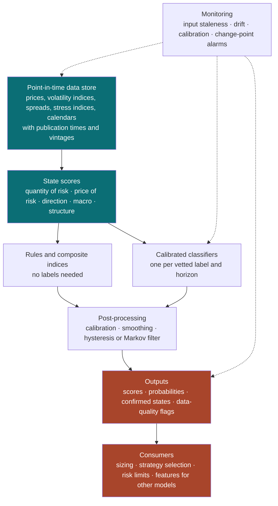
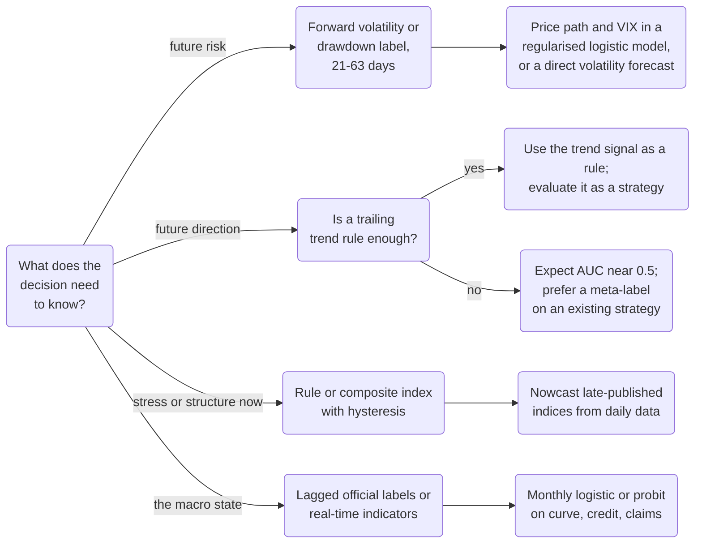

# Classifying Market Regimes

### What to measure, which regimes to name, where training labels come from, and what a causal classifier can learn

---

```{=html}
<aside class="abstract">
```

# Abstract {#abstract}

```{=latex}
\begin{chapterabstract}
```

Classifying the market regime usually means forecasting part of the future. The regimes worth building are defined by how much the market will move, which can be forecast. Regimes defined by which way it will move cannot be forecast, according to a century of US data.

A regime definition is a choice. Eight reasonable definitions of a bad market agree only moderately over a century of US data. The definitions range from bear markets to recessions to volatile months ahead. Most regime vocabularies divide five quantities into a few states: risk, the compensation for risk, drift, the economy, and co-movement. Many labels use future data. A day counts as part of a bear market because prices fell 20% afterward. From 1927 to 2025, leaving the market during bear markets known in hindsight would have raised the Sharpe ratio from 0.45 to 1.54. Leaving when the 20% rule actually confirmed each bear market gave 0.46. The confirmation came a median of 70 trading days after the peak.

Risk persists, so it can be forecast. A simple model ranked a day before a volatile month above a day before a calm month 88% of the time. Last month's volatility alone did so 84% of the time. The same model forecast the sign of the next quarter's return slightly worse than a coin flip. The VIX, credit spreads, the yield curve and the volatility term structure largely repeat what recent price variation already shows. In the worked example they added almost nothing to seven price-based features, and 19 more years of history were worth more than any extra feed. Each label source has a reach: how far into the future it looks. The reach determines how to split the training data and how late any detection will be. Official recession dates arrive 7 to 15 months late on average.

Because regimes persist, the most recent known label is a strong baseline, and a model must beat it, not a coin flip. A small, regularised model usually matches a complex one, because the data hold only a few dozen crises to learn from. A quarter-century of daily data holds nine bear markets, so evaluate per episode, with error bars that reflect the small count. The chapter recommends defining the regime by the risk a decision depends on over the next few weeks, and never training on a label before it could have been known.

```{=latex}
\end{chapterabstract}
```

```{=html}
</aside>
```

---

**What this is.** The phrase "detect the market regime" contains four questions.
The first is which definition of a regime the study should adopt. The second is
which observable inputs carry information about it. If the study trains a
model, the third is where the training labels come from. The fourth is which model
turns the inputs into a classification. This chapter answers them in that order
(§2–§5). Its companion, [Market Regimes and Hidden Markov
Models](market_regimes.html), treats a regime as a latent state and builds the
hidden Markov model that infers it. This chapter treats a regime as a *target*.
A decision needs the target. The study defines it explicitly and estimates it
from data available at the time. Most of the chapter covers two
questions that the latent-state view leaves open. These are what to feed a
classifier and what to train it against.

**How to read it.** Part I (§1–§2) states the problem and surveys the regime
definitions practitioners use. Part II (§3–§4) covers inputs and labels. A reader
building a regime study will use these two sections most. Part III (§5–§8) covers
classifiers, a worked example on public data from 1926 to 2025, evaluation, and
the architecture of a production study. §9 is the synthesis. A reader with time
for only three parts should read §1.4, §4.9 and §6. §1.4 covers the reach
of a label and why detection is forecasting. §4.9 covers vetting a label
before training on it. §6 covers what a causal classifier learns on public
data, with labels over a century and classifiers since 1990. Appendix A defines the statistical and financial concepts that the
main text uses without deriving them.

**Relationship to the other notes.** [Market Regimes and Hidden Markov
Models](market_regimes.html) supplies three results used throughout. Regime
models identify volatility and not expected returns. The choice between
predicted, filtered and smoothed state estimates governs measured performance.
The effective sample size of any regime study is its number of episodes, not its
number of days. This note is the prerequisite for §5.7 and §5.8. [Implied
Volatility](implied_volatility.html) derives the VIX and the variance risk
premium used in §3.3. [Bonds and Bond Markets](bond_markets.html) covers the
credit spreads and yield curves of §3.4 and §3.5. [Trend-Following in Financial
Markets](trend_following.html) covers the trend estimation behind §2.4. [Edge as
Information](edge_as_information.html) relates hit rates to information.
§1.4 uses that relation to size what a good direction signal delivers. Each note
stands alone.

**Epistemic tags.** The text flags claims by status where the status changes what
you should do:

- **[Fact]** — replicated across independent datasets or implementations, with
  broad agreement among people who have looked.
- **[Contested]** — documented, but with live disagreement about magnitude,
  robustness, or cause.
- **[Hypothesis]** — a proposed mechanism, not decisively tested.
- **[Practice]** — practitioner convention. It may be right. The evidence is
  private or absent, and absent evidence is not evidence against it.

Untagged sentences are definitions, derivations, or arithmetic. The numbers in §6
and every number attributed to "the worked example" come from public data.
[`figures/rc_common.py`](https://github.com/rmahfoud/quant-research/blob/master/figures/rc_common.py){target="_blank"}
prints them, so you can change a parameter and rerun.

---

**Notation.** $S_t$ is the level of a total-return price index at the close of
trading day $t$, $r_t = S_t / S_{t-1} - 1$ its simple return and
$\ell_t = \log(1 + r_t)$ its log return. $A = 252$ is the number of trading days
per year. $\mathcal{F}_t$ is the information available at the close of day $t$.
It contains data *published* by then. It excludes data that describe day $t$ but
appear later.

$z_t$ is the vector of latent **state variables** (§1.3, §2.2). They are the
quantity of risk, the price of risk, the direction of the market, the
macroeconomic state and the structure of co-movement. $x_t \in \mathbb{R}^d$ is the vector of **inputs**
(features) known at $t$. The inputs relate to the state through
$x_t = \phi(z_t) + \varepsilon_t$, where $\varepsilon_t$ is the measurement noise
(§1.3). A **regime** $s_t \in \{1, \dots, K\}$ is a coarse partition of the
state, $s_t = c(z_t)$, into $K$ classes (coded $\{0, 1\}$ when $K = 2$, as for a
label). Lowercase $s_t$ is the regime and uppercase $S_t$ the price. The two
never appear in the same role. As in the companion chapter, the text sets vectors such as $x_t$
and $z_t$ in plain type. $\Sigma$ denotes a covariance matrix.

A **label** $y_t$ is the training target attached to day $t$, computed from the
price path (or from other data) by a rule $L$:
$y_t = L(S_{t-a}, \dots, S_t, \dots, S_{t+b})$. Its **lookback** is $a$ and its
**reach** is $b$, the number of days after $t$ on which it depends (§1.4). For a
label defined over a forward window of fixed length, $b = h$, the horizon. Labels
are binary unless stated, with $y_t = 1$ marking the class of interest (the bear
market, the high-volatility month). $p_t = \Pr(y_t = 1 \mid \mathcal{F}_t)$ is the
best possible probability forecast of the label, and $\hat p_t$ a classifier's
estimate of it. An **episode** is a maximal run of consecutive days with
$y_t = 1$. A label's episode count is the number of such runs, and an episode's
length is the number of days in it.

$\mathrm{RV}^{(n)}_t = \sqrt{(A/n) \sum_{i=0}^{n-1} \ell_{t-i}^2}$ is the trailing
$n$-day realised volatility, annualised. $\mathrm{VIX}_t$ is the Cboe volatility
index in percentage points. $\delta$ is the threshold of a turning-point rule (a
20% move unless stated). $\tau$ denotes particular dates: a peak, a trough, a
confirmation, a refit. $\Lambda(u) = 1/(1 + e^{-u})$ is the logistic function.
The symbol $\sigma$ always denotes volatility and never a sigmoid. $\beta$ is the
vector of coefficients of a classifier and $\alpha$ the ridge penalty on them
(§5.4). $\lambda$ is the switching penalty of a jump model (§4.6), and $\kappa$ is
Cohen's kappa (§6.2). AUC, the Brier score $\mathrm{BS}$ and the Brier skill
score $\mathrm{BSS}$ are defined in §7.1–§7.3 (informally in §1.4 and §5.1). In
§5.11, $p_{jk}$ with two class subscripts is a Markov transition probability, as
in the companion chapter. The symbols $p_t$ and $\hat p_t$, with a time subscript,
are label probabilities. A symbol used in one subsection only is defined there.

---

**What you will be able to do.** After this chapter you should be able to:

1. Turn "detect the regime" into a stated decision, a state variable, a label and
   a horizon, and say in advance how much of the label a classifier can learn.
2. Choose inputs for each state variable, align them to the time they were
   published, and transform them so that a model trained on one decade applies to
   the next.
3. Construct training labels from six kinds of source, and measure each label's
   reach, persistence, stability and episode count before training anything.
4. Build a walk-forward training set that never uses a label before it was
   knowable, and score a classifier against the baseline that matters.
5. Choose among threshold rules, composite indices, logistic models, tree
   ensembles, latent-state models and teacher–student pipelines for a given
   decision, and know how each one fails.

---

## Table of contents

- [Abstract](#abstract)

**Part I — What to classify**

1. [What classifying a regime means](#1-what-classifying-means)
2. [How practitioners carve up regimes](#2-practitioner-regimes)

**Part II — Inputs and labels**

3. [Inputs: observing the state variables](#3-inputs)
4. [Labels: where the training targets come from](#4-labels)

**Part III — Models and evidence**

5. [Classifiers](#5-classifiers)
6. [A worked example on a century of data](#6-worked-example)
7. [Evaluating a regime classifier](#7-evaluation)
8. [Building a regime study](#8-building)
**Synthesis and references**

9. [Synthesis](#9-synthesis)
10. [References](#10-references)

**Appendix**

- [A. Concepts and prerequisites](#appendix-a-concepts-and-prerequisites)

---

# 1. What classifying a regime means {#1-what-classifying-means}

## 1.1 The wrong intuition

Most people assume that the market is in some regime at any moment: a bull
market or a bear market, risk-on or risk-off, calm or stressed. On this view the
regime is a fact about the world. A good enough model with enough inputs reveals
it, and the history of past regimes supplies the training labels. Under this view
regime detection is fault detection: more sensors give earlier and surer
detection.

The intuition fails in three ways.

1. **A regime is a definition, not a fact.** Eight reasonable definitions of a
   "bad" regime on the same century of US data agree only moderately with one
   another. Their pairwise Cohen's kappa ranges from 0.03 to 0.58 for definitions
   in different families (§6.2). Kappa is a chance-corrected agreement score,
   with 1 for perfect agreement and 0 for agreement no better than chance. No
   single regime history exists to recover.
2. **The definitions practitioners care about depend on the future.** In the
   usual sense, a day is in a bear market only if prices go on to fall 20% from
   the preceding peak. A classifier that must say so before that fall is complete
   must forecast the fall.
3. **The parts of a regime that are knowable now need measurement, not
   classification.** Today's volatility, drawdown and credit spread are
   observable. A rule computes them, so a model has nothing to learn.

One number illustrates the second point. Over 1927–2025, a strategy held the US
market when the ±20% bull–bear label said "bull" and held cash otherwise. It
earned a Sharpe ratio of 1.54, against 0.45 for holding the market throughout.
That strategy uses the label one day ahead. Acting on the label only once the
rule itself has confirmed it gave a Sharpe ratio of 0.46 (§6.3). In
Sharpe-ratio terms, all of the label's value comes from the days when it cannot
yet be known.

The right question is which property of the coming weeks or months matters to
the decision. A second question is how well the property can be forecast from
what is visible now. A third is whether a discrete regime is the best way to
carry that forecast. The question "which regime are we in?" is the wrong one.

## 1.2 Three questions before any data

A regime study should begin with a sentence, not a dataset. The sentence answers
three questions.

1. **Regime of what?** This names the asset, portfolio or strategy whose
   behaviour the study classifies. A regime of the S&P 500's volatility, a regime of a momentum
   strategy's returns and a regime of the stock–bond correlation are different
   objects with different inputs.
2. **For which decision?** Sizing, hedging, choosing between strategies,
   setting risk limits, or conditioning another model. The decision says which
   outcome the label must separate.
3. **At what horizon?** The decision's holding period sets the label's horizon.
   A daily volatility-targeting rule needs next-week or next-month risk. A
   strategic allocation needs the next year's macroeconomic state.

A well-posed study reads: *"Reduce equity exposure when
the probability that realised volatility over the next 21 trading days falls in
the top fifth of its history exceeds 0.6."* Every term in that sentence is
measurable. The phrase "detect the regime" is not.

The decisions fall into three groups. The groups differ in how much a model can deliver:

| Decision | Outcome the label must separate | Learnable from current data? |
|---|---|---|
| Risk: sizing, hedging, limits | future volatility, drawdown, correlation | largely — risk is persistent (§6.4) |
| Direction: timing, trend exposure | future return, bull or bear phase | barely — direction is not identified (§6.4) |
| Macro allocation: duration, inflation hedges, factor tilts | growth, inflation, recession | partly — slowly, with lags and revisions (§2.8) |

The rest of the chapter elaborates this table. Regime studies deliver value on
risk-type regimes. Most of them target direction-type regimes.

## 1.3 The master form

Every regime study has the same five parts, whether it is a VIX threshold or a
gradient-boosted classifier trained on jump-model labels. A few hidden state
variables drive the market. Observable inputs measure them with noise. A regime
coarsens them into a few classes. A label approximates that coarsening using the
realised price path. A classifier estimates the label from inputs available at
the time.

$$
\begin{aligned}
x_t &= \phi(z_t) + \varepsilon_t && \text{(inputs observe the state, with noise)} \\[2pt]
s_t &= c(z_t) && \text{(a regime is a coarse partition of the state)} \\[2pt]
y_t &= L\big(S_{t-a}, \dots, S_t, \dots, S_{t+b}\big) && \text{(a label is computed from the path)} \\[2pt]
\hat p_t &= f\big(x_t, x_{t-1}, \dots\big) \approx \Pr\big(y_t = 1 \mid \mathcal{F}_t\big) && \text{(a classifier estimates it causally)}
\end{aligned}
$$

The state $z_t$ is continuous and unobserved. §2.2 argues that five state
variables underlie every practitioner taxonomy. They are the **quantity of risk**
(volatility) and the **price of risk** (risk premia and risk appetite). They also
include the **direction** of the market (its conditional mean), the
**macroeconomic state** (growth, inflation and policy), and the **structure** of
co-movement (correlation, dispersion and liquidity). The function $\phi$ says how inputs
relate to these variables. The term $\varepsilon_t$ is measurement noise. For
example, the VIX measures the quantity of risk plus a time-varying premium, and a
credit spread measures expected default plus the price of risk.

The regime $s_t = c(z_t)$ is a discretisation. It is useful for two reasons: it
carries a discrete decision (on or off, strategy A or strategy B), and it
communicates the state. It costs the information that the coarsening discards.
The label $y_t$ is the computable stand-in for the regime and is the target of
the supervised model. The classifier $f$ may use only inputs dated $t$ or
earlier.

Five parts vary between studies. They are the state variable, the coarsening
$c$, the label rule $L$ (including its reach $b$), the inputs $\phi$, and the
classifier $f$. Most named methods choose three of them and leave the other two
implicit. A VIX-band study chooses the quantity of risk, a coarsening into bands,
and a label with zero reach, so it needs no classifier. A bull–bear study chooses
direction and a turning-point label. It usually ignores that the label's reach is
months long. The comparison tables of §2.12, §4.8 and §5.12 fill in this master
form.

The companion chapter's master form describes the same objects with a
latent-state view. There the regime is a latent Markov state, the "label" is its
posterior probability, and no external target is used for training. The two views
meet in §5.7 and §5.8. A latent-state model can be the classifier, or it can
produce the labels that a supervised classifier then learns.

## 1.4 The reach of a label, and why detection is forecasting

The **reach** $b$ of a label is the number of days after $t$ that the label of
day $t$ depends on. The reach alone decides what a classifier can learn, how to
build the training set, and how late any detection will be.

First, suppose $b = 0$. Then $y_t$ is a function of data available at $t$. The
best possible forecast is the rule itself, so $p_t \in \{0, 1\}$ and the error is
zero. Training a model to reproduce such a label is, at best, a slow way to
compute it. "VIX above 30" and "10% below the high" are labels of this kind. They
are useful regimes, but a rule measures them and a model does not learn them.

Now suppose $b > 0$. The label depends on what happens next. The best possible
forecast is the conditional probability $p_t = \Pr(y_t = 1 \mid
\mathcal{F}_t)$. Even this ideal forecaster has an irreducible error. Measured by
the Brier score (the mean squared difference between forecast probability and
outcome), the ideal forecaster's error is the expected conditional variance of
the label:

$$
\mathrm{BS}^{*} = \mathbb{E}\big[(p_t - y_t)^2\big] = \mathbb{E}\big[p_t\,(1 - p_t)\big].
$$

The second equality is the Bernoulli variance. Given $\mathcal{F}_t$, the squared
error is $(1 - p_t)^2$ with probability $p_t$ and $p_t^2$ otherwise, so its mean
is $p_t(1 - p_t)$. Hence $\mathrm{BS}^{*}$ is zero only when $\mathcal{F}_t$
settles the label. It is largest when $p_t$ is near one half. In expectation, no
model can do better than $\mathrm{BS}^{*}$. The size of $\mathrm{BS}^{*}$ depends
on what drives the label's future part.

This yields the chapter's first organising claim. **A supervised regime
"detector" forecasts its label's future part. The drivers of that future part
set what the detector can learn:**

- **If the future part is volatility**, the label is highly learnable, because
  volatility is persistent. The log VIX has a daily autocorrelation of 0.98 since
  1990, a half-life of about 35 trading days (a deviation with daily
  autocorrelation $\rho$ halves in $\ln 0.5 / \ln \rho$ days). Log 21-day
  realised volatility on the US market since 1930, regressed on its own value a
  month earlier, has a slope of 0.72, a half-life of about two months. In §6.4 a
  forecast of the label defined by next month's volatility reaches an AUC of
  0.88. (AUC is the probability that the classifier ranks a randomly chosen
  positive day above a randomly chosen negative one. An AUC of 0.5 is chance.)
- **If the future part is direction**, the label is barely learnable. A
  correlation (an information coefficient) of 0.05 between a forecast and the
  next period's return would be a good equity-timing signal. It corresponds to a
  hit rate of 51.6% ([Edge as Information](edge_as_information.html)). In
  §6.4, a label defined by the sign of the next quarter's return scores an AUC
  below 0.5 out of sample.
- **If the future part is the macroeconomic state**, the label is learnable at
  low frequency from slow inputs such as the yield curve and credit spreads. Both
  the inputs and the labels have long publication lags and revisions.

**Detection is forecasting.** Reach removes the usual distinction between "detecting the
current regime" and "predicting the next one". Today's data can compute any part of today's regime that they settle.
Any other part is a forecast. A study that claims to detect bear markets early
claims to forecast falls in prices. Judge such a study against the evidence on
forecasting returns, which is discouraging
([Welch & Goyal, 2008](https://www.nber.org/papers/w10483){target="_blank"}).

**Random reach.** Some labels have no fixed reach. A bull–bear label built from
turning points assigns day $t$ to a bear market if $t$ lies between a peak and
the following trough. The rule confirms a peak only when the price has fallen
$\delta = 20\%$ below it. The label of the days after a peak is therefore settled
only on the confirmation date. Its reach is the **confirmation lag**, the
number of days from the turning point to its confirmation. On the US market since
1926 the median confirmation lag was 70 trading days for bear markets
(interquartile range 42–146) and 41 for bull markets (§6.3). For about a fifth of
all days, the label could not have been known until weeks or months later.

**The stale-label baseline.** Because labels persist, the most recent label that
*is* fully known at $t$ is a strong forecast of the current one. For a label with
fixed reach $b$, that label is $y_{t-b}$. For a forward-volatility label with
horizon $h$, $y_{t-h}$ uses the returns of $(t-h, t]$. It compares
trailing realised volatility with a threshold that has barely moved in $h$ days,
so it is a pure persistence forecast. For a turning-point label, the stale label
is the **confirmed state**, the rule's own real-time classification. Judge a
classifier by its improvement over this stale label, not over the base rate. In
§6.4 trailing volatility alone reaches an AUC of 0.84 on the forward-volatility
label, and the full model adds 0.04.

Two exact equivalences hold:

| This | is exactly | Consequence |
|---|---|---|
| The real-time ±20% bull–bear rule | a hysteresis rule (separate triggers for entering and leaving a state, §5.2): a 20% drawdown from the running peak starts the bear state, a 20% rise from the running trough ends it | its "detections" are threshold crossings, made when the move is already 20% deep |
| The ex-post ±20% bull–bear label | the real-time rule with each switch moved back to the preceding peak or trough | the two differ only between each turning point and its confirmation: 20% of days since 1927 |

## 1.5 Dating, nowcasting and forecasting

Three tasks share the name "regime detection". They use different information,
so evaluate them differently.

| Task | Information used | Example | Evaluated against | Typical error |
|---|---|---|---|---|
| **Dating** | the whole sample, before and after $t$ | NBER recession dates, the ex-post bull–bear label, smoothed HMM probabilities | historical judgement | treating dated labels as observable in real time |
| **Nowcasting** | $\mathcal{F}_t$, for a label of day $t$ | "is today in a bear market?", this week's financial-conditions index before it is published | the label, once settled | reporting accuracy on days whose label was already settled |
| **Forecasting** | $\mathcal{F}_t$, for a label of a later day | "will next month be high-volatility?" | the realised label | ignoring overlap between consecutive labels |

The three tasks correspond to the three information sets of the companion
chapter (section 5 of [Market Regimes and Hidden Markov
Models](market_regimes.html#5-the-formal-models)). Dating uses smoothed
information, nowcasting uses filtered information, and forecasting uses predicted
information. Published regime classifiers most often make one error: they train
on dated labels and report accuracy against the same dated labels. This treats
the accuracy as attainable in real time. It is attainable only on days whose
label had already been settled, and a classifier is least needed on those days.

Nowcasting a label with a long reach is forecasting. Nowcasting a series that
arrives late is a different task. The Chicago Fed releases its National
Financial Conditions Index for the week ending Friday on the following Wednesday.
Estimating it on Monday from daily market data is a measurement problem with a
short horizon and a known answer. Such series are good uses of a supervised
model, because the target exists and arrives soon.

> ### §1 Key takeaways
>
> 1. A regime is a definition chosen to serve a decision. Write the decision, the
>    state variable, the label and the horizon in one sentence before touching
>    data.
> 2. The reach of a label, the number of future days it depends on, sets what
>    a classifier can learn. A label with zero reach is a rule to compute. A label with
>    positive reach is a forecast.
> 3. Supervised regime detection forecasts the label's future part. Labels
>    whose future part is volatility are learnable. Labels whose future part is
>    direction are not.
> 4. The baseline that matters is the stale label: the most recent fully known
>    label, or the rule's own confirmed state. Judge every classifier by its
>    improvement over it.
> 5. The ex-post bull–bear label and its real-time version differ only between
>    each turning point and its confirmation. That interval covers a fifth of all
>    days, and the label's value lies in it.
> 6. Dating, nowcasting and forecasting are different tasks. Accuracy measured
>    against dated labels on days already settled gives no information about
>    real-time performance.

---

# 2. How practitioners carve up regimes {#2-practitioner-regimes}

Practitioners use a dozen regime vocabularies: volatility regimes, bull and bear
markets, risk-on and risk-off, stress regimes, business-cycle phases, growth and
inflation quadrants, correlation regimes. They look like different ideas. This
section argues that they are coarsenings of five state variables. It describes
each family with the same fields. It also shows where the families agree and
where they differ. The fields answer which kinds of regime a model can
predict. Families built on the quantity of risk can be forecast. Families built
on direction cannot. Macroeconomic families can be forecast slowly.

## 2.1 A short lineage

The vocabulary accumulated over a century. Each stage added something that
practitioners still use:

| Year | Development | What changed |
|---|---|---|
| 1922 | W. P. Hamilton's *The Stock Market Barometer* sets out Dow theory: primary bull and bear markets, secondary reactions, and confirmation by two averages | The first explicit bull–bear taxonomy, with a confirmation lag built into the definition |
| 1946 | Burns and Mitchell, *Measuring Business Cycles* (NBER) | Expansions and contractions dated by expert judgement; the official recession dates that most macro labels still use |
| 1971 | Bry and Boschan's turning-point algorithm | Dating becomes a reproducible program; its window and minimum-duration parameters become choices |
| 1989 | J. D. Hamilton's Markov-switching model | The regime becomes a latent state with probabilities rather than a dated label |
| 2003–04 | Pagan and Sossounov; Lunde and Timmermann | Price-based bull–bear dating with explicit thresholds |
| 2004–12 | The Investment Clock; Bridgewater's All Weather | Allocation by growth–inflation quadrant |
| 2006–19 | Financial stress and conditions indices from central banks and the OFR | Composite, observable stress regimes published weekly or daily |
| 2018–24 | Jump models, clustering, and supervised classifiers trained on model labels | Regimes defined by fitted models; classifiers trained to predict them |

The first row matters most for this chapter. A primary bear
market in Dow theory exists only once the averages have confirmed it. So the
definition that practitioners inherited lagged from the start.
[Ang and Timmermann (2012)](https://www.nber.org/papers/w17182){target="_blank"}
review the econometric strand of this history, from Hamilton's model onward.

## 2.2 Five state variables under every taxonomy

The families below differ in vocabulary, but each one partitions one or two of
five continuous state variables. Naming them is the first step to choosing
inputs (§3), because inputs are measurements of state variables, not of regimes.

| State variable | What it is | Typical observables | Persistence | Known at $t$? |
|---|---|---|---|---|
| **Quantity of risk** | the conditional volatility of returns | realised volatility, VIX, MOVE | high: half-life of one to two months | yes, with small error |
| **Price of risk** | compensation demanded per unit of risk; risk appetite | credit spreads, variance risk premium, valuations | high | partly: a spread is observed, its split into expected loss and premium is not |
| **Direction** | the conditional mean, or trend | trailing returns, distance from moving averages | low | no: the mean is not identified in short samples |
| **Macroeconomic state** | growth, inflation, policy stance | activity data, inflation, the yield curve, the policy rate | very high | with publication lags and revisions |
| **Structure** | how assets move together, and how easily they trade | correlations, dispersion, breadth, liquidity measures | moderate | yes, with estimation noise |

The last column, together with persistence, decides what a model can predict. The
quantity of risk is observable and persistent, so a regime built on it can be
forecast a few weeks ahead with real skill. Direction is neither observable nor
persistent, so analysts can date a regime built on it in hindsight but can
hardly forecast it. The companion chapter shows the statistical cause of this asymmetry. In
a fitted regime model, the same data pin down state volatilities sixteen times
more sharply than state means (section 8 of [Market
Regimes and Hidden Markov
Models](market_regimes.html#8-what-is-known-to-work-and-what-is-not)). Most
practitioner regimes combine the quantity of risk with direction or with the
price of risk. Their observable part is therefore largely volatility.

The following sections describe each family with the same fields. The fields are
the **idea**, the **state variables**, the **definitions in use** and typical
**durations and episodes**. They also include whether the regime is **observable
at $t$**, the **decision** it serves, its **failure modes**, and **when to use
it**.

## 2.3 Volatility regimes

**Idea.** Classify the market by how much it moves.

**State variables.** The quantity of risk.

**Definitions in use.** Bands on the VIX are the commonest: below 15 "calm",
15–25 "normal", 25–35 "elevated", above 35 or 40 "crisis". **[Practice]** These
cut points are convention, not estimates. Since 1990 the VIX's median close has
been 17.6. It closed below 15 on 32.5% of days, above 30 on 8% and above 40 on
2.3%. Other definitions use quantiles of realised volatility (the top fifth of
the history so far) or bands on a GARCH volatility estimate. Others use the calm
and turbulent states of a two-state hidden Markov model fitted to returns. Others
use composite scores that average standardised measures of the VIX level, its
recent change and its own volatility.

**Durations and episodes.** Long and numerous. In the worked example, the label
"next month's realised volatility falls in the top fifth of its history so far"
has 166 episodes since 1930. The median episode length is 16 days.

**Observable at $t$?** Yes for the current level. A sizing decision needs the
level over the coming month, and that level is forecastable with an AUC near 0.88
(§6.4).

**Decision.** Position sizing and volatility targeting, option strategy
selection, stop and limit widths, risk budgets.

**Failure modes.**

- *Non-stationary levels.* A VIX of 20 was a calm reading in 2002, when the
  index averaged 27. It was an alarming reading in 2017, when the index averaged
  11. Fixed bands misclassify whole years.
- *Rolling normalisation turns a level into a surprise.* A score built from a
  rolling z-score over, say, a year adapts to the level it measures. After
  a year at a VIX of 35 the score reads "normal". Such a score classifies the
  *change* in risk. That is a different regime from the level of risk, and a
  sizing rule needs the level. For levels, use long expanding windows or
  percentiles against the history so far. Reserve short-window z-scores for
  measuring surprise explicitly (§3.12).
- *Implied is not realised.* The VIX contains a variance risk premium that varies
  with the price of risk (§3.3), so a VIX band mixes two state variables.
- *A volatility regime is not a direction regime.* High volatility also contains
  the best days of each decade, which cluster in rebounds. Volatility timing
  works by reducing risk. It does not work by avoiding losses. **[Contested]**
  Studies dispute whether it also improves returns out of sample ([Moreira & Muir,
  2017](https://www.nber.org/papers/w22208){target="_blank"}; [Cederburg et
  al., 2020](https://doi.org/10.1016/j.jfineco.2020.04.015){target="_blank"}).

**When to use it.** Whenever the decision is about risk. It is the default
regime, and the only family for which forecasts are reliably better than the
stale label.

## 2.4 Trend regimes: bull, bear, correction, rebound

**Idea.** Classify the market by the direction and persistence of its price
path.

**State variables.** Direction, with the quantity of risk entering because bear
markets are volatile.

**Definitions in use.** Five constructions are common.

1. *The ±20% rule.* A bear market runs from a peak to the following trough.
   A fall of at least 20% must follow the peak, and a rise of at least 20% must
   follow the trough. The financial press uses it. [Lunde and Timmermann
   (2004)](https://doi.org/10.1198/073500104000000136){target="_blank"}
   formalised it with separate thresholds for the two directions. A fall of 10%
   to 20% is a *correction*.
2. *Business-cycle dating applied to prices.* [Pagan and Sossounov
   (2003)](https://doi.org/10.1002/jae.664){target="_blank"} adapted the Bry–Boschan
   algorithm to monthly stock prices. The method finds local maxima and minima,
   enforces alternation and censors the ends of the sample. It requires a minimum
   cycle of 16 months and a minimum phase of four months, unless the move exceeds
   20%.
3. *Trailing-return states.* [Cooper, Gutierrez and Hameed
   (2004)](https://papers.ssrn.com/sol3/papers.cfm?abstract_id=299927){target="_blank"}
   call the market UP when its return over the past 36 months is non-negative.
   [Daniel and Moskowitz (2016)](https://www.nber.org/papers/w20439){target="_blank"}
   mark a bear state when the past two years' cumulative return is negative.
4. *Moving-average states.* The price is above or below its 200-day or ten-month
   average ([Faber, 2007](https://doi.org/10.3905/jwm.2007.674809){target="_blank"}).
5. *Four-phase cycles.* [Goulding, Harvey and Mazzoleni
   (2023)](https://papers.ssrn.com/sol3/papers.cfm?abstract_id=3489539){target="_blank"}
   cross the signs of a slow (12-month) and a fast (1-month) time-series momentum
   signal. The state is Bull when both are positive and Bear when both are
   negative. It is Correction when the slow signal is positive and the fast one
   negative, and Rebound when the slow signal is negative and the fast one
   positive. [Maheu, McCurdy and Song
   (2012)](https://papers.ssrn.com/sol3/papers.cfm?abstract_id=1939486){target="_blank"}
   fit a four-state Markov-switching model with bull, bull-correction, bear and
   bear-rally states.

**Durations and episodes.** Few. The ±20% rule finds 31 bear markets on the US
total market since 1926. Nine of them occurred since 2000. The median length is
about six months (128 trading days on the common sample of §6.2). §6.3 lists
those since 2000. Longer histories add episodes:
[Gonzalez, Powell, Shi and Wilson (2005)](https://doi.org/10.1016/j.iref.2004.02.003){target="_blank"}
date two centuries of US bull and bear cycles.

**Observable at $t$?** No for the ex-post definitions (1 and 2). Their reach is
the confirmation lag, a median of 70 trading days for bear markets. Yes for the
trailing definitions (3, 4 and 5), because they are rules with zero reach.
They are trend signals, not forecasts. The trend-following literature assesses
their value ([Trend-Following in Financial
Markets](trend_following.html)).

**Decision.** Market exposure. The risk of momentum strategies, whose crashes
cluster in bear states with high volatility, when the market rebounds ([Daniel &
Moskowitz, 2016](https://www.nber.org/papers/w20439){target="_blank"}). The choice of trend speed ([Goulding, Harvey & Mazzoleni, 2023](https://papers.ssrn.com/sol3/papers.cfm?abstract_id=3489539){target="_blank"}).

**Failure modes.**

- *Thresholds and index choice flip borderline episodes.* The S&P 500 price index
  fell 19.9% in 1990, 19.3% in 1998, 19.4% in 2011 and 19.8% in 2018. None of
  these is a bear market by the press convention. The total US market including
  dividends and small companies fell more than 20% in all four, so each is a bear
  market in the worked example. Four of its eleven bear markets since 1990 exist
  or not depending on the index.
- *Bear-market rallies count as bull markets.* The US market rose more than 20%
  between late November 2008 and early January 2009 before falling to new lows.
  So the ±20% rule
  records a brief bull market in the middle of the financial crisis. Four-phase
  definitions exist to fix this.
- *The confirmation lag.* By construction, the rule recognises a bear market once
  prices are 20% below the peak.
- *Censoring.* The last phase of any sample is provisional because its end is
  unknown.

**When to use it.** For describing history and for benchmarks. Use it as a
training target only if the decision needs direction and the user accepts the
limit on learning direction set out in §1.4.

## 2.5 Trending versus mean-reverting markets

**Idea.** Classify the market by whether it extends moves or reverses them.

**State variables.** The persistence of direction: the autocorrelation of
returns at the strategy's horizon.

**Definitions in use.** Four kinds of statistic are common. The variance ratio
$\mathrm{VR}(q)$ is the variance of $q$-day returns divided by $q$ times the
variance of one-day returns. It is above one for trending markets and below one
for mean-reverting markets ([Lo & MacKinlay,
1988](https://www.nber.org/papers/w2168){target="_blank"}). The others are the
Hurst exponent and the autocorrelation of daily returns. **[Practice]**
Practitioner indicators include the efficiency ratio (net move divided by path
length) and the average directional index.

**Durations and episodes.** Short and noisy.

**Observable at $t$?** Only with large error. An autocorrelation estimated from
63 days of returns has a standard error of about $1/\sqrt{63} \approx 0.13$,
larger than the variation in autocorrelation that the regime should detect.

**Decision.** Choosing between trend-following and mean-reversion strategies, and
placing stops and targets.

**Failure modes.** Noise dominates. The P&L of a trend rule depends on the
autocorrelation of returns at its own horizon over the holding period. That
autocorrelation is a forecast of direction's persistence, not a measurement of it
([Trend-Following
in Financial Markets](trend_following.html)).

**When to use it.** As a descriptive statistic over long windows.
**[Practice]** Little out-of-sample evidence supports switching strategies on
short-window estimates.

## 2.6 Risk-on and risk-off

**Idea.** On some days and in some periods, risky assets rise together while
havens fall (risk-on). In others the reverse happens (risk-off).

**State variables.** The price of risk, at a global level, and structure.

**Definitions in use.** The sign or standardised size of a common factor in
cross-asset returns. The factor is usually the first principal component of
returns. The principal component is the single weighted average of the returns
that carries the most common variation. The returns are those of equities,
credit, emerging markets, commodities and carry currencies, against Treasuries,
gold, the yen, the Swiss franc and the dollar. [Chari, Dilts Stedman and Lundblad
(2023)](https://www.nber.org/papers/w31907){target="_blank"} build a
risk-on/risk-off index from several market-based measures. [Miranda-Agrippino and
Rey (2020)](https://www.nber.org/papers/w21722){target="_blank"} find a single
global factor that explains a large share of the variation in risky-asset prices
worldwide. [Bekaert, Hoerova and Lo Duca
(2013)](https://www.nber.org/papers/w16397){target="_blank"} split the VIX into
risk aversion and uncertainty.

**Durations and episodes.** The daily sign flips often. The strength of the
common factor persists for weeks to months. That strength is the factor's share
of cross-asset variance over a rolling window.

**Observable at $t$?** Yes. It describes today's co-movement.

**Decision.** Cross-asset hedging, the risk of carry trades and of
emerging-market exposure.

**Failure modes.** The definition is close to circular, because a risk-off day is
a day on which risky assets fell. The set of havens changes. Treasuries hedged
equities from about 2000 to 2021 and did not in 2022 (§2.9). A daily sign is not
a regime. Use the rolling strength of the factor, or its smoothed level.

**When to use it.** For multi-asset portfolios, as a structure measure rather than
a forecast.

## 2.7 Financial stress and liquidity

**Idea.** Either the financial system functions normally, or funding and market
liquidity are impaired and forced selling drives prices.

**State variables.** The price of risk and structure. In stress, correlations
rise and diversification fails.

**Definitions in use.** Composite indices published by public institutions:

- The **St. Louis Fed Financial Stress Index** (STLFSI4) combines 18 weekly
  series (seven interest rates, six yield spreads and five other indicators)
  through their first principal component. Its average since late 1993 is zero,
  so positive values mean above-average stress ([Kliesen & Smith,
  2010](https://doi.org/10.20955/es.2010.2){target="_blank"}).
- The **Chicago Fed National Financial Conditions Index** (NFCI) is a weighted
  average of 105 indicators of risk, credit and leverage, with weights from a
  dynamic factor model. It is scaled to mean zero and standard deviation one since
  1971. Positive values mean tighter-than-average conditions ([Brave &
  Butters, 2012](https://www.ijcb.org/journal/ijcb12q2a6.htm){target="_blank"}).
  An adjusted version (ANFCI) removes the part explained by economic activity
  and inflation.
- The **OFR Financial Stress Index** combines 33 daily market indicators in five
  categories (credit, equity valuation, funding, safe assets and volatility). It
  is zero at normal stress. Its values do not change once estimated ([Monin,
  2019](https://doi.org/10.3390/risks7010025){target="_blank"}).
- The ECB's **CISS** weights its sub-indices by their cross-correlations. Stress
  therefore counts for more when it is systemic, meaning that it spreads across
  markets at once
  ([Hollo, Kremer & Lo Duca,
  2012](https://papers.ssrn.com/sol3/papers.cfm?abstract_id=2018792){target="_blank"}).
- **Turbulence** is the squared Mahalanobis distance of today's cross-asset returns
  from their historical mean (§5.3; [Kritzman & Li, 2010](https://doi.org/10.2469/faj.v66.n5.3){target="_blank"}).
  The **absorption ratio** is the share of variance explained by the leading
  eigenvectors ([Kritzman, Li, Page & Rigobon,
  2011](https://papers.ssrn.com/sol3/papers.cfm?abstract_id=1633027){target="_blank"}).
  Both are market-only constructions of the same kind.

**[Practice]** Common cut points are zero (above-average stress), and one and two
standard deviations for "significant" and "severe" stress.

**Durations and episodes.** Weeks to months, with few systemic episodes. In the
US since 1990 these were roughly 1998, 2001–02, 2007–09, 2011, 2020 and a handful
of shorter ones.

**Observable at $t$?** Yes for the daily market-based indices, after a lag of a
day or two. The OFR index publishes two business days late. Yes, with a longer
lag, for the weekly indices, whose readings for the week ending Friday appear the
following Wednesday.

**Decision.** Leverage, liquidity buffers, risk limits, and whether to trust a
diversification assumption.

**Failure modes.**

- *Revisions.* The NFCI is re-estimated every week, so its history changes. The
  Chicago Fed describes the changes as usually small, but a backtest on today's
  history uses weights that were not available then.
- *Full-sample weights.* Weights estimated on the whole sample and applied to its
  early years carry information from later crises into earlier readings.
- *Composition changes.* The STLFSI was rebuilt as LIBOR was retired. Its
  LIBOR-based spreads gave way to SOFR-based ones. Version 4 replaced a
  backward-looking 90-day average SOFR with the forward-looking 90-day rate.
- *Conditions are not stress.* The NFCI includes leverage measures, which build
  slowly in good times. A stress index measures acute strain. The two answer
  different questions.

**Evidence.** The NFCI predicts episodes of financial stress at horizons up to a
year ([Brave & Butters, 2012](https://www.ijcb.org/journal/ijcb12q2a6.htm){target="_blank"}).
Financial conditions forecast the lower tail of
GDP growth much better than its median ([Adrian, Boyarchenko & Giannone,
2019](https://doi.org/10.1257/aer.20161923){target="_blank"}).

**When to use it.** For risk limits and leverage, and as a compact input that
summarises dozens of series (§3.6).

## 2.8 Macroeconomic regimes

**Idea.** Classify periods by the state of the economy, on the theory that asset
classes respond to it in understandable ways.

**State variables.** The macroeconomic state: growth, inflation and policy.

**Definitions in use.** Four variants.

1. *The business cycle.* NBER expansions and recessions are the reference.
   Real-time alternatives include Markov-switching dynamic-factor models of
   activity ([Chauvet & Piger,
   2008](https://papers.ssrn.com/sol3/papers.cfm?abstract_id=760966){target="_blank"}).
   Another is the Sahm rule, which signals a recession when the three-month average
   unemployment rate rises half a percentage point above its low of the previous
   twelve months ([Sahm,
   2019](https://www.hamiltonproject.org/papers/direct-stimulus-payments-to-individuals){target="_blank"}).
   A third is probit models on the yield curve ([Estrella & Mishkin,
   1998](https://www.nber.org/papers/w5379){target="_blank"}). [Hamilton
   (2011)](https://www.nber.org/papers/w16162){target="_blank"} surveys how such
   methods have performed in real time. [Giusto and Piger
   (2017)](https://doi.org/10.1016/j.ijforecast.2016.04.006){target="_blank"}
   date turning points in real time with a simple machine-learning classifier,
   vector quantisation. **[Practice]** Analysts usually read composite leading
   indicators such as the OECD's in four phases. The phases cross the
   indicator's level relative to its trend with its direction: above trend and
   rising, above and falling, below and falling, below and rising ([OECD,
   2012](https://oecd.org/content/dam/oecd/en/data/methods/OECD-System-of-Composite-Leading-Indicators.pdf){target="_blank"}).
2. *Growth–inflation quadrants.* Bridgewater's All Weather framework defines four
   environments by whether growth and inflation are rising or falling relative to
   expectations. It holds assets that suit each environment, balanced by risk ([Podolsky,
   Johnson & Jennings,
   2012](https://www.bridgewater.com/research-and-insights/the-all-weather-story){target="_blank"}).
   Merrill Lynch's Investment Clock names four phases from the direction of growth
   and inflation: reflation, recovery, overheat and stagflation (Greetham and
   colleagues, Merrill Lynch, 2004). These are practitioner frameworks from firms
   that sell allocation products built on them.
3. *Statistical macro-market regimes.* A Gaussian mixture fitted to 17 factor
   returns from 1971 to 2020 yields four conditions named Crisis, Steady State,
   Inflation and Walking on Ice ([Botte & Bao,
   2021](https://www.twosigma.com/articles/a-machine-learning-approach-to-regime-modeling){target="_blank"}).
   [Guidolin and Timmermann
   (2007)](https://papers.ssrn.com/sol3/papers.cfm?abstract_id=940652){target="_blank"}
   find four states for stocks and bonds jointly: crash, slow growth, bull and
   recovery.
4. *Monetary-policy regimes.* Hiking, cutting and holding cycles, measured by
   the six- to twelve-month change in the policy rate or the two-year yield, and
   the zero-rate period as its own regime.

**Durations and episodes.** Years, and very few. The US has had 12 recessions
since 1948. Inflation regimes number a handful.

**Observable at $t$?** Only with publication lags and revisions. NBER dates are
not observable in real time at all. Over the cycles since 1978, the committee
announced peaks an average of 7.3 months after they occurred, and troughs 15
months after ([NBER announcements](https://www.nber.org/research/business-cycle-dating/business-cycle-dating-committee-announcements){target="_blank"}).
The committee announced the trough of March 1991 in December 1992.

**Decision.** Strategic allocation, duration and inflation hedging, factor tilts.

**Failure modes.**

- *Few episodes.* Twelve recessions is the whole post-war sample for a recession
  classifier.
- *Revisions.* Real-time and final macroeconomic data differ, sometimes enough
  to change the sign of a growth reading ([Croushore & Stark,
  2001](https://doi.org/10.1016/S0304-4076(01)00072-0){target="_blank"}).
- *Two-sided filters.* A detrended indicator built with the Hodrick–Prescott
  filter revises its recent values as new data arrive ([Hamilton,
  2018](https://www.nber.org/papers/w23429){target="_blank"}). The OECD's
  composite leading indicators have used this filter since 2008.
- *Relationships break.* The 10-year minus 3-month Treasury spread was negative
  from late October 2022 to mid-December 2024. This was the longest inversion on
  record. No NBER recession had followed at the time of writing.

**When to use it.** For slow allocation decisions, with labels lagged by their
publication delay. Rarely for daily equity decisions, where macro data move too
slowly to help except through surprises on release days (§3.10).

## 2.9 Correlation and dispersion regimes

**Idea.** Classify periods by how assets move together, not by how much they
move.

**State variables.** Structure.

**Definitions in use.**

- *The stock–bond correlation.* Negative from the late 1990s to about 2020,
  positive before that and again from 2021–22. Its sign appears to track whether inflation
  shocks or growth shocks dominate ([Campbell, Sunderam & Viceira,
  2017](https://www.nber.org/papers/w14701){target="_blank"}). Macroeconomic
  fundamentals explain little of its variation, and liquidity factors explain more
  ([Baele, Bekaert & Inghelbrecht,
  2010](https://www.nber.org/papers/w15260){target="_blank"}). For a balanced
  portfolio it is the most consequential regime of all (section 14 of [Bonds and
  Bond Markets](bond_markets.html#14-bonds-equities)).
- *Equity correlation.* The average correlation among index members, or the
  implied correlation from index and single-stock options (Cboe's COR1M and COR3M
  indices, with history from 2006). **[Contested]** Average correlation predicts
  market returns, because it tracks aggregate risk ([Pollet & Wilson,
  2010](https://papers.ssrn.com/sol3/papers.cfm?abstract_id=965354){target="_blank"}).
  Correlation risk also carries a premium in index options ([Driessen, Maenhout &
  Vilkov, 2009](https://papers.ssrn.com/sol3/papers.cfm?abstract_id=673425){target="_blank"}).
- *Dispersion.* The cross-sectional spread of stock returns separates a
  "macro" market from a "stock-picker's" market. It relates to time
  variation in the value and momentum premiums ([Stivers & Sun,
  2010](https://doi.org/10.1017/S0022109010000384){target="_blank"}).

**Durations and episodes.** The stock–bond sign changes every decade or two, so
episodes are very few. Equity correlation regimes last weeks to months.

**Observable at $t$?** Yes, with estimation noise. A correlation estimated over 63
days has a standard error of roughly $(1 - \rho^2)/\sqrt{63}$, about 0.11 at
$\rho = 0.3$. Volatile periods also bias measured correlations upward
for mechanical reasons ([Forbes & Rigobon,
2002](https://www.nber.org/papers/w7267){target="_blank"}).

**Decision.** Diversification and hedge ratios, dispersion trades, and factor
exposure.

**Failure modes.** Estimation noise and the volatility bias. For the stock–bond
sign, the sample has two or three regimes in a century.

**When to use it.** Whenever a portfolio relies on a correlation. It is the regime
most often ignored and most often decisive.

## 2.10 Calendar and event regimes

Some regimes are known in advance: Federal Reserve announcement days, the release
days of inflation and employment data, monthly options expiry, quarter ends,
earnings seasons, holidays. Volatility and volume behave differently on these
days. Enter them in a study as features, never as something to detect. Leaving
them out has a cost. A classifier that does not know a release is scheduled may
read the release-day spike in volatility as the start of a regime.

## 2.11 How the families overlap, and where they differ

The families overlap because volatility rises when prices fall. Low volatility,
bull markets, risk-on, low stress and expansions tend to occur together. The
overlap is real but partial. In the worked example's century of US data, the
chance-corrected agreement between the ex-post bear-market label and the
next-month high-volatility label is $\kappa = 0.35$. The agreement between either
of these labels and NBER recessions is about 0.3. The agreement between the
rule's own real-time bear state and a negative next quarter is 0.03 (§6.2).

The episodes where the families differ are the informative ones. The table uses
the worked example's data: the US total market, the VIX and the Baa–Treasury
credit spread.

| Episode | Largest drawdown in the window | VIX | Baa – 10-year spread, start → high | NBER recession | Families that fired |
|---|---|---|---|---|---|
| Aug–Dec 1987 | 33.1% | not yet published | 2.0 → 2.7 points | no | volatility, trend; no macro |
| Jan–Jun 2007 | 5.9% | mean 13, high 20 | flat near 1.6 | no | almost none; the yield curve was inverted |
| Jul–Dec 2007 | 9.7% | mean 22, high 31 | 1.6 → 2.6 points | no (the peak was December) | credit and stress before equity |
| Sep–Dec 2018 | 20.4% | high 36 | 1.9 → 2.5 points | no | trend, volatility; mild credit |
| Feb–Apr 2020 | 34.2% | high 83 | 2.1 → 4.3 points | yes | all of them, briefly |
| Jan–Oct 2022 | 25.4% | mean 26, high 36.5 | 1.8 → 2.4 points | no | trend; stock–bond correlation turned positive |
| Feb–Apr 2025 | 19.6% | high 52 | 1.5 → 2.0 points | no | volatility; trend on some indices |

Two lessons follow. First, a single "regime" label does not show which family
fired, and the families call for different responses. The credit-led stress of
late 2007 called for cutting leverage while equity volatility was still moderate.
The 2022 bear market called for hedges other than Treasuries. Second, the
borderline cases decide the labels. 2025 is a bear market on some indices (the
Nasdaq Composite fell more than 20%) and not on the total market, which fell
19.6%. A study's decision on such cases shapes everything trained on them.

## 2.12 The taxonomy as a product space

Each family is a point in the space of choices in the master form of §1.3. The families do not form a hierarchy:

| Family | State variable | Usual $K$ | Usual dating | Reach of the usual label | US episodes | Decision |
|---|---|---|---|---|---|---|
| Volatility | quantity of risk | 2–4 | threshold or quantile | 0 (level) or 21 days (forward) | over a hundred | sizing, risk |
| Bull–bear | direction | 2–4 | turning points | median 70 days for bear onsets | 31 since 1926 | exposure |
| Trending vs mean-reverting | direction's persistence | 2 | rolling statistic | 0 (estimated) | noisy | strategy choice |
| Risk-on/off | price of risk, structure | 2 | factor sign or strength | 0 | many, short | cross-asset hedging |
| Stress | price of risk, structure | 2–3 | composite index | 0, plus publication lag | about ten | leverage, limits |
| Business cycle | macro | 2–4 | expert or model | months to years | 12 since 1948 | allocation |
| Growth–inflation | macro | 4 | sign of changes | months | a handful | allocation |
| Correlation | structure | 2 | rolling estimate | 0 (estimated) | 2–3 for stock–bond | diversification |

**Which axis matters.** The choice of state variable determines what can be
forecast far more than the details of the definition. Within a family,
thresholds change the episode count a great deal and the labels much less.
Moving from ±20% to ±15% raises the number of bear markets from 31 to 47, yet
the two labels agree with $\kappa = 0.88$. Across families, agreement falls to
between 0.03 and 0.58. Spend design effort on choosing the state variable and the
horizon. Tune thresholds last.

> ### §2 Key takeaways
>
> 1. Practitioner regimes are coarsenings of five state variables: the quantity
>    of risk, the price of risk, direction, the macroeconomic state and
>    structure. Name the state variable before choosing inputs.
> 2. Regimes built on the quantity of risk are observable and persistent, so
>    they can be forecast. Analysts can date regimes built on direction in
>    hindsight but can hardly forecast them. Macro regimes move slowly and arrive
>    late.
> 3. The ±20% bull–bear convention is index-dependent at the margin: four of the
>    eleven bear markets on the total US market since 1990 were not bear markets
>    on the S&P 500 price index.
> 4. Stress and conditions indices are good compact inputs, but the publishers
>    revise the weekly ones, and they use full-sample weights. Prefer unrevised
>    indices, or store the vintages.
> 5. Macro regimes have a dozen episodes and labels published months late. Lag
>    them by their real announcement delay or do not use them.
> 6. The families overlap because volatility rises when prices fall. They
>    differ in exactly the episodes that matter. Keep them as separate outputs
>    rather than merging them into one label.
> 7. Thresholds move episode counts more than they move labels. Choose the state
>    variable and horizon first. Tune thresholds last.

---

# 3. Inputs: observing the state variables {#3-inputs}

An input is useful to a regime classifier only through what it says about a state
variable. This section covers the input families by the state variable they
measure. It gives each family's mechanism, history and failure modes. It ends
with two practical problems that decide whether any of it works. The first is
aligning inputs to the time they became known. The second is transforming them so
that a relationship estimated in one decade holds in the next. The worked example
supports the section's conclusion: the input space is much smaller than the list
of series suggests. Two factors carry most of the variation, and the price path
itself carries most of the information.

## 3.1 What makes a good regime input

Six properties, in rough order of importance:

1. **Mechanism.** A reason the input moves with the state variable the label
   depends on. A credit spread widens with the price of default risk, and the VIX
   rises with expected volatility. An input with no mechanism leads to a
   specification search.
2. **History.** Enough history to contain many episodes of the regime. An input
   that starts in 2009 has no data from 2008. In the worked example, a model that
   gained a new input but lost nineteen years of history did worse (§6.4).
3. **Timeliness.** Published soon after the fact, at a frequency at least as high
   as the decision's. A monthly series cannot inform a daily decision except on
   release days.
4. **Point-in-time integrity.** Never revised, or revised with stored vintages.
   A revised series used at its latest vintage leaks future information into the
   past.
5. **Stationarity, or a transform that delivers it.** Convert a level that drifts
   across decades into something comparable over time (§3.12).
6. **Non-redundancy.** Information beyond the inputs already present. Most
   candidate inputs are noisy measurements of the volatility factor (§3.13).

**Recommendation.** Rank candidate inputs by these properties before testing any
of them. Testing forty inputs against a label with thirty episodes always finds
some apparent relationship. That relationship does not survive.

## 3.2 The price path itself

**What it measures.** The quantity of risk and the direction, directly.

**The inputs.** The inputs include realised volatility over several horizons (5,
21 and 63 days), the downside semivariance, and the drawdown from the running or
one-year high. They also include trailing returns over one, three and twelve
months, the distance from moving averages, realised skewness, and jump measures.
With intraday data, realised
variance from five-minute returns is a far more precise volatility measurement
than a daily-return estimate ([Andersen, Bollerslev, Diebold & Labys,
2003](https://www.nber.org/papers/w8160){target="_blank"}). The
heterogeneous autoregression of daily, weekly and monthly realised variance is
the standard forecasting model built on it ([Corsi,
2009](https://doi.org/10.1093/jjfinec/nbp001){target="_blank"}).

**Why they come first.** They are available for the longest history, they are
never revised, and they measure the two state variables most labels depend on.
In the worked example, seven price-path features alone reached an AUC of 0.87
for next month's volatility and 0.83 for the ex-post bear-market label. No
other input set beat them by more than 0.01 (§6.4).

**Failure modes.** Price-path features of direction (trailing returns, distance
from averages) are rules with zero reach. They describe the trend that has
happened. Any forecasting value they have is the time-series momentum effect.
That effect has its own literature and its own crashes ([Moskowitz, Ooi & Pedersen,
2012](https://doi.org/10.1016/j.jfineco.2011.11.003){target="_blank"}).

## 3.3 The implied-volatility complex

**What it measures.** The quantity of risk expected by option buyers, plus the
premium they pay for it.

**The inputs.**

- **The VIX**, the 30-day model-free implied volatility of the S&P 500, with
  history from 1990 ([Cboe VIX
  methodology](https://cdn.cboe.com/api/global/us_indices/governance/Volatility_Index_Methodology_Cboe_Volatility_Index.pdf){target="_blank"}).
  Its square is the risk-neutral expectation of the next month's variance,
  which equals the physical expectation plus the variance risk premium (sections
  5 and 6 of [Implied Volatility](implied_volatility.html#5-price-of-variance)).
- **The VIX term structure.** Cboe publishes 9-day (VIX9D, from 2011), 3-month
  (VIX3M, whose free history file starts in September 2009) and 6-month (VIX6M,
  from 2008) indices. The ratio of the VIX to the VIX3M is normally below one.
  A ratio above one means the curve is inverted, which marks acute stress. It was
  inverted on 7.7% of days from September 2009 to 2025, in 99 separate spells. The
  slope carries information about the returns of volatility assets, such as
  variance swaps and VIX futures ([Johnson,
  2017](https://papers.ssrn.com/sol3/papers.cfm?abstract_id=2548050){target="_blank"};
  [Simon & Campasano,
  2014](https://papers.ssrn.com/sol3/papers.cfm?abstract_id=2094510){target="_blank"}).
- **The variance risk premium**: the VIX squared minus a forecast of realised
  variance. Analysts often proxy the forecast by trailing realised variance.
  **[Contested]** The premium predicts equity returns, most strongly at about a
  quarter's horizon ([Bollerslev, Tauchen &
  Zhou, 2009](https://doi.org/10.1093/rfs/hhp008){target="_blank"}). **[Contested]**
  The VIX splits into the premium and the expected variance. The premium predicts
  returns, and the expected variance predicts economic activity and financial
  instability ([Bekaert & Hoerova,
  2014](https://www.nber.org/papers/w18995){target="_blank"}). The disagreement
  concerns magnitude and stability.
- **Volatility of volatility and tails.** The VVIX (the VIX of the VIX, from 2006)
  and the SKEW index (the price of S&P 500 tail protection, from 1990).
  **[Contested]** Evidence that the SKEW anticipates crashes is weak. It measures
  demand for protection, which is high in calm, complacent markets as well as
  before falls.
- **Cross-asset implied volatility.** The MOVE index of Treasury implied
  volatility, crude oil (OVX), gold (GVZ), the Nasdaq-100 (VXN) and the Russell
  2000 (RVX), and implied volatility on credit ETFs. These measure the quantity of
  risk in other markets and help when the label is about those markets.

**Why it matters.** The VIX is forward-looking where realised volatility is
backward-looking. In the worked example the VIX alone forecast next month's
volatility better than trailing realised volatility alone, with an AUC of 0.87
against 0.84 (§6.4).

**Failure modes.**

- *Non-stationary levels* (§2.3).
- *A premium that moves.* The VIX mixes expected volatility with the price of
  volatility risk. When the premium jumps, a VIX band misreads expected risk.
- *Frequent switching in term-structure ratios.* Ninety-nine inversion spells in
  sixteen years is a signal that switches on and off within days. Use a smoothed
  ratio or hysteresis.
- *Short histories.* Every term-structure input except the VIX itself starts
  after 2005 in free data, so a model that relies on them trains on two or
  three stress episodes.

## 3.4 Credit

**What it measures.** The price of default risk, and through it the price of
risk in general.

**The inputs.**

- **Moody's Baa yield minus the 10-year Treasury yield**, daily on FRED from
  1986 (series BAA10Y). Long-history monthly versions extend the comparison back
  much further.
- **Option-adjusted spreads of the ICE BofA high-yield and investment-grade
  indices.** Since April 2026 FRED publishes only a rolling three-year window of
  these, so you must store a long history as you fetch it, or buy it.
- **The Gilchrist–Zakrajšek credit spread and the excess bond premium**, the part
  of corporate spreads not explained by expected default. The premium predicts
  economic activity better than the spread itself ([Gilchrist & Zakrajšek,
  2012](https://www.nber.org/papers/w17021){target="_blank"}). The Federal
  Reserve publishes it monthly from 1973 ([Favara, Gilchrist, Lewis &
  Zakrajšek,
  2016](https://www.federalreserve.gov/econres/notes/feds-notes/updating-the-recession-risk-and-the-excess-bond-premium-20161006.html){target="_blank"}).
- **Credit ETF prices and options**: high-yield and investment-grade bond funds,
  the ratio of a high-yield fund to a Treasury fund, and implied volatility on
  the high-yield fund.

**Mechanism.** A spread is expected default loss plus a risk premium plus a
liquidity premium (sections 8 and 9 of [Bonds and Bond
Markets](bond_markets.html#8-spreads)). The
premium component moves with the price of risk, so credit can lead
equity. In the second half of 2007 the Baa spread widened by a full percentage
point while the stock market's largest fall was under 10% (§2.11).

**Failure modes.** *Composition drift.* Index rating mixes and durations change
over decades. *Level shifts across eras.* A Baa spread of 2.5 points was a stress
reading in 2018 and an ordinary one in parts of the 1980s. *Duration mismatch.*
The Baa yield refers to long bonds, compared here with a 10-year Treasury.

## 3.5 Rates and the yield curve

**What it measures.** The macroeconomic state and expected policy.

**The inputs.** The inputs include the 10-year minus 3-month Treasury spread
(daily from 1982), the 10-year minus 2-year spread and the near-term forward
spread. They also include real yields and breakeven inflation rates from
inflation-protected Treasuries, the 2-year yield as a proxy for expected policy,
and the MOVE index.

**Evidence.** **[Fact]** The term spread is the best single predictor of
recessions two to six quarters ahead for the post-war sample ([Estrella & Hardouvelis,
1991](https://doi.org/10.1111/j.1540-6261.1991.tb02674.x){target="_blank"};
[Estrella & Mishkin, 1998](https://www.nber.org/papers/w5379){target="_blank"}).
A systematic comparison of leading indicators finds the term spread strongest
four to six quarters ahead. Its recent path and broker-dealer margin balances add
information at other horizons ([Liu & Moench,
2016](https://www.newyorkfed.org/medialibrary/media/research/staff_reports/sr691.pdf){target="_blank"}).
The spread between
the expected short rate six quarters ahead and the current short rate is a
cleaner version of the signal ([Engstrom & Sharpe,
2019](https://doi.org/10.17016/FEDS.2018.055r1){target="_blank"}).

**For equity regimes.** The curve is slow. In the worked example the 10-year
minus 3-month spread was nearly uncorrelated with the volatility inputs
(correlation 0.05 with the log VIX) and added nothing to daily classifiers
(§3.13, §6.4).

**Failure modes.** The relationship rests on eight or so recessions since the
1960s. No recession has followed its latest signal so far. The
inversion from October 2022 to December 2024 was the longest on record (§2.8).
The slope mixes expected policy with a term premium that quantitative easing
compressed. The zero lower bound held the short end of the curve near zero from
2009 to 2015.

## 3.6 Composite stress and conditions indices

**What they measure.** The price of risk and structure, summarised from dozens
of series.

**The inputs.** The STLFSI4 and NFCI (weekly), the OFR Financial Stress Index
(daily), and the ECB's CISS for the euro area (§2.7). Each is a factor model that
an outside institution maintains. It compresses many spreads, rates and
volatilities into one number.

**Use them with three precautions.** Lag each index to its publication date.
The weekly indices release readings for the week ending Friday on the following
Wednesday. Prefer indices that are not revised, such as the OFR index, or store
the vintages of those that are, such as the NFCI (FRED's archival service, ALFRED,
keeps them). Also remember that weights estimated on the full sample make the
index's early history partly hindsight.

## 3.7 Breadth and market internals

**What they measure.** Structure: how many stocks take part in a move.

**The inputs.** The share of index members above their 50- and 200-day moving
averages, the advance–decline line, and new 52-week highs minus new lows. They
also include up and down volume, the NYSE TICK (stocks trading on an uptick minus
those on a downtick, intraday), and the Arms index or TRIN. The last group is
ratios of equal-weight to cap-weight indices, small to large companies, and
cyclical to defensive sectors.

**Mechanism.** **[Practice]** Practitioners hold that narrowing participation
precedes market tops and that broad "breadth thrusts" follow bottoms.

**Evidence.** Breadth and similar sentiment measures move strongly with
contemporaneous returns but have little power to predict near-term returns
([Brown & Cliff,
2004](https://doi.org/10.1016/j.jempfin.2002.12.001){target="_blank"}).

**Failure modes.**

- *Survivorship.* Breadth computed from today's index members excludes the stocks
  that the index removed after they fell. Historical breadth then looks healthier
  than it was in every downturn, and a classifier trained on it learns a false
  relationship. Use point-in-time membership, or treat the bias as known and
  avoid breadth levels.
- *Data quality.* Exchange-published breadth series have gaps and definitional
  changes. Derived series need consistent universes.
- *Noise.* TICK and TRIN are intraday microstructure measures. At daily horizons
  they are dominated by noise.

## 3.8 Correlation, dispersion and cross-asset structure

**What they measure.** Structure, and through it the price of risk.

**The inputs.** The inputs include the average pairwise correlation of index
members, or each member's correlation with the index, over one to three months.
They also include implied correlation (COR1M and COR3M), the cross-sectional
dispersion of returns and the rolling stock–bond correlation. The last inputs
are turbulence and the absorption ratio (§2.7) and the strength of a
cross-asset risk factor (§2.6).

**Evidence.** Average correlation predicts market returns ([Pollet & Wilson,
2010](https://papers.ssrn.com/sol3/papers.cfm?abstract_id=965354){target="_blank"}). Correlation risk is priced in index options ([Driessen, Maenhout &
Vilkov, 2009](https://papers.ssrn.com/sol3/papers.cfm?abstract_id=673425){target="_blank"}). **[Contested]** Turbulence and the absorption ratio rise before and during
systemic episodes ([Kritzman & Li, 2010](https://doi.org/10.2469/faj.v66.n5.3){target="_blank"}; [Kritzman, Li, Page & Rigobon, 2011](https://papers.ssrn.com/sol3/papers.cfm?abstract_id=1633027){target="_blank"}).
The authors' firm sells analytics built on them, and the
evidence is largely in-sample.

**Failure modes.** Estimation noise (§2.9). Correlation rises mechanically with
volatility, which biases the measure. A correlation regime can therefore be a
volatility regime that looks like a correlation regime ([Forbes & Rigobon, 2002](https://www.nber.org/papers/w7267){target="_blank"}). Survivorship in member-based
measures, as with breadth.

## 3.9 Sentiment and positioning

**What they measure.** The price of risk as revealed by what investors pay for
protection or by their positioning.

**The inputs.** Put/call volume ratios come in three forms. The *equity* ratio is
dominated by trading in single-stock options. The *index* ratio is dominated by
institutional hedging and is structurally near or above one. The third is the
total. Other inputs are survey sentiment (the American
Association of Individual Investors' weekly survey) and futures positioning
reported by the CFTC. Further inputs are margin debt, fund flows, and composite
indices such as that of [Baker and Wurgler (2006)](https://www.nber.org/papers/w10449){target="_blank"}.

**Evidence.** Researchers have found that extreme readings of the VIX, the
put/call ratio and TRIN have contrarian predictive power for S&P 500 futures
returns ([Simon &
Wiggins, 2001](https://doi.org/10.1002/fut.4){target="_blank"}). Other work finds
that past returns and volatility cause such sentiment measures, and that the
measures add little once those are controlled for ([Wang, Keswani & Taylor,
2006](https://papers.ssrn.com/sol3/papers.cfm?abstract_id=499502){target="_blank"}).
Where option volume does predict returns, the information comes from buyers
opening new positions. This volume is not public, and the public ratios do not
carry it ([Pan & Poteshman,
2006](https://www.nber.org/papers/w10925){target="_blank"}). **[Contested]** At
best, the evidence for public sentiment measures as regime inputs is contested.

**Structural breaks.** The composition of option volume has changed enough that
put/call ratios are no longer comparable over time. Retail option trading grew
sharply from 2020 ([Bryzgalova, Pavlova & Sikorskaya,
2023](https://doi.org/10.1111/jofi.13285){target="_blank"}). Options expiring
the same day grew from a small fraction of S&P 500 index option volume a decade
ago to more than 60% in May 2025 ([Cboe,
2025](https://www.cboe.com/insights/posts/spx-0-dte-options-jump-to-61-share-on-retail-resurgence){target="_blank"}).
A level of the index put/call ratio in 2025 does not mean what the same level
meant in 2015.

**Recommendation.** If you use sentiment inputs, use them as residuals. Regress
each on recent returns and volatility, and keep what those do not explain. Then
test the residual against the price-path baseline. Expect little.

## 3.10 Macroeconomic data

**What it measures.** The macroeconomic state.

**The inputs.** The inputs include weekly initial unemployment claims, and
monthly payrolls, purchasing managers' indices, industrial production and retail
sales. They include composite activity indices such as the Chicago Fed National
Activity Index, and the daily business-conditions index of [Aruoba, Diebold and
Scotti (2009)](https://www.nber.org/papers/w14349){target="_blank"}. They also
include inflation measures and **surprise indices**. A surprise index
standardises each release's deviation from the
consensus forecast and aggregates across releases ([Scotti,
2016](https://doi.org/10.1016/j.jmoneco.2016.06.002){target="_blank"}). Any
economic calendar that records consensus forecasts alongside actual values
supports a surprise index.

**Real time.** Macro data are revised, sometimes heavily, and the vintage
available on a date differs from today's history ([Croushore & Stark, 2001](<https://doi.org/10.1016/S0304-4076(01)00072-0>){target="_blank"}). Daily
nowcasting models update an estimate of the current quarter as each release
arrives ([Giannone, Reichlin & Small,
2008](https://doi.org/10.1016/j.jmoneco.2008.05.010){target="_blank"}).

**For equity regimes.** Macro data move the slow regimes of §2.8. For daily
equity classification they matter mainly through surprises on release days.

## 3.11 Information timing

A daily regime study joins series that are observed at different times, published
with different lags, and revised on different schedules. Most regime studies leak
future information at the join. The rule is to **align every input to the time
it became available, not to the date it describes.**

| Input | Describes | Usable from | Revised? |
|---|---|---|---|
| Index closes, VIX family | the trading day | that day's close | no |
| Treasury yields and the Baa spread (FRED) | a business day | the next business day | no |
| ICE BofA option-adjusted spreads (FRED) | a business day | the next morning | no |
| NFCI, STLFSI4 | the week ending Friday | the following Wednesday | NFCI weekly; check vintages |
| OFR Financial Stress Index | a business day | two business days later | no |
| Cboe put/call ratios | the trading day | that evening, after the close | no |
| Initial claims | the week ending Saturday | the following Thursday | yes |
| Payrolls, CPI | the month | the following month | payrolls twice, then annually; CPI rarely |
| NBER turning points | a month | 4 to 21 months later | rarely |
| Breadth from index members | the trading day | that day | survivorship unless point-in-time |

Four rules follow:

1. **Lag to publication.** Shift each series by its release lag before joining it
   to the price data.
2. **Store what you fetched, when you fetched it.** A store that overwrites
   history with the latest vintage destroys the evidence of what was known.
3. **Forward-fill weekly and monthly series from their release date**, never
   from their reference date.
4. **Never normalise with full-sample statistics.** A z-score that uses the
   full-sample mean and standard deviation carries the future into every past
   value.

## 3.12 Transforming inputs

Raw levels rarely stay comparable across decades. A model trained when the VIX
averaged 27 and applied when it averages 11 extrapolates. Transforms make inputs
comparable across time:

- **Logs** for volatilities and ratios of volatilities. The log VIX is closer to
  symmetric and mean-reverting than the VIX itself.
- **Ratios and differences** for term structures (VIX/VIX3M) and for the gap
  between implied and realised volatility.
- **Changes** over one to three months for slow-moving levels such as spreads
  and the curve.
- **Percentiles or z-scores against an expanding window** for levels whose
  meaning should be absolute. A VIX in the top decile of all history is high,
  whatever the last year was like.
- **Z-scores against a rolling window** only for inputs whose meaning is relative
  to recent experience. A rolling z-score measures surprise. Applied to a
  persistent level, it removes the level. A regime score built that way
  classifies changes in risk, not risk (§2.3).
- **Clipping** at four or five standard deviations. This stops one crisis from
  dominating the fit. It also stops a new crisis from producing an absurd
  extrapolation.

Every transform must be causal. It may use data up to $t$ only. An expanding
quantile threshold is causal. A full-sample quantile is not.

## 3.13 How many independent inputs are there?

The inputs carry fewer independent dimensions than the list suggests. Take daily
data from September 2009 to 2025 and seven standardised inputs. The inputs are
the log VIX, log 21-day realised volatility and the log VIX/VIX3M ratio. They
also include the Baa spread, the 10-year minus 3-month spread, the drawdown from
the one-year high, and the distance from the 200-day average. Their first principal component
explains 54% of their joint variance. The second explains 22%. The six inputs
with history back to 1990 give shares of 62% and 19%. The correlations show the
structure:

| | log VIX | log RV | VIX/VIX3M | Baa spread | 10y–3m | drawdown | trend |
|---|---|---|---|---|---|---|---|
| log VIX | 1.00 | | | | | | |
| log realised vol | 0.81 | 1.00 | | | | | |
| VIX/VIX3M | 0.68 | 0.55 | 1.00 | | | | |
| Baa spread | 0.32 | 0.29 | 0.12 | 1.00 | | | |
| 10y–3m spread | 0.05 | −0.03 | 0.01 | 0.58 | 1.00 | | |
| drawdown | 0.74 | 0.75 | 0.57 | 0.22 | −0.12 | 1.00 | |
| trend | −0.52 | −0.60 | −0.48 | −0.28 | 0.05 | −0.85 | 1.00 |

The correlations form two clusters. The first is a fast **volatility and
drawdown** factor (VIX, realised volatility, term structure, drawdown, trend).
The second is a slow **credit and curve** factor. A twentieth series usually adds
a noisier measurement of the first factor. It does not add a new dimension.

**Recommendation.** Build one or two composite scores per state variable. Build
each from a few well-understood inputs, and give the scores to the classifier.
The classifier then has five to ten inputs. Its episode count can support that
many.

## 3.14 A data map

The table lists free sources and the depth of their daily history. The depth sets
how many episodes a classifier can learn from.

| Input | State variable | Free source | Daily history from | Published | Revised |
|---|---|---|---|---|---|
| US market total return | quantity of risk, direction | [Kenneth French data library](https://mba.tuck.dartmouth.edu/pages/faculty/ken.french/data_library.html){target="_blank"} | 1926 | monthly batches | rarely |
| VIX | quantity of risk | [Cboe](https://www.cboe.com/tradable_products/vix/vix_historical_data/){target="_blank"} | 1990 | same day | no |
| VIX9D, VIX3M, VIX6M | term structure | Cboe | 2011, 2009, 2008 | same day | no |
| VVIX, SKEW | volatility of volatility, tails | Cboe | 2006, 1990 | same day | no |
| COR1M, COR3M | implied correlation | Cboe | 2006 | same day | no |
| MOVE | rates volatility | ICE, via data vendors | 1988 | same day | no |
| Baa minus 10-year | credit | FRED | 1986 | next day | no |
| High-yield and investment-grade OAS | credit | FRED (three-year window) | rolling | next day | no |
| Excess bond premium | price of risk | Federal Reserve | 1973 (monthly) | monthly | re-estimated |
| 10y–3m and 10y–2y spreads | macro, policy | FRED | 1982, 1976 | next day | no |
| NFCI, ANFCI | conditions | Chicago Fed, FRED | 1971 (weekly) | Wednesday | weekly |
| STLFSI4 | stress | FRED | 1993 (weekly) | Wednesday | check vintages |
| OFR Financial Stress Index | stress | [OFR](https://www.financialresearch.gov/financial-stress-index/){target="_blank"} | 2000 | two days later | no |
| Put/call ratios | sentiment | Cboe | 2006 | same evening | no |
| NBER recession months | macro label | NBER, FRED | 1854 (monthly) | months later | rarely |

Two gaps recur. First, FRED no longer carries long, free histories of high-yield
spreads. A study that needs them must store its own copy or use the Baa spread
and the excess bond premium. Second, the volatility term structure, implied
correlation and most cross-asset volatility indices start between 2006 and 2011.
A model that uses them has seen only two or three stress episodes. Index
providers launched several of those indices years after the start of their
published history. Their earlier values are back-calculations from archived option prices.
These values are point-in-time in their inputs, but nobody published them at the
time.

> ### §3 Key takeaways
>
> 1. Choose inputs by the state variable the label depends on. For risk labels,
>    use volatility inputs first. For macro labels, use the curve and credit.
> 2. Use the price path as the first input, not the last. It has the longest
>    history and is never revised. In the worked example, no other input set beat
>    it by more than 0.01 of AUC.
> 3. The VIX is the best single forward-looking volatility input. The term
>    structure, implied correlation and cross-asset volatility indices add little
>    on average and have short histories.
> 4. Credit can lead equity in credit-led stress, as in 2007. This is the main
>    reason to include a second factor.
> 5. Public sentiment measures, including put/call ratios, mostly reflect past
>    returns. Their levels have structural breaks. Residualise them or leave them
>    out.
> 6. Align every input to its publication time, store vintages, forward-fill
>    from release dates, and never normalise with full-sample statistics.
> 7. Rolling z-scores measure surprise, not level. Use expanding percentiles for
>    inputs whose level matters.
> 8. The input space has about two dimensions. They are a fast volatility factor
>    and a slow credit-and-curve factor. Five to ten well-chosen inputs are
>    enough.

---

# 4. Labels: where the training targets come from {#4-labels}

A supervised regime classifier is only as good as the label it is trained to
predict. The label receives the least thought of any part of a regime study. This
section treats labels as objects with measurable properties. It starts from one
decomposition. It then surveys six sources of labels with a fixed set of fields.
It ends with a checklist for vetting a label. It also gives a procedure for
building training and test sets that never use a label before it was knowable.

## 4.1 The label master form

Every label is a rule applied to a window of data around its date:

$$
y_t = L\big(\underbrace{S_{t-a}, \dots, S_t}_{\text{past part: in } \mathcal{F}_t},\; \underbrace{S_{t+1}, \dots, S_{t+b}}_{\text{future part}}\big).
$$

The past part is observable when the decision is made. The future part is not.
Three properties of every label follow from its reach $b$. Compute them first for
a new label:

1. **The purge.** At a refit date $\tau$, the labels of the last $b$ days before
   $\tau$ are not yet known. Training on them uses information from after $\tau$.
2. **The detection floor.** A classifier can know the future part only by
   forecasting it. For labels whose future part is direction, that forecast is
   weak, so detection lags by roughly the reach.
3. **Censoring.** The last $b$ days of any sample have no label, or a
   provisional one. In a live system, these days are the present, and the labels
   there are always missing.

A label is a proxy for an outcome that a decision depends on. A good label meets
five conditions. It separates that outcome. It persists over the decision's
horizon. It changes little when its parameters change slightly. It has enough
episodes to learn from. Its reach leaves something to learn. §4.9 turns these
conditions into tests.
these into tests.

The six sources below use the same fields. The fields are the **idea**, the
**definition**, the **reach** and the **parameters**. Next are the **episodes**
and **persistence** the source typically produces and its **stability**. The
last fields are its **decision relevance**, its **failure modes**, and **when to
use it**.

## 4.2 Contemporaneous rules

**Idea.** Label a day by a condition on data observed that day.

**Definition.** Examples are "the VIX closed above 30", "the market closed at
least 10% below its high" and "the NFCI is above zero". Others are "the price is
below its 200-day average" and "trailing 21-day realised volatility is in the
top fifth of its history".

**Reach.** Zero. The label is in $\mathcal{F}_t$.

**Parameters.** A threshold, sometimes a window.

**Episodes and persistence.** A contemporaneous rule produces many episodes,
often too many. It flickers when its input stays near the threshold. In the
worked example, the rule "10% below the high" produced 132 episodes since 1930,
with a median length of three days (§6.2). Hysteresis removes most of the
flicker (§5.2). Hysteresis uses separate thresholds for entering and leaving.

**Stability.** Usually moderate. The threshold matters.

**Decision relevance.** Direct when the decision itself is defined by the
condition, as with a risk limit that binds when the VIX exceeds 30.

**Failure modes.** A model trained to predict a label with zero reach learns
nothing that the rule does not already compute. Two supervised uses remain
legitimate. The first is *nowcasting a late-published rule*. Examples are
estimating this week's NFCI from daily market data before Wednesday, and
estimating the monthly Sahm indicator from weekly claims. The second is
*forecasting the rule $h$ days ahead*. This turns the rule into a forward-outcome
label (§4.5).

**When to use it.** Use it as a regime when the decision needs only the current
state. Use it also as a feature and as a baseline for everything else.

## 4.3 Official and expert dating

**Idea.** Use the turning points published by an authority.

**Definition.** Sources are NBER business-cycle peaks and troughs and the OECD's
turning points in its composite leading indicators. Others are crisis
chronologies and the bear-market dates reported by the financial press.
reported by the financial press.

**Reach.** The reach is long and variable. It equals the announcement lag. Over
the cycles since 1978, the NBER announced peaks an average of 7.3 months after
they occurred and troughs 15 months after. The longest wait was 21 months, for
the trough of March 1991.

**Parameters.** The user controls none. The committee's judgement is the
parameter.

**Episodes and persistence.** Episodes are very few and very persistent. The US
has had 12 recessions since 1948, each lasting months.

**Stability.** High. The NBER rarely revises dates.

**Decision relevance.** High when a mandate or a contract depends on the
official event. Otherwise indirect.

**Failure modes.** The dates are set with hindsight. A classifier trained on them
learns to recognise a whole recession, including its first months. At the time,
those months looked like an ordinary slowdown. Used without the announcement lag,
the label is a look-ahead. A backtest that conditions on it reports unattainable
results (section 1.5 of [Market Regimes and Hidden Markov
Models](market_regimes.html#1-what-a-market-regime-is)).

**When to use it.** Use it as a benchmark. Use it as a target only for slow macro
decisions, and lag it by the real announcement delay.

## 4.4 Turning-point rules on the price path

**Idea.** Date peaks and troughs from the price path itself, by rule.

**Definition.** The ±$\delta$ rule of §2.4 confirms a peak when the price falls
$\delta$ below its running high. It confirms a trough when the price rises
$\delta$ above its running low. The label marks the days between a peak and the
following trough. Variants include the Bry–Boschan and Pagan–Sossounov
algorithms (§2.4). These algorithms sit within the general framework of [Harding
and Pagan (2002)](https://doi.org/10.1016/S0304-3932(01)00108-8){target="_blank"}
for dating cycles from turning points. Other variants are drawdown-based phases
and *directional-change* event series. A directional-change series records each
reversal of a fixed size, so it measures time in price moves rather than days
([Glattfelder, Dupuis & Olsen,
2011](https://doi.org/10.1080/14697688.2010.481632){target="_blank"}; [Tsang,
Tao, Serguieva & Ma, 2017](https://doi.org/10.1080/14697688.2016.1164887){target="_blank"}).
**[Practice]** Another variant is the zigzag indicator of charting software.

**Reach.** The reach is random. It equals the confirmation lag. For the ±20%
rule on the US market since 1926, the median lag was 70 trading days for bear
markets (interquartile range 42–146). For bull markets it was 41 (16–76). For ±15%, the
medians were 48 and 25 days.

The rule's real-time version is a hysteresis rule on drawdown and run-up. The
ex-post label is that rule's state with each switch moved back to the extreme
that preceded it. The two labels differ only on the days between each turning
point and its confirmation. In the worked example, these days are 20% of all days
since 1927.

Two-sided smoothers have the same look-ahead in continuous form. They define
trends or cycles. Examples are centred moving averages, the Hodrick–Prescott
filter and band-pass filters. The smoothed value at $t$ depends on data after
$t$. Values near the end of the sample are revised as data arrive ([Hamilton,
2018](https://www.nber.org/papers/w23429){target="_blank"}).

**Parameters.** The threshold $\delta$, or the window and minimum durations of a
dating algorithm.

**Episodes and persistence.** Episodes are few and persistent. The US market had
31 bear markets at ±20% since 1926, 47 at ±15%, and nine at ±20% since 2000.

**Stability.** Agreement is high, but counts are unstable. The ±20% and ±15%
labels agree with $\kappa = 0.88$, but the second has 50% more episodes and
shorter confirmation lags.

**Decision relevance.** High for exposure decisions in principle. In practice the
valuable part of the label is the unknowable part (§6.3).

**Failure modes.** Borderline episodes flip with the index and the threshold
(§2.4). Bear-market rallies become bull markets. The final phase is censored. On
any date, the labels after the most recent running extreme are unknown, and
training on them leaks information. A model scores well on this label only by
forecasting turning points, which is forecasting direction.

**When to use it.** Use it to describe history and to benchmark. Use it as a
training target only with the purge of §4.10 applied. Expect the classifier to
mostly learn to read the drawdown. The literature compares two ways of defining
bull and bear markets. It reaches a consistent split. Rule-based dating describes
them better in sample. Markov-switching models forecast them better ([Kole & van
Dijk, 2017](https://doi.org/10.1002/jae.2511){target="_blank"}). Using several
markets' returns jointly helps both ([Liu, Maheu & Song,
2024](https://doi.org/10.1002/jae.3048){target="_blank"}).

## 4.5 Forward-outcome labels

**Idea.** Define the regime by what happens over a fixed window after $t$, chosen
to match the decision.

**Definition.** Several forms are common.

- *Forward volatility quantile.* $y_t = 1$ if realised volatility over
  $(t, t+h]$ exceeds $q_t$, where $q_t$ is a quantile of trailing $h$-day realised
  volatility over the history up to $t$. With $h = 21$ and the 80th percentile
  this is the "next month's volatility in the top fifth" label of the worked
  example.
- *Forward drawdown event.* $y_t = 1$ if the largest fall within $(t, t+h]$,
  measured from $S_t$ or any later peak in the window, exceeds a level such as
  10%.
- *Forward return sign or quantile.* $y_t = 1$ if $S_{t+h} < S_t$.
- *Triple barrier.* Place an upper and a lower barrier, usually scaled by
  current volatility, and a time limit. The label records which is hit first
  ([López de Prado, 2018](https://www.wiley.com/en-us/Advances+in+Financial+Machine+Learning-p-9781119482086){target="_blank"}).
- *Trend scanning.* Fit linear trends over forward windows of several lengths and
  label by the sign of the slope with the largest $t$-statistic ([López de Prado,
  2020](https://www.cambridge.org/core/books/machine-learning-for-asset-managers/6D9211305EA2E425D33A9F38D0AE3545){target="_blank"}).

**Reach.** Fixed at $h$, or bounded by the time limit.

**Parameters.** The horizon and the threshold. Compute the threshold causally,
with an expanding quantile rather than a quantile of the full sample. A
full-sample quantile carries information about the future into every label.

**Episodes and persistence.** These depend on what the future part measures. In
the worked example, the forward-volatility label had 166 episodes since 1930
(median length 16 days). The forward-drawdown label had 71 (median 60 days). The
forward-return label had 501, with a median length of four days. A direction
label flickers because direction does not persist.

**Stability.** Good for volatility labels. Poor for return labels.

**Decision relevance.** The highest of any source, because the label is the
decision's outcome by construction.

**Failure modes.**

- *Overlap.* Consecutive labels share $h - 1$ days of outcome, so neighbouring
  training rows are nearly copies of each other. Standard cross-validation
  scatters neighbours across folds, so it measures memorisation. Two steps fix
  this. Purging drops the training rows whose label windows overlap the test
  block. An embargo of at least $h$ days drops the rows just after the test block
  (López de Prado, 2018; section 11 of [Market Regimes and Hidden Markov
  Models](market_regimes.html#11-research-and-evaluation)).
- *Full-sample thresholds*, as above.
- *Horizon mismatch.* The label has a one-month horizon, but the decision is held
  for a week.

**When to use it.** Use it whenever the decision can be written as a forward
event. This chapter recommends it by default.

## 4.6 Labels from a fitted model

**Idea.** Fit an unsupervised regime model to the history, and use its state
sequence as the label.

**Definition.** Several models can supply the label. One is the smoothed state
probabilities of a hidden Markov model, computed by the backward smoother of [Kim
(1994)](https://doi.org/10.1016/0304-4076(94)90036-1){target="_blank"} and used
as soft labels. Another is the most likely state path. A third is the state
sequence of a **statistical jump model**. The jump model minimises the distance
of each day's features from its state's centroid. It also adds a penalty
$\lambda$ for every switch ([Bemporad, Breschi, Piga &
Boyd, 2018](https://arxiv.org/abs/1711.09220){target="_blank"}; [Nystrup,
Lindström & Madsen, 2020](https://doi.org/10.1016/j.eswa.2020.113307){target="_blank"};
[Aydınhan, Kolm, Mulvey & Shu,
2024](https://papers.ssrn.com/sol3/papers.cfm?abstract_id=4556048){target="_blank"}).
A fourth is clusters from $k$-means or a Gaussian mixture ([Botte & Bao, 2021](https://www.twosigma.com/articles/a-machine-learning-approach-to-regime-modeling){target="_blank"}), including
clustering of whole return distributions with the Wasserstein distance
([Horvath, Issa & Muguruza, 2024](https://arxiv.org/abs/2110.11848){target="_blank"}).
The last is the segments of a change-point method.

**Reach.** Formally the reach is the whole sample, because a two-sided fit lets
every observation influence every label. In practice, the data within a few
persistence lengths of $t$ settle the label of day $t$. The worked example
measures the reach for a two-state jump model. The model uses exponentially
weighted features with half-lives of 10 and 42 days and $\lambda = 40$. The
model's forward-only state path uses no data after $t$. It agreed with the
two-sided labels on 94% of days ($\kappa = 0.84$). It recognised entry into the
high-risk state a median of eight trading days late (interquartile range 6–11).
That is a reach of about a week and a half, against months for the ±20% rule.

The parameters leak a second way. A model fitted to the whole sample defines its
states using data from after $t$, even when its state assignment is causal.
Refit the labelling model on data up to each refit date.

**Parameters.** The number of states, the features, and the persistence penalty
or transition prior. The penalty sets the episode count directly. Setting
$\lambda$ to 10, 40 and 100 gave 112, 54 and 29 high-risk episodes on the century
of data. Their median lengths were 30, 68 and 132 trading days.

**Episodes and persistence.** The penalty sets them.

**Stability.** Moderate. Labels near the end of a fitting window are revised as
data arrive, and states can swap identities between refits. Identify each state
by a fixed property, such as the lower mean return or the higher volatility.

**Decision relevance.** Indirect. The model defines the regime. A likelihood or a
clustering objective usually makes that definition volatility. That suits risk
decisions and not much else.

**Failure modes.** The two leaks above. The fitting objective chooses the
definition instead of the decision. Persistent labels also make a classifier's
accuracy look high, because yesterday's label predicts today's.

**When to use it.** Use it when no decision-defined label exists and a persistent
summary of many features is wanted. Use it also as the teacher in a
teacher–student pipeline (§5.8).

## 4.7 Strategy-outcome labels

**Idea.** Label a day by which of several actions would have done best after it.

**Definition.** The label can record which of a set of strategies earned the
highest risk-adjusted return over $(t, t+h]$. It can record whether a base
strategy's trade opened at $t$ made money, which is the **meta-label** of [López
de Prado (2018)](https://www.wiley.com/en-us/Advances+in+Financial+Machine+Learning-p-9781119482086){target="_blank"}.
It can also record whether a risky asset beat a haven over the next month.

**Reach.** $h$.

**Parameters.** The set of strategies, the horizon, and the scoring rule.

**Episodes and persistence.** As noisy as the return differences they compare.

**Stability.** Low when strategies' returns are close.

**Decision relevance.** Maximal for strategy selection, because the label is the
decision.

**Failure modes.** A strategy-outcome label is a direction label, because it
depends on future returns. Choosing among many strategies inflates the apparent
skill of the selector. Make the comparison net of costs.

**When to use it.** Use it when the regime study exists to switch between
strategies. The meta-label is the better-behaved form. It asks only whether to
act on a signal you already have. That question is narrower than which strategy
is best.

```{=latex}
\newpage
```

## 4.8 Comparison of label sources

The table shows the fields that distinguish the sources. The learnability ratings
are this chapter's assessment, informed by the worked example.

| Source | Reach | What a classifier can learn | Typical US episodes | Persistence | Main failure |
|---|---|---|---|---|---|
| Contemporaneous rule | 0 | nothing: compute it | many | low without hysteresis | flicker |
| Official dating | months to years | slow macro forecasts | 12 recessions since 1948 | very high | used without the announcement lag |
| Turning-point rule | random, median 70 days at bear onsets | mostly the current drawdown | 31 bears since 1926 | high | the value lies in the unknowable days |
| Forward outcome, volatility | $h$ | a great deal (AUC near 0.88) | over a hundred | moderate | overlap ignored in validation |
| Forward outcome, drawdown | $h$ | some (AUC near 0.65) | dozens | moderate | overlap; few severe events |
| Forward outcome, return | $h$ | almost nothing (AUC near 0.45) | hundreds of flickers | very low | mistaken for a regime |
| Fitted model | whole sample, about eight days in practice | the model's volatility state | set by the penalty | high | two-sided labels, full-sample parameters |
| Strategy outcome | $h$ | as much as the return gap allows | depends | low | a direction label in disguise |

## 4.9 Vetting a label before training anything

Five checks follow, each with a number to compute. A better model cannot rescue a
label that fails one of them.

1. **Decision relevance.** Compare the outcome the decision depends on across the
   label's classes. Examples are the strategy's forward Sharpe ratio, the forward
   volatility and the forward drawdown. If the classes do not separate the
   outcome, the label is wrong for this decision. A volatility label that
   separates forward volatility but not the strategy's returns serves a sizing
   decision, not a timing one.
2. **Episodes and persistence.** Count the episodes and their median length. The
   median length should exceed the decision's holding period. The training set
   should have at least a few dozen episodes. **[Practice]** Fewer than about
   twenty training episodes leave too little to learn from. The test period needs
   its own episodes as well (§4.10).
3. **Stability.** Recompute the label with its parameters moved by a fifth to a
   half. For example, move the threshold from 20% to 15%, or the horizon from 21
   to 15 or 30 days. Measure Cohen's kappa against the original. **[Practice]** A
   kappa below about 0.7 means the parameters determine most of the label.
4. **Reach and censoring.** Compute the reach, either fixed or as the
   distribution of confirmation lags. The reach sets the purge, the embargo and
   the expected detection lag.
5. **The value of knowing it, and when.** Compute what the decision would earn
   with the label known one day ahead (the oracle). Compute it also with the label
   known when it becomes known (the stale label). The oracle sets the upper
   bound. The stale label sets the lower bound that any classifier must beat. The
   gap between them is the value a classifier can add. For the ±20% bull–bear
   label, the upper bound was a Sharpe ratio of 1.54 and the lower bound 0.46,
   against 0.45 for doing nothing (§6.3). A classifier that recovers a fifth of
   that gap would be remarkable. The usual result is a classifier that recovers
   none.

## 4.10 Building the training and test sets

The procedure below prevents the leaks specific to regime labels. Each step names
the leak it closes.

1. **Point-in-time features.** Align every input to its publication time and use
   stored vintages for revised series (§3.11). *Closes: look-ahead in the inputs.*
2. **Causal label parameters.** Compute thresholds with expanding windows. The
   outcome of a forward label lies in the future by design. Its threshold must
   not. *Closes: look-ahead in the definition.*
3. **Train only on labels final at the refit date.** At refit date $\tau$,
   include day $t$ only if its label was settled by $\tau$. For a fixed reach,
   require $t \le \tau - b$. For a turning-point label, allow $t$ up to the
   current running extreme (the latest high in a bull phase, the latest low in a
   bear phase). For a model-derived label, refit the labelling model on data up
   to $\tau$ and use only labels older than its effective reach. *Closes: the
   purge.*
4. **Walk forward.** Refit on an expanding or rolling window at a fixed cadence
   (quarterly or yearly) and predict the next period. When data are too scarce
   for that, use purged $k$-fold cross-validation with an embargo of at least the
   reach. *Closes: evaluation on the training period.*
5. **Keep episodes whole.** Never let one episode contribute rows to both the
   training and the test side of a split. With overlapping labels, a split in the
   middle of an episode puts nearly identical rows on both sides. *Closes:
   memorisation scored as skill.*
6. **Weight for overlap.** Down-weight rows whose labels share outcomes, using the
   average uniqueness of each label (López de Prado, 2018), or keep every $b$-th
   row. This changes the point estimates of a well-specified model little.
   Without it, the effective sample size is overstated by a factor of $b$.
7. **Leave class balance alone if you need probabilities.** Oversampling the rare
   class distorts predicted probabilities. Use class weights only if the decision
   uses ranks rather than probabilities, and recalibrate afterwards.
8. **Size the test set by episodes.** A test period should contain at least ten
episodes of the minority class. Report results per episode as well as per day.
9. **Prefer soft labels where they exist.** Smoothed state probabilities carry the
   labelling model's own uncertainty. Training against them wastes less
   information than training against their rounded values. This is knowledge
   distillation ([Hinton, Vinyals & Dean,
   2015](https://arxiv.org/abs/1503.02531){target="_blank"}).
10. **Know where the label noise is.** Classifiers tolerate label noise that is
    unrelated to the features ([Frénay & Verleysen,
    2014](https://doi.org/10.1109/TNNLS.2013.2292894){target="_blank"}). Regime
    label noise is related to the features. It concentrates at transitions,
    exactly where the features are changing. Expect a classifier to be least
    reliable at the moments that matter most.

> ### §4 Key takeaways
>
> 1. Every label is a rule on a window of data around its date. Compute its reach
>    first. The reach sets the purge, the detection floor and the censoring.
> 2. Contemporaneous rules have zero reach. Compute them. Train a model on them
>    only to nowcast a late-published value or to forecast the rule ahead.
> 3. Official and expert dates are set with hindsight. Lag them by their real
>    announcement delay or do not train on them.
> 4. Turning-point labels are a real-time hysteresis rule with its switches
>    back-dated. The back-dated days are a fifth of history and hold all of the
>    label's value.
> 5. Forward-outcome labels are the default, because each is the decision's
>    outcome by construction. Their thresholds must be causal. Their overlap must
>    be purged.
> 6. Model-derived labels inherit two leaks: two-sided state assignment and
>    full-sample parameters. Refit the labeller at every refit date.
> 7. Vet a label before modelling it: decision relevance, episodes, stability,
>    reach, and the gap between the oracle and the stale label.
> 8. Train only on labels that were final at the refit date, keep episodes whole
>    across splits, and size test sets by episodes.

---

# 5. Classifiers {#5-classifiers}

After choosing inputs and vetting a label, the remaining choice is the model. The
model matters less than the two earlier choices. In the worked example, going
from a one-input to a twelve-input model added 0.04 of AUC on the volatility
label (0.84 to 0.88). Moving from the volatility label to a direction label cost
0.44 (0.88 to 0.44), eleven times as much (§6.4). This section surveys the models
with a fixed set of fields. The fields are the **idea**, the **definition**, the
**assumptions** (and which are false in practice), **strengths**, **weaknesses**,
**cost**, **robustness**, **failure modes** and **when to reach for it**. The
section begins with the baselines, because a classifier is only as good as its
margin over them. It ends with the post-processing that turns a flickering
probability into a usable regime.

## 5.1 The baselines every classifier must beat

Two baselines matter. Score a classifier against both.

**Climatology** predicts the base rate of the label in the training data, the
same probability every day. Its skill is zero by definition. The Brier skill
score (§7.1) measures improvement over it:
$\mathrm{BSS} = 1 - \mathrm{BS}_{\text{model}} / \mathrm{BS}_{\text{climatology}}$.

**The stale label** predicts the current label from the most recent label already
known (§1.4). For a forward-volatility label, it is trailing realised
volatility. For a turning-point label, it is the confirmed state. It captures
persistence, and persistence is most of what any regime classifier exploits. In
the worked example, the stale label for next month's volatility already had a
Brier skill score of 0.34 and an AUC of 0.84 (§6.4).

**Recommendation.** Report skill over climatology for comparability with the
literature, and skill over the stale label for the decision. A model that does
not beat the stale label only reproduces it, more slowly.

## 5.2 Threshold rules with hysteresis

**Idea.** Switch regime when an observable crosses a threshold, with a gap
between the entry and exit thresholds so the regime does not flicker.

**Definition.** For a single input $x_t$ and thresholds
$u_{\text{out}} < u_{\text{in}}$:

$$
s_t =
\begin{cases}
1 & \text{if } x_t \ge u_{\text{in}}, \\
0 & \text{if } x_t < u_{\text{out}}, \\
s_{t-1} & \text{otherwise.}
\end{cases}
$$

The rule enters the regime at $u_{\text{in}}$ and stays in it until the input
falls below $u_{\text{out}}$. With $u_{\text{out}} = u_{\text{in}}$, the rule is
a plain threshold and flickers. The real-time ±20% bull–bear rule is this rule
with a watched input that changes with the state. The drawdown from the running
peak starts the bear state at 20%. The run-up from the running trough ends it at
20%.

**Assumptions.** The regime is a monotone function of one observable. This holds
for volatility regimes and fails for most others.

**Strengths.** Transparent, with no estimation and no training labels. Easy to
monitor. Hard to overfit.

**Weaknesses.** It uses one input. Its fixed thresholds misclassify when the
input's level drifts (§2.3).

**Cost.** Negligible.

**Robustness.** High to noise, given hysteresis. Low to level drift.

**Failure modes.** Thresholds set on the full sample leak. Thresholds that are
never revisited misclassify whole decades. Without hysteresis, the rule flickers.

**When to reach for it.** Use it when the regime *is* the observable, as with
"VIX above 30". Use it also as the baseline for every other model.

## 5.3 Composite indices

**Idea.** Combine several standardised inputs into one score, then threshold the
score.

**Definition.** Let $\tilde x_{j,t}$ be the causally standardised $j$-th input,
signed so that a higher value means more of the state variable (more risk, more
stress). The index is

$$
I_t = \sum_{j=1}^{d} w_j\, \tilde x_{j,t},
$$

The weights $w_j$ are equal, or come from the first principal component, from a
dynamic factor model (the NFCI), or from cross-correlations (the CISS).
Turbulence is a related quadratic measure that uses the inverse covariance
matrix. Let $R_t$ be the vector of returns on $m$ assets. Estimate their mean
$\bar R$ and covariance $\Sigma$ from data up to $t$. Then
$D_t = (R_t - \bar R)^\top \Sigma^{-1} (R_t - \bar R)$. This is the squared
Mahalanobis distance of today's returns from their mean. For one asset, it is the
squared $z$-score. In general, it is large on days when assets move unusually far
*or* in unusual combinations.

**Assumptions.** The inputs share one dominant factor, and that factor is the
state variable of interest. For volatility and stress this holds well (§3.13).

**Strengths.** It uses many inputs with few parameters. It averages away
input-specific noise. It needs no labels.

**Weaknesses.** It summarises co-movement among the inputs. It does not summarise
the outcome a decision depends on. So check its relationship to the label.

**Cost.** Low.

**Robustness.** **[Practice]** Equal weights are more robust than estimated
weights when episodes are few.

**Failure modes.** Three failures occur. Weights or normalisations are estimated
on the full sample. An input changes its behaviour (the put/call ratio, §3.9) and
changes the index without notice. Rolling standardisation turns the index into a
surprise measure.

**When to reach for it.** Use it to build the state scores of §3.13 that a
classifier then uses. Use it as the regime itself when no label is available.

## 5.4 Logistic and probit models

**Idea.** Model the probability of the label as a smooth, monotone function of a
weighted sum of inputs.

**Definition.** For a binary label, the model is

$$
\Pr(y_t = 1 \mid x_t) = \Lambda\big(\beta_0 + \beta^\top x_t\big), \qquad \Lambda(u) = \frac{1}{1 + e^{-u}},
$$

The fit uses maximum likelihood with a ridge penalty. On standardised inputs, the
coefficients minimise the negative log-likelihood summed over the $n$ training
rows plus $\tfrac{1}{2}\,\alpha\, n \lVert \beta \rVert^2$. The model does not
penalise the intercept $\beta_0$. Dividing by $n$, the objective is the mean
negative log-likelihood plus $\tfrac{1}{2}\,\alpha \lVert \beta \rVert^2$. So
$\alpha$ means the same at any sample size. The penalty shrinks the coefficients
towards zero. At $\alpha = 0$ the fit is plain maximum likelihood. As $\alpha$
grows, the model converges to climatology ($\beta = 0$, the base rate).

The model has three variants. The probit model replaces $\Lambda$ with the normal
distribution function and behaves almost identically. For ordered regimes (low,
normal, high, crisis), the ordered logit uses one coefficient vector and $K - 1$
increasing cut points $\gamma_k$. It gives
$\Pr(s_t \le k \mid x_t) = \Lambda(\gamma_k - \beta^\top x_t)$. **Dynamic** binary
models add the lagged label or a lagged latent index to the right-hand side. They
are the standard tools for recession and bear-market forecasting ([Kauppi &
Saikkonen, 2008](https://doi.org/10.1162/rest.90.4.777){target="_blank"};
[Nyberg, 2013](https://doi.org/10.1016/j.jbankfin.2013.05.008){target="_blank"};
[Chen, 2009](https://doi.org/10.1016/j.jbankfin.2008.07.013){target="_blank"}).

**Assumptions.** The log-odds of the label are linear in the inputs. The
assumption is false at the extremes. So the inputs are logged, clipped and
standardised first.
standardised first.

**Strengths.** It gives calibrated probabilities when the model is roughly right.
It has few parameters, so it is stable with few episodes. A human can read its
coefficients.

**Weaknesses.** It has no interactions unless added by hand. It is monotone in
each input.

**Cost.** Negligible.

**Robustness.** Good with shrinkage, poor without it. In the worked example, a
penalty of $\alpha = 0.001$ per training row gave the twelve-input model an AUC
of 0.51 on the drawdown label. A one-input model fitted the same way scored
0.66. With $\alpha = 0.1$ the twelve-input model scored 0.64. Shrinkage matters
because the effective sample is the number of episodes, not the number of rows.

**Failure modes.** A dynamic model fails when it uses a lagged label without
lagging it by its reach and publication delay. A lagged NBER indicator is not
known at $t - 1$. A linear model also fails at extrapolation. An input outside
its training range produces extreme probabilities.

**When to reach for it.** Use it by default. **Recommendation:** start every
supervised regime study with a regularised logistic model on five to ten
transformed inputs. Require any more complex model to beat it out of sample.

## 5.5 Tree ensembles

**Idea.** Combine many decision trees, each splitting the input space at
thresholds, to capture non-linear effects and interactions.

**Definition.** Random forests average deep trees fitted to bootstrap samples.
Gradient boosting fits shallow trees in sequence, each to the errors of the
ensemble so far.

**Assumptions.** Enough examples near each split to estimate it. With regime
labels, "examples" means episodes.

**Strengths.** Trees find interactions such as "high volatility *and* a
downtrend" without specifying them. They are insensitive to monotone transforms
of the inputs. They tolerate uninformative inputs ([Grinsztajn, Oyallon &
Varoquaux, 2022](https://arxiv.org/abs/2207.08815){target="_blank"}).

**Weaknesses.** Trees have more parameters to fit from the same few episodes.
Their predicted probabilities need recalibration. They do not extrapolate. A tree
treats a VIX of 80 like the highest VIX in its training data.

**Cost.** Moderate. Trivial at daily frequency.

**Robustness.** Sensitive to the depth, the learning rate and the number of
trees. Tune them with purged validation.

**Failure modes.** Trees overfit to a handful of crises that dominate the
high-volatility region of the input space. Their stepwise response flips the
regime at an arbitrary split.

**When to reach for it.** Use it for labels with a hundred or more episodes, such
as volatility labels, and for heterogeneous inputs. The best-known
teacher–student study uses it as its classifier (§5.8).

## 5.6 Sequence models

**Idea.** Let a recurrent or attention-based network learn its own features from
the raw history of the inputs.

**Definition.** Recurrent networks, temporal convolutional networks and
transformers mapping a window of past inputs to label probabilities.

**Assumptions.** Enough data to learn features that hand-made ones miss.

**Strengths.** No feature engineering. Can find temporal patterns.

**Weaknesses.** They need much data, and regime labels offer only a few dozen
episodes. They are opaque. They are unstable across training runs.

**Cost.** High.

**Robustness.** Low with small samples.

**Failure modes.** They memorise the few crises in the training data.
Normalisation layers fitted on the full sample leak information.

**When to reach for it.** Use it rarely for regime labels. The most convincing
use of learned macroeconomic states is inside a larger asset-pricing objective,
not as a standalone regime classifier ([Chen, Pelger & Zhu,
2024](https://arxiv.org/abs/1904.00745){target="_blank"}). **[Practice]** A
network that fails to beat a regularised logistic model with good inputs is the
expected outcome.

## 5.7 Latent-state models with observable drivers

**Idea.** Skip the labels. Let a hidden Markov model or Markov-switching model
infer the regime from the inputs, with persistence built in.

**Definition.** Candidates are a hidden Markov model whose emissions are the
multivariate inputs and a Markov-switching model whose transition probabilities
depend on observables ([Diebold, Lee & Weinbach,
1994](https://doi.org/10.1093/oso/9780198773917.003.0010){target="_blank"};
[Filardo, 1994](https://doi.org/10.1080/07350015.1994.10524545){target="_blank"}).
A third candidate is a Markov-switching dynamic factor model of economic
activity ([Chauvet &
Piger, 2008](https://papers.ssrn.com/sol3/papers.cfm?abstract_id=760966){target="_blank"}).
The companion chapter covers estimation in detail (section 5 of [Market
Regimes and Hidden Markov Models](market_regimes.html#5-the-formal-models)).

**Assumptions.** A small number of states with constant emission distributions and
Markov persistence.

**Strengths.** The model provides probabilities and persistence. It needs no
labels. It gives a predictive density.

**Weaknesses.** The fitted states take whatever meaning the likelihood favours,
usually volatility. The model estimates transition probabilities from the few
transitions in the sample.

**Cost.** Moderate.

**Robustness.** Heavy-tailed emissions and persistence priors improve it (section
6 of [Market Regimes and Hidden Markov
Models](market_regimes.html#6-hidden-markov-models-in-practice)).

**Failure modes.** Smoothed probabilities fail when used as real-time signals.
States can change meaning between refits.

**When to reach for it.** Use it when no external label suits the decision and a
probabilistic, persistent state is wanted. Its filter is also the post-processor
of §5.11, where it smooths another model's output.

## 5.8 Teacher–student pipelines

**Idea.** Use an unsupervised model to define the regimes (the teacher), then
train a supervised classifier on causal inputs to predict them (the student).

**Definition.** Fit a statistical jump model or hidden Markov model to features of
past returns. Its two-sided state sequence becomes the label. Train a classifier,
often gradient boosting, on inputs known at $t$, including cross-asset and
macroeconomic data the teacher never saw. [Shu, Yu and Mulvey
(2024b)](https://papers.ssrn.com/sol3/papers.cfm?abstract_id=4864358){target="_blank"}
label bullish and bearish regimes for each of twelve assets with jump models.
They forecast the regimes with gradient-boosted trees using asset-specific and
cross-asset macro features. **[Contested]** They report better portfolios across
several allocation methods from 1991 to 2023. This is one study, by the method's
developers, and it is at odds with the small gains from cross-asset inputs in the
worked example (§6.4). The same group uses jump-model regimes for downside-risk
reduction ([Shu, Yu & Mulvey,
2024a](https://papers.ssrn.com/sol3/papers.cfm?abstract_id=4719989){target="_blank"})
and for factor allocation ([Shu & Mulvey,
2024](https://papers.ssrn.com/sol3/papers.cfm?abstract_id=4960484){target="_blank"}).
Earlier studies used the same design with other teachers. [Hauptmann,
Hoppenkamps, Min, Ramsauer and Zagst
(2014)](https://doi.org/10.1007/s11408-014-0226-0){target="_blank"} forecast the
filtered probabilities of a two-regime Markov-switching model of monthly S&P 500
returns with logistic regressions. [Uysal and Mulvey
(2021)](https://doi.org/10.3905/jfds.2021.1.057){target="_blank"} estimate the
probability of a recession or a stock-market contraction with random forests on a
large macroeconomic database, out of sample from 1973.

**Assumptions.** The teacher's regimes matter for the decision, and the student's
inputs carry information about the teacher's labels beyond what the teacher's own
causal state already has.

**Strengths.** The labels are persistent and need no external definition. All
supervised methods become available. The student can use inputs the teacher could
not model.

**Weaknesses.** The pipeline inherits two leaks from model-derived labels
(§4.6): two-sided state assignment and full-sample parameters. The student learns
to predict the teacher, not the outcome. If the teacher's states are volatility
states, the student is a volatility forecaster with a more complicated pipeline.

**Cost.** Moderate.

**Robustness.** Depends on the teacher's stability across refits.

**Failure modes.** Scoring a student against labels from a teacher fitted on the
whole sample overstates its accuracy near transitions. The next refit also
revises labels near each refit date.

**When to reach for it.** Use it when a persistent regime definition is wanted and
a source of labels is needed. Follow this procedure. Refit the teacher at each
refit date on data up to that date. Train the student only on labels older than
the teacher's effective reach. Score the student against the teacher's own causal
state as the stale-label baseline. The method is a form of knowledge distillation
([Hinton, Vinyals & Dean, 2015](https://arxiv.org/abs/1503.02531){target="_blank"}).
Training against the teacher's soft probabilities rather than its hard states
keeps the teacher's uncertainty.

## 5.9 Change-point alarms

**Idea.** Detect that the data-generating process has changed, without saying
which of $K$ known regimes it changed to.

**Definition.** Cumulative-sum (CUSUM) detectors accumulate evidence of a shift in
mean or variance and alarm at a threshold. Bayesian online change-point detection
maintains a posterior over the run length, the time since the last change. The
posterior updates with each observation ([Adams & MacKay,
2007](https://arxiv.org/abs/0710.3742){target="_blank"}).

**Assumptions.** Segments are internally stable and changes are abrupt.

**Strengths.** It answers "did something just change?", which is often the
operative question. It controls false alarms explicitly. It needs no labels.

**Weaknesses.** It does not identify the new state. It is non-recurrent by
design.

**Cost.** Low to moderate.

**Robustness.** Sensitive to the assumed size of the change and to the prior on
run length.

**Failure modes.** It alarms on every volatility burst in fat-tailed data unless
the observation model has heavy tails.

**When to reach for it.** Use it as a monitoring layer beside a classifier. An
alarm signals that the inputs' behaviour has shifted and prompts a review or a
reduction in size.

## 5.10 Skipping the regime

**Idea.** Forecast the quantity the decision needs directly, and discretise only
for communication, if at all.

**Definition.** For a sizing decision, regress next month's volatility on
trailing realised volatility at daily, weekly and monthly scales ([Corsi,
2009](https://doi.org/10.1093/jjfinec/nbp001){target="_blank"}) and on the VIX.
Size inversely to the forecast. For a drawdown decision, forecast a low quantile
of next quarter's return with quantile regression on stress inputs. Growth-at-risk
does this for GDP ([Adrian, Boyarchenko &
Giannone, 2019](https://doi.org/10.1257/aer.20161923){target="_blank"}).

**Assumptions.** The decision is a smooth function of the forecast.

**Strengths.** Coarsening discards no information. No labels need construction.
The forecast can be evaluated directly.

**Weaknesses.** It is less interpretable than a named regime. Discrete decisions
still need a threshold somewhere.

**Cost.** Low.

**Robustness.** High.

**Failure modes.** The same input-timing leaks as everything else.

**When to reach for it.** Use it first. **Recommendation:** build the continuous
forecast before the regime classifier. Adopt a discrete regime only where it
improves the decision over the forecast it coarsens. The companion chapter
reaches the same conclusion from the latent-state side. It says to size
continuously and not to gate (section 12 of [Market Regimes and Hidden Markov
Models](market_regimes.html#12-trading-a-regime-aware-model)).

## 5.11 Post-processing: calibration, smoothing and hysteresis

A classifier's daily probability is noisy, and a regime should not change every
time the probability crosses one half. Four post-processing steps follow, in
increasing order of structure:

1. **Calibration.** Map raw scores to probabilities that match observed
   frequencies. Fit a logistic curve to the scores (Platt scaling) or a monotone
   step function (isotonic regression). Fit it on training-period data only. For
   a flexible model, fit it on out-of-fold scores, because such a model's scores
   on its own training rows are too confident. Tree ensembles need calibration
   most ([Niculescu-Mizil & Caruana,
   2005](https://doi.org/10.1145/1102351.1102430){target="_blank"}).
2. **Smoothing.** An exponentially weighted average of the probability trades a
   few days of delay for stability.
3. **Hysteresis.** Enter the regime when the probability exceeds, say, 0.6, and
   leave when it falls below 0.4 (§5.2).
4. **A Markov filter over the classifier.** Treat the classifier's output as
   evidence and run it through a persistent Markov chain. Let $\pi_k$ be the share
   of class $k$ in the classifier's training data. Let $p_{jk}$ be the probability
   of moving from class $j$ to class $k$ in a day. The filtered belief
   $\tilde\xi_t$ then updates as

   $$
   \tilde\xi_t^{(k)} \;\propto\; \Big(\sum_{j} p_{jk}\, \tilde\xi_{t-1}^{(j)}\Big)\, \frac{\hat p_t^{(k)}}{\pi_k}.
   $$

   The ratio $\hat p_t^{(k)} / \pi_k$ is the classifier's evidence for class $k$,
   with its training prior divided out. The sum carries yesterday's belief
   forward through the chain. This is the Hamilton filter (section 5 of [Market
   Regimes and Hidden Markov Models](market_regimes.html#5-the-formal-models))
   with the classifier in place of the emission density. Speech recognition
   combined neural networks with hidden Markov models in the same way
   ([Bourlard & Morgan,
   1994](https://doi.org/10.1007/978-1-4615-3210-1){target="_blank"}). The
   stickiness of $p_{jk}$ sets the trade between delay and flicker. With no
   persistence ($p_{jk} = \pi_k$ for every $j$), the filter returns the
   classifier's own probability. The stickier the chain, the more consecutive
   evidence it takes to move the belief. The filter treats each day's evidence as
   independent given the state. Features built from overlapping windows are not
   independent, so read the filter's output as a smoothed score rather than a
   calibrated probability.

For more than two ordered classes, smooth the cumulative probabilities rather
than each class separately, so that the classes remain ordered.

## 5.12 Comparison

The ratings are this chapter's assessment.

| Method | Needs labels | Output | Persistence | Episodes needed | Main failure | Reach for it when |
|---|---|---|---|---|---|---|
| Threshold with hysteresis | no | state | via hysteresis | none | level drift | the regime is the observable |
| Composite index | no | score | via smoothing | none | full-sample weights | building state scores |
| Logistic or probit | yes | probability | via inputs or a filter | dozens | extrapolation; unpurged lags | the default supervised model |
| Tree ensemble | yes | score | via a filter | a hundred or more | few episodes per split | many episodes, many inputs |
| Sequence network | yes | probability | learned | many hundreds | memorising crises | seldom |
| Latent-state model | no | probability | Markov | dozens of transitions | states mean volatility | no external label fits |
| Teacher–student | from a model | probability | from the teacher | as the student needs | two leaks from the teacher | a persistent definition is wanted |
| Change-point alarm | no | run length | by construction | none | fat-tail false alarms | monitoring |
| Direct forecast | no | quantity | via inputs | none | input leaks | first, always |

> ### §5 Key takeaways
>
> 1. Judge every classifier against the stale label as well as against the base
>    rate. Persistence is most of what any regime classifier exploits.
> 2. Start with a regularised logistic model on five to ten transformed inputs.
>    Shrinkage matters because the effective sample is the number of episodes.
> 3. Tree ensembles justify their complexity only on labels with a hundred or
>    more episodes. Sequence networks rarely do.
> 4. Use composite indices to handle many inputs. Build a few state scores and
>    feed them to a small classifier.
> 5. Teacher–student pipelines inherit their teacher's leaks. Refit the teacher at
>    each refit date and score the student against the teacher's causal state.
> 6. Forecast the decision variable directly before building a regime, and keep
>    the regime only if it improves the decision.
> 7. Post-process probabilities: calibrate, then smooth with hysteresis or a
>    Markov filter whose stickiness sets the trade between delay and flicker.

---

# 6. A worked example on a century of data {#6-worked-example}

This section tests the chapter's argument on public data. It builds eight
definitions of a "bad" regime on a century of US stock returns. It measures how
much they agree. It measures how much hindsight is worth in the most popular one.
It then trains causal classifiers with and without cross-asset inputs, to measure
what each kind of label allows them to learn. The script
[`figures/rc_common.py`](https://github.com/rmahfoud/quant-research/blob/master/figures/rc_common.py){target="_blank"}
prints every number. The scripts
[`figures/rc_labels.py`](https://github.com/rmahfoud/quant-research/blob/master/figures/rc_labels.py){target="_blank"}
and
[`figures/rc_classifier.py`](https://github.com/rmahfoud/quant-research/blob/master/figures/rc_classifier.py){target="_blank"}
draw the figures.

## 6.1 Data and protocol

**Data.** The price path is the daily total return of the value-weighted US stock
market from the Kenneth French data library, July 1926 to December 2025, 26,151
trading days. Until 1952 the library includes Saturday sessions, so the early years
have up to about 300 trading days a year, and a 252-day "year" is shorter there.
The VIX (from 1990) and the VIX3M (from September 2009) come from
Cboe's public history files. The Baa–Treasury spread (BAA10Y, from 1986), the
10-year minus 3-month Treasury spread (T10Y3M, from 1982) and the NBER recession
indicator (USREC) come from FRED. The analysis lags the two FRED spreads by one
day, to match their publication time.

**Labels.** The study uses nine labels, each marking a "bad" class. They are
eight definitions and the ±15% variant of the first.

1. *Bear, ±20% rule, ex post*: days from a peak to the following trough. Moves of
   20% confirm peaks and troughs (§4.4).
2. *Bear, ±20% rule, as confirmed*: the same rule's real-time state.
3. *Bear, ±15% rule, ex post*: as the first, with 15% thresholds.
4. *10% below the high, now*: the market closed at least 10% below its all-time
   high.
5. *Next-month volatility, top fifth*: realised volatility over the next 21
   trading days at or above the 80th percentile of trailing 21-day realised
   volatility up to $t$. The threshold expands, and it applies after a burn-in of
   1,260 trading days (five years at 252 a year).
6. *10% drawdown in next quarter*: a fall of at least 10% within the next 63
   trading days.
7. *Negative next-quarter return*: the market lower 63 trading days later.
8. *Jump model, high-risk state*: the two-sided state sequence of a two-state
   statistical jump model with $\lambda = 40$, fitted on the data from 1927 on.
   Its features are exponentially weighted means and downside deviations of daily
   returns, with half-lives of 10 and 42 days.
9. *NBER recession*: months the NBER dates as recession, without any
   announcement lag. The study uses it only to compare with the others.

**Classifiers.** The classifiers are logistic regressions (§5.4) with a ridge
penalty of $\alpha = 0.1$ per training row on standardised inputs. The study
refits them every January from 2000 to 2025. Each refit uses all rows since January
1990 whose label was final by the refit date. For forward labels, these are the
rows older than the label's reach. For the ex-post bear label, they are the rows
up to the last confirmed extreme. The study compares four input sets.
*Vol-only* is the log of trailing 21-day realised volatility, the stale label for
the volatility target. *VIX-only* is the log VIX. *Price* has seven price-path
features. Three are log realised volatility over 5, 21 and 63 days. The other
four are the drawdown from the one-year high, the 12-month and 1-month log
returns, and the log distance from the 200-day average. *Price + cross-asset*,
the full model, adds five more. These are the log VIX, a variance-risk-premium
proxy, the Baa spread, its 21-day change, and the 10-year minus 3-month spread.
The proxy is the log VIX minus log realised volatility.

**Scores.** The study reports AUC and the Brier skill score (§5.1, §7.1, §7.3) on
the 2000–2025 test predictions. Climatology is the base rate in each refit's
training data. An AUC of 0.5 is chance. A Brier skill of 0 is no better than
climatology. Differences between models carry 90% intervals from a bootstrap that
resamples one-year blocks of the test period.

## 6.2 Eight definitions, one century: how much they agree

The study compares the labels on the days where all of them are defined, October 1930
to October 2025 (24,809 days). The 1,260-day burn-in of the volatility threshold
sets the start. The 63-day forward windows set the end. The ±20% rule finds 31
bear markets since 1926. The first ends before the common sample begins, so the
table counts 30. For the same reason, the table counts 45 of the 47 bear markets
of the ±15% rule.

| Label | Share of days in the bad class | Episodes | Median length (days) | Reach |
|--------------------------|----------:|--------:|--------:|--------------------------|
| Bear, ±20% rule, ex post | 19% | 30 | 128 | confirmation lag, median 70 at bear onsets |
| Bear, ±20% rule, as confirmed | 14% | 30 | 93 | 0 |
| Bear, ±15% rule, ex post | 20% | 45 | 71 | confirmation lag, median 48 at bear onsets |
| 10% below the high, now | 40% | 132 | 3 | 0 |
| Next-month volatility, top fifth | 17% | 166 | 16 | 21 days |
| 10% drawdown in next quarter | 21% | 71 | 60 | 63 days |
| Negative next-quarter return | 32% | 501 | 4 | 63 days |
| Jump model, high-risk state | 24% | 52 | 68 | whole sample; about eight days in practice |
| NBER recession | 16% | 15 | 209 | months to years |

The next table gives Cohen's kappa for each pair of labels, on the same days.
Kappa corrects the raw share of agreement for the agreement that two labels with
these base rates would reach by chance ([Cohen,
1960](https://doi.org/10.1177/001316446002000104){target="_blank"}):

$$
\kappa = \frac{\text{agreement observed} - \text{agreement by chance}}{1 - \text{agreement by chance}}.
$$

Two labels with base rates $\pi_A$ and $\pi_B$ agree by chance on a share
$\pi_A \pi_B + (1 - \pi_A)(1 - \pi_B)$ of days. A kappa of 1 is perfect agreement.
A kappa of 0 is no better than chance.

| | 1 | 2 | 3 | 4 | 5 | 6 | 7 | 8 | 9 |
|------------------------------|-----:|-----:|-----:|-----:|-----:|-----:|-----:|-----:|-----:|
| 1. Bear, ±20%, ex post | 1.00 | | | | | | | | |
| 2. Bear, ±20%, as confirmed | 0.27 | 1.00 | | | | | | | |
| 3. Bear, ±15%, ex post | 0.88 | 0.18 | 1.00 | | | | | | |
| 4. 10% below the high | 0.33 | 0.38 | 0.32 | 1.00 | | | | | |
| 5. Next-month volatility | 0.35 | 0.24 | 0.33 | 0.21 | 1.00 | | | | |
| 6. Drawdown next quarter | 0.58 | 0.21 | 0.54 | 0.23 | 0.38 | 1.00 | | | |
| 7. Negative next quarter | 0.38 | 0.03 | 0.38 | 0.08 | 0.11 | 0.52 | 1.00 | | |
| 8. Jump model | 0.50 | 0.47 | 0.45 | 0.47 | 0.50 | 0.37 | 0.11 | 1.00 | |
| 9. NBER recession | 0.30 | 0.30 | 0.29 | 0.25 | 0.27 | 0.24 | 0.08 | 0.33 | 1.00 |

Four readings:

1. **Definitions in different families agree only moderately.** Apart from the
   ±20% and ±15% versions of the ex-post bear label, no pair reaches 0.6.
   Reasonable definitions do not converge on a single regime history.
2. **Thresholds matter less than hindsight.** The ±20% and ±15% ex-post labels
   agree at 0.88. The ±20% ex-post label and its own real-time version agree at
   0.27.
3. **The ex-post bear label is mostly about the future.** It agrees better with
   *future* outcomes than with any rule that uses only the past. The kappa is 0.58
   with a 10% drawdown in the next quarter, 0.38 with a negative next quarter and
   0.35 with high volatility next month. It is 0.27 with its own real-time
   version and 0.33 with 10% below the high. The real-time version agrees with a
   negative next quarter at 0.03, which means no agreement.
4. **The jump model agrees with most labels at a middling level.** It agrees at
   about 0.5 with almost every label. It agrees with the direction label at 0.11,
   as a volatility state should.

Figure 1 shows eight of them, all but the ±15% variant, from 1995 to 2025.

```{=html}
<style>
/* Figures for this document. Prefix "mdd-", shared with the momentum, trend and
   regime notes; distinct from the reading widget's "rdw-". Narrow viewports
   reclaim the body's side padding so the figure gets the full width. */
.mdd-fig {
  display: block; width: 100%; height: auto;
  max-width: 660px; margin: 1.6rem auto;
  /* the reading widget adds a light plate (padding) in dark mode */
  box-sizing: border-box;
}
@media (max-width: 760px) {
  .mdd-fig { width: calc(100% + 64px); max-width: none; margin-left: -32px; margin-right: -32px; }
}
@media (max-width: 600px) { /* pandoc's own stylesheet drops body padding to 12px here */
  .mdd-fig { width: calc(100% + 24px); margin-left: -12px; margin-right: -12px; }
}
</style>
```

```{=html}

```

```{=latex}
\begin{center}
\includegraphics[width=\linewidth]{quant-research/figures/rc_labels.pdf}
\end{center}
```

*Figure 1. Eight definitions of a bad regime, 1995–2025. Rust strips show rules
on the price path. Teal strips show outcomes over the next month or quarter. Gold
strips show a fitted model and the NBER. Grey at the right edge marks the final
weeks, where forward labels are not yet defined.*

## 6.3 The price of hindsight: the ±20% rule

The ±20% rule is the most widely quoted regime definition. The comparison
between its real-time version and its ex-post version is exact.

**Confirmation lags.** Since 1926, the rule confirmed a bear market a median of 70
trading days after its peak (interquartile range 42–146). It confirmed a bull
market a median of 41 trading days after its trough (16–76). With 15%
thresholds, the medians fall to 48 and 25. On 20% of all days since 1927, the
confirmed state and the ex-post label disagree. On 12.7% of days the label is
bear while the confirmed state still says bull. On 7.4% the reverse holds.

**The bear markets since 2000** show the range of confirmation lags:

| Peak | Confirmed | Trading days to confirmation | Fall at confirmation |
|---|---|---:|---:|
| 24 Mar 2000 | 20 Dec 2000 | 188 | 21.9% |
| 21 May 2001 | 17 Sep 2001 | 78 | 21.1% |
| 19 Mar 2002 | 10 Jul 2002 | 78 | 20.2% |
| 9 Oct 2007 | 15 Jul 2008 | 192 | 20.3% |
| 6 Jan 2009 | 27 Feb 2009 | 36 | 20.4% |
| 29 Apr 2011 | 3 Oct 2011 | 108 | 20.3% |
| 20 Sep 2018 | 24 Dec 2018 | 65 | 20.4% |
| 19 Feb 2020 | 12 Mar 2020 | 16 | 27.5% |
| 8 Nov 2021 | 19 May 2022 | 133 | 20.0% |

In 2011 and 2018, the rule confirmed the bear market on the day of its trough. So
it recognised the bear market on the day it ended. The 2020 bear market fell
27.5% in the sixteen days the rule needed.

**The label's value, and its timing.** The table compares three ways to hold the
US market or cash (the risk-free rate) from 1927 to 2025. The Sharpe ratio uses
daily returns in excess of the risk-free rate. The maximum drawdown is the
largest peak-to-trough fall in wealth:

| Strategy | Compound annual return | Sharpe ratio | Maximum drawdown |
|---|---:|---:|---:|
| Buy and hold | 9.7% | 0.45 | 84.1% |
| Out of the market in ex-post bear markets (the oracle) | 24.2% | 1.54 | 19.6% |
| Out of the market when the rule has confirmed a bear market | 8.7% | 0.46 | 61.3% |

The oracle needs to know on each day whether that day belongs to a bear market.
That is known only after confirmation. A real system must use the rule's state
from the previous day. That gives a Sharpe ratio of 0.46, against 0.45 for buy
and hold. The real-time rule does reduce the worst drawdown, from 84% to 61%,
because it exits the deepest bear markets after their first 20%. The difference
between 1.54 and 0.46 is the value of the unknowable 20% of days. This is the
entire value available to a bull–bear classifier. A classifier can capture it
only by forecasting falls of 20% before they have happened.

## 6.4 What a causal classifier learns

The study trains the classifiers on four of the labels. These are next-month
volatility, a 10% drawdown in the next quarter, a negative next-quarter return
and the ex-post ±20% bear label. Their future parts differ. The first label's
future part is volatility. The second's is volatility and direction. The third's
is direction. The fourth's is the current drawdown plus the direction of the
coming months. The table gives the out-of-sample scores for 2000–2025 as AUC,
with the Brier skill score against climatology in brackets:

| Target | Base rate | Vol-only | VIX-only | Price | Price + cross-asset |
|---|---:|---|---|---|---|
| Next-month volatility, top fifth | 0.32 | 0.84 (+0.34) | 0.87 (+0.38) | 0.87 (+0.45) | 0.88 (+0.47) |
| 10% drawdown in next quarter | 0.24 | 0.62 (+0.09) | 0.61 (+0.08) | 0.67 (+0.10) | 0.64 (+0.07) |
| Negative next-quarter return | 0.32 | 0.43 (−0.00) | 0.39 (−0.00) | 0.45 (−0.04) | 0.44 (−0.08) |
| Bear, ±20% rule, ex post | 0.19 | 0.71 (+0.15) | 0.69 (+0.13) | 0.83 (+0.27) | 0.81 (+0.27) |

The base rate is the share of test days in the bad class. For the volatility
label it is 0.32, above the 17% of §6.2. The threshold is an expanding quantile,
and the years since 2000 were more volatile than the history before them.

The next table gives the 90% bootstrap intervals for the gain of the full model
over the price-only model:

| Target | Gain in AUC | Gain in Brier skill |
|---|---|---|
| Next-month volatility, top fifth | [+0.001, +0.025] | [−0.003, +0.039] |
| 10% drawdown in next quarter | [−0.085, −0.006] | [−0.077, −0.003] |
| Negative next-quarter return | [−0.042, +0.028] | [−0.089, −0.007] |
| Bear, ±20% rule, ex post | [−0.036, +0.002] | [−0.030, +0.034] |

Against the volatility-only model, the full model's gain on the volatility target
is [+0.023, +0.056] in AUC and [+0.10, +0.17] in Brier skill.

Five findings:

1. **Volatility labels are learnable, and mostly from persistence.** Trailing
   realised volatility alone forecasts next month's volatility regime with an AUC
   of 0.84. The VIX does better (0.87), as a forward-looking input should, and the
   full model adds about another 0.01.
2. **Direction labels are not learnable.** Every input set scores below 0.5 on the
   negative-next-quarter label, and none beats climatology on the Brier score.
An AUC below 0.5 means that a loss followed the model's riskier days *less*
often than its safer days. The link that the models learned between volatility
   and the next quarter's direction did not hold in the next period. The
   recoveries of 2009 and 2020 began near the peak of measured risk.
3. **Drawdown labels are partly learnable, through volatility.** A 10% drawdown is
   more likely when volatility is high, simply because a large fall is easier
   when the market moves more. The skill is real but small (Brier skill about
   0.1), and the cross-asset inputs make it worse.
4. **The ex-post bear label is nowcastable, but only as far as the drawdown has
   already happened.** Price features reach an AUC of 0.83. The model largely
   detects the drawdown and the volatility that accompany a bear market already
   under way (§6.5).
5. **The cross-asset inputs add almost nothing on these targets.** The VIX, the
   variance risk premium, the credit spread and the yield curve improve the
   volatility forecast over trailing volatility alone. Over the seven price
   features, they add at most 0.01 of AUC on the volatility target. The 90%
   interval is +0.001 to +0.025, and the Brier-skill interval straddles zero. On
   the other targets, they make no difference or hurt. Two further checks point
   the same way. The study added the VIX/VIX3M term-structure ratio to models
   trained from September 2009 and tested them on 2015–2025. The volatility AUC
   stayed at 0.77, and the bear-label AUC fell from 0.78 to 0.76. A model
   *without* the term-structure ratio but trained from 1990 scored 0.80 and 0.81
   on the same test years. Nineteen more years of history improved the scores more
   than the extra input did. With weak shrinkage ($\alpha = 0.001$), the
   twelve-input model's AUC on the drawdown label fell to 0.51, against 0.66 for
   the volatility-only model fitted the same way.

## 6.5 Detection at bear-market onsets

For the ex-post bear label, a practitioner asks how soon after each peak the
classifier says "bear". The table counts trading days from each peak since 2000
to two events. The first is the rule's confirmation. The second is the first day
the walk-forward classifier's probability reached one half.

| Peak | Peak to trough (days) | Rule confirms | Price model | Price + cross-asset |
|---|---:|---:|---:|---:|
| 24 Mar 2000 | 259 | 188 | 15 | 15 |
| 21 May 2001 | 82 | 78 | 4 | 6 |
| 19 Mar 2002 | 142 | 78 | 36 | 68 |
| 9 Oct 2007 | 283 | 192 | 69 | 31 |
| 6 Jan 2009 | 42 | 36 | 1 | 1 |
| 29 Apr 2011 | 108 | 108 | 67 | 68 |
| 20 Sep 2018 | 65 | 65 | 62 | 55 |
| 19 Feb 2020 | 23 | 16 | 12 | 6 |
| 8 Nov 2021 | 235 | 133 | 117 | 85 |

The classifiers cross one half well before the rule in the long bear markets of
2000 and 2007, by 120 to 170 days. They cross by 10 to 50 days before the rule in
2002, 2011 and 2021–22. They cross only days before the rule in the fast bear
markets of 2018 and 2020. The first crossing overstates the classifier's lead,
though. The crossings of one to six days in 2001 and 2009 are artefacts. The
probability had not fallen far below one half during the rally before each peak.
Over the whole test period, the full model's probability was above one half on
39% of ex-post bear days and on 6% of bull days. It gave 12 false alarms of five
days or more. The confirmed state was on for 29% of bear days and 8% of bull
days. The classifier is an earlier, noisier version of the rule.

Figure 2 shows why. The classifier's bear probability rises and falls with its
forecast of volatility. It does not detect a bear-market rally such as November
2008 to January 2009, which the ±20% rule calls a bull market. It also stays high
after the troughs: for weeks after March 2009, and less so after October 2022,
when volatility remained elevated but the new bull market had begun.

```{=html}

```

```{=latex}
\begin{center}
\includegraphics[width=\linewidth]{quant-research/figures/rc_classifier.pdf}
\end{center}
```

*Figure 2. Walk-forward probabilities through the bear markets of 2007–09, 2020
and 2022. Shaded: ex-post ±20% bear markets. Black: the full model's probability
of the ex-post bear label. Teal: its probability that next month's volatility
falls in the top fifth. Dashed grey: the rule's confirmed state.*

## 6.6 What the example does and does not show

The example supports the chapter's main argument in four ways. Labels whose
future part is volatility were forecast well, mostly from persistence. Labels
whose future part is direction were not forecast at all. The bull–bear label's
value sat entirely in the days when it could not be known. The many inputs
collapsed to the information already in the price path.

The example does not show that cross-asset inputs are useless. It has four
limits:

1. **One market and one kind of label.** All the targets are about US equities.
   Labels about credit, the stock–bond correlation or a multi-asset
   portfolio would give credit spreads and the curve a direct role. The
   episodes of 2007 suggest that credit can lead (§2.11).
2. **A linear model.** The model included no interactions, such as high volatility
   together with widening spreads. A tree ensemble could find them, but then the
   few-episode problem applies.
3. **A short cross-asset history.** The cross-asset inputs enter in 1990, so the
   classifier's first refit, in January 2000, had seen two bear markets. The
   term-structure ratio starts in September 2009, so the first refit that used it,
   in January 2015, had seen one.
4. **Nine bear onsets.** Every statement about detection in §6.5 rests on nine
   episodes. The bootstrap intervals in §6.4 resample years, not episodes. They
   therefore understate the uncertainty about bear-market detection.

Within those limits, start a regime study with
volatility labels and price-path inputs. Add the VIX. Add any other input only when
a decision-specific label shows that it beats that baseline out of sample.

> ### §6 Key takeaways
>
> 1. Eight reasonable definitions of a bad regime agree only moderately. Apart from
>    the ±20% and ±15% versions of the ex-post bear label, no pair reaches a kappa
>    of 0.6.
> 2. The ±20% bull–bear label is worth a Sharpe ratio of 1.54 known in advance and
>    0.46 known when confirmed, against 0.45 for buy and hold. Its value lies in the
>    20% of days it cannot be known.
> 3. The models forecast next month's volatility regime with an AUC near 0.88.
>    Trailing volatility alone reaches 0.84.
> 4. No input set forecasts next quarter's direction. Every input set scored below
>    0.5 out of sample.
> 5. A bear-market classifier reads the drawdown and the volatility already present.
>    It is an earlier, noisier version of the confirmation rule.
> 6. The VIX, credit spreads, the yield curve and the volatility term structure add
>    at most 0.01 of AUC to price-path features for these equity labels. Longer
>    history was worth more than an extra input.

---

# 7. Evaluating a regime classifier {#7-evaluation}

A regime classifier produces a daily probability, and a rule turns that
probability into actions. The evaluation therefore has three layers. The first
layer is the probability: whether it is accurate and calibrated. The second is
the events: whether the classifier catches regime changes in time, and how often
it raises false alarms. The third is the decision: whether acting on the
classifier pays after costs. Each layer needs its own metric and the same
discipline about uncertainty. The sample is a few dozen episodes, however many
days it spans. The companion chapter's research protocol applies in full (section
11 of [Market Regimes and Hidden Markov
Models](market_regimes.html#11-research-and-evaluation)). This section adds what
is specific to classifiers.

## 7.1 Proper scores and skill

A **proper scoring rule** has its best expected value when the forecast
probability equals the true probability. Shading forecasts toward 0 or 1
therefore cannot improve the score ([Gneiting & Raftery,
2007](https://doi.org/10.1198/016214506000001437){target="_blank"}). Two proper
rules are standard. The **Brier score** is the mean squared error of the probability over the
$n$ scored days,

$$
\mathrm{BS} = \frac{1}{n} \sum_{t=1}^{n} \big(\hat p_t - y_t\big)^2,
$$

([Brier, 1950](https://doi.org/10.1175/1520-0493(1950)078%3C0001:VOFEIT%3E2.0.CO;2){target="_blank"}).
The **log loss**, $-\frac{1}{n}\sum_t \big[y_t \log \hat p_t + (1 - y_t)\log(1 -
\hat p_t)\big]$, punishes confident errors far more heavily. The Brier score is
the better default for regime work. A single confident miss in a crisis should
count but should not dominate.

Raw scores depend on the base rate, so report **skill** against a reference
forecast:

$$
\mathrm{BSS} = 1 - \frac{\mathrm{BS}_{\text{model}}}{\mathrm{BS}_{\text{reference}}}.
$$

A score of 0 means no better than the reference, 1 means perfect, and negative
values mean worse. Use two references (§5.1). **Climatology** is for comparison with
other studies. The **stale label** is for the decision. In §6.4, with the best
input set for each label, the next-month volatility label reached a Brier skill
of 0.47 over climatology. The drawdown label reached 0.10, and the direction
label had a negative skill.

## 7.2 Calibration

A probability is **calibrated** if the label is positive on about 30% of the days
on which the forecast is 30%. Check it with a reliability table. Group the
forecasts into bins and compare each bin's average forecast with its observed
frequency. The Brier score splits into three parts, reliability minus resolution
plus uncertainty ([Murphy,
1973](https://doi.org/10.1175/1520-0450(1973)012%3C0595:ANVPOT%3E2.0.CO;2){target="_blank"}).
Index the bins by $k$. Bin $k$ holds $n_k$ days, with mean
forecast $\bar f_k$ and observed frequency $\bar y_k$. Let $\bar y$ be the base
rate over all $n$ days. Then

$$
\begin{aligned}
\mathrm{BS} &= \underbrace{\sum_k \tfrac{n_k}{n}\,(\bar f_k - \bar y_k)^2}_{\text{reliability}}
 - \underbrace{\sum_k \tfrac{n_k}{n}\,(\bar y_k - \bar y)^2}_{\text{resolution}} \\[4pt]
&\quad + \underbrace{\bar y\,(1 - \bar y)}_{\text{uncertainty}}.
\end{aligned}
$$

The identity is exact when all the forecasts in a bin are the same number. For
continuous forecasts, a small within-bin remainder remains. *Reliability*
measures miscalibration and should be small. *Resolution* measures how far the
bins' observed frequencies depart from the base rate. It shows how well the
forecasts separate good days from bad, and it should be large. *Uncertainty* is
the base rate's own variance. No model can change it.

Fit the calibration on training data only. For a flexible model, use out-of-fold
scores (§5.11). Refit the calibration together with the model. Check
calibration separately in calm and stressed periods. A model can be calibrated on
average and badly miscalibrated in exactly the periods that matter.

## 7.3 Discrimination when the class is rare

The **AUC** is the area under the receiver operating characteristic curve. The
curve plots the share of positive days flagged against the share of negative days
flagged as the threshold moves. The AUC equals the probability that a randomly
chosen positive day receives a higher score than a randomly chosen negative day.
It ignores calibration entirely, because any monotone transformation of the
scores leaves it unchanged. It measures ranking and nothing else. To get a rough
scale, suppose the scores of positive and negative days were normal with equal
spread and means $\Delta$ standard deviations apart. A positive score minus a
negative score is then normal with mean $\Delta$ and variance 2. So
$\mathrm{AUC} = \Phi(\Delta / \sqrt{2})$, with $\Phi$ the standard normal
distribution function. An AUC of 0.84 means $\Delta$ is about 1.4. An AUC of
0.6 means about 0.36.

When the class of interest is rare, as crisis regimes are, the AUC can look
high while most of the alarms are false. In that case the **precision–recall
curve** is more informative ([Saito & Rehmsmeier,
2015](https://doi.org/10.1371/journal.pone.0118432){target="_blank"}). It plots
the share of alarms that are correct against the share of positives caught.
Report precision at the threshold the decision will actually use.

## 7.4 Event metrics: delay, false alarms and flicker

Scores averaged over days ignore the main job of a regime classifier, which is
catching changes. Compute four event metrics per episode:

1. **Detection delay.** Days from the start of each positive episode to the first
   day the probability crosses the decision threshold. Report the median and the
   worst case. Compare them with the stale label's delay. For the ex-post bear
   label in §6.5, the price-feature classifier's delay ranged from 1 to 117
   trading days. The shortest delays are crossings that never reset after the
   previous bear market, as in 2009. The confirmation rule's delay ranged from 16
   to 192 trading days.
2. **False alarms.** Runs of at least $m$ days above the threshold while the label
   is negative, per year. Set $m$ by the decision. A sizing rule may tolerate
   one-day blips that a strategy switch cannot.
3. **Missed episodes.** Positive episodes never detected before they end.
4. **Flips per year.** The number of regime changes the post-processed output
   makes. Each flip has a trading cost. The companion chapter's cube-root rule
   for hysteresis bands applies (section 12 of [Market Regimes and Hidden Markov
   Models](market_regimes.html#12-trading-a-regime-aware-model)).

Delay and false alarms trade against each other as the threshold moves. Plot the
whole trade-off rather than one point on it. This trade-off is the event-level
analogue of the receiver operating characteristic. The literature on monitoring
for changes in behaviour treats it the same way ([Fawcett & Provost,
1999](https://doi.org/10.1145/312129.312195){target="_blank"}).

## 7.5 Economic evaluation

The final test is the decision itself. Compare what acting on the classifier
earns, after costs, against two alternatives. The first is the stale-label rule, which
needs no model. The second is the continuous forecast that the regime coarsens
(§5.10), such as sizing inversely to forecast volatility without any regime. A
regime classifier that beats neither is not worth its complexity. In the worked
example, the real-time ±20% rule, used for timing, earned what buy and hold earned
(§6.3). Measure the classifier's own timing value the same way, including the
cost of its false alarms. Map the probability to a position by a stated rule.
Apply it with a one-day lag. Charge a cost for every change of position. Compare
the Sharpe ratio and maximum drawdown with those of the two alternatives.

## 7.6 Uncertainty: count episodes, not days

Three tools measure uncertainty. They are listed in increasing order of strength:

1. **Block bootstrap.** Resample blocks of the test period. Make each block long enough to
   contain whole episodes, a year or more for bear markets. §6.4 gives an
   example. The stationary bootstrap is a variant with random block lengths
   ([Politis & Romano,
   1994](https://doi.org/10.1080/01621459.1994.10476870){target="_blank"}).
   Intervals from day-level resampling are far too narrow.
2. **A persistence-preserving permutation test.** Break the link between the
   features and the label while keeping the persistence of each. Circularly shift
   the label sequence against the features by random offsets of at least a year.
   Refit and score. The distribution of scores under this null shows how much
   skill persistence and overlap alone produce.
3. **A synthetic null.** Simulate price paths from a model with no regimes, such
   as a GARCH process fitted to the same data. Compute the same labels and run
   the whole pipeline. Any "skill" it finds in direction labels is an artefact of
   the pipeline.

Count the trials. Every label definition, threshold, horizon and input set tried
is a trial. The best of many trials overstates skill ([Bailey & López de
Prado, 2014](https://www.davidhbailey.com/dhbpapers/deflated-sharpe.pdf){target="_blank"};
[Harvey, Liu & Zhu, 2016](https://doi.org/10.1093/rfs/hhv059){target="_blank"}).

## 7.7 A protocol

1. Write the decision, label, horizon and reach in one sentence (§1.2).
2. Vet the label: decision relevance, episodes, stability, reach, and the oracle
   and stale-label values (§4.9).
3. Build point-in-time inputs and a walk-forward training set that uses only
   labels final at each refit date (§4.10).
4. Fit the stale-label baseline and a regularised logistic model before anything
   else (§5.1, §5.4).
5. Score probabilities with the Brier score against climatology and against the
   stale label, check calibration, and report AUC with precision at the decision
   threshold (§7.1–§7.3).
6. Score events: delay, false alarms, misses and flips, per episode (§7.4).
7. Score the decision after costs against the stale-label rule and the continuous
   alternative (§7.5).
8. Put intervals on every comparison with a block bootstrap, run the permutation
   and synthetic nulls, and count the trials (§7.6).

> ### §7 Key takeaways
>
> 1. Score probabilities with a proper rule, the Brier score by default, as skill
>    over climatology and over the stale label.
> 2. Check calibration in calm and stressed periods separately.
> 3. AUC measures ranking only. For rare crisis classes, report precision at the
>    threshold you will use.
> 4. Score events, not just days: detection delay, false alarms, misses and flips,
>    per episode.
> 5. The decision test compares the classifier with the stale-label rule and with
>    the continuous forecast it coarsens, after costs.
> 6. Resample whole episodes, test against nulls that keep persistence, and count
>    every label, threshold and input set tried.

---

# 8. Building a regime study {#8-building}

This section turns the chapter's results into an architecture. The architecture
is generic. It assumes a daily data store, a study framework that computes
derived series from inputs, and consumers such as position sizing. The main
recommendation is that the study produces continuous scores and calibrated
probabilities and derives discrete regimes from them, rather than producing a
single regime label.

## 8.1 A reference architecture

The study has five layers. Data flow through them in one direction. A
monitoring layer checks the data, the classifiers and the outputs.



**The data store** holds every input with the time it became available and, for
revised series, every vintage (§3.11). Studies read only what was available at
each date.

**The state scores** are a few continuous, causally standardised composites,
with one or two per state variable (§3.13). One example is a quantity-of-risk
score built from realised volatility at several horizons and the VIX. Another is
a price-of-risk score built from credit spreads and the variance risk premium.
The scores are also useful outputs on their own.

**The regime models** are of two kinds. Rules and composite indices need no labels
and produce regimes with zero reach. The study trains one classifier per vetted label
and horizon. Each classifier produces probabilities.

**Post-processing** calibrates the probabilities and smooths them into regimes
(§5.11).

**The outputs** go to consumers. Each consumer uses the output that suits it.
Sizing uses the risk score or the volatility probability. A strategy switch uses
a smoothed regime. A risk limit uses a rule.

## 8.2 What the study should output

For each date, a regime study should publish:

1. **The state scores**, as continuous values.
2. **A calibrated probability for each label**, tagged with the label's definition
   and horizon. "P = 0.7" is meaningless without "that next month's realised
   volatility exceeds its historical 80th percentile".
3. **The stale label or confirmed state**, so that consumers and monitors can see
   the baseline the model is supposed to beat.
4. **The discrete regime**, derived from the probability by a stated rule, never as
   the only output.
5. **Data-quality flags**: which inputs were stale, missing or filled.
6. **The model version and training window**, so that anyone can reproduce
   any output.

A study that outputs only a regime label discards the probability, the
uncertainty and the reason. Its consumers then cannot size by confidence.

## 8.3 A staged build with gates

The early stages are infrastructure. Skipping them is the usual reason regime
studies fail in production. Each stage has a gate. The study must pass the gate
before the next stage begins.

| Stage | Build | Gate |
|---|---|---|
| 0. Data | Point-in-time store; publication lags; vintages for revised series | An audit shows no input is used before its publication time |
| 1. Scores and rules | State scores; rule-based regimes with hysteresis; stale labels | Scores and rules behave as expected in known episodes (2008, 2020, 2022) |
| 2. Labels | Candidate labels for the decision; the five vetting checks | At least one label passes all five checks (§4.9) |
| 3. Classifier | Regularised logistic model on five to ten inputs, walk-forward | Brier skill over the stale label, with a block-bootstrap interval above zero |
| 4. Decision | The decision rule using the calibrated probability | Beats the stale-label rule and the continuous alternative after costs |
| 5. Production | Monitoring, retraining schedule, fallbacks | Drift and staleness alarms tested by injecting stale data |

Most studies should stop at stage 1 or 2. A set of well-built state scores and
rules, with hysteresis, gives most of what a regime study can give for risk
decisions. Stage 3 is worth building only where a vetted label shows a gap that
a model can close.

## 8.4 Failure modes in production

- **Stale or missing inputs.** A source stops updating, or a holiday calendar
  differs between sources. The study then silently forward-fills an old value.
  Flag inputs older than their expected publication lag. Degrade to rules that do
  not use them.
- **Revisions and backfills.** A vendor revises history. The next retraining then
  learns from data that were never available live. Store each value as fetched,
  with its fetch time.
- **Structural breaks in an input.** The composition of option volume changed the
  meaning of put/call ratios (§3.9). An index methodology change shifts a level.
  Monitor each input's distribution against its own history.
- **Label drift.** The base rate of a label changes, for example because an
  expanding threshold adapts only slowly. The volatility label of §6.2 marks 17% of
  days over the century but 32% of the days since 2000 (§6.4). Report the base rate
  in each training window.
- **Calibration decay.** Probabilities calibrated in training drift over time.
  Recheck the reliability table at every retraining.
- **Regimes that change meaning.** A retrained latent-state model or jump model
  swaps or redefines its states. Identify states by a fixed property and alarm on
  large label revisions.
- **Crowding.** **[Hypothesis]** Many funds cutting risk on the same VIX threshold may
  amplify the moves they respond to. Prefer continuous sizing to hard
  thresholds. Continuous sizing also reduces the study's own trading.

> ### §8 Key takeaways
>
> 1. Build in layers: point-in-time data, continuous state scores, rules and
>    classifiers, post-processing, outputs, with monitoring across all of them.
> 2. Output scores and calibrated probabilities with their label definitions, the
>    stale baseline, data-quality flags and versions. Never only a regime label.
> 3. Pass the gates in order. Data integrity and well-behaved state scores come
>    before any classifier.
> 4. Most studies should stop at state scores and rules with hysteresis. Train a
>    classifier only where a vetted label shows a gap a model can close.
> 5. In production, the failures are stale inputs, revisions, structural breaks in
>    inputs and decaying calibration. Monitor all four.

---

# 9. Synthesis {#9-synthesis}

## 9.1 The framework in one paragraph

A regime is a coarse partition of a few continuous state variables, chosen to
serve a decision. The state variables are the quantity of risk, the price of
risk, direction, the macroeconomic state and structure. Inputs are noisy
measurements of those state variables. Most inputs measure the quantity of risk.
A label is a rule on a window of the price path. Its reach, how far into the
future the window extends, decides everything else: the purge in training, the
floor on detection delay, and how much a classifier can learn. A supervised
regime classifier forecasts the future part of its label. When that future part
is volatility, which persists, the classifier learns a great deal, mostly from
the stale label. When it is direction, which does not persist, the classifier
learns almost nothing. The label's value then lies in the days when it cannot be
known. The sample size is the number of episodes, so models must be small and
evaluation must resample episodes.

| Decision | State variable | Label | Reach | First inputs | First model | Baseline to beat |
|---|---|---|---|---|---|---|
| Sizing, risk limits | quantity of risk | forward volatility quantile | 21 days | realised volatility, VIX | logistic, or a direct volatility forecast | trailing volatility |
| Drawdown control | quantity of risk, direction | forward drawdown event | 63 days | realised volatility, drawdown, VIX | logistic | trailing volatility |
| Exposure timing | direction | ex-post bull–bear or forward return | months | price path | none worth fitting | confirmed state; buy and hold |
| Leverage, liquidity | price of risk, structure | stress index above a threshold | 0, plus publication lag | spreads, stress indices | rule with hysteresis; nowcast of the index | the last published value |
| Strategic allocation | macro | lagged recession or growth–inflation phase | months | curve, credit, claims, surprises | monthly logistic or probit | the last published phase |
| Diversification | structure | correlation regime | 0 (estimated) | rolling correlations, implied correlation | rule with hysteresis | rolling estimate |
| Strategy selection | depends | meta-label of the base strategy | its holding period | the strategy's own state plus risk inputs | logistic | always on |

## 9.2 Decision tree



The same steps come first on every branch. Write the decision as a sentence. Vet
the label (§4.9). Build the stale-label baseline. Align every input to its
publication time. Count episodes rather than days.

## 9.3 Ten rules for someone starting today

1. Write the decision, the label, the horizon and the reach in one sentence before
   loading any data.
2. Prefer labels whose future part is volatility. They can be forecast. Direction
   cannot.
3. Compute the label's reach and purge accordingly. A label with zero reach is a
   rule, so compute it instead of learning it.
4. Beat the stale label, not the base rate.
5. Start with the price path and the VIX. Add any other input only when it beats
   that baseline out of sample on a decision-specific label.
6. Align every input to its publication time and store vintages of revised series.
7. Use expanding percentiles for levels. Keep rolling z-scores for surprises.
8. Use a regularised logistic model on five to ten inputs before anything more
   complex, and calibrate whatever you use.
9. Output continuous scores and calibrated probabilities. Derive regimes from them
   with hysteresis.
10. Count episodes, not days. Resample episodes, test against nulls that keep
    persistence, and count every trial.

## 9.4 What is known, and what is not

**Established.** **[Fact]** Volatility is persistent and forecastable from its
own history and from implied volatility. So regimes defined by future risk can be
forecast with real skill. **[Fact]** Official macroeconomic regime labels arrive
months to years late and are not observable in real time.

**Contested.** Researchers disagree on three questions. The first is whether regimes
defined by future direction can be forecast with useful skill from public market
data. Most proposed predictors of the equity premium fail out of sample
([Welch & Goyal,
2008](https://www.nber.org/papers/w10483){target="_blank"}), and the worked
example finds the same for regime labels. Forecasts with sensible restrictions
([Campbell & Thompson, 2008](https://www.nber.org/papers/w11468){target="_blank"})
or combinations of many predictors ([Rapach, Strauss & Zhou,
2010](https://papers.ssrn.com/sol3/papers.cfm?abstract_id=1257858){target="_blank"})
recover small but real gains. The disagreement is about whether small means
useful. No one finds the large skill a direction regime would need. The second
question is whether cross-asset inputs (credit, the curve, the volatility term
structure, sentiment) add to price-path inputs for equity regimes. The worked
example did not test sentiment. It finds a gain of at most 0.01 of AUC for its
labels. Practitioners report gains in credit-led episodes such as 2007, and
teacher–student studies report gains for multi-asset allocation. Both sides rest
on few episodes. The third question is whether volatility timing improves
returns, rather than only risk, out of sample ([Moreira & Muir, 2017](https://www.nber.org/papers/w22208){target="_blank"}; [Cederburg et al., 2020](https://doi.org/10.1016/j.jfineco.2020.04.015){target="_blank"}).

**Open.** Three questions are open. The first is whether labels defined directly
on multi-asset outcomes, such as the stock–bond correlation or a stress event, are
forecastable from structure inputs with useful skill. The second is how to share
episodes across markets. A classifier trained on many countries' bear
markets would have more episodes to learn from than one trained on the US alone. The
third is whether the composition changes in option markets since 2020 have created
new information in sentiment inputs or destroyed the old.

This is the chapter's view, stated as such. A regime study is valuable as a
disciplined measurement of the quantity and price of risk, with added
probabilities for a few risk-type labels. The search for a classifier that tells
bull markets from bear markets early is the search for a return forecast. Judge it
as one.

---

# 10. References {#10-references}

Entries fall into groups by kind. Each entry has one line on why it matters.
Practitioner sources name the author's interest. Critiques have their own group.
Links go to a free copy where one exists. Entries marked paywalled link to the
publisher.

## 10.1 Regime definitions and dating

- **Hamilton, W. P. (1922).** *The Stock Market Barometer.* Harper & Brothers. —
  Dow theory's primary bull and bear markets, confirmed by two averages. This is the
  origin of the lagging bull–bear definition. No stable free copy located.
- **Burns, A. F. & Mitchell, W. C. (1946).** [*Measuring Business
  Cycles.*](https://www.nber.org/books-and-chapters/measuring-business-cycles)
  NBER. — The reference-cycle method behind official recession dates.
- **Bry, G. & Boschan, C. (1971).** [*Cyclical Analysis of Time Series: Selected
  Procedures and Computer Programs.*](https://www.nber.org/books/bry_71-1) NBER
  Technical Paper 20. — The turning-point algorithm that made dating
  reproducible, still used by the OECD.
- **Hamilton, J. D. (1989).** ["A New Approach to the Economic Analysis of
  Nonstationary Time Series and the Business
  Cycle."](https://www.econometricsociety.org/publications/econometrica/1989/03/01/new-approach-economic-analysis-nonstationary-time-series-and)
  *Econometrica* 57(2), 357–384. — The regime as a latent Markov state. This is the
  companion chapter's subject.
- **Harding, D. & Pagan, A. (2002).** ["Dissecting the Cycle: A Methodological
  Investigation."](https://doi.org/10.1016/S0304-3932(01)00108-8) *Journal of
  Monetary Economics* 49(2), 365–381. [publisher — paywalled] — The general
  framework for describing cycles by their turning points.
- **Pagan, A. R. & Sossounov, K. A. (2003).** ["A Simple Framework for Analysing
  Bull and Bear Markets."](https://eprints.qut.edu.au/8045)
  *Journal of Applied Econometrics* 18(1), 23–46.
  [[DOI]](https://doi.org/10.1002/jae.664) — Bry–Boschan adapted to monthly stock
  prices, with minimum phase and cycle lengths.
- **Lunde, A. & Timmermann, A. (2004).** ["Duration Dependence in Stock Prices:
  An Analysis of Bull and Bear
  Markets."](https://doi.org/10.1198/073500104000000136) *Journal of Business &
  Economic Statistics* 22(3), 253–273. [publisher — paywalled] — The threshold
  rule with separate up and down thresholds, and the duration dependence of the
  phases it dates.
- **Gonzalez, L., Powell, J. G., Shi, J. & Wilson, A. (2005).** ["Two Centuries
  of Bull and Bear Market Cycles."](https://doi.org/10.1016/j.iref.2004.02.003)
  *International Review of Economics & Finance* 14(4), 469–486. [publisher —
  paywalled] — Dating over the longest US history, for more episodes.
- **Maheu, J. M., McCurdy, T. H. & Song, Y. (2012).** ["Components of Bull and
  Bear Markets: Bull Corrections and Bear
  Rallies."](https://papers.ssrn.com/sol3/papers.cfm?abstract_id=1939486)
  *Journal of Business & Economic Statistics* 30(3), 391–403. — Four states,
  separating corrections and rallies from the phases they interrupt.
- **Kole, E. & van Dijk, D. (2017).** ["How to Identify and Forecast Bull and
  Bear Markets?"](https://doi.org/10.1002/jae.2511) *Journal of Applied
  Econometrics* 32(1), 120–139. [publisher — paywalled] — Rules date better in
  sample. Switching models forecast better.
- **Liu, J., Maheu, J. M. & Song, Y. (2024).** ["Identification and Forecasting of
  Bull and Bear Markets Using Multivariate
  Returns."](https://doi.org/10.1002/jae.3048) *Journal of Applied Econometrics*
  39(5), 723–745. [publisher — paywalled] — Several markets' returns jointly
  sharpen both dating and forecasting.
- **Cooper, M. J., Gutierrez, R. C. & Hameed, A. (2004).** ["Market States and
  Momentum."](https://papers.ssrn.com/sol3/papers.cfm?abstract_id=299927)
  *Journal of Finance* 59(3), 1345–1365. — The UP/DOWN market state from the
  trailing 36-month return, and momentum's dependence on it.
- **Daniel, K. & Moskowitz, T. J. (2016).** ["Momentum
  Crashes."](https://www.nber.org/papers/w20439) *Journal of Financial Economics*
  122(2), 221–247. — The bear-state indicator, and why momentum crashes when the
  market rebounds from it.
- **Goulding, C. L., Harvey, C. R. & Mazzoleni, M. G. (2023).** ["Momentum
  Turning Points."](https://papers.ssrn.com/sol3/papers.cfm?abstract_id=3489539)
  *Journal of Financial Economics* 149(3), 378–406. — Bull, Correction, Bear and
  Rebound from slow and fast momentum signs.
- **Lo, A. W. & MacKinlay, A. C. (1988).** ["Stock Market Prices Do Not Follow
  Random Walks: Evidence from a Simple Specification
  Test."](https://www.nber.org/papers/w2168) *Review of Financial Studies* 1(1),
  41–66. — The variance ratio, the standard measure behind trending and
  mean-reverting regimes.
- **Chari, A., Dilts Stedman, K. & Lundblad, C. (2023).** ["Risk-On Risk-Off: A
  Multifaceted Approach to Measuring Global Investor Risk
  Aversion."](https://www.nber.org/papers/w31907) NBER Working Paper 31907. — A
  risk-on/risk-off index from several market measures.
- **Miranda-Agrippino, S. & Rey, H. (2020).** ["U.S. Monetary Policy and the
  Global Financial Cycle."](https://www.nber.org/papers/w21722) *Review of
  Economic Studies* 87(6), 2754–2776. — One global factor behind risky-asset
  prices, moved by US monetary policy.
- **Bekaert, G., Hoerova, M. & Lo Duca, M. (2013).** ["Risk, Uncertainty and
  Monetary Policy."](https://www.nber.org/papers/w16397) *Journal of Monetary
  Economics* 60(7), 771–788. — The VIX split into risk aversion and
  uncertainty.
- **Chauvet, M. & Piger, J. (2008).** ["A Comparison of the Real-Time Performance
  of Business Cycle Dating
  Methods."](https://papers.ssrn.com/sol3/papers.cfm?abstract_id=760966)
  *Journal of Business & Economic Statistics* 26(1), 42–49. — Turning points
  called in real time, against the NBER's later dates.
- **Hamilton, J. D. (2011).** ["Calling Recessions in Real
  Time."](https://www.nber.org/papers/w16162) *International Journal of
  Forecasting* 27(4), 1006–1026. — A survey of real-time recession dating and its
  record.
- **Giusto, A. & Piger, J. (2017).** ["Identifying Business Cycle Turning Points
  in Real Time with Vector
  Quantization."](https://doi.org/10.1016/j.ijforecast.2016.04.006)
  *International Journal of Forecasting* 33(1), 174–184. [publisher — paywalled]
  — A simple classifier for real-time turning points.
- **Sahm, C. (2019).** ["Direct Stimulus Payments to
  Individuals."](https://www.hamiltonproject.org/papers/direct-stimulus-payments-to-individuals)
  In *Recession Ready*, The Hamilton Project and the Washington Center for
  Equitable Growth. — The Sahm rule, a real-time recession signal from
  unemployment.
- **NBER (various years).** [Business Cycle Dating Committee
  announcements.](https://www.nber.org/research/business-cycle-dating/business-cycle-dating-committee-announcements)
  — The dates of each announcement, from which the label lags of §2.8 follow.
- **OECD (2012).** [*OECD System of Composite Leading
  Indicators.*](https://oecd.org/content/dam/oecd/en/data/methods/OECD-System-of-Composite-Leading-Indicators.pdf)
  Prepared by G. Gyomai and E. Guidetti. — How to build the composite leading indicators, including the Hodrick–Prescott detrending and Bry–Boschan dating.
- **Guidolin, M. & Timmermann, A. (2007).** ["Asset Allocation under Multivariate
  Regime Switching."](https://papers.ssrn.com/sol3/papers.cfm?abstract_id=940652)
  *Journal of Economic Dynamics and Control* 31(11), 3503–3544. — Four joint
  states for stocks and bonds: crash, slow growth, bull, recovery.
- **Ang, A. & Timmermann, A. (2012).** ["Regime Changes and Financial
  Markets."](https://www.nber.org/papers/w17182) *Annual Review of Financial
  Economics* 4, 313–337. — The best single review of regime models in finance.
- **Campbell, J. Y., Sunderam, A. & Viceira, L. M. (2017).** ["Inflation Bets or
  Deflation Hedges? The Changing Risks of Nominal
  Bonds."](https://www.nber.org/papers/w14701) *Critical Finance Review* 6(2),
  263–301. — Why the stock–bond correlation changes sign.
- **Baele, L., Bekaert, G. & Inghelbrecht, K. (2010).** ["The Determinants of
  Stock and Bond Return Comovements."](https://www.nber.org/papers/w15260)
  *Review of Financial Studies* 23(6), 2374–2428. — Macroeconomic fundamentals
  explain little of the stock–bond correlation. Liquidity factors explain more.
- **Pollet, J. M. & Wilson, M. (2010).** ["Average Correlation and Stock Market
  Returns."](https://papers.ssrn.com/sol3/papers.cfm?abstract_id=965354)
  *Journal of Financial Economics* 96(3), 364–380. — Average correlation predicts
  market returns. Average variance does not.
- **Driessen, J., Maenhout, P. J. & Vilkov, G. (2009).** ["The Price of
  Correlation Risk: Evidence from Equity
  Options."](https://papers.ssrn.com/sol3/papers.cfm?abstract_id=673425)
  *Journal of Finance* 64(3), 1377–1406. — Correlation risk is priced in index
  options. This is the basis of implied-correlation inputs.
- **Stivers, C. & Sun, L. (2010).** ["Cross-Sectional Return Dispersion and Time
  Variation in Value and Momentum
  Premiums."](https://doi.org/10.1017/S0022109010000384) *Journal of Financial
  and Quantitative Analysis* 45(4), 987–1014. [publisher — paywalled] —
  Dispersion as a state variable for factor premiums.

## 10.2 Inputs

- **Andersen, T. G., Bollerslev, T., Diebold, F. X. & Labys, P. (2003).**
  ["Modeling and Forecasting Realized
  Volatility."](https://www.nber.org/papers/w8160) *Econometrica* 71(2),
  579–625. — Realised variance from intraday returns as a precise volatility
  measurement.
- **Corsi, F. (2009).** ["A Simple Approximate Long-Memory Model of Realized
  Volatility."](https://doi.org/10.1093/jjfinec/nbp001) *Journal of Financial
  Econometrics* 7(2), 174–196. [publisher — paywalled] — The HAR model, the
  standard direct forecast of volatility.
- **Moskowitz, T. J., Ooi, Y. H. & Pedersen, L. H. (2012).** ["Time Series
  Momentum."](https://doi.org/10.1016/j.jfineco.2011.11.003) *Journal of
  Financial Economics* 104(2), 228–250. [publisher — paywalled] — What trailing
  returns forecast, across asset classes.
- **Cboe (current).** [*Cboe Volatility Index
  Methodology.*](https://cdn.cboe.com/api/global/us_indices/governance/Volatility_Index_Methodology_Cboe_Volatility_Index.pdf)
  — How to compute the VIX from S&P 500 option prices.
- **Johnson, T. L. (2017).** ["Risk Premia and the VIX Term
  Structure."](https://papers.ssrn.com/sol3/papers.cfm?abstract_id=2548050)
  *Journal of Financial and Quantitative Analysis* 52(6), 2461–2490. — The slope
  of the VIX term structure and the returns of volatility assets.
- **Simon, D. P. & Campasano, J. (2014).** ["The VIX Futures Basis: Evidence and
  Trading Strategies."](https://papers.ssrn.com/sol3/papers.cfm?abstract_id=2094510)
  *Journal of Derivatives* 21(3), 54–69. — What the futures term structure indicates
  about subsequent VIX futures returns.
- **Bollerslev, T., Tauchen, G. & Zhou, H. (2009).** ["Expected Stock Returns and
  Variance Risk Premia."](https://doi.org/10.1093/rfs/hhp008) *Review of
  Financial Studies* 22(11), 4463–4492. [publisher — paywalled] — The variance
  risk premium as a predictor of equity returns.
- **Bekaert, G. & Hoerova, M. (2014).** ["The VIX, the Variance Premium and Stock
  Market Volatility."](https://www.nber.org/papers/w18995) *Journal of
  Econometrics* 183(2), 181–192. — The VIX split into expected variance and the
  premium, with different predictive roles.
- **Gilchrist, S. & Zakrajšek, E. (2012).** ["Credit Spreads and Business Cycle
  Fluctuations."](https://www.nber.org/papers/w17021) *American Economic Review*
  102(4), 1692–1720. — The excess bond premium.
- **Favara, G., Gilchrist, S., Lewis, K. F. & Zakrajšek, E. (2016).** ["Updating
  the Recession Risk and the Excess Bond
  Premium."](https://www.federalreserve.gov/econres/notes/feds-notes/updating-the-recession-risk-and-the-excess-bond-premium-20161006.html)
  FEDS Notes. — The Federal Reserve's maintained version of the series.
- **Estrella, A. & Hardouvelis, G. A. (1991).** ["The Term Structure as a Predictor
  of Real Economic
  Activity."](https://doi.org/10.1111/j.1540-6261.1991.tb02674.x) *Journal of
  Finance* 46(2), 555–576. [publisher — paywalled] — The yield curve as a
  leading indicator.
- **Estrella, A. & Mishkin, F. S. (1998).** ["Predicting U.S. Recessions:
  Financial Variables as Leading
  Indicators."](https://www.nber.org/papers/w5379) *Review of Economics and
  Statistics* 80(1), 45–61. — The term spread beats other financial variables
  beyond one quarter.
- **Engstrom, E. C. & Sharpe, S. A. (2019).** ["The Near-Term Forward Yield Spread
  as a Leading Indicator: A Less Distorted
  Mirror."](https://doi.org/10.17016/FEDS.2018.055r1) *Financial Analysts
  Journal* 75(4), 37–49. — A cleaner curve signal than long-minus-short spreads.
- **Liu, W. & Moench, E. (2016).** ["What Predicts US
  Recessions?"](https://www.newyorkfed.org/medialibrary/media/research/staff_reports/sr691.pdf)
  *International Journal of Forecasting* 32(4), 1138–1150. — A systematic
  comparison of leading indicators.
- **Kliesen, K. L. & Smith, D. C. (2010).** ["Measuring Financial Market
  Stress."](https://doi.org/10.20955/es.2010.2) *Economic Synopses* 2010(2),
  Federal Reserve Bank of St. Louis. — The St. Louis Fed stress index.
- **Brave, S. & Butters, R. A. (2012).** ["Diagnosing the Financial System:
  Financial Conditions and Financial
  Stress."](https://www.ijcb.org/journal/ijcb12q2a6.htm) *International Journal
  of Central Banking* 8(2), 191–239. — The NFCI, and its record in predicting
  stress.
- **Hollo, D., Kremer, M. & Lo Duca, M. (2012).** ["CISS — A Composite Indicator
  of Systemic Stress in the Financial
  System."](https://papers.ssrn.com/sol3/papers.cfm?abstract_id=2018792) ECB
  Working Paper 1426. — Aggregation that weights stress by how systemic it is.
- **Monin, P. J. (2019).** ["The OFR Financial Stress
  Index."](https://doi.org/10.3390/risks7010025) *Risks* 7(1), 25. — A daily,
  unrevised stress index from 33 market variables.
- **Kritzman, M. & Li, Y. (2010).** ["Skulls, Financial Turbulence, and Risk
  Management."](https://doi.org/10.2469/faj.v66.n5.3) *Financial Analysts
  Journal* 66(5), 30–41. [publisher — paywalled] — The turbulence index.
  **[Contested]**: the authors' firm sells analytics built on it.
- **Kritzman, M., Li, Y., Page, S. & Rigobon, R. (2011).** ["Principal Components
  as a Measure of Systemic
  Risk."](https://papers.ssrn.com/sol3/papers.cfm?abstract_id=1633027) *Journal of
  Portfolio Management* 37(4), 112–126. — The absorption ratio. Same interest as
  above.
- **Adrian, T., Boyarchenko, N. & Giannone, D. (2019).** ["Vulnerable
  Growth."](https://doi.org/10.1257/aer.20161923) *American Economic Review*
  109(4), 1263–1289. — Financial conditions forecast the lower tail of growth, not
  its median.
- **Baker, M. & Wurgler, J. (2006).** ["Investor Sentiment and the Cross-Section
  of Stock Returns."](https://www.nber.org/papers/w10449) *Journal of Finance*
  61(4), 1645–1680. — The composite sentiment index.
- **Simon, D. P. & Wiggins, R. A. (2001).** ["S&P Futures Returns and Contrary
  Sentiment Indicators."](https://doi.org/10.1002/fut.4) *Journal of Futures
  Markets* 21(5), 447–462. [publisher — paywalled] — The VIX, put/call and TRIN
  as contrarian signals.
- **Pan, J. & Poteshman, A. M. (2006).** ["The Information in Option Volume for
  Future Stock Prices."](https://www.nber.org/papers/w10925) *Review of Financial
  Studies* 19(3), 871–908. — Option volume predicts returns through non-public
  open-buy volume, not the public ratios.
- **Bryzgalova, S., Pavlova, A. & Sikorskaya, T. (2023).** ["Retail Trading in
  Options and the Rise of the Big Three
  Wholesalers."](https://doi.org/10.1111/jofi.13285) *Journal of Finance* 78(6),
  3465–3514. [publisher — paywalled] — The retail option boom that changed what
  option-volume ratios measure.
- **Cboe (2025).** ["SPX 0DTE Options Jump to 61% Share on Retail
  Resurgence."](https://www.cboe.com/insights/posts/spx-0-dte-options-jump-to-61-share-on-retail-resurgence)
  Cboe Insights. — The share of same-day expiries in S&P 500 option volume. The
  exchange profits from this volume.
- **Aruoba, S. B., Diebold, F. X. & Scotti, C. (2009).** ["Real-Time Measurement
  of Business Conditions."](https://www.nber.org/papers/w14349) *Journal of
  Business & Economic Statistics* 27(4), 417–427. — A daily business-conditions
  index from mixed-frequency data.
- **Scotti, C. (2016).** ["Surprise and Uncertainty Indexes: Real-Time
  Aggregation of Real-Activity
  Macro-Surprises."](https://doi.org/10.1016/j.jmoneco.2016.06.002) *Journal of
  Monetary Economics* 82, 1–19. [publisher — paywalled] — How to build a
  macroeconomic surprise index.
- **Croushore, D. & Stark, T. (2001).** ["A Real-Time Data Set for
  Macroeconomists."](https://doi.org/10.1016/S0304-4076(01)00072-0) *Journal of
  Econometrics* 105(1), 111–130. [publisher — paywalled] — Why vintages matter,
  and the data set that makes them available.
- **Giannone, D., Reichlin, L. & Small, D. (2008).** ["Nowcasting: The Real-Time
  Informational Content of Macroeconomic
  Data."](https://doi.org/10.1016/j.jmoneco.2008.05.010) *Journal of Monetary
  Economics* 55(4), 665–676. [publisher — paywalled] — Updating an estimate of
  the present as each release arrives.

## 10.3 Labels, classifiers and machine learning

- **López de Prado, M. (2018).** [*Advances in Financial Machine
  Learning.*](https://www.wiley.com/en-us/Advances+in+Financial+Machine+Learning-p-9781119482086)
  Wiley. — Triple-barrier labels, meta-labels, sample uniqueness, and purged and
  embargoed cross-validation.
- **López de Prado, M. (2020).** [*Machine Learning for Asset
  Managers.*](https://www.cambridge.org/core/books/machine-learning-for-asset-managers/6D9211305EA2E425D33A9F38D0AE3545)
  Cambridge Elements in Quantitative Finance. — Trend-scanning labels (chapter 5).
- **Glattfelder, J. B., Dupuis, A. & Olsen, R. B. (2011).** ["Patterns in
  High-Frequency FX Data: Discovery of 12 Empirical Scaling
  Laws."](https://doi.org/10.1080/14697688.2010.481632) *Quantitative Finance*
  11(4), 599–614. [publisher — paywalled] — Directional-change event series.
- **Tsang, E. P. K., Tao, R., Serguieva, A. & Ma, S. (2017).** ["Profiling
  High-Frequency Equity Price Movements in Directional
  Changes."](https://doi.org/10.1080/14697688.2016.1164887) *Quantitative
  Finance* 17(2), 217–225. [publisher — paywalled] — Directional changes as
  regime descriptors.
- **Kim, C.-J. (1994).** ["Dynamic Linear Models with
  Markov-Switching."](https://doi.org/10.1016/0304-4076(94)90036-1) *Journal of
  Econometrics* 60(1–2), 1–22. [publisher — paywalled] — The smoother whose output becomes a soft label.
  Used as a signal, it leaks future data.
- **Bemporad, A., Breschi, V., Piga, D. & Boyd, S. (2018).** ["Fitting Jump
  Models."](https://arxiv.org/abs/1711.09220) *Automatica* 96, 11–21. — The jump
  model and its fitting algorithm.
- **Nystrup, P., Lindström, E. & Madsen, H. (2020).** ["Learning Hidden Markov
  Models with Persistent States by Penalizing
  Jumps."](https://doi.org/10.1016/j.eswa.2020.113307) *Expert Systems with
  Applications* 150, 113307. [publisher — paywalled] — Jump models for financial
  regimes.
- **Aydınhan, A. O., Kolm, P. N., Mulvey, J. M. & Shu, Y. (2024).** ["Identifying
  Patterns in Financial Markets: Extending the Statistical Jump Model for Regime
  Identification."](https://papers.ssrn.com/sol3/papers.cfm?abstract_id=4556048)
  *Annals of Operations Research*. [[DOI]](https://doi.org/10.1007/s10479-024-06035-z)
  — Continuous and probabilistic extensions of the jump model.
- **Horvath, B., Issa, Z. & Muguruza, A. (2024).** ["Clustering Market Regimes
  Using the Wasserstein Distance."](https://arxiv.org/abs/2110.11848) *Journal of
  Computational Finance*. — Clustering whole return distributions rather than
  feature vectors.
- **Botte, A. & Bao, D. (2021).** ["A Machine Learning Approach to Regime
  Modeling."](https://www.twosigma.com/articles/a-machine-learning-approach-to-regime-modeling)
  Two Sigma. — A Gaussian mixture on factor returns with four named conditions.
  The authors' firm sells factor analytics.
- **Shu, Y., Yu, C. & Mulvey, J. M. (2024a).** ["Downside Risk Reduction Using
  Regime-Switching Signals: A Statistical Jump Model
  Approach."](https://papers.ssrn.com/sol3/papers.cfm?abstract_id=4719989)
  *Journal of Asset Management* 25(5), 493–507. — Jump-model regimes for
  drawdown control.
- **Shu, Y., Yu, C. & Mulvey, J. M. (2024b).** ["Dynamic Asset Allocation with
  Asset-Specific Regime
  Forecasts."](https://papers.ssrn.com/sol3/papers.cfm?abstract_id=4864358)
  *Annals of Operations Research* 346(1), 285–318. — The teacher–student design:
  jump-model labels forecast by gradient-boosted trees.
- **Shu, Y. & Mulvey, J. M. (2024).** ["Dynamic Factor Allocation Leveraging
  Regime-Switching
  Signals."](https://papers.ssrn.com/sol3/papers.cfm?abstract_id=4960484)
  *Journal of Portfolio Management* 51(3), 50–72. — The same design for factor
  allocation.
- **Hauptmann, J., Hoppenkamps, A., Min, A., Ramsauer, F. & Zagst, R. (2014).**
  ["Forecasting Market Turbulence Using Regime-Switching
  Models."](https://doi.org/10.1007/s11408-014-0226-0) *Financial Markets and
  Portfolio Management* 28(2), 139–164. [publisher — paywalled] — An early
  teacher–student system: logistic regressions forecasting Markov-switching
  probabilities.
- **Uysal, A. S. & Mulvey, J. M. (2021).** ["A Machine Learning Approach in
  Regime-Switching Risk Parity
  Portfolios."](https://doi.org/10.3905/jfds.2021.1.057) *Journal of Financial
  Data Science* 3(2), 87–108. [publisher — paywalled] — Random forests on macro
  data for recession and contraction probabilities.
- **Kauppi, H. & Saikkonen, P. (2008).** ["Predicting U.S. Recessions with
  Dynamic Binary Response Models."](https://doi.org/10.1162/rest.90.4.777)
  *Review of Economics and Statistics* 90(4), 777–791. [publisher — paywalled] —
  Dynamic probit models for recessions.
- **Nyberg, H. (2013).** ["Predicting Bear and Bull Stock Markets with Dynamic
  Binary Time Series Models."](https://doi.org/10.1016/j.jbankfin.2013.05.008)
  *Journal of Banking & Finance* 37(9), 3351–3363. [publisher — paywalled] — The
  same models for bull and bear markets.
- **Chen, S.-S. (2009).** ["Predicting the Bear Stock Market: Macroeconomic
  Variables as Leading
  Indicators."](https://doi.org/10.1016/j.jbankfin.2008.07.013) *Journal of
  Banking & Finance* 33(2), 211–223. [publisher — paywalled] — Which macro
  variables help predict bear markets.
- **Diebold, F. X., Lee, J.-H. & Weinbach, G. C. (1994).** ["Regime Switching
  with Time-Varying Transition
  Probabilities."](https://doi.org/10.1093/oso/9780198773917.003.0010) In C. P.
  Hargreaves, ed., *Nonstationary Time Series Analysis and Cointegration*, Oxford
  University Press, 283–302. [publisher — paywalled] — Transitions driven by
  observables.
- **Filardo, A. J. (1994).** ["Business-Cycle Phases and Their Transitional
  Dynamics."](https://doi.org/10.1080/07350015.1994.10524545) *Journal of
  Business & Economic Statistics* 12(3), 299–308. [publisher — paywalled] — The
  applied template for time-varying transitions.
- **Grinsztajn, L., Oyallon, E. & Varoquaux, G. (2022).** ["Why Do Tree-Based
  Models Still Outperform Deep Learning on Typical Tabular
  Data?"](https://arxiv.org/abs/2207.08815) NeurIPS Datasets and Benchmarks. —
  Why trees suit irregular targets and uninformative inputs.
- **Chen, L., Pelger, M. & Zhu, J. (2024).** ["Deep Learning in Asset
  Pricing."](https://arxiv.org/abs/1904.00745) *Management Science* 70(2),
  714–750. — Learned macroeconomic states inside an asset-pricing objective.
- **Hinton, G., Vinyals, O. & Dean, J. (2015).** ["Distilling the Knowledge in a
  Neural Network."](https://arxiv.org/abs/1503.02531) arXiv:1503.02531. — Training
  a student on a teacher's soft outputs.
- **Frénay, B. & Verleysen, M. (2014).** ["Classification in the Presence of Label
  Noise: A Survey."](https://doi.org/10.1109/TNNLS.2013.2292894) *IEEE
  Transactions on Neural Networks and Learning Systems* 25(5), 845–869.
  [publisher — paywalled] — Which kinds of label noise classifiers tolerate.
- **Adams, R. P. & MacKay, D. J. C. (2007).** ["Bayesian Online Changepoint
  Detection."](https://arxiv.org/abs/0710.3742) arXiv:0710.3742. — The run-length
  posterior.
- **Breiman, L. (2001).** ["Random Forests."](https://doi.org/10.1023/A:1010933404324)
  *Machine Learning* 45(1), 5–32. [publisher — paywalled] — Averaged trees grown
  on bootstrap samples.
- **Friedman, J. H. (2001).** ["Greedy Function Approximation: A Gradient Boosting
  Machine."](https://doi.org/10.1214/aos/1013203451) *Annals of Statistics* 29(5),
  1189–1232. — Gradient boosting.
- **Koenker, R. & Bassett, G. (1978).** ["Regression
  Quantiles."](https://doi.org/10.2307/1913643) *Econometrica* 46(1), 33–50.
  [publisher — paywalled] — Quantile regression, the basis of growth-at-risk.
- **Page, E. S. (1954).** ["Continuous Inspection
  Schemes."](https://doi.org/10.1093/biomet/41.1-2.100) *Biometrika* 41(1–2),
  100–115. [publisher — paywalled] — The CUSUM change detector.
- **Bourlard, H. & Morgan, N. (1994).** [*Connectionist Speech Recognition: A
  Hybrid Approach.*](https://doi.org/10.1007/978-1-4615-3210-1) Kluwer. [publisher
  — paywalled] — Neural
  classifiers inside a hidden Markov model, the template for §5.11.
- **Niculescu-Mizil, A. & Caruana, R. (2005).** ["Predicting Good Probabilities
  with Supervised Learning."](https://doi.org/10.1145/1102351.1102430)
  *Proceedings of the 22nd International Conference on Machine Learning*,
  625–632. — Which classifiers need calibration, and how.
- **Cohen, J. (1960).** ["A Coefficient of Agreement for Nominal
  Scales."](https://doi.org/10.1177/001316446002000104) *Educational and
  Psychological Measurement* 20(1), 37–46. [publisher — paywalled] — Kappa.

## 10.4 Evaluation

- **Brier, G. W. (1950).** ["Verification of Forecasts Expressed in Terms of
  Probability."](https://doi.org/10.1175/1520-0493(1950)078%3C0001:VOFEIT%3E2.0.CO;2)
  *Monthly Weather Review* 78(1), 1–3. — The Brier score.
- **Murphy, A. H. (1973).** ["A New Vector Partition of the Probability
  Score."](https://doi.org/10.1175/1520-0450(1973)012%3C0595:ANVPOT%3E2.0.CO;2)
  *Journal of Applied Meteorology* 12(4), 595–600. — Reliability, resolution and
  uncertainty.
- **Gneiting, T. & Raftery, A. E. (2007).** ["Strictly Proper Scoring Rules,
  Prediction, and Estimation."](https://doi.org/10.1198/016214506000001437)
  *Journal of the American Statistical Association* 102(477), 359–378.
  [publisher — paywalled] — The theory of proper scores.
- **Saito, T. & Rehmsmeier, M. (2015).** ["The Precision-Recall Plot Is More
  Informative than the ROC Plot When Evaluating Binary Classifiers on Imbalanced
  Datasets."](https://doi.org/10.1371/journal.pone.0118432) *PLOS ONE* 10(3),
  e0118432. — Why rare crisis classes need precision and recall.
- **Fawcett, T. (2006).** ["An Introduction to ROC
  Analysis."](https://doi.org/10.1016/j.patrec.2005.10.010) *Pattern Recognition
  Letters* 27(8), 861–874. [publisher — paywalled] — The standard tutorial on ROC
  curves and AUC.
- **Fawcett, T. & Provost, F. (1999).** ["Activity Monitoring: Noticing
  Interesting Changes in Behavior."](https://doi.org/10.1145/312129.312195)
  *Proceedings of the Fifth ACM SIGKDD International Conference on Knowledge
  Discovery and Data Mining*, 53–62. — Evaluating detectors of change by delay
  and false alarms.
- **Politis, D. N. & Romano, J. P. (1994).** ["The Stationary
  Bootstrap."](https://doi.org/10.1080/01621459.1994.10476870) *Journal of the
  American Statistical Association* 89(428), 1303–1313. [publisher — paywalled]
  — Resampling dependent data in blocks.
- **Bailey, D. H. & López de Prado, M. (2014).** ["The Deflated Sharpe
  Ratio."](https://www.davidhbailey.com/dhbpapers/deflated-sharpe.pdf) *Journal of
  Portfolio Management* 40(5), 94–107. — Adjusting for the number of trials.
- **Harvey, C. R., Liu, Y. & Zhu, H. (2016).** ["…and the Cross-Section of
  Expected Returns."](https://doi.org/10.1093/rfs/hhv059) *Review of Financial
  Studies* 29(1), 5–68. [publisher — paywalled] — Multiple testing in finance.

## 10.5 Critiques and cautions

- **Welch, I. & Goyal, A. (2008).** ["A Comprehensive Look at the Empirical
  Performance of Equity Premium
  Prediction."](https://www.nber.org/papers/w10483) *Review of Financial Studies*
  21(4), 1455–1508. — Most return predictors fail out of sample.
  This is the evidence behind "direction is not learnable".
- **Campbell, J. Y. & Thompson, S. B. (2008).** ["Predicting Excess Stock Returns
  Out of Sample: Can Anything Beat the Historical
  Average?"](https://www.nber.org/papers/w11468) *Review of Financial Studies*
  21(4), 1509–1531. — The reply to Welch and Goyal. With simple restrictions,
  out-of-sample gains are small but positive.
- **Rapach, D. E., Strauss, J. K. & Zhou, G. (2010).** ["Out-of-Sample Equity
  Premium Prediction: Combination Forecasts and Links to the Real
  Economy."](https://papers.ssrn.com/sol3/papers.cfm?abstract_id=1257858) *Review
  of Financial Studies* 23(2), 821–862. — Combining many weak predictors recovers
  a little out-of-sample skill.
- **Cederburg, S., O'Doherty, M. S., Wang, F. & Yan, X. S. (2020).** ["On the
  Performance of Volatility-Managed
  Portfolios."](https://doi.org/10.1016/j.jfineco.2020.04.015) *Journal of
  Financial Economics* 138(1), 95–117. [publisher — paywalled] — Out of sample,
  volatility management rarely beats the unmanaged strategy.
- **Moreira, A. & Muir, T. (2017).** ["Volatility-Managed
  Portfolios."](https://www.nber.org/papers/w22208) *Journal of Finance* 72(4),
  1611–1644. — The case for volatility timing. Read it with Cederburg et al.
- **Brown, G. W. & Cliff, M. T. (2004).** ["Investor Sentiment and the Near-Term
  Stock Market."](https://doi.org/10.1016/j.jempfin.2002.12.001) *Journal of
  Empirical Finance* 11(1), 1–27. [publisher — paywalled] — Sentiment and breadth
  move with returns but predict little.
- **Wang, Y.-H., Keswani, A. & Taylor, S. J. (2006).** ["The Relationships between
  Sentiment, Returns and
  Volatility."](https://papers.ssrn.com/sol3/papers.cfm?abstract_id=499502)
  *International Journal of Forecasting* 22(1), 109–123. — Returns and volatility
  cause sentiment measures.
- **Hamilton, J. D. (2018).** ["Why You Should Never Use the Hodrick-Prescott
  Filter."](https://www.nber.org/papers/w23429) *Review of Economics and
  Statistics* 100(5), 831–843. — Two-sided filters and their end-point revisions.
- **Forbes, K. J. & Rigobon, R. (2002).** ["No Contagion, Only Interdependence:
  Measuring Stock Market Comovements."](https://www.nber.org/papers/w7267)
  *Journal of Finance* 57(5), 2223–2261. — Correlation rises mechanically with
  volatility.

- **Brown, S. J., Goetzmann, W. N., Ibbotson, R. G. & Ross, S. A. (1992).**
  ["Survivorship Bias in Performance
  Studies."](https://doi.org/10.1093/rfs/5.4.553) *Review of Financial Studies*
  5(4), 553–580. [publisher — paywalled] — How conditioning on survivors distorts
  history.

## 10.6 Books

- **Williams, D. (1991).** [*Probability with
  Martingales.*](https://doi.org/10.1017/CBO9780511813658) Cambridge University
  Press. — Conditional expectation and filtrations, rigorously.
- **Hamilton, J. D. (1994).** *Time Series Analysis.* Princeton University Press.
  — Autoregressions, persistence and regime-switching models.
- **Hastie, T., Tibshirani, R. & Friedman, J. (2009).** [*The Elements of
  Statistical Learning*](https://hastie.su.domains/ElemStatLearn/), 2nd ed.
  Springer. — Logistic regression, shrinkage, clustering, trees and boosting.
  Free from the authors.
- **Jolliffe, I. T. (2002).** [*Principal Component
  Analysis*](https://doi.org/10.1007/b98835), 2nd ed. Springer. — The reference on
  principal components.

## 10.7 Practitioner sources

Practitioner frameworks are often the clearest statement of how regimes are used.
They come from firms that sell products built on them.

- **Podolsky, P., Johnson, R. & Jennings, O. (2012).** ["The All Weather
  Story."](https://www.bridgewater.com/research-and-insights/the-all-weather-story)
  Bridgewater Associates. — Four growth–inflation environments and risk balance
  across them. The firm manages All Weather portfolios.
- **Greetham, T. and colleagues (2004).** *The Investment Clock.* Merrill Lynch.
  — Reflation, recovery, overheat and stagflation. No public copy located.
- **Faber, M. T. (2007).** ["A Quantitative Approach to Tactical Asset
  Allocation."](https://doi.org/10.3905/jwm.2007.674809) *Journal of Wealth
  Management* 9(4), 69–79. [publisher — paywalled] — The ten-month moving-average
  rule. The author's firm runs trend-following funds.

## 10.8 Data sources

- [Kenneth R. French data
  library](https://mba.tuck.dartmouth.edu/pages/faculty/ken.french/data_library.html)
  — daily US market and risk-free returns from 1926.
- [Cboe VIX historical data](https://www.cboe.com/tradable_products/vix/vix_historical_data/)
  — the VIX and its term-structure and related indices.
- FRED, Federal Reserve Bank of St. Louis — BAA10Y, T10Y3M, USREC, NFCI and
  STLFSI4. ALFRED provides vintages.
- [Chicago Fed NFCI](https://www.chicagofed.org/research/data/nfci/current-data) —
  the index, its subindices and documentation.
- [OFR Financial Stress Index](https://www.financialresearch.gov/financial-stress-index/)
  — daily, with category and regional contributions.

## 10.9 If you only read eight things

1. **[Ang & Timmermann (2012)](https://www.nber.org/papers/w17182){target="_blank"}** — the review of regime models in finance.
2. **[Kole & van Dijk (2017)](https://doi.org/10.1002/jae.2511){target="_blank"}** — rules against models for bull and bear markets.
3. **[Lunde & Timmermann (2004)](https://doi.org/10.1198/073500104000000136){target="_blank"}** — what a turning-point label is and how it
   behaves.
4. **[López de Prado (2018)](https://www.wiley.com/en-us/Advances+in+Financial+Machine+Learning-p-9781119482086){target="_blank"}** — labels with reach, and validation that respects
   it.
5. **[Bekaert & Hoerova (2014)](https://www.nber.org/papers/w18995){target="_blank"}** — what the VIX contains.
6. **[Adrian, Boyarchenko & Giannone (2019)](https://doi.org/10.1257/aer.20161923){target="_blank"}** — what financial conditions forecast,
   and what they do not.
7. **[Welch & Goyal (2008)](https://www.nber.org/papers/w10483){target="_blank"}** — why direction labels forecast poorly.
8. **[Gneiting & Raftery (2007)](https://doi.org/10.1198/016214506000001437){target="_blank"}** — how to score a probability.

---

# Appendix A. Concepts and prerequisites {#appendix-a-concepts-and-prerequisites}

This appendix covers the concepts the main text uses without explaining them.
The entries follow **dependency** order, not alphabetical order, so later entries
build on earlier ones. Each entry gives the idea in words first, then the formal
definition, then why it appears here, then where to read more. Several entries
summarise material that the companion chapter, [Market Regimes and Hidden Markov
Models](market_regimes.html), develops at length. These entries link to its
appendix instead of repeating it.

**Index.** Where each concept is first used:

| Concept | First used | Concept | First used |
|---|---|---|---|
| [Information sets and look-ahead](#a1) | §1.4 | [Clustering](#a19) | §4.6 |
| [Conditional probability forecasts](#a2) | §1.4 | [Trees and boosting](#a20) | §5.5 |
| [Persistence and half-life](#a3) | §1.4 | [Quantile regression](#a21) | §5.10 |
| [Sampling error of correlations](#a4) | §2.5 | [Hysteresis](#a22) | §1.4 |
| [Proper scores and the Brier score](#a5) | §1.4 | [Two-sided filters](#a23) | §2.8 |
| [ROC curves and AUC](#a6) | §1.4 | [Markov chains and durations](#a24) | §5.11 |
| [Cohen's kappa](#a7) | §1.1 | [Hidden Markov models and filtering](#a25) | §1.5 |
| [Information coefficient and hit rate](#a8) | §1.4 | [Statistical jump models](#a26) | §4.6 |
| [Sharpe ratio and drawdown](#a9) | §1.1 | [Change-point detection](#a27) | §5.9 |
| [Logistic regression](#a10) | §5.4 | [Knowledge distillation](#a28) | §4.10 |
| [Shrinkage](#a11) | §5.4 | [Realised volatility](#a29) | §3.2 |
| [Calibration](#a12) | §5.11 | [Implied volatility and the VIX](#a30) | §2.3 |
| [Overlapping labels](#a13) | §4.5 | [Credit spreads](#a31) | §3.4 |
| [Censoring and provisional labels](#a14) | §4.1 | [The term spread](#a32) | §2.8 |
| [Purging, embargo, walk-forward](#a15) | §4.5 | [Stress and conditions indices](#a33) | §2.7 |
| [Block bootstrap and permutation nulls](#a16) | §6.1 | [Survivorship bias](#a34) | §3.7 |
| [Multiple testing](#a17) | §3.1 | [Variance ratio and Hurst exponent](#a35) | §2.5 |
| [Principal components and factor models](#a18) | §2.6 | | |

---

## A.1 Information sets and look-ahead {#a1}

**The idea.** A backtest is valid only if every number it uses was available when
the decision was made. The *information set* $\mathcal{F}_t$ records what was
available: everything published by the close of day $t$, in the version
published then. Look-ahead bias is the use of anything outside it.

**Formally.** $\{\mathcal{F}_t\}$ is a filtration: an increasing family of
information sets, $\mathcal{F}_s \subseteq \mathcal{F}_t$ for $s \le t$. A
quantity is $\mathcal{F}_t$-measurable if its value is determined by
$\mathcal{F}_t$. In practice, test whether anyone could have computed this number
from data published by the close of day $t$, in the version that existed
then. A revised series has a *vintage* for each publication date. Only the
vintage current at $t$ belongs to $\mathcal{F}_t$.

**Why it appears here.** The reach of a label (§1.4) determines which information set
the label belongs to. The timing table of §3.11 lists when each input enters
$\mathcal{F}_t$. Its rules keep features $\mathcal{F}_t$-measurable.

**Deeper.** Appendix A.1 of [Market Regimes and Hidden Markov
Models](market_regimes.html#a1); [Williams (1991)](https://doi.org/10.1017/CBO9780511813658){target="_blank"}, chapters 9 and 10; on vintages,
[Croushore & Stark (2001)](<https://doi.org/10.1016/S0304-4076(01)00072-0>){target="_blank"}.

## A.2 Conditional probability forecasts {#a2}

**The idea.** For a binary label, the best possible forecast is the probability of 1
given everything known. It is not a guess of 0 or 1. Every classifier tries to
estimate that probability.

**Formally.** $p_t = \Pr(y_t = 1 \mid \mathcal{F}_t) = \mathbb{E}[y_t \mid
\mathcal{F}_t]$. Among all forecasts built from $\mathcal{F}_t$ it minimises the
expected squared error. The minimum is $\mathbb{E}[\operatorname{Var}(y_t
\mid \mathcal{F}_t)] = \mathbb{E}[p_t(1 - p_t)]$, because a binary variable with
success probability $p$ has variance $p(1 - p)$.

**Why it appears here.** It is the upper limit on any classifier's accuracy (§1.4).
It also explains why a label with zero reach needs no model. For such a label,
$p_t$ is 0 or 1 and the upper limit is perfect accuracy.

**Deeper.** [Williams (1991)](https://doi.org/10.1017/CBO9780511813658){target="_blank"}, chapter 9, on conditional expectation as the best
mean-squared-error predictor.

## A.3 Persistence and half-life {#a3}

**The idea.** A persistent series stays near where it is. Persistence is why
yesterday's regime predicts today's, why volatility can be forecast, and why
daily samples contain far fewer independent observations than days.

**Formally.** Take a first-order autoregression $x_t = \mu + \rho\,(x_{t-1} - \mu)
+ e_t$ with $0 < \rho < 1$. A deviation from the mean shrinks by the factor
$\rho$ each period. After $k$ periods it is $\rho^k$ of its size. It halves
after $\ln 0.5 / \ln \rho$ periods. With $\rho = 0.98$ per day, the half-life is
about 34 days. A slope of 0.72 per month gives $\ln 0.5 / \ln 0.72 \approx 2.1$
months.

**Why it appears here.** The persistence of volatility makes volatility labels
learnable and the stale label a strong baseline (§1.4, §5.1). The lack of
persistence in returns makes direction labels flicker (§4.5).

**Deeper.** Hamilton (1994), chapter 3.

## A.4 Sampling error of correlations {#a4}

**The idea.** A correlation or autocorrelation estimated from a short window is
noisy, and the noise can be as large as the variation the estimate is meant to
detect.

**Formally.** For $n$ independent pairs with true correlation $\rho$, the
estimate's standard error is approximately $(1 - \rho^2)/\sqrt{n}$. At
$\rho = 0$ this is $1/\sqrt{n}$, about 0.13 for $n = 63$. The approximation needs
$n$ moderately large and the pairs independent. Overlapping or persistent data
make the error larger. Fisher's transformation $\tfrac{1}{2}\ln[(1 + r)/(1 - r)]$
gives an approximately normal statistic with standard error
$1/\sqrt{n - 3}$. This statistic is the better basis for intervals.

**Why it appears here.** It limits trending-versus-mean-reverting regimes (§2.5)
and correlation regimes (§2.9, §3.8).

**Deeper.** Any mathematical statistics text on the sampling distribution of the
correlation coefficient.

## A.5 Proper scores and the Brier score {#a5}

**The idea.** A scoring rule grades a probability forecast against what happened.
It is *proper* if no forecaster can improve their expected score by reporting
anything other than their true belief. That makes scores comparable and honest.

**Formally.** The Brier score is $\frac{1}{n}\sum_t (\hat p_t - y_t)^2$ and the
log loss $-\frac{1}{n}\sum_t [y_t \ln \hat p_t + (1 - y_t)\ln(1 - \hat p_t)]$.
Both are strictly proper. For an event with true probability $p$, the expected
Brier score of a forecast $q$ is $p(1 - q)^2 + (1 - p)q^2$. The minimum is at
$q = p$. Skill against a reference forecast is $1 -
\mathrm{BS}/\mathrm{BS}_{\text{ref}}$. Murphy's decomposition writes the Brier
score as reliability minus resolution plus uncertainty (§7.2).

**Why it appears here.** Every Brier skill score in §5–§7 is this quantity, with
climatology or the stale label as the reference.

**Deeper.** [Gneiting & Raftery (2007)](https://doi.org/10.1198/016214506000001437){target="_blank"}; [Murphy (1973)](<https://doi.org/10.1175/1520-0450(1973)012%3C0595:ANVPOT%3E2.0.CO;2>){target="_blank"}.

## A.6 ROC curves and AUC {#a6}

**The idea.** A classifier's score becomes a yes-or-no decision at any
threshold. The receiver operating characteristic (ROC) curve shows, for every
threshold, the share of positives caught against the share of negatives falsely
flagged. The area under it summarises ranking quality in one number.

**Formally.** The true-positive rate is $\mathrm{TPR}(c) = \Pr(\hat p > c \mid y =
1)$ and the false-positive rate is $\mathrm{FPR}(c) = \Pr(\hat p > c \mid y = 0)$.
The ROC curve plots $\mathrm{TPR}$ against $\mathrm{FPR}$ as the threshold $c$
varies. The area under it satisfies
$\mathrm{AUC} = \Pr(\hat p_i > \hat p_j \mid y_i = 1, y_j = 0)$, with
ties counted as one half. This is the Mann–Whitney statistic. Any increasing
transformation of the scores leaves the AUC unchanged. Suppose the scores of
positives and negatives are normal with equal variance and means $d'$ standard
deviations apart. Then $\mathrm{AUC} = \Phi(d'/\sqrt{2})$, where $\Phi$ is the
standard normal distribution function. The precision–recall curve plots
$\Pr(y = 1 \mid \hat p > c)$ against $\mathrm{TPR}(c)$. Unlike the ROC curve,
it depends on the base rate.

**Why it appears here.** AUC is the ranking score of §1.4, §6.4 and §7.3. It ignores calibration, so the chapter pairs it with the Brier score.

**Deeper.** [Fawcett (2006)](https://doi.org/10.1016/j.patrec.2005.10.010){target="_blank"}; [Saito & Rehmsmeier (2015)](https://doi.org/10.1371/journal.pone.0118432){target="_blank"}.

## A.7 Cohen's kappa {#a7}

**The idea.** Two labels can agree on most days simply because both say "calm"
most of the time. Kappa corrects for that, measuring agreement beyond what the
two base rates would produce by chance.

**Formally.** Let $p_o$ be the observed share of days on which two binary labels
agree. Let $p_e = \pi_1 \pi_2 + (1 - \pi_1)(1 - \pi_2)$ be the agreement expected if
they were independent with base rates $\pi_1$ and $\pi_2$. Then
$\kappa = (p_o - p_e)/(1 - p_e)$. Kappa is 1 for perfect agreement and 0 for
chance-level agreement, and it can be negative. Its maximum attainable value
falls when the two base rates differ.

**Why it appears here.** The agreement table of §6.2 and the stability check of
§4.9.

**Deeper.** [Cohen (1960)](https://doi.org/10.1177/001316446002000104){target="_blank"}.

## A.8 Information coefficient and hit rate {#a8}

**The idea.** Judge a forecast of returns by how well it ranks or correlates
with what happens. Even a good forecast gets the sign right only slightly more than half
the time.

**Formally.** The information coefficient is the correlation between forecast and
outcome. If both are jointly normal with correlation $\mathrm{IC}$, the
hit rate is the probability that they share a sign. It equals
$\tfrac{1}{2} + \arcsin(\mathrm{IC})/\pi$, which is 51.6% at an IC of 0.05.

**Why it appears here.** It sets the scale of what a direction label can offer (§1.4).

**Deeper.** Section 2 of [Edge as
Information](edge_as_information.html#2-signal-and-noise).

## A.9 Sharpe ratio and drawdown {#a9}

**The idea.** The Sharpe ratio measures return per unit of risk. The drawdown
measures the worst fall from a peak. The first describes the average outcome and
the second the worst.

**Formally.** The annualised Sharpe ratio of daily excess returns $e_t$ is
$\sqrt{A}\,\bar e / s_e$, with $\bar e$ and $s_e$ their mean and standard
deviation. The drawdown at $t$ is $1 - W_t/\max_{s \le t} W_s$ for a wealth path
$W$, and the maximum drawdown is its largest value over the sample.

**Why it appears here.** The value of the bull–bear label, known in advance or
when confirmed, is measured by both (§1.1, §6.3).

**Deeper.** Section 4 of [Edge as
Information](edge_as_information.html#4-the-core-ratios); Appendix A.25 of the
companion chapter, on the Sharpe ratio's standard error.

## A.10 Logistic regression {#a10}

**The idea.** Model the log-odds of an event as a weighted sum of inputs. The
model produces probabilities between 0 and 1, and its coefficients show how much
each input moves the odds.

**Formally.** $\Pr(y_t = 1 \mid x_t) = \Lambda(\beta_0 + \beta^\top x_t)$ with
$\Lambda(u) = 1/(1 + e^{-u})$, so $\ln[p/(1 - p)] = \beta_0 + \beta^\top x_t$.
The coefficients maximise the log-likelihood $\sum_t [y_t \ln \hat p_t + (1 -
y_t) \ln(1 - \hat p_t)]$. This function is concave, so Newton's method (iteratively
reweighted least squares) finds the unique maximum in a few steps. The probit
model replaces $\Lambda$ with $\Phi$. The ordered logit applies one coefficient
vector to $K - 1$ cumulative splits of ordered classes. Dynamic versions add
lagged labels or a lagged index as inputs.

**Why it appears here.** It is the default classifier of §5.4 and the model of the
worked example (§6).

**Deeper.** [Hastie, Tibshirani & Friedman (2009)](https://hastie.su.domains/ElemStatLearn/){target="_blank"}, section 4.4.

## A.11 Shrinkage {#a11}

**The idea.** With few independent observations, estimated coefficients are
noisy, and a model that uses them as estimated fits noise. Shrinkage moves the
coefficients toward zero, trading a little bias for much less variance.

**Formally.** Ridge regularisation adds $\tfrac{1}{2}\,\alpha\, n \lVert \beta
\rVert^2$ to the negative log-likelihood of $n$ rows (§5.4); the lasso uses a
multiple of $\lVert \beta \rVert_1$ instead and sets some coefficients exactly to
zero. As the penalty grows, the fitted probabilities move toward the base rate.
Validation chooses the penalty or, as in the worked example, it is fixed in
advance.

**Why it appears here.** In the worked example the twelve-input model lost to a
one-input model without shrinkage and matched it with shrinkage (§5.4, §6.4).
The reason is that the effective sample is a few dozen episodes.

**Deeper.** [Hastie, Tibshirani & Friedman (2009)](https://hastie.su.domains/ElemStatLearn/){target="_blank"}, section 3.4; Appendix A.31 of
the companion chapter, on shrinkage as partial pooling.

## A.12 Calibration {#a12}

**The idea.** A score that ranks days well need not be a probability. Calibration
maps scores to probabilities that match observed frequencies.

**Formally.** Platt scaling fits $\Pr(y = 1 \mid s) = \Lambda(a + b\,s)$ to a
score $s$ by logistic regression. Isotonic regression fits the best
non-decreasing step function of the score. Fit both on data the
scoring model did not train on, either out-of-fold or on a later period. A
flexible model's scores on its own training rows are overconfident.

**Why it appears here.** Post-processing (§5.11) and the reliability check of
§7.2. Tree ensembles need it most (§5.5).

**Deeper.** [Niculescu-Mizil & Caruana (2005)](https://doi.org/10.1145/1102351.1102430){target="_blank"}.

## A.13 Overlapping labels {#a13}

**The idea.** A label defined over the next 63 days shares 62 days of outcome with
the label of the following day. A training set of thousands of daily rows then
holds far fewer independent pieces of evidence than it appears to.

**Formally.** For labels over windows of length $h$, rows at least $h$ days apart
share no outcome days, so $n$ days contain roughly $n/h$ non-overlapping labels.
When the label is also persistent beyond its window, the effective count is lower
still. For a rare regime it approaches the number of episodes. López de
Prado's *average uniqueness* weights each row by the inverse of the number of
labels its window overlaps.

**Why it appears here.** It explains why §4.10 purges, weights and sizes test sets by
episodes. It also explains why the worked example's intervals resample years
(§6.1).

**Deeper.** [López de Prado (2018)](https://www.wiley.com/en-us/Advances+in+Financial+Machine+Learning-p-9781119482086){target="_blank"}, chapter 4; Appendix A.30 of the companion
chapter, on effective sample size.

## A.14 Censoring and provisional labels {#a14}

**The idea.** At the end of any sample, some labels are not yet decided.
Either the forward window has not elapsed, or the current phase has not ended.
Treating the undecided labels as decided is a look-ahead in reverse. It assumes
an outcome that has not happened.

**Formally.** A label with fixed reach $b$ is *censored* for the last $b$ days of
the sample. A turning-point label is final up to the current running extreme and
provisional after it (§4.10). Survival analysis treats the same problem for
durations. A spell still in progress has a known lower bound on its length but no
end.

**Why it appears here.** §4.1, §4.4 and the training rule of §4.10.

**Deeper.** Any survival-analysis text on right-censoring.

## A.15 Purging, embargo and walk-forward validation {#a15}

**The idea.** In time-series validation, information leaks from test to training
through overlapping labels and through serial dependence. Purging removes the
leaking rows. An embargo adds a gap. Walk-forward testing predicts the
future from the past only.

**Formally.** Walk-forward validation refits at dates $\tau_1 < \tau_2 < \dots$
on rows before each $\tau_k$ and tests on $[\tau_k, \tau_{k+1})$. Purging drops
any training row whose label window overlaps the test period. An embargo also
drops training rows within a fixed gap after it. For a label with reach $b$, the
purge at a refit date $\tau$ removes training rows with $t > \tau - b$.

**Why it appears here.** §4.10 and the worked example's training rule ("rows
whose label was final by the refit date").

**Deeper.** [López de Prado (2018)](https://www.wiley.com/en-us/Advances+in+Financial+Machine+Learning-p-9781119482086){target="_blank"}, chapters 7 and 12; section 11 of the companion
chapter and its Appendix A.39.

## A.16 Block bootstrap and permutation nulls {#a16}

**The idea.** The ordinary bootstrap resamples days independently. This destroys
the persistence that makes neighbouring days alike. Resampling blocks of
consecutive days keeps the persistence and gives valid error bars for dependent
data. A permutation null shows what score the same pipeline would get if features
and labels were unrelated but each kept its own persistence.

**Formally.** The moving-block bootstrap draws blocks of fixed length with
replacement and concatenates them. The stationary bootstrap draws blocks of
random, geometrically distributed length ([Politis & Romano, 1994](https://doi.org/10.1080/01621459.1994.10476870){target="_blank"}). A
persistence-preserving permutation shifts the label series circularly against
the features by a random offset, refits and records the score. Repeated, it gives
the score's distribution under no relationship.

**Why it appears here.** The 90% intervals of §6.4 resample one-year blocks. §7.6
recommends both tools.

**Deeper.** [Politis & Romano (1994)](https://doi.org/10.1080/01621459.1994.10476870){target="_blank"}; Appendix A.41 of the companion chapter.

## A.17 Multiple testing {#a17}

**The idea.** Try enough label definitions, thresholds and inputs and one of them
will look good by luck. The best of many trials overstates what any one of them
will deliver.

**Formally.** If a researcher tests $N$ independent strategies with no edge, the expected
best Sharpe ratio grows roughly with $\sqrt{2 \ln N}$ times its standard error.
Corrections either raise the significance threshold with the number of trials or
deflate the best result for them.

**Why it appears here.** §3.1's warning against testing forty inputs on thirty
episodes, and the trial count of §7.6.

**Deeper.** [Harvey, Liu & Zhu (2016)](https://doi.org/10.1093/rfs/hhv059){target="_blank"}; [Bailey & López de Prado (2014)](https://www.davidhbailey.com/dhbpapers/deflated-sharpe.pdf){target="_blank"}; Appendix
A.40 of the companion chapter.

## A.18 Principal components and factor models {#a18}

**The idea.** When many inputs move together, a few combinations of them carry
most of the variation. Principal components find those combinations. A factor
model treats them as unobserved drivers. The Mahalanobis distance measures how
unusual a day is after accounting for the inputs' co-movement.

**Formally.** For standardised inputs with correlation matrix $C$, the principal
components are the eigenvectors of $C$. The share of total variance explained
by the $k$-th is its eigenvalue divided by the sum of all eigenvalues. A dynamic
factor model writes each input as loadings times a few latent factors that follow
their own time-series process. The squared Mahalanobis distance of a vector $R$
from mean $\bar R$ with covariance $\Sigma$ is
$(R - \bar R)^\top \Sigma^{-1} (R - \bar R)$.

**Why it appears here.** The STLFSI4 is a first principal component, and the NFCI
comes from a dynamic factor model (§2.7). Turbulence is a Mahalanobis distance, and
the absorption ratio is a principal-component share (§2.7, §5.3). §3.13
measures the input space with them.

**Deeper.** [Jolliffe (2002)](https://doi.org/10.1007/b98835){target="_blank"}; Appendix A.23 of the companion chapter.

## A.19 Clustering {#a19}

**The idea.** Clustering groups days whose features look alike, without labels.
Treat each group as a regime.

**Formally.** $k$-means chooses $K$ centroids and assigns each day to the nearest,
minimising the total squared distance. A Gaussian mixture gives each cluster its
own mean and covariance and assigns days probabilistically, fitted by the EM
algorithm. Clustering whole return distributions instead of feature vectors needs
a distance between distributions, such as the Wasserstein distance ([Horvath, Issa
& Muguruza, 2024](https://arxiv.org/abs/2110.11848){target="_blank"}). None of these methods uses the time order of days, so
their regimes flicker unless persistence is added ([A.26](#a26)).

**Why it appears here.** Model-derived labels (§4.6) and the Gaussian-mixture
regimes of §2.8.

**Deeper.** [Hastie, Tibshirani & Friedman (2009)](https://hastie.su.domains/ElemStatLearn/){target="_blank"}, sections 8.5 and 14.3; Appendix
A.22 of the companion chapter.

## A.20 Trees and boosting {#a20}

**The idea.** A decision tree splits the input space by thresholds and predicts a
constant in each region. Combining many trees, by averaging or by adding them in
sequence, gives a flexible model of interactions and non-linear effects.

**Formally.** A random forest averages deep trees grown on bootstrap samples with
random subsets of inputs ([Breiman, 2001](https://doi.org/10.1023/A:1010933404324){target="_blank"}). Gradient boosting adds shallow trees one
at a time, each fitted to the gradient of the loss at the current prediction
([Friedman, 2001](https://doi.org/10.1214/aos/1013203451){target="_blank"}). Because each tree predicts a constant beyond the last split,
the ensemble cannot extrapolate past the range of its training data.

**Why it appears here.** §5.5, and the student model of the teacher–student
pipelines in §5.8.

**Deeper.** [Hastie, Tibshirani & Friedman (2009)](https://hastie.su.domains/ElemStatLearn/){target="_blank"}, chapters 10 and 15; Appendix
A.33 of the companion chapter.

## A.21 Quantile regression {#a21}

**The idea.** Ordinary regression models the average outcome. Quantile regression
models a chosen quantile, such as the worst 5% of outcomes, so it can describe
how the lower tail moves with conditions even when the average does not.

**Formally.** The $q$-th quantile regression minimises $\sum_t \rho_q(y_t -
x_t^\top \beta)$ with the check loss $\rho_q(u) = u\,(q - \mathbb{1}[u < 0])$,
which weights positive errors by $q$ and negative errors by $1 - q$.

**Why it appears here.** Growth-at-risk (§2.7) and the direct forecast of
drawdown risk in §5.10.

**Deeper.** [Koenker & Bassett (1978)](https://doi.org/10.2307/1913643){target="_blank"}.

## A.22 Hysteresis {#a22}

**The idea.** A switch with a single threshold flips back and forth when its input stays near
the threshold. Hysteresis uses two thresholds: a higher one to switch on and a
lower one to switch off.

**Formally.** With entry threshold $u_{\text{in}}$ above exit threshold
$u_{\text{out}}$, the state turns on when the input reaches $u_{\text{in}}$
and turns off when it falls below $u_{\text{out}}$. Otherwise it stays as it was
(§5.2). The gap $u_{\text{in}} - u_{\text{out}}$ trades delay against the number
of switches.

**Why it appears here.** The real-time ±20% rule is a hysteresis rule (§1.4), and
hysteresis is the cheapest way to reduce flickering regimes (§4.2, §5.11).

**Deeper.** Section 12 of the companion chapter, on hysteresis bands and trading
costs.

## A.23 Two-sided filters {#a23}

**The idea.** Many smoothing methods estimate the trend at a date from data on
both sides of it. They look clean in history but cannot be computed in real time,
and their recent values change as new data arrive.

**Formally.** A two-sided filter computes $\tilde x_t = \sum_{k=-m}^{m} w_k
x_{t+k}$, using $m$ future values. At the end of a sample it must use a
one-sided version, so its last values change as data accumulate. The
Hodrick–Prescott filter chooses the trend $\tau_t$ to minimise $\sum_t (x_t -
\tau_t)^2 + \lambda_{\text{HP}} \sum_t (\Delta^2 \tau_t)^2$ over the whole sample,
so every fitted value depends on every observation.

**Why it appears here.** Labels defined by two-sided filters share the look-ahead
of turning-point labels (§4.4), and the OECD's leading indicators use
Hodrick–Prescott detrending (§2.8).

**Deeper.** [Hamilton (2018)](https://www.nber.org/papers/w23429){target="_blank"}.

## A.24 Markov chains and durations {#a24}

**The idea.** A Markov chain moves between a few states with fixed probabilities
that depend only on the current state. The probability of staying put sets how
long states last.

**Formally.** With transition probabilities $p_{jk} = \Pr(s_{t+1} = k \mid s_t =
j)$, a visit to state $j$ lasts a geometric number of days with mean $1/(1 -
p_{jj})$. A daily stay probability of 0.98 gives visits averaging 50 days. The
stationary distribution gives the long-run share of time in each state.

**Why it appears here.** The Markov filter that smooths a classifier's output
(§5.11) and the latent-state models of §5.7.

**Deeper.** Appendices A.4 and A.6 of the companion chapter.

## A.25 Hidden Markov models and filtering {#a25}

**The idea.** A hidden Markov model treats the regime as an unobserved Markov
state and infers it from data. Inference comes in three forms that use different
information: *predicted* (data up to yesterday), *filtered* (up to today) and
*smoothed* (the whole sample).

**Formally.** The filter alternates two steps. First it carries yesterday's belief through
the transition matrix. Then it reweights each state by how well the state explains
today's observation and renormalises (the Hamilton filter). The smoother adds a
backward pass that uses later data (the Kim smoother). Dividing a classifier's
probability by its training prior gives a quantity proportional to the
likelihood of the observation in each state. This quantity can replace the
reweighting step (§5.11).

**Why it appears here.** The dating, nowcasting and forecasting tasks of §1.5 correspond to the
smoothed, filtered and predicted beliefs. Smoothed probabilities used as
labels (§4.6) carry future data.

**Deeper.** Sections 5 and 6 and Appendices A.10–A.11 of the companion chapter;
[Bourlard & Morgan (1994)](https://doi.org/10.1007/978-1-4615-3210-1){target="_blank"} for the hybrid with a classifier.

## A.26 Statistical jump models {#a26}

**The idea.** A jump model assigns each day to the state whose typical features it
is closest to, as clustering does, but charges a fixed penalty for every switch,
so states persist.

**Formally.** It chooses states $s_1, \dots, s_T$ and centroids $\mu_1, \dots,
\mu_K$ to minimise $\sum_t \lVert x_t - \mu_{s_t} \rVert^2 + \lambda \sum_t
\mathbb{1}[s_t \ne s_{t-1}]$. Given the centroids, the best state sequence is
found exactly by dynamic programming. It uses the same recursion as the Viterbi algorithm
for hidden Markov models. Given the states, each centroid is the mean of its days.
Running the recursion forward only, and reading off the best state at each date,
gives the causal version.

**Why it appears here.** Model-derived labels (§4.6), teacher–student pipelines
(§5.8) and the worked example's jump-model label (§6).

**Deeper.** [Bemporad et al. (2018)](https://arxiv.org/abs/1711.09220){target="_blank"}; [Nystrup, Lindström & Madsen (2020)](https://doi.org/10.1016/j.eswa.2020.113307){target="_blank"}; section 5
of the companion chapter.

## A.27 Change-point detection {#a27}

**The idea.** Instead of asking which of a few known states the market is in, ask
whether its behaviour has just changed.

**Formally.** A cumulative-sum (CUSUM) detector adds up evidence for a shift with
$C_t = \max(0, C_{t-1} + \ell_t)$, where $\ell_t$ is a log-likelihood ratio of
"changed" against "unchanged". It raises an alarm when $C_t$ crosses a threshold ([Page,
1954](https://doi.org/10.1093/biomet/41.1-2.100){target="_blank"}). Bayesian online change-point detection keeps a posterior over the run
length, the time since the last change, and updates it with each observation
([Adams & MacKay, 2007](https://arxiv.org/abs/0710.3742){target="_blank"}).

**Why it appears here.** §5.9, as a monitoring layer beside a classifier.

**Deeper.** Appendix A.21 of the companion chapter.

## A.28 Knowledge distillation {#a28}

**The idea.** A large or awkward model, the teacher, can train a simpler one, the
student, by letting the student imitate the teacher's outputs. Imitating the
teacher's probabilities passes on more than imitating its hard decisions, because
the probabilities carry the teacher's uncertainty.

**Formally.** The student minimises a loss against the teacher's soft targets,
for example the cross-entropy $-\sum_t \sum_k q_t^{(k)} \ln \hat p_t^{(k)}$ with
$q_t^{(k)}$ the teacher's probability of class $k$, instead of against one-hot
labels.

**Why it appears here.** Teacher–student regime pipelines (§5.8) are distillation
with a two-sided teacher, and soft labels (§4.10) are its targets.

**Deeper.** [Hinton, Vinyals & Dean (2015)](https://arxiv.org/abs/1503.02531){target="_blank"}.

## A.29 Realised volatility {#a29}

**The idea.** Volatility cannot be observed directly. The sum of squared returns
over a window estimates it, and finer sampling of the window improves the
estimate.

**Formally.** $\mathrm{RV}^{(n)}_t = \sqrt{(A/n) \sum_{i=0}^{n-1} \ell_{t-i}^2}$
annualises the average squared daily log return over $n$ days. With intraday data,
summing squared five-minute returns gives a far more precise daily variance. The
heterogeneous autoregressive (HAR) model forecasts realised variance from its
daily, weekly and monthly averages.

**Why it appears here.** It is the main price-path input (§3.2), the stale label
for volatility targets (§1.4), and the basis of the forward-volatility label
(§4.5).

**Deeper.** [Andersen, Bollerslev, Diebold & Labys (2003)](https://www.nber.org/papers/w8160){target="_blank"}; [Corsi (2009)](https://doi.org/10.1093/jjfinec/nbp001){target="_blank"}; Appendix
A.18 of the companion chapter.

## A.30 Implied volatility, the VIX and the variance risk premium {#a30}

**The idea.** Option prices imply how much volatility buyers expect and how much
they will pay for protection against it. The VIX computes this from S&P 500 options
for the next 30 days. Option buyers pay for insurance, so implied variance is
usually above the variance then realised. The gap is the variance risk premium.

**Formally.** $\mathrm{VIX}^2_t/10^4$ approximates the expectation of the
annualised variance of the S&P 500 over the next 30 days. The expectation uses *risk-neutral*
probabilities, which are the probabilities implied by option prices. The
calculation uses a strip of out-of-the-money options. The variance risk premium is
that expectation minus the expectation under real-world probabilities. A common
proxy subtracts trailing realised variance. The VIX *term structure* compares the same measure over 9
days, 30 days, 3 months and 6 months. It normally slopes upward (contango).
In stress it inverts (backwardation).

**Why it appears here.** The VIX is the leading forward-looking input (§3.3), and
the volatility regimes of §2.3 are bands on it.

**Deeper.** Sections 5 and 6 of [Implied
Volatility](implied_volatility.html#5-price-of-variance); the Cboe VIX
methodology; [Bekaert & Hoerova (2014)](https://www.nber.org/papers/w18995){target="_blank"}.

## A.31 Credit spreads and the excess bond premium {#a31}

**The idea.** A corporate bond yields more than a government bond of similar
maturity for three reasons. It might default. Investors demand a premium for
bearing that risk. It is harder to trade. The extra yield, the spread, rises
with all three.

**Formally.** A yield spread subtracts a government yield from a corporate yield.
The Baa–10-year spread uses Moody's Baa index and the 10-year Treasury. An
option-adjusted spread is the constant spread over the government curve that
prices a bond. It removes the value of options embedded in the bond, such as the
issuer's right to call it. The excess bond premium is the part of corporate
spreads left after accounting for each firm's expected default, so it isolates
the price of risk.

**Why it appears here.** Credit is the price-of-risk input of §3.4 and the second
factor of §3.13.

**Deeper.** Sections 8 and 9 of [Bonds and Bond
Markets](bond_markets.html#8-spreads); Gilchrist & Zakrajšek (2012).

## A.32 The term spread {#a32}

**The idea.** Long-term interest rates embed expected future short rates. When
markets expect the central bank to cut, typically because they expect a slowdown,
long rates fall below short rates and the curve inverts.

**Formally.** The term spread is a long yield minus a short yield, for example the
10-year minus 3-month Treasury yield. The near-term forward spread compares the
forward rate implied for six quarters ahead with the current short rate. Both
also contain a term premium, the extra return demanded for holding long bonds,
which varies over time.

**Why it appears here.** It is the classic recession predictor (§2.8, §3.5) and
the slow second factor of §3.13.

**Deeper.** Section 11 of [Bonds and Bond Markets](bond_markets.html#11-yield-curve);
[Estrella & Mishkin (1998)](https://www.nber.org/papers/w5379){target="_blank"}.

## A.33 Stress and conditions indices {#a33}

**The idea.** Financial stress appears at once in many places. Spreads widen,
volatility rises and funding markets strain. A stress index averages many such
measurements so that the common movement is easier to separate from the noise in
each.

**Formally.** Each input is standardised against its history. The index is a
weighted sum, $I_t = \sum_j w_j \tilde x_{j,t}$, with weights from a first
principal component, a dynamic factor model, or a correlation-based scheme
(§5.3). Indices are usually scaled so that zero is the historical average.

**Why it appears here.** §2.7 uses them as regimes and §3.6 as inputs. Their
revisions and full-sample weights are the main hazards.

**Deeper.** [Kliesen & Smith (2010)](https://doi.org/10.20955/es.2010.2){target="_blank"}; [Brave & Butters (2012)](https://www.ijcb.org/journal/ijcb12q2a6.htm){target="_blank"}; [Hollo, Kremer & Lo Duca (2012)](https://papers.ssrn.com/sol3/papers.cfm?abstract_id=2018792){target="_blank"}; [Monin (2019)](https://doi.org/10.3390/risks7010025){target="_blank"}.

## A.34 Survivorship bias {#a34}

**The idea.** A data set that contains only the survivors, such as today's index
members or funds still in business, describes a past better than the one that
happened. The data set dropped the losers.

**Formally.** If membership at the end of the sample depends on performance during
it, any statistic over today's members conditions on an outcome that
was not known at the time. This is a form of look-ahead.

**Why it appears here.** Breadth and correlation inputs built from current index
members (§3.7, §3.8).

**Deeper.** [Brown, Goetzmann, Ibbotson & Ross (1992)](https://doi.org/10.1093/rfs/5.4.553){target="_blank"}.

## A.35 Variance ratio and Hurst exponent {#a35}

**The idea.** If returns are independent, the variance of $q$-day returns is $q$
times the variance of one-day returns. Departures from that scaling reveal
trending or mean reversion.

**Formally.** $\mathrm{VR}(q) = \operatorname{Var}(r_{t-q+1} + \dots + r_t) /
[q \operatorname{Var}(r_t)]$, which equals $1 + 2\sum_{k=1}^{q-1}(1 - k/q)\rho_k$
in terms of the return autocorrelations $\rho_k$. The ratio is above one when they are
positive (trending) and below one when they are negative (mean reverting). The Hurst
exponent $H$ describes the same scaling as a power law, with the range of
cumulative deviations growing like $n^H$. For independent
returns, $H = \tfrac{1}{2}$.

**Why it appears here.** The trending-versus-mean-reverting regimes of §2.5.

**Deeper.** [Lo & MacKinlay (1988)](https://www.nber.org/papers/w2168){target="_blank"}.

---

These documents were generated in whole or in part with the help of a large language model.
Dedicated to the public domain under the [CC0 1.0 Universal Public Domain Dedication](https://creativecommons.org/publicdomain/zero/1.0/).

[Index](index.html) · [Source](https://github.com/rmahfoud/quant-research)
