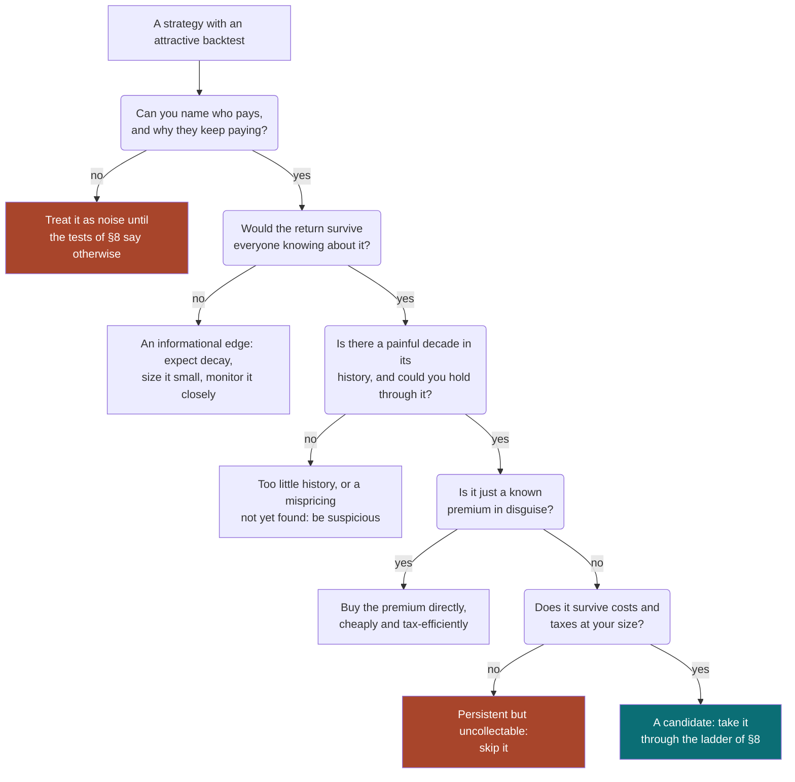
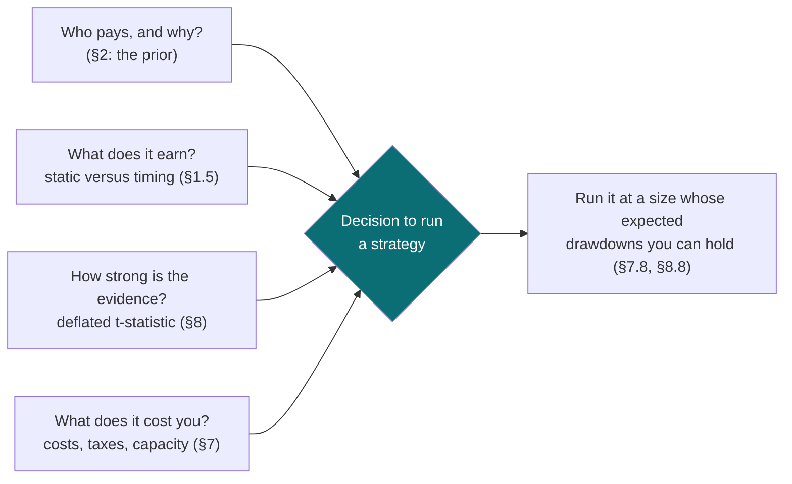
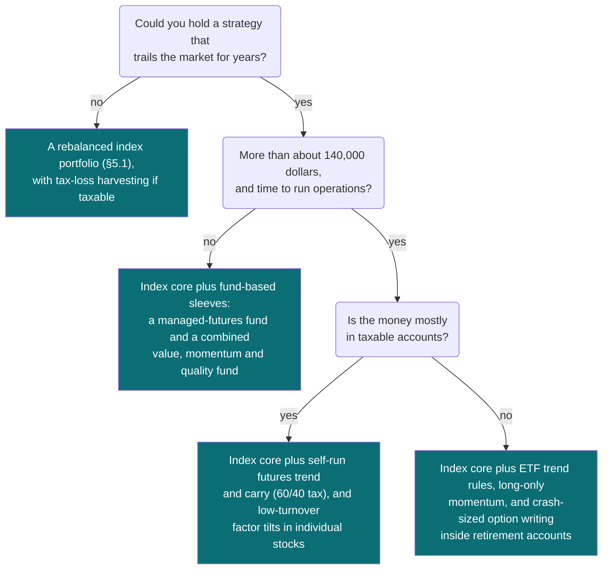

# Systematic Trading Strategies

### Where durable returns come from, how an individual can run them, and how to tell an edge from a lucky backtest

---

```{=html}
<aside class="abstract">
```

# Abstract {#abstract}

```{=latex}
\begin{chapterabstract}
```

A systematic strategy is a rule, fixed in advance, for what to hold. The rules that keep earning after they become widely known are those that pay investors to bear something unpleasant. This chapter covers where such returns come from, which strategies survive, and how to evaluate them.

A strategy's return splits into a static part, from holding its average position, and a timing part. The static part is usually most of the return, and it is cheap to buy. A rule that holds US stocks only while the market is above its 10-month average held stocks three-quarters of the time. That alone earned about six-sevenths of its 99-year return. Its timing skill was too small to prove in a century. It did cut the worst drawdown in half. Before costs, trading is zero-sum, so every lasting excess return needs a counterparty who keeps accepting the worse side. Returns paid by buyers of crash protection, by institutions with forced trades, or by repeated behavioural errors tend to last. Other investors trade away returns that come from noticing something first. Published stock-market anomalies lost about 58% of their returns after publication. Lasting premia must cause pain. Value stocks have not regained their 2007 high by the end of 2025, and momentum spent 24 years below its 1932 peak.

Six families have survived: a rebalanced mix of broad markets, multi-market trend following, value combined with momentum, carry, low volatility, and option selling. Calendar and news-reaction effects have mostly disappeared. An individual faces no benchmark or career pressure. But most investors trail their own funds by one to several points a year, because they time their flows badly. Taxes and costs can outweigh the strategy itself. An 8% pre-tax return compounds at between 4.7% and 8% after tax, depending on the account and turnover. A diversified futures program needs about 140,000 dollars, even with micro contracts.

Backtests overstate results. The best of 100 skill-free rules tested on 10 years of data beats the stock market's century-long record. Confirming a good strategy with four-in-five probability takes about 30 years of history. A study of 888 retail algorithms found that backtests predicted almost nothing about live results. A good strategy loses money about one year in three. The chapter makes four recommendations. Name who pays before testing anything. Hold a few durable strategies that fail at different times. Plan on half the backtested performance. Write stop rules before starting.

```{=latex}
\end{chapterabstract}
```

```{=html}
</aside>
```

---

**What this is.** A systematic trading strategy is a rule, fixed in advance, that turns data into positions. This chapter explains where such rules get their returns and which of those returns survive being widely known. It also explains how an individual can run a strategy from a retail brokerage account, and how to evaluate one honestly. The chapter targets a technically strong reader who intends to build something. So it explains mechanisms and failure modes. It does not give step-by-step procedures or feature lists.

**How to read this chapter.** The chapter answers four questions. The table maps each to its sections:

| Question | Where it is answered |
|---|---|
| What are systematic strategies? | §1 defines them and gives the identity that splits any strategy's return into parts. §6 organises them |
| Which ones don't get traded away? | §2 covers the economics of why a return persists. §5 judges nine strategy families on durability |
| How do individual investors run them? | §7 |
| How should they be evaluated? | §8 |

§3 (history) and §4 (the annotated bibliography) are reference material, and §9 is a synthesis. Readers can start in different places.

- Readers with time for only three things should read §1.5–§1.6, all of §2, and §8.3.
- Readers about to build should read §7 and §8 in full, and use §5 as reference.

Appendix A explains every concept that the main text relies on without stopping to explain. It builds each concept from first principles and orders the concepts by dependency.

**Objectives.** After this chapter, you should be able to:

- split any strategy's expected return into a static part, a timing part and cost, and say which part a given strategy earns.
- name who pays for a return, classify it as a risk, structural, behavioural or informational premium, and judge whether it will survive being widely known.
- describe the main strategy families, how each one fails, and how an individual can run it.
- estimate the effect of costs, taxes, account type and capital on a strategy's net return.
- judge how much a backtest can show, correct it for the number of variants tried, and set a realistic expectation for live performance.
- size and combine strategies, and write stopping rules before going live.

**Relationship to the other chapters.** This chapter is an overview of several deeper chapters. [Momentum in Financial Markets](momentum_deep_dive.html) and [Trend-Following in Financial Markets](trend_following.html) treat two of the strategy families of §5 in depth. [Portfolio Construction and the Covariance Matrix](portfolio_construction.html) gives the detail behind sizing and combining strategies (§7.8). [Foundations of Econometrics](econometrics_foundations.html) gives the detail behind the statistics of §8. [Implied Volatility](implied_volatility.html) and [Dealer Hedging and Gamma Exposure](dealer_hedging.html) are the background to volatility selling (§5.7). [Market Regimes and Hidden Markov Models](market_regimes.html) is the background to regime filters and purged cross-validation. Each chapter stands alone. This one shows which of them a reader needs.

**Where the numbers come from.** Numbers described as a calculation run for this chapter come either from the Kenneth French data library or from simulations. The generators are in [`figures/`](https://github.com/rmahfoud/quant-research/tree/master/figures){target="_blank"}. They illustrate mechanisms. They are not recommendations of anything tradeable.

**A warning about scope.** [Practice] Nothing here is investment advice. The retail implementation details apply to the United States as of September 2026. They include taxes, margin rules and account types. They change, and other jurisdictions differ materially. Where a source has a commercial interest in its own conclusion, the text says so.

**Epistemic tags.** The chapters in this collection flag claims by status:

- **[Fact]** — replicated across independent datasets or implementations, with broad agreement.
- **[Contested]** — documented, but with live disagreement about magnitude, robustness, or cause.
- **[Hypothesis]** — a proposed mechanism, not decisively tested.
- **[Practice]** — practitioner convention. The evidence may be private or absent. A [Practice] claim has not been debunked.

Tags appear only where the status changes what a reader should do. A tag governs the sentence or clause it opens. Untagged sentences are definitions, derivations or arithmetic. They are true by construction, not by evidence.

---

**Notation.** The table lists every symbol that recurs in the chapter, with the section that defines or first uses it. Symbols used in only one section are defined where they appear.

| Symbol | Meaning | Defined in |
|---|---|---|
| $t$ | Decision date; a return indexed $t+1$ is earned over the following period $(t, t+1]$ | §1.2 |
| $N$; $i$ | Number of assets; asset index | §1.2 |
| $r_{i,t+1}$ | Asset $i$'s **excess return**: its return minus the cash (T-bill) rate, so a strategy that holds nothing earns zero excess return | §1.2 |
| $w_{i,t}$ | Position in asset $i$ chosen at $t$, as a fraction of capital: positive for long, negative for short; $\sum_i \lvert w_{i,t} \rvert > 1$ means leverage | §1.2 |
| $\mathcal{I}_t$; $\theta$ | Information available at $t$; parameters fixed in advance, so that a strategy is a rule $w_t = f(\mathcal{I}_t; \theta)$ | §1.2 |
| $\pi_{t+1}$; $c_{t+1}$ | Strategy's excess return after costs; trading cost as a fraction of capital | §1.2 |
| $\nu$; $\delta$ | **Static** (passive) and **timing** (active) components of expected return | §1.5 |
| $\mu$; $\sigma$; $\rho$ | Expected excess return; volatility; correlation; all annualised unless stated | A.1, A.2 |
| $\mathrm{SR}$; $\widehat{\mathrm{SR}}$ | Annualised **Sharpe ratio** $\mu/\sigma$; its estimate from data | §1.1, A.3 |
| $\mathrm{IC}$; $\mathrm{BR}$; $\mathrm{TC}$; $\mathrm{IR}$ | Information coefficient; breadth; transfer coefficient; information ratio | §1.7 |
| $g$ | Compound growth rate | §5.1, §7.8, A.1 |
| $\sigma^\star$ | Volatility target | §5.2, §7.4 |
| $\kappa$; $u$ | One-way trading cost per unit traded; annual one-way turnover as a multiple of capital | §8.4, A.7 |
| $\tau$ | Tax rate | A.29 |
| $T$; $n$; $q$ | Backtest length in years; number of observations; observations per year ($q = 12$ for monthly data, about 252 for daily) | §8.2 |
| $M$ | Number of strategy variants tried before one is chosen | §8.3 |
| $\gamma_3$; $\gamma_4$ | Skewness; kurtosis ($\gamma_4 = 3$ for a normal distribution) | §8.2, A.4 |
| $\Phi$; $\Phi^{-1}$ | Standard normal distribution function; its inverse | §8.2 |

Several symbols carry a qualification:

- For a single asset, the text drops the subscript $i$.
- Percentages written as $\%$ inside formulas are per year unless stated.
- In §6.3 and A.24, $\tau_e$ is an option's time to expiry, distinct from the tax rate $\tau$.

---

## Table of contents

- [Abstract](#abstract)

1. [What a systematic strategy is](#1-what-a-systematic-strategy-is)
2. [Where returns come from, and why some survive being known](#2-where-returns-come-from)
3. [How the field evolved](#3-how-the-field-evolved)
4. [Foundational references](#4-foundational-references)
5. [The strategy families](#5-the-strategy-families)
6. [Taxonomy and equivalences](#6-taxonomy-and-equivalences)
7. [Running a strategy as an individual](#7-running-a-strategy-as-an-individual)
8. [Evaluation](#8-evaluation)
9. [Synthesis](#9-synthesis)

- [A. Concepts and prerequisites](#appendix-a-concepts-and-prerequisites) — every
  idea the main text leans on without fully explaining, built from first
  principles and ordered by dependency.

---

# 1. What a systematic strategy is {#1-what-a-systematic-strategy-is}

## 1.1 The wrong intuition

Most people first meet systematic trading as a search problem. On this view, the history of prices contains patterns that predict what comes next, and a good enough search finds them. A strategy is a pattern plus the discipline to trade it. The work is searching the data, the tool is the backtest, and a better search makes a better strategy.

Each part of this view misleads, and much of this chapter explains why.

- **Search finds noise before it finds signal.** Try 100 variants of a rule with no skill at all on 10 years of data. The best of them will show a Sharpe ratio of about 0.8. That is nearly double the 0.45 that the US stock market earned over the last century. §8.3 derives this. The number comes from a calculation run for this chapter.
- **Other traders trade away patterns that are merely predictable.** Suppose a rule earns money without risk, cost or discomfort. Other people find it and trade it until it stops working. [Fact] The typical published anomaly in US stock returns lost about 58% of its return after publication ([McLean & Pontiff, 2016](https://papers.ssrn.com/sol3/papers.cfm?abstract_id=2080900){target="_blank"}; §2.3).
- **A durable strategy earns most of its return as payment, not as prediction.** The payment is for holding something that other people would rather not hold: risk, illiquidity, crash exposure or an unpopular position. The rule is a disciplined way of holding it. §1.6 examines one of the best-known retail timing rules. Time in the market, not timing, earned about six-sevenths of its 99-year return.

**A systematic strategy is a fixed rule for deciding what to hold. Its long-run return is whatever the market pays for holding that, minus what it costs to trade.** The rule only decides what to hold. The return comes from what the market pays for those holdings. The key question is where that payment comes from, and §2 answers it.

## 1.2 Definition, and the anatomy of a strategy

Formally, a systematic strategy is a function, fixed in advance, from the information available at time $t$ to positions:

$$
w_t = f(\mathcal{I}_t;\ \theta).
$$

Here $w_t$ is the vector of positions held from $t$ to $t+1$. $\mathcal{I}_t$ is everything knowable at $t$: prices, volumes, company accounts, futures curves, option prices and the calendar. $\theta$ holds the parameters that the investor chooses before running the rule, such as look-back lengths, thresholds and a volatility target. The strategy's excess return over the next period is

$$
\pi_{t+1} = \sum_{i=1}^{N} w_{i,t}\, r_{i,t+1} \;-\; c_{t+1},
$$

where $c_{t+1}$ is the cost of the trades that moved the book from $w_{t-1}$ to $w_t$, charged to the period they fund.

One property makes a strategy *systematic*: $f$ is fixed before the data it acts on arrive. So the same inputs always produce the same positions. That property, and only that one, makes a strategy testable. It lets an analyst ask what the rule *would have done* in the past, without hindsight entering the answer. The same property also makes a strategy dangerous. An analyst can re-fix a rule after every look at the past. Re-fixing a rule 100 times means the analyst has not really tested it (§8.3).

In practice $f$ has five stages. Each stage fails in its own characteristic way, so naming the stages helps:

| Stage | Question it answers | Typical choices | Where it goes wrong |
|---|---|---|---|
| Universe | What may be held? | S&P 500 stocks; 20 liquid futures; 8 ETFs | Testing on today's survivors |
| Signal | What is believed about each asset? | Past return; valuation ratio; futures basis; implied minus realised volatility | Overfitting; look-ahead in the data |
| Sizing | How much of each? | Equal weight; inverse volatility; an optimiser; a volatility target | Estimation error; hidden leverage |
| Execution | How are the positions reached? | Market-on-close orders; limit orders; rebalancing bands | Costs; fills that never happen |
| Overlay | What limits a large loss? | Exposure caps; drawdown rules; a kill switch | Rules never tested, or that cut risk at the bottom |

Most published research in this field concerns the second row. People running strategies lose most of their money in the other four stages.

## 1.3 What systematic is not

People use the word loosely and fold several neighbouring terms into it. Keeping the terms apart prevents a surprising number of confused decisions:

| Term | What it is | What it is not |
|---|---|---|
| Systematic | A rule fixed in advance, reproducible from the same data | Automated. A quarterly rebalance done by hand from a spreadsheet is fully systematic |
| Systematic | A property of the decision process | A level of sophistication. A 10-month moving average is as systematic as a neural network |
| Passive investing | Holding market weights, the one strategy that needs no forecast | The opposite of systematic. It is a systematic strategy whose rule is "hold the index" |
| Algorithmic execution | A rule for *how* to fill an order (VWAP, TWAP) | A rule for *what* to hold |
| High-frequency trading | A systematic subset at sub-second horizons, earning spreads and speed | Something an individual can compete in. It is out of scope here |
| Technical analysis | A family of price-based signals | Necessarily systematic. Chart reading is discretionary |
| Machine learning | One way to estimate $f$ | A source of return. It finds whatever the data contain, including noise |
| A backtest | A measurement of what a rule would have done, under stated assumptions | Evidence that the rule will work (§8) |

## 1.4 The case for being systematic

Four benefits are real:

1. **Testability.** The past behaviour of a rule can be measured. The past behaviour of one's own judgment cannot, because memory is selective. Testability is also the main hazard, because it invites over-testing (§8.3).
2. **Consistency at the moment of decision.** A rule does not panic, get bored or anchor on its purchase price. [Fact] The documented losses of individual investors come mostly from decisions made at the time of trading. They trade too much ([Barber & Odean, 2000](https://papers.ssrn.com/sol3/papers.cfm?abstract_id=219228){target="_blank"}). They pay for immediacy with aggressive orders ([Barber, Lee, Liu & Odean, 2009](https://faculty.haas.berkeley.edu/odean/papers%20current%20versions/justhowmuchdoindividualinvestorslose_rfs_2009.pdf){target="_blank"}). They buy after rises and sell after falls ([Dichev, 2007](https://papers.ssrn.com/sol3/papers.cfm?abstract_id=544142){target="_blank"}). A rule removes those errors at the point of execution. It does not remove the larger error, which is abandoning the rule after a drawdown (§7.9).
3. **Breadth.** A rule that takes 10 minutes to apply to one asset takes about as long to apply to 1,000. §1.7 shows that most of the value of any forecasting skill comes from breadth.
4. **Auditability.** When a systematic strategy loses money, an analyst can check whether it did what its designer intended. That check separates bad luck from bad design. Discretionary trading rarely allows the check.

Four costs are real too:

- **Rigidity.** A rule cannot know that something structural changed this time.
- **Model risk.** A rule encodes assumptions that its author may not know they made.
- **Crowding.** Many people run rules published in papers at the same time. In the August 2007 "quant quake", many equity market-neutral funds lost heavily in a few days when they unwound crowded positions together ([Khandani & Lo, 2011](https://www.nber.org/papers/w14465){target="_blank"}).
- **False confidence.** A backtest looks like knowledge.

[Contested] [Harvey, Rattray, Sinclair & Van Hemert (2017)](https://people.duke.edu/~charvey/Research/Published_Papers/P130_Man_vs_machine.pdf){target="_blank"} compare hedge funds that describe themselves as systematic or discretionary. After adjusting for exposure to well-known factors, they find broadly similar performance. The authors work for a systematic manager. [Frazzini, Kabiller & Pedersen (2018)](https://www.nber.org/papers/w19681){target="_blank"} show that a leveraged, rules-based portfolio of cheap, safe, high-quality stocks reproduces much of Warren Buffett's record. These authors also work at a systematic firm. The defensible conclusion is that rules can express much of what good judgment does. Unlike judgment, rules allow testing. The evidence does not show that rules beat judgment.

## 1.5 The master decomposition

Take the expectation of $\pi_{t+1}$. Apply the identity $\operatorname{E}[XY] = \operatorname{E}[X]\operatorname{E}[Y] + \operatorname{Cov}(X, Y)$ to each term:

$$
\operatorname{E}[\pi_{t+1}]
= \underbrace{\sum_{i=1}^{N} \operatorname{E}[w_{i,t}]\,\operatorname{E}[r_{i,t+1}]}_{\nu\ \text{(static)}}
\;+\; \underbrace{\sum_{i=1}^{N} \operatorname{Cov}(w_{i,t},\, r_{i,t+1})}_{\delta\ \text{(timing)}}
\;-\; \operatorname{E}[c_{t+1}].
$$

This is an identity, so it holds for every strategy with no assumptions about how prices behave. [Lo (2008)](https://web.mit.edu/Alo/www/Papers/active_pub.pdf){target="_blank"} introduced it to ask where active managers' returns come from. It is the first of the chapter's three main ideas.

- $\nu$, the **static** or passive component, is the return from holding the strategy's *average* portfolio permanently. It requires no forecasting, only a willingness to hold the average position. An investor can usually buy it for the cost of a buy-and-hold portfolio.
- $\delta$, the **timing** or active component, measures whether the rule holds more of an asset just before that asset does well. Only this part of the return requires predicting anything.
- Turnover drives the **cost** term. The sign of this term is the only one known in advance.

Lo calls $\delta/(\nu + \delta)$ the *active ratio*. Three consequences make the decomposition worth computing for every strategy under consideration:

1. **The decomposition shows what the market pays the strategy for.** A strategy whose return is mostly $\nu$ collects a premium and only looks active. An investor can usually buy most of that return more cheaply and with less tax (§7.2). A strategy whose return is mostly $\delta$ is a forecasting strategy. It needs the statistical scrutiny of §8, because noise can fake $\delta$.
2. **Timing can be negative inside a profitable strategy.** Many active strategies earn a static premium and lose a little through their timing. [Israelov & Nielsen (2015)](https://papers.ssrn.com/sol3/papers.cfm?abstract_id=2444999){target="_blank"} show that the covered call is exactly this. It earns an equity premium and a volatility premium, both static. It has a negative equity timing component, because the position's equity exposure falls as the market rises (§5.7).
3. **Timing is hard to measure.** $\delta$ is a covariance between a slowly moving position and a noisy return. Its $t$-statistic grows only with the square root of the sample length. §1.6 gives an example in which 99 years are not enough.

Two refinements matter in practice. First, the split is per asset. So in a cross-sectional strategy, "timing" includes rotation between assets. A stock that enters a momentum portfolio after rising contributes to $\delta$. A permanent tilt toward small companies contributes to $\nu$. The useful reading is *persistent tilt* against *time-varying bet*. This split also decides turnover, and therefore cost. Second, the identity decomposes the **mean**. A rule that holds less when volatility is high can raise the Sharpe ratio and shrink drawdowns without timing the mean at all. It times the *second* moment. This effect underlies volatility-managed portfolios ([Moreira & Muir, 2017](https://www.nber.org/papers/w22208){target="_blank"}) and explains much of why trend rules cut drawdowns (§5.2). It appears in the risk numbers, not in $\delta$.

## 1.6 A worked instance: the 10-month moving average

[Faber (2007)](https://papers.ssrn.com/sol3/papers.cfm?abstract_id=1941995){target="_blank"} popularised a rule that many individuals still run. Hold the stock market when its price is above its 10-month moving average, and hold cash otherwise. Here the rule applies to the US market, and the identity of §1.5 splits its return. The data are the Kenneth French library's monthly total returns. The signal uses the total-return index at each month-end, and the rule holds the resulting position for the following month. Cash earns the T-bill rate, and there are no costs. This is a calculation run for this chapter, and the generator is [`figures/st_factor_history.py`](https://github.com/rmahfoud/quant-research/blob/master/figures/st_factor_history.py){target="_blank"}.

What the rule earned, split into its static and timing parts:

| Period | Time invested | Rule's excess return | Static $\nu$ | Timing $\delta$ | $t$ of timing |
|---|---|---|---|---|---|
| 1927–2025 | 73% | 6.90% | 5.94% | 0.96% | 1.2 |
| 1927–1962 | 68% | 8.04% | 6.71% | 1.33% | 0.7 |
| 1963–1999 | 76% | 5.59% | 5.44% | 0.15% | 0.1 |
| 2000–2025 | 74% | 7.21% | 5.44% | 1.76% | 1.3 |
| 1927–2025 without Jul 1929–Jun 1932 | 75% | 7.25% | 7.48% | −0.23% | −0.3 |

And what it did to risk, for the market and then for the rule:

| Period | Sharpe ratio, market → rule | Worst drawdown, market → rule |
|---|---|---|
| 1927–2025 | 0.44 → 0.55 | −84% → −43% |
| 1927–1962 | 0.43 → 0.56 | −84% → −43% |
| 1963–1999 | 0.47 → 0.46 | −47% → −24% |
| 2000–2025 | 0.47 → 0.70 | −50% → −18% |

Returns are annualised excess returns over T-bills. The table measures drawdowns on total-return wealth. The $t$-statistic is that of the slope in a regression of next month's market excess return on the rule's position. The sample starts in May 1927, once the moving average has 10 months of history. That is why the market's Sharpe ratio here is 0.44, not the 0.45 of §2.6.

The tables give five lessons, and each generalises:

1. **Holding the market earns most of the return.** The rule held the market 73% of the time. Holding 73% of the market permanently would have earned 5.94 of its 6.90 points a year. About six-sevenths of the headline return needed no timing skill at all.
2. **99 years do not establish the timing component.** It is 0.96 points a year, with a $t$-statistic of 1.2. Over the same period, the market premium itself has a $t$-statistic of 4.5.
3. **The timing component comes from a handful of episodes.** Removing the three years from July 1929 turns the timing component slightly negative. It was essentially zero from 1963 to 1999. After 2000 it came from two bear markets, 2000–02 and 2008.
4. **The rule robustly changed the shape of the distribution.** The worst drawdown roughly halved in every period. The Sharpe ratio rose in 1927–1962 and 2000–2025 and was flat in 1963–1999. In 1963–1999, whipsaw losses in the rest of those decades used up what the rule saved in the 1973–74 bear market. Most of the improvement came from being out of the market while volatility was high. That is timing of the second moment, not prediction of the first.
5. **Trading costs are trivial here, but taxes are not.** About 1.5 switches a year cost almost nothing at retail spreads. But every exit realises accumulated gains, often short-term ones in a US taxable account (§7.2).

Whether the rule "works" depends on what an investor wants from it. As a forecast of returns, the evidence is weak. As a rule that reliably cuts exposure during prolonged bear markets, it has done what it claims for a century. The cost is small, repeated whipsaw losses in bull markets. This is the profile of insurance. It is why §5.2 lists trend-following as a durable strategy and not as an anomaly. An investor who knows which of the two uses they bought can hold the rule through 1963–1999. An investor who does not know tends to abandon it in year three.

## 1.7 Skill, breadth, and why diversified rules win

The *fundamental law of active management* of [Grinold (1989)](https://doi.org/10.3905/jpm.1989.409211){target="_blank"} approximates the value of a forecasting skill:

$$
\mathrm{IR} \;\approx\; \mathrm{TC} \times \mathrm{IC} \times \sqrt{\mathrm{BR}}.
$$

The **information ratio** $\mathrm{IR}$ is the Sharpe ratio of the active bets. The **information coefficient** $\mathrm{IC}$ is the correlation between the forecasts and the returns that follow. **Breadth** $\mathrm{BR}$ is the number of *independent* bets per year. [Clarke, de Silva & Thorley (2002)](https://papers.ssrn.com/sol3/papers.cfm?abstract_id=290916){target="_blank"} added the **transfer coefficient** $\mathrm{TC}$. It measures the correlation between the positions that the forecasts call for and the positions actually held. Constraints such as long-only rules or position limits push it below one.

Some numbers show the scale of each term:

- **Skill is small.** An IC of 0.05 means that the forecast gets the direction right 51.6% of the time. (For jointly normal variables with correlation $\rho$, the probability that they share a sign is $\tfrac12 + \arcsin(\rho)/\pi$.) [Practice] Useful signals commonly have ICs between about 0.02 and 0.10.
- **One asset limits the payoff.** Consider timing a single index once a month, with no constraints on expressing the forecast ($\mathrm{TC} = 1$). That gives $\mathrm{BR} = 12$ and $\mathrm{IR} = 0.05\sqrt{12} = 0.17$. This Sharpe ratio is too small to confirm in a lifetime (§8.2), although the signal is one most people would consider good.
- **Breadth multiplies it.** The same IC applied monthly across 50 independent futures markets gives $\mathrm{BR} = 600$ and $\mathrm{IR} = 1.2$. That arithmetic, not a better signal, is why professional trend-followers trade 50 to 150 markets.
- **Real breadth is smaller than it looks.** Across 500 stocks monthly, the formula gives $\mathrm{BR} = 6000$ and $\mathrm{IR} = 3.9$, which no one achieves. Stocks share common factors, so the effective number of independent bets is far smaller. Constraints lower TC. Turnover costs grow with the number of bets.

For an individual, the cheapest available improvement is almost never a cleverer signal. The cheapest improvement is more independent bets. That means more assets and more strategies that do not move together. §7.8 quantifies the second.

> ### §1 Key takeaways
>
> 1. A systematic strategy is a rule fixed in advance. That property, not automation or sophistication, makes it testable. It also makes over-testing possible.
> 2. The rule only decides what to hold. The return comes from what the rule holds, so the first question about any strategy is what the market pays it for.
> 3. Every strategy's expected return splits exactly into three parts. The static part is average holdings times average returns. The timing part is the covariance of positions with subsequent returns. The third part is cost.
> 4. An investor can usually buy the static part cheaply. Only the timing part needs forecasting skill, and noise fakes it most easily.
> 5. On US stocks from 1927 to 2025, a 10-month moving-average rule earned about six-sevenths of its return from the time it spent invested. Its timing had a $t$-statistic of 1.2, yet it halved the worst drawdown in every period.
> 6. A rule can time risk as well as return. Timing risk appears in the Sharpe ratio and the drawdown. It does not appear in the mean decomposition.
> 7. The value of skill scales with the square root of the number of independent bets. Diversify across assets and strategies before refining a signal.

# 2. Where returns come from, and why some survive being known {#2-where-returns-come-from}

This section develops the second of the chapter's three ideas: **every durable return is a payment for something.** When an analyst knows what the payment is for and who pays, the analyst can say whether the return will survive being widely known. When that is unclear, the history of the field says to assume that the return will not survive.

## 2.1 The arithmetic nobody escapes

[Sharpe (1991)](https://web.stanford.edu/~wfsharpe/art/active/active.htm){target="_blank"} showed that active management is zero-sum before costs. The market portfolio's return is the value-weighted average of the returns of everyone who holds stocks. So before costs, the average actively managed dollar earns exactly the market return. After costs, it earns less. Positions that trail the market match every strategy that beats it, dollar for dollar.

That reduces the question "which strategies don't get traded away?" to a task: **identify who is on the other side, and why they stay there.** A strategy's excess return is somebody else's shortfall. It persists only as long as that somebody keeps accepting it.

Economics has a precise answer for when they will. [Grossman & Stiglitz (1980)](https://www.aeaweb.org/aer/top20/70.3.393-408.pdf){target="_blank"} showed that prices cannot be perfectly efficient. If prices reflected all information, nobody would pay to gather it, and then prices could not reflect it. In equilibrium, the people who make prices more accurate earn just enough to cover the cost of doing so. [Pedersen (2015)](https://press.princeton.edu/books/hardcover/9780691166193/efficiently-inefficient){target="_blank"} calls the result *efficiently inefficient* markets. They are inefficient enough that markets compensate active investors for their costs and risks. They are efficient enough that the marginal active investor earns nothing extra.

For an individual, this has a clear implication. **A durable excess return is compensation for a cost that the investor bears.** The cost may be risk, illiquidity, a constraint that others face and the investor does not, discomfort or effort. An investor must ask two things about any return. The first is whether a return exists. The second is whether this investor can bear the cost behind it more cheaply than the next person who wants it.

## 2.2 Four sources, ordered by how long they last

A systematic strategy can earn returns from four sources, sorted by who pays them. The sources differ in the dimension that matters here: whether publicity destroys them.

| Source | Who is on the other side | Why they stay there | What ends it | Pattern in the returns |
|---|---|---|---|---|
| **A. Risk premium** | Investors shedding risk they cannot or will not bear | The risk is real, and aversion to losing money in bad times is stable | A change in risk appetite or in the risk itself. Knowledge does not end it, because the premium cannot be collected without bearing the risk | Losses concentrated in crashes, recessions and liquidity crises; negative skew |
| **B. Structural premium** | Agents trading for reasons other than expected return: hedgers, index funds, leverage-constrained or benchmarked institutions, tax-motivated sellers, anyone who needs to trade *now* | Mandates, regulation, tax law and hedging needs change slowly | The constraint loosening, or arbitrage capital growing large enough to absorb the flow | Returns tied to identifiable flows or dates; limited capacity |
| **C. Behavioural premium** | Investors making systematic errors: under-reacting to news, extrapolating growth, overpaying for lottery-like payoffs | The errors are human, and exploiting them is risky and uncomfortable, so arbitrage is limited ([Shleifer & Vishny, 1997](https://www.nber.org/papers/w5167){target="_blank"}) | Partly publication and cheap implementation; what survives is what is too painful or costly to arbitrage | Long drawdowns, crashes, large tracking error against benchmarks |
| **D. Informational or mechanical inefficiency** | Nobody in particular: slow diffusion of public information, or a mechanical pattern | It lasts only while it is unknown or awkward to trade | Being found. Once it is cheap and safe to trade, capital trades it away | High Sharpe ratio, little risk, decay after publication |

Examples make the categories concrete. The equity premium, the term premium, the variance risk premium and much of carry are risk premia (A). Four examples are structural (B): futures roll yield driven by producers' hedging, the low-beta anomaly attributed to leverage constraints, index reconstitution, and short-term reversal as payment for supplying liquidity. Momentum, and on one reading value, are behavioural (C). The S&P 500 inclusion effect, the pre-FOMC drift and post-earnings drift in large stocks were informational or mechanical (D). As §2.3 and §5.9 show, they are largely gone.

The categories blur. [Contested] Risk-based explanations ([Fama & French, 1993](<https://doi.org/10.1016/0304-405x(93)90023-5>){target="_blank"}) and behavioural ones ([Lakonishok, Shleifer & Vishny, 1994](https://www.nber.org/papers/w4360){target="_blank"}) both claim value. Leverage constraints ([Frazzini & Pedersen, 2014](https://www.nber.org/papers/w16601){target="_blank"}) and benchmarking ([Baker, Bradley & Wurgler, 2011](https://doi.org/10.2469/faj.v67.n1.4){target="_blank"}) both claim low beta. For persistence, the label matters less than this test: **the return depends on the other side continuing to do something costly, for reasons that publicity does not change.** Risk aversion, regulation and hedging needs pass that test. Ignorance does not.

[Hypothesis] The ordering A, B, C, D by durability is a synthesis made for this chapter. It is not an established result. The decay evidence below would predict it. This chapter's view is that the ordering is the right way to weight any strategy under consideration.

## 2.3 The evidence on decay

The best evidence on what happens to a return once it is known comes from published stock-return anomalies, because their publication dates are known.

- [Fact] [McLean & Pontiff (2016)](https://papers.ssrn.com/sol3/papers.cfm?abstract_id=2080900){target="_blank"} study 97 predictors from academic journals. Their returns are 26% lower out of sample but before publication. Statistical bias in the original studies explains that part. Returns are 58% lower after publication. So investors who learned of the predictors appear to have traded away roughly a third of the original return. Declines are larger for predictors with higher in-sample returns, and for those concentrated in liquid stocks that are cheap to arbitrage. Trading volume and short interest in the affected stocks rise after publication.
- [Fact] [Falck, Rej & Thesmar (2022)](https://arxiv.org/abs/2105.01380){target="_blank"} find that published anomalies, evaluated outside their original samples, deliver about half their in-sample performance. The decay grows with the year of publication. Each year, newly published factors decay about five percentage points more. It also grows with measures of overfitting, such as the number of operations needed to compute the signal. The authors are at a quantitative fund.
- [Fact] [Chordia, Subrahmanyam & Tong (2014)](https://papers.ssrn.com/sol3/papers.cfm?abstract_id=2029057){target="_blank"} find that anomaly returns weakened in the era of decimal prices and cheap, fast trading, when arbitrage became cheaper.
- [Contested] [Linnainmaa & Roberts (2018)](https://www.nber.org/papers/w22894){target="_blank"} extend accounting-based anomalies back before 1963. They find most of them absent there, which is what data mining would produce.

Researchers still debate whether the original findings were ever real. [Contested] [Hou, Xue & Zhang (2020)](https://www.nber.org/papers/w23394){target="_blank"} control for microcap stocks with NYSE size breakpoints and value weighting. On that basis, 65% of 452 anomalies fail a conventional $|t| \ge 1.96$ hurdle, and 82% fail the multiple-testing hurdle of 2.78. [Chen & Zimmermann (2022)](https://papers.ssrn.com/sol3/papers.cfm?abstract_id=3604626){target="_blank"} use the original papers' own methods. They reproduce 98% of the 161 predictors that were clearly significant in the originals. [Jensen, Kelly & Pedersen (2023)](https://www.nber.org/papers/w28432){target="_blank"} find that most factors replicate. The factors cluster into 13 themes, and they work out of sample across 93 countries.

The three findings contradict each other less than they appear to, because they measure different things. The original results are mostly real in the data as the authors constructed it (Chen and Zimmermann). Many of them depend on small, illiquid stocks and on equal weighting, which a real portfolio cannot hold at scale (Hou, Xue and Zhang). The broad theme survives out of sample, not the particular signal (Jensen, Kelly and Pedersen). For someone implementing a strategy, the second finding sets the relevant standard, and the third gives the relevant unit of analysis.

The broad cross-asset premia look more durable than narrow stock-level anomalies. [Contested] [Baltussen, Swinkels & van Vliet (2021)](https://papers.ssrn.com/sol3/papers.cfm?abstract_id=3325720){target="_blank"} test 24 factor premia across equity indices, bonds, commodities and currencies, with data back to 1800. They find most of them present out of sample, with limited decay. [Hurst, Ooi & Pedersen (2017)](https://papers.ssrn.com/sol3/papers.cfm?abstract_id=2993026){target="_blank"} find trend-following profitable in every decade since 1880. The disagreement concerns the 2010s, which were poor for several of these premia at once.

The Kenneth French data allow a small version of the McLean–Pontiff exercise for the three most famous US equity factors. Each factor splits at the end of the year in which its best-known paper appeared. This is a calculation run for this chapter:

| Factor | Paper | Before publication | After publication | Change |
|---|---|---|---|---|
| Size (SMB) | [Banz (1981)](<https://doi.org/10.1016/0304-405x(81)90018-0>){target="_blank"} | 3.59% a year, $t = 2.3$ (1927–1981) | 0.09%, $t = 0.1$ (1982–2025) | −97% |
| Value (HML) | [Fama & French (1992)](https://doi.org/10.2307/2329112){target="_blank"} | 5.27%, $t = 3.4$ (1927–1992) | 1.96%, $t = 1.0$ (1993–2025) | −63% |
| Momentum | [Jegadeesh & Titman (1993)](https://doi.org/10.1111/j.1540-6261.1993.tb04702.x){target="_blank"} | 8.84%, $t = 4.5$ (1927–1993) | 4.23%, $t = 1.4$ (1994–2025) | −52% |

Three caveats apply. First, the analysis chose these three factors with hindsight, precisely because they became famous. They are survivors of a much larger search. Second, the "before" periods include decades that the original studies never looked at. Third, a $t$-statistic of 1.0 or 1.4 over 30-odd years does not show that a premium has gone. It shows only that 30 years cannot tell (§8.2). The table does show that the direction and size of the decline match the cross-sectional evidence. Since 2000, the US value and momentum factors have earned 2.4 and 2.1 points a year, with $t$-statistics of 1.0 and 0.6.

## 2.4 Persistent, but uncollectable

Some returns survive in the data precisely because nobody can collect them at scale. That category matters, because most claims of an individual investor's edge belong to it.

- **Fund flows compete skill away.** [Berk & Green (2004)](https://www.nber.org/papers/w9275){target="_blank"} show that even genuinely skilled managers deliver no excess return to their investors in equilibrium. Money flows to managers with good records until diseconomies of scale erase the edge. The manager keeps what remains as fees.
- **Costs eliminate the fast anomalies.** [Fact] [Novy-Marx & Velikov (2016)](https://www.nber.org/papers/w20721){target="_blank"} find that anomalies with low turnover, such as value, profitability and size, mostly survive realistic transaction costs. High-turnover anomalies mostly do not. Short-term reversal is the standard example (§5.8).
- **Machine-learning predictors find their profits in illiquid stocks.** [Avramov, Cheng & Metzker (2023)](https://papers.ssrn.com/sol3/papers.cfm?abstract_id=3450322){target="_blank"} find that the profits of machine-learning return predictors concentrate in microcaps and in distressed, hard-to-arbitrage stocks. The profits weaken sharply once the analysis excludes those stocks or charges costs.
- **Institutional costs are lower than academic proxies.** [Contested] [Frazzini, Israel & Moskowitz (2018)](https://papers.ssrn.com/sol3/papers.cfm?abstract_id=3229719){target="_blank"} use 1.7 trillion dollars of live executions. They find real trading costs an order of magnitude below academic estimates, which implies large capacity for the major factors. The authors' firm runs these strategies.

A small trader's market impact is negligible, so capacity limits that restrict a fund do not restrict the trader. [Hypothesis] That is a real advantage in niches too small for institutions. Three things partly offset it. Relative spreads are wider in exactly those niches. Borrowing constraints limit the short side. Fixed costs are large relative to a small account. The net effect is strategy-specific, and §7 is mostly about computing it.

## 2.5 What an individual has that an institution does not

Individuals have both advantages and disadvantages, so the comparison with institutions is less one-sided than the claims "retail can't compete" and "retail is nimble" suggest:

| Individual's advantage | Why it matters | Individual's disadvantage | Why it matters |
|---|---|---|---|
| Small size | No market impact. Capacity-limited niches are open | Taxes | Pensions and endowments pay none. An individual's after-tax return can trail the pre-tax one by several points a year (§7.2) |
| Long horizon, no redemptions | Can hold through a multi-year drawdown without being forced to sell | Costs in some instruments | Option spreads, small-cap spreads, borrow fees and margin rates are all worse than institutional terms |
| No benchmark, no career risk | Can hold positions with large tracking error, which institutions avoid | Leverage and shorting limits | Margin rules, retirement-account restrictions, hard-to-borrow stocks |
| No mandate | Can combine asset classes, hold cash, use futures | Data and operations | Clean historical data costs money. One person is a single point of failure |
| Tax control | Can choose accounts, lots and the timing of realisations, and harvest losses | Behaviour | A documented tendency to abandon strategies after losses (§7.9) |

The table shows one pattern. **The institutional constraints that create structural and behavioural premia are exactly the ones that an individual does not face.** These constraints are benchmarks, leverage limits, career risk and redemption risk. So the natural edge for an individual is a cheaper tolerance for discomfort, not a better signal. That means holding diversified, well-documented, uncomfortable premia through their drawdowns, cheaply and tax-efficiently. Most individuals demonstrably fail to do this (§7.9). Because they fail, it remains an edge for those who can.

```{=latex}
\newpage
```

## 2.6 Durable premia involve long losing periods

If investors could collect a premium without painful losses, capital would flow in until it was no longer a premium. So the strategies that survive must contain episodes that make people quit. These episodes are not a defect in the strategies. They are the mechanism that keeps arbitrageurs from trading the premium away. [Hypothesis] This is an argument and not a theorem. The history of the best-known US factors is consistent with it. The figures below come from a calculation run for this chapter, over 1927–2025. The calculation compounds long–short factors as fully collateralised positions:

| Factor | Excess return | Sharpe ratio | Worst drawdown |
|---|---|---|---|
| Market | 8.26% | 0.45 | −85% |
| Size (SMB) | 2.04% | 0.19 | −55% |
| Value (HML) | 4.17% | 0.34 | −58% |
| Momentum | 7.35% | 0.45 | −78% |
| Half value, half momentum | 5.76% | 0.73 | −41% |

| Factor | Longest below a previous peak | Worst 12 months | 10-year windows that lost money |
|---|---|---|---|
| Market | 15.6 years (1929–1945) | −66% | 14% |
| Size (SMB) | 42.4 years (1983–, not recovered) | −33% | 35% |
| Value (HML) | 19.0 years (2007–, not recovered) | −40% | 14% |
| Momentum | 24.4 years (1932–1956) | −76% | 21% |
| Half value, half momentum | 17.1 years (2008–, not recovered) | −32% | 12% |

```{=latex}
\newpage
\begin{center}
\includegraphics[width=\linewidth]{quant-research/figures/st_factor_history.pdf}
\end{center}
```

```{=html}
<style>
/* Figures for this document. Prefix "mdd-", shared with the other notes and
   distinct from the reading widget's "rdw-". Narrow viewports reclaim the
   body's side padding so the figure gets the full width. */
.mdd-fig {
  display: block; width: 100%; height: auto;
  max-width: 640px; margin: 1.6rem auto;
  /* the reading widget adds a light plate (padding) in dark mode */
  box-sizing: border-box;
}
@media (max-width: 760px) {
  .mdd-fig { width: calc(100% + 64px); max-width: none; margin-left: -32px; margin-right: -32px; }
}
@media (max-width: 600px) { /* pandoc's own stylesheet drops body padding to 12px here */
  .mdd-fig { width: calc(100% + 24px); margin-left: -12px; margin-right: -12px; }
}
</style>


```

A value investor who started in January 2007 was still below their high-water mark, in excess-return terms, at the end of 2025. A momentum investor who started in mid-1932 waited 24 years. These are the strategies that *work*. The last row shows the most useful result in the tables. Value and momentum are negatively correlated ($\rho = -0.41$ here), and [Asness, Moskowitz & Pedersen (2013)](https://papers.ssrn.com/sol3/papers.cfm?abstract_id=2174501){target="_blank"} document the same pattern across asset classes. So an even mix of the two had a Sharpe ratio of 0.73, far above either alone, and a shallower worst drawdown. Yet even the mix has spent the 17 years since 2008 below its peak. Diversification reduces the depth of drawdowns much more reliably than it shortens their duration.

Two points follow for anyone choosing a strategy. First, a backtest with no painful decade in it gives no reassurance. Either the sample is too short to contain one, or the return is a mispricing that no one has found yet. Second, the loss that an investor must be able to bear is the distribution of possible drawdowns, not the backtest's worst drawdown. That drawdown is one draw from the distribution. §8.8 shows how wide the distribution is, even for a strategy that genuinely works.

## 2.7 The durability test

This section gives a short list of questions to ask of any strategy before testing it. The list puts the cheapest questions first:

1. **Identify who is on the other side, and why they accept a lower expected return.** If no one can be named, the likeliest answers are "nobody, because the backtest is noise" and "the investor asking the question".
2. **Decide whether the return would survive everyone knowing about it.** Risk premia do, by construction. Informational edges do not.
3. **Describe the strategy's worst decade, and decide whether the investor would have held through it.** If the history contains no painful decade, be suspicious, not pleased.
4. **Check whether it is a known premium under another name.** Split it into static and timing parts (§1.5), and regress it on known factors (§8.6). If it is mostly a premium that an investor can buy directly, buy it directly.
5. **Compute what it costs to capture at the investor's size, after tax.** Many persistent returns persist because nobody can collect them.
6. **Judge how easy it is to copy.** A published signal that anyone can compute from free data in an afternoon decays fastest.

```{=latex}
\newpage
```

The first five questions work as gates, in order. The sixth only indicates how quickly to expect decay, and therefore how much to allocate. It does not decide whether to proceed. The flowchart shows the gates, each with an exit:



> ### §2 Key takeaways
>
> 1. Before costs, active management is a zero-sum game against the market portfolio, so every durable excess return has a payer. Ask who pays, and why they keep paying.
> 2. In equilibrium, a durable return compensates a cost that someone bears: risk, illiquidity, a constraint, discomfort or effort. An investor's edge is bearing that cost more cheaply than the next person.
> 3. Risk premia and structural premia survive publicity. Behavioural premia partly survive it. Informational edges do not. Weight strategies accordingly.
> 4. The typical published US stock anomaly lost about 58% of its return after publication. Out of sample, published anomalies lose roughly half of their in-sample performance. The more complex the signal, the faster the decay.
> 5. Broad cross-asset themes are more durable than individual stock-level signals. The themes are value, momentum, carry, defensive and trend. Many stock-level signals depend on microcaps that nobody can trade at scale.
> 6. An individual's natural edge is a cheaper tolerance for discomfort, not a better signal. The individual faces no benchmark, no career risk and no redemptions.
> 7. Durable premia must include long losing periods. Value spent 19 years below its peak after 2007, and momentum 24 years after 1932. A backtest with no painful decade is a cause for concern.
> 8. Value and momentum are negatively correlated. Mixing them raised the Sharpe ratio from 0.34–0.45 to 0.73. Even the mix has been below its 2008 peak since.

# 3. How the field evolved {#3-how-the-field-evolved}

The history is short, and the same sequence recurs. Practitioners run rules. Academics test them. The tests find either nothing or a published anomaly. The anomaly then decays, while the rules that encode risk premia survive. The history falls into six eras, each with a one-line thesis.

**Rules before theory (1930s–1960s).** *Practitioners traded mechanical rules long before anyone could test them.* Richard Donchian's moving-average and channel-breakout rules date from this period. So does one of the first publicly offered managed-futures funds (Futures, Inc., 1949). Academics responded with the random-walk model. Filter rules that bought after a rise of a given percentage earned less than buy-and-hold after commissions ([Fama & Blume, 1966](https://doi.org/10.1086/294849){target="_blank"}). *What lasted:* the rules themselves, which survive almost unchanged in futures trend-following.

**Efficiency and its anomalies (1970–1990).** *The efficient-markets hypothesis became the null hypothesis, and researchers catalogued the first systematic deviations from the CAPM.* [Fama (1970)](https://doi.org/10.2307/2325486){target="_blank"} framed efficiency as a testable proposition. The size effect and the price–earnings effect followed. So did long-horizon reversal ([De Bondt & Thaler, 1985](https://doi.org/10.1111/j.1540-6261.1985.tb05004.x){target="_blank"}) and short-term reversal ([Jegadeesh, 1990](https://doi.org/10.1111/j.1540-6261.1990.tb05110.x){target="_blank"}; [Lehmann, 1990](https://www.nber.org/papers/w2533){target="_blank"}). In parallel, commodity trading advisers industrialised trend-following in futures. The 1983 "Turtle" experiment showed that novices could learn a rules-based breakout system (Faith, 2007). *Limitation:* researchers found anomalies one at a time and did not account for how many they had searched.

**The factor era (1990–2007).** *Researchers organised anomalies into a few factors, and systematic equity investing became an industry.* Fama & French ([1992](https://doi.org/10.2307/2329112){target="_blank"}, [1993](https://doi.org/10.1016/0304-405x(93)90023-5){target="_blank"}) reduced the cross-section to market, size and value. [Jegadeesh & Titman (1993)](https://doi.org/10.1111/j.1540-6261.1993.tb04702.x){target="_blank"} added momentum. [Carhart (1997)](https://doi.org/10.1111/j.1540-6261.1997.tb03808.x){target="_blank"} made the four-factor model the standard performance benchmark. [Grinold (1989)](https://doi.org/10.3905/jpm.1989.409211){target="_blank"} had already given active management its fundamental law. [Brock, Lakonishok & LeBaron (1992)](https://doi.org/10.1111/j.1540-6261.1992.tb04681.x){target="_blank"} found that simple moving-average rules had predictive power in a century of Dow Jones data. [Sullivan, Timmermann & White (1999)](https://papers.ssrn.com/sol3/papers.cfm?abstract_id=160330){target="_blank"} showed how much of that result survived a correction for the thousands of rules that someone could have tried. [Lo & MacKinlay (1990b)](https://www.nber.org/papers/w3001){target="_blank"} had already named the problem, data snooping. The collapse of Long-Term Capital Management in 1998 illustrated the limits of arbitrage described by [Shleifer & Vishny (1997)](https://www.nber.org/papers/w5167){target="_blank"}. *What changed:* "alpha" came to mean mostly exposure to factors that earlier analyses had not accounted for.

**Crowding and crashes (2007–2012).** *Popular systematic strategies turned out to share positions, and to fail together.* In August 2007, quantitative equity funds suffered sudden, simultaneous losses when they unwound crowded positions ([Khandani & Lo, 2011](https://www.nber.org/papers/w14465){target="_blank"}). In 2009, momentum crashed when stocks that had fallen sharply rebounded violently ([Daniel & Moskowitz, 2016](https://www.nber.org/papers/w20439){target="_blank"}). Trend-followers, by contrast, profited in 2008, which established the idea of trend as "crisis alpha". [Moskowitz, Ooi & Pedersen (2012)](https://papers.ssrn.com/sol3/papers.cfm?abstract_id=2089463){target="_blank"} formalised time-series momentum. [Asness, Moskowitz & Pedersen (2013)](https://papers.ssrn.com/sol3/papers.cfm?abstract_id=2174501){target="_blank"} showed value and momentum in every major asset class. *Lasting influence:* the shift from single anomalies to diversified "style premia" across asset classes.

**Democratisation and replication studies (2011–2020).** *Tools reached individuals just as researchers began to doubt published results.* Platforms such as Quantopian let thousands of individuals write and backtest algorithms. Quantopian's own study of 888 of them found that backtest Sharpe ratios had almost no power to predict live results ([Wiecki, Campbell, Lent & Stauth, 2016](https://papers.ssrn.com/sol3/papers.cfm?abstract_id=2745220){target="_blank"}). The platform closed in 2020. [Bailey, Borwein, López de Prado & Zhu (2014)](https://papers.ssrn.com/sol3/papers.cfm?abstract_id=2308659){target="_blank"}, [Harvey, Liu & Zhu (2016)](https://www.nber.org/papers/w20592){target="_blank"} and [McLean & Pontiff (2016)](https://papers.ssrn.com/sol3/papers.cfm?abstract_id=2080900){target="_blank"} quantified overfitting and decay. [Hou, Xue & Zhang (2020)](https://www.nber.org/papers/w23394){target="_blank"} found that most anomalies did not hold up. Meanwhile, value endured its longest drawdown, and trend-followers had a weak decade. Short-volatility products collapsed in a single day in February 2018 (Augustin, Cheng & Van den Bergen, 2021). For individuals, costs fell sharply. US online brokers cut stock commissions to zero in October 2019. Exchange-listed micro futures made diversified futures positions affordable in small accounts.

**Retail at scale (2020–).** *Individuals became a large, measurable and mostly losing part of short-horizon trading.* Retail participation in single stocks and options surged. The January 2021 episode in GameStop and other heavily shorted stocks made retail order flow a significant market influence. Studies of the retail options boom document large average losses ([Bryzgalova, Pavlova & Sikorskaya, 2023](https://papers.ssrn.com/sol3/papers.cfm?abstract_id=4065019){target="_blank"}; [de Silva, Smith & So, 2026](https://papers.ssrn.com/sol3/papers.cfm?abstract_id=4050165){target="_blank"}). The losses concentrate in same-day expiries ([Beckmeyer, Branger & Gayda, 2023](https://papers.ssrn.com/sol3/papers.cfm?abstract_id=4404704){target="_blank"}). Machine learning entered asset pricing ([Gu, Kelly & Xiu, 2020](https://www.nber.org/papers/w25398){target="_blank"}). Trend and value both had a strong 2022 as interest rates rose. In June 2026, FINRA removed the US$25,000 pattern-day-trader minimum from its margin rule ([FINRA, 2026](https://www.finra.org/rules-guidance/notices/26-10){target="_blank"}). [Hypothesis] The newest change is that AI coding assistants have cut the cost of building a research and execution stack. That lowers one barrier to entry. By the logic of §2.3, it also speeds the decay of anything simple.

The table lists the milestones:

| Year | Milestone | What changed |
|---|---|---|
| 1949 | Donchian's managed-futures fund | Mechanical trend rules offered to outside investors |
| 1966 | Fama & Blume on filter rules | Simple timing rules shown not to beat buy-and-hold after costs |
| 1970 | Fama's efficient-markets review | Efficiency became the null hypothesis |
| 1981–1985 | Size effect; long-horizon reversal | The first durable-looking deviations from the CAPM |
| 1983 | The Turtle experiment | Trend-following shown to be teachable as a rule |
| 1989 | The fundamental law | Skill, breadth and implementation linked in one formula |
| 1990 | Lo & MacKinlay on data snooping | The multiple-testing problem named |
| 1992–1993 | Fama–French factors; momentum | Anomalies organised into factors |
| 1997–1998 | Limits of arbitrage; LTCM | Why mispricings can persist, and how arbitrageurs fail |
| 2007 | The quant quake | Crowding risk in systematic equity made visible |
| 2008–2009 | Trend profits; momentum crash | Trend as crisis insurance. Momentum's crash risk |
| 2012–2013 | Time-series momentum; "everywhere" | Style premia across asset classes |
| 2014–2016 | Backtest-overfitting and decay literature | Selection bias measured. The $t > 3$ hurdle |
| 2018 | Short-volatility products collapse | The left tail of volatility selling, in one day |
| 2019 | Zero commissions; micro futures | Retail trading costs and minimum sizes fall sharply |
| 2020 | Replication studies; ML asset pricing | Most anomalies found fragile. Broad themes survive |
| 2021–2023 | Meme stocks; same-day options | Retail as a major source of short-horizon trading, mostly on the losing side |
| 2026 | Pattern-day-trader minimum removed | A regulatory barrier to active retail trading gone |

> ### §3 Key takeaways
>
> 1. Mechanical trading rules are older than the theory used to test them. The rules that survived are mostly the ones that encode a risk premium.
> 2. Every generation of anomalies has prompted research on how many rules were tried. Researchers named the multiple-testing problem in 1990, and it is still the field's central statistical issue.
> 3. The field moved from single anomalies to factors to diversified style premia. Each step traded headline returns for robustness.
> 4. Crowding is a risk factor of its own. The 2007 quant quake and the 2009 momentum crash hit precisely the most popular systematic strategies.
> 5. Tools and costs reached individuals just as the evidence on overfitting matured. The platform that democratised retail backtesting also produced the clearest evidence that its backtests predicted almost nothing.
> 6. Individuals are now a large part of short-horizon trading, and the evidence says that they lose there on average. The history points instead to low-cost, low-turnover premium harvesting.

# 4. Foundational references {#4-foundational-references}

The references fall into groups by kind, because readers use each kind differently. Where a freely readable copy exists, such as an author's page, NBER, SSRN or arXiv, each entry links to it. Otherwise the entry links to the publisher and carries the label *paywalled*. Journal details were checked against Crossref. Where it matters, the body text flags practitioner research from firms that run the strategies in question, at the point of the claim.

## 4.1 The economics of returns

- **Sharpe, W. F. (1991).** ["The Arithmetic of Active Management."](https://web.stanford.edu/~wfsharpe/art/active/active.htm) *Financial Analysts Journal* 47(1), 7–9. [[DOI]](https://doi.org/10.2469/faj.v47.n1.7) — Three pages proving that active management is zero-sum before costs. The starting point of §2.
- **Grossman, S. J. & Stiglitz, J. E. (1980).** ["On the Impossibility of Informationally Efficient Markets."](https://www.aeaweb.org/aer/top20/70.3.393-408.pdf) *American Economic Review* 70(3), 393–408. — Why prices cannot be perfectly efficient, and why the return to information equals its cost in equilibrium.
- **Cochrane, J. H. (2011).** ["Presidential Address: Discount Rates."](https://www.nber.org/papers/w16972) *Journal of Finance* 66(4), 1047–1108. [[DOI]](https://doi.org/10.1111/j.1540-6261.2011.01671.x) — Expected returns as compensation for bad-times risk, and why predictable returns need not be mispricing.
- **Fama, E. F. (1970).** ["Efficient Capital Markets: A Review of Theory and Empirical Work."](https://doi.org/10.2307/2325486) *Journal of Finance* 25(2), 383–417. *Paywalled.* — The null hypothesis for every strategy test.
- **Shleifer, A. & Vishny, R. W. (1997).** ["The Limits of Arbitrage."](https://www.nber.org/papers/w5167) *Journal of Finance* 52(1), 35–55. [[DOI]](https://doi.org/10.1111/j.1540-6261.1997.tb03807.x) — Why mispricings survive. Arbitrageurs with outside capital must retreat exactly when the opportunity is best.
- **Lo, A. W. (2008).** ["Where Do Alphas Come From? A Measure of the Value of Active Investment Management."](https://web.mit.edu/Alo/www/Papers/active_pub.pdf) *Journal of Investment Management*. — The static–timing decomposition of §1.5.
- **Berk, J. B. & Green, R. C. (2004).** ["Mutual Fund Flows and Performance in Rational Markets."](https://www.nber.org/papers/w9275) *Journal of Political Economy* 112(6), 1269–1295. [[DOI]](https://doi.org/10.1086/424739) — Why investors capture none of a skilled manager's edge in equilibrium.
- **Grinold, R. C. (1989).** ["The Fundamental Law of Active Management."](https://doi.org/10.3905/jpm.1989.409211) *Journal of Portfolio Management* 15(3), 30–37. *Paywalled.* — Skill times the square root of breadth.
- **Clarke, R., de Silva, H. & Thorley, S. (2002).** ["Portfolio Constraints and the Fundamental Law of Active Management."](https://papers.ssrn.com/sol3/papers.cfm?abstract_id=290916) *Financial Analysts Journal* 58(5), 48–66. [[DOI]](https://doi.org/10.2469/faj.v58.n5.2468) — Adds the transfer coefficient. Constraints waste skill.

## 4.2 Decay, persistence and replication

- **McLean, R. D. & Pontiff, J. (2016).** ["Does Academic Research Destroy Stock Return Predictability?"](https://papers.ssrn.com/sol3/papers.cfm?abstract_id=2080900) *Journal of Finance* 71(1), 5–32. [[DOI]](https://doi.org/10.1111/jofi.12365) — The canonical decay study: 26% lower out of sample, 58% after publication.
- **Falck, A., Rej, A. & Thesmar, D. (2022).** ["When Do Systematic Strategies Decay?"](https://arxiv.org/abs/2105.01380) *Quantitative Finance* 22(11), 1955–1969. [[DOI]](https://doi.org/10.1080/14697688.2022.2098810) — Half of in-sample performance survives. Complexity predicts decay.
- **Chordia, T., Subrahmanyam, A. & Tong, Q. (2014).** ["Have Capital Market Anomalies Attenuated in the Recent Era of High Liquidity and Trading Activity?"](https://papers.ssrn.com/sol3/papers.cfm?abstract_id=2029057) *Journal of Accounting and Economics* 58(1), 41–58. [[DOI]](https://doi.org/10.1016/j.jacceco.2014.06.001) — Cheaper arbitrage, smaller anomalies.
- **Baltussen, G., Swinkels, L. & van Vliet, P. (2021).** ["Global Factor Premiums."](https://papers.ssrn.com/sol3/papers.cfm?abstract_id=3325720) *Journal of Financial Economics* 142(3), 1128–1154. [[DOI]](https://doi.org/10.1016/j.jfineco.2021.06.030) — Tests 24 cross-asset premia back to 1800. Most survive out of sample.
- **Chen, A. Y. & Zimmermann, T. (2022).** ["Open Source Cross-Sectional Asset Pricing."](https://papers.ssrn.com/sol3/papers.cfm?abstract_id=3604626) *Critical Finance Review* 11(2), 207–264. [[DOI]](https://doi.org/10.1561/104.00000112) — Reproduces 98% of clearly significant predictors, with open code and data.
- **Jensen, T. I., Kelly, B. & Pedersen, L. H. (2023).** ["Is There a Replication Crisis in Finance?"](https://www.nber.org/papers/w28432) *Journal of Finance* 78(5), 2465–2518. [[DOI]](https://doi.org/10.1111/jofi.13249) — Most factors replicate as 13 themes, across 93 countries.

## 4.3 Trend and momentum

- **Moskowitz, T. J., Ooi, Y. H. & Pedersen, L. H. (2012).** ["Time Series Momentum."](https://papers.ssrn.com/sol3/papers.cfm?abstract_id=2089463) *Journal of Financial Economics* 104(2), 228–250. [[DOI]](https://doi.org/10.1016/j.jfineco.2011.11.003) — The formal definition of trend-following, in 58 markets.
- **Hurst, B., Ooi, Y. H. & Pedersen, L. H. (2017).** ["A Century of Evidence on Trend-Following Investing."](https://papers.ssrn.com/sol3/papers.cfm?abstract_id=2993026) *Journal of Portfolio Management* 44(1), 15–29. [[DOI]](https://doi.org/10.3905/jpm.2017.44.1.015) — Positive in every decade since 1880. Practitioner authors.
- **Fung, W. & Hsieh, D. A. (2001).** ["The Risk in Hedge Fund Strategies: Theory and Evidence from Trend Followers."](https://doi.org/10.1093/rfs/14.2.313) *Review of Financial Studies* 14(2), 313–341. *Paywalled.* — Trend-following as a long position in lookback straddles.
- **Levine, A. & Pedersen, L. H. (2016).** ["Which Trend Is Your Friend?"](https://papers.ssrn.com/sol3/papers.cfm?abstract_id=2603731) *Financial Analysts Journal* 72(3), 51–66. [[DOI]](https://doi.org/10.2469/faj.v72.n3.3) — Moving averages and time-series momentum as the same family of filters.
- **Faber, M. T. (2007).** ["A Quantitative Approach to Tactical Asset Allocation."](https://papers.ssrn.com/sol3/papers.cfm?abstract_id=1941995) *Journal of Wealth Management* 9(4), 69–79. [[DOI]](https://doi.org/10.3905/jwm.2007.674809) — The 10-month moving-average rule of §1.6. Practitioner author.
- **Jegadeesh, N. & Titman, S. (1993).** ["Returns to Buying Winners and Selling Losers: Implications for Stock Market Efficiency."](https://doi.org/10.1111/j.1540-6261.1993.tb04702.x) *Journal of Finance* 48(1), 65–91. *Paywalled.* — Cross-sectional momentum.
- **Jegadeesh, N. & Titman, S. (2001).** ["Profitability of Momentum Strategies: An Evaluation of Alternative Explanations."](https://www.nber.org/papers/w7159) *Journal of Finance* 56(2), 699–720. — Momentum after its own publication.
- **Asness, C. S., Moskowitz, T. J. & Pedersen, L. H. (2013).** ["Value and Momentum Everywhere."](https://papers.ssrn.com/sol3/papers.cfm?abstract_id=2174501) *Journal of Finance* 68(3), 929–985. [[DOI]](https://doi.org/10.1111/jofi.12021) — Both premia in eight asset classes, negatively correlated with each other.
- **Daniel, K. & Moskowitz, T. J. (2016).** ["Momentum Crashes."](https://www.nber.org/papers/w20439) *Journal of Financial Economics* 122(2), 221–247. [[DOI]](https://doi.org/10.1016/j.jfineco.2015.12.002) — When and why momentum loses most.
- **Barroso, P. & Santa-Clara, P. (2015).** ["Momentum Has Its Moments."](https://doi.org/10.1016/j.jfineco.2014.11.010) *Journal of Financial Economics* 116(1), 111–120. *Paywalled.* — Volatility scaling largely removes momentum's crashes, in-sample.

## 4.4 Value, defensive and carry

- **Fama, E. F. & French, K. R. (1992).** ["The Cross-Section of Expected Stock Returns."](https://doi.org/10.2307/2329112) *Journal of Finance* 47(2), 427–465. *Paywalled.* — Size and value.
- **Fama, E. F. & French, K. R. (1993).** ["Common Risk Factors in the Returns on Stocks and Bonds."](https://doi.org/10.1016/0304-405x(93)90023-5) *Journal of Financial Economics* 33(1), 3–56. *Paywalled.* — The three-factor model and the risk reading of value.
- **Lakonishok, J., Shleifer, A. & Vishny, R. W. (1994).** ["Contrarian Investment, Extrapolation, and Risk."](https://www.nber.org/papers/w4360) *Journal of Finance* 49(5), 1541–1578. [[DOI]](https://doi.org/10.1111/j.1540-6261.1994.tb04772.x) — The behavioural reading of value.
- **De Bondt, W. F. M. & Thaler, R. (1985).** ["Does the Stock Market Overreact?"](https://doi.org/10.1111/j.1540-6261.1985.tb05004.x) *Journal of Finance* 40(3), 793–805. *Paywalled.* — Long-horizon reversal. The losers of the previous three to five years beat the winners.
- **Israel, R., Laursen, K. & Richardson, S. (2021).** ["Is (Systematic) Value Investing Dead?"](https://papers.ssrn.com/sol3/papers.cfm?abstract_id=3554267) *Journal of Portfolio Management* 47(2), 38–62. [[DOI]](https://doi.org/10.3905/jpm.2020.1.194) — Value's 2010s decomposed. Practitioner authors.
- **Arnott, R., Harvey, C. R., Kalesnik, V. & Linnainmaa, J. (2021).** ["Reports of Value's Death May Be Greatly Exaggerated."](https://papers.ssrn.com/sol3/papers.cfm?abstract_id=3488748) *Financial Analysts Journal* 77(1), 44–67. [[DOI]](https://doi.org/10.1080/0015198x.2020.1842704) — Widening valuation spreads and missing intangibles.
- **Novy-Marx, R. (2013).** ["The Other Side of Value: The Gross Profitability Premium."](https://www.nber.org/papers/w15940) *Journal of Financial Economics* 108(1), 1–28. [[DOI]](https://doi.org/10.1016/j.jfineco.2013.01.003) — Profitability as a return source.
- **Asness, C. S., Frazzini, A. & Pedersen, L. H. (2019).** ["Quality Minus Junk."](https://papers.ssrn.com/sol3/papers.cfm?abstract_id=2312432) *Review of Accounting Studies* 24(1), 34–112. [[DOI]](https://doi.org/10.1007/s11142-018-9470-2) — Quality defined and priced.
- **Black, F. (1972).** ["Capital Market Equilibrium with Restricted Borrowing."](https://doi.org/10.1086/295472) *Journal of Business* 45(3), 444–455. *Paywalled.* — Why borrowing constraints flatten the risk–return line.
- **Frazzini, A. & Pedersen, L. H. (2014).** ["Betting Against Beta."](https://www.nber.org/papers/w16601) *Journal of Financial Economics* 111(1), 1–25. [[DOI]](https://doi.org/10.1016/j.jfineco.2013.10.005) — The leverage-constraint theory of the low-beta anomaly.
- **Baker, M., Bradley, B. & Wurgler, J. (2011).** ["Benchmarks as Limits to Arbitrage: Understanding the Low-Volatility Anomaly."](https://doi.org/10.2469/faj.v67.n1.4) *Financial Analysts Journal* 67(1), 40–54. *Paywalled.* — The benchmarking theory of the same anomaly.
- **Haugen, R. A. & Heins, A. J. (1975).** ["Risk and the Rate of Return on Financial Assets: Some Old Wine in New Bottles."](https://doi.org/10.2307/2330270) *Journal of Financial and Quantitative Analysis* 10(5), 775–784. *Paywalled.* — Early evidence that the cross-section did not reward risk.
- **Ang, A., Hodrick, R. J., Xing, Y. & Zhang, X. (2006).** ["The Cross-Section of Volatility and Expected Returns."](https://www.nber.org/papers/w10852) *Journal of Finance* 61(1), 259–299. [[DOI]](https://doi.org/10.1111/j.1540-6261.2006.00836.x) — High idiosyncratic volatility, low returns.
- **Bali, T. G., Cakici, N. & Whitelaw, R. F. (2011).** ["Maxing Out: Stocks as Lotteries and the Cross-Section of Expected Returns."](https://www.nber.org/papers/w14804) *Journal of Financial Economics* 99(2), 427–446. [[DOI]](https://doi.org/10.1016/j.jfineco.2010.08.014) — The lottery-preference reading.
- **Koijen, R. S. J., Moskowitz, T. J., Pedersen, L. H. & Vrugt, E. B. (2018).** ["Carry."](https://www.nber.org/papers/w19325) *Journal of Financial Economics* 127(2), 197–225. [[DOI]](https://doi.org/10.1016/j.jfineco.2017.11.002) — Carry defined across asset classes.
- **Brunnermeier, M. K., Nagel, S. & Pedersen, L. H. (2008).** ["Carry Trades and Currency Crashes."](https://www.nber.org/papers/w14473) *NBER Macroeconomics Annual* 23, 313–347. [[DOI]](https://doi.org/10.1086/593088) — Carry's crash risk.
- **Lustig, H., Roussanov, N. & Verdelhan, A. (2011).** ["Common Risk Factors in Currency Markets."](https://www.nber.org/papers/w14082) *Review of Financial Studies* 24(11), 3731–3777. [[DOI]](https://doi.org/10.1093/rfs/hhr068) — Currency carry as compensation for global risk.
- **Gorton, G. & Rouwenhorst, K. G. (2006).** ["Facts and Fantasies about Commodity Futures."](https://www.nber.org/papers/w10595) *Financial Analysts Journal* 62(2), 47–68. — The long-run commodity futures premium.
- **Erb, C. B. & Harvey, C. R. (2006).** ["The Strategic and Tactical Value of Commodity Futures."](https://www.nber.org/papers/w11222) *Financial Analysts Journal* 62(2), 69–97. — Roll yield as the driver of commodity futures returns.
- **Schmeling, M., Schrimpf, A. & Todorov, K. (2023).** ["Crypto Carry."](https://papers.ssrn.com/sol3/papers.cfm?abstract_id=4268371) Working paper. — The crypto futures basis and who pays it.

## 4.5 Volatility and rebalancing

- **Coval, J. D. & Shumway, T. (2001).** ["Expected Option Returns."](https://papers.ssrn.com/sol3/papers.cfm?abstract_id=189840) *Journal of Finance* 56(3), 983–1009. [[DOI]](https://doi.org/10.1111/0022-1082.00352) — Index puts earn strongly negative returns.
- **Bakshi, G. & Kapadia, N. (2003).** ["Delta-Hedged Gains and the Negative Market Volatility Risk Premium."](https://papers.ssrn.com/sol3/papers.cfm?abstract_id=267106) *Review of Financial Studies* 16(2), 527–566. [[DOI]](https://doi.org/10.1093/rfs/hhg002) — The volatility risk premium, isolated.
- **Carr, P. & Wu, L. (2009).** ["Variance Risk Premiums."](https://papers.ssrn.com/sol3/papers.cfm?abstract_id=577222) *Review of Financial Studies* 22(3), 1311–1341. [[DOI]](https://doi.org/10.1093/rfs/hhn038) — Implied against realised variance, measured.
- **Israelov, R. & Nielsen, L. N. (2015).** ["Covered Calls Uncovered."](https://papers.ssrn.com/sol3/papers.cfm?abstract_id=2444999) *Financial Analysts Journal* 71(6), 44–57. [[DOI]](https://doi.org/10.2469/faj.v71.n6.1) — The covered call split into compensated and uncompensated parts. Practitioner authors.
- **Ilmanen, A. (2012).** ["Do Financial Markets Reward Buying or Selling Insurance and Lottery Tickets?"](https://doi.org/10.2469/faj.v68.n5.7) *Financial Analysts Journal* 68(5), 26–36. *Paywalled.* — Selling insurance pays, across markets.
- **Augustin, P., Cheng, I.-H. & Van den Bergen, L. (2021).** ["Volmageddon and the Failure of Short Volatility Products."](https://papers.ssrn.com/sol3/papers.cfm?abstract_id=3819342) *Financial Analysts Journal* 77(3), 35–51. [[DOI]](https://doi.org/10.1080/0015198x.2021.1913040) — The 5 February 2018 collapse.
- **Moreira, A. & Muir, T. (2017).** ["Volatility-Managed Portfolios."](https://www.nber.org/papers/w22208) *Journal of Finance* 72(4), 1611–1644. — Scaling exposure by inverse variance.
- **Harvey, C. R., Hoyle, E., Korgaonkar, R., Rattray, S., Sargaison, M. & Van Hemert, O. (2018).** ["The Impact of Volatility Targeting."](https://papers.ssrn.com/sol3/papers.cfm?abstract_id=3175538) *Journal of Portfolio Management* 45(1), 14–33. [[DOI]](https://doi.org/10.3905/jpm.2018.45.1.014) — Volatility targeting cuts equity tail risk. Practitioner authors.
- **Perold, A. F. & Sharpe, W. F. (1988).** ["Dynamic Strategies for Asset Allocation."](https://doi.org/10.2469/faj.v44.n1.16) *Financial Analysts Journal* 44(1), 16–27. *Paywalled.* — Buy-and-hold, constant mix and portfolio insurance as linear, concave and convex payoffs.
- **Booth, D. G. & Fama, E. F. (1992).** ["Diversification Returns and Asset Contributions."](https://doi.org/10.2469/faj.v48.n3.26) *Financial Analysts Journal* 48(3), 26–32. *Paywalled.* — The diversification return.
- **Willenbrock, S. (2011).** ["Diversification Return, Portfolio Rebalancing, and the Commodity Return Puzzle."](https://papers.ssrn.com/sol3/papers.cfm?abstract_id=1898864) *Financial Analysts Journal* 67(4), 42–49. [[DOI]](https://doi.org/10.2469/faj.v67.n4.1) — What rebalancing does and does not earn.

## 4.6 Short-horizon, event and calendar effects

- **Jegadeesh, N. (1990).** ["Evidence of Predictable Behavior of Security Returns."](https://doi.org/10.1111/j.1540-6261.1990.tb05110.x) *Journal of Finance* 45(3), 881–898. *Paywalled.* — One-month reversal.
- **Lehmann, B. N. (1990).** ["Fads, Martingales, and Market Efficiency."](https://www.nber.org/papers/w2533) *Quarterly Journal of Economics* 105(1), 1–28. [[DOI]](https://doi.org/10.2307/2937816) — Weekly reversal.
- **Lo, A. W. & MacKinlay, A. C. (1990a).** ["When Are Contrarian Profits Due to Stock Market Overreaction?"](https://www.nber.org/papers/w2977) *Review of Financial Studies* 3(2), 175–205. [[DOI]](https://doi.org/10.1093/rfs/3.2.175) — The decomposition of §6.3.
- **Nagel, S. (2012).** ["Evaporating Liquidity."](https://www.nber.org/papers/w17653) *Review of Financial Studies* 25(7), 2005–2039. [[DOI]](https://doi.org/10.1093/rfs/hhs066) — Reversal returns as the price of liquidity.
- **Gatev, E., Goetzmann, W. N. & Rouwenhorst, K. G. (2006).** ["Pairs Trading: Performance of a Relative-Value Arbitrage Rule."](https://www.nber.org/papers/w7032) *Review of Financial Studies* 19(3), 797–827. [[DOI]](https://doi.org/10.1093/rfs/hhj020) — The canonical pairs-trading study.
- **Do, B. & Faff, R. (2010).** ["Does Simple Pairs Trading Still Work?"](https://doi.org/10.2469/faj.v66.n4.1) *Financial Analysts Journal* 66(4), 83–95. *Paywalled.* — Declining profits.
- **Ball, R. & Brown, P. (1968).** ["An Empirical Evaluation of Accounting Income Numbers."](https://doi.org/10.2307/2490232) *Journal of Accounting Research* 6(2), 159–178. *Paywalled.* — Where post-earnings drift began.
- **Bernard, V. L. & Thomas, J. K. (1989).** ["Post-Earnings-Announcement Drift: Delayed Price Response or Risk Premium?"](https://doi.org/10.2307/2491062) *Journal of Accounting Research* 27 (supplement), 1–36. *Paywalled.*
- **Martineau, C. (2022).** ["Rest in Peace Post-Earnings Announcement Drift."](https://papers.ssrn.com/sol3/papers.cfm?abstract_id=3111607) *Critical Finance Review* 11(3–4), 613–646. [[DOI]](https://doi.org/10.1561/104.00000122) — Its disappearance.
- **Shleifer, A. (1986).** ["Do Demand Curves for Stocks Slope Down?"](https://doi.org/10.1111/j.1540-6261.1986.tb04518.x) *Journal of Finance* 41(3), 579–590. *Paywalled.* — The S&P 500 inclusion effect.
- **Harris, L. & Gurel, E. (1986).** ["Price and Volume Effects Associated with Changes in the S&P 500 List: New Evidence for the Existence of Price Pressures."](https://doi.org/10.2307/2328230) *Journal of Finance* 41(4), 815–829. *Paywalled.*
- **Greenwood, R. & Sammon, M. (2025).** ["The Disappearing Index Effect."](https://www.nber.org/papers/w30748) *Journal of Finance* 80(2), 657–698. [[DOI]](https://doi.org/10.1111/jofi.13410) — From 7.4% to under 1%.
- **Lucca, D. O. & Moench, E. (2015).** ["The Pre-FOMC Announcement Drift."](https://papers.ssrn.com/sol3/papers.cfm?abstract_id=2024459) *Journal of Finance* 70(1), 329–371. [[DOI]](https://doi.org/10.1111/jofi.12196)
- **Kurov, A., Wolfe, M. H. & Gilbert, T. (2021).** ["The Disappearing Pre-FOMC Announcement Drift."](https://papers.ssrn.com/sol3/papers.cfm?abstract_id=3134546) *Finance Research Letters* 40, 101781. [[DOI]](https://doi.org/10.1016/j.frl.2020.101781)
- **French, K. R. (1980).** ["Stock Returns and the Weekend Effect."](https://doi.org/10.1016/0304-405x(80)90021-5) *Journal of Financial Economics* 8(1), 55–69. *Paywalled.*
- **Rozeff, M. S. & Kinney, W. R. (1976).** ["Capital Market Seasonality: The Case of Stock Returns."](https://doi.org/10.1016/0304-405x(76)90028-3) *Journal of Financial Economics* 3(4), 379–402. *Paywalled.* — The January effect.
- **Keim, D. B. (1983).** ["Size-Related Anomalies and Stock Return Seasonality: Further Empirical Evidence."](https://doi.org/10.1016/0304-405x(83)90025-9) *Journal of Financial Economics* 12(1), 13–32. *Paywalled.*
- **Banz, R. W. (1981).** ["The Relationship between Return and Market Value of Common Stocks."](https://doi.org/10.1016/0304-405x(81)90018-0) *Journal of Financial Economics* 9(1), 3–18. *Paywalled.* — The size effect.
- **Ariel, R. A. (1987).** ["A Monthly Effect in Stock Returns."](https://doi.org/10.1016/0304-405x(87)90066-3) *Journal of Financial Economics* 18(1), 161–174. *Paywalled.*
- **McConnell, J. J. & Xu, W. (2008).** ["Equity Returns at the Turn of the Month."](https://papers.ssrn.com/sol3/papers.cfm?abstract_id=917884) *Financial Analysts Journal* 64(2), 49–64. [[DOI]](https://doi.org/10.2469/faj.v64.n2.11)
- **Etula, E., Rinne, K., Suominen, M. & Vaittinen, L. (2020).** ["Dash for Cash: Monthly Market Impact of Institutional Liquidity Needs."](https://papers.ssrn.com/sol3/papers.cfm?abstract_id=2528692) *Review of Financial Studies* 33(1), 75–111. [[DOI]](https://doi.org/10.1093/rfs/hhz054) — A structural payer for the turn-of-the-month effect.
- **Bouman, S. & Jacobsen, B. (2002).** ["The Halloween Indicator, 'Sell in May and Go Away': Another Puzzle."](https://papers.ssrn.com/sol3/papers.cfm?abstract_id=76248) *American Economic Review* 92(5), 1618–1635. [[DOI]](https://doi.org/10.1257/000282802762024683)
- **Andrade, S. C., Chhaochharia, V. & Fuerst, M. E. (2013).** ["'Sell in May and Go Away' Just Won't Go Away."](https://papers.ssrn.com/sol3/papers.cfm?abstract_id=2115197) *Financial Analysts Journal* 69(4), 94–105. [[DOI]](https://doi.org/10.2469/faj.v69.n4.4)
- **Schwert, G. W. (2003).** ["Anomalies and Market Efficiency."](https://www.nber.org/papers/w9277) In *Handbook of the Economics of Finance*, ch. 15, 939–974. [[DOI]](https://doi.org/10.1016/s1574-0102(03)01024-0) — What happened to the classic anomalies after publication.
- **Mitchell, M. & Pulvino, T. (2001).** ["Characteristics of Risk and Return in Risk Arbitrage."](https://papers.ssrn.com/sol3/papers.cfm?abstract_id=268144) *Journal of Finance* 56(6), 2135–2175. [[DOI]](https://doi.org/10.1111/0022-1082.00401) — Merger arbitrage as a short put on the market.
- **Gao, L., Han, Y., Li, S. Z. & Zhou, G. (2018).** ["Market Intraday Momentum."](https://papers.ssrn.com/sol3/papers.cfm?abstract_id=2440866) *Journal of Financial Economics* 129(2), 394–414. [[DOI]](https://doi.org/10.1016/j.jfineco.2018.05.009)
- **Baltussen, G., Da, Z., Lammers, S. & Martens, M. (2021).** ["Hedging Demand and Market Intraday Momentum."](https://papers.ssrn.com/sol3/papers.cfm?abstract_id=3760365) *Journal of Financial Economics* 142(1), 377–403. [[DOI]](https://doi.org/10.1016/j.jfineco.2021.04.029)

## 4.7 Evaluation and backtest statistics

- **Sharpe, W. F. (1994).** ["The Sharpe Ratio."](https://web.stanford.edu/~wfsharpe/art/sr/sr.htm) *Journal of Portfolio Management* 21(1), 49–58. [[DOI]](https://doi.org/10.3905/jpm.1994.409501) — The ratio, defined by its author.
- **Lo, A. W. (2002).** ["The Statistics of Sharpe Ratios."](https://doi.org/10.2469/faj.v58.n4.2453) *Financial Analysts Journal* 58(4), 36–52. *Paywalled.* — Standard errors and the autocorrelation correction of §8.2.
- **Opdyke, J. D. (2007).** ["Comparing Sharpe Ratios: So Where Are the p-Values?"](https://doi.org/10.1057/palgrave.jam.2250084) *Journal of Asset Management* 8(5), 308–336. *Paywalled.* — The non-normal standard error.
- **Bailey, D. H. & López de Prado, M. (2012).** ["The Sharpe Ratio Efficient Frontier."](https://papers.ssrn.com/sol3/papers.cfm?abstract_id=1821643) *Journal of Risk* 15(2), 3–44. [[DOI]](https://doi.org/10.21314/jor.2012.255) — The probabilistic Sharpe ratio and minimum track-record length.
- **Bailey, D. H. & López de Prado, M. (2014).** ["The Deflated Sharpe Ratio: Correcting for Selection Bias, Backtest Overfitting and Non-Normality."](https://papers.ssrn.com/sol3/papers.cfm?abstract_id=2460551) *Journal of Portfolio Management* 40(5), 94–107. — The expected maximum of §8.3.
- **Bailey, D. H., Borwein, J. M., López de Prado, M. & Zhu, Q. J. (2014).** ["Pseudo-Mathematics and Financial Charlatanism: The Effects of Backtest Overfitting on Out-of-Sample Performance."](https://papers.ssrn.com/sol3/papers.cfm?abstract_id=2308659) *Notices of the American Mathematical Society* 61(5), 458–471. [[DOI]](https://doi.org/10.1090/noti1105) — Minimum backtest length.
- **Bailey, D. H., Borwein, J. M., López de Prado, M. & Zhu, Q. J. (2017).** ["The Probability of Backtest Overfitting."](https://papers.ssrn.com/sol3/papers.cfm?abstract_id=2326253) *Journal of Computational Finance* 20(4). [[DOI]](https://doi.org/10.21314/jcf.2016.322) — Combinatorially symmetric cross-validation.
- **Harvey, C. R., Liu, Y. & Zhu, H. (2016).** ["…and the Cross-Section of Expected Returns."](https://www.nber.org/papers/w20592) *Review of Financial Studies* 29(1), 5–68. [[DOI]](https://doi.org/10.1093/rfs/hhv059) — The $t > 3$ hurdle.
- **Harvey, C. R. & Liu, Y. (2015).** ["Backtesting."](https://papers.ssrn.com/sol3/papers.cfm?abstract_id=2345489) *Journal of Portfolio Management* 42(1), 13–28. [[DOI]](https://doi.org/10.3905/jpm.2015.42.1.013) — Haircutting Sharpe ratios for multiple testing.
- **White, H. (2000).** ["A Reality Check for Data Snooping."](https://doi.org/10.1111/1468-0262.00152) *Econometrica* 68(5), 1097–1126. *Paywalled.*
- **Hansen, P. R. (2005).** ["A Test for Superior Predictive Ability."](https://papers.ssrn.com/sol3/papers.cfm?abstract_id=264569) *Journal of Business & Economic Statistics* 23(4), 365–380. [[DOI]](https://doi.org/10.1198/073500105000000063)
- **Sullivan, R., Timmermann, A. & White, H. (1999).** ["Data-Snooping, Technical Trading Rule Performance, and the Bootstrap."](https://papers.ssrn.com/sol3/papers.cfm?abstract_id=160330) *Journal of Finance* 54(5), 1647–1691. [[DOI]](https://doi.org/10.1111/0022-1082.00163) — The reality check applied to thousands of trading rules.
- **Fama, E. F. & Blume, M. E. (1966).** ["Filter Rules and Stock-Market Trading."](https://doi.org/10.1086/294849) *Journal of Business* 39(1), 226–241. *Paywalled.* — Simple timing rules fail to beat buy-and-hold after commissions.
- **Brock, W., Lakonishok, J. & LeBaron, B. (1992).** ["Simple Technical Trading Rules and the Stochastic Properties of Stock Returns."](https://doi.org/10.1111/j.1540-6261.1992.tb04681.x) *Journal of Finance* 47(5), 1731–1764. *Paywalled.*
- **Lo, A. W. & MacKinlay, A. C. (1990b).** ["Data-Snooping Biases in Tests of Financial Asset Pricing Models."](https://www.nber.org/papers/w3001) *Review of Financial Studies* 3(3), 431–467. [[DOI]](https://doi.org/10.1093/rfs/3.3.431)
- **Wiecki, T., Campbell, A., Lent, J. & Stauth, J. (2016).** ["All That Glitters Is Not Gold: Comparing Backtest and Out-of-Sample Performance on a Large Cohort of Trading Algorithms."](https://papers.ssrn.com/sol3/papers.cfm?abstract_id=2745220) *Journal of Investing* 25(3), 69–80. [[DOI]](https://doi.org/10.3905/joi.2016.25.3.069) — A study of 888 retail algorithms. Their backtests predicted almost nothing.
- **Suhonen, A., Lennkh, M. & Perez, F. (2017).** ["Quantifying Backtest Overfitting in Alternative Beta Strategies."](https://papers.ssrn.com/sol3/papers.cfm?abstract_id=2757113) *Journal of Portfolio Management* 43(2), 90–104. [[DOI]](https://doi.org/10.3905/jpm.2017.43.2.090) — A 73% median Sharpe ratio haircut from backtest to live.
- **Arnott, R., Harvey, C. R. & Markowitz, H. (2019).** ["A Backtesting Protocol in the Era of Machine Learning."](https://papers.ssrn.com/sol3/papers.cfm?abstract_id=3275654) *Journal of Financial Data Science* 1(1), 64–74. [[DOI]](https://doi.org/10.3905/jfds.2019.1.064) — A checklist version of §8.
- **Carhart, M. M. (1997).** ["On Persistence in Mutual Fund Performance."](https://doi.org/10.1111/j.1540-6261.1997.tb03808.x) *Journal of Finance* 52(1), 57–82. *Paywalled.* — The four-factor model used to attribute performance.
- **Magdon-Ismail, M., Atiya, A. F., Pratap, A. & Abu-Mostafa, Y. S. (2004).** ["On the Maximum Drawdown of a Brownian Motion."](https://doi.org/10.1017/s0021900200014108) *Journal of Applied Probability* 41(1), 147–161. *Paywalled.* — The distribution of the maximum drawdown.
- **Page, E. S. (1954).** ["Continuous Inspection Schemes."](https://doi.org/10.2307/2333009) *Biometrika* 41(1/2), 100–115. *Paywalled.* — The CUSUM.
- **Shumway, T. (1997).** ["The Delisting Bias in CRSP Data."](https://www.tylergshumway.org/Shumway-DelistingBiasCRSP-1997.pdf) *Journal of Finance* 52(1), 327–340. [[DOI]](https://doi.org/10.1111/j.1540-6261.1997.tb03818.x) — Missing delisting returns, and their size.

## 4.8 Implementation and practice

- **Novy-Marx, R. & Velikov, M. (2016).** ["A Taxonomy of Anomalies and Their Trading Costs."](https://www.nber.org/papers/w20721) *Review of Financial Studies* 29(1), 104–147. [[DOI]](https://doi.org/10.1093/rfs/hhv063) — Which anomalies survive costs.
- **Frazzini, A., Israel, R. & Moskowitz, T. J. (2018).** ["Trading Costs."](https://papers.ssrn.com/sol3/papers.cfm?abstract_id=3229719) Working paper. — Institutional execution costs from 1.7 trillion dollars of trades. Practitioner authors.
- **Avramov, D., Cheng, S. & Metzker, L. (2023).** ["Machine Learning vs. Economic Restrictions: Evidence from Stock Return Predictability."](https://papers.ssrn.com/sol3/papers.cfm?abstract_id=3450322) *Management Science* 69(5), 2587–2619. [[DOI]](https://doi.org/10.1287/mnsc.2022.4449) — Where machine-learning profits come from.
- **Gu, S., Kelly, B. & Xiu, D. (2020).** ["Empirical Asset Pricing via Machine Learning."](https://www.nber.org/papers/w25398) *Review of Financial Studies* 33(5), 2223–2273. — Machine learning applied to the cross-section of stock returns.
- **Tóth, B., Lempérière, Y., Deremble, C., de Lataillade, J., Kockelkoren, J. & Bouchaud, J.-P. (2011).** ["Anomalous Price Impact and the Critical Nature of Liquidity in Financial Markets."](https://arxiv.org/abs/1105.1694) *Physical Review X* 1(2), 021006. [[DOI]](https://doi.org/10.1103/physrevx.1.021006) — The square-root law of market impact.
- **Israel, R. & Moskowitz, T. J. (2013).** ["The Role of Shorting, Firm Size, and Time on Market Anomalies."](https://papers.ssrn.com/sol3/papers.cfm?abstract_id=2089466) *Journal of Financial Economics* 108(2), 275–301. [[DOI]](https://doi.org/10.1016/j.jfineco.2012.11.005) — How much of each premium the long side supplies.
- **Blitz, D., Baltussen, G. & van Vliet, P. (2020).** ["When Equity Factors Drop Their Shorts."](https://papers.ssrn.com/sol3/papers.cfm?abstract_id=3493305) *Financial Analysts Journal* 76(4), 73–99. [[DOI]](https://doi.org/10.1080/0015198x.2020.1779560) — Long legs, short legs.
- **Israel, R. & Moskowitz, T. J. (2012).** ["How Tax Efficient Are Equity Styles?"](https://papers.ssrn.com/sol3/papers.cfm?abstract_id=2089459) Working paper. — Momentum and value have similar tax burdens.
- **Chaudhuri, S. E., Burnham, T. C. & Lo, A. W. (2020).** ["An Empirical Evaluation of Tax-Loss-Harvesting Alpha."](https://papers.ssrn.com/sol3/papers.cfm?abstract_id=3351382) *Financial Analysts Journal* 76(3), 99–108. [[DOI]](https://doi.org/10.1080/0015198x.2020.1760064) — About one point a year from harvesting losses.
- **Schwarz, C., Barber, B. M., Huang, X., Jorion, P. & Odean, T. (2025).** ["The 'Actual Retail Price' of Equity Trades."](https://papers.ssrn.com/sol3/papers.cfm?abstract_id=4189239) *Journal of Finance* 80(5), 2507–2541. [[DOI]](https://doi.org/10.1111/jofi.13467) — Execution quality differs across brokers at zero commission.
- **Avellaneda, M. & Zhang, S. (2010).** ["Path-Dependence of Leveraged ETF Returns."](https://papers.ssrn.com/sol3/papers.cfm?abstract_id=1404708) *SIAM Journal on Financial Mathematics* 1(1), 586–603. [[DOI]](https://doi.org/10.1137/090760805) — The volatility drag of §7.3.
- **Kelly, J. L. (1956).** ["A New Interpretation of Information Rate."](https://doi.org/10.1002/j.1538-7305.1956.tb03809.x) *Bell System Technical Journal* 35(4), 917–926. — Growth-optimal betting.
- **Thorp, E. O. (2006).** ["The Kelly Criterion in Blackjack, Sports Betting, and the Stock Market."](https://doi.org/10.1016/s1872-0978(06)01009-x) In *Handbook of Asset and Liability Management*, vol. 1, 385–428. *Paywalled.*
- **MacLean, L. C., Thorp, E. O. & Ziemba, W. T. (2011).** ["Good and Bad Properties of the Kelly Criterion."](https://doi.org/10.1142/9789814293501_0039) In *The Kelly Capital Growth Investment Criterion*, 563–572. *Paywalled.* — Why practitioners bet a fraction.
- **Kaminski, K. M. & Lo, A. W. (2014).** ["When Do Stop-Loss Rules Stop Losses?"](https://papers.ssrn.com/sol3/papers.cfm?abstract_id=968338) *Journal of Financial Markets* 18, 234–254. [[DOI]](https://doi.org/10.1016/j.finmar.2013.07.001)
- **Khandani, A. E. & Lo, A. W. (2011).** ["What Happened to the Quants in August 2007? Evidence from Factors and Transactions Data."](https://www.nber.org/papers/w14465) *Journal of Financial Markets* 14(1), 1–46. [[DOI]](https://doi.org/10.1016/j.finmar.2010.07.005) — The quant quake.
- **Harvey, C. R., Rattray, S., Sinclair, A. & Van Hemert, O. (2017).** ["Man vs. Machine: Comparing Discretionary and Systematic Hedge Fund Performance."](https://people.duke.edu/~charvey/Research/Published_Papers/P130_Man_vs_machine.pdf) *Journal of Portfolio Management* 43(4), 55–69. [[DOI]](https://doi.org/10.3905/jpm.2017.43.4.055) — Similar risk-adjusted performance, 1996–2014. Practitioner authors.
- **Frazzini, A., Kabiller, D. & Pedersen, L. H. (2018).** ["Buffett's Alpha."](https://www.nber.org/papers/w19681) *Financial Analysts Journal* 74(4), 35–55. [[DOI]](https://doi.org/10.2469/faj.v74.n4.3) — A famous investment record, explained as a systematic portfolio. Practitioner authors.

## 4.9 Individual investors

- **Barber, B. M. & Odean, T. (2000).** ["Trading Is Hazardous to Your Wealth: The Common Stock Investment Performance of Individual Investors."](https://papers.ssrn.com/sol3/papers.cfm?abstract_id=219228) *Journal of Finance* 55(2), 773–806. [[DOI]](https://doi.org/10.1111/0022-1082.00226)
- **Barber, B. M., Lee, Y.-T., Liu, Y.-J. & Odean, T. (2009).** ["Just How Much Do Individual Investors Lose by Trading?"](https://faculty.haas.berkeley.edu/odean/papers%20current%20versions/justhowmuchdoindividualinvestorslose_rfs_2009.pdf) *Review of Financial Studies* 22(2), 609–632. [[DOI]](https://doi.org/10.1093/rfs/hhn046)
- **Chague, F., De-Losso, R. & Giovannetti, B. (2019).** ["Day Trading for a Living?"](https://papers.ssrn.com/sol3/papers.cfm?abstract_id=3423101) Working paper.
- **Dichev, I. D. (2007).** ["What Are Stock Investors' Actual Historical Returns? Evidence from Dollar-Weighted Returns."](https://papers.ssrn.com/sol3/papers.cfm?abstract_id=544142) *American Economic Review* 97(1), 386–401. [[DOI]](https://doi.org/10.1257/000282807780323370)
- **Hsu, J., Myers, B. W. & Whitby, R. (2016).** ["Timing Poorly: A Guide to Generating Poor Returns While Investing in Successful Strategies."](https://papers.ssrn.com/sol3/papers.cfm?abstract_id=2560434) *Journal of Portfolio Management* 42(2), 90–98. [[DOI]](https://doi.org/10.3905/jpm.2016.42.2.090)
- **Bryzgalova, S., Pavlova, A. & Sikorskaya, T. (2023).** ["Retail Trading in Options and the Rise of the Big Three Wholesalers."](https://papers.ssrn.com/sol3/papers.cfm?abstract_id=4065019) *Journal of Finance* 78(6), 3465–3514. [[DOI]](https://doi.org/10.1111/jofi.13285)
- **de Silva, T., Smith, K. & So, E. C. (2026).** ["Losing Is Optional: Retail Option Trading and Expected Announcement Volatility."](https://papers.ssrn.com/sol3/papers.cfm?abstract_id=4050165) *Review of Finance* 30(2).
- **Beckmeyer, H., Branger, N. & Gayda, L. (2023).** ["Retail Traders Love 0DTE Options… But Should They?"](https://papers.ssrn.com/sol3/papers.cfm?abstract_id=4404704) Working paper.

## 4.10 Critiques and replications

Each of these challenges a result used in this chapter. The text pairs each one with its claim at the point where it makes the claim.

- **Hou, K., Xue, C. & Zhang, L. (2020).** ["Replicating Anomalies."](https://www.nber.org/papers/w23394) *Review of Financial Studies* 33(5), 2019–2133. [[DOI]](https://doi.org/10.1093/rfs/hhy131) — 65% of 452 anomalies fail once the test controls for microcaps.
- **Linnainmaa, J. T. & Roberts, M. R. (2018).** ["The History of the Cross-Section of Stock Returns."](https://www.nber.org/papers/w22894) *Review of Financial Studies* 31(7), 2606–2649. — Most accounting anomalies are absent before 1963.
- **Kim, A. Y., Tse, Y. & Wald, J. K. (2016).** ["Time Series Momentum and Volatility Scaling."](https://papers.ssrn.com/sol3/papers.cfm?abstract_id=2515685) *Journal of Financial Markets* 30, 103–124. [[DOI]](https://doi.org/10.1016/j.finmar.2016.05.003) — Trend's returns without the volatility scaling.
- **Huang, D., Li, J., Wang, L. & Zhou, G. (2020).** ["Time Series Momentum: Is It There?"](https://papers.ssrn.com/sol3/papers.cfm?abstract_id=3165284) *Journal of Financial Economics* 135(3), 774–794. [[DOI]](https://doi.org/10.1016/j.jfineco.2019.08.004) — Little asset-by-asset predictability.
- **Korajczyk, R. A. & Sadka, R. (2004).** ["Are Momentum Profits Robust to Trading Costs?"](https://papers.ssrn.com/sol3/papers.cfm?abstract_id=305282) *Journal of Finance* 59(3), 1039–1082. [[DOI]](https://doi.org/10.1111/j.1540-6261.2004.00656.x)
- **Lesmond, D. A., Schill, M. J. & Zhou, C. (2004).** ["The Illusory Nature of Momentum Profits."](https://papers.ssrn.com/sol3/papers.cfm?abstract_id=256926) *Journal of Financial Economics* 71(2), 349–380. [[DOI]](https://doi.org/10.1016/s0304-405x(03)00206-x)
- **Novy-Marx, R. & Velikov, M. (2022).** ["Betting Against Betting Against Beta."](https://papers.ssrn.com/sol3/papers.cfm?abstract_id=3300965) *Journal of Financial Economics* 143(1), 80–106. [[DOI]](https://doi.org/10.1016/j.jfineco.2021.05.023) — How much of the betting-against-beta return comes from its construction.
- **Cederburg, S., O'Doherty, M. S., Wang, F. & Yan, X. S. (2020).** ["On the Performance of Volatility-Managed Portfolios."](https://www.lehigh.edu/~xuy219/research/COWY.pdf) *Journal of Financial Economics* 138(1), 95–117. [[DOI]](https://doi.org/10.1016/j.jfineco.2020.04.015) — Volatility management fails out of sample across 103 strategies.

## 4.11 Books

Books without a stable free source are listed without a link.

- **Pedersen, L. H. (2015).** [*Efficiently Inefficient: How Smart Money Invests and Market Prices Are Determined.*](https://press.princeton.edu/books/hardcover/9780691166193/efficiently-inefficient) Princeton University Press. — The best single book on how the major systematic strategies make money, and why.
- **Ilmanen, A. (2011).** [*Expected Returns: An Investor's Guide to Harvesting Market Rewards.*](https://doi.org/10.1002/9781118467190) Wiley. — A comprehensive reference on return sources. The author is a practitioner.
- **Dimson, E., Marsh, P. & Staunton, M. (2002).** [*Triumph of the Optimists: 101 Years of Global Investment Returns.*](https://doi.org/10.1515/9781400829477) Princeton University Press. — The long-run evidence on the equity premium.
- **López de Prado, M. (2018).** [*Advances in Financial Machine Learning.*](https://www.wiley.com/en-us/Advances+in+Financial+Machine+Learning-p-9781119482086) Wiley. — Backtest overfitting, purged cross-validation, and much else.
- Grinold, R. C. & Kahn, R. N. (2000). *Active Portfolio Management*, 2nd ed. McGraw-Hill. — The fundamental law in full.
- Carver, R. (2015). *Systematic Trading.* Harriman House. — The most practical book on building and sizing a futures trading system as an individual.
- Chan, E. P. (2021). *Quantitative Trading*, 2nd ed. Wiley. — Infrastructure for an individual's first systematic strategies.
- Antonacci, G. (2014). *Dual Momentum Investing.* McGraw-Hill. — The relative-strength rotation of §7.10.
- Faith, C. (2007). *Way of the Turtle.* McGraw-Hill. — The Turtle experiment and its breakout rules.

## 4.12 Data, regulation and tax

- **French, K. R.** [Data Library.](https://mba.tuck.dartmouth.edu/pages/faculty/ken.french/data_library.html) — The factor returns behind §1.6 and §2.
- **FINRA (2026).** ["Regulatory Notice 26-10."](https://www.finra.org/rules-guidance/notices/26-10) — The replacement of the pattern-day-trader provisions of Rule 4210.
- **Internal Revenue Service.** [Publication 550, *Investment Income and Expenses*](https://www.irs.gov/publications/p550) — Wash sales, and the treatment of investment income.
- **Internal Revenue Service.** [Topic 409, *Capital Gains and Losses*](https://www.irs.gov/taxtopics/tc409)
- **26 U.S.C. section 1256.** [Section 1256 contracts marked to market.](https://www.law.cornell.edu/uscode/text/26/1256)

## 4.13 If you only read seven things

1. **[Sharpe (1991)](https://web.stanford.edu/~wfsharpe/art/active/active.htm){target="_blank"}** — three pages that frame every question in this chapter.
2. **[McLean & Pontiff (2016)](https://papers.ssrn.com/sol3/papers.cfm?abstract_id=2080900){target="_blank"}** — what happens to a return once it is known.
3. **[Pedersen (2015)](https://press.princeton.edu/books/hardcover/9780691166193/efficiently-inefficient){target="_blank"}** — how the durable strategies make money, and why they survive.
4. **[Asness, Moskowitz & Pedersen (2013)](https://papers.ssrn.com/sol3/papers.cfm?abstract_id=2174501){target="_blank"}** — the case for diversified style premia.
5. **[Bailey, Borwein, López de Prado & Zhu (2014)](https://papers.ssrn.com/sol3/papers.cfm?abstract_id=2308659){target="_blank"}** — why the best of many backtests is probably a fluke.
6. **[Hurst, Ooi & Pedersen (2017)](https://papers.ssrn.com/sol3/papers.cfm?abstract_id=2993026){target="_blank"}** — more than a century of evidence for trend-following, and what it does and does not show.
7. **[Barber & Odean (2000)](https://papers.ssrn.com/sol3/papers.cfm?abstract_id=219228){target="_blank"}** — why the investor, more often than the strategy, is the main source of poor results.

> ### §4 Key takeaways
>
> 1. The foundations are short. Zero-sum arithmetic, the equilibrium price of information and the limits of arbitrage explain which returns can last.
> 2. The decay and replication literature is the most decision-relevant part of the bibliography. Read it before any single anomaly paper.
> 3. Much of the evidence on durable strategies comes from firms that run them. The claims are often right, but weigh them with that in mind.
> 4. The text pairs each critique with its claim. Each critique changes how to size or implement a strategy.

# 5. The strategy families {#5-the-strategy-families}

This section surveys the strategy families that an individual is likely to meet. It judges them by the tests of §2. Every family gets the same fields in the same order, so a reader can compare the families directly:

- **Intuition**: the idea in one or two sentences, before any notation.
- **Rule**: a canonical version, with symbols defined.
- **Who pays**: the source of the return, in the A–D classification of §2.2.
- **Evidence**: what the literature supports, tagged.
- **Failure modes**: how it breaks, with the mechanism. This field carries the most practical value.
- **For an individual**: vehicles, capital, turnover and taxes.
- **Durability**: the verdict of this chapter, given all of the above.

§5.10 compares the families in one table. Two families have their own chapters in this collection: [trend-following](trend_following.html) and [momentum](momentum_deep_dive.html). Their entries here are summaries.

## 5.1 The benchmark: buy-and-hold, and rebalancing

**Intuition.** Hold a fixed mix of broad markets, and occasionally trade back to it. This is the simplest systematic strategy. Every other strategy in this section must beat it *after costs and taxes* to be worth running.

**Rule.** Choose target weights $w^\star$, say 60% stocks and 40% bonds. At each rebalancing date, or whenever a weight drifts outside a band around its target, trade back to $w^\star$. The other extreme is never rebalancing, which is pure buy-and-hold.

**Who pays.** Risk premia (A): the equity premium and the term premium. Nobody pays the return from rebalancing itself. That return is arithmetic, as follows.

A portfolio's compound (geometric) growth rate is approximately its arithmetic mean minus half its variance, $g \approx \mu - \tfrac12\sigma^2$. A portfolio that rebalances to fixed weights $w_i$ therefore grows at about $\sum_i w_i \mu_i - \tfrac12 \sigma_p^2$. The weighted average of its constituents' growth rates is $\sum_i w_i \mu_i - \tfrac12 \sum_i w_i \sigma_i^2$. Subtracting gives

$$
g_p - \sum_i w_i g_i \;\approx\; \tfrac12 \Big( \sum_i w_i \sigma_i^2 - \sigma_p^2 \Big),
$$

the **diversification return** ([Booth & Fama, 1992](https://doi.org/10.2469/faj.v48.n3.26){target="_blank"}; [Willenbrock, 2011](https://papers.ssrn.com/sol3/papers.cfm?abstract_id=1898864){target="_blank"}). Hold two uncorrelated assets with 20% volatility, half and half. They have $\sigma_p^2 = 0.02$ against an average variance of $0.04$. So the rebalanced portfolio compounds about one percentage point a year faster than the average of the two assets.

That gain is real but easy to misread. The comparison is against the *average* of the constituents. Buy-and-hold drifts toward whichever asset wins, so the gain is not measured against it. Whether rebalancing beats buy-and-hold depends on the path. [Perold & Sharpe (1988)](https://doi.org/10.2469/faj.v44.n1.16){target="_blank"} showed that constant-mix rebalancing has a **concave** payoff. Rebalancing sells what has risen and buys what has fallen. So it does well when relative prices oscillate, and badly when they trend. Buy-and-hold has a linear payoff, and portfolio insurance has a convex payoff. Rebalancing is in effect a small short position in the volatility of relative performance (§6.3).

**Evidence.** [Fact] Equities have beaten bills over the long run in every market with a continuous century of data ([Dimson, Marsh & Staunton, 2002](https://doi.org/10.1515/9781400829477){target="_blank"}). In the Kenneth French data, the US market earned 8.3 points a year over T-bills from 1927 to 2025. Its Sharpe ratio was 0.45 and its $t$-statistic was 4.5. These figures come from a calculation run for this chapter.

**Failure modes.** The strategy has no structural failure mode, but it can be painful. The US market spent 15.6 years below its 1929 peak in excess-return terms (§2.6). A stock–bond mix needs stocks and bonds not to fall together. In 2022 both fell as inflation and interest rates rose. The dominant failure is behavioural. Investors sell after a drawdown and buy back after the recovery (§7.9).

**For an individual.** Hold two to four ETFs, preferably inside a tax-advantaged account. Rebalance annually, or when a weight drifts more than about five percentage points from target. Where possible, rebalance with new contributions, since buying the laggard with fresh cash realises no gains. Costs are close to zero.

**Durability.** It is as durable as the risk premia themselves. It is the cheapest and most tax-efficient strategy in this section. All the others must beat it.

## 5.2 Trend-following (time-series momentum)

**Intuition.** Assets that have risen over the past several months tend to keep rising a little longer. Assets that have fallen tend to keep falling. Hold each market long or short according to its own recent trend. Size each position to contribute similar risk, across as many markets as possible.

**Rule.** The canonical version of [Moskowitz, Ooi & Pedersen (2012)](https://papers.ssrn.com/sol3/papers.cfm?abstract_id=2089463){target="_blank"} is

$$
w_{i,t} = \operatorname{sign}\!\big(r_{i,\,t-12 \to t}\big)\,\frac{\sigma^\star}{\hat\sigma_{i,t}},
$$

where $r_{i,\,t-12\to t}$ is asset $i$'s excess return over the past 12 months, $\hat\sigma_{i,t}$ is an estimate of its current volatility, and $\sigma^\star$ is a target volatility per position. Moving-average crossovers and channel breakouts are similar rules. The [trend-following chapter](trend_following.html) shows that they are all weighted sums of past returns with different weights. The choice among them matters much less than the horizon.

**Who pays.** [Contested] Three explanations coexist. The behavioural explanation is that investors under-react to news at first and over-react later. The structural explanation is that hedgers and central banks move prices slowly and predictably. The insurance explanation is that trend profits come mostly in large, sustained moves, so the strategy behaves like a long option position. [Fung & Hsieh (2001)](https://doi.org/10.1093/rfs/14.2.313){target="_blank"} showed that trend-followers' returns resemble those of lookback straddles, which pay off on big moves in either direction. The insurance explanation matters most for durability, because insurance premia do not disappear once investors understand them.

**Evidence.** [Fact] [Moskowitz, Ooi & Pedersen (2012)](https://papers.ssrn.com/sol3/papers.cfm?abstract_id=2089463){target="_blank"} find significant time-series momentum in 58 futures and forward markets. [Hurst, Ooi & Pedersen (2017)](https://papers.ssrn.com/sol3/papers.cfm?abstract_id=2993026){target="_blank"} extend the evidence to 1880. They find positive average returns in every decade, and good performance in eight of the 10 worst drawdowns of a 60/40 portfolio. The authors' firm runs trend strategies. [Contested] [Kim, Tse & Wald (2016)](https://papers.ssrn.com/sol3/papers.cfm?abstract_id=2515685){target="_blank"} find that much of the performance comes from scaling positions by volatility. Unscaled trend returns look much like buy-and-hold. [Huang, Li, Wang & Zhou (2020)](https://papers.ssrn.com/sol3/papers.cfm?abstract_id=3165284){target="_blank"} find little evidence that each asset's own past return predicts its future return. They attribute the pooled result to differences in average returns across assets. Industry performance was weak in the 2010s. §1.6 shows the same pattern on a smaller scale. On a single asset, timing had a $t$-statistic of 1.2 in 99 years, yet the rule halved the worst drawdown.

**Failure modes.**

- *Whipsaws.* In choppy, trendless markets the rule buys near tops and sells near bottoms. This steady loss is the premium paid for the insurance.
- *Sharp reversals.* A V-shaped recovery hurts a rule that de-risked on the way down.
- *Short samples.* A trend system's Sharpe ratio is modest, so a decade of flat returns is well within its normal range (§8.8).
- *Single-market versions.* They lack breadth (§1.7). Most retail implementations use them.

**For an individual.** Three routes exist, in increasing order of effort.

1. Apply a moving-average or 12-month momentum filter to five to 10 asset-class ETFs, monthly. The tactical allocation of [Faber (2007)](https://papers.ssrn.com/sol3/papers.cfm?abstract_id=1941995){target="_blank"} and the dual momentum of Antonacci (2014) are well-known versions.
2. Buy a managed-futures fund or ETF, which outsources the operations for a fee.
3. Trade futures directly with micro contracts. This needs a six-figure account for adequate diversification (§7.4) and dependable operations (§7.7).

US futures receive favourable tax treatment (§7.2). Switching ETFs in a taxable account generates short-term gains.

**Durability.** [Contested] Durable. It has a century of evidence and a plausible payer: buyers of crisis insurance. But its Sharpe ratio is modest and its flat periods are long. So it belongs in a portfolio as a diversifier of equity risk, not as a source of return. The [trend-following chapter](trend_following.html) develops all of this.

## 5.3 Cross-sectional momentum

**Intuition.** Among stocks, industries, countries or asset classes, the recent relative winners tend to keep beating the recent relative losers for several months.

**Rule.** Rank assets by their return over the past 12 months *skipping the most recent month*, $r_{i,\,t-12\to t-1}$. The skip avoids the short-term reversal of §5.8. Buy the top decile or quintile and short the bottom. A long-only version holds the top $K$. Rebalance monthly.

**Who pays.** [Contested] Mostly behavioural (C): gradual diffusion of information and under-reaction to news. Part of the return is a premium for crash risk. Momentum suffers sudden, severe losses when markets rebound sharply after a bear market ([Daniel & Moskowitz, 2016](https://www.nber.org/papers/w20439){target="_blank"}).

**Evidence.** [Fact] [Jegadeesh & Titman (1993)](https://doi.org/10.1111/j.1540-6261.1993.tb04702.x){target="_blank"} documented momentum. It persisted after publication in their own later data ([Jegadeesh & Titman, 2001](https://www.nber.org/papers/w7159){target="_blank"}). It appears in most countries and asset classes ([Asness, Moskowitz & Pedersen, 2013](https://papers.ssrn.com/sol3/papers.cfm?abstract_id=2174501){target="_blank"}). A calculation on the French data, run for this chapter, gives these results. Momentum earned 7.35 points a year from 1927 to 2025, with a Sharpe ratio of 0.45. But it earned 4.23 points after 1993 ($t = 1.4$) and 2.1 points since 2000 ($t = 0.6$). Its worst drawdown was −78% in 1932, and it crashed again in 2009.

[Contested] Researchers dispute whether momentum survives costs. [Korajczyk & Sadka (2004)](https://papers.ssrn.com/sol3/papers.cfm?abstract_id=305282){target="_blank"} and [Lesmond, Schill & Zhou (2004)](https://papers.ssrn.com/sol3/papers.cfm?abstract_id=256926){target="_blank"} argued that trading costs consume much of the profit, which is concentrated in small, expensive-to-trade losers. [Frazzini, Israel & Moskowitz (2018)](https://papers.ssrn.com/sol3/papers.cfm?abstract_id=3229719){target="_blank"} find institutional costs far lower. One result about taxes is counterintuitive. [Israel & Moskowitz (2012)](https://papers.ssrn.com/sol3/papers.cfm?abstract_id=2089459){target="_blank"} find that momentum and value have similar tax burdens, although momentum's turnover is roughly five times higher. Momentum sells its losers and holds its winners, while value's return comes partly as dividends.

**Failure modes.**

- *Crashes.* After a bear market, the short leg holds beaten-down, high-beta stocks that rebound hardest. Scaling positions by recent volatility reduces these losses. In-sample, it roughly doubles the Sharpe ratio ([Barroso & Santa-Clara, 2015](https://doi.org/10.1016/j.jfineco.2014.11.010){target="_blank"}). [Contested] Researchers dispute whether that survives out of sample, as they do for volatility management generally ([Cederburg, O'Doherty, Wang & Yan, 2020](https://www.lehigh.edu/~xuy219/research/COWY.pdf){target="_blank"}).
- *Turnover.* The portfolio changes substantially every month.
- *Crowding.* It is among the most widely run systematic strategies.

**For an individual.** Long-only is the natural implementation. An investor can use a momentum factor ETF, or hold 20–50 high-momentum large companies and rebalance monthly or quarterly. The long side captures a good part of the premium. [Fact] [Israel & Moskowitz (2013)](https://papers.ssrn.com/sol3/papers.cfm?abstract_id=2089466){target="_blank"} find that long positions account for about half of momentum's profits. [Blitz, Baltussen & van Vliet (2020)](https://papers.ssrn.com/sol3/papers.cfm?abstract_id=3493305){target="_blank"} find that most of the value added by factor portfolios comes from their long legs.

**Durability.** [Contested] It is durable in the sense of §2, because it is behavioural, painful and global. But it has been weaker in US large stocks since 2000 than its reputation suggests, and it is crash-prone. It belongs in a mix, above all with value (§2.6).

## 5.4 Value

**Intuition.** Assets that are cheap relative to a measure of fundamental worth tend to outperform expensive ones over years. For stocks the measure is book value, earnings or cash flow. For commodities and currencies it is long-run reversal or real exchange rates.

**Rule.** Rank stocks on book-to-market or on a composite of valuation ratios. Buy the cheapest, and short or avoid the dearest. Rebalance annually. Outside equities, [Asness, Moskowitz & Pedersen (2013)](https://papers.ssrn.com/sol3/papers.cfm?abstract_id=2174501){target="_blank"} use the negative of the five-year return as a value measure for commodities and currencies.

**Who pays.** [Contested] Value is either a risk premium (A) or a behavioural premium (C). On the risk reading, cheap firms are distressed and do badly in bad times ([Fama & French, 1993](<https://doi.org/10.1016/0304-405x(93)90023-5>){target="_blank"}). On the behavioural reading, investors extrapolate past growth and overpay for glamour ([Lakonishok, Shleifer & Vishny, 1994](https://www.nber.org/papers/w4360){target="_blank"}). Both can be partly true, and for durability they point the same way.

**Evidence.** [Fact] In a calculation run for this chapter, US value earned 4.2 points a year from 1927 to 2025, with a Sharpe ratio of 0.34. Value appears across countries and asset classes ([Asness, Moskowitz & Pedersen, 2013](https://papers.ssrn.com/sol3/papers.cfm?abstract_id=2174501){target="_blank"}). [Contested] After publication, value earned 2.0 points a year with $t = 1.0$, and it spent 2007–2020 in the deepest drawdown of its history. [Israel, Laursen & Richardson (2021)](https://papers.ssrn.com/sol3/papers.cfm?abstract_id=3554267){target="_blank"} and [Arnott, Harvey, Kalesnik & Linnainmaa (2021)](https://papers.ssrn.com/sol3/papers.cfm?abstract_id=3488748){target="_blank"} attribute most of that drawdown to cheap stocks getting cheaper relative to expensive ones. The valuation spread widened. They do not attribute the drawdown to the premium disappearing. They also point out that book value omits intangible assets. Value rebounded in 2021–2022. But in the French data, it had still not regained its 2006 peak by the end of 2025. [Fact] Among the largest stocks the value premium is weak, and the long side supplies about 60% of it ([Israel & Moskowitz, 2013](https://papers.ssrn.com/sol3/papers.cfm?abstract_id=2089466){target="_blank"}).

**Failure modes.**

- *Long underperformance* lasting a decade or more, often when interest rates are falling and investors favour long-duration growth stocks.
- *Concentration* in whichever sectors are out of favour.
- *Accounting.* Book value ignores intangible investment, which is now most of what many firms invest in.
- *Value traps.* Some stocks are cheap because their prospects are poor.

**For an individual.** Low turnover and a long holding period make value cheap to run. But investors pay tax on its dividends as they arrive, so it belongs in a tax-advantaged account where possible. Value ETFs are inexpensive. Running value directly requires point-in-time fundamental data (§7.5).

**Durability.** It is durable in the sense of §2, but it has the longest periods of underperformance of any family here. Hold it only in combination, above all with momentum. Hold it only if a decade of underperformance would not force a sale.

## 5.5 Carry

**Intuition.** Hold assets that pay more than they cost to finance, assuming prices do not change. Examples include high-yield currencies against low-yield ones, bonds on steep yield curves, commodities whose futures trade below spot, and equity indices with high dividend yields.

**Rule.** [Koijen, Moskowitz, Pedersen & Vrugt (2018)](https://www.nber.org/papers/w19325){target="_blank"} define an asset's carry as its expected return if its price does not change. For a futures contract with spot price $S_t$ and futures price $F_t$,

$$
\mathrm{carry}_t = \frac{S_t - F_t}{F_t},
$$

which is the return that a long position earns if the spot price stays where it is and the futures price converges to it. Positive carry means buy. Hold the highest-carry assets long and the lowest short, or trade each asset on the sign of its own carry.

**Who pays.** Carry combines a crash-risk premium (A) and hedging pressure (B). Carry trades earn steadily. They lose suddenly when risk appetite collapses and investors unwind leveraged positions together ([Brunnermeier, Nagel & Pedersen, 2008](https://www.nber.org/papers/w14473){target="_blank"}). Currency carry has exposure to a global risk factor ([Lustig, Roussanov & Verdelhan, 2011](https://www.nber.org/papers/w14082){target="_blank"}). In commodities, producers who hedge by selling futures pay speculators to take the other side. The roll return this creates explains much of the long-run return of commodity futures ([Gorton & Rouwenhorst, 2006](https://www.nber.org/papers/w10595){target="_blank"}; [Erb & Harvey, 2006](https://www.nber.org/papers/w11222){target="_blank"}).

**Evidence.** [Fact] Carry predicts returns in every major asset class studied, in the cross-section and in the time series ([Koijen, Moskowitz, Pedersen & Vrugt, 2018](https://www.nber.org/papers/w19325){target="_blank"}). The authors' firm runs carry strategies. [Fact] Currency carry has pronounced negative skewness ([Brunnermeier, Nagel & Pedersen, 2008](https://www.nber.org/papers/w14473){target="_blank"}). [Contested] Crypto has its own carry trade, based on the gap between futures and spot prices. [Schmeling, Schrimpf & Todorov (2023)](https://papers.ssrn.com/sol3/papers.cfm?abstract_id=4268371){target="_blank"} find it large and linked to leveraged, trend-chasing demand. They find the crash risk equally large.

**Failure modes.**

- *Crashes*, as in currency carry in 1998 and 2008.
- *Crowding.* Carry positions are levered, so one unwind forces further unwinds.
- *Concentration.* In commodities, a few contracts supply most of the carry.
- *Counterparty risk.* The crypto basis trade exposes the holder to the exchange itself, as clients of failed exchanges discovered in 2022.

**For an individual.** Retail accounts largely cannot trade currency forwards, but they can trade exchange-listed currency futures. An investor can take bond carry with Treasury futures or duration-matched ETFs. An investor can take commodity carry with futures, or with funds built around roll yield. US futures receive the tax treatment of §7.2.

**Durability.** Carry is durable, because real crash risk pays for it. Size it by the crash, not by the steady returns between crashes.

## 5.6 Defensive: low volatility, low beta, and quality

**Intuition.** Safer stocks earn more than their risk implies. Safer here means low beta, low volatility, profitable, stable and conservatively financed. Such stocks often earn about the market's return with noticeably less risk.

**Rule.** Rank stocks by trailing beta or volatility, or by a quality composite of profitability, growth, safety and payout ([Asness, Frazzini & Pedersen, 2019](https://papers.ssrn.com/sol3/papers.cfm?abstract_id=2312432){target="_blank"}). Hold the safest. The academic "betting against beta" factor ([Frazzini & Pedersen, 2014](https://www.nber.org/papers/w16601){target="_blank"}) goes long low-beta stocks levered up to a beta of one. It goes short high-beta stocks levered down to a beta of one.

**Who pays.** Mostly structural (B). Investors who cannot or will not borrow buy high-beta stocks to get more risk. This raises the prices of those stocks and flattens the relation between beta and return ([Black, 1972](https://doi.org/10.1086/295472){target="_blank"}; [Frazzini & Pedersen, 2014](https://www.nber.org/papers/w16601){target="_blank"}). Fund managers with a benchmark avoid low-volatility stocks, because those stocks create tracking error ([Baker, Bradley & Wurgler, 2011](https://doi.org/10.2469/faj.v67.n1.4){target="_blank"}). A behavioural source (C) also contributes: a preference for lottery-like stocks with extreme recent returns ([Bali, Cakici & Whitelaw, 2011](https://www.nber.org/papers/w14804){target="_blank"}).

**Evidence.** [Fact] Early work documented a flat or negative relation between risk and return in the cross-section of stocks ([Haugen & Heins, 1975](https://doi.org/10.2307/2330270){target="_blank"}). High idiosyncratic volatility predicts low returns ([Ang, Hodrick, Xing & Zhang, 2006](https://www.nber.org/papers/w10852){target="_blank"}). Profitable firms earn higher returns ([Novy-Marx, 2013](https://www.nber.org/papers/w15940){target="_blank"}). [Contested] Researchers dispute how much of the betting-against-beta return an investor can collect. [Novy-Marx & Velikov (2022)](https://papers.ssrn.com/sol3/papers.cfm?abstract_id=3300965){target="_blank"} show that its construction effectively equal-weights stocks. For each dollar invested, it commits on average 1.05 dollars to stocks in the bottom 1% of market capitalisation. Its non-standard beta estimates also produce part of the result mechanically. Low-turnover defensive strategies do survive costs ([Novy-Marx & Velikov, 2016](https://www.nber.org/papers/w20721){target="_blank"}).

**Failure modes.**

- *Interest-rate sensitivity.* Low-volatility stocks, such as utilities and staples, are bond-like. They suffer when rates rise.
- *Crowding.* Popular low-volatility funds can raise the prices of the very stocks they own.
- *Tracking error.* A long-only defensive portfolio lags badly in strong bull markets, which is when investors abandon it.
- *Sector concentration.*

**For an individual.** Long-only, unlevered versions are easy and cheap. Rank a large-cap universe by one-year volatility and hold the 100 stocks with the lowest volatility, or buy a low-volatility or quality ETF. Turnover is low. Without leverage, the portfolio will usually trail the market in a boom. Its benefit appears in drawdowns and in the Sharpe ratio, not in the headline return. The full betting-against-beta construction needs leverage and shorting, which are expensive at retail (§7.4).

**Durability.** It is durable, because leverage constraints and benchmarking are durable features of institutions. Researchers dispute the magnitude.

## 5.7 Volatility selling

**Intuition.** On average, options cost more than the volatility that later materialises. Selling them is writing insurance. The seller earns the difference in exchange for occasional large losses.

**Rule.** The **variance risk premium** is the gap between two quantities. One is the market's risk-neutral expectation of future variance, read from option prices. The other is the variance actually realised. The premium has been positive on average for equity indices. An investor can collect it in four common ways:

- Selling one-month index puts against cash (a "put-write").
- Writing covered calls.
- Selling delta-hedged straddles.
- Shorting VIX futures, which usually trade above the spot VIX and fall toward it.

**Who pays.** Risk premium (A). Buyers of crash insurance pay for protection against exactly the states in which losses hurt most. These buyers include pension funds, structured-product issuers and anyone hedging a stock portfolio. Index puts earn strongly negative average returns ([Coval & Shumway, 2001](https://papers.ssrn.com/sol3/papers.cfm?abstract_id=189840){target="_blank"}). Delta-hedged option positions lose money on average ([Bakshi & Kapadia, 2003](https://papers.ssrn.com/sol3/papers.cfm?abstract_id=267106){target="_blank"}). The variance risk premium is large and negative for the buyer ([Carr & Wu, 2009](https://papers.ssrn.com/sol3/papers.cfm?abstract_id=577222){target="_blank"}). Retail buyers of short-dated, lottery-like options contribute too ([Beckmeyer, Branger & Gayda, 2023](https://papers.ssrn.com/sol3/papers.cfm?abstract_id=4404704){target="_blank"}; [de Silva, Smith & So, 2026](https://papers.ssrn.com/sol3/papers.cfm?abstract_id=4050165){target="_blank"}).

**Evidence.** [Fact] Implied variance has exceeded subsequent realised variance on average for major equity indices ([Carr & Wu, 2009](https://papers.ssrn.com/sol3/papers.cfm?abstract_id=577222){target="_blank"}). [Fact] Across markets, sellers of insurance and lottery tickets have earned a reward, and buyers have paid a penalty ([Ilmanen, 2012](https://doi.org/10.2469/faj.v68.n5.7){target="_blank"}). [Israelov & Nielsen (2015)](https://papers.ssrn.com/sol3/papers.cfm?abstract_id=2444999){target="_blank"} decompose the covered call into three parts: an equity premium, a volatility premium, and an uncompensated, negative equity-timing component. They argue that most of its risk comes from the uncompensated part. [Fact] On 5 February 2018, a jump in volatility caused a one-day loss of more than 90% in short-volatility exchange-traded products ([Augustin, Cheng & Van den Bergen, 2021](https://papers.ssrn.com/sol3/papers.cfm?abstract_id=3819342){target="_blank"}).

**Failure modes.**

- *The tail.* The losses are rare and large, and they arrive when everything else in the portfolio is falling. The premium exists because of these losses. A strategy selling one-month out-of-the-money puts can collect small premiums for years, then give back several years of income in weeks.
- *An overstated Sharpe ratio.* Negative skew and fat tails make the Sharpe ratio overstate how attractive the strategy is (§8.5).
- *Margin.* A margin call forces selling at the worst prices, so leverage multiplies the tail.
- *Feedback.* In February 2018, the short-volatility products' own rebalancing required buying VIX futures into the spike.
- *Execution.* Retail sellers of out-of-the-money options give up a large part of the premium to the bid–ask spread.

**For an individual.** Most US retirement accounts allow cash-secured puts and covered calls. Put spreads limit the tail loss, at the cost of most of the premium. The popular "wheel" sells puts and, if assigned, sells calls against the shares. It is economically a short-put strategy with discretionary rules (§6.3). Size positions by a stress scenario, such as the one-day fall of more than 20% in October 1987. Never size them by the broker's margin requirement. Tax treatment differs sharply by instrument. Options on broad-based indices, such as the S&P 500 index, are Section 1256 contracts. The tax code taxes them 60% long-term and 40% short-term, regardless of holding period. It taxes options on an ETF that tracks the same index like stock options (§7.2).

**Durability.** It is durable, because demand for crash insurance is durable. It is also the most dangerous family in this chapter. Its backtests understate its risk, and its Sharpe ratio overstates its attractiveness. The chapters on [implied volatility](implied_volatility.html) and [dealer hedging](dealer_hedging.html) cover these mechanisms.

## 5.8 Short-horizon reversal and liquidity provision

**Intuition.** Over days to a month, prices overshoot when someone needs to trade immediately. Buying what has just fallen and selling what has just risen supplies that trader with liquidity. This earns a return similar to a bid–ask spread.

**Rule.** Weekly or monthly cross-sectional reversal holds each stock in proportion to the negative of its return relative to the average, $w_{i,t} \propto -(r_{i,t} - \bar r_t)$ ([Lehmann, 1990](https://www.nber.org/papers/w2533){target="_blank"}; [Lo & MacKinlay, 1990a](https://www.nber.org/papers/w2977){target="_blank"}). Pairs trading takes two historically co-moving stocks. When their price ratio diverges, it buys the cheaper stock and sells the dearer stock. It closes the position when the ratio converges ([Gatev, Goetzmann & Rouwenhorst, 2006](https://www.nber.org/papers/w7032){target="_blank"}). [Practice] Some rules buy a stock index after a short, sharp decline and sell on the rebound. They are popular with retail systematic traders, but peer-reviewed work documents them only thinly.

**Who pays.** Structural (B): traders who demand immediacy pay those who supply it. [Nagel (2012)](https://www.nber.org/papers/w17653){target="_blank"} shows that reversal returns behave like the returns to liquidity provision. They rise sharply when market volatility rises, and with it the cost of supplying liquidity.

**Evidence.** [Fact] Short-term reversal is strong before costs ([Jegadeesh, 1990](https://doi.org/10.1111/j.1540-6261.1990.tb05110.x){target="_blank"}; [Lehmann, 1990](https://www.nber.org/papers/w2533){target="_blank"}). [Fact] It is one of the anomalies that fail after realistic transaction costs ([Novy-Marx & Velikov, 2016](https://www.nber.org/papers/w20721){target="_blank"}). [Fact] Pairs-trading profits have declined over time as statistical-arbitrage capital grew ([Do & Faff, 2010](https://doi.org/10.2469/faj.v66.n4.1){target="_blank"}).

**Failure modes.**

- *Costs.* Turnover runs at several hundred percent a year.
- *Buying through a sustained decline.* When liquidity disappears for longer than usual, the strategy keeps buying falling stocks. The August 2007 quant quake was in part a crowded unwind of such positions ([Khandani & Lo, 2011](https://www.nber.org/papers/w14465){target="_blank"}).
- *Competition.* Market makers and high-frequency firms are the natural collectors of this premium. Their costs are a fraction of anyone else's.

**For an individual.** Retail costs generally make stock-level reversal not viable. Index-level rules in liquid ETFs are viable on cost, but under-documented. In a taxable account, the tax code taxes their frequent short-term gains as ordinary income. The June 2026 removal of the pattern-day-trader minimum (§7.4) removes a barrier for small accounts. It does not remove the cost problem.

**Durability.** The premium is durable, because someone always needs immediacy. But it goes to the lowest-cost supplier, and an individual's costs are far above that supplier's.

## 5.9 Event, calendar and flow effects, and their decay

Most "strategies that stopped working" belong to this family. The table groups the best-documented effects by what happened after they became known:

| Effect | Original evidence | What happened next | Source (§2.2) |
|---|---|---|---|
| S&P 500 inclusion | [Shleifer (1986)](https://doi.org/10.1111/j.1540-6261.1986.tb04518.x){target="_blank"}; [Harris & Gurel (1986)](https://doi.org/10.2307/2328230){target="_blank"} | Abnormal return on addition fell from 7.4% in the 1990s to under 1% in the past decade ([Greenwood & Sammon, 2025](https://www.nber.org/papers/w30748){target="_blank"}) | D: predictable flow, front-run |
| Post-earnings drift | [Ball & Brown (1968)](https://doi.org/10.2307/2490232){target="_blank"}; [Bernard & Thomas (1989)](https://doi.org/10.2307/2491062){target="_blank"} | Non-existent in large stocks since 2006 and recently gone in microcaps ([Martineau, 2022](https://papers.ssrn.com/sol3/papers.cfm?abstract_id=3111607){target="_blank"}) | D: slow information processing |
| Pre-FOMC drift | [Lucca & Moench (2015)](https://papers.ssrn.com/sol3/papers.cfm?abstract_id=2024459){target="_blank"} | Essentially disappeared after 2015 ([Kurov, Wolfe & Gilbert, 2021](https://papers.ssrn.com/sol3/papers.cfm?abstract_id=3134546){target="_blank"}) | D |
| Weekend effect | [French (1980)](<https://doi.org/10.1016/0304-405x(80)90021-5>){target="_blank"} | Disappeared or reversed after publication ([Schwert, 2003](https://www.nber.org/papers/w9277){target="_blank"}) | D |
| January effect | [Rozeff & Kinney (1976)](<https://doi.org/10.1016/0304-405x(76)90028-3>){target="_blank"}; [Keim (1983)](<https://doi.org/10.1016/0304-405x(83)90025-9>){target="_blank"} | Weakened substantially after publication ([Schwert, 2003](https://www.nber.org/papers/w9277){target="_blank"}) | B/D: tax-loss selling |
| Size effect | [Banz (1981)](<https://doi.org/10.1016/0304-405x(81)90018-0>){target="_blank"} | 3.6% a year before publication, 0.1% after, in the French data (§2.3) | [Contested] |
| Turn of the month | [Ariel (1987)](<https://doi.org/10.1016/0304-405x(87)90066-3>){target="_blank"}; [McConnell & Xu (2008)](https://papers.ssrn.com/sol3/papers.cfm?abstract_id=917884){target="_blank"} | Persisted; linked to institutions' month-end liquidity needs ([Etula, Rinne, Suominen & Vaittinen, 2020](https://papers.ssrn.com/sol3/papers.cfm?abstract_id=2528692){target="_blank"}) | B: payment flows [Contested] |
| "Sell in May" | [Bouman & Jacobsen (2002)](https://papers.ssrn.com/sol3/papers.cfm?abstract_id=76248){target="_blank"} | Persisted in later data ([Andrade, Chhaochharia & Fuerst, 2013](https://papers.ssrn.com/sol3/papers.cfm?abstract_id=2115197){target="_blank"}) | Unexplained [Contested] |
| Merger arbitrage | [Mitchell & Pulvino (2001)](https://papers.ssrn.com/sol3/papers.cfm?abstract_id=268144){target="_blank"} | Persistent. Returns resemble selling index puts: small steady gains, losses in market crashes | A: deal-break risk |
| Intraday momentum | [Gao, Han, Li & Zhou (2018)](https://papers.ssrn.com/sol3/papers.cfm?abstract_id=2440866){target="_blank"} | Linked to option dealers' hedging flows ([Baltussen, Da, Lammers & Martens, 2021](https://papers.ssrn.com/sol3/papers.cfm?abstract_id=3760365){target="_blank"}) | B [Contested] |

The pattern matches the prediction of §2. The effects that were pure information, or predictable flows that were easy to front-run (D), are gone. The surviving effects tie either to structural flows that someone must execute regardless (B), or to a risk premium (A). Merger arbitrage is the clearest survivor, and the finding of Mitchell & Pulvino explains why. Its return is an insurance premium, and it loses when the insured risk materialises.

For an individual, the practical lesson has two parts. Treat any calendar or event strategy as category D until proven otherwise, and expect its backtest to overstate its future. Effects with a structural payer can be worth small allocations. For the rest, expect decay as the usual outcome rather than as a risk.

## 5.10 The families compared

The table lists the attributes that distinguish the families. The ratings are this chapter's assessment:

| Family | Who pays (§2.2) | Durability | Crash risk | Turnover | Feasible for an individual |
|---|---|---|---|---|---|
| Buy-and-hold with rebalancing | A | High | Market's own | Very low | Easy (ETFs) |
| Trend-following | A/B/C | Medium–high [Contested] | Low; positive skew | Medium | ETFs easy; futures need capital |
| Cross-sectional momentum | C | Medium | High | High | Long-only, moderate |
| Value | A/C | Medium–high; long underperformance | Medium | Low | Long-only, easy |
| Carry | A/B | High, crash-prone | High | Low–medium | Futures, moderate |
| Defensive and quality | B/C | Medium–high | Low–medium | Low | Long-only, easy |
| Volatility selling | A | High, crash-prone | Very high | Medium | Easy to do, hard to do safely |
| Short-term reversal | B | Premium durable, not collectable | Medium | Very high | Poor |
| Event and calendar | Mostly D | Mostly decayed | Varies | Varies | Poor to moderate |

Two structural points follow. First, an individual can run the low-turnover families most easily: buy-and-hold, value, defensive, long-only momentum and ETF-based trend. Low turnover is also where costs and taxes do the least damage. Second, the families differ sharply in *when* they lose. Momentum, carry and volatility selling lose in crashes. Trend-following tends to gain in prolonged ones. This difference in timing is the main argument for combining them (§7.8), more than any family's standalone Sharpe ratio.

> ### §5 Key takeaways
>
> 1. Buy-and-hold with rebalancing is the benchmark that every other family must beat after costs and taxes. The rebalancing gain is arithmetic. For two uncorrelated 20%-volatility assets, it equals about one point a year. Rebalancing is also a short bet on trends in relative performance.
> 2. Trend-following earns its return mainly as insurance: small whipsaw losses in ordinary markets, and gains in prolonged crises. Its evidence is long. Its Sharpe ratio is modest, and it needs many markets.
> 3. Cross-sectional momentum and value are behavioural or risk premia that survived publication in weakened form. Each alone has had multi-decade periods of underperformance, and each hedges the other.
> 4. Carry and volatility selling are genuine risk premia, paid for crash exposure. Size them by the crash, never by the calm periods between crashes.
> 5. Defensive strategies exploit leverage and benchmark constraints that institutions face and individuals do not. Their long-only versions lag in booms.
> 6. Short-term reversal is a real premium. The lowest-cost liquidity provider collects it, and that provider is not the individual.
> 7. Calendar and event anomalies without a structural payer have mostly decayed. The S&P 500 inclusion effect fell from 7.4% to under 1%. Post-earnings drift vanished in large stocks after 2006.
> 8. The families that an individual can run cheaply are the low-turnover ones, and they lose at different times. That is the case for combining them.

# 6. Taxonomy and equivalences {#6-taxonomy-and-equivalences}

§5 described nine families one at a time. They are points in one design space with a small number of choices. Several pairs that look different are provably the same trade.

## 6.1 The master form

Every strategy in §5 has the form

$$
w_{i,t} \;=\; L_t \cdot h\big(\, \psi(\mathcal{I}_{i,t};\,\theta),\ \hat\sigma_{i,t},\ \mathcal{C} \,\big),
$$

where $\psi$ turns information about asset $i$ into a view. $h$ turns views into positions, given risk estimates $\hat\sigma_{i,t}$ and constraints $\mathcal{C}$. $L_t$ sets overall leverage. The table lists the slots and the choices each one takes:

| Slot | What it decides | Typical choices |
|---|---|---|
| Universe | Which assets $i$ may be held | One index; asset-class ETFs; stocks; futures; options |
| Information $\mathcal{I}$ | What the signal reads | Past prices; company fundamentals; the futures curve; option prices; the calendar; flows |
| Transformation $\psi$ | How information becomes a view | Time-series (each asset against its own history); cross-sectional (each asset against its peers); spread (one asset against a partner) |
| Horizon | Look-back and holding period | Days (reversal); months (momentum, trend, carry); years (value) |
| Sizing $h$ | How views become positions | Equal weight; inverse volatility; an optimiser |
| Leverage $L_t$ | Overall scale | Fixed; volatility-targeted; drawdown-dependent |
| Constraints $\mathcal{C}$ | What is allowed | Long-only; position caps; turnover limits |

The families of §5 are coordinates in this space:

| Family | Information | Transformation | Horizon |
|---|---|---|---|
| Trend-following | Past prices | Time-series | 1–12 months |
| Cross-sectional momentum | Past prices | Cross-sectional | 12 months, skipping the last |
| Value | Fundamentals, or long-run prices | Cross-sectional | Years |
| Carry | Futures curve, interest rates | Either | Months |
| Defensive | Past volatility and beta; fundamentals | Cross-sectional | Months to years |
| Volatility selling | Option prices against realised volatility | Time-series | About a month |
| Short-term reversal | Past prices | Cross-sectional, negative | Days to a month |
| Calendar and event | The calendar; announcements | Time-series | Days |

This form shows unexplored combinations: carry within equities, value within futures, trend in single stocks. Several of them are active research areas.

## 6.2 Which slots matter

Readers consistently spend their effort in the wrong slot. The slots rank as follows, from most to least important:

1. **Information and transformation, because together they decide which premium the strategy harvests.** They determine the source in §2.2, and therefore durability. This choice deserves the most thought.
2. **Horizon, because it decides turnover, and turnover decides cost and tax.** The same idea at a one-week horizon and at a one-year horizon makes two different strategies.
3. **Sizing, above all scaling by volatility.** Scaling positions inversely to recent volatility is the most reliable single improvement in the risk profile of trend, momentum and diversified portfolios. [Contested] Researchers dispute whether it adds return, as well as reducing risk, out of sample ([Cederburg, O'Doherty, Wang & Yan, 2020](https://www.lehigh.edu/~xuy219/research/COWY.pdf){target="_blank"}). The evidence that it cuts tail risk in equity portfolios is strong ([Harvey, Hoyle, Korgaonkar, Rattray, Sargaison & Van Hemert, 2018](https://papers.ssrn.com/sol3/papers.cfm?abstract_id=3175538){target="_blank"}).
4. **The functional form of the signal matters least.** Within a family, choosing a moving-average crossover, an exponentially weighted filter or a raw past return is choosing a weighting kernel over past returns ([Levine & Pedersen, 2016](https://papers.ssrn.com/sol3/papers.cfm?abstract_id=2603731){target="_blank"}). Performance differences between reasonable choices are small next to the differences between horizons. Backtest optimisation spends most of its time on this slot. That is one reason optimised backtests disappoint (§8.3).

## 6.3 The equivalences

Several things that look different are the same trade. Recognising this prevents "diversifying" across three names for one position:

| Looks like | Is actually | Status | Why it matters |
|---|---|---|---|
| A covered call (long stock, short call) | A cash-secured short put at the same strike | Exact for European options, by put–call parity | Two ways to hold the same short-volatility, long-equity position. The "wheel" is this trade with assignment |
| Trend-following | A long position in lookback straddles ([Fung & Hsieh, 2001](https://doi.org/10.1093/rfs/14.2.313){target="_blank"}) | Approximate | Positive skew and convexity: it loses steadily in quiet markets, like any option buyer |
| Merger arbitrage | A short position in index puts ([Mitchell & Pulvino, 2001](https://papers.ssrn.com/sol3/papers.cfm?abstract_id=268144){target="_blank"}) | Approximate | Despite the "market-neutral" label, it has crash exposure |
| Constant-mix rebalancing | A concave strategy, short the volatility of relative returns ([Perold & Sharpe, 1988](https://doi.org/10.2469/faj.v44.n1.16){target="_blank"}) | Exact in the stylised model | Rebalancing and trend-following are opposite bets on the same thing |
| A stop-loss rule | A momentum bet on the position ([Kaminski & Lo, 2014](https://papers.ssrn.com/sol3/papers.cfm?abstract_id=968338){target="_blank"}) | Approximate | It helps when returns are positively autocorrelated and costs money under a random walk |
| Moving-average crossover | A weighted sum of past returns — time-series momentum with a particular kernel ([Levine & Pedersen, 2016](https://papers.ssrn.com/sol3/papers.cfm?abstract_id=2603731){target="_blank"}) | Exact, as a linear filter | Choosing SMA or EMA is choosing weights, not a strategy |
| Value in commodities or currencies | Five-year price reversal ([Asness, Moskowitz & Pedersen, 2013](https://papers.ssrn.com/sol3/papers.cfm?abstract_id=2174501){target="_blank"}) | By definition | "Value" outside equities is a long-horizon reversal signal |
| Currency carry | A short position in crash risk ([Brunnermeier, Nagel & Pedersen, 2008](https://www.nber.org/papers/w14473){target="_blank"}) | Approximate | Its steady returns are an insurance premium |
| Dual momentum | Cross-sectional momentum over a few assets plus a time-series filter | Exact, by construction | Two known premia combined, not a third |

Derive the first row, because it is exact. Take European options with strike $X$ and time to expiry $\tau_e$, on a stock paying no dividends. Put–call parity says $C - P = S - X e^{-r_f\tau_e}$, where $C$ and $P$ are the call and put prices, $S$ is the stock price and $r_f$ is the risk-free interest rate. Rearranging,

$$
\underbrace{S - C}_{\text{covered call}} \;=\; \underbrace{X e^{-r_f\tau_e} - P}_{\text{cash plus a short put}} ,
$$

so the two positions have identical payoffs in every state at expiry. With dividends and early exercise, the identity becomes approximate, but not in a way that changes the risk.

One more equivalence connects this section to §1.5. [Lo & MacKinlay (1990a)](https://www.nber.org/papers/w2977){target="_blank"} decompose the expected profit of a cross-sectional momentum strategy that holds $w_{i,t} = \tfrac1N (r_{i,t} - \bar r_t)$, where $\bar r_t$ is the equal-weighted average return. Write $\Gamma_{ii} = \operatorname{Cov}(r_{i,t}, r_{i,t+1})$ for each asset's own autocovariance, and $\Gamma_{ij}$ for the cross-autocovariance $\operatorname{Cov}(r_{i,t}, r_{j,t+1})$. Write $\sigma^2_\mu$ for the cross-sectional variance of the assets' mean returns $\mu_i$. Then

$$
\operatorname{E}[\pi_{t+1}]
= \frac{N-1}{N^2}\sum_{i} \Gamma_{ii}
\;-\; \frac{1}{N^2}\sum_{i \ne j} \Gamma_{ij}
\;+\; \sigma^2_\mu .
$$

The first term is time-series momentum: each asset predicting itself. The second is lead–lag between assets. It *reduces* momentum profits when one asset's rise predicts another's. The third term needs no predictability at all. A strategy that buys past winners will, on average, hold assets with higher mean returns, simply because high-mean assets are more often among past winners. That third term is the static component of §1.5. It underlies the critique of pooled evidence for time-series momentum by [Huang, Li, Wang & Zhou (2020)](https://papers.ssrn.com/sol3/papers.cfm?abstract_id=3165284){target="_blank"} (§5.2).

## 6.4 Same name, different thing

The converse problem causes as much confusion: one word covers several different trades.

- **Momentum** can mean an asset's own past return (time-series), its return relative to peers (cross-sectional), revisions to earnings forecasts (earnings momentum), or intraday continuation driven by hedging flows (§5.9). These are correlated but not interchangeable.
- **Mean reversion** can mean negative autocorrelation of returns at short horizons (§5.8), convergence of valuations (value, §5.4), or convergence of a spread between related assets (pairs). It can also mean the tendency of *volatility* to revert to its average. The last is a statement about risk, not returns.
- **Carry** can mean an interest-rate differential in currencies, the roll yield $(S - F)/F$ in futures, roll-down along a yield curve, a dividend yield or a crypto funding rate. Loosely, it can also mean the time decay collected by an option seller. These have different risks.
- **Value** means book-to-market, earnings yield or a composite in equities. Elsewhere it means long-horizon reversal, real exchange rates or real yields.
- **Risk parity** can mean inverse-volatility weights, equal risk contributions that account for correlations, or a leveraged multi-asset portfolio built on either. The third is a leverage decision as much as a weighting scheme.
- **Alpha** can mean a regression intercept against some set of factors, the timing component $\delta$ of §1.5, or simply return above a benchmark. A strategy can have positive alpha in one sense and none in another. §8.6 shows how to tell which.

> ### §6 Key takeaways
>
> 1. Every strategy is a choice of universe, information, transformation, horizon, sizing, leverage and constraints. The families of §5 are coordinates in that space.
> 2. The information and transformation slots decide which premium a strategy harvests, and therefore its durability. They deserve the most thought.
> 3. Horizon decides turnover, and turnover decides cost and tax. The signal's functional form matters least, and it is where backtest optimisation spends most of its effort.
> 4. A covered call is exactly a cash-secured short put. Merger arbitrage and currency carry are approximately short crash insurance. Trend-following is approximately long straddles.
> 5. Rebalancing and trend-following are opposite bets on the persistence of relative moves, which is why they combine well.
> 6. Cross-sectional momentum profits split exactly into own-autocorrelation, lead–lag between assets, and dispersion in mean returns. The last needs no predictability at all.
> 7. "Momentum", "mean reversion", "carry", "value", "risk parity" and "alpha" each name several different trades. Ask which one before comparing anything.

# 7. Running a strategy as an individual {#7-running-a-strategy-as-an-individual}

This section covers the decisions that turn a correct idea into something that runs in a brokerage account. The details are for the United States as of September 2026. The principles apply elsewhere, but the numbers do not.

## 7.1 Where the effort should go

People who build their first strategy spend most of their time on the signal. [Practice] Effort should instead follow the damage each item can do, in this order:

1. **The return source** (§2). It decides durability. Nothing downstream can rescue a strategy whose return has no payer.
2. **The data.** A survivorship-biased universe or a mis-adjusted price series produces errors larger than any difference between reasonable signals. The errors produce no warning (§7.5).
3. **Costs and taxes.** The after-tax difference between two otherwise similar strategies routinely exceeds the pre-tax difference between their signals (§7.2).
4. **Sizing and risk.** Volatility scaling, diversification and position limits decide whether the account survives long enough to earn the premium (§7.8).
5. **Execution and operations.** A strategy that fails to trade on one day in 20, or trades twice, is a different strategy from the one the backtest tested (§7.7).
6. **The signal.** It comes last, because within a family its functional form matters least (§6.2).

## 7.2 Accounts and taxes

US federal tax treatment depends on the holding period and on the type of instrument. [Fact] As of 2026:

- **Short-term gains**, on positions held a year or less, are taxed as ordinary income, at federal rates up to 37%.
- **Long-term gains** are taxed at 0%, 15% or 20%, depending on income.
- A **3.8% net investment income tax** applies above income thresholds. Most states add their own tax.
- **Qualified dividends** are taxed at long-term rates. Other dividends are taxed as ordinary income.
- The **wash-sale rule** disallows a loss if the investor buys a substantially identical security within 30 days before or after the sale. The rule adds the disallowed loss to the new position's cost basis (IRS Publication 550). A strategy that exits and re-enters the same fund within a month triggers it.
- **Section 1256 contracts** include regulated futures, options on broad-based indices and certain currency contracts. The tax code marks them to market at year-end and taxes them 60% at long-term and 40% at short-term rates *regardless of holding period* (26 U.S.C. section 1256).
- In **retirement accounts** (IRAs, 401(k)s), trading gains incur no tax as they occur. But borrowing and short selling are generally unavailable, and futures and option permissions are limited and broker-specific.

Take one strategy that earns 8% a year before tax for 20 years, and tax it four ways. The calculation uses the top federal rates: 37% plus 3.8% short-term, and 20% plus 3.8% long-term. It ignores state tax and the offsetting value of losses:

| Treatment | After-tax growth of 1 | Annualised |
|---|---|---|
| Tax-advantaged account | 4.66 | 8.0% |
| Bought and held, taxed once at the end at long-term rates | 3.79 | 6.9% |
| All gains realised yearly, taxed 60/40 as Section 1256 futures | 2.95 | 5.6% |
| All gains realised yearly at short-term rates | 2.52 | 4.7% |

The same pre-tax strategy compounds at anywhere from 4.7% to 8.0% a year. Buy-and-hold in a taxable account earns 6.9%. To match it, a strategy that realises everything short-term each year needs 11.6% before tax. That edge of about three and a half points a year is larger than the entire premium that most strategies in §5 earn. Three practical consequences follow:

- **Asset location is a strategy decision.** High-turnover strategies, and those paying non-qualified income, belong in tax-advantaged accounts. Buy-and-hold and Section 1256 exposures tolerate taxable accounts best.
- **Futures and broad index options are tax-favoured.** Consider a trend-follower who holds positions for weeks. At the top brackets, they pay a blended rate of about 31% through futures, against about 41% through ETFs.
- **Tax management is a return source of its own.** [Fact] Harvesting losses in a portfolio of the 500 largest US stocks was worth an estimated 1.10% a year from 1926 to 2018 ([Chaudhuri, Burnham & Lo, 2020](https://papers.ssrn.com/sol3/papers.cfm?abstract_id=3351382){target="_blank"}). Under the wash-sale rule it was worth 0.85%. It is durable in the sense of §2, because the gain comes from the tax code's asymmetries, and no trading counterparty pays for it. It is available only to taxable investors.

## 7.3 Instruments and vehicles

| Vehicle | Best for | Watch for |
|---|---|---|
| Individual stocks | Cross-sectional equity strategies: value, momentum, defensive | Point-in-time data; 20–50 names for diversification; spreads in small companies |
| Exchange-traded funds | Asset-class exposure; factor tilts; ETF-based trend rules | Fees; tracking; short-term gains when switching |
| Leveraged and inverse ETFs | Short holding periods only | Daily rebalancing makes long-run returns path-dependent (below) |
| Futures, including micro contracts | Trend, carry, diversified macro; capital efficiency; Section 1256 treatment | Contract size (§7.4); rolling; margin calls; overnight gaps; operational load |
| Listed options | Volatility selling; defined-risk positions; hedges | Spreads; assignment; the tail; tax treatment by underlying |
| Managed-futures, factor and multi-strategy funds | Outsourcing implementation | Fees; less control; varying fidelity to the academic premium |
| Crypto assets and perpetual futures | Trend and carry in a young market | Exchange and counterparty risk; 24-hour operations; tax complexity |

The warning about leveraged ETFs has a precise form. Consider a fund that resets to $L$ times the index every day, over a period in which the index has variance rate $\sigma^2$. Its log return is approximately

$$
\ln\frac{V_T}{V_0} \;\approx\; L \ln\frac{S_T}{S_0} \;-\; \frac{L^2 - L}{2}\,\sigma^2 T
$$

before fees and financing ([Avellaneda & Zhang, 2010](https://papers.ssrn.com/sol3/papers.cfm?abstract_id=1404708){target="_blank"}). The second term is a drag that grows with the square of the leverage. It is 4% a year for a 2× fund on a 20%-volatility index, and 27% a year for a 3× fund on a 30%-volatility index. These products are instruments for short holding periods, not for buy-and-hold strategies.

## 7.4 Capital, leverage and shorting

**Margin.** Regulation T allows an investor to buy a stock position with 50% initial margin. FINRA's rules set maintenance margin at no less than 25%, and brokers often set it higher. Some brokers offer risk-based portfolio margin to larger accounts, with thresholds set by the broker. [Practice] Retail margin loans cost a benchmark rate plus a spread much larger than institutions pay. That makes levered versions of low-return strategies (§5.6) unattractive.

**Day trading.** [Fact] Since 4 June 2026, FINRA's margin rule no longer carries the 25,000-dollar minimum for "pattern day traders". Intraday margin standards replace it. Brokers may phase in the change until 20 October 2027, so some will still apply the old rule in the meantime ([FINRA, 2026](https://www.finra.org/rules-guidance/notices/26-10){target="_blank"}).

**Shorting.** Borrowing a stock costs a fee. The fee is large for exactly the hard-to-borrow stocks that anomaly short legs tend to hold, and the lender can recall the stock. Short selling is generally unavailable in retirement accounts. [Fact] The long side supplies almost all of the size premium, about 60% of value and half of momentum ([Israel & Moskowitz, 2013](https://papers.ssrn.com/sol3/papers.cfm?abstract_id=2089466){target="_blank"}). So long-only versions keep a good part of each premium.

**Futures and the minimum account.** Futures contain leverage, and micro contracts made small positions possible. But contracts are indivisible, and that sets a minimum account size for diversification. Suppose the target is $K$ markets with equal risk, average pairwise correlation $\bar\rho$, and a portfolio volatility target $\sigma^\star$, on an account of $A$ dollars. With equal risk budgets, portfolio variance is $K(1 + (K-1)\bar\rho)$ times one position's variance. So each position may take annual dollar risk

$$
b = \frac{\sigma^\star A}{K}\, D, \qquad D = \sqrt{\frac{K}{1 + (K-1)\bar\rho}},
$$

where $D \ge 1$ is the *diversification multiplier*. One contract of market $i$ carries annual dollar risk $m_i P_i \sigma_i$ (multiplier times price times volatility). So holding at least $Q$ contracts of it requires

$$
A \;\ge\; \frac{Q\, K\, m_i P_i \sigma_i}{\sigma^\star D}.
$$

A micro S&P 500 contract is worth 5 dollars times the index. At an index level of 6,500 and 16% volatility, it carries about 5,200 dollars of annual risk. Take 10 markets of similar risk with $\bar\rho = 0.2$ ($D = 1.9$) and a 20% volatility target. Holding a single contract of each needs about 138,000 dollars. [Practice] Adjusting positions in reasonable increments takes about four contracts per market, which needs about 550,000. Some markets carry less risk per contract, which helps. But the conclusion is robust: **a diversified futures portfolio needs a six-figure account, even with micro contracts.** Below that, investors should buy the same exposures through ETFs or managed-futures funds. Above it, a smaller universe or a higher volatility target trades diversification for feasibility.

## 7.5 Data

A backtest is only as reliable as its data. The errors that matter most are those that improve the apparent results:

- **Survivorship.** The universe must include securities that were later delisted, for the dates when the strategy would have seen them. Testing on today's index members builds in hindsight. [Fact] Most US stocks delisted for negative reasons lack delisting returns. These returns are large and negative: about −30% in the estimate of [Shumway (1997)](https://www.tylergshumway.org/Shumway-DelistingBiasCRSP-1997.pdf){target="_blank"}. Omitting them raises the apparent return of any strategy that holds weak stocks.
- **Adjustments.** Returns must include dividends and reflect splits and other corporate actions. Price-only series understate buy-and-hold returns. Mis-adjusted splits create spurious signals.
- **Point in time.** Fundamental data must be what was known on each date, lagged to its publication date. Later restated values must not be used.
- **Futures continuity.** A continuous futures series stitched across contract rolls is not a price anyone traded. Compute returns within each contract and chain them, or use a back-adjusted series built for that purpose. Decide explicitly when the strategy rolls.
- **Timestamps.** Time zones, exchange holidays, half-days, and the difference between a closing auction price and the last trade all move backtests.

[Practice] Free sources are good for some purposes. The Kenneth French data library covers factor returns, and FRED covers rates and macroeconomic series. But free price feeds typically lack delisted securities and contain adjustment errors. Specialist vendors sell survivorship-free end-of-day data for US stocks and futures at retail prices. Point-in-time fundamentals cost more. Before trusting any source, compare it with a second one over a sample, check prices around known splits, and confirm that delisted names are present.

## 7.6 Research and backtesting tools

[Practice] Tools fall into three groups:

- **Vectorised backtests** in pandas or NumPy, or libraries built on them, compute a whole history of positions and returns as array operations. They are fast and transparent for daily or monthly portfolio rules. A single misplaced shift introduces look-ahead bias.
- **Event-driven backtesters** replay the market bar by bar and route simulated orders. Open-source examples include backtrader, Zipline-reloaded, QuantConnect's LEAN and NautilusTrader. They are slower and closer to live trading. They are the best choice when the same code will later trade.
- **Hosted platforms** range from cloud research environments to screening services for fundamentals and charting platforms with scripting languages. They give up control for convenience, and their data limits what an investor can test.

The tool matters much less than the data (§7.5) and the discipline of the test (§8). Any tool must decide positions using only information available at the time. The following minimal daily loop does this, for a signal already computed from data up to each date:

```python
import numpy as np
import pandas as pd


def backtest(prices: pd.DataFrame, signal: pd.DataFrame,
             vol_target: float = 0.10, cost_bps: float = 5.0) -> pd.Series:
    rets = prices.pct_change()
    vol = rets.ewm(span=60).std() * np.sqrt(252)
    # Decided with data up to and including day t...
    target = signal * (vol_target / vol) / prices.shape[1]
    # ...and held over day t+1. Dropping this shift is the classic look-ahead bug.
    held = target.shift(1)
    turnover = held.diff().abs().sum(axis=1)
    return (held * rets).sum(axis=1) - turnover * cost_bps / 1e4
```

Even this is optimistic in one respect. It assumes that trades happen at the same closing price that the code used to compute the signal. In practice, two valid options exist. One is to compute the signal from prices a few minutes before the close, and trade in the closing auction. The other is to trade at the next day's open, and measure returns from open to open. Either way, test the version that will actually run.

## 7.7 Execution and operations

**Brokers and interfaces.** [Practice] Several US brokers offer programmatic access. Access ranges from APIs built around a desktop trading application, which needs periodic restarts and re-authentication, to API-first brokers designed for automated clients. Most offer paper-trading environments. Paper fills are optimistic. They typically assume a trade at the quoted price, without queueing or market impact. So treat paper trading as a test of the order-routing software, not of the strategy's costs.

**Order types.** For daily and slower strategies, market-on-close and limit-on-close orders participate in the exchanges' closing auctions at the official closing price. That is the price most backtests assume. Traders must enter these orders shortly before the close. Avoid market orders in the first minutes of trading, when spreads are widest. Prefer marketable limit orders, which cap the price paid, to plain market orders.

**Execution quality is a measurable cost.** [Fact] Commissions on US stocks are mostly zero, but execution costs are not. [Schwarz, Barber, Huang, Jorion & Odean (2025)](https://papers.ssrn.com/sol3/papers.cfm?abstract_id=4189239){target="_blank"} placed 85,000 simultaneous market orders through six accounts at five brokers. They found average round-trip costs ranging from 0.07% to 0.46% across accounts. The prices that wholesalers gave each broker drove the costs. Payment for order flow did not explain them. Record every fill against the price the backtest assumed. That gap, the *implementation shortfall*, is the only cost model that reflects the investor's own account.

**Operations.** [Practice] The failures that end retail systematic strategies are mundane:

- *Reconcile before trading.* The broker's record of positions and cash is the authoritative record. Compute orders from the difference between it and the target. Never compute them from the system's own record of its holdings.
- *Make order submission idempotent*, so that a restart does not send the same orders twice. Handle partial fills and rejections explicitly.
- *Know the calendar*: exchange holidays, half-days, contract rolls, and dividend and split dates.
- *Build a kill switch* that flattens or freezes the book. Add alerts that fire when a scheduled run did not happen.
- *Log everything*: inputs, targets, orders and fills. Then any day can be replayed. Run a paper account in parallel with the live one to detect divergence.

## 7.8 Sizing and combining strategies

**Volatility targeting.** Scale each position, and then the whole portfolio, to a target volatility: $w_{i,t} \propto \sigma^\star / \hat\sigma_{i,t}$. This is the simplest robust sizing rule. It equalises risk across instruments whose volatilities differ by a factor of 10 or more. It reduces exposure when volatility rises. Its value lies mainly in the risk profile (§6.2).

**The Kelly criterion, and why to use a fraction of it.** Take a strategy with expected excess return $\mu$ and volatility $\sigma$. Leverage $L$ produces a long-run growth rate of approximately $g(L) = L\mu - \tfrac12 L^2\sigma^2$. The growth rate peaks at $L^\star = \mu / \sigma^2$, where $g(L^\star) = \tfrac12 \mathrm{SR}^2$ ([Kelly, 1956](https://doi.org/10.1002/j.1538-7305.1956.tb03809.x){target="_blank"}; [Thorp, 2006](<https://doi.org/10.1016/s1872-0978(06)01009-x>){target="_blank"}). Take a strategy with a Sharpe ratio of 0.5 at 10% volatility. Its Kelly leverage is 5, its portfolio volatility is 50%, and its growth rate is 12.5% a year. Growth falls to zero at twice that leverage: $g(2L^\star) = 0$. **So if the true Sharpe ratio is half the estimate, full Kelly on the estimate has zero expected growth.** Estimation errors of that size are entirely ordinary, as §8.3 and §8.7 show. Half Kelly keeps three-quarters of the growth at half the volatility. [Practice] Practitioners who use Kelly at all use a fraction of it, and size on a haircut Sharpe ratio ([MacLean, Thorp & Ziemba, 2011](https://doi.org/10.1142/9789814293501_0039){target="_blank"}).

**Combining strategies is the most reliable improvement available.** Take $K$ strategies with equal Sharpe ratios $s$, equal risk, and pairwise correlation $\rho$. The combination has

$$
\mathrm{SR}_K = s\,\sqrt{\frac{K}{1 + (K-1)\rho}} .
$$

Four strategies with Sharpe ratios of 0.4 combine to 0.80 if uncorrelated, 0.70 at a correlation of 0.1, and 0.51 at 0.5. Negative correlation does better still. Value and momentum had Sharpe ratios of 0.34 and 0.45 alone, and a correlation of −0.41. They combined to 0.73 in the US data (§2.6). The families of §5 lose at different times. Trend loses in choppy markets, carry and volatility selling in crashes, and value in growth booms. This difference in timing is the case for holding several families, more than any one family's standalone Sharpe ratio. The chapter on [portfolio construction](portfolio_construction.html) covers how to estimate the correlations and turn them into weights while limiting the effect of estimation error.

**Drawdown rules.** [Practice] Many individuals cut risk after losses. Cutting risk after losses is a momentum bet on the individual's own P&L (§6.3). It helps if the strategy's returns are positively autocorrelated, and costs money if they are not ([Kaminski & Lo, 2014](https://papers.ssrn.com/sol3/papers.cfm?abstract_id=968338){target="_blank"}). The more robust approach is to size the strategy at the outset, so that its *expected* drawdown distribution (§8.8) is one the investor can tolerate.

## 7.9 The behavioural layer

The strongest evidence about individual investors concerns behaviour. It is consistent across countries and decades:

- [Fact] Barber & Odean studied 66,465 US households at a discount broker in 1991–1996. The most active traders earned 11.4% a year, while the market earned 17.9% ([Barber & Odean, 2000](https://papers.ssrn.com/sol3/papers.cfm?abstract_id=219228){target="_blank"}).
- [Fact] Individual investors in Taiwan lost 3.8 percentage points a year in aggregate through trading. That was equivalent to 2.2% of Taiwan's GDP, and almost all of it came through aggressive orders ([Barber, Lee, Liu & Odean, 2009](https://faculty.haas.berkeley.edu/odean/papers%20current%20versions/justhowmuchdoindividualinvestorslose_rfs_2009.pdf){target="_blank"}).
- [Fact] Of Brazilians who day-traded equity futures for 300 days or more, 97% lost money. Only 0.4% earned more than a bank teller's wage ([Chague, De-Losso & Giovannetti, 2019](https://papers.ssrn.com/sol3/papers.cfm?abstract_id=3423101){target="_blank"}).
- [Fact] Retail option buyers lose 5–9% on average around earnings announcements, and 10–14% around the most volatile ones ([de Silva, Smith & So, 2026](https://papers.ssrn.com/sol3/papers.cfm?abstract_id=4050165){target="_blank"}). In same-day S&P 500 options, retail traders lost an estimated 358,000 dollars a day after daily expiries began in May 2022 ([Beckmeyer, Branger & Gayda, 2023](https://papers.ssrn.com/sol3/papers.cfm?abstract_id=4404704){target="_blank"}).
- [Fact] Investors' dollar-weighted returns trail the buy-and-hold returns of what they invest in. The gap was 1.3 points a year on the NYSE and AMEX over 1926–2002, and 5.3 points on Nasdaq over 1973–2002 ([Dichev, 2007](https://papers.ssrn.com/sol3/papers.cfm?abstract_id=544142){target="_blank"}). Value-fund investors trailed their own funds by 1.31 points a year over 1991–2013, through badly timed purchases and sales ([Hsu, Myers & Whitby, 2016](https://papers.ssrn.com/sol3/papers.cfm?abstract_id=2560434){target="_blank"}).

For a systematic investor, the relevant failure is the last one: abandoning a sound strategy during a drawdown and returning after the recovery. This converts a patience premium into a timing loss. The defences are procedural:

- Before starting, write down the strategy's expected drawdown distribution (§8.8), and the specific evidence that would justify stopping.
- Automate execution, so that each day does not require a decision.
- Review performance on a fixed, infrequent schedule.

[Practice] A useful test: if the investor would not hold the strategy through twice its worst historical drawdown, reduce the size until the investor would.

## 7.10 Common designs, with verdicts

The table applies the tests of §2 and §8 to the designs that individuals most often run. The verdicts are this chapter's own assessment:

| Design | What it is | Verdict |
|---|---|---|
| Rebalanced stock–bond mix | Two to four index ETFs at fixed weights | The benchmark. Hard to beat after tax, and the default for money that must not be lost to experimentation |
| Moving-average timing | Hold an index or asset-class ETFs above their 10-month average ([Faber, 2007](https://papers.ssrn.com/sol3/papers.cfm?abstract_id=1941995){target="_blank"}) | Buys drawdown protection at a small whipsaw cost. The timing return is statistically unproven (§1.6). Tax-inefficient in taxable accounts |
| Relative-strength rotation | Hold the strongest of a few ETFs, with a cash filter (Antonacci, 2014) | Combines two known premia over very few assets. Breadth is low, tracking error is high, and results depend on the path |
| Factor ETF tilts | Value, momentum, quality or low-volatility funds, ideally combined | Cheap, low-turnover access to durable premia. Expect relative underperformance lasting a decade in any single factor |
| Managed-futures fund | A diversified trend strategy bought as a fund | Diversifies equity risk, at a fee. Long flat periods |
| Self-run futures trend and carry | Micro and mini futures across markets | The best breadth and tax treatment. Needs a six-figure account and dependable operations (§7.4, §7.7) |
| Covered calls, cash-secured puts, the wheel | Short index or single-stock volatility | One trade in three forms (§6.3). The income is not extra return. Size for the crash |
| Short-term index mean reversion | Buy an index ETF after a sharp short-term fall | Cheap to trade in liquid ETFs, thinly documented, tax-inefficient. Treat as an experiment |
| Stock-screen strategies | Value, momentum or quality screens on individual stocks | Viable with clean point-in-time data and 20 or more names. Avoid the smallest stocks |

> ### §7 Key takeaways
>
> 1. Spend effort on the return source first, then data, then costs and taxes, then sizing, then operations. Spend it on the signal last.
> 2. Taxes can matter more than the signal. One 8% pre-tax strategy compounds at 4.7% to 8.0% a year, depending on account and holding period. Put high-turnover strategies in tax-advantaged accounts.
> 3. The US taxes futures and broad index options 60/40, regardless of holding period. Tax-loss harvesting was worth about 0.85–1.10% a year. It is a durable return with no counterparty on the other side.
> 4. Even with micro contracts, a diversified futures portfolio needs roughly 140,000 dollars to hold one contract in each of 10 markets. Below six figures, use ETFs or funds.
> 5. A strategy needs survivorship-free, dividend-adjusted, point-in-time data. Missing delisting returns alone overstate the returns of any strategy that holds weak stocks.
> 6. Execution quality varies by broker, even at zero commission. Measure fills against the backtest's prices.
> 7. Never size at full Kelly. Overestimating the Sharpe ratio by a factor of two is ordinary, and then full Kelly has zero expected growth.
> 8. Combining strategies that lose at different times is the most reliable improvement available. Four uncorrelated strategies with a Sharpe ratio of 0.4 each combine to 0.8.
> 9. The documented retail failure is behavioural. Pre-commit to the expected drawdown and to the evidence that would justify stopping.

# 8. Evaluation {#8-evaluation}

This section develops the chapter's third idea. **A backtest's evidence is a $t$-statistic that grows only with the square root of time. Every variant tried deflates it, and costs not yet paid discount it.** No statistical test can confirm most strategies that an individual would run within a lifetime. So evaluation has to rely on the economic prior of §2 and the attribution of §1.5. For the same reason, the statistics below are mostly tools for *rejecting* strategies.

## 8.1 The staged tests

Evaluation proceeds from cheap tests to expensive ones. Each stage can reject a strategy before the next stage costs anything:

| Stage | Question | Evidence | Stop if |
|---|---|---|---|
| 0. Rationale | Who pays, and why? | The durability test (§2.7) | You cannot name the payer |
| 1. Data audit | Is the data fit to test on? | Survivorship, adjustments, point-in-time (§7.5) | Any hindsight in the universe or the data |
| 2. Signal check | Does the signal predict at all? | Information coefficient; returns by signal quintile | No predictive content, or quintiles out of order |
| 3. Gross backtest | Would the rule have made money? | Sharpe ratio; static and timing parts (§1.5) | The return is a static premium that can be bought directly |
| 4. Net backtest | After costs, taxes and constraints? | Net and after-tax returns; turnover (§7.2) | The edge is smaller than its costs |
| 5. Robustness | Does it survive perturbation? | Nearby parameters; subperiods; other markets | It works only at a sharp peak in parameter space |
| 6. Statistics | Is it distinguishable from luck, given what was tried? | $t$-statistic; deflated Sharpe ratio (§8.3) | It fails once the trials are counted |
| 7. Attribution | Is it only a known premium? | Factor regressions (§8.6) | The intercept disappears |
| 8. Out of sample | Does it work on data not used to build it? | Holdout; walk-forward; small live (§8.7) | It degrades beyond the expected haircut |
| 9. Monitoring | Is it still doing what it was built to do? | Slippage; exposures; drawdown against expectations (§8.8) | The process breaks, or losses leave the expected range |

Two orderings matter. The economic question comes first, because it is cheap and because no later stage can answer it. Attribution comes *before* the out-of-sample test. If a strategy is only a known premium, replace it with the premium instead of validating it.

## 8.2 How much a backtest can reveal

Estimates of the Sharpe ratio have sampling error. Take $n$ independent, normally distributed returns with per-period Sharpe ratio $\mathrm{SR}_p$. [Lo (2002)](https://doi.org/10.2469/faj.v58.n4.2453){target="_blank"} shows that the estimate has variance of about $(1 + \tfrac12 \mathrm{SR}_p^2)/n$. For non-normal returns the variance becomes

$$
\operatorname{Var}\big(\widehat{\mathrm{SR}}_p\big) \;\approx\;
\frac{1 - \gamma_3\,\mathrm{SR}_p + \tfrac{\gamma_4 - 1}{4}\,\mathrm{SR}_p^2}{n}
$$

([Opdyke, 2007](https://doi.org/10.1057/palgrave.jam.2250084){target="_blank"}; [Bailey & López de Prado, 2012](https://papers.ssrn.com/sol3/papers.cfm?abstract_id=1821643){target="_blank"}). This reduces to Lo's expression for normal returns ($\gamma_3 = 0$, $\gamma_4 = 3$). Negative skewness raises the uncertainty. The strategies with the best-looking Sharpe ratios are the ones affected (§8.5).

In annual units over $T$ years, the standard error is about $\sqrt{(1 + \tfrac12 \mathrm{SR}^2)/T}$. The $t$-statistic for a true Sharpe ratio $\mathrm{SR}$ grows like $\mathrm{SR}\sqrt{T}$. Setting that equal to a threshold gives the length of history needed:

| True Sharpe ratio | Years for expected $t = 2$ | Years for expected $t = 3$ | Years for 80% power at 5% |
|---|---|---|---|
| 0.25 | 64 | 144 | 125 |
| 0.5 | 16 | 36 | 31 |
| 0.75 | 7 | 16 | 14 |
| 1.0 | 4 | 9 | 8 |
| 1.5 | 1.8 | 4 | 3.5 |
| 2.0 | 1 | 2.3 | 2 |

The first two columns solve $\mathrm{SR}\sqrt{T} = 2$ or $3$. The last column asks for an 80% chance of rejecting "no skill" in a two-sided 5% test. That needs $\mathrm{SR}\sqrt{T} \ge 1.96 + 0.84 = 2.8$.

A true Sharpe ratio of 0.5 is a good long-run figure for a real premium. **It takes 31 years to have a four-in-five chance of detecting it.** The same arithmetic bounds what an observed number means. A 10-year backtest with an observed Sharpe ratio of 1.0 has a standard error of about $\sqrt{1.5/10} = 0.39$. So its 95% confidence interval runs from roughly 0.25 to 1.75, before any correction for how the analyst chose the strategy.

Two further errors are common. First, **annualising with $\sqrt{12}$ assumes that monthly returns are independent.** Take a first-order monthly autocorrelation of 0.2. The correction of [Lo (2002)](https://doi.org/10.2469/faj.v58.n4.2453){target="_blank"} then gives an annualisation factor of $12/\sqrt{12 + 2 \cdot 11 \cdot 0.2} = 2.96$, not $\sqrt{12} = 3.46$. So the naive figure overstates the Sharpe ratio by 17%. Smoothly marked or illiquid holdings produce this autocorrelation. Second, **a Sharpe ratio computed on a strategy's live track record has the same standard error.** Three good years prove as little as three bad ones.

## 8.3 Selection: the best of many backtests

Every strategy that reaches a presentation was chosen from many that did not. Suppose an analyst tries $M$ variants across parameters, universes, filters and periods. None has any skill, and the analyst keeps the best. Under that null, each Sharpe ratio estimate over $T$ years has a standard error of about $1/\sqrt{T}$. The expected maximum of $M$ of them is approximately

$$
\operatorname{E}\big[\max_{m \le M} \widehat{\mathrm{SR}}_m\big] \;\approx\; \frac{1}{\sqrt{T}}
\Big[ (1-\gamma_E)\,\Phi^{-1}\!\big(1 - \tfrac{1}{M}\big) + \gamma_E\, \Phi^{-1}\!\big(1 - \tfrac{1}{M e}\big) \Big],
$$

where $\gamma_E \approx 0.5772$ is the Euler–Mascheroni constant and $e$ is the base of natural logarithms ([Bailey & López de Prado, 2014](https://papers.ssrn.com/sol3/papers.cfm?abstract_id=2460551){target="_blank"}). The table evaluates this formula and checks it by simulation. The calculation was run for this chapter:

| Variants tried | 5-year backtest | 10-year backtest | 20-year backtest |
|---|---|---|---|
| 10 | 0.70 | 0.50 | 0.35 |
| 100 | 1.13 | 0.80 | 0.57 |
| 1,000 | 1.46 | 1.03 | 0.73 |

```{=latex}
\begin{center}
\includegraphics[width=\linewidth]{quant-research/figures/st_best_of_n.pdf}
\end{center}
```

```{=html}

```

One hundred variants on 10 years of data produce an expected best Sharpe ratio of 0.8 with no skill at all. [Bailey, Borwein, López de Prado & Zhu (2014)](https://papers.ssrn.com/sol3/papers.cfm?abstract_id=2308659){target="_blank"} invert this result to give a *minimum backtest length*. With five years of data, trying more than about 45 independent configurations makes a Sharpe ratio near 1 the expected result of luck. Correlated variants, such as the same rule with a slightly different look-back, count as fewer independent trials. That lowers the expected best Sharpe ratio, but it does not remove the effect.

Four tools correct for this, in rough order of effort:

- **Raise the threshold.** [Harvey, Liu & Zhu (2016)](https://www.nber.org/papers/w20592){target="_blank"} argue that, given the hundreds of factors already tried, a new one should clear $t > 3$, not $t > 2$.
- **Deflate the Sharpe ratio.** The *deflated Sharpe ratio* ([Bailey & López de Prado, 2014](https://papers.ssrn.com/sol3/papers.cfm?abstract_id=2460551){target="_blank"}) is the probability that the true Sharpe ratio is positive. It conditions on the observed ratio, the number and dispersion of the trials, the sample length, and the skewness and kurtosis of returns. It replaces the benchmark of zero with the expected maximum above.
- **Test the whole search.** The reality check of [White (2000)](https://doi.org/10.1111/1468-0262.00152){target="_blank"} and the test of superior predictive ability of [Hansen (2005)](https://papers.ssrn.com/sol3/papers.cfm?abstract_id=264569){target="_blank"} bootstrap the distribution of the best performance across *all* the rules tried. The reality check covered thousands of technical trading rules on a century of Dow Jones data. The best rules survived the correction in-sample, but not in the following decade ([Sullivan, Timmermann & White, 1999](https://papers.ssrn.com/sol3/papers.cfm?abstract_id=160330){target="_blank"}).
- **Measure overfitting directly.** Split the history into blocks. Choose half the blocks as a training set, in every possible way. For each choice, pick the best configuration on the training half and rank it on the other half. The fraction of splits in which the in-sample winner ranks below the median out of sample estimates the *probability of backtest overfitting* ([Bailey, Borwein, López de Prado & Zhu, 2017](https://papers.ssrn.com/sol3/papers.cfm?abstract_id=2326253){target="_blank"}).

All of these need an honest count of $M$. The true count is always larger than analysts expect. [Practice] **Recommendation: keep a trial log from the first day.** Count every variant examined, not only those "seriously considered". Decide the test and the parameter set before looking at results. Hold back the most recent fifth to third of the history, untouched, until the end. Use it only once.

## 8.4 The bias catalogue

Beyond selection, a backtest overstates a strategy's performance in these recurring ways:

| Bias | What happens | Typical effect | Defence |
|---|---|---|---|
| Look-ahead | Using information not available at the decision time: restated fundamentals, the same bar's close | Can create any Sharpe ratio | Shift positions (§7.6); point-in-time data; timestamp audits |
| Survivorship | Testing on today's survivors | Overstates returns, most for strategies holding weak stocks | Include delisted securities and historical index membership |
| Cost omission | Ignoring spread, impact, borrow fees and financing | Largest for high turnover | Charge $\kappa u$ per year; measure real fills |
| Tax omission | Pre-tax results for a taxable investor | One to three or more points a year (§7.2) | Backtest after tax |
| Fill optimism | Assuming a limit order fills whenever the price touches it | Fills arrive when the trade is wrong | Assume fills only when the price trades through |
| Untradeable prices | Stale, illiquid or after-hours prices | Inflates reversal and small-company strategies | Volume filters; tradeable quotes |
| Short availability | Assuming any stock can be shorted, free | Inflates short legs | Borrow fees; hard-to-borrow filters |
| Period choice | Starting after a crash, or within one regime | Either direction | Use all available history; report subperiods |
| Parameter peaks | Choosing the best point on a jagged surface | Inflated and fragile | Prefer broad regions of stable results, and fewer parameters |

## 8.5 Metrics, and the question each answers

Every metric answers one question and misleads on others:

| Metric | Question it answers | How it misleads |
|---|---|---|
| Arithmetic mean return | Expected profit per year | It is not what compounds |
| Compound (geometric) return | What wealth actually did | One number from one path |
| Volatility | The typical size of moves | Understates tail risk in skewed strategies |
| Sharpe ratio | Return per unit of risk, comparable across leverage | Looks too good for negatively skewed strategies; wide standard error (§8.2) |
| Maximum drawdown | The worst peak-to-trough loss | One draw from a wide distribution, and it grows with sample length (§8.8) |
| Time under water | How long until a new high | The metric that makes people quit |
| Skewness and worst month | The shape of the tail | Noisy in small samples |
| Turnover | Exposure to costs and taxes | — |
| Hit rate and payoff ratio | How the edge is realised | A 40% hit rate can be excellent; meaningless alone |
| Correlation with equities in their worst months | Whether it diversifies when needed | Unconditional correlation does not show crisis behaviour |
| Alpha and its $t$-statistic | Whether it is a known premium (§8.6) | Depends entirely on the factors included |

A worked example shows how the Sharpe ratio fails for skewed strategies. Take a strategy that earns 1% a month, with a monthly standard deviation of 1.5%, in ordinary months. It loses 30% in one month in 60. Its true mean is about 0.48% a month, and its true standard deviation about 4.2%. That is an annual Sharpe ratio of 0.40. A four-year backtest misses the loss month with probability $(59/60)^{48} \approx 45\%$. When it misses, the measured Sharpe ratio is $\sqrt{12} \times 1/1.5 \approx 2.3$. So nearly half of all four-year histories of this strategy would show a Sharpe ratio of 2.3. Short-volatility strategies (§5.7) have this shape. So judge them by stress tests and by skew-aware statistics, not by the Sharpe ratio.

## 8.6 Attribution: testing whether the strategy is only a known premium

A strategy with a genuine edge should not be reproducible from premia available cheaply. Two tests apply, in order:

1. **Split static from timing** (§1.5). Compare the strategy with a constant position equal to its average exposure, as §1.6 did for the moving-average rule. If the static part explains most of the return, the strategy is an expensive version of a cheap premium.
2. **Regress on known factors.** Estimate

   $$
   \pi_t = \alpha + \sum_{k} \beta_k F_{k,t} + \varepsilon_t ,
   $$

   where the $F_{k,t}$ are returns of factors that an investor could hold directly. Examples are the market, size, value, momentum and profitability, a trend factor, a carry factor, and the return of a put-writing index. Report $\alpha$ with standard errors that allow for autocorrelation. If $\alpha$ is insignificant, the strategy is a combination of available premia. The strategy may still be worth holding, but buy it as a set of premia.

Linear regressions miss option-like exposures. A strategy that is short volatility will show a positive intercept against linear factors. Its losses are concentrated in the rare months that the regression barely weights. [Fung & Hsieh (2001)](https://doi.org/10.1093/rfs/14.2.313){target="_blank"} built option-based factors for this reason. At a minimum, estimate separate betas for up and down markets, or examine the strategy's returns in the market's worst months. [Contested] [Frazzini, Kabiller & Pedersen (2018)](https://www.nber.org/papers/w19681){target="_blank"} attribute much of Berkshire Hathaway's long-run alpha to leveraged exposure to low-risk and high-quality stocks. The authors' firm runs such strategies.

## 8.7 Out of sample, on paper, and live

Out-of-sample evidence comes in three strengths:

- **A holdout** is the most recent part of the history, left untouched until the end. It is the cleanest test, and it can be used once.
- **Walk-forward testing** re-fits the strategy on a rolling or expanding window, tests it on the next period, and joins the test periods into one series. Choosing among walk-forward methods by their results reintroduces selection. For machine-learning strategies with overlapping labels, purged and embargoed cross-validation ([López de Prado, 2018](https://www.wiley.com/en-us/Advances+in+Financial+Machine+Learning-p-9781119482086){target="_blank"}) prevents leakage between training and test sets. The chapter on [market regimes](market_regimes.html) covers it.
- **Paper trading and small live trading** test different things. Paper trading tests the operational setup. Only live trading tests costs, and only real money tests the investor's behaviour.

The evidence on how much vanishes between backtest and reality is consistent:

| Study | Setting | Finding |
|---|---|---|
| [Wiecki, Campbell, Lent & Stauth (2016)](https://papers.ssrn.com/sol3/papers.cfm?abstract_id=2745220){target="_blank"} | 888 algorithms from a retail platform | Backtest Sharpe ratios explained less than 2.5% of the variation in live Sharpe ratios; more backtesting went with a larger gap |
| [Suhonen, Lennkh & Perez (2017)](https://papers.ssrn.com/sol3/papers.cfm?abstract_id=2757113){target="_blank"} | 215 "alternative beta" strategies marketed by investment banks | Median 73% deterioration in Sharpe ratio from backtest to live, over 30 points worse for the most complex |
| [McLean & Pontiff (2016)](https://papers.ssrn.com/sol3/papers.cfm?abstract_id=2080900){target="_blank"} | 97 published anomalies | Returns 26% lower out of sample, 58% lower after publication |
| [Falck, Rej & Thesmar (2022)](https://arxiv.org/abs/2105.01380){target="_blank"} | Published factors | About half of in-sample performance retained; complexity predicts decay |

[Harvey & Liu (2015)](https://papers.ssrn.com/sol3/papers.cfm?abstract_id=2345489){target="_blank"} add that the right haircut varies. Cut marginal results by far more than 50%, and very strong ones by less. [Practice] **Recommendation: as a planning figure, assume half of a backtest's Sharpe ratio for a simple, economically motivated strategy with few parameters.** Assume much less for a complex or heavily searched one.

## 8.8 What a working strategy feels like, and when to stop

The hardest evaluation problem is the live one. When the strategy loses money, the investor must decide whether it has stopped working or has had bad luck. The first step is to know what a working strategy looks like in live trading. The table simulates 10 years of daily returns at 10% volatility, for strategies whose *true* Sharpe ratios are known. The calculation was run for this chapter with normal returns, so real strategies with fat tails do worse:

| True Sharpe ratio | Worst drawdown in 10 years: median (1 in 10 worse than) | Longest spell below a peak: median (1 in 10 longer than) | Share of losing years | Chance the decade loses money |
|---|---|---|---|---|
| 0.3 | 24% (37%) | 4.4 years (8.7) | 38% | 22% |
| 0.5 | 21% (32%) | 3.3 years (6.9) | 31% | 8% |
| 1.0 | 16% (23%) | 1.8 years (3.6) | 16% | 0.2% |

```{=latex}
\begin{center}
\includegraphics[width=\linewidth]{quant-research/figures/st_drawdowns.pdf}
\end{center}
```

```{=html}

```

Drawdowns scale roughly with volatility, so at 20% volatility the depths double. A genuinely good strategy with a Sharpe ratio of 0.5 loses money in about one year in three. One time in 10, it spends nearly seven of 10 years below a previous peak. Each of these paths comes from a strategy that works.

**Profit and loss alone cannot reveal promptly that a strategy has stopped working.** The CUSUM of [Page (1954)](https://doi.org/10.2307/2333009){target="_blank"} is the classical detector for a shift in a mean. It accumulates the months in which returns fall short of a reference value. The reference value lies halfway between the expected return and zero. The detector raises an alarm when the shortfall exceeds a threshold. Tune it to raise a false alarm on a working strategy with a Sharpe ratio of 0.5 only about once every 19 years. It then takes 6.5 years on average (median 5.2) to detect that the same strategy's expected return has fallen to zero. One time in 10, detection takes more than 12 years. This is a calculation run for this chapter. A faster detector raises a false alarm about once a decade.

So stopping rules have to rest on more than the P&L:

1. **Stop at once for process failures.** These include data errors, slippage far beyond the cost model, exposures drifting from the design, and a failure to trade as specified. They are observable quickly and do not need statistics.
2. **Stop when the payer disappears.** The reason the return existed (§2.7) may be gone. A constraint may have lifted, arbitrageurs may have front-run a flow, or the market may have restructured. In that case stop, even if recent returns are fine. Good performance at that point is luck.
3. **Treat losses as evidence only against a distribution set in advance.** Before going live, write down the drawdown and time-under-water distributions for the Sharpe ratio actually expected, after the haircut of §8.7. Also write down a threshold at which to reduce size and re-examine the strategy, such as a drawdown beyond the 1-in-20 level of that distribution. Decide it before the drawdown, never during it.

> ### §8 Key takeaways
>
> 1. Evaluate in stages, from cheap to expensive: rationale, data, signal, gross and net backtests, robustness, statistics, attribution, out of sample and monitoring. Most strategies should fail an early stage.
> 2. A Sharpe ratio's standard error over $T$ years is about $1/\sqrt{T}$. Detecting a true Sharpe ratio of 0.5 with 80% power takes 31 years. An observed 1.0 over 10 years is consistent with anything from 0.25 to 1.75.
> 3. Selection inflates Sharpe ratios. The best of 100 skill-less variants on 10 years of data scores about 0.8. Count every variant, raise the threshold to $t > 3$, deflate the Sharpe ratio, and keep a holdout to use once.
> 4. Negative skew makes the Sharpe ratio overstate performance in short samples. A strategy with a true Sharpe ratio of 0.40 shows 2.3 in nearly half of all four-year histories.
> 5. Attribute before validating. If static exposure or known factors explain the return, buy the premia directly.
> 6. Expect backtest Sharpe ratios to halve in live trading for simple, well-motivated strategies. Expect them to fall much further for complex or heavily searched ones.
> 7. A working strategy with a Sharpe ratio of 0.5 loses money one year in three, and can spend seven years under water. A well-tuned detector needs about five to six years to detect that the strategy has stopped working. Stop for process failures and vanished payers, not for P&L alone.

# 9. Synthesis {#9-synthesis}

## 9.1 The framework on one page

Three ideas generate almost everything in this chapter.

**What a strategy earns.** Every strategy's expected return splits exactly into three parts (§1.5). The static part is its average holdings times average returns. The timing part is the covariance of its positions with subsequent returns. The third part is cost. Investors can usually buy the static part cheaply. Only the timing part needs skill, and noise can imitate it.

**Why a return lasts.** Every durable return is a payment for something, and a counterparty on the other side pays it (§2). Risk premia and structural premia survive being widely known. Behavioural premia partly survive because holding them is uncomfortable. Informational edges do not survive. Durable premia are painful to hold, and the history of the best of them includes decades under water.

**What the evidence can show.** A backtest's $t$-statistic grows only with the square root of time. Every variant tried deflates it, and costs and taxes reduce what remains (§8). For most strategies that an individual would run, statistics can reject, but rarely confirm, within a lifetime.

The three ideas work together. The statistics are weak, so the economic prior must carry much of the weight. The prior asks who pays, and why they will keep paying. Much of what looks like skill is static exposure. So the decomposition shows what the statistics actually test. The diagram combines the ideas into one decision:



```{=latex}
\newpage
```

## 9.2 A decision tree for an individual

Three questions decide the answer: temperament, capital and time, and tax status. The tree asks them in that order:



Whatever the branch, the same disciplines apply:

- Name the payer.
- Compute the static and timing split.
- Model costs and taxes.
- Diversify across families that lose at different times.
- Write down the expected drawdowns and the stop rules before trading.

An investor who researches new signals instead of harvesting documented premia should use a trial log, a holdout used once, and a small allocation. The investor should expect whatever they find to decay.

## 9.3 A staged build, with gates

The early stages build infrastructure. Skipping them is the usual cause of failure. Each stage has a gate, and the investor must pass it before the next stage begins:

| Stage | Build | Gate |
|---|---|---|
| 0. Infrastructure | Survivorship-free, adjusted data; a backtester with the shift discipline of §7.6; a trial log | Reproduce a published result, such as the French momentum factor or §1.6's table, to within tolerance |
| 1. Benchmark | The rebalanced index core, automated, with after-tax accounting | Tracks its index within costs |
| 2. One durable premium | One family from §5 with a named payer: gross and net backtests, the static and timing split, attribution | Positive net, after-tax, deflated evidence, and a return that can be explained |
| 3. Paper, then small live | Run alongside a paper account; record every fill against the model | Three to six months of fills within the cost model, and no missed or duplicated trades |
| 4. Diversify and scale | A second family that loses at different times; sizing by a portfolio volatility target and fractional Kelly on a haircut Sharpe ratio | Realised volatility near target; correlations as expected |
| 5. Monitor | Pre-registered drawdown distributions and stop rules; a yearly review of each payer | Stops triggered only by process failures, vanished payers or pre-set thresholds |

Stage 0's gate is the most valuable one in the table. A pipeline that cannot reproduce a well-known result from public data gives no basis for trusting its later output. Its errors are also invisible.

## 9.4 Advice for someone starting today

1. **Start from who pays, not from a backtest.** If the payer cannot be named, the backtest shows noise, or the investor's own future losses.
2. **Reproduce a known result before trusting a new one.** This is the only test of the data and code with a known answer.
3. **Keep a trial log from the first day.** Count every variant, keep a holdout, and use it once.
4. **Split every strategy into static and timing parts.** Most of what looks like timing is exposure that investors can buy for less.
5. **Model costs and taxes before optimising anything.** Location, meaning which account holds which strategy, is worth more than most signal refinements.
6. **Prefer low-turnover, economically motivated premia, and expect painful periods.** A backtest with no painful decade is a warning sign.
7. **Diversify across families that lose at different times before refining any one of them.**
8. **Plan on half the backtest's Sharpe ratio, and size with a fraction of Kelly on that haircut figure.**
9. **Write down the expected drawdowns and the stop rules before going live.** Stop for process failures and vanished payers, not for losses inside the expected range.
10. **Automate execution, reconcile with the broker every day, and measure fills.** The strategy that runs is the one the operations implement, not the one the backtest tested.

## 9.5 What is known, and what is not

Some things are settled. [Fact] Equities have earned a premium over cash over long horizons. Published anomalies lose about half their performance out of sample. Backtests overstate live results, and more searching overstates them more. Individuals who trade actively lose on average, mostly through costs and timing. Costs and taxes can exceed the premia that investors collect. Combining premia that lose at different times improves risk-adjusted returns.

[Contested] Several questions remain open:

- Whether value, momentum, trend and carry will deliver premia as large as their long histories suggest, after the weak 2010s.
- Whether their causes are risk or behaviour.
- How much of the low-risk anomaly investors can collect.
- Whether volatility timing adds return or only reduces risk.
- How much of the retail move into factor funds investors will lose to badly timed buying and selling.

Some things are simply unknown. [Hypothesis] It is unknown whether cheaper research tools, including AI-assisted coding, will accelerate the decay of simple signals. It is unknown whether the removal of the pattern-day-trader rule changes retail short-horizon behaviour. It is unknown whether the growth of factor and managed-futures funds has compressed the premia they harvest.

The view taken here is that an individual's reliable edges are cost and tax efficiency, diversification across premia with named payers, and the patience to hold those premia through drawdowns. Those drawdowns are the reason the premia persist. These edges do not come from prediction. Better prediction is also possible. But prediction is the edge with the most competition, the fastest decay and the weakest evidence. Individuals lose most often in this area.

> ### §9 Key takeaways
>
> 1. What a strategy earns, why the return lasts and what the evidence can show are three separate questions. Answer all three before trading.
> 2. Weak statistics make the economic prior decisive. The static–timing split shows whether any skill exists to test.
> 3. For most individuals, the right structure is an index core plus sleeves of durable premia, chosen by temperament, capital and tax status.
> 4. Build in stages with gates. Treat the ability to reproduce a published result as the first and most important gate.
> 5. The individual's reliable edges are efficiency, diversification and patience, not prediction.

```{=latex}
\newpage
```

# Appendix A. Concepts and prerequisites {#appendix-a-concepts-and-prerequisites}

This appendix explains the concepts that the main text uses without stopping to explain them. It targets a reader who is mathematically comfortable but does not work in finance. Such a reader meets "excess return", "put–call parity" or "the deflated Sharpe ratio" somewhere in the text. The reader wants the idea, not a dictionary definition, and prefers not to leave the chapter to get it.

Entries follow **dependency** order, not alphabetical order. Later entries use earlier ones. Five parts group the entries, and the parts follow dependency order too. Each entry gives the idea in words first, then the formal definition, then why it appears here, then where to go deeper. Notation follows the main text's notation table.

**Index.** Where each concept first matters:

| Concept | First used | Concept | First used |
|---|---|---|---|
| [Returns: excess and compound](#a1) | §1.2 | [Standard errors, $t$, power](#a16) | §1.5 |
| [Covariance and autocorrelation](#a2) | §1.5 | [Regression and alpha](#a17) | §1.6 |
| [The Sharpe ratio](#a3) | §1.1 | [Multiple testing](#a18) | §1.1 |
| [Skewness and kurtosis](#a4) | §2.2 | [Probabilistic, deflated Sharpe](#a19) | §8.3 |
| [Drawdowns](#a5) | §1.6 | [Bootstrap, reality check](#a20) | §8.3 |
| [Dollar-weighted returns](#a6) | §7.9 | [Holdouts, cross-validation](#a21) | §8.3 |
| [Costs and turnover](#a7) | §1.2 | [The CUSUM](#a22) | §8.8 |
| [Beta and the CAPM](#a8) | §2.2 | [Futures](#a23) | §1.2 |
| [Market efficiency](#a9) | §2.1 | [Options, put–call parity](#a24) | §1.5 |
| [Risk premia and arbitrage](#a10) | §2.2 | [Convex and concave strategies](#a25) | §5.1 |
| [Benchmarks and tracking error](#a11) | §2.2 | [Variance risk premium](#a26) | §5.7 |
| [Long–short factors](#a12) | §1.4 | [ETFs, leveraged ETFs](#a27) | §1.2 |
| [The fundamental law](#a13) | §1.7 | [Orders and execution](#a28) | §1.2 |
| [Volatility targeting](#a14) | §1.5 | [US taxes on trading](#a29) | §1.6 |
| [The Kelly criterion](#a15) | §7.8 | [Margin, day-trading rules](#a30) | §2.5 |

---

**Part I — Returns and risk.** The quantities that every table in the chapter reports.

## A.1 Returns: simple, excess, arithmetic and compound {#a1}

**The idea.** A return is the proportional change in wealth over a period, counting dividends and coupons. The chapter uses three distinctions. First, an *excess* return subtracts what cash would have earned. Anyone can earn the cash rate without skill or risk, so the market pays a strategy only for the excess. Second, an *arithmetic* average of yearly returns overstates what wealth actually grows at. A loss reduces wealth more than an equal gain increases it. A rise of 50% followed by a fall of 50% leaves 75% of the starting wealth. Third, the gap between the two averages grows with volatility. This gap is called *volatility drag*.

**Formally.** The simple return is $R_t = (P_t + D_t)/P_{t-1} - 1$, for a price $P$ and cash distribution $D$. The excess return is $r_t = R_t - R_{f,t}$, for the cash rate $R_{f,t}$. The arithmetic mean is $\mu = \operatorname{E}[r]$. The compound growth rate is $g = \operatorname{E}[\ln(1 + R)]$. A second-order expansion $\ln(1+x) \approx x - \tfrac12 x^2$ gives

$$
g \;\approx\; \mu - \tfrac12 \sigma^2 .
$$

**Why it appears here.** The notation table defines $r$ as an excess return. The diversification return of §5.1 is a difference of compound growth rates. The leveraged-ETF drag of §7.3 is the $\tfrac12\sigma^2$ term scaled by leverage. The Kelly growth rate of §7.8 is the same approximation applied to a levered position.

**Deeper.** The chapter on [simple and log returns](log_returns.html) in this collection.

## A.2 Variance, covariance, correlation and autocorrelation {#a2}

**The idea.** Variance measures how spread out a quantity is. Covariance measures whether two quantities tend to be high or low together. Correlation rescales covariance to lie between −1 and 1. This removes the dependence on units. Autocovariance is the covariance of a series with its own past. It measures whether this month's return carries information about next month's.

**Formally.** $\operatorname{Var}(X) = \operatorname{E}[(X - \operatorname{E}X)^2]$, and $\operatorname{Cov}(X, Y) = \operatorname{E}[(X - \operatorname{E}X)(Y - \operatorname{E}Y)]$. The latter rearranges to the identity used in §1.5,

$$
\operatorname{E}[XY] = \operatorname{E}[X]\operatorname{E}[Y] + \operatorname{Cov}(X, Y).
$$

Correlation is $\rho = \operatorname{Cov}(X,Y)/(\sigma_X \sigma_Y)$. For a return series, the lag-$k$ autocovariance is $\operatorname{Cov}(r_t, r_{t+k})$. The autocorrelation $\rho_k$ divides it by the variance. Between two series, the cross-autocovariance $\operatorname{Cov}(r_{i,t}, r_{j,t+1})$ measures whether one asset's return leads the other's.

**Why it appears here.** §1.5 applies the identity above term by term. §6.3 builds its decomposition of momentum profits from own- and cross-autocovariances. The correction to annualisation in §8.2 depends on autocorrelation.

**Deeper.** Section 2 of [Foundations of Econometrics](econometrics_foundations.html).

## A.3 The Sharpe ratio, and annualisation {#a3}

**The idea.** The Sharpe ratio is return per unit of risk. Leverage multiplies a strategy's excess return and its volatility by the same factor, so their ratio does not change with leverage. That makes it the natural way to compare strategies that could be scaled up or down. It is a poor guide when volatility does not describe risk well (A.4).

**Formally.** $\mathrm{SR} = \mu / \sigma$ for excess returns. With $q$ periods a year and independent returns, the mean scales by $q$ and the standard deviation by $\sqrt{q}$. So an annual Sharpe ratio is $\sqrt{q}$ times a per-period one. With autocorrelated returns, the factor is instead $q \big/ \sqrt{q + 2\sum_{k=1}^{q-1} (q-k)\rho_k}$ ([Lo, 2002](https://doi.org/10.2469/faj.v58.n4.2453){target="_blank"}). This is smaller than $\sqrt q$ when the $\rho_k$ are positive. Two simpler descriptive ratios appear in §8.5. The *hit rate* is the share of periods with a gain. The *payoff ratio* is the average gain divided by the average loss. The mean return is positive exactly when the hit rate times the payoff ratio exceeds one minus the hit rate. So a 40% hit rate is profitable whenever gains average more than 1.5 times losses. Neither ratio alone says whether a strategy makes money.

**Why it appears here.** Almost everywhere. §8.2 covers its sampling error, §8.3 its behaviour under selection, and §8.5 its failure for skewed strategies.

**Deeper.** [Sharpe (1994)](https://web.stanford.edu/~wfsharpe/art/sr/sr.htm){target="_blank"}. [Lo (2002)](https://doi.org/10.2469/faj.v58.n4.2453){target="_blank"}.

## A.4 Skewness, kurtosis and fat tails {#a4}

**The idea.** Volatility describes the typical size of a move, not the shape of the distribution. *Skewness* measures asymmetry. A negatively skewed strategy makes small gains often and suffers large losses rarely, which is the pattern of selling insurance. *Kurtosis* measures how much probability lies in the tails. "Fat tails" means that extreme moves are more common than a normal distribution allows.

**Formally.** With mean $\mu$ and standard deviation $\sigma$, $\gamma_3 = \operatorname{E}[(r - \mu)^3]/\sigma^3$ and $\gamma_4 = \operatorname{E}[(r - \mu)^4]/\sigma^4$. A normal distribution has $\gamma_3 = 0$ and $\gamma_4 = 3$. *Excess* kurtosis is $\gamma_4 - 3$.

**Why it appears here.** Carry and volatility selling are negatively skewed (§2.2, §5.5, §5.7). Skewness and kurtosis enter the Sharpe ratio's standard error (§8.2). The worked example of §8.5 shows a negatively skewed strategy whose short-sample Sharpe ratio is almost six times its true value.

**Deeper.** [Opdyke (2007)](https://doi.org/10.1057/palgrave.jam.2250084){target="_blank"}. [Bailey & López de Prado (2012)](https://papers.ssrn.com/sol3/papers.cfm?abstract_id=1821643){target="_blank"}.

## A.5 Drawdowns and time under water {#a5}

**The idea.** A drawdown is how far wealth sits below its previous high. Investors feel drawdowns directly, and drawdowns make them abandon strategies. The maximum drawdown of a history is a single draw from a wide distribution. It grows with the length of the history, because longer histories have more chances to contain a bad spell.

**Formally.** With wealth $W_t$, the drawdown is $D_t = W_t / \max_{s \le t} W_s - 1 \le 0$. The maximum drawdown is $\min_t D_t$. Time under water is the length of a spell during which $D_t < 0$.

**Why it appears here.** §2.6 reports the worst drawdowns and longest spells of the US factors. §8.8 shows their distribution for strategies that work.

**Deeper.** [Magdon-Ismail, Atiya, Pratap & Abu-Mostafa (2004)](https://doi.org/10.1017/s0021900200014108){target="_blank"}.

## A.6 Time-weighted and dollar-weighted returns {#a6}

**The idea.** A fund's published return is *time-weighted*. It measures what one dollar invested at the start and left alone would have earned. An investor who adds money after good years and withdraws after bad ones earns a different return. This is the *dollar-weighted* return. It counts each period in proportion to the money invested during it. The gap between the two is the cost of the investor's own timing.

**Formally.** The time-weighted return compounds the period returns, $\prod_t (1 + R_t) - 1$. The dollar-weighted return is the internal rate of return $y$ that makes the present value of the investor's cash flows zero, $\sum_t C_t/(1+y)^t = 0$. Contributions count as negative flows. Withdrawals and the final balance count as positive ones.

**Why it appears here.** In §7.9, [Dichev (2007)](https://papers.ssrn.com/sol3/papers.cfm?abstract_id=544142){target="_blank"} and [Hsu, Myers & Whitby (2016)](https://papers.ssrn.com/sol3/papers.cfm?abstract_id=2560434){target="_blank"} measure the investor return gap as the difference between the two.

**Deeper.** [Dichev (2007)](https://papers.ssrn.com/sol3/papers.cfm?abstract_id=544142){target="_blank"}.

## A.7 Basis points, turnover and the components of trading costs {#a7}

**The idea.** Trading costs are small per trade and large per year. So they are measured in basis points, hundredths of a percent, and charged against turnover. They come from several sources:

- commissions.
- crossing half the gap between the best bid and offer.
- moving the price against oneself when trading size (market impact).
- borrowing stock to short it.
- financing leverage.

**Formally.** One basis point is $0.01\%$. One-way turnover $u$ is the sum of $|\Delta w_{i,t}|$ over a year. With a cost of $\kappa$ per unit traded, the annual drag is about $\kappa u$. So 200% turnover at 10 basis points costs 0.2 points a year, and at 50 basis points it costs a full point. Models often let market impact grow with the square root of the order's share of daily volume ([Tóth, Lempérière, Deremble, de Lataillade, Kockelkoren & Bouchaud, 2011](https://arxiv.org/abs/1105.1694){target="_blank"}). For individual-sized orders in liquid markets, impact is negligible and the spread dominates.

**Why it appears here.** §2.4 asks which anomalies survive costs. §7.1 and §7.7 treat costs as an implementation priority. §8.4 lists cost omission as a bias.

**Deeper.** [Novy-Marx & Velikov (2016)](https://www.nber.org/papers/w20721){target="_blank"}. [Frazzini, Israel & Moskowitz (2018)](https://papers.ssrn.com/sol3/papers.cfm?abstract_id=3229719){target="_blank"}.

---

**Part II — Markets, premia and portfolios.** The economic concepts of §2 and §5.

## A.8 Beta and the capital asset pricing model {#a8}

**The idea.** Beta measures how much an asset moves with the market. The capital asset pricing model (CAPM) says that, in equilibrium, beta is the only risk that earns a reward, because investors can diversify away all other risk. It is the benchmark theory against which "anomalies" are defined.

**Formally.** $\beta_i = \operatorname{Cov}(r_i, r_m)/\operatorname{Var}(r_m)$ for market excess return $r_m$. The CAPM predicts $\operatorname{E}[r_i] = \beta_i \operatorname{E}[r_m]$. Expected excess return rises linearly with beta.

**Why it appears here.** The low-beta anomaly (§5.6) is the observation that the line is much flatter than predicted. Betting against beta (§5.6) levers low-beta stocks up to a beta of one. The regressions of §8.6 generalise the CAPM to several factors.

**Deeper.** [Black (1972)](https://doi.org/10.1086/295472){target="_blank"}. [Frazzini & Pedersen (2014)](https://www.nber.org/papers/w16601){target="_blank"}.

## A.9 Market efficiency, the random walk and the Grossman–Stiglitz paradox {#a9}

**The idea.** A market is *informationally efficient* if prices already reflect the available information. Then no rule using that information earns more than a fair reward for the risk it takes. The crudest version, the *random walk*, says that nobody can predict future price changes from past ones. Efficiency is a statement about returns *after* adjusting for risk. So any test of it is also a test of some model of what the fair reward is. Grossman and Stiglitz pointed out that perfect efficiency cannot persist. If prices already reflected everything, nobody would earn a return from gathering the information that makes prices reflect it.

**Formally.** [Fama (1970)](https://doi.org/10.2307/2325486){target="_blank"} distinguished three forms. Weak-form efficiency means that prices reflect past prices. Semi-strong form covers all public information, and strong form all information. In the Grossman–Stiglitz equilibrium, the share of traders who pay to become informed adjusts until the expected gain from information equals its cost.

**Why it appears here.** §2.1 builds its account of which returns persist on this equilibrium. §3 describes how efficiency became the null hypothesis against which researchers test anomalies.

**Deeper.** [Fama (1970)](https://doi.org/10.2307/2325486){target="_blank"}. [Grossman & Stiglitz (1980)](https://www.aeaweb.org/aer/top20/70.3.393-408.pdf){target="_blank"}. [Pedersen (2015)](https://press.princeton.edu/books/hardcover/9780691166193/efficiently-inefficient){target="_blank"}.

## A.10 Risk premia, arbitrage, and the limits of arbitrage {#a10}

**The idea.** A *risk premium* is the extra expected return paid for holding something that does badly in bad times, when losses are hardest to bear. It persists because the risk is real. An *arbitrage* is a riskless profit, and competition removes arbitrages quickly. Between these cases are the mispricings of §2. They are profitable on average but risky or costly to trade. The *limits of arbitrage* are the reasons that capital does not close them. The mispricing can widen before it closes. Arbitrageurs who manage other people's money must reduce their positions exactly when the opportunity is best.

**Formally.** In modern asset pricing, an asset's expected excess return is proportional to minus its covariance with a *stochastic discount factor* $m$, which is high in bad states. The formula is $\operatorname{E}[r] = -\operatorname{Cov}(m, r) / \operatorname{E}[m]$. Assets that pay off badly when $m$ is high, in crises, must offer higher average returns.

**Why it appears here.** The four sources of §2.2 differ in what the return is: a risk premium, a payment by a constrained party, or a mispricing protected by the limits of arbitrage.

**Deeper.** [Cochrane (2011)](https://www.nber.org/papers/w16972){target="_blank"}. [Shleifer & Vishny (1997)](https://www.nber.org/papers/w5167){target="_blank"}.

## A.11 Benchmarks, tracking error and index flows {#a11}

**The idea.** Clients judge most professional money against a benchmark index. The risk that matters most to its managers is lagging the benchmark, more than losing money. A position that might trail the index for years is dangerous to a manager's career, even when it is safe in absolute terms. So benchmarked money avoids it. Index funds add a mechanical flow. When a stock enters or leaves an index, every fund tracking that index must trade, on a date known in advance.

**Formally.** Tracking error is the standard deviation of the return difference from the benchmark, $\operatorname{sd}(r_p - r_b)$. An active portfolio's information ratio is its average return difference divided by its tracking error. That is the $\mathrm{IR}$ of §1.7.

**Why it appears here.** §2.2 and §2.5 attribute structural premia, such as the low-volatility anomaly and the index-inclusion effect, to benchmarking and index flows. §5.6 and §5.9 return to both.

**Deeper.** [Baker, Bradley & Wurgler (2011)](https://doi.org/10.2469/faj.v67.n1.4){target="_blank"}. [Greenwood & Sammon (2025)](https://www.nber.org/papers/w30748){target="_blank"}.

## A.12 Long–short portfolios and factors {#a12}

**The idea.** A *factor* is the return of a portfolio built to isolate one characteristic. The portfolio is long the assets that have the characteristic, and short those that do not. The long and short sides roughly cancel the market's movement. The remaining return is the reward, if any, for the characteristic. In practice, the long–short position needs collateral, which earns the cash rate. So a factor's return is an excess return, and compounding it treats the position as fully collateralised.

**Formally.** The Fama–French value factor is $\mathrm{HML} = \tfrac12(\text{small value} + \text{big value}) - \tfrac12(\text{small growth} + \text{big growth})$. It comes from portfolios sorted on size and on book-to-market, which is the accounting book value of equity divided by its market value. Analogous portfolios give size (SMB) and momentum. Momentum uses returns over months $t-12$ to $t-2$.

*Value-weighted* portfolios weight each stock by its market capitalisation, so the largest companies dominate. *Equal-weighted* portfolios give every stock the same weight, so the many small companies dominate. The smallest stocks, the *microcaps*, are numerous, illiquid and expensive to trade. So investors often cannot capture at scale the results that hold only with equal weighting. Replication studies therefore sort stocks using size breakpoints computed from NYSE-listed companies alone, which keeps microcaps from defining the portfolios (§2.3). A long–short factor's long and short sides have similar exposure to the market. So the factor is roughly *market-neutral*. Its return depends little on the market's direction.

**Why it appears here.** The worked numbers of §1.6, §2.3 and §2.6 use the Kenneth French library's market, size, value and momentum factors. §5 describes each family by its factor.

**Deeper.** [Fama & French (1993)](<https://doi.org/10.1016/0304-405x(93)90023-5>){target="_blank"}. The documentation of the [Kenneth French data library](https://mba.tuck.dartmouth.edu/pages/faculty/ken.french/data_library.html).

## A.13 The information coefficient and the fundamental law {#a13}

**The idea.** The information coefficient (IC) is the correlation between a forecast and what then happens. The IC is always small. A small IC becomes a useful strategy when applied to many *independent* bets. The errors of independent bets partly cancel, while their small edges add up.

**Formally.** For a jointly normal forecast and outcome with correlation $\rho$, the probability that they share a sign is $\tfrac12 + \arcsin(\rho)/\pi$. That is 51.6% at $\rho = 0.05$. Take $\mathrm{BR}$ independent bets a year, each contributing a small edge proportional to the IC and independent noise. The expected active return grows in proportion to $\mathrm{BR}$, and its standard deviation in proportion to $\sqrt{\mathrm{BR}}$. So their ratio grows as $\mathrm{IC}\sqrt{\mathrm{BR}}$. The transfer coefficient scales it down for constraints, giving $\mathrm{IR} \approx \mathrm{TC}\cdot\mathrm{IC}\cdot\sqrt{\mathrm{BR}}$.

**Why it appears here.** §1.7.

**Deeper.** [Grinold (1989)](https://doi.org/10.3905/jpm.1989.409211){target="_blank"}. [Clarke, de Silva & Thorley (2002)](https://papers.ssrn.com/sol3/papers.cfm?abstract_id=290916){target="_blank"}. Grinold & Kahn (2000).

## A.14 Volatility targeting {#a14}

**The idea.** Volatility clusters. Another volatile month tends to follow a volatile month. So recent volatility is a usable forecast of near-term volatility, even though no method forecasts returns well. Scaling each position inversely to its recent volatility keeps the risk it contributes roughly constant. It also cuts exposure when markets become turbulent.

**Formally.** A common volatility estimate $\hat\sigma_{i,t}$ is an exponentially weighted average of squared returns, $\hat\sigma^2_{t} = \lambda \hat\sigma^2_{t-1} + (1-\lambda) r^2_t$. The position is $w_{i,t} = \sigma^\star/\hat\sigma_{i,t}$ times the signal. The `span=60` in the code of §7.6 corresponds to $\lambda = 1 - 2/61 \approx 0.967$.

**Why it appears here.** The trend rule of §5.2, the sizing slot of §6.2, the code of §7.6 and the sizing discussion of §7.8 all use it.

**Deeper.** [Moreira & Muir (2017)](https://www.nber.org/papers/w22208){target="_blank"}. [Harvey, Hoyle, Korgaonkar, Rattray, Sargaison & Van Hemert (2018)](https://papers.ssrn.com/sol3/papers.cfm?abstract_id=3175538){target="_blank"}. The chapter on [trend-following](trend_following.html).

## A.15 The Kelly criterion {#a15}

**The idea.** The Kelly criterion gives the leverage that maximises long-run compound growth. Too little leverage forgoes growth. Too much leverage lets the volatility drag of A.1 outweigh the extra return. The optimum balances the two.

**Formally.** Take a position with leverage $L$ on a strategy with excess return $\mu$ and volatility $\sigma$. It has arithmetic mean $L\mu$ and variance $L^2\sigma^2$. So by A.1, its growth rate is about $g(L) = L\mu - \tfrac12 L^2 \sigma^2$. Setting $g'(L) = 0$ gives $L^\star = \mu/\sigma^2$ and $g(L^\star) = \tfrac12 \mu^2/\sigma^2 = \tfrac12\mathrm{SR}^2$. Because $g$ is a parabola, $g(L^\star/2) = \tfrac34 g(L^\star)$ and $g(2L^\star) = 0$.

**Why it appears here.** §7.8 uses it, and the last identity shows why full Kelly on an overestimated Sharpe ratio is dangerous.

**Deeper.** [Kelly (1956)](https://doi.org/10.1002/j.1538-7305.1956.tb03809.x){target="_blank"}. [Thorp (2006)](<https://doi.org/10.1016/s1872-0978(06)01009-x>){target="_blank"}. [MacLean, Thorp & Ziemba (2011)](https://doi.org/10.1142/9789814293501_0039){target="_blank"}.

---

**Part III — Statistics.** The methods of §8.

## A.16 Standard errors, $t$-statistics, significance and power {#a16}

**The idea.** Any estimate from finite data has sampling error. The standard error is its typical size. A $t$-statistic counts how many standard errors an estimate lies from zero. A *significance level* is the probability of declaring an effect when there is none. *Power* is the probability of detecting an effect that is there.

**Formally.** The mean of $n$ independent observations with standard deviation $\sigma$ has standard error $\sigma/\sqrt{n}$. $t$ is the mean divided by the standard error. A two-sided test at 5% rejects when $|t| > 1.96$. If the true effect is $\delta$ standard errors, the test's power is about $\Phi(\delta - 1.96)$. So 80% power requires $\delta = 1.96 + 0.84 = 2.8$, since $\Phi(0.84) \approx 0.8$.

**Why it appears here.** The $t$-statistics of §1.6 and §2.3, and the table of years needed in §8.2.

**Deeper.** Section 4 of [Foundations of Econometrics](econometrics_foundations.html).

## A.17 Regression, alpha and factor models {#a17}

**The idea.** Regress a strategy's returns on the returns of portfolios that an investor could hold directly. The regression shows how much of the strategy those portfolios reproduce. The *betas* are the exposures. The intercept, *alpha*, is the average return left over. Alpha is always measured *relative to a chosen set of factors*. So the word means different things to different people (§6.4).

**Formally.** $\pi_t = \alpha + \sum_k \beta_k F_{k,t} + \varepsilon_t$, estimated by ordinary least squares. The residuals may be autocorrelated, as with overlapping or smoothed returns. Then the standard error of $\alpha$ must allow for it. Heteroskedasticity- and autocorrelation-consistent (HAC) standard errors widen it to reflect the correlation between nearby residuals. Newey–West standard errors are the usual choice.

**Why it appears here.** §8.6. The timing test of §1.6 is a one-variable regression of next month's return on the rule's position.

**Deeper.** [Fama & French (1993)](<https://doi.org/10.1016/0304-405x(93)90023-5>){target="_blank"}. [Carhart (1997)](https://doi.org/10.1111/j.1540-6261.1997.tb03808.x){target="_blank"}. Section 3 of [Foundations of Econometrics](econometrics_foundations.html).

## A.18 Multiple testing, and the best of $M$ trials {#a18}

**The idea.** Run enough tests, and some will pass by chance. Worse, the best of many noisy estimates is biased upward. Keeping only the winner means keeping the luckiest. Correcting for this means comparing the best result with the best result that luck alone would have produced, not with zero.

**Formally.** The expected maximum of $M$ independent standard normal variables is approximately $(1-\gamma_E)\,\Phi^{-1}(1 - 1/M) + \gamma_E\,\Phi^{-1}(1 - 1/(Me))$, with $\gamma_E \approx 0.5772$ the Euler–Mascheroni constant. It grows roughly like $\sqrt{2\ln M}$. The formula comes from extreme value theory. Suitably rescaled, the maximum of many independent normal variables approaches a Gumbel distribution, whose mean involves the Euler–Mascheroni constant. The crude Bonferroni correction tests each of $M$ hypotheses at level $\alpha/M$. For $M = 100$ at 5% two-sided, that means $|t| > 3.5$.

**Why it appears here.** §8.3, and the opening example of §1.1.

**Deeper.** [Bailey & López de Prado (2014)](https://papers.ssrn.com/sol3/papers.cfm?abstract_id=2460551){target="_blank"}. [Harvey, Liu & Zhu (2016)](https://www.nber.org/papers/w20592){target="_blank"}.

## A.19 The probabilistic and deflated Sharpe ratios {#a19}

**The idea.** These are two corrections to the naive question "is the Sharpe ratio above zero?". The *probabilistic* Sharpe ratio asks how likely it is that the true Sharpe ratio exceeds a benchmark, given the length of the sample and the shape of the returns. So it penalises short histories, negative skew and fat tails. The *deflated* Sharpe ratio sets that benchmark at the best Sharpe ratio that luck alone would have produced across all the variants tried.

**Formally.** Take a per-period estimate $\widehat{\mathrm{SR}}$ from $n$ observations with skewness $\gamma_3$ and kurtosis $\gamma_4$. The probabilistic Sharpe ratio against a benchmark $\mathrm{SR}^\ast$ is

$$
\Phi\!\left( \frac{(\widehat{\mathrm{SR}} - \mathrm{SR}^\ast)\sqrt{n - 1}}
{\sqrt{1 - \gamma_3 \widehat{\mathrm{SR}} + \tfrac{\gamma_4 - 1}{4}\widehat{\mathrm{SR}}^2}} \right).
$$

The deflated Sharpe ratio evaluates it with $\mathrm{SR}^\ast$ set to the expected maximum of the previous entry. That maximum is scaled by the standard deviation of the Sharpe ratios across the trials.

**Why it appears here.** The denominator is the non-normal standard error of §8.2. §8.3 uses the deflated version.

**Deeper.** [Bailey & López de Prado (2012)](https://papers.ssrn.com/sol3/papers.cfm?abstract_id=1821643){target="_blank"}. [Bailey & López de Prado (2014)](https://papers.ssrn.com/sol3/papers.cfm?abstract_id=2460551){target="_blank"}.

## A.20 The bootstrap, and the reality check {#a20}

**The idea.** Sometimes the sampling distribution of a statistic is hard to derive. The bootstrap simulates it by resampling the available data. Resampling blocks of consecutive observations, not single ones, preserves short-range dependence. White's *reality check* bootstraps the *best* performance across every strategy tried, not one strategy's performance. That is the right null for a search.

**Formally.** Draw $B$ resamples of the return history and recompute the statistic on each. Use the empirical distribution of the $B$ values as its sampling distribution. For the reality check, the statistic is the maximum, across all $M$ rules, of each rule's average excess performance.

**Why it appears here.** §8.3.

**Deeper.** [White (2000)](https://doi.org/10.1111/1468-0262.00152){target="_blank"}. [Hansen (2005)](https://papers.ssrn.com/sol3/papers.cfm?abstract_id=264569){target="_blank"}. [Sullivan, Timmermann & White (1999)](https://papers.ssrn.com/sol3/papers.cfm?abstract_id=160330){target="_blank"}.

## A.21 Holdouts, walk-forward testing and purged cross-validation {#a21}

**The idea.** The analyst must judge a model on data outside its fitting sample. A *holdout* sets aside the most recent data. *Walk-forward* testing repeatedly fits on the past and tests on the next period. *Cross-validation* rotates the part of the data that is held out. In finance it must be *purged*, which means removing from training any observation whose outcome window overlaps the test set. Otherwise information leaks from test to train. A symmetric version of this rotation estimates the probability of backtest overfitting of §8.3.

**Formally.** In $k$-fold cross-validation, the sample is split into $k$ blocks. Each block serves once as the test set for a model fitted on the others. Purging drops training observations whose labels overlap the test block's time span. An *embargo* also drops a short period after it.

**Why it appears here.** §8.3 and §8.7.

**Deeper.** [López de Prado (2018)](https://www.wiley.com/en-us/Advances+in+Financial+Machine+Learning-p-9781119482086){target="_blank"}. The chapter on [market regimes](market_regimes.html).

## A.22 The CUSUM {#a22}

**The idea.** The CUSUM is a running tally of how far a series has fallen short of what was expected. It resets to zero whenever the series is ahead. When the tally exceeds a threshold, the detector concludes that the mean has shifted. The threshold trades the rate of false alarms against the delay in detecting a real change.

**Formally.** To detect a fall in the mean of $x_t$ from $\mu_0$ to $\mu_1$, set $S_0 = 0$ and $S_t = \max\big(0,\ S_{t-1} + \tfrac12(\mu_0 + \mu_1) - x_t\big)$. Raise an alarm when $S_t > h$. §8.8 uses $\mu_1 = 0$, meaning the strategy's expected return has fallen to zero, and measures $h$ in monthly standard deviations.

**Why it appears here.** §8.8.

**Deeper.** [Page (1954)](https://doi.org/10.2307/2333009){target="_blank"}.

---

**Part IV — Instruments and markets.** The instruments of §5 and §7.

## A.23 Futures: multipliers, margin, rolls and carry {#a23}

**The idea.** A futures contract is an agreement to buy or sell something at a fixed price on a future date. Gains and losses settle daily. So the margin posted is a performance bond, not a down payment. This is why futures embed leverage. Contracts expire, so holding a position means *rolling* it. Rolling closes the expiring contract and opens the next. Commodity trading advisers (CTAs) are the regulated managers who run futures strategies for clients. Trend-following is their dominant style.

**Formally.** A contract's notional value is its multiplier times the price. For a micro S&P 500 contract, that is 5 dollars times the index. The *basis* is the gap between the futures price $F$ and the spot price $S$. *Carry* is $(S - F)/F$, the return from the futures price converging to an unchanged spot price. When futures trade above spot, the curve is in *contango*. When they trade below, it is in *backwardation*. Crypto exchanges also list *perpetual* futures, which never expire. Periodic *funding* payments between longs and shorts keep their price near spot. Those payments are the crypto carry of §5.5.

**Why it appears here.** Trend and carry (§5.2, §5.5). Vehicles and minimum account size (§7.3, §7.4). Continuous-series construction (§7.5).

**Deeper.** [Koijen, Moskowitz, Pedersen & Vrugt (2018)](https://www.nber.org/papers/w19325){target="_blank"}. The chapter on [trend-following](trend_following.html).

## A.24 Options, put–call parity and implied volatility {#a24}

**The idea.** A call option is the right to buy at a fixed *strike* price. A put is the right to sell. Their prices depend on how volatile the underlying is expected to be. So traders quote an option price as a volatility, the *implied volatility* that makes a pricing model reproduce the market price. Combining options and the underlying gives payoffs of almost any shape. Some combinations have identical payoffs, and so must have identical prices.

**Formally.** With strike $X$, at expiry a call pays $\max(S - X, 0)$ and a put pays $\max(X - S, 0)$. A portfolio of a call plus cash worth $X$ at expiry pays $\max(S, X)$. So does a put plus the stock. Equal payoffs imply equal prices. This gives $C + X e^{-r_f\tau_e} = P + S$, which is put–call parity. Several related terms appear in the main text:

- An option's *delta* is the sensitivity of its price to the underlying's price.
- *Delta hedging* holds an offsetting position in the underlying, adjusted as delta changes. The remaining position is a bet on volatility, not on direction.
- A *straddle* is a call plus a put at the same strike. It pays on large moves either way. A *lookback* straddle pays the full range between the highest and lowest prices.
- A *covered call* is a stock position with a call sold against it.
- A *cash-secured put* is a short put backed by cash equal to the strike.
- *Same-day* options, often called 0DTE, expire on their trading day.

**Why it appears here.** Volatility selling (§5.7) and the equivalences of §6.3.

**Deeper.** The chapters on [implied volatility](implied_volatility.html) and [dealer hedging](dealer_hedging.html).

## A.25 Convex and concave strategies {#a25}

**The idea.** A strategy is *convex* in the market if it gains more from large moves than it loses from small ones. That is the shape of an option buyer's payoff. A strategy is *concave* if the reverse holds, which is the shape of an option seller's payoff. Many strategies that hold no options still have one of these shapes, because of how they trade. Buying as prices rise and selling as they fall produces convexity. Rebalancing back to fixed weights sells after rises and buys after falls, which produces concavity.

**Formally.** [Perold & Sharpe (1988)](https://doi.org/10.2469/faj.v44.n1.16){target="_blank"} compare three rules for a stock–cash portfolio. Buy-and-hold is linear in the stock price. Constant-mix rebalancing is concave. It gains when prices oscillate and loses when they trend. Portfolio insurance raises the stock weight after rises, so it is convex. It gains in trends and loses in oscillations. A convex strategy is in effect long volatility, and a concave one is short it.

**Why it appears here.** §5.1 covers rebalancing. §5.2 and §6.3 treat trend-following as a long straddle, and merger arbitrage and carry as short puts.

**Deeper.** [Perold & Sharpe (1988)](https://doi.org/10.2469/faj.v44.n1.16){target="_blank"}. [Fung & Hsieh (2001)](https://doi.org/10.1093/rfs/14.2.313){target="_blank"}.

## A.26 The variance risk premium and the VIX {#a26}

**The idea.** Option prices imply a forecast of future volatility. On average, that forecast has been higher than the volatility that followed. The difference is what buyers pay for protection and what sellers earn. The VIX index summarises the S&P 500's implied volatility over the next 30 days. VIX futures let investors trade it directly.

**Formally.** Option prices embed *risk-neutral* probabilities. These weight bad outcomes more heavily than their real-world frequency, because investors pay more for payoffs in bad states. The variance risk premium is the difference between two quantities. One is the risk-neutral expectation of future realised variance, which the VIX computes from a strip of option prices. The other is the realised variance itself. VIX futures usually trade above the spot index (contango). So short positions earn a roll return in calm markets, and lose heavily when volatility spikes.

**Why it appears here.** §5.7.

**Deeper.** [Carr & Wu (2009)](https://papers.ssrn.com/sol3/papers.cfm?abstract_id=577222){target="_blank"}. [Augustin, Cheng & Van den Bergen (2021)](https://papers.ssrn.com/sol3/papers.cfm?abstract_id=3819342){target="_blank"}. The chapter on [implied volatility](implied_volatility.html).

## A.27 ETFs and leveraged ETFs {#a27}

**The idea.** An exchange-traded fund holds a basket of assets and trades like a single stock. A creation and redemption mechanism keeps its price close to the basket's value. A *leveraged* ETF resets to a fixed multiple of its index every day. That makes its long-run return depend on the path the index takes, not just on where the index ends.

**Formally.** With daily rebalancing, the fund's instantaneous return is $L$ times the index's. By A.1, its log return grows at $L\mu - \tfrac12 L^2\sigma^2$. $L$ times the index's log return grows at $L\mu - \tfrac12 L\sigma^2$. The difference, $-\tfrac12(L^2 - L)\sigma^2$ per year, is the drag of §7.3.

**Why it appears here.** §7.3.

**Deeper.** [Avellaneda & Zhang (2010)](https://papers.ssrn.com/sol3/papers.cfm?abstract_id=1404708){target="_blank"}.

## A.28 Orders, auctions and payment for order flow {#a28}

**The idea.** A *market order* trades immediately at the best available price. A *limit order* trades only at a stated price or better, and may not trade at all. A *marketable limit order* is priced to trade at once, but caps the price. Exchanges set the official closing price in a *closing auction*, which market-on-close and limit-on-close orders join. Brokers route most US retail stock orders to wholesale market makers. The market makers execute the orders off-exchange and pay the broker for the flow.

**Formally.** The *bid–ask spread* is the gap between the best price to sell and the best price to buy. A round trip at the quotes costs one spread. *Price improvement* is execution inside the quotes. *Implementation shortfall* is the difference between the price a strategy assumed and the price it got.

**Why it appears here.** §7.7.

**Deeper.** [Schwarz, Barber, Huang, Jorion & Odean (2025)](https://papers.ssrn.com/sol3/papers.cfm?abstract_id=4189239){target="_blank"}. [Bryzgalova, Pavlova & Sikorskaya (2023)](https://papers.ssrn.com/sol3/papers.cfm?abstract_id=4065019){target="_blank"}.

---

**Part V — US rules.** The constraints of §7, as of September 2026.

## A.29 US taxation of trading gains {#a29}

**The idea.** US tax treatment depends on the holding period and on the kind of instrument. The US taxes gains on short holding periods like wages. It taxes long holding periods at lower rates. It taxes some derivatives at a fixed blend, regardless of holding period. Deferring tax is itself valuable, because untaxed gains keep compounding.

**Formally.** The US taxes gains on positions held a year or less at ordinary rates, and gains on longer holdings at long-term rates. It taxes Section 1256 contracts 60% as long-term and 40% as short-term, marked to market each year-end. The wash-sale rule disallows a loss if the investor buys a substantially identical security within 30 days before or after the sale. Take a pre-tax return $g$ over $Y$ years and a tax rate $\tau$. Realising every year compounds to $\big(1 + g(1 - \tau)\big)^Y$. Deferring to the end gives $1 + \big((1+g)^Y - 1\big)(1 - \tau)$. These are the two formulas behind the table in §7.2.

**Why it appears here.** §7.2.

**Deeper.** IRS Publication 550 and Topic 409. 26 U.S.C. section 1256 (§4.12).

## A.30 Margin, Regulation T, and day-trading rules {#a30}

**The idea.** Buying on margin means borrowing from the broker against the securities bought. Regulators set minimum collateral levels. Brokers can set higher ones, and can sell positions when an account falls below them.

**Formally.** Regulation T sets initial margin for stocks at 50% of the purchase price. FINRA's rules set maintenance margin at no less than 25%. Some brokers offer *portfolio margin* to larger accounts. It sets requirements from a stress test of the whole account instead, and usually allows more leverage on hedged positions. Until June 2026, FINRA required accounts of "pattern day traders" to hold at least 25,000 dollars. A pattern day trader was, broadly, one making four or more day trades within five business days. The replacement standard ties required equity to intraday exposure instead.

**Why it appears here.** §7.4.

**Deeper.** [FINRA (2026)](https://www.finra.org/rules-guidance/notices/26-10){target="_blank"}.

---

These documents were generated in whole or in part with the help of a large language model.
Dedicated to the public domain under the [CC0 1.0 Universal Public Domain Dedication](https://creativecommons.org/publicdomain/zero/1.0/).

[Index](index.html) · [Source](https://github.com/rmahfoud/quant-research)
